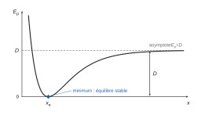
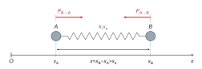
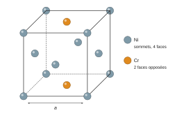
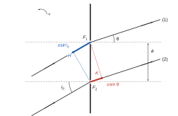
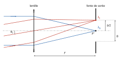

# CCINP TPC — Modélisation de systèmes physiques ou chimiques 2026 · Corrigé brut

*Corrigé rédigé par IA, non officiel. Signalez toute erreur.*

Épreuve TPC7MO, durée 4 h, calculatrice interdite. *Étude d'un spectrophotomètre infrarouge.*

## Partie I — Absorption vibrationnelle

### I.1 — Modèle classique de la vibration d'une molécule diatomique

#### Q1

L'argument d'une exponentielle est sans dimension : $\alpha(x - x_e)$ est sans dimension.

Comme $x$ est une longueur et que l'on retranche $x_e$ à $x$, $x_e$ est une longueur. Donc $\alpha$ est l'inverse d'une longueur.

Enfin $\bigl(1 - \mathrm{e}^{-\alpha(x-x_e)}\bigr)^2$ est sans dimension et $E_p$ est une énergie, donc $D$ est une énergie.

$$\boxed{\begin{aligned}
&D\ \text{en J}\ (\mathrm{kg\,m^2\,s^{-2}}) \\
&\alpha\ \text{en}\ \mathrm{m^{-1}} \\
&x_e\ \text{en m}
\end{aligned}}$$

#### Q2

Allure de la courbe (figure 1) : branche répulsive très raide aux petits $x$, minimum nul en $x = x_e$, puis croissance avec un point d'inflexion vers l'asymptote horizontale $E_p = D$.



En effet $E_p = D(1-u)^2 \ge 0$ avec $u = \mathrm{e}^{-\alpha(x - x_e)}$, et $E_p = 0 \iff u = 1 \iff x = x_e$.

La position d'équilibre est $x = x_e$ (où $\mathrm{d}E_p/\mathrm{d}x = 0$). **Cet équilibre est stable car $E_p$ y présente un minimum** : tout écart fait apparaître une force $-\mathrm{d}E_p/\mathrm{d}x$ qui ramène le système vers $x_e$.

#### Q3

$\alpha > 0$ donc $\mathrm{e}^{-\alpha(x - x_e)} \to 0$ quand $x \to +\infty$, et $E_p \to D$. Comme $E_p(x_e) = 0$,

$$\boxed{D = \lim_{x\to+\infty} E_p(x) - E_p(x_e)}$$

Sur l'axe des ordonnées, $D$ est l'ordonnée de l'asymptote horizontale (comptée depuis le fond du puits, d'ordonnée nulle) : c'est la profondeur du puits, énergie à fournir pour dissocier la molécule au repos en $x_e$.

#### Q4

Posons $u = \mathrm{e}^{-\alpha(x - x_e)}$, donc $u' = -\alpha u$ et $E_p = D(1-u)^2$.

$$\frac{\mathrm{d}E_p}{\mathrm{d}x} = 2D(1-u)(-u') = \boxed{2\alpha D\,\mathrm{e}^{-\alpha(x - x_e)}\left(1 - \mathrm{e}^{-\alpha(x - x_e)}\right)}$$

En dérivant $2\alpha D(u - u^2)$ :

$$\frac{\mathrm{d}^2E_p}{\mathrm{d}x^2} = 2\alpha D\,u'(1 - 2u) = -2\alpha^2 D\,u(1-2u)$$

$$\boxed{\frac{\mathrm{d}^2E_p}{\mathrm{d}x^2} = 2\alpha^2 D\,\mathrm{e}^{-\alpha(x - x_e)}\left(2\,\mathrm{e}^{-\alpha(x - x_e)} - 1\right)}$$

#### Q5

En $x = x_e$, $u = 1$ :

$$\boxed{\begin{aligned}
E_p(x_e) &= 0 \\
\left(\frac{\mathrm{d}E_p}{\mathrm{d}x}\right)(x_e) &= 0 \\
\left(\frac{\mathrm{d}^2E_p}{\mathrm{d}x^2}\right)(x_e) &= 2\alpha^2 D
\end{aligned}}$$

La dérivée seconde est strictement positive : on retrouve un minimum, donc un équilibre stable.

#### Q6

Le développement limité devient $E_p(x) \approx 0 + 0 + \frac12 (x - x_e)^2 \cdot 2\alpha^2 D$, soit $E_p(x) = \frac12 k (x - x_e)^2$ avec

$$\boxed{k = 2\alpha^2 D}$$

(homogène à des $\mathrm{J\,m^{-2}} = \mathrm{N\,m^{-1}}$, unité d'une raideur).

#### Q7

Système : atome $A$, de masse $m_A$, dans le référentiel d'étude galiléen. La molécule étant isolée, la seule force est celle de liaison, modélisée (énoncé) par un ressort de raideur $k$, de longueur à vide $x_e$ et de longueur $x = x_B - x_A$.

Loi de Hooke : la force exercée sur $A$ a pour norme $k|x - x_e|$. Elle est dirigée vers $B$ quand le ressort est étiré (figure 2) :

$$\vec F_{B\to A} = +k(x - x_e)\,\vec u_x$$

(l'expression algébrique reste valable si $x < x_e$ : le ressort comprimé repousse $A$ selon $-\vec u_x$).



La deuxième loi de Newton projetée sur $\vec u_x$ donne $m_A \ddot x_A = k(x - x_e)$ :

$$\boxed{\ddot x_A - \frac{k}{m_A}(x - x_e) = 0}\qquad (2)$$

#### Q8

Système : atome $B$, même référentiel.

$$\vec F_{A\to B} = -\vec F_{B\to A} = -k(x - x_e)\,\vec u_x$$

(troisième loi de Newton ; c'est aussi la loi de Hooke à l'autre extrémité du ressort). D'où $m_B \ddot x_B = -k(x - x_e)$ :

$$\boxed{\ddot x_B + \frac{k}{m_B}(x - x_e) = 0}\qquad (3)$$

**Le signe devant $k/m_B$ est le signe $+$.**

#### Q9

$$\begin{aligned}
\ddot x &= \ddot x_B - \ddot x_A \\
&= -\frac{k}{m_B}(x - x_e) - \frac{k}{m_A}(x - x_e) \\
&= -k\left(\frac{1}{m_A} + \frac{1}{m_B}\right)(x - x_e)
\end{aligned}$$

En posant $\dfrac{1}{\mu} = \dfrac{1}{m_A} + \dfrac{1}{m_B}$ et en multipliant par $\mu$ : $\mu \ddot x = -k(x - x_e)$, soit

$$\boxed{\begin{aligned}
\mu\ddot x + kx &= kx_e \\
\mu &= \frac{m_A m_B}{m_A + m_B}
\end{aligned}}$$

#### Q10

Avec $X = x - x_e$ : $\ddot X + \dfrac{k}{\mu} X = 0$, oscillateur harmonique de pulsation $\sqrt{k/\mu}$ :

$$\boxed{f_0 = \frac{1}{2\pi}\sqrt{\frac{k}{\mu}}}$$

#### Q11

Dans le vide $\lambda_0 = c/f_0$, donc

$$\boxed{\sigma_0 = \frac{f_0}{c} = \frac{1}{2\pi c}\sqrt{\frac{k}{\mu}}}$$

### Validité de la loi de Hooke sur la multiplicité de la liaison

#### Q12

Le point de masse $\mu$, d'abscisse $x$ comptée depuis le support $O$, est relié à $O$ par deux ressorts identiques de longueur $x$.

Ils ont donc le **même allongement** $x - x_e$ et exercent chacun la force $-k(x - x_e)\vec u_x$. La somme des forces vaut

$$\sum \vec F = -2k(x - x_e)\,\vec u_x$$

Un ressort unique équivalent exercerait $-k_{\text{éq},2}(x - x_e)\,\vec u_x$ ; par identification :

$$\boxed{k_{\text{éq},2} = 2k}$$

#### Q13

Par le même raisonnement (même allongement pour les trois ressorts, forces qui s'ajoutent) :

$$\boxed{k_{\text{éq},3} = 3k}$$

#### Q14

La masse réduite est la même (mêmes atomes) ; on remplace $k$ par la raideur équivalente dans Q11 :

$$\boxed{\begin{aligned}
\sigma_{0,2} &= \frac{1}{2\pi c}\sqrt{\frac{2k}{\mu}} \\
&= \sqrt2\,\sigma_0 \\
\sigma_{0,3} &= \frac{1}{2\pi c}\sqrt{\frac{3k}{\mu}} \\
&= \sqrt3\,\sigma_0
\end{aligned}}$$

#### Q15

Les trois liaisons relient les mêmes atomes C et N, donc $\mu$ est commun ; le nombre d'onde croît avec la multiplicité ($\sigma \propto \sqrt{p}$). On attribue par ordre croissant :

$$\boxed{\begin{aligned}
\text{C–N} &: 1{,}30\cdot10^3\ \mathrm{cm^{-1}} \\
\text{C=N} &: 1{,}65\cdot10^3\ \mathrm{cm^{-1}} \\
\text{C}\equiv\text{N} &: 2{,}20\cdot10^3\ \mathrm{cm^{-1}}
\end{aligned}}$$

Contrôle : $\sqrt2 \times 1{,}30\cdot10^3 \approx 1{,}84\cdot10^3$ et $\sqrt3 \times 1{,}30\cdot10^3 \approx 2{,}25\cdot10^3\ \mathrm{cm^{-1}}$. Le modèle donne le bon ordre ; il surestime la raideur de la double liaison (écart d'environ 11 %), la triple étant bien décrite (environ 2 %).

### I.2 — Modèle quantique

#### Q16

Avec $\psi(x,t) = \varphi(x)\,\mathrm{e}^{-\mathrm{i}Et/\hbar}$ :

$$\frac{\partial\psi}{\partial t} = -\frac{\mathrm{i}E}{\hbar}\psi$$

$$\frac{\partial^2\psi}{\partial x^2} = \varphi''(x)\,\mathrm{e}^{-\mathrm{i}Et/\hbar}$$

L'équation de Schrödinger donne

$$E\varphi(x)\,\mathrm{e}^{-\mathrm{i}Et/\hbar} = \left(-\frac{\hbar^2}{2\mu}\varphi''(x) + V(x)\varphi(x)\right)\mathrm{e}^{-\mathrm{i}Et/\hbar}$$

L'exponentielle ne s'annule pas ; on simplifie, et avec $V = \frac12\mu\omega_0^2 x^2$ :

$$\boxed{\frac{\mathrm{d}^2\varphi}{\mathrm{d}x^2} + \frac{2\mu}{\hbar^2}\left(E - \tfrac12 \mu\omega_0^2 x^2\right)\varphi(x) = 0}\qquad (6)$$

#### Q17

Formule de l'annexe appliquée en $a = x$, avec les accroissements $+\mathrm{d}x$ et $-\mathrm{d}x$ :

$$\boxed{\varphi(x + \mathrm{d}x) \approx \varphi(x) + \mathrm{d}x\,\varphi'(x) + \frac{\mathrm{d}x^2}{2}\varphi''(x)}$$

$$\boxed{\varphi(x - \mathrm{d}x) \approx \varphi(x) - \mathrm{d}x\,\varphi'(x) + \frac{\mathrm{d}x^2}{2}\varphi''(x)}$$

#### Q18

En sommant, les termes d'ordre 1 se compensent :

$$\varphi(x+\mathrm{d}x) + \varphi(x - \mathrm{d}x) \approx 2\varphi(x) + \mathrm{d}x^2\,\varphi''(x)$$

d'où

$$\boxed{\frac{\mathrm{d}^2\varphi}{\mathrm{d}x^2} = \frac{\varphi(x + \mathrm{d}x) - 2\varphi(x) + \varphi(x - \mathrm{d}x)}{\mathrm{d}x^2}}$$

#### Q19

Au point $x_i$, avec $\mathrm{d}x = \mathtt{Dx}$, $x_i \pm \mathtt{Dx} = x_{i\pm1}$ :

$$\boxed{\left(\frac{\mathrm{d}^2\varphi}{\mathrm{d}x^2}\right)_{x_i} = \frac{\varphi_{i+1} - 2\varphi_i + \varphi_{i-1}}{\mathtt{Dx}^2}}$$

valable pour $1 \le i \le N-2$.

#### Q20

L'équation (6) en $x_i$, avec $E = (n + \frac12)\hbar\omega_0$ et Q19 :

$$\begin{aligned}
\varphi_{i+1} - 2\varphi_i + \varphi_{i-1} &= \frac{2\mu}{\hbar^2}\left(\tfrac12\mu\omega_0^2 x_i^2 - (n + \tfrac12)\hbar\omega_0\right)\mathtt{Dx}^2\,\varphi_i \\
&= \frac{2\mu\omega_0}{\hbar^2}\left(\tfrac12\mu\omega_0 x_i^2 - (n + \tfrac12)\hbar\right)\mathtt{Dx}^2\,\varphi_i
\end{aligned}$$

d'où, en isolant $\varphi_{i+1}$ et en factorisant 2 :

$$\boxed{\varphi_{i+1} = 2\left[1 + \frac{\mu\omega_0}{\hbar^2}\left(\tfrac12\mu\omega_0 x_i^2 - (n + \tfrac12)\hbar\right)\mathtt{Dx}^2\right]\varphi_i - \varphi_{i-1}}\qquad (7)$$

#### Q21

$V(L) = E(5)$ s'écrit $\frac12\mu\omega_0^2 L^2 = \frac{11}{2}\hbar\omega_0$, d'où ($L > 0$)

$$\boxed{L = \sqrt{\frac{11\hbar}{\mu\omega_0}}}$$

AN de contrôle, avec $\mu\omega_0 = 10^{-14}$ SI :

$$\begin{aligned}
L &= \sqrt{11 \times 1{,}05\cdot10^{-34}/10^{-14}} \\
&= \sqrt{1{,}155\cdot10^{-19}} \\
&\approx 3{,}4\cdot10^{-10}\ \mathrm{m}
\end{aligned}$$

cohérent avec la figure 7.

```python
L = np.sqrt(11 * hbar / (mu * omega0))          # Q21
```

#### Q22

```python
X = np.linspace(-L, L, N)                       # Q22
```

#### Q23

$N$ points délimitent $N - 1$ intervalles sur une longueur $2L$ :

```python
Dx = X[1] - X[0]                                # Q23  (ou Dx = 2 * L / (N - 1))
```

#### Q24

```python
    phi = np.zeros(N)                           # Q24 : phi(x_0) = 0 déjà réalisé
    phi[1] = 1                                  # Q24 : phi(x_1) = 1
```

#### Q25

La récurrence remplit $\varphi_{i+1}$ pour $i$ de 1 à $N-2$ :

```python
    for i in range(1, N - 1):                   # Q25
        phi[i + 1] = 2 * (1 + mu * omega0 / hbar**2 * (0.5 * mu * omega0 * X[i]**2 - (n + 0.5) * hbar) * Dx**2) * phi[i] - phi[i - 1]   # Q25
```

(On utilise `X[i]` et non `i*Dx`, puisque `X` commence à $-L$.) Le programme complété reproduit la figure 7 (maximum de $\varphi_0$ voisin de $7{,}4\cdot10^4\ \mathrm{m^{-1/2}}$).

#### Q26

$|\varphi(x)|^2\,\mathrm{d}x$ est la probabilité de trouver la particule entre $x$ et $x + \mathrm{d}x$. $K = 1$ est la **condition de normalisation** : **la probabilité de trouver la particule dans l'intervalle $[-L, L]$, où elle est localisée, vaut 1 (événement certain).**

#### Q27

Méthode des rectangles à gauche sur les $N-1$ intervalles, de largeur constante $\mathtt{Dx}$ : $K \approx \mathtt{Dx}\sum_{i=0}^{N-2}|\varphi_i|^2$.

```python
    I = np.sum([abs(phi[i])**2 for i in range(N-1)]) * Dx      # Q27
```

La ligne 26 divise alors `phi` par $\sqrt{I}$, ce qui rend l'intégrale égale à 1.

## Partie II — Principe de fonctionnement d'un spectrophotomètre infrarouge

### II.1 — Étude de la source infrarouge

#### Q28

$Z = 28$, règle de Klechkowski :

$$\boxed{\mathrm{Ni} : 1s^2\,2s^2\,2p^6\,3s^2\,3p^6\,4s^2\,3d^8 = [\mathrm{Ar}]\,4s^2\,3d^8}$$

$n_{\max} = 4$ : **4ᵉ période** ; bloc $d$ avec $2 + 8 = 10$ électrons de valence ($4s$ et $3d$) : **groupe 10**.

#### Q29

CFC : $8 \times \frac18 = 1$ atome aux sommets, $6 \times \frac12 = 3$ aux centres des faces. Les deux centres de faces opposées occupés par Cr comptent $2 \times \frac12 = 1$ ; il reste $1 + 4 \times \frac12 = 3$ Ni.

$$\boxed{1\ \text{atome de Cr et 3 atomes de Ni par maille (}\mathrm{Ni_3Cr}\text{)}}$$



#### Q30

Masse d'une maille : $\dfrac{3M_{\mathrm{Ni}} + M_{\mathrm{Cr}}}{N_A}$ ; volume $a^3$. Donc

$$\mu_{\mathrm{NiCr}} = \frac{3M_{\mathrm{Ni}} + M_{\mathrm{Cr}}}{N_A a^3}$$

d'où

$$\boxed{a = \left(\frac{3M_{\mathrm{Ni}} + M_{\mathrm{Cr}}}{\mu_{\mathrm{NiCr}}\,N_A}\right)^{1/3}}$$

#### Q31

Dans une structure CFC d'atomes identiques, les plus proches voisins sont un sommet et le centre d'une face adjacente, distants d'une demi-diagonale de face (le contact se fait le long de la diagonale de face) :

$$\begin{aligned}
d &= \frac{a\sqrt2}{2} \\
&= \frac{a}{\sqrt2} \\
&= \frac{350}{\sqrt2}\ \mathrm{pm}
\end{aligned}$$

$$\boxed{d \approx 247\ \mathrm{pm}}$$

#### Q32

Effet Joule : $P_{\text{élec}} = RI^2$ avec $R = \dfrac{4L}{\gamma\pi D^2}$ :

$$\boxed{P_{\text{élec}} = \frac{4LI^2}{\gamma\pi D^2}}$$

#### Q33

Surface d'échange : surface latérale $S = \pi DL$ (extrémités négligées, $L \gg D$). Le filament émet $\sigma T_s^4$ par unité de surface et reçoit $\sigma T_a^4$ du gaz. Puissance nette cédée par le filament au gaz :

$$\boxed{P_{\text{ray}} = \sigma\pi DL\left(T_s^4 - T_a^4\right)}$$

#### Q34

$$\boxed{P_{\text{conv}} = h\pi DL\,(T_s - T_a)}$$

comptée elle aussi du filament vers le gaz.

#### Q35

En régime permanent (température $T_s$ atteinte), l'énergie interne du filament est constante : $P_{\text{élec}} = P_{\text{ray}} + P_{\text{conv}}$, soit

$$\frac{4LI^2}{\gamma\pi D^2} = \pi DL\left[\sigma(T_s^4 - T_a^4) + h(T_s - T_a)\right]$$

En divisant par $\pi DL$ :

$$\frac{4I^2}{\gamma\pi^2 D^3} = \sigma T_s^4 - \sigma T_a^4 + hT_s - hT_a$$

d'où

$$\boxed{\sigma T_a^4 + hT_a = \sigma T_s^4 + hT_s - \frac{4I^2}{\gamma\pi^2 D^3}}\qquad (8)$$

#### Q36

$f(T) = \sigma T^4 + hT - \sigma T_s^4 - hT_s + \dfrac{4I^2}{\gamma\pi^2 D^3}$, continue et strictement croissante sur $\mathbb{R}^+$. Le code 2 n'importe rien : on ajoute `from math import pi` en tête du programme.

```python
def f(T):
    return sigma * T**4 + h * T - sigma * Ts**4 - h * Ts + 4 * I**2 / (gamma * pi**2 * D**3)   # Q36
```

#### Q37

```python
def dichotomie(f, a, b, eps):                   # Q37
    while b - a > eps:
        m = (a + b) / 2
        if f(m) == 0:
            return m
        if f(a) * f(m) > 0:     # même signe : la racine est dans [m, b]
            a = m
        else:                   # sinon elle est dans [a, m]
            b = m
    return (a + b) / 2
```

Invariant : $f(a)$ et $f(b)$ sont de signes opposés, la racine est dans $[a, b]$. La largeur est divisée par 2 à chaque tour : de $702$ K à moins de 1 K en 10 itérations ; le résultat est à moins de $\varepsilon/2$ de la racine.

#### Q38

$T_a \approx 986$ K est **inférieure** à $T_s = 1{,}00\cdot10^3$ K, comme il se doit (le filament chauffe le gaz ; $f(T_s) > 0$), et comprise dans l'intervalle de recherche $[298, 1000]$ K. L'écart n'est que d'environ 14 K, soit 1,4 % de $T_s$ : le gaz est presque à la température du filament.

Ordres de grandeur :

$$\begin{aligned}
\frac{4I^2}{\gamma\pi^2 D^3} &= \frac{4 \times 625}{10^7 \times \pi^2 \times 8\cdot10^{-9}} \\
&\approx 3{,}2\cdot10^3\ \mathrm{W\,m^{-2}}
\end{aligned}$$

C'est petit devant $\sigma T_s^4 = 5{,}67\cdot10^4\ \mathrm{W\,m^{-2}}$ : un faible écart de température suffit à évacuer la puissance Joule.

Le flux conducto-convectif $h(T_s - T_a) \approx 14\ \mathrm{W\,m^{-2}}$ ne représente que 0,4 % du total : **l'échange est presque exclusivement radiatif** car $h = 1\ \mathrm{W\,m^{-2}\,K^{-1}}$ est très faible.

La valeur est donnée à $\varepsilon = 1$ K près (trois chiffres significatifs, cohérents avec les données) ; l'écart $T_s - T_a$ est en revanche très sensible aux données (une variation de 0,5 % de $T_s$ déplace $T_a$ d'environ 5 K). Une température de gaz aussi élevée traduit les limites du modèle (gaz assimilé à un corps noir isotherme, sans autre perte vers les parois).

### II.2 — Monochromateur à réseau

#### Q39

Repère : $\vec u_x$ normal au réseau dans le sens de propagation, $\vec u_y$ le long du réseau dirigé de la fente $F_2$ (rayon 2) vers la fente $F_1$ (rayon 1). Les angles sont orientés positivement dans le sens de la figure 9.

Directions incidente et diffractée, et vecteur entre fentes :

$$\begin{aligned}
\vec u_i &= \cos i_0\,\vec u_x + \sin i_0\,\vec u_y \\
\vec u_d &= \cos\theta\,\vec u_x + \sin\theta\,\vec u_y \\
\overrightarrow{F_1F_2} &= -a\,\vec u_y
\end{aligned}$$

On prend un plan d'onde incident (perpendiculaire à $\vec u_i$) et un plan d'onde diffracté (perpendiculaire à $\vec u_d$), communs aux deux rayons. Par rapport au rayon (1), le rayon (2) parcourt avant le réseau le chemin supplémentaire $\vec u_i\cdot\overrightarrow{F_1F_2}$, et après le réseau le chemin supplémentaire $-\vec u_d\cdot\overrightarrow{F_1F_2}$. Dans l'air (indice 1) :

$$\begin{aligned}
\delta_{2/1} &= (\vec u_i - \vec u_d)\cdot\overrightarrow{F_1F_2} \\
&= -a(\sin i_0 - \sin\theta)
\end{aligned}$$

$$\boxed{\delta_{2/1} = a\left(\sin\theta - \sin i_0\right)}$$



#### Q40

(9) s'écrit $a(\sin\theta - \sin i_0) = -\lambda$, soit $\delta_{2/1} = p\lambda$ avec $p = -1$.

**C'est la condition d'interférences constructives entre les ondes issues de toutes les fentes (différence de marche multiple entier de $\lambda$ entre fentes consécutives) : la direction $\theta$ est celle d'un maximum principal de diffraction d'ordre $-1$ pour la longueur d'onde $\lambda$.**

Cette direction dépend de $\lambda$ : le réseau disperse la lumière.

#### Q41

Les rayons qui convergent au foyer image $F'$ d'une lentille convergente sont ceux qui arrivent parallèlement à l'axe optique ; la lentille étant parallèle au réseau, son axe est normal au réseau :

$$\boxed{\theta = 0}$$

Alors (9) donne $0 = \sin i_0 - \lambda_0/a$ :

$$\boxed{i_0 = \arcsin\left(\frac{\lambda_0}{a}\right)}$$

qui n'existe que si $\lambda_0 \le a = 3{,}33\ \mu$m, soit $\sigma_0 \ge 3{,}0\cdot10^3\ \mathrm{cm^{-1}}$ (avec ce réseau, la zone 1500–3000 cm⁻¹ étudiée plus loin ne serait pas accessible à l'ordre −1 dans cette configuration : incohérence de données de l'énoncé).

#### Q42

Dans les conditions de Gauss, un faisceau parallèle incliné de $\theta$ sur l'axe converge dans le plan focal image au point d'abscisse $x = f'\tan\theta \approx f'\theta$. La fente de largeur $b$, centrée sur $F'$, a son bord supérieur en $x = b/2$ :

$$\boxed{\theta_\ell = \frac{b}{2f'}}$$

AN : $\theta_\ell = 5\cdot10^{-4}$ rad, angle très petit (conditions de Gauss vérifiées).



#### Q43

(9) en $\theta_\ell$ : $\lambda_\ell = a(\sin i_0 - \sin\theta_\ell)$, avec $\sin i_0 = \lambda_0/a$ et $\sin\theta_\ell \approx \theta_\ell = b/(2f')$ :

$$\boxed{\lambda_\ell = \lambda_0 - \frac{ab}{2f'}}$$

Le bord inférieur ($-\theta_\ell$) correspond à $\lambda_0 + \dfrac{ab}{2f'}$. Les longueurs d'onde qui atteignent la fente occupent l'intervalle de largeur

$$\boxed{\Delta\lambda = \frac{ab}{f'}}$$

AN : $a = \dfrac{1}{3\cdot10^2}\ \mathrm{mm} = 3{,}33\ \mu\mathrm{m}$, $b = 0{,}1$ mm, $f' = 100$ mm :

$$\Delta\lambda = \frac{3{,}33\cdot10^{-3} \times 0{,}1}{100}\ \mathrm{mm}$$

$$\boxed{\Delta\lambda \approx 3{,}3\ \mathrm{nm}}$$

**Cette valeur est en bon accord avec la largeur spectrale de 3 nm annoncée par la notice** : la largeur de la fente de sortie suffit à expliquer la résolution du constructeur (la précision et la reproductibilité de ±2 nm relèvent du positionnement du réseau, pas de ce calcul).

#### Q44

La transmittance est le rapport de l'intensité transmise par l'échantillon à une intensité de **référence** (blanc, ligne de base) mesurée séparément. Pour un milieu qui ne fait qu'absorber, $T \le 100$ % et $A \ge 0$. **Les valeurs $T > 100$ % (par exemple 102,2 % à 1536 cm⁻¹) sont des artefacts de mesure** dans des zones où la solution n'absorbe pas : bruit du détecteur, dérive de la source entre la mesure de référence et celle de l'échantillon, ou absorption parasite (vapeur d'eau, CO₂, solvant, cuve) plus forte lors de la référence que lors de la mesure. L'absorbance vraie y est nulle et le signal fluctue de quelques pour cent autour de 0.

#### Q45

`np.loadtxt` renvoie un tableau à deux dimensions (une ligne par point de mesure, deux colonnes ; la ligne d'en-tête commençant par `#` est ignorée).

- Ligne 5 : `s = data[:, 0]` extrait la première colonne (toutes les lignes, colonne 0) : tableau des **nombres d'onde** en $\mathrm{cm^{-1}}$.
- Ligne 6 : `T = data[:, 1]` extrait la seconde colonne : tableau des **transmittances**, en pourcentage.

Les deux tableaux ont la même indexation : `s[i]` et `T[i]` se rapportent au même point (ce qu'exploite la ligne 19).

#### Q46

$\log$ est le logarithme décimal (`np.log10` de l'annexe) et $T$ est donné en pourcentage :

```python
A = -np.log10(T / 100)                          # Q46
```

#### Q47

Un pic est un maximum local strict ($A_i > A_{i-1}$ et $A_i > A_{i+1}$), d'indice $1 \le i \le n-2$, dont le pourcentage d'absorption atteint le seuil. Avec l'absorbance de Q46, le pourcentage de lumière absorbée vaut $100(1 - 10^{-A_i}) = 100 - T_i$ (c'est la grandeur tracée sur la figure 11) :

```python
    for i in range(1, n - 1):                                                   # Q47
        if A[i] > A[i - 1] and A[i] > A[i + 1] and 100 * (1 - 10**(-A[i])) >= p_abs:   # Q47
            pics.append(i)                                                      # Q47
```

Variante équivalente : si l'on stocke à la ligne 7 le pourcentage absorbé `A = 100 - T`, le troisième test devient `A[i] >= p_abs` ; les maxima locaux sont les mêmes (fonctions décroissantes de $T$), le tableau d'indices aussi (`[45 61 103]`, soit 2042, 2235 et 2741 cm⁻¹).

**FIN**
