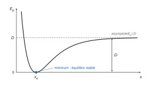
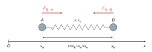
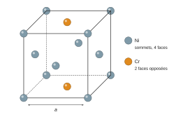
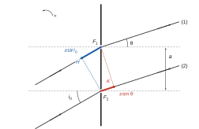
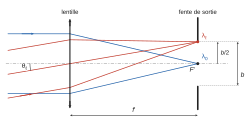

# CCINP TPC — Modélisation de systèmes physiques ou chimiques 2026 · Corrigé guidé

*Corrigé rédigé par IA, non officiel. Signalez toute erreur.*

## Présentation du sujet

L'épreuve (TPC7MO, 4 heures, **calculatrices interdites**) porte sur l'**étude d'un spectrophotomètre infrarouge**. Elle comporte **47 questions** réparties en deux parties indépendantes, suivies d'une annexe qui rappelle le développement limité à l'ordre 2 et les commandes `numpy` utiles (`zeros`, `linspace`, `sum`, `sqrt`, `abs`, `log`, `log10`, `loadtxt`). Les applications numériques sont peu nombreuses et calibrées pour être faites à la main (aides au calcul fournies en Q31).

**Partie I — Absorption vibrationnelle (Q1 à Q27).** Pourquoi une liaison absorbe-t-elle à un nombre d'onde précis ?

- **I.1 — Modèle classique (Q1 à Q15).** Potentiel de Morse : unités, allure, position d'équilibre, profondeur du puits (Q1–Q3) ; dérivées et approximation harmonique, $k = 2\alpha^2 D$ (Q4–Q6) ; lois de Newton sur les deux atomes, masse réduite, fréquence propre et nombre d'onde d'absorption (Q7–Q11) ; liaisons multiples modélisées par des ressorts en parallèle et attribution de trois nombres d'onde C–N, C=N, C≡N (Q12–Q15).
- **I.2 — Modèle quantique (Q16 à Q27).** Équation de Schrödinger stationnaire pour l'oscillateur harmonique (Q16) ; schéma aux différences finies centrées et récurrence à trois termes (Q17–Q20) ; complétion du code Python 1 (Q21–Q25, Q27) ; normalisation de la fonction d'onde (Q26).

**Partie II — Principe de fonctionnement du spectrophotomètre (Q28 à Q47).**

- **II.1 — Source infrarouge (Q28 à Q38).** Configuration électronique du nickel (Q28) ; maille CFC substituée Ni₃Cr, paramètre de maille, distance entre voisins (Q29–Q31) ; bilan thermique d'un filament chauffé par effet Joule et refroidi par rayonnement et conducto-convection (Q32–Q35) ; résolution par dichotomie en Python et commentaire du résultat (Q36–Q38).
- **II.2 — Monochromateur à réseau (Q39 à Q47).** Différence de marche entre fentes consécutives, ordre −1 (Q39–Q40) ; sélection de $\lambda_0$ au foyer d'une lentille, résolution spectrale due à la largeur de la fente de sortie, comparaison à la notice (Q41–Q43) ; lecture d'un spectre et d'un fichier de mesures, calcul de l'absorbance et détection automatique des pics (Q44–Q47).

**Notions mobilisées.** Analyse dimensionnelle, énergie potentielle et stabilité, développement limité, lois de Newton, oscillateur harmonique ; interprétation probabiliste de la fonction d'onde ; atomistique et cristallographie (CFC) ; effet Joule et bilan de puissance en régime permanent ; interférences (différence de marche entre plans d'onde) et optique géométrique (foyer image, conditions de Gauss) ; Python : tableaux `numpy`, boucles et indices, méthode des rectangles, dichotomie, recherche de maxima locaux.

**Difficulté et gestion du temps.** Sujet long mais très guidé : beaucoup de « montrer que » avec le résultat donné, ce qui permet de ne jamais rester bloqué. Les points faciles à ne pas laisser passer : Q1, Q3, Q5, Q10–Q14, Q22–Q24, Q26, Q28–Q32, Q34, Q41, Q45. Les questions de code (Q21–Q27, Q36–Q37, Q46–Q47) demandent une attention particulière aux **indices** et aux **bornes de boucle**. Compter environ 1 h 45 pour la partie I et 2 h pour la partie II, en gardant un quart d'heure pour relire les codes.

## Partie I — Absorption vibrationnelle

### I.1 — Modèle classique de la vibration d'une molécule diatomique

On remplace la liaison par un potentiel de Morse, on l'approche par un ressort au voisinage de l'équilibre, puis on réduit le problème à deux corps à un oscillateur unique de masse réduite $\mu$. Outils : analyse dimensionnelle, dérivation, développement limité, deuxième et troisième lois de Newton.

### Question 1

> [!INDICATION]
> Que peut-on dire de l'argument d'une exponentielle ? Et de deux termes que l'on additionne ?

> [!INDICATION]
> Commencez par $\alpha$ et $x_e$ à partir de l'exposant, puis déduisez $D$ de la dimension de $E_p$.

#### Solution

L'argument d'une exponentielle est sans dimension : $\alpha(x - x_e)$ est sans dimension.

On retranche $x_e$ à la longueur $x$ : $x_e$ est une longueur, et $\alpha$ est donc l'inverse d'une longueur.

Le facteur $\bigl(1 - \mathrm{e}^{-\alpha(x - x_e)}\bigr)^2$ est sans dimension et $E_p$ est une énergie : $D$ est une énergie.

$$\boxed{\begin{aligned}
&D\ \text{en J}\ (\mathrm{kg\,m^2\,s^{-2}}) \\
&\alpha\ \text{en}\ \mathrm{m^{-1}} \\
&x_e\ \text{en m}
\end{aligned}}$$

> [!PIEGE]
> La question demande les unités du Système International : répondre en eV ou en cm⁻¹, unités pourtant courantes en spectroscopie, ne répond pas à la question.

### Question 2

> [!INDICATION]
> Écrivez $E_p = D(1-u)^2$ avec $u = \mathrm{e}^{-\alpha(x - x_e)}$ : quel est le signe de $E_p$, quand s'annule-t-elle ?

> [!INDICATION]
> Étudiez la limite en $+\infty$ et le comportement aux petites distances ; un équilibre est stable si l'énergie potentielle y est minimale.

#### Solution

Allure de la courbe (figure 1) : branche très raide aux petits $x$ (répulsion des noyaux), minimum nul en $x = x_e$, puis croissance avec un point d'inflexion vers l'asymptote horizontale $E_p = D$.



En effet, $E_p = D(1 - u)^2 \ge 0$ et $E_p = 0 \iff u = 1 \iff x = x_e$, puisque $u$ est strictement décroissante ($\alpha > 0$).

La position d'équilibre est $x = x_e$, abscisse du minimum, où $\mathrm{d}E_p/\mathrm{d}x = 0$. **L'équilibre est stable car $E_p$ y est minimale** : un écart à $x_e$ fait apparaître une force $-\mathrm{d}E_p/\mathrm{d}x$ qui ramène le système vers $x_e$.

> [!PIEGE]
> « La dérivée est nulle » caractérise l'équilibre, pas sa stabilité. C'est le caractère de minimum (dérivée seconde positive, calculée en Q5) qui donne la stabilité. Et la courbe ne passe jamais sous l'axe des abscisses : $E_p \ge 0$.

### Question 3

> [!INDICATION]
> Que vaut $E_p$ quand les deux atomes sont infiniment éloignés ?

#### Solution

Comme $\alpha > 0$, $\mathrm{e}^{-\alpha(x - x_e)} \to 0$ quand $x \to +\infty$, donc $E_p \to D$. Avec $E_p(x_e) = 0$ :

$$\boxed{D = \lim_{x\to+\infty} E_p(x) - E_p(x_e)}$$

Sur l'axe des ordonnées, $D$ est l'ordonnée de l'asymptote horizontale, mesurée depuis le fond du puits (d'ordonnée nulle). C'est la profondeur du puits, c'est-à-dire l'énergie à fournir à la molécule au repos en $x_e$ pour séparer les deux atomes.

> [!METHODE]
> Pour lire une constante sur un graphe d'énergie potentielle, passer par les limites et la valeur au minimum : la justification demandée, c'est ce calcul de limite.

### Question 4

> [!INDICATION]
> Posez $u(x) = \mathrm{e}^{-\alpha(x - x_e)}$ et exprimez $u'$ en fonction de $u$.

> [!INDICATION]
> Pour la dérivée seconde, écrivez la dérivée première comme un polynôme en $u$ et dérivez à nouveau.

#### Solution

Avec $u = \mathrm{e}^{-\alpha(x - x_e)}$, $u' = -\alpha u$ et $E_p = D(1 - u)^2$ :

$$\begin{aligned}
\frac{\mathrm{d}E_p}{\mathrm{d}x} &= 2D(1 - u)(-u') \\
&= 2\alpha D\,u(1 - u) \\
&= 2\alpha D\,\mathrm{e}^{-\alpha(x - x_e)}\left(1 - \mathrm{e}^{-\alpha(x - x_e)}\right)
\end{aligned}$$

C'est la relation annoncée. Puis, avec $\dfrac{\mathrm{d}E_p}{\mathrm{d}x} = 2\alpha D(u - u^2)$ :

$$\frac{\mathrm{d}^2E_p}{\mathrm{d}x^2} = 2\alpha D\,u'(1 - 2u) = -2\alpha^2 D\,u(1 - 2u)$$

$$\boxed{\frac{\mathrm{d}^2E_p}{\mathrm{d}x^2} = 2\alpha^2 D\,\mathrm{e}^{-\alpha(x - x_e)}\left(2\,\mathrm{e}^{-\alpha(x - x_e)} - 1\right)}$$

> [!METHODE]
> Contrôle immédiat : en $x = x_e$, la dérivée première doit s'annuler et la dérivée seconde être positive (minimum). Un signe faux sur $u'$ se détecte ainsi tout de suite.

### Question 5

> [!INDICATION]
> En $x = x_e$, que vaut l'exponentielle ?

#### Solution

En $x = x_e$, $u = 1$ :

$$\boxed{\begin{aligned}
E_p(x_e) &= 0 \\
\left(\frac{\mathrm{d}E_p}{\mathrm{d}x}\right)(x_e) &= 0 \\
\left(\frac{\mathrm{d}^2E_p}{\mathrm{d}x^2}\right)(x_e) &= 2\alpha^2 D
\end{aligned}}$$

La dérivée première nulle confirme l'équilibre ; la dérivée seconde strictement positive confirme le minimum, donc la stabilité (Q2).

### Question 6

> [!INDICATION]
> Reportez les trois valeurs de Q5 dans le développement limité de l'énoncé et identifiez.

#### Solution

Les deux premiers termes du développement sont nuls : $E_p(x) \approx \frac12 (x - x_e)^2 \times 2\alpha^2 D$. Par identification avec $\frac12 k(x - x_e)^2$ :

$$\boxed{k = 2\alpha^2 D}$$

Homogénéité : $[\alpha^2 D] = \mathrm{J\,m^{-2}} = \mathrm{N\,m^{-1}}$, unité d'une raideur.

> [!PIEGE]
> Oublier le facteur $\frac12$ du développement, ou le compter deux fois, donne $\alpha^2 D$ ou $4\alpha^2 D$ : l'analyse dimensionnelle ne détecte pas cette erreur.

### Question 7

> [!INDICATION]
> Précisez système, référentiel et bilan des forces. La molécule est isolée : quelle est la seule force sur $A$ ?

> [!INDICATION]
> L'énoncé assimile la liaison à un ressort de raideur $k$ et de longueur à vide $x_e$ : écrivez la force de rappel (loi de Hooke) sur $A$, en raisonnant sur un ressort étiré.

#### Solution

Système : l'atome $A$, de masse $m_A$, dans le référentiel d'étude supposé galiléen. La molécule est isolée : seule agit la force de liaison, modélisée par un ressort de raideur $k$, de longueur à vide $x_e$ et de longueur $x = x_B - x_A$.

Loi de Hooke : quand le ressort est étiré, il tire $A$ vers $B$, dans le sens $+\vec u_x$, avec une norme $k(x - x_e)$ (figure 2) :

$$\vec F_{B\to A} = +k(x - x_e)\,\vec u_x$$

L'expression algébrique vaut aussi pour $x < x_e$ (ressort comprimé, force selon $-\vec u_x$).



La deuxième loi de Newton projetée sur $\vec u_x$ donne $m_A\ddot x_A = k(x - x_e)$, soit

$$\boxed{\ddot x_A - \frac{k}{m_A}(x - x_e) = 0}\qquad (2)$$

> [!JURY]
> Pour une application des lois de Newton, il faut écrire explicitement le système, le référentiel et le bilan des forces : ce sont des étapes de rédaction attendues.

### Question 8

> [!INDICATION]
> Même démarche pour $B$ ; la troisième loi de Newton vous donne directement la force.

#### Solution

Système : l'atome $B$, même référentiel. Par la troisième loi de Newton (ou la loi de Hooke à l'autre extrémité du ressort) :

$$\vec F_{A\to B} = -\vec F_{B\to A} = -k(x - x_e)\,\vec u_x$$ La deuxième loi donne $m_B\ddot x_B = -k(x - x_e)$ :

$$\boxed{\ddot x_B + \frac{k}{m_B}(x - x_e) = 0}\qquad (3)$$

**Le signe devant $k/m_B$ est le signe $+$.**

> [!PIEGE]
> La question demande explicitement de préciser le signe : il faut l'écrire en toutes lettres. Les deux forces étant opposées, les signes devant $k/m_A$ et $k/m_B$ sont nécessairement opposés.

### Question 9

> [!INDICATION]
> Formez $\ddot x = \ddot x_B - \ddot x_A$ à partir de (2) et (3).

> [!INDICATION]
> Faites apparaître la somme $\frac{1}{m_A} + \frac{1}{m_B}$ et nommez son inverse.

#### Solution

D'après (2) et (3) :

$$\begin{aligned}
\ddot x &= \ddot x_B - \ddot x_A \\
&= -\frac{k}{m_B}(x - x_e) - \frac{k}{m_A}(x - x_e) \\
&= -k\left(\frac{1}{m_A} + \frac{1}{m_B}\right)(x - x_e)
\end{aligned}$$

Avec $\dfrac{1}{\mu} = \dfrac{1}{m_A} + \dfrac{1}{m_B}$, on obtient $\mu\ddot x = -k(x - x_e)$, soit

$$\boxed{\begin{aligned}
\mu\ddot x + kx &= kx_e \\
\mu &= \frac{m_A m_B}{m_A + m_B}
\end{aligned}}$$

> [!METHODE]
> Contrôles sur la masse réduite : homogène à une masse, et $\mu \to m_A$ si $m_B \gg m_A$ (l'atome lourd reste quasi fixe, seul l'atome léger vibre).

### Question 10

> [!INDICATION]
> Changez de variable pour faire disparaître le second membre et reconnaissez une équation canonique.

#### Solution

Avec $X = x - x_e$ (constante $x_e$, donc $\ddot X = \ddot x$) :

$$\ddot X + \frac{k}{\mu}X = 0$$

C'est l'équation d'un oscillateur harmonique de pulsation propre $\sqrt{k/\mu}$ ; la fréquence est

$$\boxed{f_0 = \frac{1}{2\pi}\sqrt{\frac{k}{\mu}}}$$

> [!PIEGE]
> L'énoncé demande la fréquence, pas la pulsation : le facteur $2\pi$ compte et se propage jusqu'à Q15.

### Question 11

> [!INDICATION]
> Reliez longueur d'onde et fréquence d'une onde électromagnétique dans le vide.

#### Solution

Dans le vide, $\lambda_0 = c/f_0$, donc

$$\boxed{\begin{aligned}
\sigma_0 &= \frac{1}{\lambda_0} \\
&= \frac{f_0}{c} \\
&= \frac{1}{2\pi c}\sqrt{\frac{k}{\mu}}
\end{aligned}}$$

Homogénéité : $\sqrt{k/\mu}$ est en $\mathrm{s^{-1}}$ et $c$ en $\mathrm{m\,s^{-1}}$.

Donc $\sigma_0$ est en $\mathrm{m^{-1}}$ (les spectroscopistes utilisent le $\mathrm{cm^{-1}}$).

### Validité de la loi de Hooke sur la multiplicité de la liaison

On teste un modèle naïf : une liaison double ou triple vaut deux ou trois ressorts identiques en parallèle.

### Question 12

> [!INDICATION]
> Les deux ressorts sont fixés aux deux mêmes points : que dire de leurs allongements ?

> [!INDICATION]
> Sommez les deux forces et identifiez à la force d'un ressort unique de même longueur à vide.

#### Solution

Repérons le point de masse $\mu$ par son abscisse $x$ depuis le support fixe $O$. Les deux ressorts ont la longueur $x$, donc le **même allongement** $x - x_e$ : chacun exerce $-k(x - x_e)\vec u_x$. La somme des forces vaut

$$\sum\vec F = -2k(x - x_e)\,\vec u_x$$

Un ressort unique de raideur $k_{\text{éq},2}$ et de longueur à vide $x_e$ exercerait $-k_{\text{éq},2}(x - x_e)\vec u_x$ ; en identifiant :

$$\boxed{k_{\text{éq},2} = 2k}$$

> [!PIEGE]
> En parallèle, c'est l'allongement qui est commun et les raideurs s'ajoutent ; en série, c'est la force qui est commune et ce sont les inverses des raideurs qui s'ajoutent.

### Question 13

> [!INDICATION]
> Même raisonnement avec trois ressorts.

#### Solution

Les trois ressorts ont le même allongement ; leurs forces s'ajoutent :

$$\boxed{k_{\text{éq},3} = 3k}$$

### Question 14

> [!INDICATION]
> Dans l'expression de Q11, qu'est-ce qui change d'une liaison à l'autre entre les mêmes atomes, et qu'est-ce qui ne change pas ?

#### Solution

La masse réduite ne dépend que des atomes, elle est inchangée ; on remplace $k$ par la raideur équivalente :

$$\boxed{\begin{aligned}
\sigma_{0,2} &= \frac{1}{2\pi c}\sqrt{\frac{2k}{\mu}} \\
&= \sqrt2\,\sigma_0 \\
\sigma_{0,3} &= \frac{1}{2\pi c}\sqrt{\frac{3k}{\mu}} \\
&= \sqrt3\,\sigma_0
\end{aligned}}$$

Le nombre d'onde croît comme la racine de la multiplicité.

### Question 15

> [!INDICATION]
> Les trois liaisons relient les mêmes atomes : comment se classent leurs nombres d'onde d'après Q14 ?

> [!INDICATION]
> Après l'attribution, testez quantitativement le modèle en partant de la liaison simple.

#### Solution

C–N, C=N et C≡N relient les mêmes atomes : $\mu$ est commun et le nombre d'onde croît avec la multiplicité. Par ordre croissant :

$$\boxed{\begin{aligned}
\text{C–N} &: 1{,}30\cdot10^3\ \mathrm{cm^{-1}} \\
\text{C=N} &: 1{,}65\cdot10^3\ \mathrm{cm^{-1}} \\
\text{C}\equiv\text{N} &: 2{,}20\cdot10^3\ \mathrm{cm^{-1}}
\end{aligned}}$$

Test du modèle : à partir de $1{,}30\cdot10^3$, il prédit $\sqrt2 \times 1{,}30\cdot10^3 \approx 1{,}84\cdot10^3$ et $\sqrt3 \times 1{,}30\cdot10^3 \approx 2{,}25\cdot10^3\ \mathrm{cm^{-1}}$. L'ordre est correct, la triple liaison bien décrite (écart d'environ 2 %), la double surestimée (environ 11 %) : une liaison $\pi$ n'équivaut pas à une liaison $\sigma$.

> [!METHODE]
> Confronter la prédiction d'un modèle à la mesure et en énoncer les limites est la démarche de modélisation attendue ; quelques lignes suffisent.

### I.2 — Modèle quantique

On résout numériquement l'équation de Schrödinger stationnaire de l'oscillateur harmonique : la dérivée seconde est remplacée par une différence finie, ce qui donne une récurrence à trois termes que le code Python 1 calcule, avant normalisation.

### Question 16

> [!INDICATION]
> Injectez la forme $\psi = \varphi(x)\,\mathrm{e}^{-\mathrm{i}Et/\hbar}$ dans l'équation de Schrödinger : sur quelle fonction porte chaque dérivée ?

> [!INDICATION]
> Simplifiez par l'exponentielle (justifiez que c'est licite) et réarrangez.

#### Solution

$\varphi$ ne dépend que de $x$, l'exponentielle que de $t$ :

$$\frac{\partial\psi}{\partial t} = -\frac{\mathrm{i}E}{\hbar}\,\varphi(x)\,\mathrm{e}^{-\mathrm{i}Et/\hbar}$$

$$\frac{\partial^2\psi}{\partial x^2} = \varphi''(x)\,\mathrm{e}^{-\mathrm{i}Et/\hbar}$$

Comme $\mathrm{i}\hbar \times (-\mathrm{i}E/\hbar) = E$, l'équation de Schrödinger devient

$$E\,\varphi(x)\,\mathrm{e}^{-\mathrm{i}Et/\hbar} = \left(-\frac{\hbar^2}{2\mu}\varphi''(x) + V(x)\varphi(x)\right)\mathrm{e}^{-\mathrm{i}Et/\hbar}$$

L'exponentielle, de module 1, ne s'annule jamais : on simplifie. Avec $V(x) = \frac12\mu\omega_0^2x^2$ :

$$\boxed{\frac{\mathrm{d}^2\varphi}{\mathrm{d}x^2} + \frac{2\mu}{\hbar^2}\left(E - \tfrac12\mu\omega_0^2x^2\right)\varphi(x) = 0}\qquad (6)$$

### Question 17

> [!INDICATION]
> Appliquez la formule de l'annexe au point $a = x$ avec un accroissement $+\mathrm{d}x$, puis $-\mathrm{d}x$.

#### Solution

$$\boxed{\varphi(x + \mathrm{d}x) \approx \varphi(x) + \mathrm{d}x\,\varphi'(x) + \frac{\mathrm{d}x^2}{2}\varphi''(x)}$$

$$\boxed{\varphi(x - \mathrm{d}x) \approx \varphi(x) - \mathrm{d}x\,\varphi'(x) + \frac{\mathrm{d}x^2}{2}\varphi''(x)}$$

Le terme d'ordre 1 change de signe, celui d'ordre 2 non, car $(-\mathrm{d}x)^2 = \mathrm{d}x^2$.

### Question 18

> [!INDICATION]
> Quelle combinaison des deux développements fait disparaître la dérivée première ?

#### Solution

En sommant les deux relations, les termes en $\varphi'(x)$ se compensent :

$$\varphi(x + \mathrm{d}x) + \varphi(x - \mathrm{d}x) \approx 2\varphi(x) + \mathrm{d}x^2\,\varphi''(x)$$

$$\boxed{\frac{\mathrm{d}^2\varphi}{\mathrm{d}x^2} = \frac{\varphi(x + \mathrm{d}x) - 2\varphi(x) + \varphi(x - \mathrm{d}x)}{\mathrm{d}x^2}}$$

(égalité approchée pour $\mathrm{d}x$ petit).

> [!METHODE]
> C'est la différence finie centrée à trois points : à retenir, elle sert dans tout problème de discrétisation d'une équation différentielle du second ordre.

### Question 19

> [!INDICATION]
> Écrivez Q18 en $x = x_i$ avec $\mathrm{d}x = \mathtt{Dx}$ : que valent $x_i \pm \mathtt{Dx}$ ?

#### Solution

Les points sont régulièrement espacés : $x_i \pm \mathtt{Dx} = x_{i\pm1}$, d'où

$$\boxed{\left(\frac{\mathrm{d}^2\varphi}{\mathrm{d}x^2}\right)_{x_i} = \frac{\varphi_{i+1} - 2\varphi_i + \varphi_{i-1}}{\mathtt{Dx}^2}}$$

valable pour $1 \le i \le N - 2$ (il faut un voisin de chaque côté).

### Question 20

> [!INDICATION]
> Écrivez (6) en $x_i$, remplacez la dérivée seconde par Q19 et l'énergie par sa valeur quantifiée (4).

> [!INDICATION]
> Isolez $\varphi_{i+1}$, puis factorisez $\omega_0$ dans la parenthèse et 2 devant le crochet.

#### Solution

L'équation (6) en $x_i$ s'écrit

$$\varphi''(x_i) = \frac{2\mu}{\hbar^2}\left(\tfrac12\mu\omega_0^2x_i^2 - E\right)\varphi_i$$

Avec Q19 et $E = (n + \frac12)\hbar\omega_0$, en multipliant par $\mathtt{Dx}^2$ :

$$\begin{aligned}
\varphi_{i+1} - 2\varphi_i + \varphi_{i-1} &= \frac{2\mu}{\hbar^2}\left(\tfrac12\mu\omega_0^2x_i^2 - (n + \tfrac12)\hbar\omega_0\right)\mathtt{Dx}^2\,\varphi_i \\
&= \frac{2\mu\omega_0}{\hbar^2}\left(\tfrac12\mu\omega_0x_i^2 - (n + \tfrac12)\hbar\right)\mathtt{Dx}^2\,\varphi_i
\end{aligned}$$

En isolant $\varphi_{i+1}$ et en mettant $2\varphi_i$ en facteur :

$$\boxed{\varphi_{i+1} = 2\left[1 + \frac{\mu\omega_0}{\hbar^2}\left(\tfrac12\mu\omega_0x_i^2 - (n + \tfrac12)\hbar\right)\mathtt{Dx}^2\right]\varphi_i - \varphi_{i-1}}\qquad (7)$$

> [!METHODE]
> Vérifier que le terme ajouté à 1 dans le crochet est sans dimension : $\mu\omega_0\,\mathtt{Dx}^2/\hbar$ l'est bien ($\hbar$ est en $\mathrm{J\,s} = \mathrm{kg\,m^2\,s^{-1}}$).

### Question 21

> [!INDICATION]
> Écrivez l'égalité $V(L) = E(n = 5)$ avec (4) et (5), et résolvez en ne gardant que la racine positive.

> [!INDICATION]
> En Python, soignez les parenthèses du dénominateur.

#### Solution

$$\begin{aligned}
\tfrac12\mu\omega_0^2L^2 &= \left(5 + \tfrac12\right)\hbar\omega_0 \\
&= \tfrac{11}{2}\hbar\omega_0
\end{aligned}$$

On garde la racine positive :

$$\boxed{L = \sqrt{\frac{11\hbar}{\mu\omega_0}}}$$

Contrôle numérique :

$$\begin{aligned}
L &= \sqrt{11 \times 1{,}05\cdot10^{-34}/(10^{-28}\times10^{14})} \\
&= \sqrt{1{,}155\cdot10^{-19}} \\
&\approx 3{,}4\cdot10^{-10}\ \mathrm{m}
\end{aligned}$$

Cela correspond à l'étendue de l'axe des abscisses de la figure 7.

```python
L = np.sqrt(11 * hbar / (mu * omega0))          # Q21
```

> [!PIEGE]
> `np.sqrt(11*hbar/mu*omega0)` calcule $11\hbar\omega_0/\mu$ : Python évalue de gauche à droite. Autre piège : prendre $E = n\hbar\omega_0$ en oubliant l'énergie de point zéro.

### Question 22

> [!INDICATION]
> L'annexe montre que `np.linspace(a, b, n)` renvoie $n$ valeurs, bornes comprises.

#### Solution

```python
X = np.linspace(-L, L, N)                       # Q22
```

On a `X[0]` $= -L$ et `X[N-1]` $= L$.

### Question 23

> [!INDICATION]
> Combien d'intervalles séparent $N$ points ?

#### Solution

$N$ points délimitent $N - 1$ intervalles sur une longueur $2L$ :

```python
Dx = X[1] - X[0]                                # Q23  (ou Dx = 2 * L / (N - 1))
```

> [!PIEGE]
> `2 * L / N` est faux : il y a $N - 1$ intervalles, pas $N$.

### Question 24

> [!INDICATION]
> Que contient déjà un tableau créé par `np.zeros` ? Quelle condition reste-t-il à imposer ?

#### Solution

```python
    phi = np.zeros(N)                           # Q24 : tableau de N zéros, phi(x_0) = 0 réalisé
    phi[1] = 1                                  # Q24 : condition phi(x_1) = 1
```

La récurrence étant d'ordre 2, il faut deux valeurs initiales. Sans `phi[1] = 1`, la récurrence produirait le tableau nul, que la ligne 26 ne pourrait pas normaliser (division par zéro).

### Question 25

> [!INDICATION]
> La récurrence calcule `phi[i + 1]` à partir de `phi[i]` et `phi[i - 1]` : quel est le premier indice $i$ utilisable, et le dernier (la dernière case est `phi[N - 1]`) ?

> [!INDICATION]
> Pour $x_i$, utilisez le tableau `X` : il commence à $-L$, pas à 0.

#### Solution

Les cases 0 et 1 sont initialisées ; on remplit les cases 2 à $N - 1$, donc $i$ va de 1 à $N - 2$, soit `range(1, N - 1)` :

```python
    for i in range(1, N - 1):                   # Q25
        phi[i + 1] = 2 * (1 + mu * omega0 / hbar**2 * (0.5 * mu * omega0 * X[i]**2 - (n + 0.5) * hbar) * Dx**2) * phi[i] - phi[i - 1]   # Q25
```

Le programme ainsi complété, exécuté, reproduit la figure 7.

- Maximum de $\varphi_0$ voisin de $7{,}4\cdot10^4\ \mathrm{m^{-1/2}}$ en $x = 0$ (valeur théorique $(\mu\omega_0/\pi\hbar)^{1/4}$).
- Un zéro pour $n = 1$, deux pour $n = 2$.
- Une divergence des queues au bord droit, due à l'intégration numérique.

> [!PIEGE]
> `range(0, N - 1)` lirait `phi[-1]`, qui en Python est la dernière case : erreur silencieuse. Et `hbar^2` n'est pas une puissance en Python (opérateur bit à bit) : écrire `hbar**2`.

### Question 26

> [!INDICATION]
> Quel est le sens physique de $|\varphi(x)|^2\,\mathrm{d}x$ ?

#### Solution

$|\varphi(x)|^2\,\mathrm{d}x$ est la probabilité de trouver la particule entre $x$ et $x + \mathrm{d}x$ ; $|\varphi|^2$ est une densité de probabilité de présence.

$K$ est donc la probabilité de trouver la particule dans $[-L, L]$. **$K = 1$ est la condition de normalisation : la particule, localisée dans $[-L, L]$, s'y trouve avec certitude.**

> [!METHODE]
> La normalisation fixe l'unité de $\varphi$ à une dimension : $\mathrm{m^{-1/2}}$. Ordre de grandeur cohérent avec la figure 7 : $1/\sqrt{L} \approx 5\cdot10^4\ \mathrm{m^{-1/2}}$.

### Question 27

> [!INDICATION]
> Identifiez $f$, les $x_i$ et $x_{i+1} - x_i$ dans la formule des rectangles à gauche rappelée par l'énoncé.

> [!INDICATION]
> Combien d'intervalles élémentaires ? La méthode à gauche utilise-t-elle la dernière valeur ?

#### Solution

Ici $f = |\varphi|^2$ et le pas est constant : $x_{i+1} - x_i = \mathtt{Dx}$. Sur les $N - 1$ intervalles :

$$\begin{aligned}
K &\approx \sum_{i=0}^{N-2}\mathtt{Dx}\,|\varphi_i|^2 \\
&= \mathtt{Dx}\sum_{i=0}^{N-2}|\varphi_i|^2
\end{aligned}$$

```python
    I = np.sum([abs(phi[i])**2 for i in range(N-1)]) * Dx      # Q27
```

La ligne 26 remplace alors $\varphi$ par $\varphi/\sqrt{I}$, dont l'intégrale vaut 1.

## Partie II — Principe de fonctionnement d'un spectrophotomètre infrarouge

### II.1 — Étude de la source infrarouge

Chimie de l'alliage nickel–chrome, puis bilan thermique du filament : on aboutit à une équation non linéaire en $T_a$, résolue par dichotomie.

### Question 28

> [!INDICATION]
> Règle de Klechkowski : ordre de remplissage $1s, 2s, 2p, 3s, 3p, 4s, 3d$.

> [!INDICATION]
> La période est donnée par le plus grand $n$ ; pour le bloc $d$, le groupe compte les électrons $ns$ et $(n-1)d$.

#### Solution

$$\boxed{\mathrm{Ni} : 1s^2\,2s^2\,2p^6\,3s^2\,3p^6\,4s^2\,3d^8 = [\mathrm{Ar}]\,4s^2\,3d^8}$$

(28 électrons). Le plus grand nombre quantique principal occupé est $n = 4$ : **4ᵉ période**. Élément du bloc $d$ avec $2 + 8 = 10$ électrons de valence : **groupe 10**.

> [!PIEGE]
> L'écriture $[\mathrm{Ar}]\,3d^8\,4s^2$ (par $n$ croissant) est équivalente et correcte ; en revanche $3d^{10}\,4s^0$ ou $4s^1\,3d^9$ ne sont pas la configuration attendue par la règle de Klechkowski.

### Question 29

> [!INDICATION]
> Comptez les atomes d'une maille CFC en pondérant chaque position par la fraction qui appartient à la maille.

> [!INDICATION]
> Un atome au centre d'une face est partagé entre combien de mailles ?

#### Solution

Maille CFC : 8 sommets comptant $\frac18$ (total 1) et 6 centres de faces comptant $\frac12$ (total 3), soit 4 atomes. Les deux centres de faces opposées occupés par le chrome comptent $2 \times \frac12 = 1$ atome ; le nickel occupe les sommets et les quatre autres faces, $1 + 4 \times \frac12 = 3$ atomes.

$$\boxed{1\ \text{atome de Cr et 3 atomes de Ni par maille, formule } \mathrm{Ni_3Cr}}$$



> [!PIEGE]
> Compter 2 atomes de chrome (en oubliant le partage des faces) conduit à la formule NiCr, fausse, et fausse Q30.

### Question 30

> [!INDICATION]
> Masse volumique = masse de la maille / volume de la maille.

#### Solution

La masse d'un atome est $M/N_A$ ; la maille contient 3 Ni et 1 Cr, de volume $a^3$ :

$$\mu_{\mathrm{NiCr}} = \frac{3M_{\mathrm{Ni}} + M_{\mathrm{Cr}}}{N_A\,a^3}$$

d'où

$$\boxed{a = \left(\frac{3M_{\mathrm{Ni}} + M_{\mathrm{Cr}}}{\mu_{\mathrm{NiCr}}\,N_A}\right)^{1/3}}$$

Homogénéité : $\dfrac{\mathrm{kg\,mol^{-1}}}{\mathrm{kg\,m^{-3}}\cdot\mathrm{mol^{-1}}} = \mathrm{m^3}$.

> [!PIEGE]
> La lettre $\mu$ désigne ici une masse volumique, sans rapport avec la masse réduite de la partie I.

### Question 31

> [!INDICATION]
> Dans un réseau CFC, le long de quelle direction les sphères sont-elles en contact ?

> [!INDICATION]
> Choisissez dans l'aide au calcul la valeur qui correspond à une demi-diagonale de face.

#### Solution

Dans une structure CFC d'atomes identiques, chaque atome de sommet est au contact de l'atome centré sur une face adjacente : la distance entre plus proches voisins est la moitié de la diagonale de face, $a\sqrt2/2$ (une arête mesure $a$, plus grand).

$$\begin{aligned}
d &= \frac{a}{\sqrt2} \\
&= \frac{350}{\sqrt2}\ \mathrm{pm}
\end{aligned}$$

$$\boxed{d \approx 247\ \mathrm{pm}}$$

> [!PIEGE]
> $350\sqrt2 \approx 495$ pm est la diagonale de face entière. En cubique centré, le contact se ferait selon la grande diagonale, $d = a\sqrt3/2 \approx 303$ pm ; quant à $350/\sqrt3 \approx 202$ pm, elle ne correspond à aucune distance de contact simple : l'aide au calcul contient des valeurs leurres.

### Question 32

> [!INDICATION]
> Loi de Joule pour un conducteur ohmique.

#### Solution

$$\begin{aligned}
P_{\text{élec}} &= RI^2 \\
&= \boxed{\frac{4LI^2}{\gamma\pi D^2}}
\end{aligned}$$

### Question 33

> [!INDICATION]
> Quelle est la surface d'échange d'un cylindre long ? Combien de sources rayonnent ?

> [!INDICATION]
> Le filament émet $\sigma T_s^4$ et reçoit $\sigma T_a^4$ par unité de surface : faites le bilan net.

#### Solution

La surface d'échange est la surface latérale $S = \pi DL$ (les extrémités, d'aire $\pi D^2/2$, sont négligeables pour un filament long). Le filament émet $\sigma T_s^4$ par unité de surface et reçoit $\sigma T_a^4$ du gaz. Puissance nette cédée au gaz :

$$\boxed{P_{\text{ray}} = \sigma\pi DL\left(T_s^4 - T_a^4\right)}$$

> [!PIEGE]
> Ne garder que l'émission $\sigma T_s^4$ du filament rend l'équation (8) inaccessible : l'énoncé insiste sur l'existence de deux sources de rayonnement.

### Question 34

> [!INDICATION]
> Même surface, loi de Newton donnée.

#### Solution

$$\boxed{P_{\text{conv}} = h\pi DL\,(T_s - T_a)}$$

comptée, comme $P_{\text{ray}}$, positivement du filament vers le gaz.

### Question 35

> [!INDICATION]
> Faites un bilan d'énergie sur le filament en régime permanent.

> [!INDICATION]
> Divisez par la surface latérale pour retrouver la forme (8).

#### Solution

En régime permanent ($T_s$ atteinte), l'énergie interne du filament est constante : la puissance reçue compense la puissance cédée, $P_{\text{élec}} = P_{\text{ray}} + P_{\text{conv}}$, soit

$$\frac{4LI^2}{\gamma\pi D^2} = \sigma\pi DL\left(T_s^4 - T_a^4\right) + h\pi DL\,(T_s - T_a)$$

En divisant par $\pi DL > 0$ :

$$\frac{4I^2}{\gamma\pi^2D^3} = \sigma T_s^4 - \sigma T_a^4 + hT_s - hT_a$$

d'où

$$\boxed{\sigma T_a^4 + hT_a = \sigma T_s^4 + hT_s - \frac{4I^2}{\gamma\pi^2D^3}}\qquad (8)$$

> [!JURY]
> Dans un « montrer que », chaque étape doit figurer : ici l'hypothèse de régime permanent et la division par $\pi DL$, qui fait passer de $D^2$ à $D^3$ et fait apparaître $\pi^2$.

### Question 36

> [!INDICATION]
> Passez tout dans un même membre de (8) pour écrire $f(T_a) = 0$.

> [!INDICATION]
> Le code 2 n'importe aucun module : comment disposer de $\pi$ ?

#### Solution

$$f(T) = \sigma T^4 + hT - \sigma T_s^4 - hT_s + \frac{4I^2}{\gamma\pi^2D^3}$$

$f$ est continue et strictement croissante sur $\mathbb{R}^+$ : l'équation $f(T) = 0$ a au plus une solution. On ajoute `from math import pi` en tête du programme (ou l'on écrit une valeur numérique de $\pi$) :

```python
def f(T):
    return sigma * T**4 + h * T - sigma * Ts**4 - h * Ts + 4 * I**2 / (gamma * pi**2 * D**3)   # Q36
```

Contrôle : $f(T_s) = \dfrac{4I^2}{\gamma\pi^2D^3} > 0$, donc la racine est inférieure à $T_s$.

### Question 37

> [!INDICATION]
> Suivez le squelette : condition de la boucle, milieu, sortie si $f(m) = 0$, choix du demi-intervalle.

> [!INDICATION]
> La précision porte sur la largeur de l'intervalle ; pour comparer les signes de $f(a)$ et $f(m)$, un produit suffit.

#### Solution

```python
def dichotomie(f, a, b, eps):                   # Q37
    while b - a > eps:
        m = (a + b) / 2
        if f(m) == 0:
            return m
        if f(a) * f(m) > 0:     # même signe : la racine est dans [m, b]
            a = m
        else:                   # sinon elle est dans [a, m]
            b = m
    return (a + b) / 2
```

Invariant : la racine reste dans $[a, b]$ (signes opposés de $f$ aux bornes, $f$ continue). La largeur est divisée par 2 à chaque tour : de $1000 - 298 = 702$ K à moins de 1 K, il faut 10 itérations ($2^{10} = 1024 > 702$). La valeur renvoyée est à moins de $\varepsilon/2$ de la racine.

> [!PIEGE]
> `while abs(f(m)) > eps` mélange une précision sur $T$ (en K) et une précision sur $f$ (en $\mathrm{W\,m^{-2}}$). Tester seulement `f(a) > 0 and f(m) > 0` est faux ici, puisque $f(298) < 0$ : le test sur le produit couvre les deux cas de même signe.

### Question 38

> [!INDICATION]
> Comparez la valeur à $T_s$ et à l'intervalle de recherche ; le sens de l'écart est-il physique ?

> [!INDICATION]
> Évaluez les ordres de grandeur des termes de (8) : puissance Joule surfacique, $\sigma T_s^4$, $h(T_s - T_a)$.

#### Solution

$T_a \approx 986$ K est inférieure à $T_s = 1{,}00\cdot10^3$ K : le filament, source chaude, chauffe le gaz (cohérent avec $f(T_s) > 0$). Elle est bien dans l'intervalle $[298, 1000]$ K. L'écart vaut seulement 14 K environ (1,4 % de $T_s$).

Ordres de grandeur : la puissance Joule surfacique vaut

$$\begin{aligned}
\frac{4I^2}{\gamma\pi^2D^3} &= \frac{4\times625}{10^7\times\pi^2\times8\cdot10^{-9}} \\
&\approx 3{,}2\cdot10^3\ \mathrm{W\,m^{-2}}
\end{aligned}$$

soit environ 6 % de $\sigma T_s^4 = 5{,}67\cdot10^4\ \mathrm{W\,m^{-2}}$ : un faible écart de température suffit à l'évacuer par rayonnement. Le flux conducto-convectif $h(T_s - T_a) \approx 14\ \mathrm{W\,m^{-2}}$ n'en représente que 0,4 % : **l'échange est presque exclusivement radiatif**, $h = 1\ \mathrm{W\,m^{-2}\,K^{-1}}$ étant très faible.

La valeur est garantie à $\varepsilon = 1$ K près, ce qui correspond à trois chiffres significatifs, cohérents avec les données ; mais l'écart $T_s - T_a$ est très sensible aux données (0,5 % sur $T_s$ déplace $T_a$ d'environ 5 K). Un gaz à près de 1000 K traduit surtout les limites du modèle : gaz assimilé à un corps noir isotherme, sans aucune perte vers les parois.

> [!METHODE]
> « Commenter au regard des données » appelle des chiffres : comparer à une température de référence, estimer le poids relatif des termes, discuter la précision et les hypothèses du modèle.

### II.2 — Monochromateur à réseau

Le réseau disperse la lumière ; la lentille et la fente de sortie sélectionnent une bande étroite de longueurs d'onde, dont on calcule la largeur. On termine par le traitement des données du spectre.

### Question 39

> [!INDICATION]
> Choisissez un plan d'onde incident et un plan d'onde diffracté communs aux deux rayons, et fixez une orientation des angles.

> [!INDICATION]
> Les chemins supplémentaires avant et après le réseau sont des projections du vecteur qui joint deux fentes consécutives sur les directions incidente et diffractée.

#### Solution

Repère : $\vec u_x$ normal au réseau dans le sens de propagation, $\vec u_y$ le long du réseau, de la fente $F_2$ (rayon 2) vers la fente $F_1$ (rayon 1) ; angles orientés comme sur la figure 9. Alors

$$\begin{aligned}
\overrightarrow{F_1F_2} &= -a\,\vec u_y \\
\vec u_i &= \cos i_0\,\vec u_x + \sin i_0\,\vec u_y \\
\vec u_d &= \cos\theta\,\vec u_x + \sin\theta\,\vec u_y
\end{aligned}$$

Le faisceau incident est parallèle : ses plans d'onde sont perpendiculaires à $\vec u_i$ ; on observe les rayons diffractés parallèlement dans la direction $\theta$ : plans d'onde perpendiculaires à $\vec u_d$. Par rapport au rayon (1), le rayon (2) parcourt, avant le réseau, le chemin supplémentaire $\vec u_i\cdot\overrightarrow{F_1F_2}$ et, après le réseau, le chemin supplémentaire $-\vec u_d\cdot\overrightarrow{F_1F_2}$. Dans l'air (indice 1) :

$$\begin{aligned}
\delta_{2/1} &= (\vec u_i - \vec u_d)\cdot\overrightarrow{F_1F_2} \\
&= -a(\sin i_0 - \sin\theta)
\end{aligned}$$

$$\boxed{\delta_{2/1} = a\left(\sin\theta - \sin i_0\right)}$$



> [!PIEGE]
> Le signe du résultat dépend de l'orientation des angles et du sens de la différence (2 par rapport à 1) : il faut les écrire, sinon le signe de l'énoncé ne peut pas être justifié.

### Question 40

> [!INDICATION]
> Comparez (9) à Q39 : à quel multiple de $\lambda$ la différence de marche est-elle égale ?

#### Solution

(9) s'écrit $a(\sin\theta - \sin i_0) = -\lambda$, soit $\delta_{2/1} = p\lambda$ avec $p = -1$.

**C'est la condition d'interférences constructives : la différence de marche entre deux fentes consécutives quelconques est un multiple entier de $\lambda$, toutes les ondes diffractées sont en phase et l'intensité est maximale dans la direction $\theta$ (maximum principal d'ordre $-1$).**

Cette direction dépend de $\lambda$ : c'est la dispersion qui permet la sélection en longueur d'onde (à l'ordre 0, $\theta = i_0$ pour toutes les longueurs d'onde, sans dispersion).

### Question 41

> [!INDICATION]
> Quels rayons convergent au foyer image d'une lentille convergente ?

> [!INDICATION]
> Reportez la valeur de $\theta$ dans (9).

#### Solution

Les rayons qui convergent en $F'$ sont ceux qui arrivent parallèlement à l'axe optique ; la lentille étant parallèle au réseau, cet axe est normal au réseau :

$$\boxed{\theta = 0}$$

(9) donne alors $\sin i_0 = \lambda_0/a$ :

$$\boxed{i_0 = \arcsin\left(\frac{\lambda_0}{a}\right)}$$

Cette expression exige $\lambda_0 \le a = 3{,}33\ \mu$m, soit $\sigma_0 \ge 3{,}0\cdot10^3\ \mathrm{cm^{-1}}$. On peut signaler sur la copie qu'avec ce réseau la zone 1500–3000 cm⁻¹ du spectre étudié en fin de sujet ne serait pas accessible dans cette configuration : les données semblent simplifiées.

### Question 42

> [!INDICATION]
> Où converge, dans le plan focal image, un faisceau parallèle incliné de $\theta$ sur l'axe ?

> [!INDICATION]
> La fente a une largeur totale $b$ et est centrée sur $F'$.

#### Solution

Dans les conditions de Gauss, un faisceau parallèle incliné de $\theta$ converge dans le plan focal image en $x = f'\tan\theta \approx f'\theta$. Le bord supérieur de la fente est en $x = b/2$ :

$$\boxed{\theta_\ell = \frac{b}{2f'}}$$

AN : $\theta_\ell = 0{,}1/(2\times100) = 5\cdot10^{-4}$ rad : angle petit, conditions de Gauss respectées.



> [!PIEGE]
> Le bord supérieur est à la demi-largeur $b/2$, pas à $b$ : oublier le 2 fausse la résolution d'un facteur 2.

### Question 43

> [!INDICATION]
> Appliquez (9) à $\theta_\ell$ en utilisant Q41 pour $\sin i_0$ et Q42 pour $\sin\theta_\ell$.

> [!INDICATION]
> L'intervalle cherché est limité par les deux bords de la fente.

#### Solution

(9) en $\theta_\ell$ : $\lambda_\ell = a(\sin i_0 - \sin\theta_\ell)$, avec $\sin i_0 = \lambda_0/a$ et $\sin\theta_\ell \approx \theta_\ell = b/(2f')$ :

$$\boxed{\lambda_\ell = \lambda_0 - \frac{ab}{2f'}}$$

Le bord inférieur ($-\theta_\ell$) correspond à $\lambda_0 + ab/(2f')$. Les longueurs d'onde qui atteignent la fente occupent l'intervalle

$$\boxed{\Delta\lambda = \frac{ab}{f'}}$$

AN : $a = \dfrac{1}{3\cdot10^2}\ \mathrm{mm} = 3{,}33\cdot10^{-3}$ mm, $b = 0{,}1$ mm, $f' = 100$ mm :

$$\begin{aligned}
\Delta\lambda &= \frac{3{,}33\cdot10^{-3}\times0{,}1}{100}\ \mathrm{mm} \\
&= 3{,}3\cdot10^{-6}\ \mathrm{mm}
\end{aligned}$$

$$\boxed{\Delta\lambda \approx 3{,}3\ \mathrm{nm}}$$

**La valeur est en bon accord avec la largeur spectrale de 3 nm de la notice** : la seule largeur de la fente de sortie explique la résolution annoncée. La précision et la reproductibilité (±2 nm) relèvent du positionnement mécanique du réseau, pas de ce calcul.

> [!METHODE]
> Travailler dans une seule unité (ici le millimètre) évite les erreurs de puissances de 10 quand les données mêlent traits/mm, cm et mm.

### Question 44

> [!INDICATION]
> Une transmittance est un rapport à une intensité de référence : comment cette référence est-elle obtenue ?

> [!INDICATION]
> Un milieu absorbant peut-il transmettre plus que la référence ? Concluez sur l'origine du phénomène.

#### Solution

La transmittance est le rapport entre l'intensité transmise par l'échantillon et une intensité de **référence** (blanc, ligne de base) enregistrée séparément. Un milieu qui ne fait qu'absorber vérifie $T \le 100$ % et $A \ge 0$. **Les transmittances supérieures à 100 % (par exemple 102,2 % à 1536 cm⁻¹) sont donc des artefacts de mesure**, visibles dans les zones où la solution n'absorbe pas : bruit du détecteur, dérive de la source entre l'acquisition de la référence et celle de l'échantillon, absorption parasite (vapeur d'eau, CO₂, solvant, cuve) plus forte lors de la référence que lors de la mesure. L'absorbance vraie y est nulle et le signal fluctue de quelques pour cent autour de zéro ; c'est pour éliminer ce bruit que la recherche de pics impose un seuil (Q47).

### Question 45

> [!INDICATION]
> Que désignent les deux indices de `data[:, 0]` ? Relisez l'en-tête du tableau 2.

#### Solution

`np.loadtxt` renvoie un tableau à deux dimensions : une ligne par point de mesure, deux colonnes ; l'en-tête commençant par `#` est ignoré.

- Ligne 5 : `s = data[:, 0]` prend toutes les lignes de la colonne 0 : tableau des **nombres d'onde**, en $\mathrm{cm^{-1}}$.
- Ligne 6 : `T = data[:, 1]` prend la colonne 1 : tableau des **transmittances**, en pourcentage.

Les deux tableaux sont indexés de la même façon : `s[i]` et `T[i]` correspondent au même point, ce qu'utilise la ligne 19. Contrôle : le pas vaut environ $12{,}05\ \mathrm{cm^{-1}}$, et $1499{,}955 + 45\times12{,}053 \approx 2042$, conforme à l'affichage.

### Question 46

> [!INDICATION]
> Quel logarithme intervient dans la définition de l'absorbance ? Lequel des deux fournis par l'annexe ?

> [!INDICATION]
> Dans quelle unité les transmittances du fichier sont-elles exprimées ?

#### Solution

Le logarithme de l'absorbance est décimal (`np.log10`), et le fichier donne $T$ en pourcentage (99,118 et non 0,99118) : il faut ramener $T$ à une fraction.

```python
A = -np.log10(T / 100)                          # Q46
```

L'opération porte terme à terme sur tout le tableau.

> [!PIEGE]
> Trois erreurs classiques : `np.log` (logarithme népérien), oubli de la division par 100 (absorbance voisine de $-2$ là où rien n'absorbe), oubli du signe moins.

### Question 47

> [!INDICATION]
> Un pic est un maximum local : comparez `A[i]` à ses deux voisins. Quels indices ont deux voisins ?

> [!INDICATION]
> Le seuil `p_abs` est un pourcentage d'absorption : à quelle grandeur, calculable à partir de `A[i]`, faut-il le comparer ?

#### Solution

Les indices utilisables vont de 1 à $n - 2$, soit `range(1, n - 1)`. Un pic est un maximum local strict dont le pourcentage de lumière absorbée atteint le seuil. Avec l'absorbance de Q46, ce pourcentage vaut $100(1 - 10^{-A_i}) = 100 - T_i$ : c'est la grandeur tracée sur la figure 11 (le point à $T = 102{,}2$ % y apparaît à $-2{,}2$).

```python
    for i in range(1, n - 1):                                                   # Q47
        if A[i] > A[i - 1] and A[i] > A[i + 1] and 100 * (1 - 10**(-A[i])) >= p_abs:   # Q47
            pics.append(i)                                                      # Q47
```

Variante équivalente : si la ligne 7 stocke directement le pourcentage absorbé, `A = 100 - T`, le troisième test devient `A[i] >= p_abs`. Les deux versions ont les mêmes maxima locaux (fonctions décroissantes de $T$) et renvoient les mêmes indices, `[45 61 103]`, soit 2042, 2235 et 2741 cm⁻¹. Exécutée sur un spectre synthétique comportant ces trois pics, un pic secondaire à 16 % et du bruit, la fonction renvoie bien ces seuls trois indices.

> [!PIEGE]
> Comparer directement l'absorbance $-\log_{10}(T/100)$, qui ne dépasse guère 0,5 ici (environ 0,52 au pic le plus intense, absorbé à 70 %), au seuil 40 renverrait un tableau vide : l'énoncé mêle absorbance et pourcentage d'absorption, il faut expliciter la grandeur comparée. Les inégalités strictes évitent de compter deux fois un plateau.

> [!JURY]
> Quand un énoncé paraît incohérent (ici l'ordonnée « Absorbance [%] » de la figure 11 et le seuil en pourcentage), il faut le signaler sur la copie et expliquer l'initiative prise, comme le demandent les consignes de l'épreuve.

## Bilan

**Méthodes à retenir.**

- Analyse dimensionnelle : argument d'exponentielle sans dimension, termes additionnés homogènes entre eux.
- Équilibre et stabilité sur un profil d'énergie potentielle : dérivée nulle pour l'équilibre, minimum (dérivée seconde positive) pour la stabilité ; approximation harmonique par développement limité à l'ordre 2, $k = E_p''(x_e)$.
- Problème à deux corps : différence des deux équations de Newton, masse réduite $\mu = m_Am_B/(m_A + m_B)$.
- Ressorts en parallèle : même allongement, raideurs qui s'ajoutent.
- États stationnaires : $\psi = \varphi(x)\,\mathrm{e}^{-\mathrm{i}Et/\hbar}$, simplification par le facteur temporel ; normalisation, interprétation de $|\varphi|^2$ comme densité de probabilité.
- Différence finie centrée pour la dérivée seconde, récurrence à trois termes et ses deux conditions initiales.
- Décompte des atomes d'une maille CFC et relation masse volumique / paramètre de maille ; contact selon la diagonale de face.
- Bilan de puissance en régime permanent avec conventions de signe cohérentes.
- Réseau : différence de marche entre plans d'onde, formule des réseaux ; foyer image et conditions de Gauss, $x = f'\theta$.

**Prérequis à revoir.** Lois de Newton et rédaction (système, référentiel, forces) ; oscillateur harmonique ; configuration électronique et tableau périodique ; cristallographie CFC ; effet Joule ; interférences à $N$ ondes ; Python : `numpy` (tableaux, `linspace`, tranches `data[:, j]`), bornes de `range`, indices négatifs.

**Questions transposables.** Unités et allure du potentiel de Morse ; masse réduite et nombre d'onde $\sigma_0 = \frac{1}{2\pi c}\sqrt{k/\mu}$ (classement IR des liaisons) ; résolution numérique d'une équation différentielle par différences finies ; méthode des rectangles ; dichotomie (invariant, nombre d'itérations $\lceil \log_2((b-a)/\varepsilon)\rceil$) ; recherche de maxima locaux avec seuil ; résolution d'un monochromateur limitée par la fente, $\Delta\lambda = ab/f'$.
