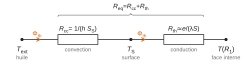
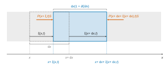
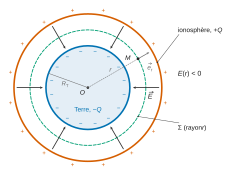
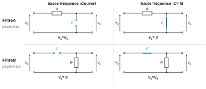
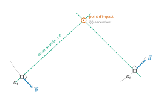

# CCINP TPC — Physique 2026 · Corrigé brut

*Corrigé rédigé par IA, non officiel. Signalez toute erreur.*

Épreuve TPC2P, 4 heures, calculatrices interdites. Deux problèmes indépendants.

# Problème I — Physique du pop-corn

## Partie I — Diffusion thermique dans un grain de maïs

### Q1

$$\begin{aligned}
{[\lambda]}&=\mathrm{W\cdot K^{-1}\cdot m^{-1}}\\
&=\mathrm{J\cdot s^{-1}\cdot K^{-1}\cdot m^{-1}}\\
{[\rho c]}&=\mathrm{kg\cdot m^{-3}}\times\mathrm{J\cdot K^{-1}\cdot kg^{-1}}\\
&=\mathrm{J\cdot K^{-1}\cdot m^{-3}}
\end{aligned}$$
Le quotient vaut
$$\boxed{[D_{th}]=\mathrm{m^2\cdot s^{-1}}}$$

### Q2

La durée cherchée ne dépend que de la taille $a$ et de la diffusivité $D_{th}$, seul coefficient de transport du problème (loi d'échelle de la diffusion construite par analyse dimensionnelle). On cherche $\tau_{diff}=a^\alpha D_{th}^\beta$ :
$$\begin{aligned}
\mathrm{T}&=\mathrm{L}^{\alpha}\left(\mathrm{L}^2\mathrm{T}^{-1}\right)^{\beta}\\
&=\mathrm{L}^{\alpha+2\beta}\,\mathrm{T}^{-\beta}
\end{aligned}$$
On identifie les exposants du temps et de la longueur :
$$\begin{aligned}
-\beta&=1\\
\alpha+2\beta&=0
\end{aligned}$$
d'où $\beta=-1$ et $\alpha=2$.
À un facteur numérique sans dimension près, pris égal à 1 :
$$\boxed{\tau_{diff}=\frac{a^2}{D_{th}}}$$

### Q3

$$\begin{aligned}
D_{th}&=\frac{0{,}2}{1\cdot10^3\times2\cdot10^3}\\
&=1\cdot10^{-7}\ \mathrm{m^2\cdot s^{-1}}
\end{aligned}$$
puis
$$\begin{aligned}
\tau_{diff}&=\frac{(3\cdot10^{-3})^2}{1\cdot10^{-7}}\\
&=\frac{9\cdot10^{-6}}{1\cdot10^{-7}}
\end{aligned}$$
$$\boxed{\tau_{diff}\simeq9\cdot10^1\ \mathrm{s}}$$
C'est la durée donnée pour le germe dans le tableau 1. Le temps de cuisson (de l'ordre de la minute) est du même ordre que $\tau_{diff}$, et non très grand devant lui : **le régime de diffusion dans le grain entier ne peut pas être considéré comme permanent** pendant la cuisson.

### Q4

Pour l'enveloppe, $\tau_{env}=0{,}1$ s. Les conditions aux limites qu'elle subit (température de surface, température de l'amande vitreuse) évoluent sur les durées des zones internes (7 s à 90 s) et sur la durée de cuisson ($\sim60$ s) :
$$\frac{\tau_{env}}{t_{cuisson}}\sim\frac{0{,}1}{60}\sim2\cdot10^{-3}\ll1 .$$
Le profil de température dans l'enveloppe s'adapte quasi instantanément à ces conditions : à chaque instant, il est celui du régime stationnaire correspondant aux températures de bord de cet instant. **La diffusion dans l'enveloppe est quasi stationnaire.**

### Q5

La calotte (deux sphères concentriques, matériau homogène, bain isotrope) est invariante par toute rotation autour du centre $O$. Le champ scalaire $T$ a les mêmes invariances : $T$ ne dépend ni de $\theta$ ni de $\varphi$, $T=T(r)$ (le temps n'intervenant que comme paramètre en régime quasi stationnaire). Le gradient en sphériques se réduit à son terme radial et la loi de Fourier donne
$$\boxed{\vec j_{th}=-\lambda\frac{\mathrm dT}{\mathrm dr}\,\vec e_r=j_{th}(r)\,\vec e_r}$$
L'huile (200 °C) est plus chaude que le grain : la chaleur va de l'extérieur vers le centre, selon $-\vec e_r$. Donc $\boxed{j_{th}(r)<0}$.

### Q6

On compte $\Phi_{th}(r)$ positivement vers le centre : $\Phi_{th}(r)=-4\pi r^2j_{th}(r)>0$. Premier principe pour la coquille comprise entre $r$ et $r+\mathrm dr$ (système fermé, pas de travail, pas de source interne), de capacité thermique $\mathrm dC$, pendant $\mathrm dt$ :
$$\mathrm dC\,\frac{\partial T}{\partial t}=\Phi_{th}(r+\mathrm dr)-\Phi_{th}(r) .$$
En régime quasi stationnaire (Q4), le membre de gauche est négligeable, d'où $\Phi_{th}(r+\mathrm dr)=\Phi_{th}(r)$ :
$$\boxed{\frac{\mathrm d\Phi_{th}}{\mathrm dr}=0\ :\ \Phi_{th}\ \text{est indépendant de}\ r}$$

### Q7

D'après Q6, $j_{th}(r)=-\dfrac{\Phi_{th}}{4\pi r^2}$ ; d'après Q5, $j_{th}=-\lambda\dfrac{\mathrm dT}{\mathrm dr}$. Donc
$$\frac{\mathrm dT}{\mathrm dr}=\frac{\Phi_{th}}{4\pi\lambda r^2}$$
Une primitive de $1/r^2$ étant $-1/r$ :
$$\boxed{T(r)=-\frac{\Phi_{th}}{4\pi\lambda}\,\frac1r+K}$$
Contrôle : $\mathrm dT/\mathrm dr>0$, la température croît vers l'extérieur, ce qui est la situation physique.

### Q8

La résistance thermique est définie par $\Delta T=R_{th}\Phi_{th}$, avec $\Delta T=T(R_2)-T(R_1)$ :
$$\boxed{R_{th}=\frac{T(R_2)-T(R_1)}{\Phi_{th}}}$$
Elle s'exprime en $\mathrm{K\cdot W^{-1}}$.

| Grandeur thermique | Équivalent électrocinétique |
|---|---|
| écart de température $\Delta T$ (K) | tension $U$ (V) |
| flux thermique $\Phi_{th}$ (W) | intensité $I$ (A) |
| résistance thermique $R_{th}$ (K·W⁻¹) | résistance électrique $R$ (Ω) |

La relation $\Delta T=R_{th}\Phi_{th}$ est l'analogue de la loi d'Ohm $U=RI$.

### Q9

Avec Q7 :
$$\begin{aligned}
\Delta T&=-\frac{\Phi_{th}}{4\pi\lambda}\left(\frac1{R_2}-\frac1{R_1}\right)\\
&=\frac{\Phi_{th}}{4\pi\lambda}\,\frac{R_2-R_1}{R_1R_2}
\end{aligned}$$
d'où
$$\boxed{R_{th}=\frac{R_2-R_1}{4\pi\lambda R_1R_2}}$$
Le tableau 1 donne l'épaisseur de l'enveloppe $e=R_2-R_1=0{,}1$ mm pour $R_2=a=3$ mm : $e/a\simeq3\cdot10^{-2}\ll1$, donc $R_1R_2\simeq a^2$ et
$$\boxed{R_{th}\simeq\frac{e}{\lambda S}}$$
avec
$$e=R_2-R_1$$
$$S=4\pi R_1R_2\simeq4\pi a^2$$
**Commentaire** : l'enveloppe étant très mince devant le rayon, sa courbure est négligeable ; on retrouve la résistance d'un mur plan d'épaisseur $e$ et de section égale à la surface du grain. À titre indicatif, $S\simeq1{,}1\cdot10^{-4}$ m² et $R_{th}\simeq4$ K·W⁻¹.

### Q10

La loi de Newton s'écrit $T_{ext}-T_S=\Phi_{th}/(hS_S)$ ; par identification avec $\Delta T=R\,\Phi_{th}$ :
$$\boxed{R_{cc}=\frac1{h\,S_S}}$$

### Q11

Le même flux $\Phi_{th}$ traverse l'interface huile-grain puis l'enveloppe (pas d'accumulation, Q6), et les écarts de température s'ajoutent :
$$T_{ext}-T(R_1)=(T_{ext}-T_S)+(T_S-T(R_1))=(R_{cc}+R_{th})\,\Phi_{th} .$$
Les deux résistances sont **en série**. Avec $S\simeq S_S$ (enveloppe mince) :
$$\boxed{R_{eq}=R_{cc}+R_{th}\simeq\frac1{S_S}\left(\frac1h+\frac e\lambda\right)}$$

### Q12

Le flux reçu par l'intérieur du grain vaut $\Phi_{th}=(T_{ext}-T(R_1))/R_{eq}$, avec $R_{eq}\simeq\dfrac1{S_S}\left(\dfrac1h+\dfrac e\lambda\right)$. Or l'épaisseur $e$ de l'enveloppe, la surface $S_S$ et l'état de surface (qui influe sur $h$) varient d'un grain à l'autre (grandeurs biologiques dispersées ; l'énoncé ne donne que des valeurs moyennes). $R_{eq}$, donc le flux reçu et la vitesse de montée en température de l'amande farineuse, varient d'un grain à l'autre : le seuil d'éclatement est atteint à des dates différentes. De plus, la résistance mécanique de l'enveloppe, qui dépend de son épaisseur, fixe la pression de rupture et varie elle aussi.
$$\boxed{e\ (\text{et}\ S_S)\ \text{variant d'un grain à l'autre,}\ R_{eq}\ \text{et la date d'éclatement varient}}$$

## Partie II — Éclatement et saut du grain de maïs

### Q13

Figure 4 : $P_{sat}=9$ bar pour $T_r\simeq175$ °C. Figure 5 : l'eau se trouve dans l'amande farineuse, dont la courbe atteint 175 °C vers
$$\boxed{t_{\text{éclatement}}\simeq1{,}3\cdot10^2\ \mathrm s\simeq2\ \text{min}}$$
**Commentaire** : c'est l'ordre de grandeur observé pour la cuisson du pop-corn (une à deux minutes) et environ $3\,\tau_{diff}$ de l'amande farineuse (45 s). La courbe approche son plafond (vers 183 °C) : la date est très sensible au seuil lu ; un seuil de 178 °C repousserait l'éclatement vers 140 s.

### Q14

À $t\simeq125$ s, l'enveloppe (≈195 °C) et l'amande vitreuse (≈190 °C) sont sur leur plateau ; l'amande farineuse (≈175 °C) et surtout le germe (≈138 °C) voient encore leur température croître nettement. **Non, le régime permanent n'est pas établi dans toutes les zones** : il ne l'est pas dans l'amande farineuse ni dans le germe.

Pour une zone, la montée est de type premier ordre, $T(t)=T_\infty-(T_\infty-T_0)\,\mathrm e^{-t/\tau}$, où $\tau\sim\ell^2/D_{th}$ ne dépend pas de la température de l'huile, et $T_\infty$ croît avec $T_{ext}$. Le seuil $T_r$ est franchi à
$$t_r=\tau\ln\frac{T_\infty-T_0}{T_\infty-T_r}$$
Sa dérivée par rapport à $T_\infty$ est négative, puisque $T_\infty-T_r<T_\infty-T_0$ :
$$\frac{\mathrm dt_r}{\mathrm dT_\infty}=\tau\left(\frac1{T_\infty-T_0}-\frac1{T_\infty-T_r}\right)<0 .$$
**Oui, augmenter la température de l'huile raccourcit la durée nécessaire à l'éclatement** (dans la limite où le grain ne brûle pas et l'huile ne se dégrade pas).

### Q15

$$\begin{aligned}
n&=\frac{P_rV_0}{RT_r}\\
&=\frac{9\cdot10^5\times1\cdot10^{-7}}{4\cdot10^3}\\
&=2{,}25\cdot10^{-5}\ \mathrm{mol}
\end{aligned}$$
puis
$$\begin{aligned}
m_{vap}&=nM\\
&=2{,}25\cdot10^{-5}\times18\cdot10^{-3}
\end{aligned}$$
$$\boxed{m_{vap}\simeq4\cdot10^{-7}\ \mathrm{kg}=0{,}4\ \mathrm{mg}}$$
Le grain contient $0{,}10\times100=10$ mg d'eau : seuls 4 % de l'eau sont sous forme vapeur juste avant l'éclatement. L'essentiel reste liquide, ce qui justifie l'équilibre liquide-vapeur ($P=P_{sat}(T)$) et fournit une réserve d'eau qui se vaporise lors de la détente.

### Q16

Système fermé $\{$vapeur d'eau$\}$, $n$ fixé (la vapeur ne s'échappe pas). La détente réelle est brutale, donc irréversible, et ni la pression extérieure ni $\gamma$ ne sont fournis. On l'estime par le modèle isotherme réversible à $T_r$ (la vapeur reste au contact de l'eau liquide et de l'amidon) : $P=nRT_r/V$ et
$$\begin{aligned}
W&=-\int_{V_0}^{5V_0}\frac{nRT_r}{V}\,\mathrm dV\\
&=-nRT_r\ln5
\end{aligned}$$
Comme $nRT_r=P_rV_0$ :
$$\boxed{W=-P_rV_0\ln5}$$
Avec $\ln5=\ln10-\ln2\simeq2{,}30-0{,}69=1{,}6$ :
$$\boxed{W\simeq-9\cdot10^{-2}\times1{,}6\simeq-1{,}4\cdot10^{-1}\ \mathrm J}$$
$W<0$ : la vapeur fournit du travail. Ce modèle majore $|W|$. Une détente monobare contre l'atmosphère donnerait $W=-P_{atm}\cdot4V_0\simeq-4\cdot10^{-2}$ J, même ordre de grandeur.

### Q17

Si $|W|$ devient énergie potentielle de pesanteur du grain au sommet du saut : $|W|=mgh$,
$$\begin{aligned}
h&=\frac{|W|}{mg}\\
&=\frac{1{,}4\cdot10^{-1}}{1\cdot10^{-4}\times10}
\end{aligned}$$
$$\boxed{h\simeq1{,}4\cdot10^2\ \mathrm m}$$
**Commentaire** : un pop-corn saute de quelques centimètres à quelques dizaines de centimètres (figure 6) ; l'estimation est trop grande de deux à trois ordres de grandeur (avec $|W|\simeq4\cdot10^{-2}$ J, on trouverait encore 40 m). Seule une très petite fraction du travail devient énergie mécanique du grain.

**Autres formes** : énergie cinétique de la vapeur éjectée par la brèche ; énergie de rupture de l'enveloppe et de déformation irréversible de l'amidon (expansion en mousse) ; énergie acoustique (le « pop ») ; énergie cinétique de rotation du grain ; dissipation finale en énergie interne (frottements, transferts thermiques).

## Partie III — Étude du « pop » du pop-corn

### Q18

L'approximation acoustique consiste à traiter l'onde comme une **petite perturbation** de l'état de repos : $|p_1|\ll P_0$, $|\mu_1|\ll\mu_0$, $|\partial\xi/\partial x|\ll1$, vitesse des particules petite devant la célérité. On **linéarise** les équations en ne gardant que les termes du premier ordre en ces perturbations (les produits de deux perturbations sont négligés).

### Q19

À l'instant $t$, la tranche est comprise entre $x+\xi(x,t)$ et $x+\mathrm dx+\xi(x+\mathrm dx,t)$. Sa longueur est
$$\mathrm dx+\xi(x+\mathrm dx,t)-\xi(x,t)=\mathrm dx\left(1+\frac{\partial\xi}{\partial x}\right)\ \text{au premier ordre en}\ \mathrm dx ,$$
et la section $S$ est inchangée :
$$\boxed{\mathrm d\tau\simeq S\,\mathrm dx\left(1+\frac{\partial\xi}{\partial x}\right)}$$

### Q20

La tranche est un système fermé : $\mu_0S\,\mathrm dx=(\mu_0+\mu_1)\,S\,\mathrm dx\left(1+\dfrac{\partial\xi}{\partial x}\right)$, soit
$$0=\mu_1+\mu_0\frac{\partial\xi}{\partial x}+\mu_1\frac{\partial\xi}{\partial x} .$$
Le dernier terme est d'ordre 2, négligé :
$$\boxed{\mu_1(x,t)\simeq-\mu_0\frac{\partial\xi}{\partial x}}\qquad(1)$$

### Q21

Système : la tranche, de masse $\mu_0S\,\mathrm dx$, dans le référentiel terrestre galiléen ; accélération $\partial^2\xi/\partial t^2$. Forces : pressions sur les deux faces (poids négligé) :
$$\mu_0S\,\mathrm dx\,\frac{\partial^2\xi}{\partial t^2}=S\left[P(x+\xi,t)-P(x+\mathrm dx+\xi(x+\mathrm dx),t)\right]\simeq-S\,\frac{\partial P}{\partial x}\,\mathrm dx .$$
$P_0$ étant uniforme, $\partial P/\partial x=\partial p_1/\partial x$, déjà d'ordre 1 ; l'évaluer en $x+\xi$ au lieu de $x$ ne change que des termes d'ordre 2 :
$$\boxed{\mu_0\frac{\partial^2\xi}{\partial t^2}\simeq-\frac{\partial p_1}{\partial x}}\qquad(2)$$

### Q22

(1) et (3) donnent $\dfrac{\partial\xi}{\partial x}=-\chi_sp_1$. En dérivant (2) par rapport à $x$ (théorème de Schwarz) :
$$\mu_0\frac{\partial^2}{\partial t^2}\left(\frac{\partial\xi}{\partial x}\right)=-\frac{\partial^2p_1}{\partial x^2}$$
On remplace $\partial\xi/\partial x$ par $-\chi_sp_1$ :
$$-\mu_0\chi_s\frac{\partial^2p_1}{\partial t^2}=-\frac{\partial^2p_1}{\partial x^2}$$
$$\boxed{\frac{\partial^2p_1}{\partial x^2}-\frac1{c^2}\frac{\partial^2p_1}{\partial t^2}=0}$$
avec
$$\boxed{c=\frac1{\sqrt{\mu_0\chi_s}}}$$

### Q23

C'est l'**équation de d'Alembert** (équation d'onde à une dimension).

D'après (3), $\chi_s=\mu_1/(\mu_0p_1)$ est l'inverse d'une pression : $[\chi_s]=\mathrm{Pa^{-1}}=\mathrm{kg^{-1}\cdot m\cdot s^2}$. Alors $[\mu_0\chi_s]=\mathrm{kg\cdot m^{-3}}\times\mathrm{kg^{-1}\cdot m\cdot s^2}=\mathrm{s^2\cdot m^{-2}}$ et $c$ s'exprime en $\mathrm{m\cdot s^{-1}}$ : c'est une vitesse.

Dans l'air, conditions usuelles : $\boxed{c\simeq3{,}4\cdot10^2\ \mathrm{m\cdot s^{-1}}}$. Pour $d=34$ cm :
$$\boxed{\Delta t_{prop}=\frac dc=\frac{0{,}34}{340}\simeq1\ \mathrm{ms}}$$
**Commentaire** : ce retard est très petit devant la durée du « pop » (environ 50 ms, Q24) et devant l'échelle de la figure 8 (graduée par 50 ms) : la synchronisation entre micro et caméra n'en est pas affectée.

### Q24

Sur la figure 8, la flèche « pop » s'étend d'environ 105 ms à 155 ms :
$$\Delta t\simeq50\ \mathrm{ms} .$$
On est certain de trouver la durée dans $[40;60]$ ms, soit $\Delta=10$ ms :
$$u(\Delta t)=\frac{\Delta}{\sqrt3}\simeq0{,}6\times10\ \mathrm{ms}$$
Résultat :
$$\boxed{\Delta t=50\ \mathrm{ms}}$$
$$\boxed{u(\Delta t)\simeq6\ \mathrm{ms}}$$

### Q25

$$\begin{aligned}
\Delta f&=\frac1{\Delta t}\\
&=\frac1{5\cdot10^{-2}}
\end{aligned}$$
$$\boxed{\Delta f\simeq20\ \mathrm{Hz}}$$
Quotient avec un numérateur exact :
$$\begin{aligned}
\frac{u(\Delta f)}{\Delta f}&=\frac{u(\Delta t)}{\Delta t}\\
&=\frac6{50}\\
&=0{,}12
\end{aligned}$$
d'où
$$\boxed{u(\Delta f)\simeq2\ \mathrm{Hz}}$$

### Q26

Nyquist-Shannon : $F_E>2f_{max}$. Le spectre est centré sur $f_0=1$ kHz, de largeur $\Delta f\simeq20$ Hz, donc $f_{max}\simeq f_0+\Delta f/2\simeq1{,}01$ kHz :
$$\boxed{F_{E,min}=2f_{max}\simeq2\ \mathrm{kHz}}$$

### Q27

$$\begin{aligned}
N_{min}&=F_{E,min}\,T_{aq}\\
&=F_{E,min}\times2\Delta t\\
&=2\cdot10^3\times0{,}1
\end{aligned}$$
$$\boxed{N_{min}\simeq2\cdot10^2\ \text{points}}$$

### Q28

La résolution du spectre calculé est $\delta f\simeq1/T_{aq}$ (écart entre deux fréquences successives du spectre discret). Avec $T_{aq}=0{,}1$ s, on a $\delta f=10$ Hz, déjà comparable à $\Delta f\simeq20$ Hz.

Diminuer $T_{aq}$ augmente $\delta f$ : **la résolution spectrale se dégrade**. Le pic n'est plus décrit que par un ou deux points et sa largeur $\Delta f$ n'est plus mesurable (le spectre affiché est élargi). Le repliement, lui, ne dépend que de $F_E$.

# Problème II — Circulations électriques dans l'atmosphère

## Partie I — Modélisation du condensateur terrestre

### Q29

**Invariances** : la distribution (deux sphères concentriques uniformément chargées) est invariante par toute rotation autour du centre $O$ : les composantes de $\vec E$ ne dépendent que de $r$.

**Symétries** : tout plan contenant $O$ et $M$ est plan de symétrie de la distribution ; $\vec E$, vecteur polaire, appartient à tous ces plans, donc à leur intersection, la droite $(OM)$ :
$$\boxed{\vec E=E(r)\,\vec e_r}$$
**Signe** : le champ va des charges positives (ionosphère, $+Q$) vers les charges négatives (Terre, $-Q$), donc vers le centre : $\boxed{E(r)<0}$.

### Q30

Surface de Gauss : sphère $\Sigma$ de centre $O$ et de rayon $r\in[R_T,R_T+h]$, orientée vers l'extérieur. D'après Q29, $\vec E$ y est normal et de valeur uniforme : flux $E(r)\,4\pi r^2$. La charge intérieure est celle de la Terre, $-Q$ :
$$E(r)\,4\pi r^2=-\frac Q{\varepsilon_0}$$
d'où
$$\boxed{E(r)=-\frac Q{4\pi\varepsilon_0r^2}}$$

### Q31

À l'altitude $z$, $r=R_T+z$ :
$$-E=\frac Q{4\pi\varepsilon_0R_T^2}\left(1+\frac z{R_T}\right)^{-2}$$
On note $-E_0=Q/(4\pi\varepsilon_0R_T^2)$ la valeur au sol. En logarithme décimal, puis au premier ordre en $z/R_T$ :
$$\begin{aligned}
\log(-E)&=\log(-E_0)-\frac2{\ln10}\ln\left(1+\frac z{R_T}\right)\\
&\simeq\log(-E_0)-\frac2{\ln10}\,\frac z{R_T}
\end{aligned}$$
Donc
$$\boxed{z\simeq\frac{R_T\ln10}2\left[\log(-E_0)-\log(-E)\right]}$$
Au premier ordre, $z$ est une **fonction affine décroissante de $\log(-E)$** : $|E|$ diminue quand l'altitude augmente, et la courbe $z(\log(-E))$ est une droite dans le repère semi-logarithmique.

C'est l'allure globale de la figure 11a (de $-E\simeq40$ V/m vers 1,5 km à $-E\simeq5$ V/m vers 10 km, décroissance monotone à peu près rectiligne en semi-log) : le modèle est **globalement compatible**.

En revanche, la pente prédite ($R_T\ln10/2\simeq7\cdot10^3$ km par décade) est bien plus grande que la pente observée (environ 10 km par décade) : la géométrie sphérique seule n'explique pas l'amplitude de la décroissance (l'atmosphère est conductrice, partie II).

### Q32

Zone 1 de la figure 11b : $-E$ passe de 0,2 à 0,13 kV/m environ, soit avec un chiffre significatif
$$\boxed{-E\simeq0{,}2\ \mathrm{kV\cdot m^{-1}}=2\cdot10^2\ \mathrm{V\cdot m^{-1}}}$$
Q30 en $r=R_T$ :
$$\begin{aligned}
Q&=4\pi\varepsilon_0R_T^2|E|\\
&=\frac{(6\cdot10^6)^2\times2\cdot10^2}{9\cdot10^9}\\
&=\frac{7{,}2\cdot10^{15}}{9\cdot10^9}
\end{aligned}$$
$$\boxed{Q\simeq8\cdot10^5\ \mathrm C}$$
La Terre porte donc la charge $-Q\simeq-8\cdot10^5$ C.

### Q33

L'ordonnée de la figure 11b est $-E$. Par temps calme, $-E>0$, donc $E<0$ : le champ est dirigé vers le sol ($-\vec e_r$).

La courbe décroît, s'annule vers 3 à 4 min (zone 2, temps orageux), puis reste négative pendant l'orage ($-E$ descend jusqu'à $-2{,}5$ kV/m). Alors $E>0$ : le champ est dirigé vers le haut.

**Le champ électrique change de sens vers $t\simeq3$ à $4$ min, au passage de $-E$ par zéro, avant le début de l'orage proprement dit.**

## Partie II — Courant ionique atmosphérique par beau temps

### Q34

$[\lambda]=[F]/[v]=\mathrm{kg\cdot m\cdot s^{-2}}/(\mathrm{m\cdot s^{-1}})$ :
$$\boxed{\lambda\ \text{en}\ \mathrm{kg\cdot s^{-1}}}$$

### Q35

Système : l'ion ($m$, $+e$) ; référentiel terrestre galiléen ; forces : $e\vec E$ et $-\lambda\vec v$ (poids et force magnétique négligés). Principe fondamental de la dynamique :
$$\boxed{m\frac{\mathrm d\vec v}{\mathrm dt}+\lambda\vec v=e\vec E}$$

### Q36

Équation linéaire du premier ordre de constante de temps $m/\lambda$ ; le régime transitoire s'amortit et, en régime permanent, $\mathrm d\vec v/\mathrm dt=\vec0$ :
$$\boxed{\vec v_\ell=\frac e\lambda\,\vec E}$$

### Q37

$$\boxed{\vec j_c=n\,e\,\vec v_\ell=\frac{ne^2}\lambda\,\vec E}$$

### Q38

Pour un anion (charge $-e$, même $\lambda$) : $\vec v_{\ell,a}=-\dfrac e\lambda\vec E$ et $\vec j_a=n(-e)\vec v_{\ell,a}=\dfrac{ne^2}\lambda\vec E$. Les deux contributions sont de même sens :
$$\boxed{\vec j=\vec j_a+\vec j_c=2n\frac{e^2}\lambda\,\vec E}$$
C'est une loi d'Ohm locale ; comme $E(z)<0$, le courant est descendant.

### Q39

Chaque famille d'ions obéit à la loi d'Ohm locale : $\vec j_a=\gamma_a\vec E$ et $\vec j_c=\gamma_c\vec E$. On a donc calculé, **à chaque altitude**, le produit de la conductivité mesurée par la valeur du champ mesurée à la même altitude (figure 12a) :
$$\boxed{j_a(z)=\gamma_a(z)\,|E(z)|}$$
$$\boxed{j_c(z)=\gamma_c(z)\,|E(z)|}$$
Exemple : vers 3 km, $\gamma_a\simeq8\cdot10^{-14}$ S/m et $|E|\simeq25$ V/m donnent $j_a\simeq2\cdot10^{-12}$ A/m² ; vers 10 km, $4\cdot10^{-13}$ S/m et 5 V/m donnent la même valeur.

### Q40

La figure 12b donne $j_a\simeq j_c\simeq2\cdot10^{-12}$ A·m⁻² à toutes les altitudes (densité moyenne). La densité totale est leur somme :
$$\boxed{j_{mes}=j_a+j_c\simeq4\cdot10^{-12}\ \mathrm{A\cdot m^{-2}}}$$
**La valeur annoncée est compatible avec la mesure.**

## Partie III — Décharge du condensateur terrestre

### Q41

$\vec j$ uniforme et normal à la surface : $I=jS_T=4\cdot10^{-12}\times5\cdot10^{14}$
$$\boxed{I\simeq2\cdot10^3\ \mathrm A}$$

### Q42

Par définition, $I=\left|\dfrac{\mathrm dq}{\mathrm dt}\right|$. En supposant $I$ constant, la charge $Q$ est neutralisée au bout de $\tau$ tel que $Q=I\tau$ :
$$\boxed{\tau=\frac QI}$$

### Q43

Avec Q32 et Q41, $\tau=8\cdot10^5/2\cdot10^3=4\cdot10^2$ s, en accord avec la valeur annoncée. Sept minutes : le condensateur terrestre serait déchargé en quelques minutes. Or le champ de beau temps est observé en permanence et la différence de potentiel reste constante. **Le modèle d'un condensateur isolé qui se décharge est incomplet : il faut un mécanisme de recharge permanent (un générateur)**, que les parties IV et V identifient aux orages.

## Partie IV — Recharge du condensateur terrestre

### Q44

**Invariances** : le fil infini d'axe $Oz$ est invariant par translation selon $z$ et par rotation autour de $Oz$ : $\vec B(M)=\vec B(d,t)$ (ARQS : le temps n'est qu'un paramètre).

**Symétries** : le plan $(M,\vec e_r,\vec e_z)$ contient le fil ; c'est un plan de symétrie de la distribution de courant. $\vec B$, pseudo-vecteur, est orthogonal à ce plan :
$$\boxed{\vec B=B(d,t)\,\vec e_\theta}$$

### Q45

Contour $\mathcal C$ : cercle de rayon $d$ centré sur le fil, dans un plan perpendiculaire à $Oz$, orienté selon $\vec e_\theta$ (normale $+\vec e_z$, sens du courant). $\vec B$ y est tangent et de norme uniforme. Théorème d'Ampère (valable dans l'ARQS) :
$$B(d,t)\,2\pi d=\mu_0\,i(t)$$
d'où
$$\boxed{\vec B=\frac{\mu_0\,i(t)}{2\pi d}\,\vec e_\theta}$$

### Q46

Champ uniforme sur la bobine : flux à travers les $N$ spires
$$\Phi=N\,\vec B\cdot\vec S_1=NS_1\frac{\mu_0\,i(t)}{2\pi d}\cos\alpha .$$
Seul $i$ dépend du temps ; loi de Faraday :
$$\begin{aligned}
e_1&=-\frac{\mathrm d\Phi}{\mathrm dt}\\
&=-NS_1\frac{\mu_0}{2\pi d}\frac{\mathrm di}{\mathrm dt}\cos\alpha
\end{aligned}$$
Par identification avec l'expression de l'énoncé :
$$\boxed{f(\alpha)=\cos\alpha}$$

### Q47

Basse fréquence : le condensateur est un interrupteur ouvert ; haute fréquence : un fil.

- Filtre A (sortie aux bornes de $C$) : en BF, aucun courant, $v_s=v_e$ ; en HF, $C$ court-circuite la sortie, $v_s=0$. Passe-bas, gain 1 puis 0.
- Filtre B (sortie aux bornes de $R$) : en BF, $C$ bloque le courant, $v_s=0$ ; en HF, $v_s=v_e$. Passe-haut.

Or $|\underline H_1|\to1$ en BF et $\to0$ en HF ; $|\underline H_2|\to0$ en BF et $\to1$ en HF :
$$\boxed{\underline H_1\leftrightarrow\text{filtre A},\qquad\underline H_2\leftrightarrow\text{filtre B}}$$
(Le diviseur de tension le confirme : $\underline H_A=\dfrac{1/(jC\omega)}{R+1/(jC\omega)}=\dfrac1{1+jRC\omega}$.)

### Q48

Un intégrateur a une fonction de transfert de la forme $\dfrac1{j\omega\tau_0}$. Pour $RC\omega\gg1$ :
$$\underline H_1\simeq\frac1{jRC\omega}$$
En temporel, diviser par $j\omega$ revient à intégrer :
$$v_s\simeq\frac1{RC}\int v_e\,\mathrm dt .$$
$$\boxed{\text{Le filtre A est intégrateur pour}\ \omega\gg\frac1{RC},\ \text{soit}\ f\gg\frac1{2\pi RC}}$$
Appliqué à $e_1\propto\mathrm di/\mathrm dt$, il restitue un signal proportionnel à $i(t)$. (Le filtre B serait dérivateur en basse fréquence.)

## Partie V — Intensité déplacée par les orages

### Q49

Le rapport $e_2/e_1$ élimine $N$, $S_1$, $d$ et $\mathrm di/\mathrm dt$.

Sur la figure 15b (1 V/div), les deux tensions ont la même forme. Au sommet, $e_1\simeq2{,}4$ V et $e_2\simeq2{,}2$ V :
$$\tan\alpha=\frac{e_2}{e_1}\simeq0{,}9$$
$$\boxed{\alpha\simeq42^\circ\ \text{(environ}\ 45^\circ)}$$
**Le champ magnétique est horizontal, dans le plan des deux vecteurs surface, et fait un angle d'environ 42° avec $\vec S_1$**, à peu près selon la bissectrice de $\vec S_1$ et $\vec S_2$.

Comme $\vec B$ est porté par $\vec e_\theta$, l'éclair se trouve dans la direction perpendiculaire à $\vec B$ (selon $\vec e_r$).

### Q50

D'après Q46, $|e_1|=NS_1\dfrac{\mu_0}{2\pi}\cos\alpha\cdot\dfrac1d\left|\dfrac{\mathrm di}{\mathrm dt}\right|$. La distance n'apparaît que dans le rapport $\dfrac1d\left|\dfrac{\mathrm di}{\mathrm dt}\right|$, et le courant de l'éclair est inconnu : un éclair faible et proche donne le même signal qu'un éclair intense et lointain. Un détecteur fournit la direction de l'éclair (Q49), **pas sa distance**.

### Q51

Chaque détecteur donne une droite de visée : la droite passant par le détecteur, perpendiculaire à $\vec B$ mesuré. Deux droites non parallèles se coupent en un point unique :
$$\boxed{\text{2 détecteurs au minimum}}$$

La construction échoue si l'éclair est aligné avec $D_1$ et $D_2$ (droites confondues) ; un troisième détecteur lève ce cas et améliore la précision.

### Q52

Figure 16 : environ 1,7 kA (décembre-février), 2,2 kA (mars-mai), 2,4 kA (juin-août), 2,0 kA (septembre-novembre). Moyenne annuelle :
$$\boxed{I_{\text{orages}}\simeq2\ \mathrm{kA}=2\cdot10^3\ \mathrm A}$$

### Q53

$I_{\text{décharge}}=jS_T\simeq2\cdot10^3$ A (Q41) et $I_{\text{orages}}\simeq2\cdot10^3$ A (Q52) sont égales à un chiffre significatif. Les orages font circuler les charges en sens opposé au courant de beau temps, d'où
$$\frac{\mathrm dQ_{\text{Terre}}}{\mathrm dt}=I_{\text{orages}}-I_{\text{décharge}}\simeq0 .$$
**Oui, les orages compensent la décharge naturelle du condensateur terrestre**, qui reste chargé en régime stationnaire : ils jouent le rôle du générateur qui manquait en Q43.

FIN
