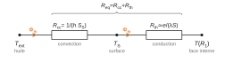
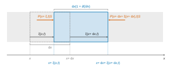
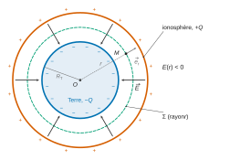
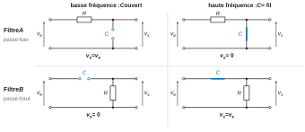
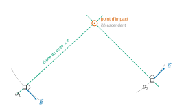

# CCINP TPC — Physique 2026 · Corrigé guidé

*Corrigé rédigé par IA, non officiel. Signalez toute erreur.*

## Présentation du sujet

L'épreuve (TPC2P, 4 heures, **calculatrice interdite**) comporte **53 questions** réparties en deux problèmes indépendants, de longueur comparable. Tous deux suivent la même démarche : on modélise un phénomène familier avec un outil du cours, puis on confronte le modèle à des mesures lues sur des figures.

**Problème I — Physique du pop-corn (Q1 à Q28).**

- **Partie I — Diffusion thermique dans un grain (Q1 à Q12).** Diffusivité et temps de diffusion par analyse dimensionnelle, critère de régime quasi stationnaire, puis une enveloppe sphérique mince : invariances, bilan d'énergie, profil de température en $1/r$, résistance thermique, résistance conducto-convective, association en série. On termine par une question qualitative sur la dispersion des dates d'éclatement.
- **Partie II — Éclatement et saut (Q13 à Q17).** Double lecture graphique (pression de vapeur saturante, puis courbes de température), gaz parfait, travail des forces de pression lors de la détente, bilan énergétique du saut, qui se révèle très surestimé.
- **Partie III — Le « pop » (Q18 à Q28).** Établissement de l'équation de d'Alembert acoustique par la méthode lagrangienne (tranche de fluide), célérité du son, puis traitement d'un enregistrement réel : durée, incertitude-type, étalement spectral, critère de Shannon, nombre de points, résolution spectrale.

**Problème II — Circulations électriques dans l'atmosphère (Q29 à Q53).**

- **Partie I — Le condensateur terrestre (Q29 à Q33).** Symétries et théorème de Gauss en sphérique, compatibilité avec un profil de champ mesuré en semi-log (développement limité), estimation de la charge de la Terre, inversion du champ sous un orage.
- **Partie II — Courant ionique (Q34 à Q40).** Mouvement d'un ion soumis à une force électrique et à un frottement fluide, vitesse limite, densité de courant et loi d'Ohm locale, exploitation de mesures de conductivité.
- **Partie III — Décharge (Q41 à Q43).** Intensité totale, durée de décharge, conclusion sur la modélisation.
- **Partie IV — Recharge par les éclairs (Q44 à Q51).** Champ magnétique d'un fil (symétries, Ampère), loi de Faraday dans une bobine, identification de filtres du premier ordre et intégrateur, goniométrie à deux bobines, localisation d'un impact.
- **Partie V — Bilan (Q52 et Q53).** Lecture d'une intensité moyenne et comparaison avec le courant de décharge.

**Notions mobilisées** : diffusion thermique, loi de Fourier, résistances thermiques et loi de Newton, gaz parfait, travail des forces de pression, énergie potentielle de pesanteur, approximation acoustique, équation de d'Alembert, échantillonnage et analyse spectrale, incertitudes de type B et composition, électrostatique (symétries, Gauss), mécanique du point avec frottement, loi d'Ohm locale, magnétostatique (Ampère) en ARQS, induction (Faraday), filtres du premier ordre.

**Difficulté.** Moyenne. Une grande partie des questions sont des questions de cours bien balisées : Q1, Q5 à Q8, Q10, Q11, Q18 à Q23, Q29, Q30, Q34 à Q38, Q41, Q42, Q44 à Q47. Les points délicats sont les **signes** (Q5 à Q7, Q20, Q29, Q33), les **lectures graphiques** commentées (Q13, Q14, Q24, Q31 à Q33, Q39, Q40, Q49, Q52) et la **modélisation** de la détente (Q16). Sans calculatrice, toutes les applications numériques se font avec des puissances de dix rondes ; le problème II impose un seul chiffre significatif.

**À ne pas laisser passer** : Q1 à Q3, Q8, Q10, Q11, Q15, Q19 à Q23, Q26, Q27, Q29, Q30, Q34 à Q38, Q41 à Q47.

**Gestion du temps** : les deux problèmes sont indépendants et de poids voisin ; environ 1 h 50 chacun et 20 minutes de relecture. Le problème II, plus proche du cours, est un bon point de départ si l'on veut sécuriser des points. Les résultats intermédiaires sont souvent donnés (Q2, Q7, Q9, Q20, Q21, Q22, Q30, Q38, Q45, Q46, valeur de $\tau$ en Q43) : on peut toujours repartir.

# Problème I — Physique du pop-corn

## Partie I — Diffusion thermique dans un grain de maïs

On estime d'abord le temps de diffusion dans le grain entier, puis on se concentre sur l'enveloppe, assez mince pour être traitée en régime quasi stationnaire, ce qui permet d'utiliser le formalisme des résistances thermiques.

### Question 1
> [!INDICATION]
> Écrire les unités de $\lambda$, $\rho$ et $c$, puis remplacer le watt par des joules par seconde.

#### Solution
$$\begin{aligned}
{[\lambda]}&=\mathrm{W\cdot K^{-1}\cdot m^{-1}}\\
&=\mathrm{J\cdot s^{-1}\cdot K^{-1}\cdot m^{-1}}\\
{[\rho c]}&=\mathrm{kg\cdot m^{-3}}\times\mathrm{J\cdot K^{-1}\cdot kg^{-1}}\\
&=\mathrm{J\cdot K^{-1}\cdot m^{-3}}
\end{aligned}$$
Le quotient vaut
$$\boxed{[D_{th}]=\mathrm{m^2\cdot s^{-1}}}$$

> [!METHODE]
> Tous les coefficients de diffusion (de particules, de chaleur, de quantité de mouvement) s'expriment en $\mathrm{m^2\cdot s^{-1}}$. Le retenir donne immédiatement la loi d'échelle de la question suivante.

### Question 2
> [!INDICATION]
> De quelles grandeurs la durée peut-elle dépendre ? Une seule longueur caractérise le grain.

> [!INDICATION]
> Chercher un monôme $a^\alpha D_{th}^\beta$ et identifier les exposants de la longueur et du temps.

#### Solution
La durée de diffusion ne dépend que du rayon $a$ et de $D_{th}$, seul coefficient de transport du problème : c'est la loi d'échelle de la diffusion, construite par analyse dimensionnelle. On pose $\tau_{diff}=a^\alpha D_{th}^\beta$ :
$$\begin{aligned}
\mathrm{T}&=\mathrm{L}^\alpha\left(\mathrm L^2\mathrm T^{-1}\right)^\beta\\
&=\mathrm L^{\alpha+2\beta}\,\mathrm T^{-\beta}
\end{aligned}$$
On identifie les exposants du temps et de la longueur :
$$\begin{aligned}
-\beta&=1\\
\alpha+2\beta&=0
\end{aligned}$$
d'où $\beta=-1$ et $\alpha=2$.
Le monôme est unique ; avec un préfacteur sans dimension pris égal à 1 :
$$\boxed{\tau_{diff}=\frac{a^2}{D_{th}}}$$

> [!METHODE]
> La durée de diffusion croît comme le **carré** de la taille. Le tableau 1 l'illustre : de l'enveloppe (0,1 mm, 0,1 s) au germe (3 mm, 90 s), la taille est multipliée par 30 et la durée par environ $900$.

### Question 3
> [!INDICATION]
> Calculer $D_{th}$ en puissances de dix, puis $\tau_{diff}$.

> [!INDICATION]
> Un régime peut être tenu pour permanent si la durée d'observation est très grande devant la durée d'établissement. Comparer.

#### Solution
$$\begin{aligned}
D_{th}&=\frac{0{,}2}{1\cdot10^3\times2\cdot10^3}\\
&=1\cdot10^{-7}\ \mathrm{m^2\cdot s^{-1}}
\end{aligned}$$
puis
$$\begin{aligned}
\tau_{diff}&=\frac{(3\cdot10^{-3})^2}{1\cdot10^{-7}}\\
&=\frac{9\cdot10^{-6}}{1\cdot10^{-7}}
\end{aligned}$$
$$\boxed{\tau_{diff}\simeq9\cdot10^1\ \mathrm s}$$
On retrouve la durée du germe dans le tableau 1, ce qui est cohérent : il faut traverser tout le rayon. La cuisson dure de l'ordre d'une minute, du même ordre que $\tau_{diff}$ et non très grand devant lui : **le régime de diffusion dans le grain entier n'est pas permanent**.

> [!PIEGE]
> Répondre « oui » parce que 90 s « c'est court » est un contresens : le critère est un rapport de durées. La suite du sujet repose précisément sur le fait que le cœur du grain chauffe encore au moment de l'éclatement.

### Question 4
> [!INDICATION]
> Lire la durée de diffusion propre à l'enveloppe dans le tableau 1.

> [!INDICATION]
> À quelle échelle de temps évoluent les conditions aux limites que subit l'enveloppe ?

#### Solution
Pour l'enveloppe, $\tau_{env}=0{,}1$ s. Les températures à ses bords évoluent sur les durées des zones internes (7 s à 90 s) et de la cuisson ($\sim60$ s) :
$$\frac{\tau_{env}}{t_{cuisson}}\sim\frac{0{,}1}{60}\sim2\cdot10^{-3}\ll1 .$$
Le profil de température dans l'enveloppe s'adapte presque instantanément : à chaque instant, c'est le profil stationnaire correspondant aux températures de bord de cet instant. **Le régime est quasi stationnaire dans l'enveloppe.**

> [!PIEGE]
> « Quasi stationnaire » ne veut pas dire « stationnaire » : les températures de bord dépendent du temps, seul le profil interne les suit sans retard. Il faut comparer deux durées nommées, pas seulement invoquer la finesse de l'enveloppe.

### Question 5
> [!INDICATION]
> Quelles transformations laissent invariants la géométrie, le matériau et les conditions aux limites ?

> [!INDICATION]
> Si $T$ ne dépend que de $r$, que reste-t-il du gradient fourni ? Pour le signe, dans quel sens va la chaleur ?

#### Solution
La calotte est délimitée par deux sphères concentriques, le matériau est homogène, l'huile entoure le grain de façon isotrope : le problème est invariant par toute rotation autour du centre $O$. Le champ de température a ces invariances : $T$ ne dépend ni de $\theta$ ni de $\varphi$, $T=T(r)$ (le temps n'est qu'un paramètre en régime quasi stationnaire). Le gradient se réduit à $\dfrac{\mathrm dT}{\mathrm dr}\vec e_r$ et la loi de Fourier donne
$$\boxed{\vec j_{th}=-\lambda\frac{\mathrm dT}{\mathrm dr}\,\vec e_r=j_{th}(r)\,\vec e_r}$$
L'huile à 200 °C est plus chaude que le grain : la chaleur va de l'extérieur vers le centre, dans le sens de $-\vec e_r$. Donc $\boxed{j_{th}(r)<0}$.

> [!PIEGE]
> Le signe n'est pas une convention : il est imposé par la physique. Il doit rester cohérent avec le sens choisi pour $\Phi_{th}$ (la figure 3 le dessine vers le centre), sinon la forme de $T(r)$ en Q7 sort avec le mauvais signe.

### Question 6
> [!INDICATION]
> Faire un bilan d'énergie sur la coquille comprise entre $r$ et $r+\mathrm dr$.

> [!INDICATION]
> Que vaut le terme d'accumulation en régime quasi stationnaire ? Y a-t-il une source interne ?

#### Solution
On compte $\Phi_{th}(r)$ positivement vers le centre : $\Phi_{th}(r)=-4\pi r^2j_{th}(r)>0$. Pour la coquille $[r,r+\mathrm dr]$, système fermé sans travail ni source interne, de capacité thermique $\mathrm dC$, le premier principe entre $t$ et $t+\mathrm dt$ donne
$$\mathrm dC\,\frac{\partial T}{\partial t}=\Phi_{th}(r+\mathrm dr)-\Phi_{th}(r)$$
(ce qui entre par la face extérieure moins ce qui sort par la face intérieure). En régime quasi stationnaire, l'accumulation est négligeable :
$$\boxed{\frac{\mathrm d\Phi_{th}}{\mathrm dr}=0\ :\ \Phi_{th}\ \text{est indépendant de}\ r}$$

> [!PIEGE]
> Ce qui se conserve est le **flux** $\Phi_{th}$, pas la densité de courant : $j_{th}$ décroît en $1/r^2$. Confondre les deux fait perdre Q7 à Q9.

### Question 7
> [!INDICATION]
> Exprimer $j_{th}(r)$ à l'aide de $\Phi_{th}$ constant, puis égaler avec la loi de Fourier.

#### Solution
D'après Q6, $j_{th}(r)=-\dfrac{\Phi_{th}}{4\pi r^2}$ ; d'après Q5, $j_{th}=-\lambda\dfrac{\mathrm dT}{\mathrm dr}$. D'où
$$\frac{\mathrm dT}{\mathrm dr}=\frac{\Phi_{th}}{4\pi\lambda r^2}$$
Une primitive de $r^{-2}$ étant $-1/r$ :
$$\boxed{T(r)=-\frac{\Phi_{th}}{4\pi\lambda}\,\frac1r+K}$$
Contrôle : $\mathrm dT/\mathrm dr>0$, la température croît vers l'huile, comme attendu.

> [!METHODE]
> En géométrie sphérique, le profil stationnaire est en $1/r$ (affine en $1/r$) ; en cylindrique, il est en $\ln r$ ; dans un mur plan, il est affine en $x$. Dans les trois cas, on part de la conservation du flux.

### Question 8
> [!INDICATION]
> La résistance thermique est définie par analogie avec la loi d'Ohm.

#### Solution
Par définition, $\Delta T=R_{th}\Phi_{th}$, avec $\Delta T=T(R_2)-T(R_1)$ :
$$\boxed{R_{th}=\frac{T(R_2)-T(R_1)}{\Phi_{th}}}$$
Elle s'exprime en $\mathrm{K\cdot W^{-1}}$.

| Grandeur thermique | Équivalent électrocinétique |
|---|---|
| écart de température $\Delta T$ (K) | tension $U$ (V) |
| flux thermique $\Phi_{th}$ (W) | intensité $I$ (A) |
| résistance thermique $R_{th}$ (K·W⁻¹) | résistance électrique $R$ (Ω) |

$\Delta T=R_{th}\Phi_{th}$ est l'analogue de $U=RI$. L'analogie repose sur la conservation du flux (comme celle de l'intensité) et sur l'additivité des écarts de température (comme celle des tensions).

### Question 9
> [!INDICATION]
> Calculer $\Delta T$ avec la forme de $T(r)$ obtenue en Q7.

> [!INDICATION]
> Comparer l'épaisseur de l'enveloppe au rayon du grain, puis simplifier le produit $R_1R_2$.

#### Solution
$$\begin{aligned}
\Delta T&=-\frac{\Phi_{th}}{4\pi\lambda}\left(\frac1{R_2}-\frac1{R_1}\right)\\
&=\frac{\Phi_{th}}{4\pi\lambda}\,\frac{R_2-R_1}{R_1R_2}
\end{aligned}$$
d'où
$$\boxed{R_{th}=\frac{R_2-R_1}{4\pi\lambda R_1R_2}}$$
Positive, puisque $R_1<R_2$. Le tableau 1 donne une épaisseur d'enveloppe $e=R_2-R_1=0{,}1$ mm pour $R_2=a=3$ mm, soit $e/a\simeq3\cdot10^{-2}\ll1$ : $R_1R_2\simeq a^2$ à 3 % près, et
$$\boxed{R_{th}\simeq\frac e{\lambda S}}$$
avec
$$e=R_2-R_1$$
$$S=4\pi R_1R_2\simeq4\pi a^2$$
**Commentaire** : l'enveloppe est si mince que sa courbure ne compte pas ; on retrouve la résistance d'un mur plan d'épaisseur $e$ et de section égale à la surface du grain. Ordre de grandeur : $S\simeq1{,}1\cdot10^{-4}$ m² et $R_{th}\simeq4$ K·W⁻¹.

> [!PIEGE]
> L'application numérique (facultative ici) se fait avec les longueurs en mètres : $e=1\cdot10^{-4}$ m. Une erreur de conversion décale le résultat d'un facteur $10^3$.

### Question 10
> [!INDICATION]
> Mettre la loi de Newton sous la forme « écart de température = résistance × flux ».

#### Solution
$T_{ext}-T_S=\dfrac{\Phi_{th}}{hS_S}$, d'où
$$\boxed{R_{cc}=\frac1{h\,S_S}}$$
Contrôle : $h$ en $\mathrm{W\cdot K^{-1}\cdot m^{-2}}$, donc $R_{cc}$ en $\mathrm{K\cdot W^{-1}}$.

### Question 11
> [!INDICATION]
> Qu'est-ce qui est commun aux deux résistances : le flux ou l'écart de température ?

#### Solution
Le même flux $\Phi_{th}$ traverse l'interface huile-grain puis l'enveloppe, sans accumulation (Q6), et les écarts de température s'ajoutent :
$$\begin{aligned}
T_{ext}-T(R_1)&=\underbrace{(T_{ext}-T_S)}_{R_{cc}\Phi_{th}}+\underbrace{(T_S-T(R_1))}_{R_{th}\Phi_{th}}\\
&=(R_{cc}+R_{th})\,\Phi_{th}
\end{aligned}$$
Les résistances sont **en série**, comme deux résistors parcourus par la même intensité. Avec $S\simeq S_S$ (enveloppe mince) :
$$\boxed{R_{eq}=R_{cc}+R_{th}\simeq\frac1{S_S}\left(\frac1h+\frac e\lambda\right)}$$

> [!METHODE]
> Même flux : série, les résistances s'ajoutent. Même écart de température : dérivation, les conductances s'ajoutent. La justification est la moitié de la réponse.

### Question 12
> [!INDICATION]
> De quels paramètres propres à chaque grain dépend $R_{eq}$ ?

> [!INDICATION]
> Relier $R_{eq}$ au flux reçu, donc à la vitesse de montée en température de l'intérieur du grain.

#### Solution
Le flux reçu vaut $\Phi_{th}=\dfrac{T_{ext}-T(R_1)}{R_{eq}}$, avec $R_{eq}\simeq\dfrac1{S_S}\left(\dfrac1h+\dfrac e\lambda\right)$. L'épaisseur $e$ de l'enveloppe, sa surface $S_S$ et son état de surface (qui influe sur $h$) sont des caractéristiques biologiques qui varient d'un grain à l'autre ; l'énoncé ne donne que des valeurs moyennes. $R_{eq}$ varie donc, et avec elle le flux reçu et la vitesse de chauffage de l'amande farineuse : la température d'éclatement est atteinte à des dates différentes. Par ailleurs, la résistance mécanique de l'enveloppe, liée à son épaisseur, fixe la pression de rupture, elle aussi variable.
$$\boxed{e\ (\text{et}\ S_S)\ \text{varient d'un grain à l'autre, donc}\ R_{eq}\ \text{et la date d'éclatement aussi}}$$

> [!PIEGE]
> « Les grains sont tous différents » ne suffit pas : il faut nommer la grandeur du modèle qui varie et dire comment elle décale la date d'éclatement. Et rester sur l'enveloppe, comme le demande l'énoncé.

## Partie II — Éclatement et saut du grain de maïs

On convertit le seuil de pression en date d'éclatement par deux lectures graphiques, puis on estime l'énergie libérée par la détente de la vapeur et la hauteur du saut.

### Question 13
> [!INDICATION]
> Commencer par la figure 4 : quelle température correspond à 9 bar ?

> [!INDICATION]
> Sur la figure 5, quelle zone contient l'eau dont la pression déclenche l'éclatement ?

#### Solution
Figure 4 : $P_{sat}=9$ bar pour $T_r\simeq175$ °C. Figure 5 : l'eau confinée est dans l'amande farineuse, dont la courbe atteint 175 °C vers
$$\boxed{t_{\text{éclatement}}\simeq1{,}3\cdot10^2\ \mathrm s\simeq2\ \text{min}}$$
**Commentaire** : cette durée correspond à l'expérience de cuisine (une à deux minutes) et vaut environ $3\,\tau_{diff}$ de l'amande farineuse (45 s). La courbe de l'amande farineuse approche son plafond (environ 183 °C à 200 s) : la date est très sensible au seuil ; un seuil lu à 178 °C donnerait environ 140 s.

> [!PIEGE]
> Lire la date sur la courbe de l'enveloppe (175 °C atteint en une fraction de seconde) n'a pas de sens : c'est la zone qui contient l'eau qui commande l'éclatement.

### Question 14
> [!INDICATION]
> Pour la première question, comparer à $t\simeq125$ s chaque courbe à son allure : a-t-elle cessé de croître ?

> [!INDICATION]
> Pour la seconde, modéliser la montée de température d'une zone par un premier ordre. Qu'est-ce qui change quand l'huile est plus chaude : la constante de temps ou la valeur finale ?

#### Solution
À $t\simeq125$ s, l'enveloppe (≈195 °C) et l'amande vitreuse (≈190 °C) ont atteint leur plateau. L'amande farineuse (≈175 °C) et surtout le germe (≈138 °C) chauffent encore nettement. **Non, le régime permanent n'est pas établi dans toutes les zones.**

Pour une zone, $T(t)=T_\infty-(T_\infty-T_0)\,\mathrm e^{-t/\tau}$, où $\tau\sim\ell^2/D_{th}$ ne dépend pas de la température de l'huile tandis que $T_\infty$ croît avec $T_{ext}$. Le seuil $T_r$ est franchi à
$$t_r=\tau\ln\frac{T_\infty-T_0}{T_\infty-T_r}$$
Sa dérivée par rapport à $T_\infty$ est négative, puisque $T_\infty-T_r<T_\infty-T_0$ :
$$\frac{\mathrm dt_r}{\mathrm dT_\infty}=\tau\left(\frac1{T_\infty-T_0}-\frac1{T_\infty-T_r}\right)<0$$ **Oui, une huile plus chaude raccourcit la durée nécessaire à l'éclatement**, dans la limite où le grain ne brûle pas et où l'huile ne se dégrade pas.

> [!PIEGE]
> Une huile plus chaude n'accélère pas la diffusion : $D_{th}$ et $\tau$ ne changent pas (au premier ordre). C'est la valeur finale qui monte, et le seuil est franchi plus tôt sur une courbe plus haute.

### Question 15
> [!INDICATION]
> Équation d'état des gaz parfaits ; le produit $RT_r$ est donné tel quel.

> [!INDICATION]
> Comparer la masse de vapeur à la masse d'eau initialement contenue dans le grain.

#### Solution
$$\begin{aligned}
n&=\frac{P_rV_0}{RT_r}\\
&=\frac{9\cdot10^5\times1\cdot10^{-7}}{4\cdot10^3}\\
&=2{,}25\cdot10^{-5}\ \mathrm{mol}
\end{aligned}$$
puis
$$\begin{aligned}
m_{vap}&=nM\\
&=2{,}25\cdot10^{-5}\times18\cdot10^{-3}
\end{aligned}$$
$$\boxed{m_{vap}\simeq4\cdot10^{-7}\ \mathrm{kg}=0{,}4\ \mathrm{mg}}$$
Le grain contient $0{,}10\times100=10$ mg d'eau : 4 % seulement sont sous forme de vapeur juste avant l'éclatement. L'essentiel reste liquide, ce qui justifie l'équilibre liquide-vapeur ($P=P_{sat}(T)$, figure 4) et laisse une réserve d'eau qui se vaporise pendant la détente.

> [!PIEGE]
> $9$ bar $=9\cdot10^5$ Pa et $18$ g·mol⁻¹ $=18\cdot10^{-3}$ kg·mol⁻¹. Les erreurs d'exposant sont la principale source de perte de points dans ce type de question.

### Question 16
> [!INDICATION]
> Écrire la définition du travail des forces de pression reçu par un système fermé. Que faut-il connaître pour l'intégrer ?

> [!INDICATION]
> Les données ne fournissent ni pression extérieure ni coefficient $\gamma$. Quel modèle simple de détente peut-on chiffrer avec $P_r$, $V_0$ et le rapport des volumes ? Annoncer ses limites.

#### Solution
Système fermé $\{$vapeur d'eau$\}$, de quantité de matière $n$ fixée (la vapeur ne s'échappe pas). La détente réelle est brutale, donc irréversible, et les données ne permettent pas de la décrire exactement. On l'estime par une détente **isotherme réversible** à $T_r$ (la vapeur reste au contact de l'eau liquide et de l'amidon) : $P=nRT_r/V$ à chaque instant, et
$$\begin{aligned}
W&=-\int_{V_0}^{5V_0}\frac{nRT_r}{V}\,\mathrm dV\\
&=-nRT_r\ln5
\end{aligned}$$
Comme $nRT_r=P_rV_0$ :
$$\boxed{W=-P_rV_0\ln5}$$
Avec $\ln5=\ln10-\ln2\simeq2{,}30-0{,}69\simeq1{,}6$ :
$$\boxed{W\simeq-9\cdot10^{-2}\times1{,}6\simeq-1{,}4\cdot10^{-1}\ \mathrm J}$$
$W<0$ : la vapeur fournit du travail au milieu extérieur. Ce modèle donne une borne supérieure de $|W|$ : une détente brutale fournit moins de travail que la détente réversible entre les mêmes états. Une détente monobare contre l'atmosphère donnerait $W=-P_{atm}\cdot4V_0\simeq-4\cdot10^{-2}$ J, du même ordre de grandeur.

> [!PIEGE]
> Le travail **reçu** par un gaz qui se détend est négatif. Écrire $W=-4P_rV_0$ (pression extérieure égale à $P_r$ pendant toute la détente) n'est pas cohérent : la pression du gaz diminue pendant l'expansion, et le travail fourni dépasserait celui de la détente réversible.

> [!JURY]
> Quand un modèle n'est pas imposé, il faut l'annoncer clairement (hypothèses, domaine de validité) avant de calculer. Un résultat juste dans un modèle non dit est difficile à valoriser.

### Question 17
> [!INDICATION]
> Que devient l'énergie cinétique communiquée au grain au sommet de sa trajectoire ?

> [!INDICATION]
> Comparer la hauteur obtenue à celle d'un vrai saut de pop-corn (figure 6), puis faire la liste de tout ce qui a pu absorber de l'énergie.

#### Solution
Si tout le travail fourni devient énergie potentielle de pesanteur du grain : $|W|=mgh$, avec $m=1\cdot10^{-4}$ kg,
$$\begin{aligned}
h&=\frac{|W|}{mg}\\
&=\frac{1{,}4\cdot10^{-1}}{1\cdot10^{-4}\times10}
\end{aligned}$$
$$\boxed{h\simeq1{,}4\cdot10^2\ \mathrm m}$$
**Commentaire** : un pop-corn saute de quelques centimètres à quelques dizaines de centimètres. L'estimation est trop grande de deux à trois ordres de grandeur (avec $|W|\simeq4\cdot10^{-2}$ J, on trouverait encore 40 m). Seule une très petite fraction du travail devient énergie mécanique du grain : l'hypothèse est une borne supérieure très grossière.

**Autres formes d'énergie** : énergie cinétique de la vapeur éjectée par la brèche (poste principal) ; énergie de rupture de l'enveloppe et de déformation irréversible de l'amidon qui gonfle en mousse ; énergie acoustique (le « pop » de la partie III) ; énergie cinétique de rotation du grain ; finalement énergie interne par frottements et transferts thermiques.

> [!PIEGE]
> $100$ mg $=1\cdot10^{-4}$ kg. Une conversion fausse change la hauteur de trois décades et rend le commentaire incohérent.

## Partie III — Étude du « pop » du pop-corn

On établit l'équation de propagation du son par la méthode de la tranche de fluide (description lagrangienne linéarisée), puis on exploite l'enregistrement du « pop » pour dimensionner une acquisition numérique.

### Question 18
> [!INDICATION]
> Que suppose-t-on sur la taille des perturbations, et qu'en fait-on dans les équations ?

#### Solution
L'approximation acoustique traite l'onde comme une **petite perturbation** de l'état de repos : $|p_1|\ll P_0$, $|\mu_1|\ll\mu_0$, $|\partial\xi/\partial x|\ll1$, vitesse des particules petite devant la célérité. On **linéarise** les équations : on ne garde que les termes du premier ordre en ces perturbations et l'on néglige tout produit de deux perturbations.

> [!METHODE]
> La linéarisation est l'objet même de l'approximation : c'est elle qui autorise, en Q19 à Q22, à éliminer systématiquement les termes croisés.

### Question 19
> [!INDICATION]
> Repérer les positions des deux faces de la tranche à l'instant $t$ à l'aide de $\xi$.

> [!INDICATION]
> Développer $\xi(x+\mathrm dx,t)$ au premier ordre en $\mathrm dx$.

#### Solution

Les faces sont en $x+\xi(x,t)$ et $x+\mathrm dx+\xi(x+\mathrm dx,t)$. Longueur de la tranche :
$$\mathrm dx+\xi(x+\mathrm dx,t)-\xi(x,t)=\mathrm dx\left(1+\frac{\partial\xi}{\partial x}\right)\quad\text{(Taylor au premier ordre)} .$$
La section $S$ ne change pas (mouvement unidimensionnel) :
$$\boxed{\mathrm d\tau\simeq S\,\mathrm dx\left(1+\frac{\partial\xi}{\partial x}\right)}$$

### Question 20
> [!INDICATION]
> La tranche suivie est un système fermé : écrire l'égalité de sa masse au repos et en mouvement.

#### Solution
$\mu_0S\,\mathrm dx=(\mu_0+\mu_1)\,S\,\mathrm dx\left(1+\dfrac{\partial\xi}{\partial x}\right)$, soit
$$0=\mu_1+\mu_0\frac{\partial\xi}{\partial x}+\underbrace{\mu_1\frac{\partial\xi}{\partial x}}_{\text{ordre 2}} .$$
On néglige le terme d'ordre 2 :
$$\boxed{\mu_1(x,t)\simeq-\mu_0\frac{\partial\xi}{\partial x}}\qquad(1)$$

> [!PIEGE]
> Contrôle de signe : une dilatation ($\partial\xi/\partial x>0$) doit diminuer la masse volumique. Un signe faux ici se propage jusqu'à l'équation d'onde.

### Question 21
> [!INDICATION]
> Système : la tranche, de masse constante. Quelles forces s'exercent sur ses deux faces ?

> [!INDICATION]
> Faire apparaître la différence des forces de pression, puis justifier qu'évaluer $\partial p_1/\partial x$ en $x+\xi$ ou en $x$ revient au même au premier ordre.

#### Solution
Tranche de masse $\mu_0S\,\mathrm dx$, référentiel terrestre galiléen, accélération $\partial^2\xi/\partial t^2$ ($x$ n'est qu'une étiquette). Forces : pression sur les deux faces, poids négligé. Projection sur l'axe :
$$\mu_0S\,\mathrm dx\,\frac{\partial^2\xi}{\partial t^2}=S\left[P(x+\xi,t)-P(x+\mathrm dx+\xi(x+\mathrm dx),t)\right]\simeq-S\,\frac{\partial P}{\partial x}\,\mathrm dx .$$
$P_0$ étant uniforme, $\partial P/\partial x=\partial p_1/\partial x$, déjà d'ordre 1 ; la position exacte des faces n'ajoute que des termes d'ordre 2 :
$$\boxed{\mu_0\frac{\partial^2\xi}{\partial t^2}\simeq-\frac{\partial p_1}{\partial x}}\qquad(2)$$

### Question 22
> [!INDICATION]
> Combiner (1) et (3) pour exprimer $\partial\xi/\partial x$ en fonction de $p_1$.

> [!INDICATION]
> Dériver (2) par rapport à $x$ pour faire apparaître cette quantité.

#### Solution
(1) et (3) donnent $-\mu_0\dfrac{\partial\xi}{\partial x}=\mu_0\chi_sp_1$, soit $\dfrac{\partial\xi}{\partial x}=-\chi_sp_1$. On dérive (2) par rapport à $x$ et on intervertit les dérivations (théorème de Schwarz) :
$$\mu_0\frac{\partial^2}{\partial t^2}\left(\frac{\partial\xi}{\partial x}\right)=-\frac{\partial^2p_1}{\partial x^2}$$
On remplace $\partial\xi/\partial x$ par $-\chi_sp_1$ :
$$-\mu_0\chi_s\frac{\partial^2p_1}{\partial t^2}=-\frac{\partial^2p_1}{\partial x^2}$$
$$\boxed{\frac{\partial^2p_1}{\partial x^2}-\frac1{c^2}\frac{\partial^2p_1}{\partial t^2}=0}$$
avec
$$\boxed{c=\frac1{\sqrt{\mu_0\chi_s}}}$$

### Question 23
> [!INDICATION]
> Pour l'homogénéité, tirer la dimension de $\chi_s$ de la relation (3) elle-même.

> [!INDICATION]
> Pour le commentaire, comparer le retard de propagation à une autre durée du problème.

#### Solution
C'est l'**équation de d'Alembert** à une dimension ; ses solutions sont des superpositions d'ondes progressives $f(t-x/c)+g(t+x/c)$.

D'après (3), $\mu_1/\mu_0=\chi_sp_1$ est sans dimension : $[\chi_s]=\mathrm{Pa^{-1}}=\mathrm{kg^{-1}\cdot m\cdot s^2}$. Alors $[\mu_0\chi_s]=\mathrm{kg\cdot m^{-3}}\times\mathrm{kg^{-1}\cdot m\cdot s^2}=\mathrm{s^2\cdot m^{-2}}$ et $c$ est bien une vitesse.

Dans l'air, conditions usuelles : $\boxed{c\simeq3{,}4\cdot10^2\ \mathrm{m\cdot s^{-1}}}$. Pour 34 cm :
$$\boxed{\Delta t_{prop}=\frac{0{,}34}{340}\simeq1\ \mathrm{ms}}$$
**Commentaire** : ce retard est très petit devant la durée du « pop » (environ 50 ms, Q24) et devant la graduation de la figure 8 (50 ms) ; il ne fausse pas la synchronisation entre microphone et caméra.

> [!PIEGE]
> La question contient quatre demandes : nom, homogénéité, valeur, durée commentée. Un commentaire sans comparaison chiffrée ne répond pas.

### Question 24
> [!INDICATION]
> Lire les bornes de la flèche « pop » sur l'axe du temps.

> [!INDICATION]
> Choisir une plage dans laquelle on est sûr de trouver la durée, puis appliquer la formule fournie.

#### Solution
La flèche « pop » s'étend d'environ 105 ms à 155 ms : $\Delta t\simeq50$ ms. La fin du signal se fond dans le bruit ; on est certain de trouver la durée dans $[40;60]$ ms, soit $\Delta=10$ ms :
$$u(\Delta t)=\frac{\Delta}{\sqrt3}\simeq0{,}6\times10\ \mathrm{ms}$$
Résultat :
$$\boxed{\Delta t=50\ \mathrm{ms}}$$
$$\boxed{u(\Delta t)\simeq6\ \mathrm{ms}}$$

> [!METHODE]
> Incertitude de type B : annoncer explicitement la demi-étendue $\Delta$ choisie, puis diviser par $\sqrt3$. L'incertitude se donne avec un ou deux chiffres significatifs et la valeur s'arrondit en conséquence.

### Question 25
> [!INDICATION]
> $\Delta f$ est un quotient : utiliser la formule de composition fournie, avec un numérateur exact.

#### Solution
$$\begin{aligned}
\Delta f&=\frac1{\Delta t}\\
&=\frac1{5\cdot10^{-2}}
\end{aligned}$$
$$\boxed{\Delta f\simeq20\ \mathrm{Hz}}$$
Le numérateur étant exact :
$$\begin{aligned}
\frac{u(\Delta f)}{\Delta f}&=\frac{u(\Delta t)}{\Delta t}\\
&=\frac6{50}\\
&=0{,}12
\end{aligned}$$
$$\boxed{u(\Delta f)\simeq2\ \mathrm{Hz}}$$

> [!PIEGE]
> Les incertitudes **relatives** se conservent par passage à l'inverse ; écrire $u(\Delta f)=1/u(\Delta t)$ n'a pas de sens.

### Question 26
> [!INDICATION]
> Le critère porte sur la plus haute fréquence du signal, pas sur la fréquence centrale.

#### Solution
Nyquist-Shannon : $F_E>2f_{max}$. Le spectre est centré sur $f_0=1$ kHz et large de $\Delta f\simeq20$ Hz : $f_{max}\simeq f_0+\Delta f/2\simeq1{,}01$ kHz, d'où
$$\boxed{F_{E,min}=2f_{max}\simeq2\ \mathrm{kHz}}$$
En pratique on prend une marge (plusieurs fois $f_{max}$).

### Question 27
> [!INDICATION]
> Nombre de points = fréquence d'échantillonnage × durée d'acquisition.

#### Solution
$$\begin{aligned}
N_{min}&=F_{E,min}\times2\Delta t\\
&=2\cdot10^3\times0{,}1
\end{aligned}$$
$$\boxed{N_{min}\simeq2\cdot10^2\ \text{points}}$$

> [!PIEGE]
> $T_{aq}=2\Delta t=0{,}1$ s et non $\Delta t$ : oublier le facteur 2 divise le résultat par deux.

### Question 28
> [!INDICATION]
> Quel paramètre de l'acquisition fixe l'écart entre deux fréquences voisines du spectre calculé ?

#### Solution
La résolution du spectre est $\delta f\simeq1/T_{aq}$. Avec $T_{aq}=0{,}1$ s, $\delta f=10$ Hz, déjà comparable à $\Delta f\simeq20$ Hz. Diminuer $T_{aq}$ augmente $\delta f$ : **la résolution spectrale se dégrade**, le pic n'est plus décrit que par un ou deux points, il apparaît élargi et sa largeur n'est plus mesurable.

> [!METHODE]
> Deux paramètres, deux rôles : $F_E$ fixe la fréquence maximale observable (repliement), $T_{aq}$ fixe la résolution $1/T_{aq}$. Invoquer le repliement ici est un contresens, puisque $F_E$ ne change pas.

# Problème II — Circulations électriques dans l'atmosphère

## Partie I — Modélisation du condensateur terrestre

Le sol et l'ionosphère forment un condensateur sphérique. Symétries et théorème de Gauss donnent le champ, qu'on confronte à deux jeux de mesures pour estimer la charge de la Terre.

### Question 29
> [!INDICATION]
> Séparer les deux arguments : les invariances disent de quelles variables dépend le champ, les symétries disent sa direction.

> [!INDICATION]
> Pour le signe : le champ électrique va des charges positives vers les charges négatives.

#### Solution
**Invariances** : la distribution (deux sphères concentriques uniformément chargées) est invariante par toute rotation autour du centre $O$ : les composantes de $\vec E$ ne dépendent que de $r$.

**Symétries** : tout plan contenant $O$ et $M$ est plan de symétrie de la distribution. $\vec E$, vecteur polaire, appartient à tous ces plans, donc à leur intersection, la droite $(OM)$ :
$$\boxed{\vec E=E(r)\,\vec e_r}$$
**Signe** : le champ va de l'ionosphère ($+Q$) vers la Terre ($-Q$), donc vers le centre : $\boxed{E(r)<0}$.

> [!METHODE]
> $\vec E$ (vecteur polaire) appartient aux plans de symétrie de la distribution ; $\vec B$ (pseudo-vecteur) leur est orthogonal. La même méthode resservira en Q44 avec la règle inverse.

### Question 30
> [!INDICATION]
> Choisir une surface fermée sur laquelle le champ de Q29 est normal et de norme uniforme.

> [!INDICATION]
> Quelles charges sont à l'intérieur de cette surface ?

#### Solution

Surface de Gauss : sphère $\Sigma$ de centre $O$, de rayon $r\in[R_T,R_T+h]$, orientée vers l'extérieur.

D'après Q29, $\vec E$ y est normal et de valeur uniforme : le flux vaut $E(r)\,4\pi r^2$. $\Sigma$ n'englobe que la Terre, de charge $-Q$ :
$$E(r)\,4\pi r^2=-\frac Q{\varepsilon_0}$$
d'où
$$\boxed{E(r)=-\frac Q{4\pi\varepsilon_0r^2}}$$
On retrouve $E<0$. La charge $+Q$ de l'ionosphère, extérieure à $\Sigma$, ne contribue pas au flux.

### Question 31
> [!INDICATION]
> Écrire $-E$ en fonction de l'altitude $z=r-R_T$, puis prendre le logarithme décimal.

> [!INDICATION]
> Utiliser le développement limité fourni au premier ordre en $z/R_T$ : quelle relation simple obtient-on entre $z$ et $\log(-E)$ ? Comparer à la forme de la courbe, puis à sa pente.

#### Solution
Avec $r=R_T+z$ et $-E_0=Q/(4\pi\varepsilon_0R_T^2)$ la valeur au sol :
$$-E=-E_0\left(1+\frac z{R_T}\right)^{-2}$$
En logarithme décimal, puis au premier ordre en $z/R_T$ :
$$\begin{aligned}
\log(-E)&=\log(-E_0)-\frac2{\ln10}\ln\left(1+\frac z{R_T}\right)\\
&\simeq\log(-E_0)-\frac2{\ln10}\,\frac z{R_T}
\end{aligned}$$
$$\boxed{z\simeq\frac{R_T\ln10}2\left[\log(-E_0)-\log(-E)\right]}$$
Au premier ordre, $z$ est une **fonction affine décroissante de $\log(-E)$** : $|E|$ diminue quand on monte, et la courbe est une droite dans le repère semi-logarithmique. C'est l'allure globale de la figure 11a (de $-E\simeq40$ V/m vers 1,5 km à environ 5 V/m vers 10 km, décroissance à peu près rectiligne) : le modèle est **globalement compatible**.

Quantitativement, la pente prédite, $R_T\ln10/2\simeq7\cdot10^3$ km par décade, est sans commune mesure avec la pente observée (environ 10 km par décade) : le modèle géométrique prévoit une variation de $|E|$ de $2z/R_T\simeq0{,}3$ % sur 10 km, la mesure une division par 8. La décroissance réelle vient de la conductivité de l'atmosphère, qui augmente avec l'altitude (partie II).

> [!PIEGE]
> La figure porte $z$ en ordonnée et $\log(-E)$ en abscisse : il faut exprimer la relation dans ce sens, et retenir que « globalement compatible » porte sur l'allure, pas sur la pente.

### Question 32
> [!INDICATION]
> Lire l'ordonnée de la zone 1 en faisant attention à l'unité de l'axe.

> [!INDICATION]
> Appliquer le résultat de Q30 au niveau du sol et calculer en puissances de dix.

#### Solution
Zone 1 de la figure 11b : $-E$ passe d'environ 0,2 à 0,13 kV/m, soit avec un chiffre significatif
$$\boxed{-E\simeq0{,}2\ \mathrm{kV\cdot m^{-1}}=2\cdot10^2\ \mathrm{V\cdot m^{-1}}}$$
Avec Q30 en $r=R_T$ :
$$\begin{aligned}
Q&=4\pi\varepsilon_0R_T^2|E|\\
&=\frac{(6\cdot10^6)^2\times2\cdot10^2}{9\cdot10^9}\\
&=\frac{7{,}2\cdot10^{15}}{9\cdot10^9}
\end{aligned}$$
$$\boxed{Q\simeq8\cdot10^5\ \mathrm C}$$
La charge de la Terre est donc $-Q\simeq-8\cdot10^5$ C.

> [!METHODE]
> Contrôle disponible : la question 43 donne $\tau\simeq4\cdot10^2$ s et la question 41 donnera $I\simeq2\cdot10^3$ A ; comme $\tau=Q/I$, on attend $Q\simeq8\cdot10^5$ C. Quand l'énoncé fournit une valeur en aval, s'en servir pour vérifier une lecture en amont.

> [!PIEGE]
> L'axe de la figure 11b est en kV/m. Oublier le facteur $10^3$ fausse $Q$ d'autant.

### Question 33
> [!INDICATION]
> L'ordonnée est $-E$ : que signifie le passage de cette grandeur par zéro ?

#### Solution
Par temps calme, $-E>0$ donc $E<0$ : le champ est dirigé vers le sol.

La courbe décroît, **s'annule vers 3 à 4 min** (zone 2, temps orageux), puis devient négative et le reste pendant l'orage (jusqu'à $-E\simeq-2{,}5$ kV/m). Alors $E>0$ : le champ est dirigé vers le haut.

**Le champ électrique change de sens au passage de $-E$ par zéro, vers 3 à 4 minutes, avant le début de l'orage proprement dit.** Physiquement, la base du nuage, chargée négativement, domine alors localement la charge de la Terre.

> [!PIEGE]
> Situer l'inversion au début de la zone 3 est une erreur de lecture : l'annulation a lieu dès la zone 2.

## Partie II — Courant ionique atmosphérique par beau temps

On modélise le mouvement des ions avec un frottement fluide ; la vitesse limite conduit à une loi d'Ohm locale, qu'on confronte aux mesures de conductivité.

### Question 34
> [!INDICATION]
> $\lambda\vec v$ est une force.

#### Solution
$[\lambda]=\dfrac{[F]}{[v]}=\dfrac{\mathrm{kg\cdot m\cdot s^{-2}}}{\mathrm{m\cdot s^{-1}}}$, donc
$$\boxed{\lambda\ \text{en}\ \mathrm{kg\cdot s^{-1}}}$$
Le rapport $m/\lambda$ est une durée : la constante de temps de Q35.

### Question 35
> [!INDICATION]
> Système, référentiel, bilan des forces, puis principe fondamental de la dynamique.

#### Solution
Système : l'ion ($m$, $+e$) ; référentiel terrestre galiléen ; forces : $e\vec E$ et $-\lambda\vec v$ (poids et force magnétique négligés) :
$$\boxed{m\frac{\mathrm d\vec v}{\mathrm dt}+\lambda\vec v=e\vec E}$$
Équation linéaire du premier ordre de constante de temps $m/\lambda$.

### Question 36
> [!INDICATION]
> Que devient le terme $\mathrm d\vec v/\mathrm dt$ une fois le régime transitoire amorti ?

#### Solution
Le transitoire décroît en $\mathrm e^{-\lambda t/m}$ ; en régime permanent, $\mathrm d\vec v/\mathrm dt=\vec0$ :
$$\boxed{\vec v_\ell=\frac e\lambda\,\vec E}$$
Colinéaire à $\vec E$ et de même sens pour un cation.

### Question 37
> [!INDICATION]
> Densité de courant d'une population de porteurs = densité particulaire × charge × vitesse.

#### Solution
$$\boxed{\vec j_c=n\,e\,\vec v_\ell=\frac{ne^2}\lambda\,\vec E}$$
On reconnaît la loi d'Ohm locale, de conductivité $\gamma_c=ne^2/\lambda$.

### Question 38
> [!INDICATION]
> Refaire Q36 et Q37 avec une charge $-e$ : que deviennent les signes de la vitesse et de la densité de courant ?

#### Solution
Pour un anion : $\vec v_{\ell,a}=-\dfrac e\lambda\vec E$, opposée à celle des cations, et $\vec j_a=n(-e)\vec v_{\ell,a}=\dfrac{ne^2}\lambda\vec E$. Charge et vitesse changent de signe ensemble : les deux contributions s'ajoutent.
$$\boxed{\vec j=\vec j_a+\vec j_c=2n\frac{e^2}\lambda\,\vec E}$$
Comme $E(z)<0$, le courant est descendant : c'est le courant de beau temps de l'introduction.

> [!PIEGE]
> Conclure que les deux courants se compensent est l'erreur classique : des porteurs de charges opposées qui se déplacent en sens opposés donnent des courants de même sens.

### Question 39
> [!INDICATION]
> Quelle loi relie densité de courant, conductivité et champ ?

> [!INDICATION]
> Les deux grandeurs nécessaires sont tracées sur la même figure 12a, en fonction de l'altitude.

#### Solution
Chaque famille d'ions vérifie la loi d'Ohm locale $\vec j_a=\gamma_a\vec E$, $\vec j_c=\gamma_c\vec E$ (Q37, Q38). On a donc multiplié, **altitude par altitude**, la conductivité mesurée par la valeur du champ mesurée à la même altitude :
$$\boxed{j_a(z)=\gamma_a(z)\,|E(z)|}$$
$$\boxed{j_c(z)=\gamma_c(z)\,|E(z)|}$$
Vérification : vers 3 km, $\gamma_a\simeq8\cdot10^{-14}$ S/m et $|E|\simeq25$ V/m donnent $j_a\simeq2\cdot10^{-12}$ A/m² ; vers 10 km, $4\cdot10^{-13}$ S/m et 5 V/m donnent la même valeur. La conductivité augmente quand le champ diminue, si bien que le produit reste constant : en régime stationnaire, le courant se conserve le long de la verticale.

### Question 40
> [!INDICATION]
> La figure 12b porte $j_a$ et $j_c$ séparément : comment obtient-on la densité totale ?

#### Solution
La figure 12b donne $j_a\simeq j_c\simeq2\cdot10^{-12}$ A·m⁻² à toutes les altitudes. La densité totale est leur somme :
$$\boxed{j_{mes}=j_a+j_c\simeq4\cdot10^{-12}\ \mathrm{A\cdot m^{-2}}}$$
**La valeur annoncée est compatible avec la mesure**, à la dispersion des points près.

## Partie III — Décharge du condensateur terrestre

On calcule le courant de fuite total et le temps qu'il mettrait à décharger la Terre ; la conclusion appelle un générateur.

### Question 41
> [!INDICATION]
> Intensité = flux de la densité de courant à travers la surface.

#### Solution
$\vec j$ est uniforme et normal à la surface : $I=jS_T=4\cdot10^{-12}\times5\cdot10^{14}$, soit
$$\boxed{I\simeq2\cdot10^3\ \mathrm A}$$

### Question 42
> [!INDICATION]
> L'intensité est un débit de charge ; supposer ce débit constant.

#### Solution
$I=\left|\dfrac{\mathrm dq}{\mathrm dt}\right|$. À débit constant, la charge $Q$ est neutralisée au bout de $\tau$ tel que $Q=I\tau$ :
$$\boxed{\tau=\frac QI}$$
(Pour une décharge exponentielle, $Q_0/I_0$ est aussi la constante de temps : l'ordre de grandeur est le même.)

### Question 43
> [!INDICATION]
> Convertir $\tau$ en minutes et confronter à l'observation : le champ de beau temps disparaît-il ?

#### Solution
Avec Q32 et Q41, $\tau=\dfrac{8\cdot10^5}{2\cdot10^3}=4\cdot10^2$ s, en accord avec la valeur annoncée. Sept minutes : livrée à elle-même, la Terre serait déchargée en quelques minutes. Or le champ de beau temps est observé en permanence et la différence de potentiel reste constante. **Le modèle d'un condensateur isolé qui se décharge est incomplet : il faut un générateur qui le recharge en permanence.** Les parties IV et V montrent que ce sont les orages.

> [!PIEGE]
> « Le modèle est faux » ne suffit pas : il donne les bons ordres de grandeur de $Q$, $I$ et $\tau$. Il faut dire ce qui manque et quelle observation le prouve.

## Partie IV — Recharge du condensateur terrestre

L'éclair est modélisé par un fil infini en ARQS. Le champ magnétique induit une tension dans des bobines ; un filtre intégrateur restitue le courant, et deux bobines croisées donnent la direction de l'éclair.

### Question 44
> [!INDICATION]
> Mêmes étapes qu'en Q29, avec la règle propre à un pseudo-vecteur.

#### Solution
**Invariances** : le fil infini d'axe $Oz$ est invariant par translation selon $z$ et par rotation autour de $Oz$ : $\vec B=\vec B(d,t)$. L'ARQS permet de raisonner à chaque instant comme en magnétostatique.

**Symétries** : le plan $(M,\vec e_r,\vec e_z)$ contient le fil, c'est un plan de symétrie de la distribution de courant. $\vec B$, pseudo-vecteur, est orthogonal à ce plan :
$$\boxed{\vec B=B(d,t)\,\vec e_\theta}$$

> [!PIEGE]
> Appliquer à $\vec B$ la règle de $\vec E$ (appartenance au plan de symétrie) donne un champ radial, ce qui est faux.

### Question 45
> [!INDICATION]
> Sur le cercle proposé, le champ de Q44 est tangent et de norme uniforme : la circulation se factorise.

#### Solution
Contour $\mathcal C$ : cercle de rayon $d$ centré sur le fil, dans un plan perpendiculaire à $Oz$, orienté selon $\vec e_\theta$ (normale $+\vec e_z$, sens du courant ascendant). Théorème d'Ampère (valable dans l'ARQS) :
$$\begin{aligned}
\oint_{\mathcal C}\vec B\cdot\mathrm d\vec\ell&=B(d,t)\,2\pi d\\
&=\mu_0\,i(t)
\end{aligned}$$
d'où
$$\boxed{\vec B=\frac{\mu_0\,i(t)}{2\pi d}\,\vec e_\theta}$$

> [!JURY]
> Une application du théorème d'Ampère est complète quand on précise le contour, son orientation, la factorisation justifiée par les symétries et le courant enlacé avec son signe.

### Question 46
> [!INDICATION]
> Calculer le flux de $\vec B$ à travers les $N$ spires, en utilisant l'angle entre $\vec S_1$ et $\vec B$.

> [!INDICATION]
> Quelles grandeurs dépendent du temps ?

#### Solution
Le champ est uniforme sur la bobine : $\Phi=N\,\vec B\cdot\vec S_1=NS_1\dfrac{\mu_0\,i(t)}{2\pi d}\cos\alpha$. Seul $i$ dépend du temps ; loi de Faraday :
$$\begin{aligned}
e_1&=-\frac{\mathrm d\Phi}{\mathrm dt}\\
&=-NS_1\frac{\mu_0}{2\pi d}\frac{\mathrm di}{\mathrm dt}\cos\alpha
\end{aligned}$$
Par identification avec l'expression de l'énoncé :
$$\boxed{f(\alpha)=\cos\alpha}$$
La tension mesurée est proportionnelle à $\mathrm di/\mathrm dt$, pas à $i$ : il faudra l'intégrer.

### Question 47
> [!INDICATION]
> Par quoi peut-on remplacer un condensateur à très basse fréquence ? À très haute fréquence ?

> [!INDICATION]
> En déduire le gain de chaque filtre aux deux limites, puis comparer aux limites de $|\underline H_1|$ et $|\underline H_2|$.

#### Solution
Basse fréquence : condensateur équivalent à un interrupteur ouvert ; haute fréquence : à un fil.

- Filtre A (sortie aux bornes de $C$) : en BF, aucun courant, $v_s=v_e$ ; en HF, $C$ court-circuite la sortie, $v_s=0$. C'est un passe-bas.
- Filtre B (sortie aux bornes de $R$) : en BF, $C$ bloque le courant, $v_s=0$ ; en HF, $v_s=v_e$. C'est un passe-haut.

Or $|\underline H_1|\to1$ en BF et $\to0$ en HF, $|\underline H_2|\to0$ en BF et $\to1$ en HF :
$$\boxed{\underline H_1\leftrightarrow\text{filtre A},\qquad\underline H_2\leftrightarrow\text{filtre B}}$$
Le diviseur de tension le confirme : $\underline H_A=\dfrac{1/(jC\omega)}{R+1/(jC\omega)}=\dfrac1{1+jRC\omega}$.

### Question 48
> [!INDICATION]
> Quelle est la fonction de transfert d'un intégrateur idéal ?

> [!INDICATION]
> Dans quel domaine de fréquence $\underline H_1$ prend-elle cette forme ?

#### Solution
Intégrer revient, en complexe, à diviser par $j\omega$ : un intégrateur a une fonction de transfert $\dfrac1{j\omega\tau_0}$. Pour $RC\omega\gg1$ :
$$\underline H_1\simeq\frac1{jRC\omega}$$
En temporel, diviser par $j\omega$ revient à intégrer :
$$v_s\simeq\frac1{RC}\int v_e\,\mathrm dt .$$
$$\boxed{\text{Le filtre A est intégrateur pour}\ \omega\gg\frac1{RC},\ \text{soit}\ f\gg\frac1{2\pi RC}}$$
Appliqué à $e_1\propto\mathrm di/\mathrm dt$, il restitue un signal proportionnel à $i(t)$. Le filtre B, lui, est dérivateur en basse fréquence.

> [!METHODE]
> Un intégrateur passif fonctionne loin au-delà de sa fréquence de coupure, là où le gain $1/(RC\omega)$ est faible : le signal intégré est atténué. C'est le prix à payer.

### Question 49
> [!INDICATION]
> Dans le rapport $e_2/e_1$, quels facteurs disparaissent ?

> [!INDICATION]
> Relever les amplitudes des deux pics avec le calibre indiqué, puis relier l'angle obtenu à la direction du champ.

#### Solution
Le rapport $e_2/e_1$ élimine $N$, $S_1$, $d$ et $\mathrm di/\mathrm dt$ : il ne dépend que de l'orientation.

Sur la figure 15b (1 V/div), les deux tensions ont la même forme et presque la même amplitude. Au sommet, $e_1\simeq2{,}4$ V et $e_2\simeq2{,}2$ V :
$$\tan\alpha=\frac{e_2}{e_1}\simeq0{,}9$$
$$\boxed{\alpha\simeq42^\circ\ (\text{environ}\ 45^\circ)}$$
**Le champ magnétique est horizontal, dans le plan des deux vecteurs surface, et fait un angle d'environ 42° avec $\vec S_1$**, presque selon la bissectrice de $\vec S_1$ et $\vec S_2$. Comme $\vec B$ est porté par $\vec e_\theta$, l'éclair est vu dans la direction perpendiculaire à $\vec B$, connue à 180° près.

> [!PIEGE]
> Ne pas confondre la direction de $\vec B$ avec celle de l'éclair : elles sont perpendiculaires.

### Question 50
> [!INDICATION]
> Dans l'expression de $e_1$, sous quelle forme la distance $d$ apparaît-elle ? Avec quelle autre inconnue ?

#### Solution
$|e_1|=NS_1\dfrac{\mu_0}{2\pi}\cos\alpha\cdot\dfrac1d\left|\dfrac{\mathrm di}{\mathrm dt}\right|$ : la distance n'apparaît qu'à travers le rapport $\dfrac1d\left|\dfrac{\mathrm di}{\mathrm dt}\right|$, et le courant de l'éclair est inconnu. Un éclair faible et proche donne le même signal qu'un éclair intense et lointain. **Un détecteur donne la direction de l'éclair (Q49), pas sa distance** : une équation, deux inconnues.

### Question 51
> [!INDICATION]
> Que fournit géométriquement un détecteur : un point, une droite, un cercle ?

> [!INDICATION]
> Combien de ces objets faut-il pour définir un point du plan ? Penser aux cas particuliers.

#### Solution
Chaque détecteur fournit une droite de visée : la droite qui passe par lui, perpendiculaire au champ mesuré. Deux droites non parallèles du plan se coupent en un point unique :
$$\boxed{\text{2 détecteurs au minimum}}$$

Si l'éclair est aligné avec $D_1$ et $D_2$, les deux droites sont confondues et la méthode échoue ; un troisième détecteur lève ce cas et améliore la précision, ce que font les réseaux réels.

## Partie V — Intensité déplacée par les orages

On referme le bilan de charge : le courant apporté par les orages compense-t-il la fuite de beau temps ?

### Question 52
> [!INDICATION]
> Relever les quatre valeurs saisonnières et en faire la moyenne, avec le nombre de chiffres imposé.

#### Solution
Figure 16 : environ 1,7 kA (décembre-février), 2,2 kA (mars-mai), 2,4 kA (juin-août), 2,0 kA (septembre-novembre). Moyenne annuelle, avec un chiffre significatif :
$$\boxed{I_{\text{orages}}\simeq2\ \mathrm{kA}=2\cdot10^3\ \mathrm A}$$
Il s'agit de l'intensité moyenne de l'ensemble des orages actifs sur le globe, pas de celle d'un coup de foudre isolé (des dizaines de kiloampères pendant quelques dizaines de microsecondes). Le maximum de l'été boréal correspond aux grandes surfaces continentales de l'hémisphère nord.

### Question 53
> [!INDICATION]
> Comparer les deux intensités en grandeur, mais aussi en sens.

#### Solution
$I_{\text{décharge}}=jS_T\simeq2\cdot10^3$ A (Q41) et $I_{\text{orages}}\simeq2\cdot10^3$ A (Q52) sont égales à un chiffre significatif, et les orages font circuler les charges en sens opposé au courant de beau temps. Le bilan de charge de la Terre s'écrit
$$\frac{\mathrm dQ_{\text{Terre}}}{\mathrm dt}=I_{\text{orages}}-I_{\text{décharge}}\simeq0 .$$
**Oui, les orages compensent la décharge naturelle du condensateur terrestre**, qui reste chargé en régime stationnaire. Ils jouent le rôle du générateur qui manquait en Q43 : le circuit électrique global de l'atmosphère est bouclé.

> [!PIEGE]
> Une égalité à un chiffre significatif ne prouve pas une compensation exacte. Elle montre seulement qu'aucun autre terme n'est nécessaire pour équilibrer le bilan, à la précision des données.

## Bilan

**Méthodes à retenir.**

- **Analyse dimensionnelle et lois d'échelle** : $\tau\sim L^2/D$ pour la diffusion ; un régime est quasi stationnaire si sa durée d'établissement est très petite devant la durée d'évolution des conditions aux limites.
- **Résistances thermiques** : conservation du flux en régime stationnaire sans source, profil en $1/r$ en sphérique, limite du mur plan pour une coquille mince, associations en série (même flux) et en dérivation (même écart de température).
- **Méthode de la tranche de fluide** : volume, conservation de la masse, principe fondamental, linéarisation, élimination pour obtenir l'équation de d'Alembert.
- **Acquisition numérique** : $F_E>2f_{max}$ (repliement) et résolution $1/T_{aq}$ ; deux paramètres, deux rôles.
- **Incertitudes de type B** : $u=\Delta/\sqrt3$ ; les incertitudes relatives s'ajoutent quadratiquement pour un produit ou un quotient.
- **Symétries et invariances** : $\vec E$ dans les plans de symétrie, $\vec B$ orthogonal ; théorèmes de Gauss et d'Ampère avec une surface ou un contour justifiés.
- **Induction et filtrage** : $e=-\mathrm d\Phi/\mathrm dt$ donne une tension proportionnelle à $\mathrm di/\mathrm dt$ ; un passe-bas du premier ordre intègre au-delà de sa coupure.
- **Lectures de figures** : unité des axes, grandeur réellement portée (ici $-E$), précision de lecture, et contrôle par une valeur donnée plus loin dans l'énoncé (Q32 et Q43).

**Prérequis à revoir** : loi de Fourier et bilans thermiques en géométrie sphérique ; gaz parfait et travail des forces de pression (choix et annonce d'un modèle de transformation) ; approximation acoustique ; théorème de Shannon ; filtres du premier ordre (comportements asymptotiques).

**Questions transposables** : temps de diffusion et critère de quasi-stationnarité ; résistance d'une coquille sphérique ou cylindrique ; mise en série conduction-convection ; équation d'onde acoustique ; condensateur sphérique et estimation d'une charge à partir d'un champ mesuré ; mobilité ionique et loi d'Ohm locale ; champ d'un fil et f.é.m. induite dans une bobine ; choix d'un filtre intégrateur ; localisation par triangulation.
