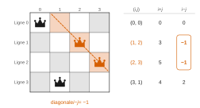
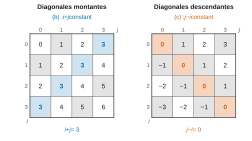
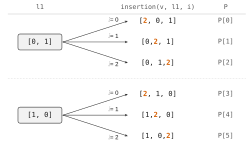
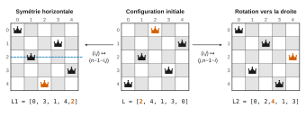
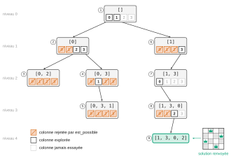
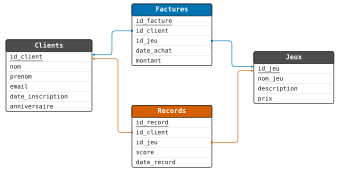

# CCINP TSI — Informatique 2026 · Corrigé brut

*Corrigé rédigé par IA, non officiel. Signalez toute erreur.*

**Rédaction** · Modèle : claude-opus-5-5 · Effort de raisonnement : non renseigné · Mode de vitesse : non renseigné.

**Révision** · Modèle : OpenAI Codex (famille GPT-6) · Effort de raisonnement : non renseigné · Mode de vitesse : non renseigné.

Épreuve de 3 heures, calculatrice interdite. Les codes à compléter suivent le cadre fourni aux candidats. [Document réponse officiel](https://www.concours-commun-inp.fr/_resource/annales%20%C3%A9crits/2026/TSI/2026_TSI5IN_DR.pdf). Convention : la case $(i, j)$ est celle de la ligne $i$ et de la colonne $j$.

## Partie I — Des algorithmes pour résoudre le problème des n reines

### I.1 — Introduction

**Q1.** Dans la configuration perdante, les reines occupent les cases (ligne, colonne) $(0,0)$, $(1,2)$, $(2,3)$ et $(3,1)$. Lignes et colonnes sont distinctes.

Deux cases sont sur une même diagonale montante si elles ont la même somme $i+j$, sur une même diagonale descendante si elles ont la même différence $i-j$. Ici :

| Reine | (0, 0) | (1, 2) | (2, 3) | (3, 1) |
|---|---|---|---|---|
| $i+j$ | 0 | 3 | 5 | 4 |
| $i-j$ | 0 | −1 | −1 | 2 |

Les sommes sont distinctes, mais la différence −1 apparaît deux fois.

**Les reines des cases $(1,2)$ et $(2,3)$ sont sur la même diagonale descendante (elles sont même diagonalement voisines) : elles se contrôlent mutuellement, la configuration ne résout pas le problème.**



**Q2.** On lit, ligne par ligne, la colonne de la reine (contrôle sur la figure 5 : on retrouve bien `[2, 4, 1, 3, 0]`).

$$\boxed{L_{\text{gagnante}} = [2, 0, 3, 1]}$$

$$\boxed{L_{\text{perdante}} = [0, 2, 3, 1]}$$

### I.2 — Mise en place d'un affichage

**Q3.**

```python
def ligne(n):
    L = []
    for k in range(n):
        L.append(0)
    return L
```

(L'écriture `return [0] * n` est également correcte : 0 est un entier, objet non modifiable.)

**Q4.** Il faut $n$ listes **distinctes** en mémoire : on appelle `ligne(n)` à chaque tour, plutôt que d'écrire `[ligne(n)] * n` qui crée $n$ références vers la même liste.

```python
def grille(n):
    G = []
    for i in range(n):
        G.append(ligne(n))
    return G
```

**Q5.** Pour chaque ligne $i$, une seule case vaut 1 : celle de colonne `L[i]`. On l'écrit directement, sans double boucle.

```python
def remplir(L):
    n = len(L)
    G = grille(n)
    for i in range(n):
        G[i][L[i]] = 1
    return G
```

La boucle de placement effectue `len(L)` affectations à coût constant : elle est en $O(\texttt{len(L)})$. (La création de la grille par `grille(n)` coûte, elle, $\Theta(n^2)$, ce qui est incompressible pour une grille $n \times n$.) Sur `[1, 3, 0, 2]`, on obtient `[[0, 1, 0, 0], [0, 0, 0, 1], [1, 0, 0, 0], [0, 0, 1, 0]]`.

**Q6.**

```python
def affiche(G):
    for rangee in G:
        print(rangee)
```

La fonction n'a pas de `return` : elle renvoie `None` et affiche une ligne de la grille par ligne d'écran.

### I.3 — Tester si une configuration est valide

**Q7.** Le codage place exactement une reine par ligne (la reine de la ligne $i$ est en $(i, L[i])$).

- **(a)** Deux reines des lignes $i \neq k$ sont dans la même colonne si et seulement si $L[i] = L[k]$ : (a) traduit **au plus une reine par colonne**.
- **(b)** Le long d'une diagonale montante, on passe de $(i, j)$ à $(i-1, j+1)$ : la somme $i + j$ est constante, et deux cases sont sur la même diagonale montante si et seulement si elles ont même somme. Avec $j = L[i]$, (b) traduit **au plus une reine par diagonale montante**.
- **(c)** Le long d'une diagonale descendante, on passe de $(i, j)$ à $(i+1, j+1)$ : la différence $j - i$ est constante. (c) traduit **au plus une reine par diagonale descendante**.

Avec (d), qui assure qu'il y a $n$ reines, ces conditions disent qu'aucune reine n'en contrôle une autre.



**Q8.**

```python
def tous_distincts(L):
    presents = dict()
    for x in L:
        if x in presents:
            return False
        presents[x] = True
    return True
```

**Q9.** Deux erreurs : la boucle interne part de `i` (le couple $(i, i)$ donne toujours une égalité, la fonction renvoie `True` dès le premier tour pour toute liste non vide) ; les valeurs de retour sont inversées (une égalité prouve qu'il y a un doublon).

```python
def tous_distincts2(L):
    n = len(L)
    for i in range(n):
        for j in range(i + 1, n):
            if L[i] == L[j]:
                return False
    return True
```

Pire des cas : une liste sans doublon (aucune sortie anticipée).

- `tous_distincts` : $n$ tours, chacun formé d'un test `x in presents` et d'une insertion, en $O(1)$ d'après l'annexe 2 : **$O(n)$**.
- `tous_distincts2` : chaque comparaison coûte $O(1)$, et leur nombre est
$$\sum_{i=0}^{n-1} (n - 1 - i) = \frac{n(n-1)}{2},$$
d'où un coût **$O(n^2)$**.

**La version par dictionnaire est linéaire, la version corrigée par double boucle quadratique** (au prix de $O(n)$ cases mémoire supplémentaires pour le dictionnaire).

**Q10.**

```python
def est_possible(L):
    montantes = []
    descendantes = []
    for i in range(len(L)):
        montantes.append(L[i] + i)
        descendantes.append(L[i] - i)
    return tous_distincts(L) and tous_distincts(montantes) and tous_distincts(descendantes)
```

Coût $O(\texttt{len(L)})$. La fonction n'impose pas `len(L) == n`, ce qui permet de l'appliquer à des configurations partielles (I.7). Contrôle : pour `[3, 4, 1, 7, 0, 6, 2, 5]`, les `L[i] + i` valent $3, 5, 3, \dots$ : (b) échoue, la fonction renvoie `False` ; pour `[2, 4, 1, 7, 0, 6, 3, 5]`, les trois listes sont sans doublon, elle renvoie `True`.

**Q11.**

```python
def est_solution(L, n):
    return len(L) == n and est_possible(L)
```

### I.4 — Une première approche par recherche aléatoire

**Q12.** Les trois lignes d’importation, dans l’ordre du document réponse, correspondent aux trois formes d’appel déjà imprimées.

```python
import random as rd
rd.sample(L, len(L))
```

```python
from random import sample
sample(L, len(L))
```

```python
import random
random.sample(L, len(L))
```

Chaque appel produit une nouvelle liste tirée sans remise parmi les éléments de `L`.

**Q13.**

```python
def recherche_aleatoire(n, N):
    L = []
    for i in range(n):
        L.append(i)
    for essai in range(N):
        P = sample(L, len(L))
        if est_solution(P, n):
            return P
    return []
```

Le tirage est fait **dans** la boucle (sinon on testerait $N$ fois la même liste) ; la valeur d'échec est `[]` comme imposé. Coût au pire $O(nN)$.

### I.5 — Déterminer toutes les permutations de L = [0, 1, …, n-1]

**Q14.**

```python
def insertion(x, L, i):
    M = []
    for k in range(i):
        M.append(L[k])
    M.append(x)
    for k in range(i, len(L)):
        M.append(L[k])
    return M
```

`insertion(5, [2, 3, 6, 4], 1)` renvoie `[2, 5, 3, 6, 4]` et `insertion(5, [2, 3, 6, 4], 4)` renvoie `[2, 3, 6, 4, 5]` ; la liste `L` n'est pas modifiée.

Seule une fonction d'insertion toute faite (comme `L.insert`) est interdite : le découpage en tranches est permis, et `return L[:i] + [x] + L[i:]` est une réponse équivalente.

**Q15.** À l'issue du premier passage dans la boucle externe (`l1 = [0, 1]`, $i = 0, 1, 2$) :

$$\boxed{P = [[2, 0, 1],\ [0, 2, 1],\ [0, 1, 2]]}$$

(Si l'on comprend « premier passage » comme le premier tour de la boucle interne, `P` vaut alors `[[2, 0, 1]]`.) Après exécution complète, le second passage (`l1 = [1, 0]`) ajoute trois listes :

$$\boxed{P = [[2, 0, 1],\ [0, 2, 1],\ [0, 1, 2],\ [2, 1, 0],\ [1, 2, 0],\ [1, 0, 2]]}$$

**Ce code construit toutes les permutations de $\{0, 1, 2\}$ à partir de celles de $\{0, 1\}$ : il insère la nouvelle valeur $v = 2$ à chacune des $v + 1 = 3$ positions possibles de chaque permutation de `L`.**

Il n'y a ni oubli ni doublon : en retirant le 2 d'une permutation de $\{0, 1, 2\}$, on retrouve une unique permutation de $\{0, 1\}$ et une unique position d'insertion. On obtient bien $2 \times 3 = 3!$ listes.



**Q16.** Le document réponse commence avec `L = [[0]]`. À chaque étape, `P` reçoit les permutations obtenues en insérant `v` dans les listes de l’étape précédente.

```python
def permutations(n):
    L = [[0]]
    for v in range(1, n):
        P = []
        for l1 in L:
            for i in range(v + 1):
                P.append(insertion(v, l1, i))
        L = P
    return L
```

Avant le tour d’indice $v$, `L` contient les $v!$ permutations de $\{0,\ldots,v-1\}$. Chaque permutation de $\{0,\ldots,v\}$ s’obtient une seule fois : enlever $v$ restitue la liste de départ et sa position d’insertion. Après le dernier tour, `L` contient donc les $n!$ permutations demandées. Par exemple, `permutations(2)` renvoie `[[1, 0], [0, 1]]`. L’ordre des listes est libre. La construction explicite demande $\Theta(n\,n!)$ opérations.

**Q17.**

```python
def configurations(n):
    C = []
    for p in permutations(n):
        if est_solution(p, n):
            C.append(p)
    return C
```

Toute solution est une liste de $n$ entiers distincts de $\{0, \dots, n-1\}$, donc une permutation : elle est produite par `permutations(n)` et retenue ; réciproquement, toute liste retenue vérifie (a), (b), (c), (d). On retrouve 10 configurations pour $n = 5$ et 92 pour $n = 8$.

### I.6 — Classer les configurations similaires

**Q18.** Avec $L = [2, 4, 1, 3, 0]$ et $n = 5$.

- Symétrie horizontale (axe horizontal) : les lignes $i$ et $n - 1 - i$ sont échangées, les colonnes inchangées. La reine de la ligne $i$ passe en ligne $n-1-i$, même colonne, donc $L_1[i] = L[n-1-i]$.

$$\boxed{L_1 = [0, 3, 1, 4, 2]}$$

- Rotation d'un quart de tour vers la droite : la reine $(i, L[i])$ passe en $(L[i], n-1-i)$, donc $L_2[L[i]] = n - 1 - i$. Pour $i = 0, \dots, 4$ :

$$\begin{aligned}
L_2[2] &= 4 \\
L_2[4] &= 3 \\
L_2[1] &= 2 \\
L_2[3] &= 1 \\
L_2[0] &= 0
\end{aligned}$$

$$\boxed{L_2 = [0, 2, 4, 1, 3]}$$

Ces deux listes correspondent aux grilles de la figure 6. **De façon générale, $L_1$ est la liste $L$ lue à l'envers : $L_1[i] = L[n-1-i]$ pour $0 \le i \le n-1$.**



**Q19.**

```python
def symetrie(L):
    n = len(L)
    M = []
    for i in range(n):
        M.append(L[n - 1 - i])
    return M
```

`symetrie([1, 0, 2])` renvoie `[2, 0, 1]`.

**Q20.** La nouvelle liste se remplit à l'indice `L[i]`, et non dans l'ordre : on crée d'abord $n$ cases.

```python
def rotation(L):
    n = len(L)
    M = ligne(n)
    for i in range(n):
        M[L[i]] = n - 1 - i
    return M
```

Comme $L$ est une permutation de $\{0, \dots, n-1\}$, chaque case de `M` est écrite exactement une fois. `rotation([2, 5, 3, 1, 7, 4, 6, 0])` renvoie `[0, 4, 7, 5, 2, 6, 1, 3]`.

**Q21.**

- **Ligne 1** : `C = configurations(n)` place dans `C` la liste de toutes les configurations solutions du problème pour une grille $n \times n$ (Q17).
- **Type renvoyé** : `partition(n)` renvoie **une liste**.
- **Structure** : c'est une **liste de listes de configurations**, c'est-à-dire une liste de listes de listes d'entiers. `P` est la liste des classes ; chaque classe `elt` est une liste non vide de configurations deux à deux similaires ; chaque configuration est une liste de $n$ entiers. Le premier élément `elt[0]` d'une classe est la première configuration de `C` rangée dans cette classe ; il sert de représentant.
- **Fonctionnement** : **la fonction range les configurations solutions une à une dans des classes de configurations similaires : chaque configuration est comparée au premier élément de chaque classe déjà formée ; elle rejoint la classe dont elle est similaire, et ouvre une nouvelle classe si elle n'est similaire à aucune.** La fonction renvoie la liste de ces classes, qui forment une partition de l'ensemble des solutions.

La similarité est une relation d'équivalence (les rotations et symétries du carré forment un groupe) : comparer au seul représentant suffit, et une configuration ne peut pas être similaire à deux représentants distincts (ils seraient similaires entre eux et le second n'aurait pas ouvert de classe). Pour $n = 5$ on obtient 2 classes (8 et 2 configurations), pour $n = 8$ 12 classes (onze de 8 et une de 4).

### I.7 — Des graphes pour aller plus vite et plus loin

**Q22.** Le premier test du document réponse élimine les configurations partielles déjà incompatibles. Le second reconnaît une solution complète. Les trois cases à compléter contiennent successivement `-1`, `n` et `-1`.

```python
def explore(L, n):
    if not est_possible(L):
        return -1
    if len(L) == n:
        return L
    for i in range(n):
        res = explore(L + [i], n)
        if res != -1:
            return res
    return -1

def resout_graphe(n):
    rep = explore([], n)
    return rep
```

Si le préfixe est invalide, toute configuration qui le prolonge contient le même conflit. Si le préfixe est valide et complet, il constitue une solution. Dans le dernier cas, chaque prolongement place sa prochaine reine dans l’une des colonnes explorées par la boucle. Par récurrence sur $n-\mathrm{len}(L)$, l’appel renvoie donc le premier prolongement gagnant ou $-1$ si tous échouent. Chaque appel reçoit une nouvelle liste et la profondeur est au plus $n$. On trouve `resout_graphe(4) = [1, 3, 0, 2]` et `resout_graphe(8) = [0, 4, 7, 5, 2, 6, 1, 3]`.



**Q23.** Une branche invalide contribue zéro solution. Une feuille valide contribue une solution. À un sommet intérieur, on additionne les nombres de solutions de **tous** les enfants.

```python
def explore2(L, n):
    if not est_possible(L):
        return 0
    if len(L) == n:
        return 1
    nb_sol = 0
    for i in range(n):
        nb_sol = nb_sol + explore2(L + [i], n)
    return nb_sol

def compte(n):
    return explore2([], n)
```

Les prolongements obtenus pour deux colonnes différentes sont disjoints. Cette partition justifie la somme par récurrence sur le nombre de lignes à remplir. On obtient `compte(4) = 2`, `compte(5) = 10` et `compte(8) = 92`.

## Partie II — Base de données d'un serveur de jeu en ligne

**Q24.** Le format est `'JJ-MM'` : le 3 juillet s'écrit `'03-07'`.

```sql
SELECT nom, prenom, email
FROM Clients
WHERE anniversaire = '03-07';
```

Sur l'extrait de l'annexe 1, la requête renvoie Jean Dupont et Tom Cruise.

**Q25.**

```sql
SELECT Clients.nom, Clients.prenom, Factures.date_achat
FROM Clients
JOIN Factures ON Clients.id_client = Factures.id_client
WHERE Clients.email = 'myriam.sarr@ccinp.edu';
```

Une ligne par achat du client.



**Q26.** On groupe par la clé primaire du client (deux homonymes ne doivent pas être confondus).

```sql
SELECT Clients.nom, Clients.email, COALESCE(SUM(Factures.montant), 0) AS total
FROM Clients
LEFT JOIN Factures ON Clients.id_client = Factures.id_client
GROUP BY Clients.id_client, Clients.nom, Clients.email;
```

La jointure externe garde aussi le client sans facture. Pour lui, `SUM` donne `NULL` et `COALESCE` inscrit un total de zéro.

**Q27.**

```sql
SELECT Jeux.nom_jeu, MAX(Records.score) AS meilleur_score
FROM Jeux
LEFT JOIN Records ON Jeux.id_jeu = Records.id_jeu
GROUP BY Jeux.id_jeu, Jeux.nom_jeu;
```

Chaque jeu apparaît. Sans record, `MAX` renvoie `NULL`, ce qui distingue l’absence de score d’un record de zéro.

**FIN**
