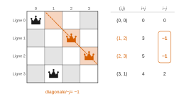
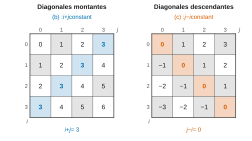
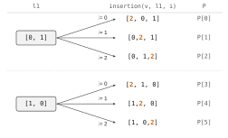
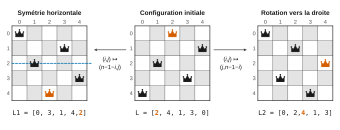
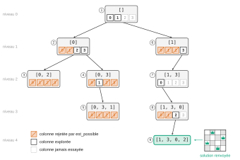
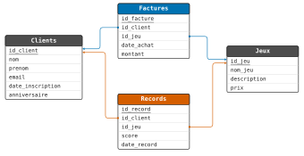

# CCINP TSI — Informatique 2026 · Corrigé brut

*Corrigé rédigé par IA, non officiel. Signalez toute erreur.*

Épreuve de 3 heures, calculatrice interdite. Le Document Réponse (DR), qui porte les codes à trous des Q5, Q12, Q16, Q22 et Q23, n'est pas reproduit ici : ces fonctions sont donc écrites en entier, avec les noms, paramètres et valeurs de retour imposés par l'énoncé. Convention : la case $(i, j)$ est celle de la ligne $i$ et de la colonne $j$.

## Partie I — Des algorithmes pour résoudre le problème des n reines

### I.1 — Introduction

**Q1.** Dans la configuration perdante, les reines occupent les cases (ligne, colonne) $(0,0)$, $(1,2)$, $(2,3)$ et $(3,1)$. Lignes et colonnes sont distinctes.

Deux cases sont sur une même diagonale montante si elles ont la même somme $i+j$, sur une même diagonale descendante si elles ont la même différence $i-j$. Ici :

| Reine | (0, 0) | (1, 2) | (2, 3) | (3, 1) |
|---|---|---|---|---|
| $i+j$ | 0 | 3 | 5 | 4 |
| $i-j$ | 0 | −1 | −1 | 2 |

Les sommes sont distinctes, mais la différence −1 apparaît deux fois.

**Les reines des cases $(1,2)$ et $(2,3)$ sont sur la même diagonale descendante (elles sont même diagonalement voisines) : elles se contrôlent mutuellement, la configuration ne résout pas le problème.**



**Q2.** On lit, ligne par ligne, la colonne de la reine (contrôle sur la figure 5 : on retrouve bien `[2, 4, 1, 3, 0]`).

$$\boxed{L_{\text{gagnante}} = [2, 0, 3, 1]}$$

$$\boxed{L_{\text{perdante}} = [0, 2, 3, 1]}$$

### I.2 — Mise en place d'un affichage

**Q3.**

```python
def ligne(n):
    L = []
    for k in range(n):
        L.append(0)
    return L
```

(L'écriture `return [0] * n` est également correcte : 0 est un entier, objet non modifiable.)

**Q4.** Il faut $n$ listes **distinctes** en mémoire : on appelle `ligne(n)` à chaque tour, plutôt que d'écrire `[ligne(n)] * n` qui crée $n$ références vers la même liste.

```python
def grille(n):
    G = []
    for i in range(n):
        G.append(ligne(n))
    return G
```

**Q5.** Pour chaque ligne $i$, une seule case vaut 1 : celle de colonne `L[i]`. On l'écrit directement, sans double boucle.

```python
def remplir(L):
    n = len(L)
    G = grille(n)
    for i in range(n):
        G[i][L[i]] = 1
    return G
```

La boucle de placement effectue `len(L)` affectations à coût constant : elle est en $O(\texttt{len(L)})$. (La création de la grille par `grille(n)` coûte, elle, $\Theta(n^2)$, ce qui est incompressible pour une grille $n \times n$.) Sur `[1, 3, 0, 2]`, on obtient `[[0, 1, 0, 0], [0, 0, 0, 1], [1, 0, 0, 0], [0, 0, 1, 0]]`.

**Q6.**

```python
def affiche(G):
    for rangee in G:
        print(rangee)
```

La fonction n'a pas de `return` : elle renvoie `None` et affiche une ligne de la grille par ligne d'écran.

### I.3 — Tester si une configuration est valide

**Q7.** Le codage place exactement une reine par ligne (la reine de la ligne $i$ est en $(i, L[i])$).

- **(a)** Deux reines des lignes $i \neq k$ sont dans la même colonne si et seulement si $L[i] = L[k]$ : (a) traduit **au plus une reine par colonne**.
- **(b)** Le long d'une diagonale montante, on passe de $(i, j)$ à $(i-1, j+1)$ : la somme $i + j$ est constante, et deux cases sont sur la même diagonale montante si et seulement si elles ont même somme. Avec $j = L[i]$, (b) traduit **au plus une reine par diagonale montante**.
- **(c)** Le long d'une diagonale descendante, on passe de $(i, j)$ à $(i+1, j+1)$ : la différence $j - i$ est constante. (c) traduit **au plus une reine par diagonale descendante**.

Avec (d), qui assure qu'il y a $n$ reines, ces conditions disent qu'aucune reine n'en contrôle une autre.



**Q8.**

```python
def tous_distincts(L):
    presents = dict()
    for x in L:
        if x in presents:
            return False
        presents[x] = True
    return True
```

**Q9.** Deux erreurs : la boucle interne part de `i` (le couple $(i, i)$ donne toujours une égalité, la fonction renvoie `True` dès le premier tour pour toute liste non vide) ; les valeurs de retour sont inversées (une égalité prouve qu'il y a un doublon).

```python
def tous_distincts2(L):
    n = len(L)
    for i in range(n):
        for j in range(i + 1, n):
            if L[i] == L[j]:
                return False
    return True
```

Pire des cas : une liste sans doublon (aucune sortie anticipée).

- `tous_distincts` : $n$ tours, chacun formé d'un test `x in presents` et d'une insertion, en $O(1)$ d'après l'annexe 2 : **$O(n)$**.
- `tous_distincts2` : chaque comparaison coûte $O(1)$, et leur nombre est
$$\sum_{i=0}^{n-1} (n - 1 - i) = \frac{n(n-1)}{2},$$
d'où un coût **$O(n^2)$**.

**La version par dictionnaire est linéaire, la version corrigée par double boucle quadratique** (au prix de $O(n)$ cases mémoire supplémentaires pour le dictionnaire).

**Q10.**

```python
def est_possible(L):
    montantes = []
    descendantes = []
    for i in range(len(L)):
        montantes.append(L[i] + i)
        descendantes.append(L[i] - i)
    return tous_distincts(L) and tous_distincts(montantes) and tous_distincts(descendantes)
```

Coût $O(\texttt{len(L)})$. La fonction n'impose pas `len(L) == n`, ce qui permet de l'appliquer à des configurations partielles (I.7). Contrôle : pour `[3, 4, 1, 7, 0, 6, 2, 5]`, les `L[i] + i` valent $3, 5, 3, \dots$ : (b) échoue, la fonction renvoie `False` ; pour `[2, 4, 1, 7, 0, 6, 3, 5]`, les trois listes sont sans doublon, elle renvoie `True`.

**Q11.**

```python
def est_solution(L, n):
    return len(L) == n and est_possible(L)
```

### I.4 — Une première approche par recherche aléatoire

**Q12.** Méthode 1, import du module :

```python
import random
P = random.sample(L, len(L))
```

Méthode 2, import de la seule fonction, appel direct (celle utilisée ensuite, puisque l'énoncé écrit `sample(L, len(L))` sans préfixe) :

```python
from random import sample
P = sample(L, len(L))
```

(Troisième forme au programme : `import random as rd`, puis `rd.sample(L, len(L))`.)

**Q13.**

```python
def recherche_aleatoire(n, N):
    L = []
    for i in range(n):
        L.append(i)
    for essai in range(N):
        P = sample(L, len(L))
        if est_solution(P, n):
            return P
    return []
```

Le tirage est fait **dans** la boucle (sinon on testerait $N$ fois la même liste) ; la valeur d'échec est `[]` comme imposé. Coût au pire $O(nN)$.

### I.5 — Déterminer toutes les permutations de L = [0, 1, …, n-1]

**Q14.**

```python
def insertion(x, L, i):
    M = []
    for k in range(i):
        M.append(L[k])
    M.append(x)
    for k in range(i, len(L)):
        M.append(L[k])
    return M
```

`insertion(5, [2, 3, 6, 4], 1)` renvoie `[2, 5, 3, 6, 4]` et `insertion(5, [2, 3, 6, 4], 4)` renvoie `[2, 3, 6, 4, 5]` ; la liste `L` n'est pas modifiée.

Seule une fonction d'insertion toute faite (comme `L.insert`) est interdite : le découpage en tranches est permis, et `return L[:i] + [x] + L[i:]` est une réponse équivalente.

**Q15.** À l'issue du premier passage dans la boucle externe (`l1 = [0, 1]`, $i = 0, 1, 2$) :

$$\boxed{P = [[2, 0, 1],\ [0, 2, 1],\ [0, 1, 2]]}$$

(Si l'on comprend « premier passage » comme le premier tour de la boucle interne, `P` vaut alors `[[2, 0, 1]]`.) Après exécution complète, le second passage (`l1 = [1, 0]`) ajoute trois listes :

$$\boxed{P = [[2, 0, 1],\ [0, 2, 1],\ [0, 1, 2],\ [2, 1, 0],\ [1, 2, 0],\ [1, 0, 2]]}$$

**Ce code construit toutes les permutations de $\{0, 1, 2\}$ à partir de celles de $\{0, 1\}$ : il insère la nouvelle valeur $v = 2$ à chacune des $v + 1 = 3$ positions possibles de chaque permutation de `L`.**

Il n'y a ni oubli ni doublon : en retirant le 2 d'une permutation de $\{0, 1, 2\}$, on retrouve une unique permutation de $\{0, 1\}$ et une unique position d'insertion. On obtient bien $2 \times 3 = 3!$ listes.



**Q16.** On répète le procédé de la Q15 pour $v = 2, 3, \dots, n-1$, en repartant chaque fois de la liste obtenue à l'étape précédente.

```python
def permutations(n):
    P = [[0, 1], [1, 0]]
    for v in range(2, n):
        Q = []
        for l1 in P:
            for i in range(v + 1):
                Q.append(insertion(v, l1, i))
        P = Q
    return P
```

Par récurrence sur $v$ : avant le tour d'indice $v$, `P` contient sans répétition les $v!$ permutations de $\{0, \dots, v-1\}$. L'argument de la Q15 montre qu'après le tour, `P` contient les $(v+1)!$ permutations de $\{0, \dots, v\}$.

En sortie, `P` contient donc les $n!$ permutations de $\{0, \dots, n-1\}$. Pour $n = 2$, la boucle est vide et la fonction renvoie `[[0, 1], [1, 0]]`.

`permutations(3)` renvoie `[[2, 0, 1], [0, 2, 1], [0, 1, 2], [2, 1, 0], [1, 2, 0], [1, 0, 2]]`. Coût $\Theta(n \cdot n!)$.

**Q17.**

```python
def configurations(n):
    C = []
    for p in permutations(n):
        if est_solution(p, n):
            C.append(p)
    return C
```

Toute solution est une liste de $n$ entiers distincts de $\{0, \dots, n-1\}$, donc une permutation : elle est produite par `permutations(n)` et retenue ; réciproquement, toute liste retenue vérifie (a), (b), (c), (d). On retrouve 10 configurations pour $n = 5$ et 92 pour $n = 8$.

### I.6 — Classer les configurations similaires

**Q18.** Avec $L = [2, 4, 1, 3, 0]$ et $n = 5$.

- Symétrie horizontale (axe horizontal) : les lignes $i$ et $n - 1 - i$ sont échangées, les colonnes inchangées. La reine de la ligne $i$ passe en ligne $n-1-i$, même colonne, donc $L_1[i] = L[n-1-i]$.

$$\boxed{L_1 = [0, 3, 1, 4, 2]}$$

- Rotation d'un quart de tour vers la droite : la reine $(i, L[i])$ passe en $(L[i], n-1-i)$, donc $L_2[L[i]] = n - 1 - i$. Pour $i = 0, \dots, 4$ :

$$\begin{aligned}
L_2[2] &= 4 \\
L_2[4] &= 3 \\
L_2[1] &= 2 \\
L_2[3] &= 1 \\
L_2[0] &= 0
\end{aligned}$$

$$\boxed{L_2 = [0, 2, 4, 1, 3]}$$

Ces deux listes correspondent aux grilles de la figure 6. **De façon générale, $L_1$ est la liste $L$ lue à l'envers : $L_1[i] = L[n-1-i]$ pour $0 \le i \le n-1$.**



**Q19.**

```python
def symetrie(L):
    n = len(L)
    M = []
    for i in range(n):
        M.append(L[n - 1 - i])
    return M
```

`symetrie([1, 0, 2])` renvoie `[2, 0, 1]`.

**Q20.** La nouvelle liste se remplit à l'indice `L[i]`, et non dans l'ordre : on crée d'abord $n$ cases.

```python
def rotation(L):
    n = len(L)
    M = ligne(n)
    for i in range(n):
        M[L[i]] = n - 1 - i
    return M
```

Comme $L$ est une permutation de $\{0, \dots, n-1\}$, chaque case de `M` est écrite exactement une fois. `rotation([2, 5, 3, 1, 7, 4, 6, 0])` renvoie `[0, 4, 7, 5, 2, 6, 1, 3]`.

**Q21.**

- **Ligne 1** : `C = configurations(n)` place dans `C` la liste de toutes les configurations solutions du problème pour une grille $n \times n$ (Q17).
- **Type renvoyé** : `partition(n)` renvoie **une liste**.
- **Structure** : c'est une **liste de listes de configurations**, c'est-à-dire une liste de listes de listes d'entiers. `P` est la liste des classes ; chaque classe `elt` est une liste non vide de configurations deux à deux similaires ; chaque configuration est une liste de $n$ entiers. Le premier élément `elt[0]` d'une classe est la première configuration de `C` rangée dans cette classe ; il sert de représentant.
- **Fonctionnement** : **la fonction range les configurations solutions une à une dans des classes de configurations similaires : chaque configuration est comparée au premier élément de chaque classe déjà formée ; elle rejoint la classe dont elle est similaire, et ouvre une nouvelle classe si elle n'est similaire à aucune.** La fonction renvoie la liste de ces classes, qui forment une partition de l'ensemble des solutions.

La similarité est une relation d'équivalence (les rotations et symétries du carré forment un groupe) : comparer au seul représentant suffit, et une configuration ne peut pas être similaire à deux représentants distincts (ils seraient similaires entre eux et le second n'aurait pas ouvert de classe). Pour $n = 5$ on obtient 2 classes (8 et 2 configurations), pour $n = 8$ 12 classes (onze de 8 et une de 4).

### I.7 — Des graphes pour aller plus vite et plus loin

**Q22.** Les sommets du graphe sont les configurations partielles (listes de longueur $k$ au niveau $k$) ; on le parcourt en profondeur, récursivement, en élaguant dès qu'une configuration partielle est invalide. La liste courante sert de pile (`append` pour poser une reine, `pop` pour revenir en arrière). La signature `explore(L, n)` est une hypothèse, le DR n'étant pas disponible.

```python
def explore(L, n):
    if len(L) == n:
        return L
    for j in range(n):
        L.append(j)
        if est_possible(L):
            R = explore(L, n)
            if R != -1:
                return R
        L.pop()
    return -1

def resout_graphe(n):
    return explore([], n)
```

Correction (récurrence sur $n - \texttt{len(L)}$) : si `L` est une configuration partielle valide, `explore(L, n)` renvoie une solution prolongeant `L` s'il en existe, et $-1$ sinon, en laissant `L` intacte en cas d'échec. En effet, toute solution prolongeant `L` commence par `L + [j]` pour un $j$, et `L + [j]` est alors valide (un préfixe d'une configuration valide est valide) : la boucle examine tous les $j$, l'élagage ne supprime aucune solution, et chaque `append` est défait par un `pop` en cas d'échec. Terminaison : $n - \texttt{len(L)}$ décroît strictement à chaque appel, la profondeur est au plus $n$. On obtient `resout_graphe(4) = [1, 3, 0, 2]` et `resout_graphe(8) = [0, 4, 7, 5, 2, 6, 1, 3]`.



**Q23.** On ne s'arrête plus à la première solution : on renvoie 1 pour une configuration complète et on additionne les résultats des sous-arbres.

```python
def explore2(L, n):
    if len(L) == n:
        return 1
    total = 0
    for j in range(n):
        L.append(j)
        if est_possible(L):
            total = total + explore2(L, n)
        L.pop()
    return total

def compte(n):
    return explore2([], n)
```

Par la même récurrence, `explore2(L, n)` renvoie le nombre de solutions prolongeant la configuration partielle valide `L` : ces prolongements se répartissent, sans recouvrement, selon la colonne $j$ de la reine suivante. On obtient `compte(4) = 2`, `compte(5) = 10`, `compte(8) = 92`, en accord avec la Q17.

## Partie II — Base de données d'un serveur de jeu en ligne

**Q24.** Le format est `'JJ-MM'` : le 3 juillet s'écrit `'03-07'`.

```sql
SELECT nom, prenom, email
FROM Clients
WHERE anniversaire = '03-07';
```

Sur l'extrait de l'annexe 1, la requête renvoie Jean Dupont et Tom Cruise.

**Q25.**

```sql
SELECT Clients.nom, Clients.prenom, Factures.date_achat
FROM Clients
JOIN Factures ON Clients.id_client = Factures.id_client
WHERE Clients.email = 'myriam.sarr@ccinp.edu';
```

Une ligne par achat du client.



**Q26.** On groupe par la clé primaire du client (deux homonymes ne doivent pas être confondus).

```sql
SELECT Clients.nom, Clients.email, SUM(Factures.montant) AS total
FROM Clients
JOIN Factures ON Clients.id_client = Factures.id_client
GROUP BY Clients.id_client, Clients.nom, Clients.email;
```

La jointure interne ne fait apparaître que les clients ayant au moins un achat ; un client sans facture, dont le total serait nul, n'est pas listé.

**Q27.**

```sql
SELECT Jeux.nom_jeu, MAX(Records.score) AS meilleur_score
FROM Jeux
JOIN Records ON Jeux.id_jeu = Records.id_jeu
GROUP BY Jeux.id_jeu, Jeux.nom_jeu;
```

Une ligne par jeu ayant au moins un record, avec le score maximal enregistré pour ce jeu.

**FIN**
