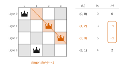
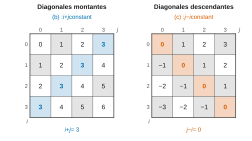
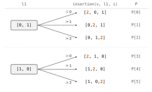
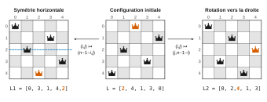
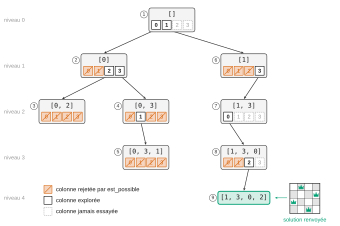
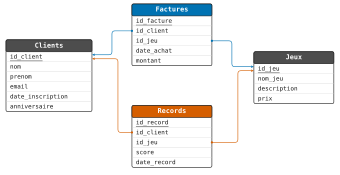

# CCINP TSI — Informatique 2026 · Corrigé guidé

*Corrigé rédigé par IA, non officiel. Signalez toute erreur.*

## Présentation du sujet

**Thème.** « Autour de jeux » : le sujet résout trois fois le problème des $n$ reines (placer $n$ reines sur une grille $n \times n$ sans qu'aucune n'en contrôle une autre), par des méthodes de coût très différent, puis propose un court exercice de bases de données sur un site de jeux en ligne.

**Format.** 3 heures, calculatrice interdite, 27 questions. Les réponses se rédigent sur un Document Réponse (DR) qui contient les codes à trous des Q5, Q12, Q16, Q22 et Q23. Ce DR n'est pas reproduit ici : les fonctions correspondantes sont écrites en entier, avec les noms, paramètres et valeurs de retour imposés par l'énoncé. L'annexe 2 rappelle la syntaxe Python utile et les coûts des opérations élémentaires (dictionnaire en $O(1)$, `x in L` en $O(\texttt{len(L)})$).

**Découpage.**

| Sous-partie | Questions | Contenu |
|---|---|---|
| I.1 Introduction | Q1–Q2 | lecture de grilles, codage d'une configuration par une liste |
| I.2 Affichage | Q3–Q6 | listes, listes de listes, piège des références partagées |
| I.3 Validité | Q7–Q11 | caractérisation des diagonales, dictionnaire, complexité |
| I.4 Recherche aléatoire | Q12–Q13 | import de module, boucle avec sortie anticipée |
| I.5 Permutations | Q14–Q17 | insertion, génération de toutes les permutations, filtrage |
| I.6 Similitudes | Q18–Q21 | symétrie, rotation, lecture d'un algorithme de partition |
| I.7 Graphe et retour sur trace | Q22–Q23 | parcours en profondeur récursif avec élagage, dénombrement |
| II Bases de données | Q24–Q27 | sélection, jointure, agrégats `SUM` et `MAX` avec `GROUP BY` |

**Notions mobilisées.** Listes Python (création, `append`, `pop`, indices), dictionnaires, fonctions et récursivité, complexité dans le pire des cas, invariant et récurrence pour justifier un algorithme, parcours de graphe en profondeur, SQL (`SELECT`, `WHERE`, `JOIN … ON`, `GROUP BY`, `SUM`, `MAX`).

**Difficulté.** Sujet de difficulté modérée et très guidé, avec beaucoup d'exemples dans l'énoncé : chacun permet de tester sa fonction à la main, et il faut le faire. Les sous-parties sont presque indépendantes (admettre Q11 pour I.4 et I.5, Q17 pour I.6, Q10 pour I.7).

**Ce qu'en dit le jury (rapport 2026).** Le sujet a été bien compris et le rapport le juge « discriminant ». Les questions qui ont fait la différence sont :

- Q9, où les deux corrections attendues ont rarement été trouvées ensemble ;
- Q14 (insertion, « assez mal traitée »), Q16 (permutations, peu de bonnes réponses), Q19 (renversement sans découpage, pas si souvent réussi) et Q20 (rotation, « plus difficile ») ;
- Q21, dont l'explication a rarement été claire ;
- Q26 et Q27, les deux requêtes avec agrégat et `GROUP BY`, explicitement qualifiées de discriminantes.

Le rapport signale aussi des questions faciles qui ont coûté des points : Q3 (liste de $n$ zéros), Q4 (listes liées), Q6 (affichage) et surtout Q12 (import de module).

**À ne pas laisser passer.** Q1, Q2, Q3, Q4, Q6, Q8, Q11, Q12, Q18, Q24 et Q25 sont courtes et sans piège caché pour qui connaît les bases (listes, dictionnaires, imports, jointure simple). La partie II est indépendante : la traiter dès le début, ou du moins ne pas la sacrifier en fin d'épreuve, car Q26 et Q27 rapportent à qui maîtrise `GROUP BY`.

**Gestion du temps.** Environ 2 h 20 pour la partie I (en gardant 30 à 40 minutes pour I.5 à I.7) et 25 minutes pour la partie II, plus une relecture.

## Partie I — Des algorithmes pour résoudre le problème des n reines

La partie I construit pas à pas les outils (codage, affichage, test de validité), puis compare trois stratégies de recherche : tirage au hasard, énumération exhaustive, parcours élagué du graphe des placements partiels.

### Question 1

> [!INDICATION]
> Relevez les quatre cases occupées sous la forme (ligne, colonne), puis vérifiez une à une les quatre familles d'alignements.

> [!INDICATION]
> Trouvez une quantité, fonction de $i$ et $j$, qui reste constante le long d'une diagonale descendante.

#### Solution

Dans la configuration perdante, les reines occupent les cases (ligne, colonne) $(0,0)$, $(1,2)$, $(2,3)$ et $(3,1)$. Lignes et colonnes sont deux à deux distinctes.

Le long d'une diagonale montante, la somme $i + j$ est constante ; le long d'une diagonale descendante, la différence $i - j$ est constante. Ici :

| Reine | (0, 0) | (1, 2) | (2, 3) | (3, 1) |
|---|---|---|---|---|
| $i+j$ | 0 | 3 | 5 | 4 |
| $i-j$ | 0 | −1 | −1 | 2 |

Les sommes sont distinctes, mais la différence −1 apparaît deux fois.

**Les reines des cases $(1,2)$ et $(2,3)$ sont sur la même diagonale descendante (elles sont même voisines en diagonale) : elles se contrôlent, la configuration ne résout pas le problème.**



> [!PIEGE]
> Répondre seulement « deux reines se contrôlent » ne suffit pas pour un « expliquer pourquoi » : il faut désigner les deux reines et la diagonale concernée.

### Question 2

> [!INDICATION]
> `L[i]` est le numéro de **colonne** de la reine de la ligne `i`. Vérifiez votre lecture sur la figure 5, dont la liste est donnée.

#### Solution

On parcourt les lignes de haut en bas et on relève la colonne de la reine. Sur la figure 5, cela redonne bien `[2, 4, 1, 3, 0]`. Pour la figure 4 :

$$\boxed{L_{\text{gagnante}} = [2, 0, 3, 1]}$$

$$\boxed{L_{\text{perdante}} = [0, 2, 3, 1]}$$

> [!PIEGE]
> Écrire la liste « réciproque » (ligne de la reine de la colonne $j$) : pour la configuration gagnante on obtiendrait `[1, 3, 0, 2]`, qui est aussi une solution valide, si bien qu'aucun test de validité ne révèle l'erreur. Seul le contrôle sur l'exemple de la figure 5 la détecte.

## I.2 — Mise en place d'un affichage

Quatre fonctions courtes de manipulation de listes. Le point important est la différence entre une liste de listes **distinctes** et une liste de références vers la même liste.

### Question 3

> [!INDICATION]
> Partez d'une liste vide et ajoutez des zéros, ou utilisez la répétition de liste par `*`.

#### Solution

```python
def ligne(n):
    L = []
    for k in range(n):
        L.append(0)
    return L
```

L'écriture `return [0] * n` est aussi correcte : les $n$ cases contiennent le même entier 0, objet non modifiable, ce qui ne pose aucun problème. `ligne(5)` renvoie `[0, 0, 0, 0, 0]`.

### Question 4

> [!INDICATION]
> Le mot « distinctes » est un avertissement. Que se passe-t-il si l'on modifie une case de `[ligne(n)] * n` ?

> [!INDICATION]
> Chaque appel à `ligne(n)` crée une nouvelle liste.

#### Solution

```python
def grille(n):
    G = []
    for i in range(n):
        G.append(ligne(n))
    return G
```

Chaque tour de boucle crée une nouvelle liste par `ligne(n)` : les $n$ lignes sont distinctes en mémoire. Après `G = grille(3)` puis `G[0][0] = 1`, seule la première ligne est modifiée. Coût $\Theta(n^2)$.

> [!PIEGE]
> `[ligne(n)] * n` ou `[[0] * n] * n` s'affichent correctement, mais contiennent $n$ fois **la même** liste : `G[0][0] = 1` modifie alors toutes les lignes, et `remplir` (Q5) devient fausse. Même faute, plus discrète : créer une seule liste `L = ligne(n)` avant la boucle, puis faire `G.append(L)` à chaque tour.

> [!JURY]
> Rapport 2026 : « L'erreur la plus fréquente concernait la création de listes liées », sous les deux formes ci-dessus. Le jury y voit une finesse de Python à maîtriser, les listes de listes servant dans de nombreux problèmes.

### Question 5

> [!INDICATION]
> Pour une ligne $i$ donnée, combien de cases doivent valoir 1, et laquelle ?

> [!INDICATION]
> Inutile de tester tous les couples $(i, j)$ : on peut écrire directement à la bonne place.

#### Solution

```python
def remplir(L):
    n = len(L)
    G = grille(n)
    for i in range(n):
        G[i][L[i]] = 1
    return G
```

La boucle de placement fait `len(L)` affectations à coût constant : elle est en $O(\texttt{len(L)})$, au lieu des $n^2$ tests `if L[i] == j` d'une double boucle. La création de la grille coûte, elle, $\Theta(n^2)$, ce qu'aucune fonction renvoyant une grille $n \times n$ ne peut éviter : la linéarité valorisée par l'énoncé porte sur la phase de remplissage. Sur `[1, 3, 0, 2]`, on obtient `[[0, 1, 0, 0], [0, 0, 0, 1], [1, 0, 0, 0], [0, 0, 1, 0]]`, la sortie annoncée.

> [!PIEGE]
> Écrire `G[L[i]][i] = 1` donne la grille transposée ; l'exemple de l'énoncé permet de le détecter immédiatement. Oublier le `return` fait renvoyer `None`.

> [!JURY]
> Rapport 2026 : « La difficulté résidait dans l’évitement d’une double boucle pour avoir une complexité en O(n). »

### Question 6

> [!INDICATION]
> L'affichage d'une liste par `print` produit exactement la forme demandée pour une ligne.

#### Solution

```python
def affiche(G):
    for rangee in G:
        print(rangee)
```

La fonction ne comporte pas de `return` (elle renvoie `None`) et affiche une ligne de la grille par ligne d'écran. Un unique `print(G)` ne convient pas : il réafficherait toute la liste de listes sur une seule ligne.

> [!METHODE]
> « Renvoyer » et « afficher » sont deux choses différentes : une fonction d'affichage n'a pas de `return`, une fonction de calcul n'affiche rien.

> [!JURY]
> Rapport 2026 : « Pourtant facile, cette question a perturbé un nombre non négligeable de candidats. » Le jury rappelle que l'annexe 2 donnait tout ce qu'il fallait savoir sur `print` : chaque appel affiche son argument puis passe à la ligne.

## I.3 — Tester si une configuration est valide

On traduit la règle du jeu en conditions sur la liste, puis on les teste efficacement grâce à un dictionnaire. C'est le cœur technique de la partie : `tous_distincts` et `est_possible` servent jusqu'à la fin.

### Question 7

> [!INDICATION]
> Le codage par une liste impose déjà une contrainte : laquelle ?

> [!INDICATION]
> Quand on se déplace d'une case le long d'une diagonale montante, comment évoluent $i$ et $j$ ? Quelle combinaison reste constante ? Même question pour une diagonale descendante.

#### Solution

Le codage place exactement une reine par ligne : la reine de la ligne $i$ est en $(i, L[i])$. Aucune condition n'est donc nécessaire pour les lignes.

- **(a)** Deux reines des lignes $i \neq k$ sont dans la même colonne si et seulement si $L[i] = L[k]$ : (a) exprime qu'il y a **au plus une reine par colonne**.
- **(b)** Une diagonale montante se parcourt par $(i, j) \mapsto (i-1, j+1)$, qui conserve $i + j$ ; deux cases sont sur la même diagonale montante si et seulement si elles ont la même somme $i + j$. Avec $j = L[i]$, (b) exprime qu'il y a **au plus une reine par diagonale montante**.
- **(c)** Une diagonale descendante se parcourt par $(i, j) \mapsto (i+1, j+1)$, qui conserve $j - i$ : (c) exprime qu'il y a **au plus une reine par diagonale descendante**.

Avec (d), qui garantit la présence de $n$ reines, ces conditions disent exactement qu'aucune reine n'en contrôle une autre.



> [!PIEGE]
> Échanger (b) et (c). Contrôle immédiat sur la figure 1 : la case $(3, 0)$ et la case $(0, 3)$ sont sur la même diagonale montante, et toutes deux ont $i + j = 3$. Autre confusion relevée par le jury : intervertir lignes et colonnes (c'est la colonne qui est stockée dans `L[i]`).

> [!JURY]
> Rapport 2026 : « Aucune justification approfondie n’était attendue (notamment sur le respect de (b) et (c)). » Une phrase par condition suffit ; la justification par les invariants $i + j$ et $j - i$ donnée ci-dessus est un plus, pas une exigence.

### Question 8

> [!INDICATION]
> Suivez exactement l'algorithme décrit : un dictionnaire des éléments déjà vus, une sortie anticipée au premier doublon.

#### Solution

```python
def tous_distincts(L):
    presents = dict()
    for x in L:
        if x in presents:
            return False
        presents[x] = True
    return True
```

Invariant : au début du tour traitant $x_k$, les clés de `presents` sont exactement $x_0, \dots, x_{k-1}$, deux à deux distincts. Si $x_k$ est déjà une clé, il y a un doublon et `False` est correct ; sinon on l'insère et l'invariant se conserve. En fin de boucle, tous les éléments sont distincts et l'on renvoie `True`.

> [!PIEGE]
> Remplacer le dictionnaire par une liste : le test `x in presents` devient linéaire et la fonction quadratique, ce qui ruine l'intérêt de la méthode.

> [!PIEGE]
> Écrire `presents.append(x)` : un dictionnaire n'a pas de méthode `append`. On insère un couple (clé, valeur) par affectation, `presents[x] = True`.

> [!JURY]
> Rapport 2026 : l'évaluation portait sur la maîtrise des dictionnaires et sur la logique de la démarche, et les erreurs d'insertion d'un couple étaient fréquentes. « Rappelons que la méthode append est spécifique aux listes Python. »

### Question 9

> [!INDICATION]
> Exécutez le code de l'étudiant à la main sur `[1, 2, 3]` : que renvoie-t-il dès le premier tour ?

> [!INDICATION]
> Il y a deux erreurs indépendantes : l'une porte sur les bornes de la boucle interne, l'autre sur les valeurs renvoyées.

> [!INDICATION]
> Pour les complexités, identifiez d'abord le pire des cas (quand n'y a-t-il aucune sortie anticipée ?), puis comptez les tours de boucle et le coût de chaque tour grâce à l'annexe 2.

#### Solution

Erreurs du code proposé :

- ligne 3 : la boucle interne commence à `i` ; le couple $(i, i)$ vérifie toujours `L[i] == L[j]`, donc la fonction s'arrête au premier tour pour toute liste non vide. Il faut partir de `i + 1` ;
- lignes 5 et 6 : les valeurs de retour sont inversées ; trouver deux éléments égaux prouve que les éléments ne sont **pas** tous distincts.

```python
def tous_distincts2(L):
    n = len(L)
    for i in range(n):
        for j in range(i + 1, n):
            if L[i] == L[j]:
                return False
    return True
```

Pour les deux fonctions, le pire des cas est une liste sans doublon, qui ne déclenche aucune sortie anticipée.

- `tous_distincts` : $n$ tours ; chaque tour fait un test d'appartenance à un dictionnaire et une insertion, en $O(1)$ d'après l'annexe 2. Coût **$O(n)$**.
- `tous_distincts2` corrigée : le nombre de comparaisons (chacune en $O(1)$) est
$$\sum_{i=0}^{n-1} (n-1-i) = \frac{n(n-1)}{2},$$
soit un coût **$O(n^2)$**.

**La première version est linéaire, la seconde quadratique.** Le gain vient du test d'appartenance à coût constant du dictionnaire ; en contrepartie, `tous_distincts` utilise $O(n)$ cases mémoire supplémentaires.

> [!METHODE]
> Pour une complexité « dans le pire des cas », dites toujours quel est ce pire cas avant de compter. Ici, c'est la liste sans doublon, car un doublon provoque une sortie immédiate.

> [!PIEGE]
> Ne corriger qu'une des deux erreurs, le plus souvent en gardant `range(i, n)`. Autre faute : « corriger » en déplaçant les `return` (par exemple `return True` remonté dans la boucle), ce qui ajoute une erreur au lieu d'en ôter une.

> [!JURY]
> Rapport 2026 : il fallait conserver la structure de la fonction et corriger les indices et l'inversion de `True` et `False`. « Les deux corrections attendues étaient rarement présentes toutes les deux. » Pour la complexité de `tous_distincts`, le jury aurait voulu voir plus souvent écrit que le test d'appartenance à un dictionnaire est en $O(1)$, comme l'indique l'annexe 2 : c'est l'argument central.

### Question 10

> [!INDICATION]
> D'après la Q7, il suffit de vérifier qu'il n'y a pas de doublon dans trois listes. Lesquelles ?

#### Solution

```python
def est_possible(L):
    montantes = []
    descendantes = []
    for i in range(len(L)):
        montantes.append(L[i] + i)
        descendantes.append(L[i] - i)
    return tous_distincts(L) and tous_distincts(montantes) and tous_distincts(descendantes)
```

Coût $O(\texttt{len(L)})$.

Pour `[3, 4, 1, 7, 0, 6, 2, 5]`, les `L[i] + i` valent `[3, 5, 3, 10, 4, 11, 8, 12]`. La valeur 3 est répétée : les reines $(0, 3)$ et $(2, 1)$ sont sur la même diagonale montante, et la fonction renvoie `False`. Pour `[2, 4, 1, 7, 0, 6, 3, 5]`, les trois listes sont sans doublon et elle renvoie `True`.

> [!METHODE]
> La fonction n'utilise jamais $n$ et n'impose pas `len(L) == n` : elle s'applique donc à une configuration **partielle**, ce qui la rend utilisable comme test d'élagage en I.7.

> [!JURY]
> Rapport 2026 : deux étapes étaient attendues, construire les listes des `L[i] + i` et des `L[i] - i`, puis enchaîner les tests (par `and` ou par des `if` successifs). « C’est la première étape qui a été le plus souvent mal traitée. »

### Question 11

> [!INDICATION]
> Des quatre conditions, trois sont déjà testées par `est_possible`.

#### Solution

```python
def est_solution(L, n):
    return len(L) == n and est_possible(L)
```

`est_solution([2, 0, 3, 1], 4)` renvoie `True` et `est_solution([0, 2, 3, 1], 4)` renvoie `False`.

> [!PIEGE]
> Oublier le test sur la longueur, ou poser `n = len(L)` dans la fonction, ce qui rend la condition (d) toujours vraie : `[0, 2]` passerait pour une solution d'une grille $5 \times 5$.

> [!JURY]
> Rapport 2026 : question simple, bien traitée « sauf par les candidats ayant oublié le test sur la longueur de L. »

## I.4 — Une première approche par recherche aléatoire

On tire des permutations au hasard jusqu'à en trouver une valide. La méthode est simple, mais elle ne prouve rien en cas d'échec.

### Question 12

> [!INDICATION]
> Selon la forme de l'import, l'appel s'écrit avec ou sans le nom du module devant `sample`.

> [!INDICATION]
> L'énoncé indique que, avec la méthode 2, on écrit directement `sample(L, len(L))`.

#### Solution

Méthode 1 : on importe le module, l'appel est préfixé.

```python
import random
P = random.sample(L, len(L))
```

Méthode 2 : on importe la seule fonction, l'appel est direct. C'est celle utilisée dans la suite.

```python
from random import sample
P = sample(L, len(L))
```

Troisième forme au programme : `import random as rd`, puis `rd.sample(L, len(L))`.

> [!PIEGE]
> `from random import sample` suivi de `random.sample(...)` provoque une erreur : le nom `random` n'est alors pas défini. Inversement, après `import random`, un appel `sample(...)` sans préfixe échoue.

> [!JURY]
> Rapport 2026 : « Savoir importer correctement des modules Python est une compétence de base. » Cette question, qui aurait dû être très facile, a pourtant reçu un nombre assez important de réponses partiellement ou totalement fausses.

### Question 13

> [!INDICATION]
> Trois blocs : construire `[0, 1, …, n-1]`, au plus $N$ essais avec sortie dès le premier succès, valeur d'échec.

> [!INDICATION]
> Où doit se trouver l'appel à `sample` pour que chaque essai teste une nouvelle permutation ?

#### Solution

```python
def recherche_aleatoire(n, N):
    L = []
    for i in range(n):
        L.append(i)
    for essai in range(N):
        P = sample(L, len(L))
        if est_solution(P, n):
            return P
    return []
```

Chaque tirage est une permutation de $\{0, \dots, n-1\}$ : (a) et (d) sont automatiquement vérifiées, le test porte en pratique sur les diagonales. La fonction renvoie la première solution trouvée, `[]` après $N$ échecs. Coût au pire $O(nN)$.

Ordre de grandeur : pour $n = 8$, il y a 92 solutions parmi $8! = 40\,320$ permutations, soit environ une chance sur 438 par tirage ; $100\,000$ tirages suffisent largement.

> [!PIEGE]
> Tirer la permutation avant la boucle (on teste $N$ fois la même liste), ou renvoyer `False` ou `-1` au lieu de la liste vide imposée.

> [!PIEGE]
> Écrire `if est_solution(sample(L, len(L)), n): return sample(L, len(L))` : le second appel tire une **nouvelle** permutation, qui n'a pas été testée. On range le tirage dans une variable, on teste cette variable et on renvoie cette variable. De même, `return []` doit être placé **après** la boucle, pas dans un `else` à l'intérieur.

> [!JURY]
> Rapport 2026 : le jury relève des erreurs de logique sur la position des `return` et, comme erreur classique, le double appel à `sample` décrit ci-dessus.

## I.5 — Déterminer toutes les permutations de L = [0, 1, …, n-1]

On construit les permutations de $\{0, \dots, n-1\}$ par insertions successives, puis on filtre celles qui sont des solutions. La méthode est exhaustive mais son coût croît comme $n!$.

### Question 14

> [!INDICATION]
> Construisez une nouvelle liste en trois temps : le début, l'élément inséré, la fin.

#### Solution

```python
def insertion(x, L, i):
    M = []
    for k in range(i):
        M.append(L[k])
    M.append(x)
    for k in range(i, len(L)):
        M.append(L[k])
    return M
```

La liste `L` n'est pas modifiée, ce qui compte puisque la même liste sert à plusieurs insertions en Q15 et Q16. `insertion(5, [2, 3, 6, 4], 1)` renvoie `[2, 5, 3, 6, 4]` et `insertion(5, [2, 3, 6, 4], 4)` renvoie `[2, 3, 6, 4, 5]` (la seconde boucle est alors vide).

Seule une fonction d'insertion toute faite (comme `L.insert`) est interdite : le découpage en tranches est permis, et `return L[:i] + [x] + L[i:]` est une réponse équivalente, plus courte.

> [!PIEGE]
> Faire commencer la seconde boucle à `i + 1` : l'élément `L[i]` est perdu. Ou arrêter la première boucle à `i - 1` exclu, avec `range(i - 1)` : l'élément `L[i-1]` disparaît. Vérifiez les bornes sur les deux exemples de l'énoncé, dont l'un insère en fin de liste.

> [!JURY]
> Rapport 2026 : « Question classique mais assez mal traitée. Le slicing était autorisé mais peu utilisé. » Chez les candidats qui avaient une démarche cohérente, c'est souvent la gestion des indices qui a posé problème.

### Question 15

> [!INDICATION]
> Déroulez le code à la main, en appliquant `insertion` pour $i = 0, 1, 2$ dans cet ordre.

> [!INDICATION]
> Pour l'explication, comparez les éléments de `L` à ceux de `P` : de quels ensembles sont-ils les permutations ?

#### Solution

À l'issue du premier passage dans la boucle externe (`l1 = [0, 1]`) :

$$\boxed{P = [[2, 0, 1],\ [0, 2, 1],\ [0, 1, 2]]}$$

(Si l'on comprend « premier passage » comme le premier tour de la boucle interne, `P` vaut alors `[[2, 0, 1]]`.) Le second passage (`l1 = [1, 0]`) ajoute `[2, 1, 0]`, `[1, 2, 0]`, `[1, 0, 2]`. Après exécution complète :

$$\boxed{P = [[2, 0, 1],\ [0, 2, 1],\ [0, 1, 2],\ [2, 1, 0],\ [1, 2, 0],\ [1, 0, 2]]}$$

**Le code construit toutes les permutations de $\{0, 1, 2\}$ à partir des permutations de $\{0, 1\}$ rangées dans `L` : il insère la valeur $v = 2$ à chacune des trois positions possibles.**

Il n'y a ni oubli ni doublon : en retirant le 2 d'une permutation de $\{0, 1, 2\}$, on retrouve une unique permutation de $\{0, 1\}$ et une unique position d'insertion. On obtient bien $2 \times 3 = 3!$ listes.

> [!JURY]
> Rapport 2026 : il s'agissait d'exécuter un code pas à pas ; le travail prenait un peu de temps, et il a été valorisé. Le jury ajoute que la Q16 devenait assez facile pour qui avait bien compris celle-ci.



### Question 16

> [!INDICATION]
> Le code de la Q15 fait passer de $\{0, 1\}$ à $\{0, 1, 2\}$. Comment passer de $\{0, \dots, v-1\}$ à $\{0, \dots, v\}$ ?

> [!INDICATION]
> Répétez ce passage pour $v$ allant de 2 à $n - 1$, en rangeant chaque nouvelle génération dans une liste auxiliaire.

#### Solution

```python
def permutations(n):
    P = [[0, 1], [1, 0]]
    for v in range(2, n):
        Q = []
        for l1 in P:
            for i in range(v + 1):
                Q.append(insertion(v, l1, i))
        P = Q
    return P
```

Récurrence sur $v$ : avant le tour d'indice $v$, `P` contient sans répétition les $v!$ permutations de $\{0, \dots, v-1\}$ (vrai pour $v = 2$).

Le tour construit toutes les insertions de $v$ à l'une des $v + 1$ positions. Comme en Q15, chaque permutation de $\{0, \dots, v\}$ est obtenue exactement une fois, d'où $(v+1)!$ listes.

En sortie, `P` contient les $n!$ permutations de $\{0, \dots, n-1\}$. Pour $n = 2$, la boucle est vide.

`permutations(3)` renvoie `[[2, 0, 1], [0, 2, 1], [0, 1, 2], [2, 1, 0], [1, 2, 0], [1, 0, 2]]`, les six listes attendues dans un autre ordre, ce que l'énoncé autorise. Coût $\Theta(n \cdot n!)$.

> [!PIEGE]
> Ajouter directement dans `P` pendant qu'on le parcourt : une boucle `for` visite aussi les éléments ajoutés en cours de route, la liste grossit sans fin et la boucle ne termine pas. D'où la liste auxiliaire `Q`.

> [!METHODE]
> Une version récursive est aussi recevable : `permutations(n)` appelle `permutations(n - 1)` et insère $n - 1$ à toutes les positions, avec un cas de base explicite.

> [!JURY]
> Rapport 2026 : question assez facile pour qui avait compris la Q15, et pourtant « Peu de bonnes réponses ont été observées. » Le code de la Q15 est exactement le corps de la boucle sur `v` : il suffit de le généraliser.

### Question 17

> [!INDICATION]
> « En déduire » : combinez les fonctions des Q16 et Q11.

#### Solution

```python
def configurations(n):
    C = []
    for p in permutations(n):
        if est_solution(p, n):
            C.append(p)
    return C
```

Toute solution est une liste de $n$ entiers distincts de $\{0, \dots, n-1\}$ (conditions (a) et (d)), donc une permutation : elle est produite par `permutations(n)` et retenue. Réciproquement, toute liste retenue vérifie les quatre conditions. On retrouve 10 configurations pour $n = 5$ et 92 pour $n = 8$.

Coût $\Theta(n \cdot n!)$, ce qui limite la méthode à $n \approx 10$ ($10! \approx 3{,}6 \times 10^6$).

> [!PIEGE]
> Appeler `est_solution(p)` en oubliant le second paramètre : l'appel lève une erreur. La signature de la Q11 impose `est_solution(L, n)`.

> [!JURY]
> Rapport 2026 : « L'oubli du paramètre dans l'appel à est_solution était l'erreur la plus récurrente. »

## I.6 — Classer les configurations similaires

On transforme une configuration par les isométries du carré, puis on lit un algorithme qui regroupe les configurations équivalentes.

### Question 18

> [!INDICATION]
> Lisez les grilles de la figure 6 ligne par ligne, comme en Q2.

> [!INDICATION]
> Pour la rotation, utilisez la règle donnée en Q20 : où arrive la reine de la case $(i, L[i])$ ? Dans la nouvelle liste, quel indice reçoit quelle valeur ?

#### Solution

Avec $L = [2, 4, 1, 3, 0]$, $n = 5$.

Symétrie horizontale (axe horizontal) : les lignes $i$ et $n - 1 - i$ sont échangées, les colonnes inchangées. La reine de la ligne $i$ passe en ligne $n - 1 - i$, même colonne, donc $L_1[i] = L[n-1-i]$ :

$$\boxed{L_1 = [0, 3, 1, 4, 2]}$$

Rotation d'un quart de tour vers la droite : la reine $(i, L[i])$ passe en $(L[i], n-1-i)$, donc $L_2[L[i]] = n - 1 - i$. Pour $i = 0, \dots, 4$, on obtient :

$$\begin{aligned}
L_2[2] &= 4 \\
L_2[4] &= 3 \\
L_2[1] &= 2 \\
L_2[3] &= 1 \\
L_2[0] &= 0
\end{aligned}$$

d'où :

$$\boxed{L_2 = [0, 2, 4, 1, 3]}$$

On retrouve les grilles de la figure 6. **De façon générale, $L_1$ est la liste $L$ lue à l'envers : $L_1[i] = L[n-1-i]$.**



> [!PIEGE]
> Confondre symétrie d'axe horizontal (échange des lignes) et symétrie d'axe vertical (échange des colonnes, qui donnerait $n - 1 - L[i]$). L'exemple de la Q19, `[1, 0, 2]` donnant `[2, 0, 1]`, tranche.

### Question 19

> [!INDICATION]
> Parcourez les indices de $L$ dans l'ordre décroissant, à la main.

#### Solution

```python
def symetrie(L):
    n = len(L)
    M = []
    for i in range(n):
        M.append(L[n - 1 - i])
    return M
```

Quand $i$ parcourt $0, \dots, n-1$, l'indice $n - 1 - i$ parcourt $n - 1, \dots, 0$. `symetrie([1, 0, 2])` renvoie `[2, 0, 1]`.

> [!PIEGE]
> `L[n - i]` déborde dès le premier tour.

> [!JURY]
> Rapport 2026 : question classique (renverser une liste sans découpage en tranches), pas si souvent bien traitée. Prudence : dans ses remarques générales, le jury range la Q19 parmi les questions où la liste en compréhension était interdite, alors que l'énoncé n'exclut que `reverse`, `reversed` et `L[::-1]`. La boucle avec `append` ci-dessus évite la question.

### Question 20

> [!INDICATION]
> La nouvelle liste ne se remplit pas dans l'ordre des indices : à quel indice écrit-on, et quelle valeur ?

> [!INDICATION]
> Il faut donc que la liste résultat possède déjà ses $n$ cases avant la boucle.

#### Solution

```python
def rotation(L):
    n = len(L)
    M = ligne(n)
    for i in range(n):
        M[L[i]] = n - 1 - i
    return M
```

La reine $(i, L[i])$ arrive sur la ligne $L[i]$, en colonne $n - 1 - i$. Comme $L$ est une permutation de $\{0, \dots, n-1\}$, chaque case de `M` est écrite exactement une fois. Sur `[2, 5, 3, 1, 7, 4, 6, 0]`, on obtient `[0, 4, 7, 5, 2, 6, 1, 3]`, la valeur annoncée.

> [!PIEGE]
> `M.append(n - 1 - i)` remplit la liste dans le mauvais ordre ; une liste vide au départ provoque une erreur d'indice.

> [!JURY]
> Rapport 2026 : « Question plus difficile, avec assez peu de bonnes réponses. » Les candidats qui ont réussi ont généralement créé une liste de $n$ zéros avant de la remplir par un parcours, comme ci-dessus.

### Question 21

> [!INDICATION]
> Répondez aux trois demandes séparément : la ligne 1, le type et la structure, le fonctionnement.

> [!INDICATION]
> Pour la structure, descendez jusqu'au bout de l'emboîtement : que contient `P`, que contient chacun de ses éléments, et ainsi de suite ? Quel rôle joue `elt[0]` ?

> [!INDICATION]
> Pour le fonctionnement, expliquez à quoi sert la variable `test`.

#### Solution

**Ligne 1.** `C = configurations(n)` place dans `C` la liste de toutes les configurations solutions pour une grille $n \times n$ (Q17).

**Type.** `partition(n)` renvoie **une liste**.

**Structure.** C'est une **liste de listes de configurations**, c'est-à-dire une liste de listes de listes d'entiers :

- `P` est la liste des classes ;
- chaque classe `elt` est une liste non vide de configurations deux à deux similaires ;
- chaque configuration est une liste de $n$ entiers.

Le premier élément `elt[0]` d'une classe est la première configuration de `C` rangée dans cette classe ; il sert de représentant.

**Fonctionnement.** **La fonction range les configurations solutions une à une dans des classes de configurations similaires : chaque configuration est comparée au premier élément de chaque classe déjà formée ; elle rejoint la classe dont elle est similaire, et ouvre une nouvelle classe si elle n'est similaire à aucune.** La fonction renvoie la liste de ces classes, qui forment une partition de l'ensemble des solutions.

La similarité est une relation d'équivalence (les rotations et symétries du carré forment un groupe) : comparer au seul représentant suffit, et une configuration ne peut pas rejoindre deux classes. Pour $n = 8$, on obtient 12 classes : onze de 8 configurations et une de 4.

> [!METHODE]
> Le drapeau `test` mémorise, pendant le parcours des classes, si la configuration a trouvé sa place ; on ne décide d'ouvrir une classe qu'une fois ce parcours terminé. C'est le schéma classique « chercher, puis agir si rien n'a été trouvé ».

> [!PIEGE]
> Remplacer le drapeau par un `else` attaché au `if` de la ligne 6 : la configuration ouvrirait une nouvelle classe à chaque représentant non similaire.

> [!PIEGE]
> Répondre à « expliquer comment fonctionne » par un commentaire ligne à ligne : il décrit le code sans dire ce qu'il fait.

> [!JURY]
> Rapport 2026 : le type attendu était « une liste », et la structure « liste de listes de configurations » ou « liste de listes de listes ». Pour le fonctionnement, « On attendait une ou deux phrases compréhensibles décrivant la démarche globale, et non un commentaire pas à pas de chaque instruction. »

## I.7 — Des graphes pour aller plus vite et plus loin

On parcourt en profondeur l'arbre des placements partiels (figure 7) en abandonnant une branche dès qu'elle est invalide : c'est le retour sur trace. L'élagage repose sur `est_possible` (Q10), applicable aux configurations partielles.

### Question 22

> [!INDICATION]
> Un sommet du graphe est une configuration partielle ; ses successeurs s'obtiennent en plaçant une reine sur la ligne suivante, dans l'une des $n$ colonnes.

> [!INDICATION]
> Structure récursive : cas d'arrêt (configuration complète), boucle sur les colonnes, test de validité partielle, appel récursif, retour arrière.

> [!INDICATION]
> La liste courante peut servir de pile : quelle opération défait un `append` ? Quand doit-elle être exécutée ?

#### Solution

Le DR n'étant pas disponible, on adopte la signature `explore(L, n)`, où `L` est la configuration partielle courante.

```python
def explore(L, n):
    if len(L) == n:
        return L
    for j in range(n):
        L.append(j)
        if est_possible(L):
            R = explore(L, n)
            if R != -1:
                return R
        L.pop()
    return -1

def resout_graphe(n):
    return explore([], n)
```

**Correction.** Par récurrence sur $n - \texttt{len(L)}$ : si `L` est une configuration partielle valide, `explore(L, n)` renvoie une solution prolongeant `L` s'il en existe une, $-1$ sinon, et laisse `L` intacte en cas d'échec.

- Si `len(L) == n`, `L` est une solution et elle est renvoyée.
- Sinon, toute solution prolongeant `L` commence par `L + [j]` pour un certain $j$, et `L + [j]` est valide (un préfixe d'une configuration valide est valide) : l'élagage de la ligne `if est_possible(L)` ne supprime aucune solution. Si un appel réussit, la solution est remontée sans `pop` ; sinon chaque `append` est défait par le `pop`, et l'on renvoie $-1$.

**Terminaison.** $n - \texttt{len(L)}$ décroît strictement à chaque appel : la profondeur de récursion est au plus $n$.

On obtient `resout_graphe(4) = [1, 3, 0, 2]` et `resout_graphe(8) = [0, 4, 7, 5, 2, 6, 1, 3]`.



> [!PIEGE]
> Placer le `pop` à l'intérieur du `if` : après un test d'élagage raté, la reine n'est pas retirée et la liste grossit indûment. Autre faute : tester avec `est_solution`, dont la condition (d) est fausse pour toute configuration partielle, si bien que le parcours ne dépasse jamais le niveau 1.

> [!METHODE]
> Schéma général du retour sur trace : choisir (`append`), vérifier, explorer récursivement, défaire (`pop`). L'efficacité vient de l'élagage, qui évite de visiter des sous-arbres entiers.

> [!JURY]
> Rapport 2026 : il s'agissait de compléter une fonction récursive de parcours du graphe des coups, et « En observant les codes des questions Q22 et Q23, on pouvait déjà déduire une partie des réponses. » Lisez les deux codes à trous ensemble : ce qui est imprimé dans l'un éclaire les pointillés de l'autre. Même remarque pour la Q23.

### Question 23

> [!INDICATION]
> Partez d'`explore` : qu'est-ce qui doit être remonté maintenant, à la place d'une solution ?

> [!INDICATION]
> Que renvoie le cas d'arrêt ? Faut-il encore interrompre la boucle après un succès ?

#### Solution

```python
def explore2(L, n):
    if len(L) == n:
        return 1
    total = 0
    for j in range(n):
        L.append(j)
        if est_possible(L):
            total = total + explore2(L, n)
        L.pop()
    return total

def compte(n):
    return explore2([], n)
```

Par la même récurrence qu'en Q22, `explore2(L, n)` renvoie le nombre de solutions prolongeant la configuration partielle valide `L`, et laisse `L` inchangée : les prolongements se répartissent sans recouvrement selon la colonne $j$ de la reine suivante, ceux dont le préfixe `L + [j]` est invalide sont en nombre nul, les autres sont comptés par l'appel récursif. On obtient `compte(4) = 2`, `compte(5) = 10`, `compte(8) = 92`, en accord avec la Q17.

> [!PIEGE]
> Garder un `return` dans la boucle (on s'arrête à la première solution), ou mal indenter le `return total` (seule la première colonne est explorée).

## Partie II — Base de données d'un serveur de jeu en ligne

Quatre requêtes de difficulté croissante : sélection simple, jointure, puis agrégats avec regroupement. Le schéma relie `Clients` et `Jeux` par deux tables d'association, `Factures` et `Records`.

### Question 24

> [!INDICATION]
> Une seule table suffit. Attention au format `'JJ-MM'` de l'attribut `anniversaire`.

#### Solution

```sql
SELECT nom, prenom, email
FROM Clients
WHERE anniversaire = '03-07';
```

Le 3 juillet s'écrit `'03-07'`, jour d'abord, sur deux chiffres. Sur l'extrait de l'annexe 1, la requête renvoie Jean Dupont et Tom Cruise.

> [!PIEGE]
> Écrire `'07-03'` (inversion jour/mois) ou `'3-07'` : la comparaison de chaînes échoue.

### Question 25

> [!INDICATION]
> Les informations demandées sont réparties entre deux tables : lesquelles, et par quel attribut commun les relier ?

#### Solution

```sql
SELECT Clients.nom, Clients.prenom, Factures.date_achat
FROM Clients
JOIN Factures ON Clients.id_client = Factures.id_client
WHERE Clients.email = 'myriam.sarr@ccinp.edu';
```

Le résultat comporte une ligne par achat de ce client.



> [!PIEGE]
> `id_client` existe dans les deux tables : sans préfixe, la référence est ambiguë.

### Question 26

> [!INDICATION]
> Une somme par client : agrégat et regroupement.

> [!INDICATION]
> Sur quel attribut regrouper pour ne pas fusionner deux clients homonymes ?

#### Solution

```sql
SELECT Clients.nom, Clients.email, SUM(Factures.montant) AS total
FROM Clients
JOIN Factures ON Clients.id_client = Factures.id_client
GROUP BY Clients.id_client, Clients.nom, Clients.email;
```

Chaque groupe rassemble les factures d'un même client et `SUM` en additionne les montants. On regroupe sur la clé primaire `id_client` ; `nom` et `email`, projetés sans agrégation, figurent aussi dans le `GROUP BY`. La jointure interne ne fait apparaître que les clients ayant au moins un achat.

> [!PIEGE]
> Regrouper sur le seul `nom` : deux homonymes verraient leurs dépenses additionnées.

> [!JURY]
> Rapport 2026 : la question demandait jointure, fonction d'agrégation et `GROUP BY`. « Elle était logiquement discriminante. » Le jury fait la même remarque pour la Q27.

### Question 27

> [!INDICATION]
> Même schéma qu'en Q26, avec une autre table et un autre agrégat.

#### Solution

```sql
SELECT Jeux.nom_jeu, MAX(Records.score) AS meilleur_score
FROM Jeux
JOIN Records ON Jeux.id_jeu = Records.id_jeu
GROUP BY Jeux.id_jeu, Jeux.nom_jeu;
```

Chaque groupe rassemble les records d'un même jeu, tous joueurs confondus, et `MAX` en extrait le meilleur score. On obtient une ligne par jeu ayant au moins un record.

> [!PIEGE]
> Oublier le `GROUP BY` : on obtient une seule ligne, le meilleur score tous jeux confondus. Projeter en plus `Clients.nom` à côté de `MAX(score)` ne donne pas le nom du détenteur du record ; il faudrait une requête imbriquée, que la question ne demande pas.

## Bilan

**Méthodes à retenir.**

- Coder un objet géométrique par une liste (ici, une colonne par ligne), puis traduire les contraintes en conditions sur la liste : $i + j$ constant sur une diagonale montante, $j - i$ constant sur une diagonale descendante.
- Utiliser un dictionnaire pour tester l'appartenance en temps constant : c'est ce qui fait passer de $O(n^2)$ à $O(n)$.
- Générer toutes les permutations par insertions successives, et justifier qu'il n'y a ni oubli ni doublon.
- Retour sur trace : choisir, vérifier, explorer, défaire. Le même squelette sert à trouver une solution (sortie anticipée) ou à les compter (accumulateur).
- SQL : jointure sur la clé étrangère, `GROUP BY` sur la clé primaire, attributs projetés repris dans le `GROUP BY`.

**Prérequis à revoir.** Références partagées dans les listes de listes ; différence entre afficher et renvoyer ; complexité dans le pire des cas (identifier le pire cas) ; récurrence pour prouver un algorithme récursif ; formes d'import d'un module.

**Ce que le jury a retenu (rapport 2026).** Les erreurs les plus fréquentes portent sur les bases : insertion d'un couple dans un dictionnaire (pas d'`append`), import et usage des modules, manipulations de listes, bornes des boucles `for`, position des `return` (indentation). Le jury invite à utiliser davantage les listes en compréhension quand elles ne sont pas interdites, et pénalise les écritures illisibles (confusions entre `i`, `l` et `1`). Les questions discriminantes ont été Q9, Q14, Q16, Q19, Q20, Q21, Q26 et Q27.

**Questions transposables.** Le test « tous distincts » par dictionnaire, la génération des permutations, la symétrie et la rotation d'une grille, et le retour sur trace (sudoku, coloriage de graphe, problème du cavalier) reviennent très souvent dans les sujets d'informatique de tronc commun.
