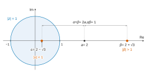
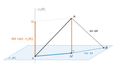
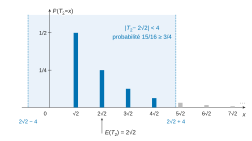
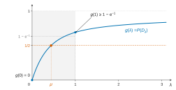

# CCINP TSI — Mathématiques 2026 · Corrigé brut

*Corrigé rédigé par IA, non officiel. Signalez toute erreur.*

Épreuve de 4 heures, calculatrice interdite. Deux problèmes indépendants.

---

# Problème 1 — Calcul d'une intégrale via les nombres complexes

Dans tout le problème, $a$ est un réel tel que $|a|>1$.

## Partie I — Lemme préliminaire

### Q1

Le trinôme réel $P(z)=z^2-2az+1$ a pour discriminant

$$\Delta=4a^2-4=4(a^2-1).$$

Comme $|a|>1$, on a $a^2>1$, donc $\Delta>0$. Le trinôme admet donc deux racines réelles distinctes, $a-\sqrt{a^2-1}$ et $a+\sqrt{a^2-1}$.

En les notant $\alpha$ et $\beta$, la factorisation d'un trinôme unitaire par ses racines donne :

$$\boxed{\forall z\in\mathbb C,\quad z^2-2az+1=(z-\alpha)(z-\beta)}$$

$$\{\alpha,\beta\}=\big\{a-\sqrt{a^2-1},\ a+\sqrt{a^2-1}\big\}.$$

En particulier $\alpha$ et $\beta$ sont **réels**.

### Q2

Pour tout $z\in\mathbb C$, on développe :

$$(z-\alpha)(z-\beta)=z^2-(\alpha+\beta)z+\alpha\beta.$$

Deux polynômes égaux en tout point ont les mêmes coefficients. Par identification avec $z^2-2az+1$ :

$$\boxed{\begin{aligned}\alpha+\beta&=2a\\ \alpha\beta&=1\end{aligned}}$$

### Q3

Par Q2, $|\alpha|\,|\beta|=|\alpha\beta|=1$. Supposons $|\alpha|\ge1$ et $|\beta|\ge1$. Alors

$$\begin{aligned}1=|\alpha|\,|\beta|&\ge|\alpha|\\ &\ge1,\end{aligned}$$

donc $|\alpha|=1$, puis $|\beta|=1/|\alpha|=1$ :

$$|\alpha|=|\beta|=1.$$

Par Q2 et l'inégalité triangulaire dans $\mathbb C$ :

$$\begin{aligned}2|a|&=|\alpha+\beta|\\ &\le|\alpha|+|\beta|\\ &=2,\end{aligned}$$

d'où

$$\boxed{|a|\le1.}$$

### Q4

Q3 établit l'implication

$$\big(|\alpha|\ge1\ \text{et}\ |\beta|\ge1\big)\Longrightarrow|a|\le1.$$

Par contraposition, puisque $|a|>1$, on n'a pas à la fois $|\alpha|\ge1$ et $|\beta|\ge1$ :

$$\boxed{|\alpha|<1\quad\text{ou}\quad|\beta|<1.}$$

Les deux ne peuvent avoir lieu simultanément, car $|\alpha|\,|\beta|=1$. Avec la convention $|\alpha|<1$ de l'énoncé : $\alpha$ est réel et non nul (car $\alpha\beta=1$), donc $\alpha\in\,]-1,1[\setminus\{0\}$.

De plus $\beta=1/\alpha$, donc $|\beta|>1$, et $0<1-\alpha^2<1$.

### Q5

Pour $a=2$, le trinôme $z^2-4z+1$ a pour discriminant $\Delta=16-4=12>0$, et $\sqrt{12}=2\sqrt3$. Ses racines sont

$$\frac{4\pm2\sqrt3}2=2\pm\sqrt3.$$

Comme $1<\sqrt3<2$, on a $0<2-\sqrt3<1<2+\sqrt3$. Avec $|\alpha|<1$ :

$$\boxed{\begin{aligned}\alpha&=2-\sqrt3\\ \beta&=2+\sqrt3\end{aligned}}$$

Contrôle : $\alpha+\beta=4=2a$ et $\alpha\beta=4-3=1$.



## Partie II — Calcul d'une intégrale

### II.1 — Une première expression en série trigonométrique

### Q6

Soit $t\in\mathbb R$. On a $|\cos t|\le1$, donc, par l'inégalité triangulaire :

$$\begin{aligned}|a-\cos t|&\ge|a|-|\cos t|\\ &\ge|a|-1\\ &>0.\end{aligned}$$

D'où :

$$\boxed{\forall t\in\mathbb R,\quad a-\cos t\ne0.}$$

(Si $a>1$, $a-\cos t>0$ ; si $a<-1$, $a-\cos t<0$.)

### Q7

- *Continuité* : $t\mapsto a-\cos t$ est continue sur $\mathbb R$, comme différence d'une constante et de $\cos$. Elle ne s'annule pas sur $\mathbb R$ (Q6). Son inverse $f$ est donc continue sur $\mathbb R$.
- *Parité* : $\mathbb R$ est symétrique par rapport à $0$, et pour tout $t\in\mathbb R$, $f(-t)=\dfrac1{a-\cos(-t)}=f(t)$, car $\cos$ est paire.
- *Périodicité* : pour tout $t\in\mathbb R$, $t+2\pi\in\mathbb R$ et $f(t+2\pi)=f(t)$, car $\cos$ est $2\pi$-périodique.

**$f$ est continue, paire et $2\pi$-périodique sur $\mathbb R$.**

### Q8

$f$ est $2\pi$-périodique et continue, donc continue par morceaux. Ses coefficients de Fourier trigonométriques sont :

$$\boxed{\begin{aligned}a_0&=\frac1{2\pi}\int_0^{2\pi}f(t)\,\mathrm dt\\ a_n&=\frac1\pi\int_0^{2\pi}f(t)\cos(nt)\,\mathrm dt\quad(n\ge1)\\ b_n&=\frac1\pi\int_0^{2\pi}f(t)\sin(nt)\,\mathrm dt\quad(n\ge1)\end{aligned}}$$

Le coefficient $a_0$ est la valeur moyenne de $f$ : c'est cette convention qui donne la forme $\sum_{n\ge0}a_n\cos(nt)$ de Q9.

De plus, pour $n\ge1$, $t\mapsto f(t)\sin(nt)$ est impaire et $2\pi$-périodique. L'intégrale sur une période pouvant se prendre sur $[-\pi,\pi]$ :

$$b_n=\frac1\pi\int_{-\pi}^{\pi}f(t)\sin(nt)\,\mathrm dt=0.$$

### Q9

La fonction $t\mapsto a-\cos t$ est de classe $\mathcal C^\infty$ et ne s'annule pas.

Donc $f$ est de classe $\mathcal C^\infty$ sur $\mathbb R$, a fortiori $\mathcal C^1$ par morceaux, et elle est $2\pi$-périodique.

Par le théorème de Dirichlet, la série de Fourier de $f$ converge en tout point $t$ vers $\frac12\big(f(t^+)+f(t^-)\big)$, qui vaut $f(t)$ puisque $f$ est continue. Comme $b_n=0$ (Q8) :

$$\boxed{\begin{aligned}\forall t\in\mathbb R,\quad f(t)&=a_0+\sum_{n=1}^{+\infty}a_n\cos(nt)\\ &=\sum_{n=0}^{+\infty}a_n\cos(nt).\end{aligned}}$$

### II.2 — Une seconde expression en série trigonométrique

### Q10

Soit $t\in\mathbb R$. Par la formule d'Euler $\cos t=\frac{e^{it}+e^{-it}}2$ :

$$\begin{aligned}2e^{it}(a-\cos t)&=2ae^{it}-e^{2it}-1\\ &=-\big((e^{it})^2-2ae^{it}+1\big).\end{aligned}$$

Le membre de gauche est non nul (Q6 et $e^{it}\ne0$), donc le trinôme aussi. En divisant :

$$\boxed{\forall t\in\mathbb R,\quad \frac1{a-\cos t}=\frac{-2e^{it}}{(e^{it})^2-2ae^{it}+1}.}$$

### Q11

Par Q1 appliquée en $z=e^{it}$, on a $(e^{it})^2-2ae^{it}+1=(e^{it}-\alpha)(e^{it}-\beta)$, d'où, avec Q10 :

$$\forall t\in\mathbb R,\quad \frac1{a-\cos t}=\frac{-2e^{it}}{(e^{it}-\alpha)(e^{it}-\beta)}.$$

Comme $\beta=1/\alpha$ (Q2), on factorise :

$$\begin{aligned}e^{it}-\alpha&=e^{it}(1-\alpha e^{-it})\\ e^{it}-\beta&=-\frac{1-\alpha e^{it}}{\alpha}\end{aligned}$$

Ces quantités sont non nulles, car $|e^{it}|=1$ alors que $|\alpha|<1<|\beta|$. Donc

$$\frac1{a-\cos t}=\frac{2\alpha}{(1-\alpha e^{-it})(1-\alpha e^{it})}.$$

Or, en réduisant au même dénominateur :

$$\begin{aligned}\frac{\alpha e^{-it}}{1-\alpha e^{-it}}+\frac1{1-\alpha e^{it}}&=\frac{\alpha e^{-it}-\alpha^2+1-\alpha e^{-it}}{(1-\alpha e^{-it})(1-\alpha e^{it})}\\ &=\frac{1-\alpha^2}{(1-\alpha e^{-it})(1-\alpha e^{it})}.\end{aligned}$$

Puisque $1-\alpha^2\ne0$ :

$$\boxed{\forall t\in\mathbb R,\quad \frac1{a-\cos t}=\frac{2\alpha}{1-\alpha^2}\left(\frac{\alpha e^{-it}}{1-\alpha e^{-it}}+\frac1{1-\alpha e^{it}}\right).}$$

### Q12

La série entière $\sum z^n$ converge pour $|z|<1$. Pour $|z|\ge1$, son terme général ne tend pas vers $0$ et elle diverge grossièrement. Ainsi :

$$\boxed{R=1}$$

$$\boxed{\forall z\in\mathbb C,\ |z|<1\ :\ \sum_{n=0}^{+\infty}z^n=\frac1{1-z}.}$$

### Q13

Soit $t\in\mathbb R$. On a $|\alpha e^{-it}|=|\alpha|<1$ et $|\alpha e^{it}|=|\alpha|<1$ : les deux raisons sont de module strictement inférieur à 1. Par Q12 :

$$\begin{aligned}\frac{\alpha e^{-it}}{1-\alpha e^{-it}}&=\alpha e^{-it}\sum_{n=0}^{+\infty}\alpha^ne^{-int}\\ &=\sum_{n=0}^{+\infty}\alpha^{n+1}e^{-i(n+1)t}\\ \frac1{1-\alpha e^{it}}&=\sum_{n=0}^{+\infty}\alpha^ne^{int}\end{aligned}$$

D'où la première égalité. Les deux séries convergeant, on peut les ajouter terme à terme, après réindexation ($m=n+1$ dans la première) :

$$\begin{aligned}{}&\sum_{m=1}^{+\infty}\alpha^me^{-imt}+1+\sum_{m=1}^{+\infty}\alpha^me^{imt}\\ &=1+\sum_{m=1}^{+\infty}\alpha^m\big(e^{imt}+e^{-imt}\big)\\ &=1+2\sum_{m=1}^{+\infty}\alpha^m\cos(mt).\end{aligned}$$

$$\boxed{\begin{aligned}\frac{\alpha e^{-it}}{1-\alpha e^{-it}}+\frac1{1-\alpha e^{it}}&=\sum_{n=0}^{+\infty}\alpha^{n+1}e^{-i(n+1)t}+\sum_{n=0}^{+\infty}\alpha^ne^{int}\\ &=1+2\sum_{n=1}^{+\infty}\alpha^n\cos(nt).\end{aligned}}$$

### Q14

Par Q11 et Q13, pour tout $t\in\mathbb R$ :

$$\begin{aligned}f(t)&=\frac{2\alpha}{1-\alpha^2}\Big(1+2\sum_{n=1}^{+\infty}\alpha^n\cos(nt)\Big)\\ &=\frac{2\alpha}{1-\alpha^2}+\sum_{n=1}^{+\infty}\frac{4\alpha^{n+1}}{1-\alpha^2}\cos(nt),\end{aligned}$$

soit

$$\boxed{\begin{aligned}{}&\forall t\in\mathbb R,\quad f(t)=\sum_{n=0}^{+\infty}\gamma_n\cos(nt)\\ &\gamma_0=\frac{2\alpha}{1-\alpha^2},\qquad \gamma_n=\frac{4\alpha^{n+1}}{1-\alpha^2}\ \ (n\ge1)\end{aligned}}$$

### Q15

Pour $n\ge1$ :

$$|\gamma_n|=\frac{4|\alpha|}{1-\alpha^2}\,|\alpha|^n.$$

C'est une constante fois le terme général d'une série géométrique de raison $|\alpha|\in[0,1[$, donc convergente. **Donc $\sum\gamma_n$ converge absolument.**

### II.3 — Conclusion

### Q16

Soit $t\in\mathbb R$. Les séries $\sum a_n\cos(nt)$ (Q9) et $\sum\gamma_n\cos(nt)$ (Q14) convergent, toutes deux de somme $f(t)$.

Pour tout $N$, la somme partielle $\sum_{n=0}^Nu_n\cos(nt)$ est la différence des sommes partielles de ces deux séries. Par linéarité de la limite :

$$\boxed{\begin{aligned}\forall t\in\mathbb R,\quad \sum_{n=0}^{+\infty}u_n\cos(nt)&=f(t)-f(t)\\ &=0.\end{aligned}}$$

### Q17

**a)** Soit $g$ de classe $\mathcal C^1$ sur $\mathbb R$ et $T$-périodique : $g(t+T)=g(t)$ pour tout $t\in\mathbb R$.

La fonction $t\mapsto g(t+T)$ est la composée de $g$ et de $t\mapsto t+T$ ; elle est dérivable de dérivée $t\mapsto g'(t+T)$. En dérivant les deux membres de l'égalité, qui sont deux fonctions égales sur $\mathbb R$ :

$$\forall t\in\mathbb R,\quad g'(t+T)=g'(t).$$

**$g'$ est $T$-périodique.**

**b)** La fonction $t\mapsto a-\cos t$ est de classe $\mathcal C^\infty$ sur $\mathbb R$, et son dénominateur ne s'annule pas (Q6).

L'inverse d'une fonction de classe $\mathcal C^\infty$ qui ne s'annule pas est de classe $\mathcal C^\infty$. **Donc $f$ est de classe $\mathcal C^2$ sur $\mathbb R$** (et même $\mathcal C^\infty$).

**c)** Par a) appliqué à $f$ (de classe $\mathcal C^1$), $f'$ est $2\pi$-périodique : $f'(2\pi)=f'(0)$.

*Cas $n=0$* : le membre de gauche est nul, et

$$-\int_0^{2\pi}f''(t)\,\mathrm dt=-\big(f'(2\pi)-f'(0)\big)=0.$$

*Cas $n\ge1$* : première intégration par parties, avec $u(t)=\cos(nt)$ et $v(t)=f'(t)$.

Ces deux fonctions sont de classe $\mathcal C^1$ sur $[0,2\pi]$, car $f$ est $\mathcal C^2$ :

$$\begin{aligned}\int_0^{2\pi}f''(t)\cos(nt)\,\mathrm dt&=\big[f'(t)\cos(nt)\big]_0^{2\pi}+n\int_0^{2\pi}f'(t)\sin(nt)\,\mathrm dt\\ &=n\int_0^{2\pi}f'(t)\sin(nt)\,\mathrm dt,\end{aligned}$$

le crochet valant $f'(2\pi)-f'(0)=0$.

Seconde intégration par parties, avec $u(t)=\sin(nt)$ et $v(t)=f(t)$, de classe $\mathcal C^1$ sur $[0,2\pi]$ :

$$\begin{aligned}\int_0^{2\pi}f'(t)\sin(nt)\,\mathrm dt&=\big[f(t)\sin(nt)\big]_0^{2\pi}-n\int_0^{2\pi}f(t)\cos(nt)\,\mathrm dt\\ &=-n\int_0^{2\pi}f(t)\cos(nt)\,\mathrm dt,\end{aligned}$$

le crochet étant nul car $\sin(2n\pi)=\sin0=0$. D'où

$$\boxed{\forall n\in\mathbb N,\quad n^2\int_0^{2\pi}f(t)\cos(nt)\,\mathrm dt=-\int_0^{2\pi}f''(t)\cos(nt)\,\mathrm dt.}$$

**d)** Soit $n\ge1$. Par Q8, $\int_0^{2\pi}f(t)\cos(nt)\,\mathrm dt=\pi a_n$. Par c) et l'inégalité triangulaire pour les intégrales ($f''$ continue, $|\cos|\le1$) :

$$\begin{aligned}n^2\pi|a_n|&=\Big|\int_0^{2\pi}f''(t)\cos(nt)\,\mathrm dt\Big|\\ &\le\int_0^{2\pi}|f''(t)|\,\mathrm dt,\end{aligned}$$

d'où

$$\boxed{\forall n\ge1,\quad |a_n|\le\frac1{n^2\pi}\int_0^{2\pi}|f''(t)|\,\mathrm dt.}$$

**e)** Posons $M=\int_0^{2\pi}|f''(t)|\,\mathrm dt$ : c'est un réel fini, intégrale d'une fonction continue sur un segment. Pour $n\ge1$ :

$$0\le|a_n|\le\frac M\pi\cdot\frac1{n^2}.$$

La série de Riemann $\sum1/n^2$ converge ($2>1$). Par comparaison de séries à termes positifs, **$\sum a_n$ converge absolument**.

Enfin, $|u_n|\le|a_n|+|\gamma_n|$ et $\sum|\gamma_n|$ converge (Q15). Par comparaison, **$\sum u_n$ converge absolument**.

### Q18

Par Q16, Q17 e) et le théorème admis, $u_n=0$, soit $a_n=\gamma_n$ pour tout $n\in\mathbb N$.

- Pour $n\ge1$, par Q8 :

$$\begin{aligned}\int_0^{2\pi}\frac{\cos(nt)}{a-\cos t}\,\mathrm dt&=\pi a_n=\pi\gamma_n\\ &=\frac{4\pi\alpha^{n+1}}{1-\alpha^2}.\end{aligned}$$

- Pour $n=0$, le coefficient $a_0$ a une autre normalisation :

$$\begin{aligned}\int_0^{2\pi}\frac{\mathrm dt}{a-\cos t}&=2\pi a_0=2\pi\gamma_0\\ &=\frac{4\pi\alpha}{1-\alpha^2}=\frac{4\pi\alpha^{0+1}}{1-\alpha^2}.\end{aligned}$$

$$\boxed{\forall n\in\mathbb N,\quad \int_0^{2\pi}\frac{\cos(nt)}{a-\cos t}\,\mathrm dt=\frac{4\pi\alpha^{n+1}}{1-\alpha^2},}$$

où $\alpha$ est la racine de module $<1$ : $\alpha=a-\sqrt{a^2-1}$ si $a>1$, $\alpha=a+\sqrt{a^2-1}$ si $a<-1$.

### Q19

On applique Q18 avec $a=2$ (qui vérifie bien $|a|>1$) et $n=0$. Par Q5, $\alpha=2-\sqrt3$. Alors :

$$\begin{aligned}\alpha^2&=7-4\sqrt3\\ 1-\alpha^2&=4\sqrt3-6=2\sqrt3(2-\sqrt3)\end{aligned}$$

donc

$$\begin{aligned}\int_0^{2\pi}\frac{\mathrm dt}{2-\cos t}&=\frac{4\pi(2-\sqrt3)}{2\sqrt3(2-\sqrt3)}\\ &=\frac{2\pi}{\sqrt3}.\end{aligned}$$

$$\boxed{\int_0^{2\pi}\frac{\mathrm dt}{2-\cos t}=\frac{2\pi\sqrt3}3\approx3{,}63.}$$

---

# Problème 2 — Matrices aléatoires

On note $\mathcal A_2(\mathbb R)$ le sous-espace des matrices antisymétriques de $\mathcal M_2(\mathbb R)$.

## Partie I — Généralités sur l'espace vectoriel $\mathcal M_2(\mathbb R)$

### Q20

On a $B^\top=\begin{pmatrix}b_1&b_3\\b_2&b_4\end{pmatrix}$, donc

$$AB^\top=\begin{pmatrix}a_1b_1+a_2b_2&a_1b_3+a_2b_4\\a_3b_1+a_4b_2&a_3b_3+a_4b_4\end{pmatrix}.$$

En sommant les coefficients diagonaux :

$$\boxed{\begin{aligned}\langle A,B\rangle=\mathrm{Tr}(AB^\top)&=a_1b_1+a_2b_2+a_3b_3+a_4b_4\\ &=\sum_{k=1}^4a_kb_k.\end{aligned}}$$

### Q21

On vérifie les quatre propriétés à l'aide de Q20. Soient $A,A',B\in\mathcal M_2(\mathbb R)$ et $\lambda\in\mathbb R$.

- *Symétrie* : $\langle B,A\rangle=\sum b_ka_k=\langle A,B\rangle$.
- *Linéarité à gauche* : les coefficients de $A+\lambda A'$ sont les $a_k+\lambda a'_k$, donc $\langle A+\lambda A',B\rangle=\langle A,B\rangle+\lambda\langle A',B\rangle$. Avec la symétrie, la forme est bilinéaire.
- *Positivité* : $\langle A,A\rangle=\sum a_k^2\ge0$.
- *Caractère défini* : si $\langle A,A\rangle=\sum a_k^2=0$, c'est une somme de carrés de réels qui est nulle, donc chaque $a_k$ est nul, et $A=0$.

**$\langle\cdot,\cdot\rangle$ est un produit scalaire sur $\mathcal M_2(\mathbb R)$.**

### Q22

Posons $M=\frac{A+A^\top}2$ et $N=\frac{A-A^\top}2$. La transposition est linéaire et involutive, donc :

$$\begin{aligned}M^\top&=\frac{A^\top+A}2=M\\ N^\top&=\frac{A^\top-A}2=-N\end{aligned}$$

**$M$ est symétrique et $N$ est antisymétrique.**

Plus généralement, soient $S$ symétrique et $T$ antisymétrique. D'une part $\langle S,T\rangle=\mathrm{Tr}(ST^\top)=-\mathrm{Tr}(ST)$.

D'autre part, par symétrie du produit scalaire et $\mathrm{Tr}(TS)=\mathrm{Tr}(ST)$ :

$$\begin{aligned}\langle S,T\rangle=\langle T,S\rangle&=\mathrm{Tr}(TS^\top)\\ &=\mathrm{Tr}(TS)=\mathrm{Tr}(ST).\end{aligned}$$

Donc $\mathrm{Tr}(ST)=0$ et $\langle S,T\rangle=0$. En particulier

$$\boxed{\langle M,N\rangle=0.}$$

### Q23

*Existence* : $A=M+N$ avec $M\in\mathcal S_2(\mathbb R)$ et $N\in\mathcal A_2(\mathbb R)$ (Q22).

*Unicité* : soit $A=M'+N'$ avec $M'$ symétrique et $N'$ antisymétrique. Alors $A^\top=M'-N'$. En additionnant puis en soustrayant ces deux égalités :

$$\begin{aligned}M'&=\frac{A+A^\top}2=M\\ N'&=\frac{A-A^\top}2=N\end{aligned}$$

$$\boxed{\begin{aligned}{}&A=M+N\ \text{de façon unique, avec}\\ &M=\frac{A+A^\top}2,\qquad N=\frac{A-A^\top}2.\end{aligned}}$$

Ainsi $\mathcal M_2(\mathbb R)=\mathcal S_2(\mathbb R)\oplus\mathcal A_2(\mathbb R)$, et cette somme directe est orthogonale par Q22.

### Q24

Soit $A=M+N$ comme en Q23. On a $M\in\mathcal S_2(\mathbb R)$ et $N\in\mathcal A_2(\mathbb R)\subset\mathcal S_2(\mathbb R)^\perp$ (Q22).

Donc $M$ est le projeté orthogonal de $A$ sur $\mathcal S_2(\mathbb R)$, et la distance de $A$ à ce sous-espace est $\|A-M\|=\|N\|$.

Détail : soit $B\in\mathcal S_2(\mathbb R)$. Alors $A-B=(M-B)+N$, avec $M-B\in\mathcal S_2(\mathbb R)$ et $N\in\mathcal A_2(\mathbb R)$, orthogonaux (Q22). Par le théorème de Pythagore :

$$\begin{aligned}\|A-B\|^2&=\|M-B\|^2+\|N\|^2\\ &\ge\|N\|^2,\end{aligned}$$

avec égalité pour $B=M\in\mathcal S_2(\mathbb R)$. La borne inférieure est donc atteinte et vaut $\|N\|$. Par homogénéité de la norme :

$$\boxed{\begin{aligned}d\big(A,\mathcal S_2(\mathbb R)\big)&=\|N\|\\ &=\frac12\big\|A-A^\top\big\|.\end{aligned}}$$



## Partie II — Matrice de Rademacher

### Q25

Par définition de l'espérance d'une variable finie :

$$E(X_1)=(-1)\cdot\frac12+1\cdot\frac12=0.$$

Comme $X_1^2=1$, $E(X_1^2)=1$. Par la formule de König-Huygens, $V(X_1)=E(X_1^2)-E(X_1)^2=1$ :

$$\boxed{\begin{aligned}E(X_1)&=0\\ V(X_1)&=1\end{aligned}}$$

### Q26

On a $T_1(\Omega)=\{-2,0,2\}$. Par indépendance de $X_1$ et $Y_1$ :

$$\begin{aligned}P(T_1=-2)&=P(X_1=-1)P(Y_1=-1)=\tfrac14\\ P(T_1=2)&=P(X_1=1)P(Y_1=1)=\tfrac14\end{aligned}$$

L'événement $[T_1=0]$ est la réunion disjointe de $[X_1=-1]\cap[Y_1=1]$ et $[X_1=1]\cap[Y_1=-1]$. Par additivité et indépendance, $P(T_1=0)=\frac14+\frac14=\frac12$.

$$\boxed{\begin{aligned}P(T_1=-2)&=\tfrac14\\ P(T_1=0)&=\tfrac12\\ P(T_1=2)&=\tfrac14\end{aligned}}$$

Espérance et moment d'ordre 2 :

$$\begin{aligned}E(T_1)&=-2\cdot\tfrac14+0\cdot\tfrac12+2\cdot\tfrac14=0\\ E(T_1^2)&=4\cdot\tfrac14+0\cdot\tfrac12+4\cdot\tfrac14=2\end{aligned}$$

Par König-Huygens, $V(T_1)=E(T_1^2)-E(T_1)^2=2$ :

$$\boxed{\begin{aligned}E(T_1)&=0\\ V(T_1)&=2\end{aligned}}$$

(Contrôle : $V(X_1)+V(Y_1)=2$ par indépendance.)

### Q27

On a $Z_1(\Omega)=\{-1,1\}$. L'événement $[Z_1=1]$ est la réunion disjointe de $[X_1=1]\cap[Y_1=1]$ et $[X_1=-1]\cap[Y_1=-1]$. Par indépendance, $P(Z_1=1)=\frac14+\frac14=\frac12$, puis $P(Z_1=-1)=\frac12$.

**$Z_1$ suit la loi de Rademacher.** On a donc, comme en Q25 (avec $Z_1^2=1$) :

$$\boxed{\begin{aligned}E(Z_1)&=0\\ V(Z_1)&=1\end{aligned}}$$

## Partie III — Matrice géométrique

### Q28

$$\boxed{\begin{aligned}E(X_2)&=\frac1p\\ V(X_2)&=\frac{1-p}{p^2}\end{aligned}}$$

### Q29

**a)** Pour tout $\omega\in\Omega$, on applique Q24 à la matrice $A=\Sigma_2(\omega)$ :

$$\begin{aligned}\Sigma_2-\Sigma_2^\top&=\begin{pmatrix}0&(X_2-Y_2)-(X_2+Y_2)\\(X_2+Y_2)-(X_2-Y_2)&0\end{pmatrix}\\ &=\begin{pmatrix}0&-2Y_2\\2Y_2&0\end{pmatrix}.\end{aligned}$$

Par Q20, $\|\Sigma_2-\Sigma_2^\top\|^2=8Y_2^2$, donc $\|\Sigma_2-\Sigma_2^\top\|=2\sqrt2\,|Y_2|=2\sqrt2\,Y_2$, car $Y_2\ge1>0$. Ainsi

$$\boxed{T_2=\frac12\cdot2\sqrt2\,Y_2=\sqrt2\,Y_2.}$$

**b)** $Y_2$ suit la même loi géométrique que $X_2$. Par linéarité de l'espérance et $V(cY)=c^2V(Y)$ :

$$\boxed{\begin{aligned}E(T_2)&=\frac{\sqrt2}p\\ V(T_2)&=\frac{2(1-p)}{p^2}\end{aligned}}$$

### Q30

$T_2$ admet une variance (Q29 b). L'inégalité de Bienaymé-Tchebychev donne, pour tout $\delta>0$ :

$$\boxed{\begin{aligned}P\Big(\Big|T_2-\frac{\sqrt2}p\Big|\ge\delta\Big)&\le\frac{V(T_2)}{\delta^2}\\ &=\frac{2(1-p)}{\delta^2p^2}.\end{aligned}}$$

### Q31

**a)** Pour $p=\frac12$ : $\frac{\sqrt2}p=2\sqrt2$ et $\frac{2(1-p)}{\delta^2p^2}=\frac4{\delta^2}$. Or, pour $\delta>0$ :

$$\frac4{\delta^2}\le\frac14\iff\delta\ge4.$$

**Pour $\delta=4$** :

$$\boxed{P\big(|T_2-2\sqrt2|\ge4\big)\le\frac14.}$$

**b)** En passant à l'événement contraire :

$$P\big(|T_2-2\sqrt2|<4\big)\ge1-\frac14=\frac34.$$

Comme $T_2=d(\Sigma_2,\mathcal S_2(\mathbb R))$ :

$$\boxed{P\Big(\big|d(\Sigma_2,\mathcal S_2(\mathbb R))-2\sqrt2\big|<4\Big)\ge\frac34.}$$



## Partie IV — Matrice de Poisson

### Q32

$$\boxed{\begin{aligned}E(X_3)&=\lambda\\ V(X_3)&=\lambda\end{aligned}}$$

### Q33

**a)** Un produit de réels est nul si et seulement si l'un des facteurs l'est : $[Z_3=0]=[X_3=0]\cup[Y_3=0]$. Par la formule de la probabilité de la réunion de deux événements, $P(A\cup B)=P(A)+P(B)-P(A\cap B)$, puis par indépendance de $X_3$ et $Y_3$ :

$$\begin{aligned}P(Z_3=0)&=P(X_3=0)+P(Y_3=0)-P(X_3=0)P(Y_3=0)\\ &=e^{-\lambda}+e^{-\lambda}-e^{-\lambda}e^{-\lambda}\end{aligned}$$

$$\boxed{P(Z_3=0)=2\exp(-\lambda)-\exp(-2\lambda).}$$

**b)** On a $\det\Sigma_3=X_3Y_3=Z_3$, et $\Sigma_3$ est inversible si et seulement si $Z_3\ne0$. Par passage au contraire :

$$\boxed{\begin{aligned}P(\Sigma_3\ \text{inversible})&=1-2e^{-\lambda}+e^{-2\lambda}\\ &=\big(1-e^{-\lambda}\big)^2.\end{aligned}}$$

### Q34

**a)** *Support.* $X_3$ et $Y_3$ sont à valeurs dans $\mathbb N$, donc $T_3(\Omega)\subset\mathbb N$. Réciproquement, soit $n\in\mathbb N$ ; par indépendance,

$$\begin{aligned}P\big([X_3=n]\cap[Y_3=0]\big)&=e^{-2\lambda}\frac{\lambda^n}{n!}\\ &>0.\end{aligned}$$

Cet événement est donc non vide, et sur lui $T_3=n$ : $n\in T_3(\Omega)$. **Donc $T_3(\Omega)=\mathbb N$.**

*Formule.* La famille $([X_3=k])_{k\in\mathbb N}$ est un système complet d'événements. Par la formule des probabilités totales :

$$\begin{aligned}P(T_3=n)&=\sum_{k=0}^{+\infty}P\big([X_3=k]\cap[T_3=n]\big)\\ &=\sum_{k=0}^{+\infty}P\big([X_3=k]\cap[Y_3=n-k]\big).\end{aligned}$$

Pour $k>n$, l'événement $[Y_3=n-k]$ est vide, car $Y_3\ge0$ : ces termes sont nuls. Par indépendance de $X_3$ et $Y_3$ :

$$\boxed{\begin{aligned}{}&\forall n\in\mathbb N,\\ &P(T_3=n)=\sum_{k=0}^nP(X_3=k)\,P(Y_3=n-k).\end{aligned}}$$

**b)** Soit $n\in\mathbb N$. En reportant les lois de Poisson :

$$\begin{aligned}P(T_3=n)&=\sum_{k=0}^ne^{-\lambda}\frac{\lambda^k}{k!}\,e^{-\lambda}\frac{\lambda^{n-k}}{(n-k)!}\\ &=e^{-2\lambda}\frac{\lambda^n}{n!}\sum_{k=0}^n\binom nk\\ &=e^{-2\lambda}\frac{(2\lambda)^n}{n!},\end{aligned}$$

par la formule du binôme ($\sum_{k=0}^n\binom nk=2^n$). **$T_3$ suit la loi de Poisson de paramètre $2\lambda$.**

### Q35

**a)** Le vecteur $V=\begin{pmatrix}X_3-Y_3\\1\end{pmatrix}$ est non nul, car sa seconde coordonnée vaut $1$. On calcule :

$$\begin{aligned}\Sigma_3V&=\begin{pmatrix}X_3(X_3-Y_3)\\X_3-Y_3+Y_3\end{pmatrix}\\ &=X_3\begin{pmatrix}X_3-Y_3\\1\end{pmatrix}.\end{aligned}$$

**$V$ est vecteur propre de $\Sigma_3$ associé à la valeur propre $X_3$.**

**b)** Le vecteur $W=\begin{pmatrix}0\\1\end{pmatrix}$ est non nul, et $\Sigma_3W=\begin{pmatrix}0\\Y_3\end{pmatrix}=Y_3W$. **$Y_3$ est valeur propre de $\Sigma_3$, de vecteur propre associé $\begin{pmatrix}0\\1\end{pmatrix}$.**

### Q36

**a)** La famille $([Y_3=k])_{k\in\mathbb N}$ est un système complet d'événements. Par la formule des probabilités totales :

$$\begin{aligned}P(X_3=Y_3)&=\sum_{k=0}^{+\infty}P\big([X_3=Y_3]\cap[Y_3=k]\big)\\ &=\sum_{k=0}^{+\infty}P\big([X_3=k]\cap[Y_3=k]\big).\end{aligned}$$

Par indépendance de $X_3$ et $Y_3$, puis égalité de leurs lois :

$$\boxed{\begin{aligned}P(X_3=Y_3)&=\sum_{k=0}^{+\infty}P(X_3=k)P(Y_3=k)\\ &=\sum_{k=0}^{+\infty}P(X_3=k)^2.\end{aligned}}$$

**b)** Fixons $\omega$ et posons $x=X_3(\omega)$, $y=Y_3(\omega)$.

- *Si $x\ne y$* : par Q35, $\Sigma_3$, d'ordre 2, a deux valeurs propres réelles distinctes $x$ et $y$, donc est diagonalisable dans $\mathbb R$.
- *Si $x=y=c$* : $\Sigma_3=\begin{pmatrix}c&0\\1&c\end{pmatrix}$ est triangulaire, de seule valeur propre $c$. Si elle était diagonalisable, elle serait semblable à $cI_2$, donc égale à $P(cI_2)P^{-1}=cI_2$.
  Or son coefficient $(2,1)$ vaut $1$ : contradiction.

On a montré les deux implications :

$$\boxed{\Sigma_3\ \text{est diagonalisable dans}\ \mathbb R\iff X_3\ne Y_3.}$$

**c)** Par b), $D_\lambda=[X_3\ne Y_3]$. Par a), en passant au contraire :

$$P(D_\lambda)=1-\sum_{k=0}^{+\infty}\Big(e^{-\lambda}\frac{\lambda^k}{k!}\Big)^2,$$

$$\boxed{P(D_\lambda)=1-e^{-2\lambda}\sum_{k=0}^{+\infty}\frac{\lambda^{2k}}{(k!)^2}.}$$

### Q37

**a)**

```python
import math

def Approx_Sum(N):
    S = 0
    for k in range(N + 1):          # k = 0, 1, ..., N
        S = S + math.exp(-2) / math.factorial(k) ** 2
    return S
```

(Exécution : `Approx_Sum(4)` renvoie $0{,}30850\ldots$)

**b)** *Formule de Taylor avec reste intégral* : si $\varphi$ est de classe $\mathcal C^{n+1}$ sur un intervalle $I$ et $a,x\in I$, alors

$$\varphi(x)=\sum_{k=0}^n\frac{\varphi^{(k)}(a)}{k!}(x-a)^k+\int_a^x\frac{(x-t)^n}{n!}\varphi^{(n+1)}(t)\,\mathrm dt.$$

On l'applique à $\varphi=\exp$, qui est de classe $\mathcal C^\infty$, donc $\mathcal C^{n+1}$, sur $I=\mathbb R$. On prend $a=0$ et $x\ge0$.

Toutes les dérivées de $\exp$ valent $\exp$, et $\exp(0)=1$ :

$$\boxed{\begin{aligned}{}&\forall n\in\mathbb N,\ \forall x\ge0,\\ &\exp(x)-\sum_{k=0}^n\frac{x^k}{k!}=\frac1{n!}\int_0^x(x-t)^n\exp(t)\,\mathrm dt.\end{aligned}}$$

**c)** Soit $x\ge0$. Pour $t\in[0,x]$, $\exp$ étant croissante :

$$0\le(x-t)^ne^t\le(x-t)^ne^x.$$

Par croissance de l'intégrale (bornes $0\le x$), avec $\int_0^x(x-t)^n\,\mathrm dt=\frac{x^{n+1}}{n+1}$ :

$$\begin{aligned}0\le\exp(x)-\sum_{k=0}^n\frac{x^k}{k!}&\le\frac{e^x}{n!}\cdot\frac{x^{n+1}}{n+1}\\ &=\frac{x^{n+1}}{(n+1)!}\exp(x).\end{aligned}$$

$$\boxed{\exp(x)-\sum_{k=0}^n\frac{x^k}{k!}\le\frac{x^{n+1}}{(n+1)!}\exp(x).}$$

**d)** Avec $x=1$ dans c), pour tout $n$ :

$$\begin{aligned}0&\le e-\sum_{k=0}^n\frac1{k!}\\ &\le\frac e{(n+1)!}.\end{aligned}$$

Le majorant tend vers $0$ quand $n\to+\infty$. Donc $\sum_{k\ge0}\frac1{k!}$ converge et vaut $e$, et son reste vérifie :

$$\boxed{\begin{aligned}\sum_{k=n+1}^{+\infty}\frac1{k!}&=e-\sum_{k=0}^n\frac1{k!}\\ &\le\frac e{(n+1)!}.\end{aligned}}$$

**e)** Pour $k\in\mathbb N$, $k!\ge1$, donc $0\le\frac1{(k!)^2}\le\frac1{k!}$. La série $\sum\frac{e^{-2}}{(k!)^2}$, à termes positifs, converge par comparaison. Son reste d'ordre $n$ est positif, et par d) :

$$\begin{aligned}\sum_{k=0}^{+\infty}\frac{e^{-2}}{(k!)^2}-\sum_{k=0}^n\frac{e^{-2}}{(k!)^2}&=\sum_{k=n+1}^{+\infty}\frac{e^{-2}}{(k!)^2}\\ &\le e^{-2}\sum_{k=n+1}^{+\infty}\frac1{k!}\\ &\le e^{-2}\frac e{(n+1)!}=\frac{e^{-1}}{(n+1)!}.\end{aligned}$$

$$\boxed{\begin{aligned}0&\le\sum_{k=0}^{+\infty}\frac{e^{-2}}{(k!)^2}-\sum_{k=0}^n\frac{e^{-2}}{(k!)^2}\\ &\le\frac{e^{-1}}{(n+1)!}.\end{aligned}}$$

**f)** Par e), il suffit que $\frac{e^{-1}}{(N_0+1)!}\le10^{-2}$, c'est-à-dire $(N_0+1)!\ge100e^{-1}$. Comme $100e^{-1}\le37$, il suffit que $(N_0+1)!\ge37$.

Or $4!=24<37$ mais $5!=120\ge37$. **$N_0=4$ convient** :

$$\begin{aligned}\Big|\sum_{k=0}^{+\infty}\frac{e^{-2}}{(k!)^2}-\sum_{k=0}^{4}\frac{e^{-2}}{(k!)^2}\Big|&\le\frac{e^{-1}}{120}\\ &\le\frac{0{,}37}{120}<10^{-2}.\end{aligned}$$

(Avec cette majoration, $N_0=3$ ne suffit pas : $4!=24<36\le100e^{-1}$.)

**g)** Notons $S=\sum_{k\ge0}\frac{e^{-2}}{(k!)^2}$. La valeur affichée $0{,}31$ est un arrondi au centième : $\texttt{Approx\_Sum}(4)\in[0{,}305\,;0{,}315[$.

Par e) et f), $0\le S-\texttt{Approx\_Sum}(4)\le10^{-2}$, donc $S\in[0{,}305\,;0{,}325]$ :

$$\boxed{S\approx0{,}3\ \text{à}\ 10^{-1}\ \text{près}.}$$

Par Q36 c) avec $\lambda=1$, $P(D_1)=1-e^{-2}\sum_{k\ge0}\frac1{(k!)^2}=1-S$, donc $P(D_1)\in[0{,}675\,;0{,}695]$ :

$$\boxed{P(D_1)\approx0{,}7\ \text{à}\ 10^{-1}\ \text{près}.}$$

(Valeurs plus précises : $S\approx0{,}3085$ et $P(D_1)\approx0{,}6915$.)

**h)** Ce n'est pas judicieux en général. L'appel `math.factorial(k)` recalcule $k!$ à partir de zéro, soit environ $k$ multiplications à chaque tour.

Au total, cela fait de l'ordre de $\sum_{k=0}^Nk=\frac{N(N+1)}2$ multiplications (coût quadratique). En mettant à jour une variable par $k!=(k-1)!\times k$, on n'en fait que $N$ (coût linéaire) :

```python
def Approx_Sum_bis(N):
    S, f = 0, 1                     # f vaut k! au début du tour k
    for k in range(N + 1):
        if k > 0:
            f = f * k
        S = S + math.exp(-2) / f ** 2
    return S
```

Ici $N_0=4$ : la boucle fait 5 tours sur des entiers minuscules ($0!,\dots,4!$), soit une dizaine de multiplications au lieu de quatre. **Le surcoût est négligeable.**

### Q38

**a)** Soit $x\ne0$ et $u_k=\frac{x^k}{(k!)^2}\ne0$. On a

$$\left|\frac{u_{k+1}}{u_k}\right|=\frac{|x|}{(k+1)^2}\xrightarrow[k\to+\infty]{}0<1.$$

Par la règle de d'Alembert, la série converge absolument pour tout réel $x$ :

$$\boxed{R=+\infty.}$$

**b)** La somme d'une série entière est continue sur son intervalle ouvert de convergence, ici $]-\infty,+\infty[$. **Donc $h:x\mapsto\sum_{k\ge0}\frac{x^k}{(k!)^2}$ est continue sur $\mathbb R$.**

**c)** Pour $\lambda\ge0$, on a $g(\lambda)=1-e^{-2\lambda}h(\lambda^2)$.

Les fonctions $\lambda\mapsto\lambda^2$, $h$ (b) et $\lambda\mapsto e^{-2\lambda}$ sont continues. Par composition, produit et somme, **$g$ est continue sur $[0,+\infty[$.**

### Q39

Soit $\lambda>0$, et $X_3,Y_3$ indépendantes de loi $\mathcal P(\lambda)$.

Par Q36 c), la probabilité que $\begin{pmatrix}X_3&0\\1&Y_3\end{pmatrix}$ soit diagonalisable est $P(D_\lambda)=g(\lambda)$. Il suffit donc de trouver $\mu>0$ tel que $g(\mu)=\frac12$.

- $g(0)=1-e^0\cdot1=0$ (seul le terme $k=0$ de la série est non nul).
- Comme $\frac1{(k!)^2}\le\frac1{k!}$, on a $\sum_{k\ge0}\frac1{(k!)^2}\le e$ (Q37 d). Donc :

$$\begin{aligned}g(1)&\ge1-e^{-2}e=1-e^{-1}\\ &\ge1-0{,}37=0{,}63>\tfrac12.\end{aligned}$$

$g$ est continue sur $[0,1]$ (Q38 c), avec $g(0)<\frac12<g(1)$.

Par le théorème des valeurs intermédiaires, il existe $\mu\in[0,1]$ tel que $g(\mu)=\frac12$, et $\mu\ne0$ car $g(0)=0$.

$$\boxed{\begin{aligned}{}&\exists\,\mu\in\,]0,1[,\ \text{pour}\ X_3,Y_3\sim\mathcal P(\mu)\ \text{indépendantes}:\\ &P\left(\begin{pmatrix}X_3&0\\1&Y_3\end{pmatrix}\ \text{diagonalisable}\right)=g(\mu)=\frac12.\end{aligned}}$$



### Q40

On applique la **méthode de dichotomie** à $\varphi=g-\frac12$, continue sur $[0,1]$, avec $\varphi(0)<0<\varphi(1)$ (Q39) :

1. $u\leftarrow0$, $v\leftarrow1$ ;
2. tant que $v-u>\varepsilon$ : $m\leftarrow\frac{u+v}2$ ; si $\varphi(m)<0$, $u\leftarrow m$, sinon $v\leftarrow m$ ;
3. renvoyer $\frac{u+v}2$.

L'invariant $\varphi(u)<0\le\varphi(v)$ et le théorème des valeurs intermédiaires assurent qu'un zéro de $\varphi$ reste dans $[u,v]$. La longueur de cet intervalle est divisée par 2 à chaque étape : $\lceil\log_2(1/\varepsilon)\rceil$ itérations suffisent (une dizaine pour $\varepsilon=10^{-3}$).

Chaque évaluation de $g(m)$ se fait en tronquant la série :

$$g(m)\simeq1-e^{-2m}\sum_{k=0}^K\frac{m^{2k}}{(k!)^2}.$$

Pour $m\in[0,1]$, l'erreur est majorée par $\sum_{k>K}\frac1{k!}\le\frac e{(K+1)!}$ (comme en Q37 d–e). $K=8$ donne une erreur $<10^{-5}$, et la factorielle est mise à jour par une multiplication (Q37 h). On obtiendrait $\mu\approx0{,}44$.

**FIN**
