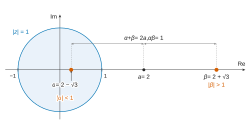
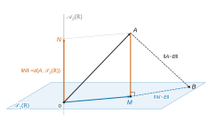
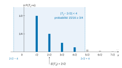
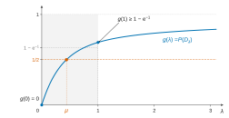

# CCINP TSI — Mathématiques 2026 · Corrigé guidé

*Corrigé rédigé par IA, non officiel. Signalez toute erreur.*

## Présentation du sujet

**Format.** Épreuve de 4 heures, calculatrice interdite, deux problèmes indépendants, 40 questions numérotées Q1 à Q40 (beaucoup avec sous-questions). Les parties de chaque problème sont « globalement indépendantes » : on peut avancer en admettant un résultat.

**Problème 1 — Calcul d'une intégrale via les nombres complexes (Q1–Q19).** On calcule $\displaystyle\int_0^{2\pi}\frac{\cos(nt)}{a-\cos t}\,\mathrm dt$ pour $|a|>1$. Pour cela, on développe la même fonction $f:t\mapsto\frac1{a-\cos t}$ de deux façons en série de cosinus, puis on identifie les coefficients.

- *Partie I (Q1–Q5)* : racines $\alpha,\beta$ du trinôme $z^2-2az+1$ ; l'une, notée $\alpha$, est de module $<1$.
- *II.1 (Q6–Q9)* : $f$ est continue, paire, $2\pi$-périodique ; le théorème de Dirichlet donne $f=\sum a_n\cos(nt)$.
- *II.2 (Q10–Q15)* : formules d'Euler, réduction au même dénominateur et série géométrique donnent $f=\sum\gamma_n\cos(nt)$, avec des $\gamma_n$ explicites.
- *II.3 (Q16–Q19)* : la différence $u_n=a_n-\gamma_n$ vérifie les hypothèses d'un théorème d'unicité admis (Q17 : convergence absolue par deux intégrations par parties), d'où la formule et un calcul explicite.

**Problème 2 — Matrices aléatoires (Q20–Q40).** Matrices $2\times2$ dont les coefficients sont des variables aléatoires discrètes.

- *Partie I (Q20–Q24)* : produit scalaire $\mathrm{Tr}(AB^\top)$, décomposition symétrique + antisymétrique, distance à $\mathcal S_2(\mathbb R)$.
- *Partie II (Q25–Q27)* : lois de la trace et du déterminant pour des coefficients de Rademacher.
- *Partie III (Q28–Q31)* : distance à $\mathcal S_2(\mathbb R)$ d'une matrice à coefficients géométriques, Bienaymé-Tchebychev.
- *Partie IV (Q32–Q40)* : coefficients de Poisson ; inversibilité, loi de la trace, éléments propres, probabilité de diagonalisabilité $g(\lambda)$, approximation numérique (Python, Taylor avec reste intégral), série entière, valeurs intermédiaires et dichotomie.

**Notions mobilisées.** Trinôme et nombres complexes ; séries de Fourier (coefficients, théorème de Dirichlet) ; séries géométriques et séries entières (rayon, continuité) ; intégration par parties ; comparaison de séries ; produit scalaire, orthogonalité, projection ; lois usuelles discrètes, indépendance, formule des probabilités totales, Bienaymé-Tchebychev ; réduction en dimension 2 ; formule de Taylor avec reste intégral ; Python ; théorème des valeurs intermédiaires, dichotomie.

**Difficulté et gestion du temps.** Le rapport 2026 juge le sujet « relativement long », de difficulté raisonnable, et rappelle que de nombreuses questions relevaient directement du cours. Les questions de cours (Q8, Q12, Q25, Q28, Q32) et les calculs directs (Q1–Q7, Q20–Q27, Q29–Q36) doivent tous être traités : ils représentent l'essentiel de l'épreuve. Compter environ 1 h 40 pour le problème 1 et 2 h 10 pour le problème 2, dont la partie IV est la plus longue.

**Ce que le jury a vu (rapport 2026).** Le rapport ne donne pas de statistiques chiffrées, mais il signale clairement les questions qui ont départagé les copies :

- *mal réussies alors qu'accessibles* : Q3 (« très souvent malmenée ou bâclée »), Q4 (« rarement traitée correctement »), Q12 (question de cours à « très faible réussite »), Q14 (peu abordée), Q34 b) (calculs rarement aboutis), Q37 b) (très peu traitée) ;
- *rarement abordées* : Q37 c) à g), puis Q39 et Q40, « quasiment jamais » abordées ;
- *justifications réclamées partout* : théorème de Dirichlet (Q9), non-nullité d'un vecteur propre (Q35), formule des probabilités totales avec son système complet (Q34 a, Q36 a), indépendance dans chaque calcul de loi ;
- *bien réussies* : Q2, Q16, Q37 a) et, plus généralement, l'informatique.

Le rapport note aussi que trop de candidats ne maîtrisent pas leur cours sur les séries de Fourier. Les questions de fin de problème 2 (Q37 b–h, Q38–Q40) sont donc une vraie source de points pour qui garde du temps.

---

# Problème 1 — Calcul d'une intégrale via les nombres complexes

## Partie I — Lemme préliminaire

Un trinôme réel à discriminant positif, ses relations coefficients-racines, et une petite inégalité sur les modules : c'est ce qui permettra en partie II de développer en série géométrique.

### Question 1

> [!INDICATION]
> Calculez le discriminant du trinôme et utilisez l'hypothèse sur $a$.

> [!INDICATION]
> L'égalité est demandée pour tout complexe $z$ : invoquez la factorisation d'un trinôme unitaire par ses racines, pas seulement l'existence de racines.

#### Solution

Le trinôme réel $P(z)=z^2-2az+1$ a pour discriminant

$$\Delta=4a^2-4=4(a^2-1).$$

Comme $|a|>1$, on a $a^2>1$, donc $\Delta>0$. Il y a deux racines réelles distinctes, $a-\sqrt{a^2-1}$ et $a+\sqrt{a^2-1}$.

En les notant $\alpha$ et $\beta$, la factorisation d'un trinôme unitaire donne :

$$\boxed{\forall z\in\mathbb C,\quad z^2-2az+1=(z-\alpha)(z-\beta)}$$

$$\{\alpha,\beta\}=\big\{a-\sqrt{a^2-1},\ a+\sqrt{a^2-1}\big\}.$$

Retenir : $\alpha$ et $\beta$ sont **réels**, ce qui servira constamment.

> [!JURY]
> Le rapport 2026 note : « Beaucoup de candidats calculent le discriminant, dont le signe pose parfois problème, mais ne savent pas exploiter le résultat obtenu. » Le signe de $\Delta$ se lit sur $a^2-1>0$, et l'exploitation attendue est la factorisation, valable pour tout $z$.

### Question 2

> [!INDICATION]
> Développez le produit de Q1 et identifiez les coefficients.

#### Solution

Pour tout $z$, on développe :

$$(z-\alpha)(z-\beta)=z^2-(\alpha+\beta)z+\alpha\beta.$$

Deux polynômes égaux ont mêmes coefficients, donc :

$$\boxed{\begin{aligned}\alpha+\beta&=2a\\ \alpha\beta&=1\end{aligned}}$$

> [!METHODE]
> La relation $\alpha\beta=1$ est l'information utile de toute la partie : elle donne $\alpha\neq0$, $\beta=1/\alpha$ et $|\alpha|\,|\beta|=1$, ce qui évite de manipuler les radicaux.

### Question 3

> [!INDICATION]
> Passez aux modules dans $\alpha\beta=1$ et combinez avec les deux hypothèses.

> [!INDICATION]
> Pour majorer $|a|$, écrivez $2a=\alpha+\beta$ et utilisez une inégalité classique sur les modules, en la nommant.

#### Solution

On a $|\alpha|\,|\beta|=1$. Supposons $|\alpha|\ge1$ et $|\beta|\ge1$. Alors

$$\begin{aligned}1=|\alpha|\,|\beta|&\ge|\alpha|\\ &\ge1,\end{aligned}$$

donc $|\alpha|=1$, puis $|\beta|=1/|\alpha|=1$ :

$$|\alpha|=|\beta|=1.$$

Par Q2 et l'inégalité triangulaire dans $\mathbb C$ :

$$\begin{aligned}2|a|&=|\alpha+\beta|\\ &\le|\alpha|+|\beta|\\ &=2,\end{aligned}$$

d'où

$$\boxed{|a|\le1.}$$

> [!PIEGE]
> Pas d'inégalité entre nombres complexes : on compare des **modules**, jamais $\alpha$ et $1$. Et l'implication (produit égal à 1 et chacun $\ge1$, donc chacun égal à 1) doit être écrite : c'est le cœur de la question.

> [!JURY]
> Le rapport 2026 juge la question « très souvent malmenée ou bâclée » : « Peu de candidats pensent à utiliser l'inégalité triangulaire ou l'utilisent sans la citer. » Il ajoute qu'affirmer « il est clair que » est du plus mauvais effet.

### Question 4

> [!INDICATION]
> Lisez Q3 comme une implication et regardez sa contraposée.

#### Solution

Q3 montre l'implication

$$\big(|\alpha|\ge1\ \text{et}\ |\beta|\ge1\big)\Longrightarrow|a|\le1.$$

Par contraposition, comme $|a|>1$ :

$$\boxed{|\alpha|<1\quad\text{ou}\quad|\beta|<1.}$$

Les deux ne peuvent avoir lieu ensemble, car $|\alpha|\,|\beta|=1$. Avec la convention $|\alpha|<1$ de l'énoncé : $\alpha$ est réel et non nul, donc $\alpha\in\,]-1,1[\setminus\{0\}$.

Ensuite $|\beta|=1/|\alpha|>1$ et $0<1-\alpha^2<1$. Cette remarque légitime toutes les divisions par $1-\alpha^2$ de la suite.

> [!JURY]
> Question « rarement traitée correctement » selon le rapport 2026 : « Trop peu de candidats font le lien avec le résultat précédent. » Le jury précise qu'écrire seulement que le résultat découle de la question précédente ne rapporte aucun point : il faut nommer la contraposition.

### Question 5

> [!INDICATION]
> Appliquez Q1 avec $a=2$ et repérez la racine de module strictement inférieur à 1.

#### Solution

Pour $a=2$, le trinôme $z^2-4z+1$ a pour discriminant $\Delta=16-4=12>0$, et $\sqrt{12}=2\sqrt3$. Ses racines sont

$$\frac{4\pm2\sqrt3}2=2\pm\sqrt3.$$

Comme $1<\sqrt3<2$, on a $0<2-\sqrt3<1<2+\sqrt3$. Donc

$$\boxed{\begin{aligned}\alpha&=2-\sqrt3\\ \beta&=2+\sqrt3\end{aligned}}$$

Contrôle : $\alpha+\beta=4=2a$ et $\alpha\beta=4-3=1$.



> [!PIEGE]
> Inverser les rôles de $\alpha$ et $\beta$ fausserait Q19 : on obtiendrait une intégrale négative d'une fonction positive.

> [!JURY]
> Selon le rapport 2026, cette résolution a donné du fil à retordre à bon nombre de candidats : « Certains ne simplifient pas racine de 12. »

## Partie II — Calcul d'une intégrale

On va écrire $f$ comme somme d'une série de cosinus de deux manières : par le cours (II.1), puis par un calcul explicite (II.2) ; II.3 identifie les deux.

### II.1 — Une première expression en série trigonométrique

### Question 6

> [!INDICATION]
> Comparez $|a|$ et $|\cos t|$ avec l'inégalité triangulaire.

#### Solution

Soit $t\in\mathbb R$. On a $|\cos t|\le1$, donc :

$$\begin{aligned}|a-\cos t|&\ge|a|-|\cos t|\\ &\ge|a|-1\\ &>0.\end{aligned}$$

$$\boxed{\forall t\in\mathbb R,\quad a-\cos t\neq0.}$$

> [!PIEGE]
> L'hypothèse est $|a|>1$, pas $a>1$ : le cas $a<-1$ existe (alors $f<0$). L'inégalité triangulaire traite les deux cas à la fois. Le rapport 2026 relève aussi que se contenter de dire que $a$ est différent de 1 ne suffit pas.

### Question 7

> [!INDICATION]
> Trois vérifications séparées, chacune héritée d'une propriété du cosinus ; pour la continuité, Q6 est indispensable mais pas suffisante.

#### Solution

- *Continuité* : $t\mapsto a-\cos t$ est continue sur $\mathbb R$ (différence d'une constante et de $\cos$) et ne s'annule pas (Q6). Son inverse $f$ est donc continue sur $\mathbb R$.
- *Parité* : $\mathbb R$ est symétrique par rapport à $0$, et pour tout $t\in\mathbb R$, $f(-t)=\frac1{a-\cos(-t)}=f(t)$, car $\cos$ est paire.
- *Périodicité* : pour tout $t\in\mathbb R$, $f(t+2\pi)=f(t)$, car $\cos$ est $2\pi$-périodique.

**$f$ est continue, paire et $2\pi$-périodique sur $\mathbb R$.**

Pour $a=2$, $f$ oscille entre $\frac13$, atteint en $t\equiv\pi$, et $1$, atteint en $t\equiv0$.

> [!JURY]
> Le rapport 2026 insiste sur trois points. La non-annulation du dénominateur est souvent oubliée et ne suffit pas seule pour la continuité. « Pour la parité, ne pas oublier de rappeler que le domaine est centré en 0. » Enfin : « La quantification est très souvent oubliée. »

### Question 8

> [!INDICATION]
> Rappelez les formules pour une fonction $T$-périodique avec ici $T=2\pi$. Attention au coefficient constant.

> [!INDICATION]
> Regardez la forme de la somme annoncée en Q9 pour savoir quelle normalisation de $a_0$ est attendue.

#### Solution

$f$ est $2\pi$-périodique et continue par morceaux. Ses coefficients de Fourier sont :

$$\boxed{\begin{aligned}a_0&=\frac1{2\pi}\int_0^{2\pi}f(t)\,\mathrm dt\\ a_n&=\frac1\pi\int_0^{2\pi}f(t)\cos(nt)\,\mathrm dt\quad(n\ge1)\\ b_n&=\frac1\pi\int_0^{2\pi}f(t)\sin(nt)\,\mathrm dt\quad(n\ge1)\end{aligned}}$$

Comme $f$ est paire, $t\mapsto f(t)\sin(nt)$ est impaire et $2\pi$-périodique. En intégrant sur $[-\pi,\pi]$ :

$$b_n=\frac1\pi\int_{-\pi}^{\pi}f(t)\sin(nt)\,\mathrm dt=0.$$

> [!PIEGE]
> Avec la normalisation $a_0=\frac1\pi\int_0^{2\pi}f$, la série de Fourier s'écrit $\frac{a_0}2+\sum_{n\ge1}\dots$ et l'égalité de Q9 serait fausse. L'énoncé impose implicitement $a_0$ = valeur moyenne de $f$.

> [!JURY]
> Le rapport 2026 demande de ne pas oublier le coefficient constant : « Les coefficients de Fourier sont trop souvent mal connus. »

### Question 9

> [!INDICATION]
> Quel théorème donne la convergence ponctuelle d'une série de Fourier ? Vérifiez soigneusement ses hypothèses.

> [!INDICATION]
> La limite fournie par ce théorème est une demi-somme de limites à droite et à gauche : que vaut-elle pour une fonction continue ?

#### Solution

$t\mapsto a-\cos t$ est $\mathcal C^\infty$ et ne s'annule pas, donc $f$ est $\mathcal C^\infty$, a fortiori $\mathcal C^1$ par morceaux. Elle est de plus $2\pi$-périodique.

Par le théorème de Dirichlet, la série de Fourier de $f$ converge en tout $t$ vers $\frac12\big(f(t^+)+f(t^-)\big)$, qui vaut $f(t)$ puisque $f$ est continue. Avec $b_n=0$ :

$$\boxed{\begin{aligned}\forall t\in\mathbb R,\quad f(t)&=a_0+\sum_{n=1}^{+\infty}a_n\cos(nt)\\ &=\sum_{n=0}^{+\infty}a_n\cos(nt).\end{aligned}}$$

> [!JURY]
> Rapport 2026 : « Très peu de candidats pensent à justifier la convergence de la série de Fourier vers la fonction avec le théorème de Dirichlet. » La nullité des $b_n$ par parité est, elle, bien employée. Il faut donc nommer le théorème et vérifier ses hypothèses : périodicité, $\mathcal C^1$ par morceaux, continuité pour identifier la limite.

### II.2 — Une seconde expression en série trigonométrique

### Question 10

> [!INDICATION]
> Formule d'Euler pour $\cos t$, puis multipliez par une quantité non nulle bien choisie.

#### Solution

Soit $t\in\mathbb R$. Avec $\cos t=\frac{e^{it}+e^{-it}}2$ :

$$\begin{aligned}2e^{it}(a-\cos t)&=2ae^{it}-e^{2it}-1\\ &=-\big((e^{it})^2-2ae^{it}+1\big).\end{aligned}$$

Le membre de gauche est non nul (Q6 et $e^{it}\neq0$), donc le trinôme aussi, et

$$\boxed{\forall t\in\mathbb R,\quad\frac1{a-\cos t}=\frac{-2e^{it}}{(e^{it})^2-2ae^{it}+1}.}$$

### Question 11

> [!INDICATION]
> Première égalité : Q1 en $z=e^{it}$. Seconde : utilisez $\beta=1/\alpha$ pour tout écrire avec $\alpha$.

> [!INDICATION]
> Plutôt que de chercher vous-même la décomposition, partez du membre de droite et réduisez au même dénominateur.

#### Solution

Par Q1 en $z=e^{it}$, et Q10 :

$$\frac1{a-\cos t}=\frac{-2e^{it}}{(e^{it}-\alpha)(e^{it}-\beta)}.$$

Comme $\beta=1/\alpha$, on factorise :

$$\begin{aligned}e^{it}-\alpha&=e^{it}(1-\alpha e^{-it})\\ e^{it}-\beta&=-\frac{1-\alpha e^{it}}\alpha\end{aligned}$$

Ces facteurs sont non nuls, car $|e^{it}|=1$ alors que $|\alpha|<1<|\beta|$. D'où

$$\frac1{a-\cos t}=\frac{2\alpha}{(1-\alpha e^{-it})(1-\alpha e^{it})}.$$

Par ailleurs :

$$\begin{aligned}\frac{\alpha e^{-it}}{1-\alpha e^{-it}}+\frac1{1-\alpha e^{it}}&=\frac{\alpha e^{-it}(1-\alpha e^{it})+1-\alpha e^{-it}}{(1-\alpha e^{-it})(1-\alpha e^{it})}\\ &=\frac{1-\alpha^2}{(1-\alpha e^{-it})(1-\alpha e^{it})}.\end{aligned}$$

Comme $1-\alpha^2\neq0$ :

$$\boxed{\forall t\in\mathbb R,\quad\frac1{a-\cos t}=\frac{2\alpha}{1-\alpha^2}\left(\frac{\alpha e^{-it}}{1-\alpha e^{-it}}+\frac1{1-\alpha e^{it}}\right).}$$

> [!METHODE]
> Quand le résultat d'une décomposition est donné, le vérifier en réduisant au même dénominateur est plus sûr et plus rapide que de recalculer les coefficients. Le rapport 2026 constate justement que cette seconde égalité a souvent donné lieu à des calculs laborieux.

### Question 12

> [!INDICATION]
> Question de cours : série géométrique. Deux réponses sont attendues, le rayon et la somme.

#### Solution

$\sum z^n$ converge pour $|z|<1$. Pour $|z|\ge1$, son terme général ne tend pas vers 0 et elle diverge grossièrement. Ainsi :

$$\boxed{R=1}$$

$$\boxed{\forall z\in\mathbb C,\ |z|<1\ :\ \sum_{n=0}^{+\infty}z^n=\frac1{1-z}.}$$

> [!PIEGE]
> Écrire que la série est égale à $\frac1{1-z}$ confond la série et sa somme ; la somme partielle, elle, vaut $\frac{1-z^{N+1}}{1-z}$ pour $z\neq1$. Et la formule de la somme n'a de sens que pour $|z|<1$.

> [!JURY]
> Le rapport 2026 trouve « effarant » le faible taux de réussite de cette question de cours. « Régulièrement, le rayon de convergence ou la somme est exact, mais pas les deux. » Et : « Il y a trop de confusions entre somme partielle, série ou somme. »

### Question 13

> [!INDICATION]
> Appliquez Q12 à deux complexes de module $|\alpha|$, en vérifiant la condition de convergence.

> [!INDICATION]
> Pour la seconde égalité, décalez l'indice dans la première série et regroupez les termes de même indice.

#### Solution

Soit $t$ réel. On a $|\alpha e^{-it}|=|\alpha|<1$ et $|\alpha e^{it}|=|\alpha|<1$, donc, par Q12 :

$$\begin{aligned}\frac{\alpha e^{-it}}{1-\alpha e^{-it}}&=\alpha e^{-it}\sum_{n=0}^{+\infty}\alpha^ne^{-int}\\ &=\sum_{n=0}^{+\infty}\alpha^{n+1}e^{-i(n+1)t}\\ \frac1{1-\alpha e^{it}}&=\sum_{n=0}^{+\infty}\alpha^ne^{int}\end{aligned}$$

ce qui donne la première égalité. Les deux séries convergent ; on pose $m=n+1$ dans la première et on isole le terme $n=0$ de la seconde :

$$\begin{aligned}{}&\sum_{m=1}^{+\infty}\alpha^me^{-imt}+1+\sum_{m=1}^{+\infty}\alpha^me^{imt}\\ &=1+\sum_{m=1}^{+\infty}\alpha^m(e^{imt}+e^{-imt})\\ &=1+2\sum_{m=1}^{+\infty}\alpha^m\cos(mt).\end{aligned}$$

$$\boxed{\begin{aligned}\frac{\alpha e^{-it}}{1-\alpha e^{-it}}+\frac1{1-\alpha e^{it}}&=\sum_{n=0}^{+\infty}\alpha^{n+1}e^{-i(n+1)t}+\sum_{n=0}^{+\infty}\alpha^ne^{int}\\ &=1+2\sum_{n=1}^{+\infty}\alpha^n\cos(nt).\end{aligned}}$$

> [!PIEGE]
> Additionner deux séries terme à terme n'est licite que si les deux convergent : le dire. Et $\alpha$ réel est utilisé pour écrire $\alpha^m(e^{imt}+e^{-imt})=2\alpha^m\cos(mt)$ sans partie imaginaire parasite.

> [!JURY]
> Rapport 2026 : « Ne pas oublier de vérifier que la raison de chaque série géométrique est de module strictement inférieur à 1. »

### Question 14

> [!INDICATION]
> Reportez Q13 dans Q11 et distribuez la constante.

#### Solution

Pour tout $t$ :

$$\begin{aligned}f(t)&=\frac{2\alpha}{1-\alpha^2}\Big(1+2\sum_{n=1}^{+\infty}\alpha^n\cos(nt)\Big)\\ &=\frac{2\alpha}{1-\alpha^2}+\sum_{n=1}^{+\infty}\frac{4\alpha^{n+1}}{1-\alpha^2}\cos(nt).\end{aligned}$$

$$\boxed{\begin{aligned}{}&f(t)=\sum_{n=0}^{+\infty}\gamma_n\cos(nt)\\ &\gamma_0=\frac{2\alpha}{1-\alpha^2},\qquad\gamma_n=\frac{4\alpha^{n+1}}{1-\alpha^2}\ \ (n\ge1)\end{aligned}}$$

> [!JURY]
> Le rapport 2026 classe cette question parmi les moins réussies : peu abordée, et rarement de façon correcte. Elle ne demande pourtant que de combiner Q11 et Q13.

### Question 15

> [!INDICATION]
> Reconnaissez une série géométrique dans $|\gamma_n|$.

#### Solution

Pour $n\ge1$ :

$$|\gamma_n|=\frac{4|\alpha|}{1-\alpha^2}|\alpha|^n.$$

C'est une constante fois le terme d'une série géométrique de raison $|\alpha|\in[0,1[$, convergente. **$\sum\gamma_n$ converge absolument.**

### II.3 — Conclusion

### Question 16

> [!INDICATION]
> Les deux séries convergent vers la même valeur en chaque point : raisonnez sur les sommes partielles.

#### Solution

Pour $t$ fixé, $\sum a_n\cos(nt)$ et $\sum\gamma_n\cos(nt)$ convergent, de somme $f(t)$ (Q9, Q14). Les sommes partielles de $\sum u_n\cos(nt)$ sont les différences de leurs sommes partielles. Par linéarité de la limite :

$$\boxed{\begin{aligned}\forall t\in\mathbb R,\quad\sum_{n=0}^{+\infty}u_n\cos(nt)&=f(t)-f(t)\\ &=0.\end{aligned}}$$

### Question 17

> [!INDICATION]
> a) Dérivez la relation de périodicité, en justifiant la dérivée de $t\mapsto g(t+T)$. b) Opérations sur les fonctions de classe $\mathcal C^k$.

> [!INDICATION]
> c) Partez de $\int f''\cos(nt)$ et intégrez deux fois par parties en dérivant le cosinus ; les crochets disparaissent grâce à a). Le cas $n=0$ est à part.

> [!INDICATION]
> d) Reliez $\int f\cos(nt)$ à $a_n$ par Q8, puis inégalité triangulaire. e) Série de Riemann, puis inégalité triangulaire sur $u_n$.

#### Solution

**a)** Soit $g$ de classe $\mathcal C^1$ et $T$-périodique : $g(t+T)=g(t)$ pour tout $t$.

La fonction $t\mapsto g(t+T)$ est la composée de $g$ et de $t\mapsto t+T$, de dérivée $t\mapsto g'(t+T)$.

En dérivant les deux membres, qui sont deux fonctions égales sur $\mathbb R$ : $g'(t+T)=g'(t)$ pour tout $t$. **$g'$ est $T$-périodique.**

**b)** $t\mapsto a-\cos t$ est $\mathcal C^\infty$, et ce dénominateur ne s'annule pas (Q6). Son inverse est donc $\mathcal C^\infty$. **$f$ est de classe $\mathcal C^2$ sur $\mathbb R$.**

**c)** Par a), $f'$ est $2\pi$-périodique, donc $f'(2\pi)=f'(0)$.

*Cas $n=0$* : le membre de gauche est nul, et $-\int_0^{2\pi}f''=-(f'(2\pi)-f'(0))=0$.

*Cas $n\ge1$* : on intègre par parties avec $u=\cos(n\,\cdot)$, $v=f'$, puis avec $u=\sin(n\,\cdot)$, $v=f$.

Ces fonctions sont de classe $\mathcal C^1$ sur $[0,2\pi]$, car $f$ est $\mathcal C^2$ :

$$\begin{aligned}\int_0^{2\pi}f''(t)\cos(nt)\,\mathrm dt&=\big[f'(t)\cos(nt)\big]_0^{2\pi}+n\int_0^{2\pi}f'(t)\sin(nt)\,\mathrm dt\\ &=n\int_0^{2\pi}f'(t)\sin(nt)\,\mathrm dt,\end{aligned}$$

$$\begin{aligned}\int_0^{2\pi}f'(t)\sin(nt)\,\mathrm dt&=\big[f(t)\sin(nt)\big]_0^{2\pi}-n\int_0^{2\pi}f(t)\cos(nt)\,\mathrm dt\\ &=-n\int_0^{2\pi}f(t)\cos(nt)\,\mathrm dt.\end{aligned}$$

Le premier crochet vaut $f'(2\pi)-f'(0)=0$, le second est nul car $\sin(2n\pi)=\sin0=0$. D'où

$$\boxed{\forall n\in\mathbb N,\quad n^2\int_0^{2\pi}f(t)\cos(nt)\,\mathrm dt=-\int_0^{2\pi}f''(t)\cos(nt)\,\mathrm dt.}$$

**d)** Pour $n\ge1$, $\int_0^{2\pi}f(t)\cos(nt)\,\mathrm dt=\pi a_n$ (Q8). Par c) et l'inégalité triangulaire :

$$\begin{aligned}n^2\pi|a_n|&=\Big|\int_0^{2\pi}f''(t)\cos(nt)\,\mathrm dt\Big|\\ &\le\int_0^{2\pi}|f''(t)|\,\mathrm dt,\end{aligned}$$

$$\boxed{\forall n\ge1,\quad|a_n|\le\frac1{n^2\pi}\int_0^{2\pi}|f''(t)|\,\mathrm dt.}$$

**e)** Posons $M=\int_0^{2\pi}|f''|$, fini car $f''$ est continue sur un segment. Pour $n\ge1$ :

$$0\le|a_n|\le\frac M\pi\cdot\frac1{n^2}.$$

La série de Riemann $\sum\frac1{n^2}$ converge, donc par comparaison **$\sum a_n$ converge absolument**. Puis $|u_n|\le|a_n|+|\gamma_n|$ et $\sum|\gamma_n|$ converge (Q15) : **$\sum u_n$ converge absolument.**

> [!PIEGE]
> En a), la périodicité de $g'$ n'est pas immédiate : la primitive d'une fonction périodique ne l'est pas toujours (une primitive de la constante $1$ est $t\mapsto t$). C'est l'exemple que donne le rapport 2026.

> [!PIEGE]
> Dans c), le crochet $[f'(t)\cos(nt)]_0^{2\pi}$ ne s'annule pas parce que le cosinus vaudrait 1 aux bornes : il vaut $f'(2\pi)-f'(0)$, et c'est la périodicité de $f'$, donc a), qui le tue. C'est la raison d'être de a).

> [!JURY]
> Pour c), le rapport 2026 écrit : « Bien que non obligatoire, il est conseillé de poser les intégrations par parties. » La vérification des hypothèses (fonctions de classe $\mathcal C^1$) est très appréciée. Pour e), il signale des mélanges entre convergence des séries et convergence des intégrales : ici, $M$ est une intégrale sur un segment, finie, et seule une série est en jeu.

> [!METHODE]
> Chaque intégration par parties contre $\cos(nt)$ ou $\sin(nt)$ fait gagner un facteur $1/n$ : une fonction périodique de classe $\mathcal C^2$ a des coefficients de Fourier en $O(1/n^2)$, donc absolument sommables.

### Question 18

> [!INDICATION]
> Le théorème admis donne $a_n=\gamma_n$. Revenez à la définition intégrale de $a_n$ en distinguant $n=0$ et $n\ge1$.

#### Solution

Par Q16, Q17 e) et le théorème admis, $u_n=0$, donc $a_n=\gamma_n$ pour tout $n$.

- $n\ge1$ :

$$\begin{aligned}\int_0^{2\pi}\frac{\cos(nt)}{a-\cos t}\,\mathrm dt&=\pi a_n=\pi\gamma_n\\ &=\frac{4\pi\alpha^{n+1}}{1-\alpha^2}.\end{aligned}$$

- $n=0$, qui donne la même formule :

$$\begin{aligned}\int_0^{2\pi}\frac{\mathrm dt}{a-\cos t}&=2\pi a_0=2\pi\gamma_0\\ &=\frac{4\pi\alpha}{1-\alpha^2}.\end{aligned}$$

$$\boxed{\forall n\in\mathbb N,\quad\int_0^{2\pi}\frac{\cos(nt)}{a-\cos t}\,\mathrm dt=\frac{4\pi\alpha^{n+1}}{1-\alpha^2},}$$

avec $\alpha=a-\sqrt{a^2-1}$ si $a>1$ et $\alpha=a+\sqrt{a^2-1}$ si $a<-1$.

> [!PIEGE]
> Le cas $n=0$ n'est pas automatique : devant $a_0$, le facteur vaut $2\pi$ et non $\pi$.
> Il compense exactement le coefficient $2$ (et non $4$) de $\gamma_0$.
>
> Le rapport 2026 le rappelle : « Ne pas oublier de traiter le cas n = 0. »

### Question 19

> [!INDICATION]
> Appliquez Q18 en précisant les valeurs des paramètres, et la valeur de $\alpha$ trouvée en Q5.

> [!INDICATION]
> Factorisez $1-\alpha^2$ pour faire apparaître $2-\sqrt3$.

#### Solution

On applique Q18 avec $a=2$ (qui vérifie $|a|>1$) et $n=0$. Par Q5, $\alpha=2-\sqrt3$. Alors :

$$\begin{aligned}\alpha^2&=7-4\sqrt3\\ 1-\alpha^2&=4\sqrt3-6=2\sqrt3(2-\sqrt3)\end{aligned}$$

Donc

$$\begin{aligned}\int_0^{2\pi}\frac{\mathrm dt}{2-\cos t}&=\frac{4\pi(2-\sqrt3)}{2\sqrt3(2-\sqrt3)}\\ &=\frac{2\pi}{\sqrt3}.\end{aligned}$$

$$\boxed{\int_0^{2\pi}\frac{\mathrm dt}{2-\cos t}=\frac{2\pi\sqrt3}3\approx3{,}63.}$$

Contrôle de vraisemblance : $\frac13\le f\le1$, donc l'intégrale est entre $\frac{2\pi}3\approx2{,}09$ et $2\pi\approx6{,}28$.

> [!JURY]
> Le rapport 2026 demande, outre le renvoi à Q5, de préciser explicitement les valeurs $a=2$ et $n=0$ utilisées dans la formule de Q18.

---

# Problème 2 — Matrices aléatoires

On note $\mathcal A_2(\mathbb R)$ le sous-espace des matrices antisymétriques.

## Partie I — Généralités sur l'espace vectoriel $\mathcal M_2(\mathbb R)$

Le produit $\mathrm{Tr}(AB^\top)$ n'est autre que le produit scalaire canonique de $\mathbb R^4$ ; symétriques et antisymétriques sont supplémentaires orthogonaux, ce qui donne la distance à $\mathcal S_2(\mathbb R)$.

### Question 20

> [!INDICATION]
> Calcul direct de $AB^\top$ ; seuls les coefficients diagonaux comptent.

#### Solution

On a $B^\top=\begin{pmatrix}b_1&b_3\\b_2&b_4\end{pmatrix}$, donc

$$AB^\top=\begin{pmatrix}a_1b_1+a_2b_2&a_1b_3+a_2b_4\\a_3b_1+a_4b_2&a_3b_3+a_4b_4\end{pmatrix}.$$

$$\boxed{\begin{aligned}\langle A,B\rangle&=a_1b_1+a_2b_2+a_3b_3+a_4b_4\\ &=\sum_{k=1}^4a_kb_k.\end{aligned}}$$

> [!PIEGE]
> Le rapport 2026 relève que « Trop de candidats calculent le produit de A par B (au lieu de celui de A par la transposée de B) » et tombent malgré tout sur le résultat annoncé : le correcteur voit l'erreur. Écrivez $B^\top$ avant de multiplier.

### Question 21

> [!INDICATION]
> Quatre propriétés à vérifier ; l'expression de Q20 les rend immédiates, mais chacune doit être écrite.

#### Solution

Par Q20, pour $A,A',B\in\mathcal M_2(\mathbb R)$ et $\lambda\in\mathbb R$ :

- *symétrie* : $\sum b_ka_k=\sum a_kb_k$ ;
- *linéarité à gauche* : les coefficients de $A+\lambda A'$ sont les $a_k+\lambda a'_k$, d'où $\langle A+\lambda A',B\rangle=\langle A,B\rangle+\lambda\langle A',B\rangle$ ; avec la symétrie, la forme est bilinéaire ;
- *positivité* : $\langle A,A\rangle=\sum a_k^2\ge0$ ;
- *caractère défini* : une somme de carrés réels nulle impose $a_k=0$ pour tout $k$, soit $A=0$.

**$\langle\cdot,\cdot\rangle$ est un produit scalaire.**

> [!JURY]
> Question bien traitée selon le rapport 2026, qui précise : « Les correcteurs attendent une justification rigoureuse, en particulier pour la propriété de définition positive du produit scalaire. » Annoncer qu'on « vérifie » une propriété ne vaut pas preuve.

### Question 22

> [!INDICATION]
> Transposez. Pour l'orthogonalité, calculez $\langle S,T\rangle$ de deux façons grâce à la symétrie du produit scalaire.

#### Solution

Avec $M=\frac{A+A^\top}2$ et $N=\frac{A-A^\top}2$ :

$$\begin{aligned}M^\top&=\frac{A^\top+A}2=M\\ N^\top&=\frac{A^\top-A}2=-N\end{aligned}$$

Soient $S$ symétrique et $T$ antisymétrique. D'une part $\langle S,T\rangle=\mathrm{Tr}(ST^\top)=-\mathrm{Tr}(ST)$. D'autre part :

$$\begin{aligned}\langle S,T\rangle=\langle T,S\rangle&=\mathrm{Tr}(TS^\top)\\ &=\mathrm{Tr}(TS)=\mathrm{Tr}(ST).\end{aligned}$$

Donc $\langle S,T\rangle=0$. En particulier :

$$\boxed{M\in\mathcal S_2(\mathbb R),\quad N\in\mathcal A_2(\mathbb R),\quad\langle M,N\rangle=0.}$$

> [!PIEGE]
> Antisymétrique ne veut pas dire non symétrique. Le rapport 2026 le rappelle : « Une matrice M est antisymétrique lorsqu'elle est égale à l'opposé de sa transposée. » Il relève aussi des copies qui appellent symétrie une matrice symétrique.

> [!METHODE]
> On a même démontré plus que demandé : $\mathcal A_2(\mathbb R)\subset\mathcal S_2(\mathbb R)^\perp$. C'est cette version générale qui sert en Q24.

### Question 23

> [!INDICATION]
> Deux choses à prouver. Existence : Q22. Unicité : transposez une décomposition quelconque.

#### Solution

*Existence* : $M+N=A$ avec $M$ symétrique et $N$ antisymétrique.

*Unicité* : si $A=M'+N'$ ($M'$ symétrique, $N'$ antisymétrique), alors $A^\top=M'-N'$. En additionnant et en soustrayant :

$$\begin{aligned}M'&=\frac{A+A^\top}2=M\\ N'&=\frac{A-A^\top}2=N\end{aligned}$$

$$\boxed{\begin{aligned}N&=\frac{A-A^\top}2\\ \mathcal M_2(\mathbb R)&=\mathcal S_2(\mathbb R)\oplus\mathcal A_2(\mathbb R)\end{aligned}}$$

> [!JURY]
> Rapport 2026 : « Une majorité de candidats prouve l'existence ou l'unicité de la décomposition, mais pas les deux. »

### Question 24

> [!INDICATION]
> Le cours sur la projection orthogonale donne presque tout : identifiez le projeté de $A$ sur $\mathcal S_2(\mathbb R)$.

> [!INDICATION]
> Pour une preuve autonome : pour $B$ symétrique, décomposez $A-B$, puis appliquez le théorème de Pythagore et cherchez le cas d'égalité.

#### Solution

On a $M\in\mathcal S_2(\mathbb R)$ et $N=A-M\in\mathcal A_2(\mathbb R)\subset\mathcal S_2(\mathbb R)^\perp$ (Q22). Donc $M$ est le projeté orthogonal de $A$ sur $\mathcal S_2(\mathbb R)$, et la distance cherchée est $\|A-M\|=\|N\|$.

Détail : pour $B\in\mathcal S_2(\mathbb R)$, $A-B=(M-B)+N$, avec $M-B$ symétrique et $N$ antisymétrique, orthogonaux. Par Pythagore :

$$\begin{aligned}\|A-B\|^2&=\|M-B\|^2+\|N\|^2\\ &\ge\|N\|^2,\end{aligned}$$

avec égalité pour $B=M$. La borne inférieure est atteinte en $M$ :

$$\boxed{\begin{aligned}d(A,\mathcal S_2(\mathbb R))&=\|N\|\\ &=\frac12\|A-A^\top\|.\end{aligned}}$$



> [!JURY]
> Rapport 2026 : « Quand le résultat est donné, une démonstration rigoureuse est attendue. » Une part importante des candidats l'a admis, « alors qu'invoquer la projection orthogonale donne le résultat presque immédiatement ».

> [!METHODE]
> Distance à un sous-espace : si l'on dispose d'une décomposition $A=p+q$ avec $p$ dans le sous-espace et $q$ orthogonal à tout le sous-espace, alors la distance vaut $\|q\|$ (Pythagore, ou théorème du projeté orthogonal).

## Partie II — Matrice de Rademacher

Calculs de lois finies : bien décomposer chaque événement en réunion disjointe d'intersections, puis utiliser l'indépendance, en la citant.

### Question 25

> [!INDICATION]
> Définition de l'espérance, puis formule de König-Huygens ; que vaut $X_1^2$ ?

#### Solution

$E(X_1)=-\frac12+\frac12=0$. Comme $X_1^2=1$, la formule de König-Huygens donne $V(X_1)=E(X_1^2)-E(X_1)^2=1$.

$$\boxed{\begin{aligned}E(X_1)&=0\\ V(X_1)&=1\end{aligned}}$$

> [!PIEGE]
> Une variance négative signale une erreur de calcul : le rapport 2026 regrette que certains candidats en obtiennent une sans remettre en question la cohérence de leur résultat.

### Question 26

> [!INDICATION]
> Listez les valeurs possibles de $X_1+Y_1$ et décrivez chaque événement en termes de $X_1$ et $Y_1$. Pour la variance, détaillez $E(T_1^2)$.

#### Solution

$T_1(\Omega)=\{-2,0,2\}$. Par indépendance de $X_1$ et $Y_1$ :

$$\begin{aligned}P(T_1=-2)&=P(X_1=-1)P(Y_1=-1)=\tfrac14\\ P(T_1=2)&=P(X_1=1)P(Y_1=1)=\tfrac14\end{aligned}$$

Ensuite $[T_1=0]=([X_1=-1]\cap[Y_1=1])\sqcup([X_1=1]\cap[Y_1=-1])$ donne $P(T_1=0)=\frac12$ :

$$\boxed{\begin{aligned}P(T_1=-2)&=\tfrac14\\ P(T_1=0)&=\tfrac12\\ P(T_1=2)&=\tfrac14\end{aligned}}$$

Espérance et moment d'ordre 2 :

$$\begin{aligned}E(T_1)&=-2\cdot\tfrac14+2\cdot\tfrac14=0\\ E(T_1^2)&=4\cdot\tfrac14+4\cdot\tfrac14=2\end{aligned}$$

Par König-Huygens :

$$\boxed{\begin{aligned}E(T_1)&=0\\ V(T_1)&=2\end{aligned}}$$

Contrôle : $V(X_1+Y_1)=V(X_1)+V(Y_1)=2$ par indépendance.

> [!JURY]
> Rapport 2026 : « Lors de la détermination de la loi de probabilité, il ne faut pas oublier l'indépendance des variables aléatoires initiales. » Il note aussi que beaucoup donnent la variance sans détailler le calcul.

### Question 27

> [!INDICATION]
> $X_1Y_1=1$ signifie que $X_1$ et $Y_1$ ont le même signe. Reconnaissez ensuite une loi déjà étudiée.

#### Solution

$Z_1(\Omega)=\{-1,1\}$ et $[Z_1=1]=([X_1=1]\cap[Y_1=1])\sqcup([X_1=-1]\cap[Y_1=-1])$. Par indépendance, $P(Z_1=1)=\frac12=P(Z_1=-1)$.

**$Z_1$ suit la loi de Rademacher**, donc, comme en Q25 :

$$\boxed{\begin{aligned}E(Z_1)&=0\\ V(Z_1)&=1\end{aligned}}$$

En particulier $\det\Sigma_1=\pm1$ : $\Sigma_1$ est toujours inversible.

> [!METHODE]
> Reconnaître une loi déjà étudiée dispense de refaire les calculs : le rapport 2026 fait exactement cette remarque pour $Z_1$.

## Partie III — Matrice géométrique

La partie I donne une expression simple de la distance, puis on applique Bienaymé-Tchebychev.

### Question 28

> [!INDICATION]
> Question de cours.

#### Solution

$$\boxed{\begin{aligned}E(X_2)&=\frac1p\\ V(X_2)&=\frac{1-p}{p^2}\end{aligned}}$$

> [!JURY]
> Le rapport 2026 constate que cette question de cours sans démonstration n'a pas toujours été bien traitée. Plus largement, il attend la connaissance de l'espérance et de la variance des lois usuelles, et la maîtrise de leur démonstration.

### Question 29

> [!INDICATION]
> a) Appliquez Q24 à $\Sigma_2$ et calculez la norme avec Q20. Que dire du signe de $Y_2$ ?

> [!INDICATION]
> b) $T_2$ est un multiple constant de $Y_2$.

#### Solution

**a)** Pour tout $\omega$, on applique Q24 à $\Sigma_2(\omega)$. On a $\Sigma_2-\Sigma_2^\top=\begin{pmatrix}0&-2Y_2\\2Y_2&0\end{pmatrix}$, donc $\|\Sigma_2-\Sigma_2^\top\|^2=8Y_2^2$.

Puisque $Y_2\ge1>0$, $\|\Sigma_2-\Sigma_2^\top\|=2\sqrt2\,Y_2$. Par Q24 :

$$\boxed{T_2=\sqrt2\,Y_2.}$$

**b)** Par linéarité et $V(cY)=c^2V(Y)$ :

$$\boxed{\begin{aligned}E(T_2)&=\frac{\sqrt2}p\\ V(T_2)&=\frac{2(1-p)}{p^2}\end{aligned}}$$

> [!PIEGE]
> $\sqrt{8Y_2^2}=2\sqrt2\,|Y_2|$ : la valeur absolue disparaît parce que $Y_2$ est à valeurs dans $\mathbb N^*$, il faut le dire.

> [!JURY]
> Pour a), le rapport 2026 note : « Lorsque le résultat est donné dans la question, les candidats manquent trop souvent d'honnêteté intellectuelle. » Le calcul de $\Sigma_2-\Sigma_2^\top$ doit apparaître en entier.

### Question 30

> [!INDICATION]
> Reconnaissez une inégalité de concentration du cours faisant intervenir la variance.

#### Solution

$T_2$ admet une variance. Par l'inégalité de Bienaymé-Tchebychev et Q29 b), pour tout $\delta>0$ :

$$\boxed{\begin{aligned}P\Big(\Big|T_2-\frac{\sqrt2}p\Big|\ge\delta\Big)&\le\frac{V(T_2)}{\delta^2}\\ &=\frac{2(1-p)}{\delta^2p^2}.\end{aligned}}$$

> [!JURY]
> Le rapport 2026 rappelle que le respect des noms propres fait partie de la rigueur : « L'orthographe du théorème de Bienaymé-Tchebychev est particulièrement malmenée dans les copies. »

### Question 31

> [!INDICATION]
> a) Spécialisez Q30 et résolvez une inégalité en $\delta$. b) Événement contraire.

#### Solution

**a)** Pour $p=\frac12$ : $E(T_2)=2\sqrt2$ et la majoration vaut $\frac4{\delta^2}$, qui est $\le\frac14$ dès que $\delta\ge4$. **$\delta=4$ convient** :

$$P\big(|T_2-2\sqrt2|\ge4\big)\le\frac14.$$

**b)** En passant à l'événement contraire :

$$P\big(|T_2-2\sqrt2|<4\big)\ge1-\frac14=\frac34.$$

Comme $T_2=d(\Sigma_2,\mathcal S_2(\mathbb R))$ :

$$\boxed{P\Big(\big|d(\Sigma_2,\mathcal S_2(\mathbb R))-2\sqrt2\big|<4\Big)\ge\frac34.}$$

La probabilité réelle est $P(Y_2\le4)=\frac{15}{16}$ : Bienaymé-Tchebychev est une majoration grossière mais universelle.



## Partie IV — Matrice de Poisson

La partie la plus longue : probabilités (probabilité d'une réunion de deux événements, formule des probabilités totales, lois de Poisson), réduction d'une matrice triangulaire, puis analyse et numérique autour de $g(\lambda)=P(D_\lambda)$.

### Question 32

> [!INDICATION]
> Question de cours.

#### Solution

$$\boxed{\begin{aligned}E(X_3)&=\lambda\\ V(X_3)&=\lambda\end{aligned}}$$

> [!JURY]
> Rapport 2026 : « Cette question de cours sans démonstration a été peu traitée, ce qui est dommage. »

### Question 33

> [!INDICATION]
> a) Un produit est nul si et seulement si l'un des facteurs l'est : la réunion obtenue n'est pas disjointe.

> [!INDICATION]
> b) Lien entre déterminant et inversibilité, puis événement contraire.

#### Solution

**a)** $[Z_3=0]=[X_3=0]\cup[Y_3=0]$. Par la formule de la probabilité de la réunion de deux événements, $P(A\cup B)=P(A)+P(B)-P(A\cap B)$, puis par indépendance :

$$\begin{aligned}P(Z_3=0)&=P(X_3=0)+P(Y_3=0)-P(X_3=0)P(Y_3=0)\\ &=e^{-\lambda}+e^{-\lambda}-e^{-2\lambda}\end{aligned}$$

$$\boxed{P(Z_3=0)=2\exp(-\lambda)-\exp(-2\lambda).}$$

**b)** $\det\Sigma_3=X_3Y_3=Z_3$, et $\Sigma_3$ est inversible si et seulement si $Z_3\neq0$ :

$$\boxed{\begin{aligned}P(\Sigma_3\ \text{inversible})&=1-2e^{-\lambda}+e^{-2\lambda}\\ &=(1-e^{-\lambda})^2.\end{aligned}}$$

> [!JURY]
> Rapport 2026 : « Ne pas oublier l'indépendance des variables aléatoires. » Il signale aussi quelques tentatives malhonnêtes pour arriver à la formule de l'énoncé : le terme $P([X_3=0]\cap[Y_3=0])$ doit être écrit et calculé.

### Question 34

> [!INDICATION]
> a) Deux inclusions pour $T_3(\Omega)$. Pour la formule, choisissez un système complet d'événements lié à $X_3$.

> [!INDICATION]
> b) Factorisez par $\frac{\lambda^n}{n!}$ pour faire apparaître des coefficients binomiaux.

#### Solution

**a)** *Support.* $T_3(\Omega)\subset\mathbb N$. Pour $n\in\mathbb N$, par indépendance, $P([X_3=n]\cap[Y_3=0])=e^{-2\lambda}\frac{\lambda^n}{n!}>0$. Il existe donc $\omega$ avec $T_3(\omega)=n$ : **$T_3(\Omega)=\mathbb N$.**

*Formule.* La famille $([X_3=k])_{k\in\mathbb N}$ est un système complet d'événements. Par la formule des probabilités totales :

$$\begin{aligned}P(T_3=n)&=\sum_{k=0}^{+\infty}P\big([X_3=k]\cap[T_3=n]\big)\\ &=\sum_{k=0}^{+\infty}P\big([X_3=k]\cap[Y_3=n-k]\big).\end{aligned}$$

Pour $k>n$, $[Y_3=n-k]$ est vide car $Y_3\ge0$. Par indépendance :

$$\boxed{\begin{aligned}{}&\forall n\in\mathbb N,\\ &P(T_3=n)=\sum_{k=0}^nP(X_3=k)P(Y_3=n-k).\end{aligned}}$$

**b)** On reporte les lois de Poisson :

$$\begin{aligned}P(T_3=n)&=e^{-2\lambda}\sum_{k=0}^n\frac{\lambda^k\lambda^{n-k}}{k!(n-k)!}\\ &=e^{-2\lambda}\frac{\lambda^n}{n!}\sum_{k=0}^n\binom nk\\ &=e^{-2\lambda}\frac{(2\lambda)^n}{n!}.\end{aligned}$$

**$T_3$ suit la loi de Poisson de paramètre $2\lambda$.**

> [!PIEGE]
> Ne pas mélanger les objets : on réunit des **événements**, on additionne des **probabilités**. Le rapport 2026 met en garde contre les réunions de probabilités et les sommes d'événements.

> [!JURY]
> Rapport 2026 : « Il ne faut pas oublier de citer la formule des probabilités totales en précisant le système complet d'événements utilisé. » Le support était bien justifié, la formule beaucoup moins. Pour b), « Les calculs ont rarement abouti. »

> [!METHODE]
> Somme de deux variables indépendantes à valeurs entières : formule des probabilités totales selon la valeur de l'une, indépendance, puis reconnaissance d'une loi. Le résultat (somme de Poisson indépendantes) est classique et réutilisable.

### Question 35

> [!INDICATION]
> a) Calculez le produit matrice-vecteur et vérifiez que le vecteur n'est pas nul.

> [!INDICATION]
> b) La matrice est triangulaire ; essayez un vecteur de la base canonique.

#### Solution

**a)** Le vecteur $V=\begin{pmatrix}X_3-Y_3\\1\end{pmatrix}$ est non nul, car sa seconde coordonnée vaut 1. On calcule :

$$\begin{aligned}\Sigma_3V&=\begin{pmatrix}X_3(X_3-Y_3)\\(X_3-Y_3)+Y_3\end{pmatrix}\\ &=X_3V.\end{aligned}$$

**$V$ est vecteur propre associé à la valeur propre $X_3$.**

**b)** Le vecteur $W=\begin{pmatrix}0\\1\end{pmatrix}$ est non nul, et $\Sigma_3W=\begin{pmatrix}0\\Y_3\end{pmatrix}=Y_3W$. **$Y_3$ est valeur propre, de vecteur propre $\begin{pmatrix}0\\1\end{pmatrix}$.**

> [!JURY]
> Rapport 2026 : « La grande majorité des candidats ne maîtrise pas la définition de vecteur propre et oublie de justifier la non-nullité d'un vecteur propre. » Un vecteur propre est un vecteur **non nul** $V$ tel que $\Sigma_3V$ soit colinéaire à $V$.

### Question 36

> [!INDICATION]
> a) Système complet d'événements selon la valeur de $Y_3$, puis formule des probabilités totales et indépendance.

> [!INDICATION]
> b) Deux implications. Valeurs propres distinctes, ou valeur propre double : dans le second cas, que serait une matrice diagonalisable n'ayant qu'une valeur propre ?

> [!INDICATION]
> c) Événement contraire, puis développez $P(X_3=k)^2$.

#### Solution

**a)** La famille $([Y_3=k])_{k\in\mathbb N}$ est un système complet d'événements. Par la formule des probabilités totales :

$$\begin{aligned}P(X_3=Y_3)&=\sum_{k=0}^{+\infty}P\big([X_3=Y_3]\cap[Y_3=k]\big)\\ &=\sum_{k=0}^{+\infty}P\big([X_3=k]\cap[Y_3=k]\big).\end{aligned}$$

Par indépendance, puis égalité des lois :

$$\boxed{\begin{aligned}P(X_3=Y_3)&=\sum_{k=0}^{+\infty}P(X_3=k)P(Y_3=k)\\ &=\sum_{k=0}^{+\infty}P(X_3=k)^2.\end{aligned}}$$

**b)** À $\omega$ fixé, posons $x=X_3(\omega)$ et $y=Y_3(\omega)$.

- *Si $x\neq y$* : $\Sigma_3$, d'ordre 2, a deux valeurs propres réelles distinctes (Q35), donc est diagonalisable dans $\mathbb R$.
- *Si $x=y=c$* : $\Sigma_3=\begin{pmatrix}c&0\\1&c\end{pmatrix}$ a $c$ pour seule valeur propre.
  Diagonalisable, elle serait semblable à $cI_2$, donc égale à $cI_2$ ; c'est faux, car son coefficient $(2,1)$ vaut $1$.

$$\boxed{\Sigma_3\ \text{diagonalisable dans}\ \mathbb R\iff X_3\neq Y_3.}$$

**c)** Par b) puis a), en passant au contraire :

$$\begin{aligned}P(D_\lambda)&=1-P(X_3=Y_3)\\ &=1-\sum_{k=0}^{+\infty}e^{-2\lambda}\frac{\lambda^{2k}}{(k!)^2}.\end{aligned}$$

$$\boxed{P(D_\lambda)=1-e^{-2\lambda}\sum_{k=0}^{+\infty}\frac{\lambda^{2k}}{(k!)^2}.}$$

> [!PIEGE]
> Une valeur propre double n'empêche pas, à elle seule, la diagonalisabilité ($cI_2$ est diagonale) : il faut un argument spécifique : ici, la seule matrice diagonalisable de spectre $\{c\}$ est $cI_2$.

> [!JURY]
> Pour a), le rapport 2026 situe la difficulté dans la traduction de l'événement en réunion disjointe, ou dans la citation de la formule des probabilités totales avec son système complet. « L'utilisation de l'indépendance des variables aléatoires est indispensable pour garantir la rigueur du raisonnement. » Pour b) : « De nombreux candidats traitent la condition nécessaire ou la condition suffisante, mais pas les deux. »

### Question 37

> [!INDICATION]
> a) Boucle `for` avec accumulateur ; attention à la borne de `range`. b) Formule du cours qui fait apparaître un reste intégral : énoncez-la avec ses hypothèses.

> [!INDICATION]
> c) Majorez $e^t$ sur $[0,x]$. d) Cas particulier de c). e) Comparez $(k!)^2$ et $k!$. f) Cherchez quand la majoration de e) passe sous $10^{-2}$.

> [!INDICATION]
> g) La valeur affichée est un arrondi : combinez l'incertitude d'arrondi et l'erreur de troncature. h) Combien de multiplications coûte chaque appel à la factorielle ?

#### Solution

**a)**

```python
import math

def Approx_Sum(N):
    S = 0
    for k in range(N + 1):          # k = 0, 1, ..., N
        S = S + math.exp(-2) / math.factorial(k) ** 2
    return S
```

**b)** *Formule de Taylor avec reste intégral* : si $\varphi$ est de classe $\mathcal C^{n+1}$ sur un intervalle $I$ et $a,x\in I$, alors

$$\varphi(x)=\sum_{k=0}^n\frac{\varphi^{(k)}(a)}{k!}(x-a)^k+\int_a^x\frac{(x-t)^n}{n!}\varphi^{(n+1)}(t)\,\mathrm dt.$$

Hypothèses vérifiées : $\varphi=\exp$ est de classe $\mathcal C^\infty$ sur $I=\mathbb R$, et l'on prend $a=0$, $x\ge0$.

Toutes ses dérivées valent $\exp$, et $\exp(0)=1$ :

$$\boxed{\exp(x)-\sum_{k=0}^n\frac{x^k}{k!}=\frac1{n!}\int_0^x(x-t)^n\exp(t)\,\mathrm dt.}$$

Variante sans citer la formule : une récurrence sur $n$, l'hérédité venant d'une intégration par parties qui abaisse l'exposant de $(x-t)$.

**c)** Pour $t\in[0,x]$, $0\le(x-t)^ne^t\le(x-t)^ne^x$, et $\int_0^x(x-t)^n\,\mathrm dt=\frac{x^{n+1}}{n+1}$. Par croissance de l'intégrale :

$$\boxed{\begin{aligned}0&\le\exp(x)-\sum_{k=0}^n\frac{x^k}{k!}\\ &\le\frac{x^{n+1}}{(n+1)!}\exp(x).\end{aligned}}$$

**d)** En $x=1$ :

$$\begin{aligned}0&\le e-\sum_{k=0}^n\frac1{k!}\\ &\le\frac e{(n+1)!}\xrightarrow[n\to+\infty]{}0.\end{aligned}$$

Donc $\sum_{k\ge0}\frac1{k!}=e$, et :

$$\boxed{\sum_{k=n+1}^{+\infty}\frac1{k!}\le\frac e{(n+1)!}.}$$

**e)** Comme $\frac1{(k!)^2}\le\frac1{k!}$, la série converge, et son reste, positif, vérifie :

$$\boxed{\begin{aligned}0&\le\sum_{k=0}^{+\infty}\frac{e^{-2}}{(k!)^2}-\sum_{k=0}^n\frac{e^{-2}}{(k!)^2}\\ &=\sum_{k=n+1}^{+\infty}\frac{e^{-2}}{(k!)^2}\\ &\le e^{-2}\frac e{(n+1)!}=\frac{e^{-1}}{(n+1)!}.\end{aligned}}$$

**f)** Il suffit que $(N_0+1)!\ge100e^{-1}$, et, comme $100e^{-1}\le37$, que $(N_0+1)!\ge37$. Or $4!=24$ et $5!=120$ :

$$\boxed{\begin{aligned}{}&N_0=4\ \text{convient, avec une erreur}\\ &\le\frac{e^{-1}}{120}\le\frac{0{,}37}{120}<10^{-2}.\end{aligned}}$$

**g)** Posons $S=\sum_{k\ge0}\frac{e^{-2}}{(k!)^2}$. La valeur affichée $0{,}31$ est un arrondi au centième, donc $\texttt{Approx\_Sum}(4)\in[0{,}305\,;0{,}315[$.

De plus $0\le S-\texttt{Approx\_Sum}(4)\le10^{-2}$, donc $S\in[0{,}305\,;0{,}325]$. Par Q36 c) avec $\lambda=1$, $P(D_1)=1-S\in[0{,}675\,;0{,}695]$.

$$\boxed{S\approx0{,}3\quad\text{et}\quad P(D_1)\approx0{,}7\quad\text{à }10^{-1}\text{ près.}}$$

Valeurs précises : $S\approx0{,}3085$ et $P(D_1)\approx0{,}6915$.

**h)** Non, ce n'est pas judicieux en général. Chaque appel recalcule $k!$ depuis le début, soit environ $k$ multiplications, donc de l'ordre de $\frac{N(N+1)}2$ au total.

En conservant la factorielle précédente ($k!=(k-1)!\times k$), on n'en fait que $N$ :

```python
def Approx_Sum_bis(N):
    S, f = 0, 1                     # f vaut k! au début du tour k
    for k in range(N + 1):
        if k > 0:
            f = f * k
        S = S + math.exp(-2) / f ** 2
    return S
```

Pour $N_0=4$, la boucle fait 5 tours sur des entiers minuscules : le surcoût, une dizaine de multiplications au lieu de quatre, est négligeable.

> [!JURY]
> Pour b), le rapport 2026 est net : « Il faut citer la formule de Taylor avec reste intégral, ainsi que ses hypothèses, puis les vérifier. » La question a été très peu traitée, comme c) à g). Pour h) : « Les réponses ont trop souvent été confuses et peu précises, même si l'idée était présente. » Il faut donc chiffrer le coût (quadratique contre linéaire) et expliquer pourquoi $N_0=4$ le rend négligeable.

> [!PIEGE]
> En g), lire « $\simeq0{,}31$ » comme une valeur exacte conduit à des encadrements faux ($S$ vaut en réalité $0{,}3085<0{,}31$). Une valeur affichée arrondie porte sa propre incertitude, à ajouter à l'erreur de troncature.

> [!METHODE]
> Majorer un reste de série par celui d'une série connue (ici $\sum1/k!$, contrôlée par Taylor avec reste intégral) permet de choisir à l'avance un rang de troncature garanti : c'est le schéma de toute approximation numérique certifiée.

### Question 38

> [!INDICATION]
> a) Règle de d'Alembert, à citer. b) Propriété de la somme d'une série entière sur son intervalle ouvert de convergence. c) Écrivez $g$ à l'aide de la fonction de b) composée avec $\lambda\mapsto\lambda^2$.

#### Solution

**a)** Pour $x\neq0$ :

$$\frac{|x|^{k+1}/((k+1)!)^2}{|x|^k/(k!)^2}=\frac{|x|}{(k+1)^2}\xrightarrow[k\to+\infty]{}0.$$

Ce rapport tend vers $0<1$ : par la règle de d'Alembert, la série converge absolument pour tout $x$ :

$$\boxed{R=+\infty.}$$

**b)** La somme d'une série entière est continue sur son intervalle ouvert de convergence, ici $\mathbb R$. **$h:x\mapsto\sum_{k\ge0}\frac{x^k}{(k!)^2}$ est continue sur $\mathbb R$.**

**c)** Pour $\lambda\ge0$, $g(\lambda)=1-e^{-2\lambda}h(\lambda^2)$. Par composition, produit et somme de fonctions continues, **$g$ est continue sur $[0,+\infty[$.**

> [!PIEGE]
> Rapport 2026 : « Une somme infinie de fonctions continues n'est pas immédiatement continue. » Il faut invoquer le théorème sur les séries entières. Et la somme n'est pas un polynôme : « Certains candidats affirment que la somme de la série est une fonction polynomiale. »

### Question 39

> [!INDICATION]
> Traduisez la question en une équation $g(\mu)=\frac12$, puis pensez au théorème des valeurs intermédiaires.

> [!INDICATION]
> $g(0)$ se calcule directement. Pour trouver un point où $g>\frac12$, inutile d'étudier la limite en $+\infty$ : un point bien choisi et la comparaison de Q37 e) suffisent.

#### Solution

Par Q36 c), pour $\lambda>0$, la probabilité que la matrice soit diagonalisable vaut $g(\lambda)$. On cherche $\mu>0$ avec $g(\mu)=\frac12$.

- $g(0)=1-1=0$.
- $\sum_{k\ge0}\frac1{(k!)^2}\le\sum_{k\ge0}\frac1{k!}=e$, donc :

$$\begin{aligned}g(1)&\ge1-e^{-2}e=1-e^{-1}\\ &\ge1-0{,}37=0{,}63>\tfrac12.\end{aligned}$$

$g$ est continue sur $[0,1]$ (Q38 c) et $g(0)<\frac12<g(1)$.

Par le théorème des valeurs intermédiaires, il existe $\mu\in[0,1]$ avec $g(\mu)=\frac12$, et $\mu\neq0$ puisque $g(0)=0$.

$$\boxed{\begin{aligned}{}&\exists\,\mu\in\,]0,1[,\ \text{pour}\ X_3,Y_3\sim\mathcal P(\mu)\ \text{indépendantes}:\\ &P\left(\begin{pmatrix}X_3&0\\1&Y_3\end{pmatrix}\text{ diagonalisable}\right)=g(\mu)=\frac12.\end{aligned}}$$



> [!PIEGE]
> $g(0)$ n'est pas une probabilité (la loi de Poisson exige un paramètre $>0$) : c'est la valeur de la fonction continue $g$, ce qui suffit pour le théorème des valeurs intermédiaires ; la conclusion $\mu>0$ ramène dans le cadre probabiliste.

> [!JURY]
> Le rapport 2026 indique que cette question n'a quasiment jamais été abordée. Elle ne demande pourtant que Q36 c), Q37 d) et Q38 c) : c'est une question discriminante, accessible à qui a gardé du temps.

### Question 40

> [!INDICATION]
> Vous disposez d'une fonction continue qui change de signe sur un intervalle connu.

> [!INDICATION]
> Décrivez l'algorithme et sa condition d'arrêt, puis expliquez comment évaluer $g$ en pratique, puisque c'est la somme d'une série.

#### Solution

**Méthode de dichotomie** appliquée à $\varphi=g-\frac12$, continue sur $[0,1]$ avec $\varphi(0)<0<\varphi(1)$ (Q39) :

1. $u\leftarrow0$, $v\leftarrow1$ ;
2. tant que $v-u>\varepsilon$ : $m\leftarrow\frac{u+v}2$ ; si $\varphi(m)<0$ alors $u\leftarrow m$, sinon $v\leftarrow m$ ;
3. renvoyer $\frac{u+v}2$, valeur approchée de $\mu$ à $\varepsilon$ près.

Justification : l'invariant $\varphi(u)<0\le\varphi(v)$ et le théorème des valeurs intermédiaires garantissent qu'un zéro reste dans $[u,v]$. La longueur de l'intervalle est divisée par 2 à chaque étape : il faut $\lceil\log_2(1/\varepsilon)\rceil$ étapes (une dizaine pour $\varepsilon=10^{-3}$).

Évaluation de $g(m)$ : on tronque la série,

$$g(m)\simeq1-e^{-2m}\sum_{k=0}^K\frac{m^{2k}}{(k!)^2}.$$

Pour $m\in[0,1]$, l'erreur est majorée par $\sum_{k>K}\frac1{k!}\le\frac e{(K+1)!}$ (Q37 d–e). Donc $K=8$ suffit pour une erreur $<10^{-5}$, avec mise à jour incrémentale de la factorielle (Q37 h). On trouverait $\mu\approx0{,}44$.

> [!JURY]
> Question quasiment jamais abordée selon le rapport 2026, qui précise : « Quelques mots d'explication sont attendus. » Nommer la méthode ne suffit pas : il faut dire pourquoi elle converge et sur quel intervalle on l'initialise.

> [!METHODE]
> Valeurs intermédiaires et dichotomie vont de pair : la preuve d'existence fournit l'intervalle de départ et l'invariant de l'algorithme. Quand la fonction est elle-même une somme de série, il faut aussi contrôler l'erreur d'évaluation.

---

## Bilan

**Méthodes à retenir.**
- Calculer une intégrale en **identifiant deux développements** d'une même fonction (Fourier contre série géométrique) ; l'identification demande un théorème d'unicité et donc ses hypothèses (convergence absolue).
- **Formules d'Euler + série géométrique** : la voie standard pour développer $\frac1{a-\cos t}$ ou $\frac1{1-\alpha e^{it}}$ ; vérifier que la raison est de module $<1$.
- **Intégrations par parties successives** contre $\cos(nt)$ : décroissance en $1/n^2$ des coefficients de Fourier d'une fonction $\mathcal C^2$ périodique, les crochets s'annulant par périodicité.
- **Supplémentaires orthogonaux** symétriques/antisymétriques, et distance par le projeté orthogonal.
- Lois discrètes : **formule des probabilités totales avec un système complet nommé**, indépendance citée, probabilité d'une réunion de deux événements, somme de Poisson, Bienaymé-Tchebychev.
- **Taylor avec reste intégral**, hypothèses vérifiées, pour majorer un reste de série et choisir un rang de troncature ; **valeurs intermédiaires** puis **dichotomie**.

**Ce que le rapport 2026 met en avant.** Les points perdus l'ont surtout été sur des questions de cours ou de rédaction : série géométrique (Q12), coefficients de Fourier et théorème de Dirichlet (Q8, Q9), espérance et variance des lois usuelles (Q28, Q32), définition d'un vecteur propre (Q35). Le rapport insiste sur les quantificateurs, sur la distinction entre implication et équivalence, et sur la citation des théorèmes avec leurs hypothèses. Les questions discriminantes sont Q3, Q4, Q14, Q34 b), Q37 b) et la fin du sujet (Q39, Q40), rarement abordée.

**Prérequis à revoir.** Convention des coefficients de Fourier ($a_0$ = valeur moyenne) et énoncé précis du théorème de Dirichlet ; lois géométrique et de Poisson (espérance, variance, et leur démonstration) ; critère de diagonalisabilité en dimension 2 ; règle de d'Alembert et continuité de la somme d'une série entière ; coût des boucles en Python.

**Questions transposables.** Pour $a>1$, $\int_0^{2\pi}\frac{\mathrm dt}{a-\cos t}=\frac{2\pi}{\sqrt{a^2-1}}$, que l'on retrouve à partir de Q18. Aussi : somme de deux Poisson indépendantes ; distance à $\mathcal S_n(\mathbb R)$ égale à $\frac12\|A-A^\top\|$ en toute dimension ; majoration $\sum_{k>n}\frac1{k!}\le\frac e{(n+1)!}$ ; recherche d'un paramètre par valeurs intermédiaires et dichotomie.
