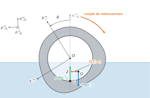
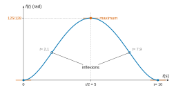
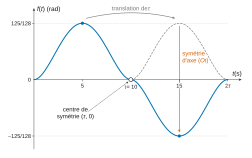
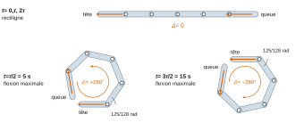
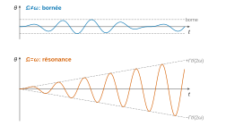
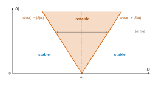

# CCINP TSI — Modélisation 2026 · Corrigé brut

*Corrigé rédigé par IA, non officiel. Signalez toute erreur.*

Épreuve de 3 heures, calculatrice interdite, trois parties indépendantes. Notations : $\vec u\wedge\vec v$ désigne le produit vectoriel, et les angles sont orientés par l'axe indiqué.

## Partie I — Modélisation et stabilisation d'un flotteur

### I.1 — Géométrie d'un flotteur

**Q1.** $R_e$ est continue sur le segment $[0,2\pi]$. Par le théorème des bornes atteintes, elle y est bornée et atteint ses bornes :

$$\begin{aligned}
m&=\min_{[0,2\pi]}R_e\\
M&=\max_{[0,2\pi]}R_e
\end{aligned}$$

Soit $\theta\in\mathbb{R}$ et $k=\lfloor\theta/2\pi\rfloor\in\mathbb{Z}$. Alors $\theta-2k\pi\in[0,2\pi[$. Par $2\pi$-périodicité :

$$R_e(\theta)=R_e(\theta-2k\pi)\in[m,M].$$

**$R_e$ est bornée sur $\mathbb{R}$, et ses bornes sont atteintes. En particulier, $\min_{\mathbb{R}}R_e$ existe, ce qui donne un sens à la condition $R_i<\min R_e$.**

**Q2.** $R_e$ est continue et $2\pi$-périodique. Ses coefficients de Fourier trigonométriques sont, pour $k\geqslant1$ :

$$\boxed{\begin{aligned}
a_0&=\frac{1}{2\pi}\int_0^{2\pi}R_e(\theta)\,\mathrm d\theta\\
a_k&=\frac1\pi\int_0^{2\pi}R_e(\theta)\cos(k\theta)\,\mathrm d\theta\\
b_k&=\frac1\pi\int_0^{2\pi}R_e(\theta)\sin(k\theta)\,\mathrm d\theta
\end{aligned}}$$

Le coefficient $a_0$ est la valeur moyenne de $R_e$, conformément à l'écriture $S_N=a_0+\sum\ldots$ de l'énoncé. Les intégrandes étant $2\pi$-périodiques, on peut intégrer sur n'importe quel intervalle de longueur $2\pi$, par exemple $[-\pi,\pi]$.

**Q3.** La symétrie orthogonale d'axe $(O,\vec x)$ envoie le point de coordonnées polaires $(\rho,\theta)$ sur le point $(\rho,-\theta)$. L'image du profil $\{(R_e(\theta),\theta)\}$ est donc $\{(R_e(-\varphi),\varphi)\}$.

Un angle ne correspondant qu'à un seul rayon, cette image coïncide avec le profil si et seulement si $R_e(-\varphi)=R_e(\varphi)$ pour tout $\varphi$.

$$\boxed{\text{profil symétrique par rapport à }(O,\vec x)\iff R_e\text{ paire sur }\mathbb{R}}$$

**Q4.** Supposons $R_e$ paire et soit $k\geqslant1$. La fonction $\theta\mapsto R_e(\theta)\sin(k\theta)$ est impaire et $2\pi$-périodique, donc son intégrale sur $[-\pi,\pi]$ est nulle : $b_k=0$.

La fonction $\theta\mapsto R_e(\theta)\cos(k\theta)$ est paire, ce qui permet d'intégrer sur $[0,\pi]$ et de doubler. D'où

$$\boxed{\begin{aligned}
S_N(\theta)&=a_0+\sum_{k=1}^{N-1}a_k\cos(k\theta)\\
a_0&=\frac1\pi\int_0^\pi R_e(\theta)\,\mathrm d\theta\\
a_k&=\frac2\pi\int_0^\pi R_e(\theta)\cos(k\theta)\,\mathrm d\theta
\end{aligned}}$$

**Q5.** *Théorème de Dirichlet.* Soit $f:\mathbb{R}\to\mathbb{R}$, $2\pi$-périodique et de classe $\mathcal C^1$ par morceaux. Alors, pour tout réel $\theta$, la suite des sommes partielles de Fourier de $f$ converge, et

$$\lim_{N\to+\infty}S_N(f)(\theta)=\frac12\Big(f(\theta^+)+f(\theta^-)\Big).$$

L'énoncé suppose seulement $R_e$ continue. Il faut ajouter l'hypothèse « $\mathcal C^1$ par morceaux », naturelle pour un profil usiné formé d'un nombre fini d'arcs réguliers.

Sous cette hypothèse, et puisque $R_e$ est continue, la régularisée est $R_e$ elle-même :

$$\boxed{\forall\theta\in\mathbb{R},\qquad \lim_{N\to+\infty}S_N(\theta)=R_e(\theta)}$$

**Q6.** Le modèle est **linéaire en ses paramètres**. Dans le cas symétrique de l'exemple (cosinus seuls), les $N$ paramètres forment le vecteur $c=(a_0,\dots,a_{N-1})$. On pose

$$\Phi=\begin{pmatrix}1&\cos\theta_1&\cdots&\cos((N-1)\theta_1)\\ \vdots&\vdots&&\vdots\\ 1&\cos\theta_m&\cdots&\cos((N-1)\theta_m)\end{pmatrix}\in\mathcal M_{m,N}(\mathbb{R}).$$

On note $r=(r_1,\dots,r_m)^\top$ le vecteur des rayons mesurés. Le système $\Phi c=r$ est surdéterminé ($m\gg N$) et bruité : il n'a pas de solution exacte. On cherche donc $c$ qui minimise l'écart quadratique

$$J(c)=\sum_{i=1}^m\big(R_e(\theta_i)-r_i\big)^2 .$$

On a $J(c)=\|\Phi c-r\|^2$. Le minimum est atteint quand $\Phi c$ est le projeté orthogonal de $r$ sur $\operatorname{Im}\Phi$, c'est-à-dire pour les **équations normales**

$$\Phi^\top\Phi\,c=\Phi^\top r .$$

Leur solution est unique si $\operatorname{rg}\Phi=N$.

**Famille d'algorithmes : régression par moindres carrés linéaires** (optimisation d'un critère quadratique). On résout les équations normales, système linéaire carré, par exemple par la méthode de Gauss avec recherche partielle du pivot. Dans le cas général (sinus compris), on ajoute les colonnes $\sin(k\theta_i)$, soit $2N-1$ inconnues.

```python
import numpy as np

def identifier_profil(theta, r, N):
    """Coefficients a_0..a_{N-1} de R_e(t) = a_0 + sum a_k cos(k t), au sens des moindres carrés."""
    theta = np.asarray(theta, dtype=float)
    Phi = np.column_stack([np.cos(k * theta) for k in range(N)])
    c, *_ = np.linalg.lstsq(Phi, np.asarray(r, dtype=float), rcond=None)
    return c
```

Sur 200 points tirés au hasard autour du profil de l'énoncé (bruit d'écart-type $0{,}05$ mm), ce code retrouve les cinq coefficients de l'énoncé (de $54{,}42$ à $-1{,}47$) à $10^{-2}$ près.

Si les $\theta_i$ sont régulièrement répartis sur une période et si $N-1<m/2$, les colonnes de $\Phi$ sont orthogonales. La solution se réduit alors aux sommes discrètes

$$\begin{aligned}
a_0&=\frac1m\sum_{i=1}^m r_i\\
a_k&=\frac2m\sum_{i=1}^m r_i\cos(k\theta_i)
\end{aligned}$$

Ce sont les intégrales de Q2 approchées par la méthode des rectangles.

**Q7.** On suppose le flotteur homogène : ses plans de symétrie géométrique sont alors aussi des plans de symétrie matérielle. On suppose aussi le profil symétrique par rapport à $(O,\vec x)$, c'est-à-dire $R_e$ paire (Q3), comme en Q4 et comme le confirme le modèle en cosinus de Q6.
- Le domaine $\mathcal D$ est invariant par $z\mapsto-z$, car $z$ décrit $[-\ell/2,\ell/2]$ : le plan $(O,\vec x,\vec y)$ est un plan de symétrie géométrique et matérielle.
- Le profil est symétrique par rapport à $(O,\vec x)$, donc $\mathcal D$ est invariant par $y\mapsto-y$ : le plan $(O,\vec x,\vec z)$ est un plan de symétrie géométrique et matérielle.

Ces deux plans sont orthogonaux. Le centre d'inertie d'un solide appartient à tout plan de symétrie matérielle : par exemple, $\int_{\mathcal D}y\,\mathrm dm=0$ par imparité de $y\mapsto y$ sur un domaine invariant par $y\mapsto-y$. Donc $G$ appartient à l'intersection des deux plans :

$$\boxed{G\in(O,\vec x)}$$

Le flotteur n'a pas de symétrie de révolution : la droite $(O,\vec x)$ est seulement l'intersection de deux plans de symétrie.

### I.2 — Équilibre d'un flotteur

**Q8.** *Hypothèses et système.* On isole le flotteur, en équilibre dans le référentiel terrestre supposé galiléen, sur mer calme. Il est soumis à deux actions mécaniques extérieures : le poids (glisseur de point $G$, de résultante $-mg\vec x_0$) et la poussée d'Archimède (glisseur de point $C$, de résultante $\rho Vg\vec x_0$).

*Principe fondamental de la statique.* La somme des torseurs des actions extérieures est nulle : théorème de la résultante statique et théorème du moment statique en $G$.

*Résultante :*

$$\begin{aligned}
-mg\,\vec x_0+\rho Vg\,\vec x_0&=\vec 0\\
\text{donc}\quad m&=\rho V
\end{aligned}$$

*Moment en $G$.* Le moment du poids en $G$ est nul, car $G$ est sur son support. Pour la poussée, la formule de changement de point donne

$$\vec M_G(\text{eau}\to f)=\vec M_C(\text{eau}\to f)+\overrightarrow{GC}\wedge\rho Vg\,\vec x_0=\overrightarrow{GC}\wedge\rho Vg\,\vec x_0 .$$

Comme $Z$ est le projeté de $G$ sur $(C,\vec x_0)$, $\overrightarrow{ZC}$ est colinéaire à $\vec x_0$ et $\overrightarrow{GZ}=\overline{GZ}\,\vec y_0$. Alors

$$\begin{aligned}
\overrightarrow{GC}\wedge\rho Vg\,\vec x_0&=(\overrightarrow{GZ}+\overrightarrow{ZC})\wedge\rho Vg\,\vec x_0\\
&=\rho Vg\,\overline{GZ}\,(\vec y_0\wedge\vec x_0)\\
&=-\rho Vg\,\overline{GZ}\,\vec z_0 .
\end{aligned}$$

Le théorème du moment statique en $G$ impose donc $\rho Vg\,\overline{GZ}=0$, soit $\overline{GZ}=0$ : **le flotteur n'est en équilibre que si $G=Z$, c'est-à-dire si $G$ et $C$ sont sur la même verticale.**

*Cas contraire.* Si $m=\rho V$ mais $G\neq Z$, la résultante est nulle et le torseur des actions extérieures se réduit au couple $-\rho Vg\,\overline{GZ}\,\vec z_0$, non nul. Le flotteur n'est pas en équilibre : il se met à tourner autour de $\vec z_0$, dans le sens qui dépend du signe de $\overline{GZ}$. Il revient vers $\theta=0$ (couple de redressement) ou s'en éloigne (chavirement).

Si de plus $m\neq\rho V$, le flotteur s'enfonce ou remonte (pilonnement) jusqu'à ce que le volume immergé vérifie $\rho V=m$.



**Q9.** Par définition de $E_p$, on a $E_p'(\theta)=mg\,\overline{GZ}(\theta)$. Les positions d'équilibre ($\overline{GZ}=0$ d'après Q8) sont donc les points critiques de $E_p$.
- **$A$ ($\theta=0$)** : $\overline{GZ}=0$ et $E_p$ est minimale. C'est une **position d'équilibre stable** : $\overline{GZ}$ passe de négatif à positif, et le couple ramène vers $A$.
- **$C$ ($\theta=\theta_C$)** : $\overline{GZ}=0$ et $E_p$ est maximale. C'est une **position d'équilibre instable**, et $\theta_C$ est l'**angle de chavirement**. Au-delà, $\overline{GZ}<0$ et le couple éloigne le flotteur de l'équilibre.
- **$B$** ($0<\theta_B<\theta_C$) : le bras de levier $\overline{GZ}>0$ y est maximal, ce qui correspond à un point d'inflexion de l'énergie potentielle. $B$ n'est pas une position d'équilibre. Le couple de redressement, maximal en $B$, ramène le flotteur vers $A$ : **l'angle de gîte diminue.**

### I.3 — Stabilité dynamique

**Q10.** Dans la base $(\vec x,\vec y,\vec z)$, la matrice d'inertie en $O$ s'écrit

$$\bar{\bar I}_f(O)=\begin{pmatrix}A&-F&-E\\-F&B&-D\\-E&-D&C\end{pmatrix}.$$

Ses produits d'inertie sont $D=\int yz\,\mathrm dm$, $E=\int zx\,\mathrm dm$ et $F=\int xy\,\mathrm dm$. Le flotteur est homogène et possède les deux plans de symétrie géométrique et matérielle, orthogonaux, de Q7 :
- $(O,\vec x,\vec y)$ (invariance par $z\mapsto-z$) annule $D$ et $E$ ;
- $(O,\vec x,\vec z)$ (invariance par $y\mapsto-y$) annule $D$ et $F$.

Les trois produits d'inertie sont nuls : **la matrice est diagonale dans la base $(\vec x,\vec y,\vec z)$ liée au flotteur.**

La droite $(O,\vec x)$ est un axe de symétrie du flotteur, donc un axe principal d'inertie, mais ce seul fait ne suffit pas à rendre la matrice diagonale : ce sont les deux plans qui le font. Le flotteur n'a pas d'axe de symétrie de révolution, et l'on n'a pas $A_f=B_f$ en général.

**Q11.** Le segment est un cylindre homogène de révolution d'axe $(O,\vec z)$ : sa géométrie et sa répartition de masse sont invariantes par toute rotation autour de cet axe.
- Tout plan contenant l'axe est un plan de symétrie matérielle. Les plans $(O,\vec y,\vec z)$ et $(O,\vec x,\vec z)$ annulent les trois produits d'inertie : la matrice est diagonale.
- La rotation d'angle $\pi/2$ autour de $(O,\vec z)$ laisse le cylindre invariant et échange $x$ et $y$. Donc $\int(y^2+z^2)\,\mathrm dm=\int(x^2+z^2)\,\mathrm dm$, c'est-à-dire $A_s=B_s$.

Ces arguments valent pour toute base orthonormée de troisième vecteur $\vec z$, d'où la notation $(-,-,\vec z)$ :

$$\boxed{\bar{\bar I}_s(O)=\begin{pmatrix}A_s&0&0\\0&A_s&0\\0&0&C_s\end{pmatrix}_{(\vec x,\vec y,\vec z)}}$$

**Q12.** On compose les taux de rotation, avec $\vec\Omega_{s/f}=-\vec\Omega_{f/s}=-\omega_m\vec z$ :

$$\begin{aligned}
\vec\Omega_{s/0}&=\vec\Omega_{s/f}+\vec\Omega_{f/0}\\
&=-\omega_m\,\vec z+\dot\theta\,\vec z
\end{aligned}$$

$$\boxed{\vec\Omega_{s/0}=(\dot\theta-\omega_m)\,\vec z}$$

Ce résultat est cohérent avec l'équation du segment donnée par l'énoncé, $C_s(\ddot\theta-\dot\omega_m)=-C_m$.

**Q13.** *Hypothèses.* On isole le flotteur. L'axe $(O,\vec z)$ est fixe dans le référentiel galiléen $\mathcal R_0$ (hypothèse de l'énoncé), et $\vec z=\vec z_0$.

*Bilan des actions mécaniques extérieures au flotteur :*
- l'action du segment par la liaison pivot motorisée d'axe $(O,\vec z)$ : la liaison, supposée parfaite, transmet un torseur de moment en $O$ orthogonal à $\vec z$, auquel s'ajoute le couple moteur $C_m\vec z_0$ ;
- le poids, glisseur de point $G$, de résultante $-mg\vec x_0$ ;
- la poussée d'Archimède, glisseur de point $C$, de résultante $\rho Vg\vec x_0$.

*Théorème du moment dynamique* en $O$, point fixe, projeté sur $\vec z$. Le moment dynamique vaut $C_f\ddot\theta$ (énoncé). On calcule les moments en $O$ par la formule de changement de point $\vec M_O=\vec M_P+\overrightarrow{OP}\wedge\vec R$.
- Liaison et moteur : la composante suivant $\vec z$ vaut $C_m$.
- Poids : $\overrightarrow{OG}=-c\,\vec x$, avec $\vec x=\cos\theta\,\vec x_0+\sin\theta\,\vec y_0$. Comme $\vec x\wedge\vec x_0=-\sin\theta\,\vec z_0$ :

$$\big(-c\,\vec x\wedge(-mg\,\vec x_0)\big)\cdot\vec z=-mgc\sin\theta .$$

- Poussée : $\overrightarrow{OC}=-a\vec x_0-b\vec y_0$. Comme $\vec y_0\wedge\vec x_0=-\vec z_0$ :

$$\big(\overrightarrow{OC}\wedge\rho Vg\,\vec x_0\big)\cdot\vec z=\rho Vg\,b .$$

$$\boxed{C_f\,\ddot\theta=C_m+\rho Vg\,b-mgc\sin\theta}$$

L'équation de résultante n'apporte rien ici : elle ne fait intervenir que les inconnues de liaison.

**Q14.** *Définition.* Avec $m=\rho V$, les actions de la pesanteur et de l'eau forment un couple (résultante nulle), de moment indépendant du point. D'après Q8, ce moment vaut $-\rho Vg\,\overline{GZ}\,\vec z_0$. Le couple de redressement $\Gamma=\rho Vg\,\overline{GZ}$ est donc défini par

$$\vec M(\text{pes}\to f)+\vec M(\text{eau}\to f)=-\Gamma\,\vec z_0 .$$

*Calcul.* $\overrightarrow{ZC}$ est colinéaire à $\vec x_0$, donc orthogonal à $\vec y_0$. Par suite :

$$\begin{aligned}
\overline{GZ}&=\overrightarrow{GC}\cdot\vec y_0\\
&=(c\,\vec x-a\vec x_0-b\vec y_0)\cdot\vec y_0\\
&=c\sin\theta-b .
\end{aligned}$$

Avec $m=\rho V$ :

$$\boxed{\Gamma=mg\,(c\sin\theta-b)}$$

C'est bien la somme, changée de signe, des deux moments calculés en Q13. L'équation de Q13 s'écrit alors $C_f\ddot\theta=C_m-\Gamma$ : pour $\Gamma>0$, le couple de redressement tend à faire diminuer $\theta$.

**Q15.** *Rôle de $b$.* À l'équilibre $\theta=0$, les points $G$ et $C$ sont sur la même verticale (Q8). Or, en $\theta=0$, on a $\overline{GZ}=-b$.

Donc $b=0$ à l'équilibre.

Pour $|\theta|\ll\theta_C$, le profil étant proche d'un cercle centré en $O$, le centre de carène reste quasiment sur la verticale passant par $O$.

Le paramètre $b$ reste donc négligeable devant $c\sin\theta$ : on le néglige, et $\sin\theta\simeq\theta$ au premier ordre :

$$\Gamma\simeq mgc\,\theta .$$

L'équation de Q14 devient

$$\boxed{\begin{aligned}
C_f\ddot\theta&=C_m-K_x\theta\\
K_x&=mgc
\end{aligned}}$$

Plus généralement, si l'on tient compte du déplacement du centre de carène avec la gîte, $b=b(\theta)$ avec $b(0)=0$. On obtient alors

$$K_x=mg\,\frac{\mathrm d\overline{GZ}}{\mathrm d\theta}(0)=mg\,\big(c-b'(0)\big).$$

$K_x$ vaut $mg$ fois la pente à l'origine du bras de redressement. Dans le cas $K_x=mgc$, la condition $K_x>0$ (centre d'inertie sous $O$) traduit la stabilité de $A$.

Au voisinage de $0$, on a alors $E_p\simeq\frac12K_x\theta^2$.

**Q16.** $C_r(p)$ se retranche au couple moteur, en amont du bloc mécanique : c'est un **couple perturbateur** (en N·m), exercé sur le flotteur autour de l'axe de roulis et non commandé. Il peut représenter l'action de la houle et des vagues, celle du vent sur la partie émergée, les frottements hydrodynamiques, ou les frottements secs dans la liaison.

**Q17.** *Définition.* La fonction de transfert en boucle ouverte est le rapport, au même comparateur (le premier), du signal de retour $K_{\text{capt}}\Theta$ à l'écart $\varepsilon$, perturbation nulle :

$$\mathrm{FTBO}(p)=\frac{K_{\text{capt}}\,\Theta(p)}{\varepsilon(p)}\bigg|_{C_r=0}.$$

On note

$$\begin{aligned}
M(p)&=\frac{K_t}{R+Lp}\\
G_m(p)&=\frac{1}{C_fp^2+K_x}\\
H(p)&=\frac{K_e[(C_f+C_s)p^2+K_x]}{C_sp}
\end{aligned}$$

La boucle interne, réduite par la formule de Black, donne

$$\frac{\Theta}{U}=\frac{MG_m}{1+MG_mH}.$$

On multiplie par $C(p)$ et par $K_{\text{capt}}$ :

$$\boxed{\mathrm{FTBO}(p)=\frac{K_{\text{capt}}\,K_t\,C_s\,p\;C(p)}{C_sp\,(R+Lp)(C_fp^2+K_x)+K_eK_t\big[(C_f+C_s)p^2+K_x\big]}}$$

Le dénominateur vaut $K_eK_tK_x\neq0$ en $p=0$, et le numérateur contient un facteur $p$. Quand $p\to0$ :

$$\mathrm{FTBO}(p)\sim\frac{K_{\text{capt}}C_s}{K_eK_x}\,p\,C(p).$$

La boucle ouverte possède un **zéro à l'origine** : si $C(p)$ est de classe $n$, la FTBO est de classe $n-1$. On suppose $A=K_{\text{capt}}$, pour que $\varepsilon$ soit l'image de l'erreur $\theta_c-\theta$.
- *Échelon de consigne :* l'erreur statique est nulle si et seulement si la FTBO est de classe $\geqslant1$, donc si $C(p)$ est de classe $\geqslant2$.
- *Échelon de perturbation :* avec $\Theta_c=0$, on obtient

$$\frac{\Theta}{C_r}=\frac{-C_sp\,(R+Lp)}{C_sp(R+Lp)(C_fp^2+K_x)+K_eK_t[(C_f+C_s)p^2+K_x]+K_{\text{capt}}K_tC_s\,p\,C(p)}.$$

Pour $C_r=c_0/p$, le théorème de la valeur finale donne $\theta(\infty)=0$ dès la classe 0, grâce au facteur $p$ du numérateur. Cette exigence est donc moins forte que celle sur la consigne.

**Classe minimale du correcteur : 2.** Un double intégrateur seul déphase de $-180^\circ$ et ne laisse aucune marge de phase. On propose donc

$$\boxed{C(p)=\frac{K\,(1+T_1p)(1+T_2p)}{p^2},\qquad K,T_1,T_2>0}$$

Les deux zéros sont placés sous la pulsation de coupure pour restaurer la marge de phase. Ce correcteur est le produit de deux correcteurs proportionnels intégraux. La stabilité en boucle fermée est à vérifier (position des pôles ou marges de stabilité sur le diagramme de Bode). Ce choix compense le zéro à l'origine par un pôle du correcteur : le réglage dépend de la qualité du modèle.

## Partie II — Modélisation géométrique

### II.1 — Espace des configurations

**Q18.** Dans la base orthonormée directe $(\vec x,\vec y,\vec z)$, la rotation d'axe $\vec z$ et d'angle $\alpha$ a pour matrice

$$\begin{pmatrix}\cos\alpha&-\sin\alpha&0\\ \sin\alpha&\cos\alpha&0\\0&0&1\end{pmatrix}.$$

Pour $\alpha=-\frac\pi2$ :

$$\boxed{R_2=\begin{pmatrix}0&1&0\\-1&0&0\\0&0&1\end{pmatrix}}$$

On vérifie sur la position 2 de la figure 6 :

$$\begin{aligned}
R_2\vec x&=-\vec y=\vec x_2\\
R_2\vec y&=\vec x=\vec y_2\\
R_2\vec z&=\vec z=\vec z_2
\end{aligned}$$

**Q19.** On a $p_2=(-1,3,1)^\top$ et $R_2\in SO_3(\mathbb{R})$, donc

$$\boxed{g_2=\begin{pmatrix}0&1&0&-1\\-1&0&0&3\\0&0&1&1\\0&0&0&1\end{pmatrix}}$$

**Q20.** Sur la figure 6 (position 3), on lit $\vec x_3=-\vec x$, $\vec y_3=\vec y$ et $\vec z_3=-\vec z$ : la tête regarde toujours suivant $\vec y$ mais elle est retournée.

$R_3=\operatorname{diag}(-1,1,-1)$ est orthogonale, de déterminant $1$ : c'est la rotation d'axe $\vec y$ et d'angle $\pi$.

$$\boxed{g_3=\begin{pmatrix}-1&0&0&5\\0&1&0&2\\0&0&-1&0\\0&0&0&1\end{pmatrix}}$$

**Q21.** On écrit $g_4=\begin{pmatrix}R_4&p_4\\0&1\end{pmatrix}$. Le bloc $R_4$ a la forme de Q18 avec $\cos\alpha=\sin\alpha=\frac{\sqrt2}2$, soit $\alpha=\frac\pi4$.

La matrice $g_4$ agit par $X\mapsto R_4X+p_4$, avec $p_4=(1,2,3)^\top$.

**La tête subit une rotation d'angle $+\frac\pi4$ autour de l'axe $(O,\vec z)$, vertical et passant par sa position initiale (lacet de $45^\circ$ vers la gauche, sans lever ni incliner la tête), puis une translation de vecteur $\vec x+2\vec y+3\vec z$.**

**Q22.** Les colonnes de $R$ sont

$$\begin{aligned}
C_1&=\tfrac13(2,2,1)\\
C_2&=\tfrac13(-1,2,-2)\\
C_3&=\tfrac13(-2,1,2)
\end{aligned}$$

Elles sont normées :

$$\begin{aligned}
\|C_1\|^2&=\tfrac19(4+4+1)=1\\
\|C_2\|^2&=\tfrac19(1+4+4)=1\\
\|C_3\|^2&=\tfrac19(4+1+4)=1
\end{aligned}$$

Elles sont deux à deux orthogonales :

$$\begin{aligned}
\langle C_1,C_2\rangle&=\tfrac19(-2+4-2)=0\\
\langle C_1,C_3\rangle&=\tfrac19(-4+2+2)=0\\
\langle C_2,C_3\rangle&=\tfrac19(2+2-4)=0
\end{aligned}$$

Les colonnes forment une famille orthonormée, donc **$R^\top R=I_3$ : $R$ est orthogonale.**

**Q23.** On développe selon la première ligne :

$$\begin{aligned}
\det(3R)&=\det\begin{pmatrix}2&-1&-2\\2&2&1\\1&-2&2\end{pmatrix}\\
&=2\cdot6+1\cdot3-2\cdot(-6)\\
&=27 .
\end{aligned}$$

En dimension 3, $\det(3R)=27\det R$, d'où $\det R=1$. **$R$ est orthogonale de déterminant $1$ : $R\in SO_3(\mathbb{R})$.**

**Q24.** L'axe de la rotation est l'ensemble des vecteurs fixes, $\ker(R-I_3)$. On a

$$3(R-I_3)=\begin{pmatrix}-1&-1&-2\\2&-1&1\\1&-2&-1\end{pmatrix}.$$

La première ligne donne $y=-x-2z$. La deuxième donne alors $3x+3z=0$, d'où $z=-x$ puis $y=x$. La troisième ligne est vérifiée. Le noyau est de dimension $1$ :

$$\boxed{\begin{aligned}
&\text{axe}=\operatorname{Vect}(\vec a)\\
&\vec a=(1,1,-1)
\end{aligned}}$$

**Q25.** La trace donne le cosinus :

$$\begin{aligned}
\operatorname{tr}R&=\tfrac13(2+2+2)=2\\
1+2\cos\theta&=2\\
\cos\theta&=\frac12
\end{aligned}$$

Pour le signe, on prend $\vec w=(1,-1,0)$, orthogonal à $\vec a$, et $\vec u=\vec a/\sqrt3$, unitaire et orienté comme $\vec a$.

On calcule $R\vec w=(1,0,1)$ et $\vec w\wedge R\vec w=(-1,-1,1)$. Pour une rotation d'axe orienté par $\vec u$ et $\vec w\perp\vec u$ :

$$\begin{aligned}
\sin\theta\,\|\vec w\|^2&=\vec u\cdot(\vec w\wedge R\vec w)\\
&=-\sqrt3 .
\end{aligned}$$

Comme $\|\vec w\|^2=2$, on obtient $\sin\theta=-\frac{\sqrt3}2$.

$$\boxed{\theta=-\frac\pi3}$$

Contrôle : $\vec w\cdot R\vec w=1=\|\vec w\|^2\cos\theta$ redonne bien $\cos\theta=\frac12$.

**Q26.** $g_5$ agit par $X\mapsto RX+p$.

**La tête subit une rotation d'angle $-\frac\pi3$ autour de l'axe passant par sa position initiale $M_0$ et orienté par $\vec a=(1,1,-1)$ (ou, ce qui revient au même, d'angle $+\frac\pi3$ autour de $-\vec a$), puis une translation de vecteur $\vec p$.** L'axe étant oblique, ce mouvement combine lacet, tangage et roulis.

### II.2 — Intérêt d'une telle modélisation

**Q27.** Soient $g=\begin{pmatrix}R&p\\0_{1,3}&1\end{pmatrix}$ et $h=\begin{pmatrix}S&q\\0_{1,3}&1\end{pmatrix}$ dans $SE(3)$, avec $R,S\in SO_3(\mathbb{R})$ et $p,q\in\mathbb{R}^3$. La formule admise, avec $a=b=1$, donne

$$gh=\begin{pmatrix}RS&Rq+p\\0_{1,3}&1\end{pmatrix}.$$

$SO_3(\mathbb{R})$ est stable par produit : $(RS)^\top RS=S^\top R^\top RS=I_3$ et $\det(RS)=\det R\det S=1$.

Donc $RS\in SO_3(\mathbb{R})$. De plus $Rq+p\in\mathbb{R}^3$. **$gh\in SE(3)$ : $SE(3)$ est stable par produit.**

**Q28.** On développe selon la dernière ligne $(0,0,0,1)$ :

$$\begin{aligned}
\det g&=(-1)^{4+4}\cdot1\cdot\det R\\
&=\det R=1
\end{aligned}$$

**$\det g=1\neq0$, donc $g$ est inversible.**

**Q29.** On cherche $h=\begin{pmatrix}S&q\\0_{1,3}&b\end{pmatrix}$ telle que $gh=I_4$. Par la formule admise (avec $a=1$) :

$$gh=\begin{pmatrix}RS&Rq+bp\\0_{1,3}&b\end{pmatrix}.$$

L'égalité $gh=I_4$ équivaut à

$$\begin{aligned}
b&=1\\
RS&=I_3\\
Rq+p&=0 .
\end{aligned}$$

On obtient $S=R^{-1}=R^\top$ et $q=-R^\top p$. Comme $g$ est inversible (Q28), cet inverse à droite est l'inverse ; on vérifie d'ailleurs que $hg=I_4$.

$$\boxed{g^{-1}=\begin{pmatrix}R^\top&-R^\top p\\0_{1,3}&1\end{pmatrix}}$$

$R^\top$ est orthogonale, de déterminant $\det R=1$, et $-R^\top p\in\mathbb{R}^3$.

Donc $g^{-1}\in SE(3)$. **$SE(3)$ est stable par passage à l'inverse.** Comme il contient $I_4$, c'est un sous-groupe de $GL_4(\mathbb{R})$.

### II.3 — Simulateur

**Q30.** Pour $t\in[0,\tau]$, on factorise :

$$\begin{aligned}
f(t)&=\frac{t^4-2\tau t^3+\tau^2t^2}{640}\\
&=\frac{t^2(t-\tau)^2}{640}
\end{aligned}$$

On dérive :

$$f'(t)=\frac{t(t-\tau)(2t-\tau)}{320}.$$

Le signe de $f'$ se lit sur les trois facteurs : $f'>0$ sur $]0,\frac\tau2[$ et $f'<0$ sur $]\frac\tau2,\tau[$.

La dérivée s'annule en $0$, en $\frac\tau2$ et en $\tau$.

| $t$ | $0$ | | $\tau/2=5$ s | | $\tau=10$ s |
|---|---|---|---|---|---|
| $f'(t)$ | $0$ | $+$ | $0$ | $-$ | $0$ |
| $f(t)$ | $0$ | croissante | $\dfrac{125}{128}$ | décroissante | $0$ |

Le maximum est atteint en $\tau/2$ :

$$\begin{aligned}
\max_{[0,\tau]}f&=f\Big(\frac\tau2\Big)=\frac{\tau^4}{10\,240}\\
&=\frac{10\,000}{10\,240}
\end{aligned}$$

$$\boxed{\max_{[0,\tau]}f=\frac{125}{128}}$$

La fraction est irréductible, car $125=5^3$ et $128=2^7$.

**Q31.** Le graphe est une « cloche » positive sur $[0,10]$ :
- elle est symétrique par rapport à la droite $t=5$, car $f(\tau-t)=f(t)$ ;
- elle part de $0$ et revient à $0$ avec des tangentes horizontales en $t=0$ et $t=10$ (racines doubles) ;
- son maximum vaut $125/128\approx0{,}98$ en $t=5$, avec une tangente horizontale ;
- elle a deux points d'inflexion en $t=\tau\frac{3\mp\sqrt3}{6}$, soit environ $2{,}1$ s et $7{,}9$ s, où $f\approx0{,}43$.

Elle est plus aplatie qu'une parabole au voisinage de $0$ et de $10$.



**Q32.** Pour $t\in[\tau,2\tau]$, le point $(t,f(t))$ s'obtient à partir de $(t-\tau,f(t-\tau))$ par une **translation de $\tau$ le long de l'axe des temps suivie d'une symétrie par rapport à l'axe des abscisses**.

L'arc initial étant symétrique par rapport à $t=\tau/2$, cela revient à une **symétrie centrale de centre $(\tau,0)$**. On obtient sur $[10,20]$ une cloche négative, de minimum $-\frac{125}{128}$ en $t=15$ s.



La relation $f(t)=-f(t-\tau)$ exprime que $f$ est **$\tau$-antipériodique, donc $2\tau$-périodique** : le corps fléchit d'un côté pendant dix secondes, puis symétriquement de l'autre côté.

Le raccord en $t=\tau$ est $\mathcal C^1$, car $f(\tau)=0$ et $f'(\tau^\pm)=0$.

**Q33.** Les cinq pivots ont des axes parallèles et le même angle $f(t)$. Le mouvement est plan et les angles relatifs s'additionnent le long de la chaîne. L'écart d'orientation entre le premier segment (côté tête) et le dernier (côté queue) vaut donc

$$\Delta(t)=5f(t).$$

- Pour $t=0$, $\tau$ et $2\tau$, le corps est rectiligne ($\Delta=0$).
- Les **configurations extrêmes** sont atteintes en $t=\tau/2=5$ s, où le corps est courbé au maximum d'un côté (« C »), et en $t=3\tau/2=15$ s, où il est courbé au maximum de l'autre côté.

En prenant $f$ en radians :

$$\boxed{\Delta_{\max}=5\times\frac{125}{128}=\frac{625}{128}\ \text{rad}\approx280^\circ}$$

Sans calculatrice : $\frac{625}{128}\approx4{,}88$ et $4{,}88\times57{,}3\approx280$. L'écart vaut $-280^\circ$ dans la configuration opposée, soit environ $560^\circ$ entre les deux configurations extrêmes.



## Partie III — Stabilisation du roulis

### III.1 — Modélisation du mouvement

**Q34.** On a $\overrightarrow{OG}=\overrightarrow{OA}+\overrightarrow{AG}=\lambda\vec y_0+\ell\vec x_1$. Dans $\mathcal R_0$, $\vec y_0$ est fixe et

$$\begin{aligned}
\frac{\mathrm d\vec x_1}{\mathrm dt}\Big|_{\mathcal R_0}&=\dot\theta\,\vec y_1\\
\frac{\mathrm d\vec y_1}{\mathrm dt}\Big|_{\mathcal R_0}&=-\dot\theta\,\vec x_1
\end{aligned}$$

On dérive une première fois :

$$\vec V(G/\mathcal R_0)=\dot\lambda\,\vec y_0+\ell\dot\theta\,\vec y_1 .$$

On dérive une seconde fois (dérivée d'un produit) :

$$\boxed{\vec a(G/\mathcal R_0)=\ddot\lambda\,\vec y_0+\ell\ddot\theta\,\vec y_1-\ell\dot\theta^2\,\vec x_1}$$

**Q35.** Le travail élémentaire du poids pendant $\mathrm dt$ est $\delta W=m\vec g\cdot\vec V(G/\mathcal R_0)\,\mathrm dt$, avec $m\vec g=mg\vec x_0$ ($\vec x_0$ vers le bas). On a $\vec x_0\cdot\vec y_0=0$ et $\vec x_0\cdot\vec y_1=-\sin\theta$. Donc

$$\begin{aligned}
\delta W&=mg\big(\dot\lambda\,\vec x_0\cdot\vec y_0+\ell\dot\theta\,\vec x_0\cdot\vec y_1\big)\,\mathrm dt\\
&=-mg\ell\sin\theta\,\mathrm d\theta
\end{aligned}$$

$$\boxed{\delta W=\mathrm d(mg\ell\cos\theta)}$$

Une force est conservative si son travail élémentaire s'écrit $\delta W=-\mathrm dE_p$, où $E_p$ est une fonction de la seule position du point d'application. Ici,

$$E_p=-m\vec g\cdot\overrightarrow{OG}+\text{cste}=-mg\ell\cos\theta+\text{cste}.$$

$E_p$ ne dépend que de la position de $G$, car le champ de pesanteur est uniforme et stationnaire. **Le poids est donc une force conservative**, même si le support bouge. Le terme en $\lambda$ disparaît car $\vec g\perp\vec y_0$.

**Q36.** *Démarche.*
- On isole la masse $m$, dans le référentiel galiléen $\mathcal R_0$.
- Elle est soumise à son poids $mg\vec x_0$ et à l'action du fil $-T\vec x_1$, avec $T\geqslant0$ (le fil tire $G$ vers $A$).
- On applique le principe fondamental de la dynamique, sous la forme du théorème de la résultante dynamique : $m\,\vec a(G/\mathcal R_0)=mg\,\vec x_0-T\,\vec x_1$, avec l'accélération de Q34.
- On projette sur $\vec x_1$, direction du fil : c'est la projection qui fait apparaître $T$. La projection sur $\vec y_1$ élimine $T$ et donne l'équation (4).

*Mise en œuvre.* Avec $\vec y_0\cdot\vec x_1=\sin\theta$ et $\vec x_0\cdot\vec x_1=\cos\theta$, la projection sur $\vec x_1$ donne

$$m\big(\ddot\lambda\sin\theta-\ell\dot\theta^2\big)=mg\cos\theta-T .$$

$$T=m\big(g\cos\theta+\ell\dot\theta^2-\ddot\lambda\sin\theta\big).$$

Pour exprimer $T$ avec $m,g,\ell,\theta,\ddot\lambda$ seulement, il faut éliminer $\dot\theta$ grâce à une intégrale première de (4). On multiplie (4) par $\dot\theta$ et on intègre. Si $\ddot\lambda=\gamma$ est constant, cela donne

$$\frac12\dot\theta^2+\frac\gamma\ell\sin\theta-\frac g\ell\cos\theta=\text{cste}.$$

Pour un départ au repos en $\theta=0$, on obtient

$$\ell\dot\theta^2=2g(\cos\theta-1)-2\gamma\sin\theta .$$

$$\boxed{T=m\big[g\,(3\cos\theta-2)-3\,\ddot\lambda\sin\theta\big]}$$

Cette expression suppose $\ddot\lambda$ constant et un départ au repos en $\theta=0$.

Pour un $\lambda(t)$ quelconque, $\dot\theta$ s'obtient en résolvant (4), numériquement si nécessaire. Si le mouvement est lent ($\ell\dot\theta^2\ll g$), on a simplement $T\simeq m(g\cos\theta-\ddot\lambda\sin\theta)$.

**Q37.** On dérive deux fois $\lambda(t)=X\sin(\Omega t)$ :

$$\ddot\lambda(t)=-X\Omega^2\sin(\Omega t).$$

L'amplitude $X$ est petite et les conditions initiales sont nulles : on se place en petits angles. Au premier ordre, $\sin\theta\simeq\theta$, et $\ddot\lambda\cos\theta\simeq\ddot\lambda$ (le terme $\ddot\lambda\,\theta^2/2$ est d'ordre supérieur). L'équation (4) devient

$$\ddot\theta-\frac{X\Omega^2}{\ell}\sin(\Omega t)+\frac g\ell\,\theta=0 .$$

On l'identifie à la forme (5) :

$$\boxed{\begin{aligned}
&\ddot\theta+\omega^2\theta=\Gamma\sin(\Omega t)\\
&\omega=\sqrt{\frac g\ell}\\
&\Gamma=\frac{X\Omega^2}{\ell}
\end{aligned}}$$

Contrôle d'homogénéité : $\omega$ est en $\mathrm{s^{-1}}$ et $\Gamma$ en $\mathrm{s^{-2}}$.

**Q38.** L'équation (5) est linéaire du second ordre à coefficients constants. Ses solutions sont la somme de la solution générale de l'équation homogène et d'une solution particulière.
- Équation homogène : l'équation caractéristique $r^2+\omega^2=0$ a pour racines $\pm i\omega$. Les solutions sont $t\mapsto\alpha\cos\omega t+\beta\sin\omega t$, avec $(\alpha,\beta)\in\mathbb{R}^2$.
- Solution particulière : le second membre est sinusoïdal (il n'y a pas de solution constante). Comme $\Omega\neq\omega$, $i\Omega$ n'est pas racine de l'équation caractéristique : on cherche $\theta_p=K\sin\Omega t$. Alors $(\omega^2-\Omega^2)K=\Gamma$.

La solution générale sur $\mathbb{R}$ est donc

$$\theta(t)=\alpha\cos\omega t+\beta\sin\omega t+\frac{\Gamma}{\omega^2-\Omega^2}\sin\Omega t .$$

Les conditions $\theta(0)=0$ et $\dot\theta(0)=0$ donnent

$$\begin{aligned}
\alpha&=0\\
\beta\omega+\frac{\Gamma\Omega}{\omega^2-\Omega^2}&=0
\end{aligned}$$

$$\boxed{\theta(t)=\frac{\Gamma}{\omega^2-\Omega^2}\Big(\sin(\Omega t)-\frac\Omega\omega\sin(\omega t)\Big)}$$

**Q39.** Pour $\Omega=\omega$, $i\omega$ est racine simple de l'équation caractéristique : $\sin\omega t$ est solution de l'équation homogène et la forme $K\sin\omega t$ ne convient pas. On cherche donc $\theta_p=\mu\,t\cos(\omega t)$. Le calcul donne

$$\ddot\theta_p+\omega^2\theta_p=-2\mu\omega\sin\omega t ,$$

d'où $\mu=-\frac{\Gamma}{2\omega}$. La solution générale est

$$\theta(t)=\alpha\cos\omega t+\beta\sin\omega t-\frac{\Gamma}{2\omega}\,t\cos\omega t .$$

Les conditions initiales donnent $\alpha=0$ et $\beta\omega-\frac{\Gamma}{2\omega}=0$ :

$$\boxed{\begin{aligned}
\theta(t)&=\frac{\Gamma}{2\omega^2}\Big(\sin(\omega t)-\omega t\cos(\omega t)\Big)\\
\Gamma&=\frac{X\omega^2}{\ell}=\frac{Xg}{\ell^2}
\end{aligned}}$$

**Q40.**
- $\Omega\neq\omega$ : $\theta$ est une somme de deux sinusoïdes, donc **bornée**. L'amplitude du régime forcé, $\frac{|\Gamma|}{|\omega^2-\Omega^2|}$, dépend de la pulsation $\Omega$ : elle est modérée loin de $\omega$ et devient grande quand $\Omega\to\omega$, avec des battements.
- $\Omega=\omega$ : le terme $-\frac{\Gamma}{2\omega}t\cos\omega t$ fait **croître l'amplitude linéairement avec le temps** : c'est la résonance, et le balancier n'est pas borné.

Le modèle cesse alors d'être valable, car l'hypothèse des petits angles tombe et les frottements ont été négligés. Physiquement, une houle de pulsation voisine de $\omega=\sqrt{g/\ell}$ peut conduire au chavirement.



### III.2 — Stabilité de l'équation linéaire

#### III.2.1 — Théorie de perturbation naïve au premier ordre

**Q41.** On fixe $t$ et l'on pose $h=2(\Omega-\omega)t$, qui est un $O(\delta)$ puisque $\Omega-\omega=O(\delta)$. On fait un développement limité du cosinus au point $2\omega t$ (et non en $0$) :

$$\begin{aligned}
\cos(2\Omega t)&=\cos(2\omega t+h)\\
&=\cos(2\omega t)-h\sin(2\omega t)+O(h^2)\\
&=\cos(2\omega t)+O(\delta).
\end{aligned}$$

Le reste est même majoré explicitement par l'inégalité des accroissements finis : $|\cos(2\omega t+h)-\cos(2\omega t)|\leqslant|h|=2|\Omega-\omega||t|$.

**Donc $\cos(2\Omega t)=\cos(2\omega t)+O(\delta)$, à $t$ fixé** (ou uniformément sur tout intervalle borné, mais pas uniformément sur $\mathbb{R}$).

**Q42.** On injecte $\theta_\delta=\theta_0+\delta\theta_1+O(\delta^2)$ dans le membre de gauche de (6) :

$$\ddot\theta_\delta+\omega^2\theta_\delta=(\ddot\theta_0+\omega^2\theta_0)+\delta(\ddot\theta_1+\omega^2\theta_1)+O(\delta^2).$$

Le premier terme est nul par (7). Dans le membre de droite, Q41 et $\theta_\delta=\theta_0+O(\delta)$ donnent

$$\begin{aligned}
-\omega^2\delta\cos(2\Omega t)\,\theta_\delta&=-\omega^2\delta\big(\cos2\omega t+O(\delta)\big)\big(\theta_0+O(\delta)\big)\\
&=-\delta\omega^2\cos(2\omega t)\,\theta_0+O(\delta^2).
\end{aligned}$$

D'où, avec $\theta_0=A\cos\omega t+B\sin\omega t$ :

$$\boxed{\delta\big(\ddot\theta_1+\omega^2\theta_1\big)=-\delta\omega^2\cos(2\omega t)\big(A\cos\omega t+B\sin\omega t\big)+O(\delta^2)}$$

**Q43.** On linéarise les produits :

$$\begin{aligned}
\cos(2\omega t)\cos(\omega t)&=\tfrac12(\cos3\omega t+\cos\omega t)\\
\cos(2\omega t)\sin(\omega t)&=\tfrac12(\sin3\omega t-\sin\omega t)
\end{aligned}$$

En reportant dans (8) :

$$\boxed{\ddot\theta_1+\omega^2\theta_1=-\frac{\omega^2}2\big(A\cos3\omega t+A\cos\omega t+B\sin3\omega t-B\sin\omega t\big)}$$

**Q44.** Soient $\alpha,\beta,\gamma,\eta$ des réels tels que $h=\alpha g_1+\beta g_2+\gamma g_3+\eta g_4$ soit la fonction nulle sur $\mathbb{R}$. La fonction $h$ est $\mathcal C^\infty$ et toutes ses dérivées sont nulles. En $t=0$ :

$$\begin{aligned}
h(0)&=\alpha+\gamma=0\\
h'(0)&=\omega(\beta+3\eta)=0\\
h''(0)&=-\omega^2(\alpha+9\gamma)=0\\
h'''(0)&=-\omega^3(\beta+27\eta)=0
\end{aligned}$$

Comme $\omega\neq0$, la première et la troisième ligne donnent $8\gamma=0$, puis $\alpha=\gamma=0$. La deuxième et la quatrième donnent $24\eta=0$, puis $\beta=\eta=0$. **La famille $(g_1,g_2,g_3,g_4)$ est libre.**

Autre méthode : la famille est orthogonale pour le produit scalaire $\langle f,h\rangle=\int_0^{2\pi/\omega}fh$, et formée de vecteurs non nuls.

**Q45.** $\theta_1$ est solution de (8) si et seulement si la différence des deux membres de l'équivalence de l'énoncé est la fonction nulle. Cette différence est une combinaison linéaire de $g_1,\dots,g_4$. Par liberté (Q44), tous ses coefficients sont nuls :
- selon $g_3$ : $-8\omega^2a=-\frac{\omega^2}2A$, donc $a=\frac A{16}$ ;
- selon $g_4$ : $-8\omega^2b=-\frac{\omega^2}2B$, donc $b=\frac B{16}$ ;
- selon $g_1$ : $2\omega d=-\frac{\omega^2}2A$, donc $d=-\frac{\omega A}4$ ;
- selon $g_2$ : $-2\omega c=\frac{\omega^2}2B$, donc $c=-\frac{\omega B}4$.

$$\boxed{\theta_1(t)=\frac A{16}\cos(3\omega t)+\frac B{16}\sin(3\omega t)-\frac{\omega B}4t\cos(\omega t)-\frac{\omega A}4t\sin(\omega t)}$$

C'est **une** solution particulière de (8). Les autres s'en déduisent en ajoutant $\alpha\cos\omega t+\beta\sin\omega t$.

**Q46.** Les conditions $\theta_\delta(0)=\Theta_0$ et $\dot\theta_\delta(0)=0$ valent pour tout $\delta$ petit. On les identifie ordre par ordre.
- *Ordre 0* : $\theta_0(0)=A$ et $\dot\theta_0(0)=B\omega$. Donc $A=\Theta_0$ et $B=0$.
- *Ordre 1* : il faut $\theta_1(0)=0$ et $\dot\theta_1(0)=0$.

Avec $A=\Theta_0$ et $B=0$, la solution particulière de Q45 est $\frac{\Theta_0}{16}\cos3\omega t-\frac{\Theta_0\omega}4t\sin\omega t$. Elle vaut $\frac{\Theta_0}{16}$ en $0$, et sa dérivée

$$-\frac{3\omega\Theta_0}{16}\sin3\omega t-\frac{\Theta_0\omega}4\big(\sin\omega t+\omega t\cos\omega t\big)$$

s'annule en $0$. On lui ajoute la solution homogène $\alpha\cos\omega t+\beta\sin\omega t$, avec $\alpha=-\frac{\Theta_0}{16}$ et $\beta=0$.

$$\boxed{\theta_\delta(t)=\Theta_0\cos(\omega t)+\delta\Big(\frac{\Theta_0}{16}\big(\cos3\omega t-\cos\omega t\big)-\frac{\Theta_0\omega}4\,t\sin(\omega t)\Big)+\underset{\delta\to0}{O}(\delta^2)}$$

On peut aussi laisser $A$ et $B$ dépendre de $\delta$ : $A(1+\frac\delta{16})=\Theta_0$ et $B=0$ redonnent le même résultat à $O(\delta^2)$ près.

#### III.2.2 — Utilisation de la méthode de Poincaré-Lindstedt

**Q47.** On pose $u=\frac{\omega\delta}4$ et $v=\Omega-\omega$, de sorte que $M=\begin{pmatrix}u&-v\\v&-u\end{pmatrix}$. On a

$$\begin{aligned}
\operatorname{tr}M&=u-u=0\\
\det M&=-u^2+v^2
\end{aligned}$$

Le polynôme caractéristique est donc

$$\chi_M(X)=X^2+v^2-u^2 .$$

Une discussion selon le signe de $u^2-v^2$ s'impose :
- si $|u|>|v|$ : deux valeurs propres réelles distinctes $\pm\sqrt{u^2-v^2}$ ;
- si $|u|<|v|$ : deux valeurs propres imaginaires pures conjuguées $\pm i\sqrt{v^2-u^2}$ ;
- si $|u|=|v|$ : $0$ valeur propre double.

$$\boxed{\lambda=\pm\sqrt{\Big(\frac{\omega\delta}4\Big)^2-(\Omega-\omega)^2}\quad(\text{racine carrée complexe si la quantité est négative})}$$

**Q48.** Si $|u|<|v|$, $\chi_M=X^2+(v^2-u^2)$ n'a aucune racine réelle. Une matrice diagonalisable dans $\mathcal M_2(\mathbb{R})$ a un polynôme caractéristique scindé sur $\mathbb{R}$. **$M$ n'est donc pas diagonalisable dans $\mathcal M_2(\mathbb{R})$.**

**Q49.** On pose $\varphi=\sqrt{(\Omega-\omega)^2-(\omega\delta/4)^2}$, réel strictement positif. $M$ admet dans $\mathbb{C}$ les deux valeurs propres **distinctes** $i\varphi$ et $-i\varphi$. Une matrice de taille 2 ayant deux valeurs propres distinctes est diagonalisable dans $\mathcal M_2(\mathbb{C})$.

Il existe donc $P\in GL_2(\mathbb{C})$ telle que $M=PDP^{-1}$, avec $D=\operatorname{diag}(i\varphi,-i\varphi)$ et $\varphi\in\mathbb{R}$. Par exemple :

$$P=\begin{pmatrix}v&v\\u-i\varphi&u+i\varphi\end{pmatrix},\qquad\det P=2iv\varphi\neq0 .$$

**Q50.** Soit $X$ une solution réelle de (10). On pose $Y=P^{-1}X$, de classe $\mathcal C^1$. Comme $P$ est constante :

$$\begin{aligned}
\dot Y&=P^{-1}\dot X=P^{-1}MX\\
&=DP^{-1}X=DY
\end{aligned}$$

Le système est découplé. On le résout composante par composante :

$$\begin{aligned}
y_1(\tau)&=y_1(0)\,e^{i\varphi\tau}\\
y_2(\tau)&=y_2(0)\,e^{-i\varphi\tau}
\end{aligned}$$

Comme $\varphi\in\mathbb{R}$, $|e^{\pm i\varphi\tau}|=1$, donc $|y_k(\tau)|=|y_k(0)|$. On revient à $X=PY$ par l'inégalité triangulaire :

$$|x(\tau)|\leqslant|p_{11}|\,|y_1(0)|+|p_{12}|\,|y_2(0)| ,$$

et de même pour $y$. **Les solutions réelles $(x,y)$ de (9) sont bornées.** Elles sont même $2\pi/\varphi$-périodiques, et l'amplitude $2\sqrt{x^2+y^2}$ de $\theta_0$ reste bornée.

**Q51.** Si $|u|>|v|$, $M$ a deux valeurs propres réelles distinctes $\pm r$, avec $r=\sqrt{(\omega\delta/4)^2-(\Omega-\omega)^2}>0$. Elle est diagonalisable dans $\mathcal M_2(\mathbb{R})$, et les solutions s'écrivent

$$X(\tau)=c_+e^{r\tau}V_++c_-e^{-r\tau}V_- .$$

Dès que $c_+\neq0$, c'est-à-dire pour toute condition initiale hors de la droite $\operatorname{Vect}(V_-)$, $\|X(\tau)\|\to+\infty$ exponentiellement. **Les solutions ne sont pas bornées : l'amplitude du roulis croît exponentiellement, c'est la résonance paramétrique.** Le robot finit par dépasser l'angle de chavirement.

Dans le cas limite $|u|=|v|$, avec $M\neq0$, un calcul direct donne $M^2=(u^2-v^2)I_2=0$. Alors $\tau\mapsto(I_2+\tau M)X(0)$ vérifie (10) et la condition initiale : par unicité de la solution du problème de Cauchy, c'est la solution, qui croît linéairement. Ce cas est lui aussi instable.

**Q52.** D'après Q50 et Q51, le robot est stable si et seulement si $|\Omega-\omega|>\frac{\omega|\delta|}4$ :

$$\boxed{\Omega\in\Big]0\,;\,\omega\Big(1-\frac{|\delta|}4\Big)\Big[\ \cup\ \Big]\omega\Big(1+\frac{|\delta|}4\Big)\,;\,+\infty\Big[,\quad\text{avec }\omega=\sqrt{\frac g\ell}}$$

Ce résultat vaut au voisinage de $\omega$, dans le cadre $\Omega-\omega=O(\delta)$ de l'étude. Il existe une **bande d'instabilité** $\big]\omega(1-\frac{|\delta|}4),\omega(1+\frac{|\delta|}4)\big[$ autour de $\omega$.

**Le robot NATRIX ne peut donc pas être utilisé passivement en toutes situations de navigation.** Une houle dont la pulsation tombe dans cette bande excite une résonance paramétrique qui fait croître le roulis jusqu'au chavirement. Cette bande ne disparaît pas quand $\delta$ diminue : elle se rétrécit seulement. Il faut donc soit éviter ces états de mer, soit recourir à la stabilisation active du roulis par les flotteurs motorisés (partie I.3).


