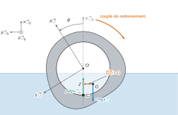
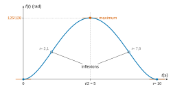
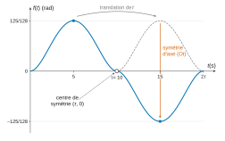
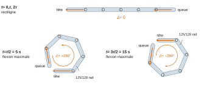
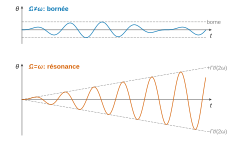
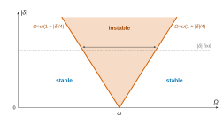

# CCINP TSI — Modélisation 2026 · Corrigé guidé

*Corrigé rédigé par IA, non officiel. Signalez toute erreur.*

## Présentation du sujet

**Thème.** Le sujet suit le robot serpentiforme aquatique NATRIX, qui comprend une tête, un cou, six modules ARIM à deux degrés de liberté et une queue passive. Chaque module porte un flotteur au profil « triangulaire », que l'on peut faire tourner autour de l'axe du module pour corriger le roulis. L'épreuve de « Modélisation » mêle mathématiques et sciences industrielles autour de cet objet unique.

**Format.** 3 heures, calculatrice interdite, 52 questions réparties en trois parties **indépendantes**. On peut admettre le résultat d'une question pour poursuivre.

**Découpage.**

| Partie | Questions | Contenu |
|---|---|---|
| I.1 Géométrie d'un flotteur | Q1–Q7 | fonction périodique bornée, coefficients de Fourier, parité, Dirichlet, moindres carrés, centre d'inertie |
| I.2 Équilibre d'un flotteur | Q8–Q9 | PFS (poids et poussée d'Archimède), bras de redressement, énergie potentielle |
| I.3 Stabilité dynamique | Q10–Q17 | matrices d'inertie, composition des rotations, théorème du moment dynamique, linéarisation, schéma-blocs, précision |
| II.1 Espace des configurations | Q18–Q26 | matrices de rotation, $SE(3)$, axe et angle d'une rotation de $\mathbb{R}^3$ |
| II.2 Structure de groupe | Q27–Q29 | stabilité par produit, déterminant, inverse |
| II.3 Simulateur | Q30–Q33 | étude de fonction polynomiale, antipériodicité, composition d'angles |
| III.1 Pendule à support mobile | Q34–Q40 | cinématique, travail du poids, tension, équation linéaire du second ordre forcée, résonance |
| III.2 Résonance paramétrique | Q41–Q52 | développements en $O(\delta)$, linéarisation trigonométrique, famille libre, valeurs propres, diagonalisation, stabilité |

**Notions mobilisées.** En mathématiques : séries de Fourier, théorème de Dirichlet, matrices orthogonales et rotations, déterminant, réduction des matrices $2\times2$ (sur $\mathbb{R}$ et sur $\mathbb{C}$), équations différentielles linéaires d'ordre 1 et 2, familles libres et notations $O$. En sciences industrielles : statique (PFS), cinétique (matrice d'inertie, plans de symétrie), dynamique (TMD), modélisation d'un moteur à courant continu, schémas-blocs et précision des systèmes asservis.

**Difficulté.** Le sujet est long mais très guidé : beaucoup de questions sont des « montrer que » dont le résultat est donné. Les vraies difficultés sont les suivantes :
- Q14–Q15 : signe du couple et rôle de $b$ ;
- Q17 : boucle interne et zéro à l'origine ;
- Q25 : signe de l'angle d'une rotation ;
- Q36 : élimination de $\dot\theta$ ;
- Q46 : conditions initiales ordre par ordre ;
- Q50–Q52 : stabilité.

**À ne pas laisser passer.** Q1, Q2, Q3, Q12, Q16, Q18–Q24, Q27–Q30, Q34, Q37–Q39, Q43–Q45, Q47 et Q48 sont des questions de cours appliqué, rapides et rentables.

**Ce qu'en dit le jury (rapport 2026).** Le sujet est jugé « très long (52 questions en 3 heures) », et les questions demandant de l'initiative sur les hypothèses ont été peu abordées. Le jury attendait d'abord « une résolution honnête et rigoureuse des questions simples (Q2, Q4, Q5, Q22, Q23, Q24, Q30, etc.) », et il s'étonne des points perdus sur l'étude de fonction et la citation de théorèmes du cours.

Les questions les plus discriminantes, d'après le rapport :
- Q8 et Q13 (PFS et TMD : hypothèses, bilan des actions, changement de point), avec « très peu de démonstrations correctes » en Q8 ;
- Q17, « majoritairement ratée » (boucle ouverte, classe, erreur statique) ;
- Q29, « très peu réussie », et Q35 (travail élémentaire, force conservative) ;
- Q39 à Q46 (résonance, développements en $\delta$), puis Q51 et Q52, presque jamais traitées.

Le rapport insiste aussi sur la rédaction des questions de sciences industrielles : citer le théorème, justifier les hypothèses, ne pas répondre par une simple formule.

**Gestion du temps.** Comptez environ 1 h pour la partie I, 45 min pour la partie II et 1 h 05 pour la partie III, plus une relecture. Les parties étant indépendantes, commencer par celle où l'on est le plus à l'aise est une stratégie raisonnable.

## Partie I — Modélisation et stabilisation d'un flotteur

La sous-partie I.1 (Q1–Q7) est purement mathématique : elle décrit le profil du flotteur par une fonction périodique, puis l'identifie à partir de mesures. La sous-partie I.2 (Q8–Q9) étudie l'équilibre statique du flotteur. La sous-partie I.3 (Q10–Q17) établit son équation dynamique et conçoit un asservissement du roulis.

### Question 1

> [!INDICATION]
> Une fonction continue sur $\mathbb{R}$ n'est pas forcément bornée. Quelle hypothèse supplémentaire permet de se ramener à un ensemble sur lequel un théorème du cours s'applique ?

> [!INDICATION]
> Utilisez le théorème des bornes atteintes sur un segment bien choisi, puis la périodicité pour revenir à tout $\mathbb{R}$.

#### Solution

$R_e$ est continue sur le segment $[0,2\pi]$. Par le théorème des bornes atteintes, elle y est bornée et atteint ses bornes :

$$\begin{aligned}
m&=\min_{[0,2\pi]}R_e\\
M&=\max_{[0,2\pi]}R_e
\end{aligned}$$

Soit $\theta\in\mathbb{R}$ et $k=\lfloor\theta/2\pi\rfloor\in\mathbb{Z}$. Alors $\theta-2k\pi\in[0,2\pi[$, et par $2\pi$-périodicité :

$$R_e(\theta)=R_e(\theta-2k\pi)\in[m,M].$$

**$R_e$ est bornée sur $\mathbb{R}$ et ses bornes sont atteintes.** En particulier, le minimum qui figure dans la condition $R_i<\min R_e$ existe bien.

> [!PIEGE]
> « Continue donc bornée » est faux sur $\mathbb{R}$ (voir $x\mapsto x$). C'est le segment qui fait le travail, et la périodicité qui permet de transporter le résultat partout.

> [!JURY]
> D'après le rapport 2026, beaucoup de candidats ont invoqué le théorème « une fonction continue et périodique sur $\mathbb{R}$ est bornée » ; ceux qui l'ont démontré ont en général obtenu tous les points.

### Question 2

> [!INDICATION]
> C'est une question de cours. Quelle est la période, donc la pulsation, de $R_e$ ?

> [!INDICATION]
> Attention au coefficient constant : dans la convention de $S_N$, $a_0$ est la valeur moyenne de $R_e$.

#### Solution

$R_e$ est continue et $2\pi$-périodique (pulsation $1$) :

$$\begin{aligned}
a_0&=\frac{1}{2\pi}\int_0^{2\pi}R_e(\theta)\,\mathrm d\theta\\
a_k&=\frac1\pi\int_0^{2\pi}R_e(\theta)\cos(k\theta)\,\mathrm d\theta\qquad(k\geqslant1)\\
b_k&=\frac1\pi\int_0^{2\pi}R_e(\theta)\sin(k\theta)\,\mathrm d\theta\qquad(k\geqslant1)
\end{aligned}$$

On peut intégrer sur n'importe quel intervalle de longueur $2\pi$, par exemple $[-\pi,\pi]$, ce qui servira en Q4.

> [!PIEGE]
> Écrire $a_0=\frac1\pi\int_0^{2\pi}R_e$ double la valeur moyenne. Le facteur $\frac1{2\pi}$ est propre à $a_0$ ; les $a_k$ et $b_k$ portent un facteur $\frac1\pi$.

> [!JURY]
> Rapport 2026 : « Beaucoup de candidats ont oublié le coefficient $a_0$. Il est dommage de constater que de nombreuses réponses utilisaient des notations différentes de celles de l'énoncé. » Q2 figure dans la liste des questions simples que le jury attendait traitées rigoureusement.

### Question 3

> [!INDICATION]
> Que devient un point de coordonnées polaires $(\rho,\theta)$ par la symétrie d'axe $(O,\vec x)$ ?

> [!INDICATION]
> Écrivez l'image du profil $\{(R_e(\theta),\theta)\}$ et comparez-la au profil lui-même, en utilisant qu'un angle ne correspond qu'à un seul rayon.

#### Solution

La symétrie d'axe $(O,\vec x)$ envoie $(\rho,\theta)$ sur $(\rho,-\theta)$. L'image du profil est $\{(R_e(-\varphi),\varphi)\}$, qui coïncide avec le profil si et seulement si $R_e(-\varphi)=R_e(\varphi)$ pour tout $\varphi$.

$$\boxed{\text{profil symétrique par rapport à }(O,\vec x)\iff R_e\text{ paire}}$$

> [!PIEGE]
> Ne confondez pas la symétrie de la courbe dans le plan avec une symétrie du graphe de $R_e$. La symétrie par rapport à $(O,\vec y)$, elle, s'écrirait $R_e(\pi-\theta)=R_e(\theta)$.

### Question 4

> [!INDICATION]
> Regardez la parité des fonctions à intégrer dans $a_k$ et $b_k$ lorsque $R_e$ est paire.

> [!INDICATION]
> Une fonction impaire et périodique a une intégrale nulle sur $[-\pi,\pi]$ ; pour une fonction paire, on peut se ramener à $[0,\pi]$.

#### Solution

Si $R_e$ est paire, la fonction $\theta\mapsto R_e(\theta)\sin(k\theta)$ est impaire et $2\pi$-périodique. Son intégrale sur $[-\pi,\pi]$ est nulle, donc $b_k=0$.

La fonction $\theta\mapsto R_e(\theta)\cos(k\theta)$ est paire : on intègre sur $[0,\pi]$ et on double. D'où

$$\boxed{\begin{aligned}
S_N(\theta)&=a_0+\sum_{k=1}^{N-1}a_k\cos(k\theta)\\
a_0&=\frac1\pi\int_0^\pi R_e(\theta)\,\mathrm d\theta\\
a_k&=\frac2\pi\int_0^\pi R_e(\theta)\cos(k\theta)\,\mathrm d\theta
\end{aligned}}$$

> [!METHODE]
> Fonction paire : série en cosinus seuls ; fonction impaire : série en sinus seuls. Le modèle de Q6, qui ne contient que des cosinus, décrit donc un profil symétrique par rapport à $(O,\vec x)$ : c'est cette hypothèse qui sert en Q7 et en Q10.

> [!JURY]
> Le rapport 2026 rappelle qu'il faut argumenter les calculs, « par exemple, en justifiant l'utilisation de la parité d'une fonction », surtout lorsque le résultat est donné. Dites quelle fonction est impaire et sur quel intervalle on intègre.

### Question 5

> [!INDICATION]
> Le théorème de Dirichlet porte sur la convergence simple de la série de Fourier. Quelle régularité exige-t-il ?

> [!INDICATION]
> Comparez cette hypothèse à ce que l'énoncé dit de $R_e$, et signalez ce qui manque.

#### Solution

*Théorème de Dirichlet.* Soit $f:\mathbb{R}\to\mathbb{R}$, $2\pi$-périodique et de classe $\mathcal C^1$ par morceaux. Alors, pour tout réel $\theta$, la suite des sommes partielles de Fourier converge et

$$\lim_{N\to+\infty}S_N(f)(\theta)=\frac12\big(f(\theta^+)+f(\theta^-)\big).$$

L'énoncé suppose seulement $R_e$ continue. Il faut ajouter l'hypothèse « $\mathcal C^1$ par morceaux », naturelle pour un profil usiné. Comme $R_e$ est continue, la régularisée coïncide avec $R_e$ :

$$\forall\theta\in\mathbb{R},\qquad\lim_{N\to+\infty}S_N(\theta)=R_e(\theta).$$

> [!PIEGE]
> La continuité seule ne suffit pas : il existe des fonctions continues dont la série de Fourier diverge en un point. Énoncer Dirichlet sans l'hypothèse $\mathcal C^1$ par morceaux est une faute de cours.

> [!JURY]
> Rapport 2026 : « Une question de cours très mal réussie. Les hypothèses n'ont pas souvent été correctement données, et dans de nombreuses copies, la conclusion n'évoquait même pas une notion de limite. » Énoncez les hypothèses complètes, puis la conclusion sous forme de limite des sommes partielles.

### Question 6

> [!INDICATION]
> Le modèle est-il linéaire par rapport aux paramètres inconnus ? Écrivez les $m$ conditions $R_e(\theta_i)\simeq r_i$ sous forme matricielle.

> [!INDICATION]
> Il y a beaucoup plus d'équations que d'inconnues, et les mesures sont bruitées : il n'y a pas de solution exacte. Quel critère minimiser ?

#### Solution

On cherche $c=(a_0,\dots,a_{N-1})$ (cas pair). On pose $\Phi\in\mathcal M_{m,N}(\mathbb{R})$ de terme général $\Phi_{i,k}=\cos(k\theta_i)$ (pour $k=0,\dots,N-1$) et $r=(r_i)$. On minimise l'écart quadratique

$$\begin{aligned}
J(c)&=\sum_{i=1}^m\big(R_e(\theta_i)-r_i\big)^2\\
&=\|\Phi c-r\|^2 .
\end{aligned}$$

Le minimum est atteint quand $\Phi c$ est le projeté orthogonal de $r$ sur $\operatorname{Im}\Phi$, c'est-à-dire pour les **équations normales** $\Phi^\top\Phi\,c=\Phi^\top r$.

**Famille d'algorithmes : moindres carrés linéaires (régression linéaire).** En pratique, on résout les équations normales (système carré) par la méthode de Gauss avec recherche partielle du pivot, ou l'on utilise la fonction `numpy.linalg.lstsq`, sa documentation étant fournie :

```python
import numpy as np

def identifier_profil(theta, r, N):
    theta = np.asarray(theta, dtype=float)
    Phi = np.column_stack([np.cos(k * theta) for k in range(N)])
    c, *_ = np.linalg.lstsq(Phi, np.asarray(r, dtype=float), rcond=None)
    return c   # a_0, ..., a_{N-1}
```

Testé sur 200 points bruités autour du profil de l'énoncé, ce code retrouve les cinq coefficients donnés (de $54{,}42$ à $-1{,}47$).

Dans le cas général, on ajoute les colonnes $\sin(k\theta_i)$, soit $2N-1$ inconnues. Si les angles sont régulièrement répartis sur une période (avec $N-1<m/2$), la solution se réduit aux sommes discrètes qui approchent les intégrales de Q2.

> [!PIEGE]
> Une interpolation (courbe passant par tous les points) est impossible avec $N\ll m$ paramètres, et elle serait absurde sur des données bruitées.

> [!METHODE]
> Un modèle linéaire en ses paramètres s'identifie toujours par moindres carrés linéaires. Ce n'est plus le cas si une pulsation inconnue entre dans un cosinus : le problème devient non linéaire.

> [!JURY]
> Rapport 2026 : question « peu traitée et souvent mal abordée ». Le jury précise : « Il était inutile de mentionner des algorithmes d'IA qui ne sauraient répondre au problème posé. » On attend le critère minimisé et le nom de la famille d'algorithmes (moindres carrés).

### Question 7

> [!INDICATION]
> Un centre d'inertie appartient à tout plan de symétrie matérielle. Combien de plans de symétrie le flotteur possède-t-il ?

> [!INDICATION]
> L'un vient de l'intervalle décrit par $z$, l'autre de la parité de $R_e$. Précisez l'hypothèse sur la répartition de masse.

#### Solution

On suppose le flotteur homogène : ses plans de symétrie géométrique sont alors des plans de symétrie matérielle. On suppose aussi le profil symétrique par rapport à $(O,\vec x)$, c'est-à-dire $R_e$ paire (Q3, Q4, confirmé par le modèle de Q6).
- $z$ décrit $[-\ell/2,\ell/2]$ : le plan $(O,\vec x,\vec y)$ est un plan de symétrie géométrique et matérielle.
- Le profil est symétrique par rapport à $(O,\vec x)$, donc $\mathcal D$ est invariant par $y\mapsto-y$ : le plan $(O,\vec x,\vec z)$ est un plan de symétrie géométrique et matérielle.

Ces deux plans sont orthogonaux. $G$ appartient à tout plan de symétrie matérielle, donc à leur intersection : **$G\in(O,\vec x)$.**

> [!PIEGE]
> Un seul plan de symétrie place $G$ dans un plan, pas sur une droite. Il faut aussi dire que la masse est uniformément répartie : une symétrie géométrique seule ne suffit pas.

> [!PIEGE]
> Le flotteur n'a pas de symétrie de révolution, et la parité de $R_e$ n'est pas en soi un argument de mécanique : elle sert seulement à établir que $(O,\vec x,\vec z)$ est un plan de symétrie. C'est ce plan qu'il faut invoquer.

> [!JURY]
> Rapport 2026 : « peu de copies mentionnaient le fait que les plans de symétrie sont orthogonaux, matériels et géométriques ». Le jury relève aussi des symétries de révolution inventées, des confusions entre axe et plan de symétrie, et des arguments absurdes fondés sur la seule parité de $R_e$.

### Question 8

> [!INDICATION]
> Le PFS comporte deux équations. Laquelle donne la condition de flottaison, et laquelle donne la relation entre $G$ et $Z$ ?

> [!INDICATION]
> Pour le moment en $G$, décomposez $\overrightarrow{GC}=\overrightarrow{GZ}+\overrightarrow{ZC}$ et remarquez que $\overrightarrow{ZC}$ est colinéaire à $\vec x_0$.

#### Solution

*Hypothèses et bilan.* On isole le flotteur, en équilibre dans le référentiel terrestre supposé galiléen, sur mer calme. Il subit deux actions extérieures : le poids (glisseur de point $G$) et la poussée d'Archimède (glisseur de point $C$).

*Principe fondamental de la statique* : théorèmes de la résultante statique et du moment statique, ce dernier écrit en $G$ comme l'impose l'énoncé.

*Résultante :* $(\rho V-m)g\,\vec x_0=\vec 0$, donc $m=\rho V$.

*Moment en $G$ :* le moment du poids en $G$ est nul. Pour la poussée, on applique la formule de changement de point, avec $\vec M_C=\vec 0$ :

$$\begin{aligned}
\vec M_G(\text{eau}\to f)&=\vec M_C(\text{eau}\to f)+\overrightarrow{GC}\wedge\rho Vg\,\vec x_0\\
&=\overrightarrow{GZ}\wedge\rho Vg\,\vec x_0\\
&=\rho Vg\,\overline{GZ}\,(\vec y_0\wedge\vec x_0)\\
&=-\rho Vg\,\overline{GZ}\,\vec z_0 .
\end{aligned}$$

Le théorème du moment statique impose $\overline{GZ}=0$ : **$G=Z$, c'est-à-dire que $G$ et $C$ sont sur la même verticale.**

*Cas contraire :* la résultante reste nulle, mais le torseur se réduit au couple $-\rho Vg\,\overline{GZ}\,\vec z_0$, non nul. Le flotteur n'est pas en équilibre : il tourne autour de $\vec z_0$, vers $\theta=0$ ou en s'en éloignant (chavirement) selon le signe de $\overline{GZ}$. Si de plus $m\neq\rho V$, il s'enfonce ou remonte (pilonnement).



> [!PIEGE]
> La résultante seule donne $m=\rho V$, ce qui ne répond pas à la question : c'est le moment qui donne $G=Z$. Attention aussi au signe : $\vec y_0\wedge\vec x_0=-\vec z_0$.

> [!PIEGE]
> Étudier la configuration « stable » de la figure 3 ne montre rien : il n'y a alors aucun moment de basculement. C'est la situation de gîte qu'il faut écrire.

> [!JURY]
> Le rapport 2026 juge que « très peu de démonstrations correctes ont été proposées ». Il reproche l'absence d'hypothèses et de bilan exhaustif, un théorème non cité, l'absence d'équation de moment, et note que, « bien que le point G ait été ici imposé, toutes les équations de moment n'ont pas été écrites en ce point ». Il regrette aussi que beaucoup ignorent la formule de changement de point.

### Question 9

> [!INDICATION]
> Dérivez $E_p$ : quel lien existe-t-il entre $E_p'$ et $\overline{GZ}$ ?

> [!INDICATION]
> Un équilibre correspond à un point critique de $E_p$. Sa nature (stable ou instable) se lit sur le type d'extremum, ou sur le signe de $\overline{GZ}$ de part et d'autre du point.

#### Solution

$E_p'=mg\,\overline{GZ}$, donc les équilibres ($\overline{GZ}=0$) sont les points critiques de $E_p$.
- **$A$ ($\theta=0$)** : minimum de $E_p$, **équilibre stable**.
- **$C$ ($\theta=\theta_C$)** : maximum de $E_p$, **équilibre instable**. $\theta_C$ est l'**angle de chavirement** : au-delà, $\overline{GZ}<0$ et le couple fait chavirer.
- **$B$** : $\overline{GZ}>0$ y est maximal (point d'inflexion de $E_p$). Le couple de redressement est maximal et ramène le flotteur vers $A$ : **l'angle de gîte diminue.**

> [!PIEGE]
> $B$ n'est pas un équilibre : c'est un extremum du couple, pas de l'énergie.

### Question 10

> [!INDICATION]
> Écrivez la forme générale de la matrice d'inertie avec ses produits d'inertie $D$, $E$ et $F$.

> [!INDICATION]
> Chaque plan de symétrie matérielle annule les deux produits d'inertie qui font intervenir la coordonnée normale à ce plan. Réutilisez Q7.

#### Solution

Avec $D=\int yz\,\mathrm dm$, $E=\int zx\,\mathrm dm$ et $F=\int xy\,\mathrm dm$ :
- le plan $(O,\vec x,\vec y)$ (invariance par $z\mapsto-z$) donne $D=E=0$ ;
- le plan $(O,\vec x,\vec z)$ (invariance par $y\mapsto-y$, parité de $R_e$) donne $D=F=0$.

Ces deux plans de symétrie géométrique et matérielle sont orthogonaux. **La matrice est diagonale dans la base $(\vec x,\vec y,\vec z)$ liée au flotteur.**

La droite $(O,\vec x)$ est un axe de symétrie, donc un axe principal d'inertie, mais cela seul ne rend pas la matrice diagonale. En revanche $A_f\neq B_f$ en général, car le profil n'est pas de révolution.

> [!METHODE]
> Deux plans de symétrie orthogonaux suffisent à rendre la matrice d'inertie diagonale dans la base associée, et ce en tout point de leur intersection.

> [!PIEGE]
> Justifier que la matrice est diagonale par le seul fait qu'elle n'a de termes que sur sa diagonale est circulaire ; invoquer l'axe de rotation $\vec z$ ne prouve rien non plus. Seules les symétries de la répartition de masse annulent les produits d'inertie.

> [!JURY]
> Rapport 2026 : « Ici, le flotteur possède bien un axe de symétrie, mais pas un axe de symétrie de révolution ». Il était attendu de mentionner les deux plans de symétrie orthogonaux, géométrique et matériel.

### Question 11

> [!INDICATION]
> Un cylindre homogène est un solide de révolution. Quels plans de symétrie contient-il ?

> [!INDICATION]
> Pour l'égalité des deux premiers moments, cherchez une isométrie qui laisse le cylindre invariant et échange $\vec x$ et $\vec y$.

#### Solution

Le segment est un cylindre homogène de révolution d'axe $(O,\vec z)$ : sa géométrie et sa répartition de masse sont invariantes par toute rotation autour de cet axe.

Tout plan contenant l'axe $(O,\vec z)$ est un plan de symétrie matérielle. Les plans $(O,\vec x,\vec z)$ et $(O,\vec y,\vec z)$ annulent les trois produits d'inertie.

La rotation d'angle $\pi/2$ autour de $\vec z$ laisse le cylindre invariant et échange $x$ et $y$. Donc $\int(y^2+z^2)\,\mathrm dm=\int(x^2+z^2)\,\mathrm dm$, soit $A_s=B_s$.

Ces deux arguments valent dans **toute** base orthonormée de troisième vecteur $\vec z$, d'où la notation $(-,-,\vec z)$ et la forme $\operatorname{diag}(A_s,A_s,C_s)$ dans la base $(\vec x,\vec y,\vec z)$.

> [!JURY]
> Rapport 2026 : « Il était attendu de mentionner une géométrie de révolution pour justifier l'égalité des deux produits d'inertie. » Il s'agit en fait des deux moments d'inertie $A_s$ et $B_s$ : c'est la révolution qui les rend égaux.

### Question 12

> [!INDICATION]
> Composez les mouvements : segment par rapport au flotteur, puis flotteur par rapport au référentiel galiléen.

> [!INDICATION]
> Faites attention au sens de l'indice : $\vec\Omega_{s/f}=-\vec\Omega_{f/s}$.

#### Solution

$$\vec\Omega_{s/0}=\vec\Omega_{s/f}+\vec\Omega_{f/0}=\boxed{(\dot\theta-\omega_m)\,\vec z}$$

On peut contrôler ce résultat avec l'équation du segment donnée ensuite, $C_s(\ddot\theta-\dot\omega_m)+C_m=0$ : c'est le TMD sur le segment, qui subit le couple $-C_m$.

> [!METHODE]
> Quand l'énoncé fournit une équation juste après une question, elle sert souvent de contrôle : utilisez-la pour vérifier votre signe.

> [!PIEGE]
> Un taux de rotation est un vecteur. Le rapport 2026 signale que « certains ont écrit le vecteur vitesse de rotation comme une somme de scalaires » : gardez $\vec z$ dans chaque terme.

### Question 13

> [!INDICATION]
> Appliquez le théorème du moment dynamique en $O$, point fixe, et projetez sur $\vec z$. Faites la liste des actions extérieures.

> [!INDICATION]
> L'énoncé donne $\overrightarrow{GO}$ et $\overrightarrow{CO}$, pas $\overrightarrow{OG}$ et $\overrightarrow{OC}$. Exprimez $\vec x$ dans la base $(\vec x_0,\vec y_0)$ pour calculer les produits vectoriels.

#### Solution

*Hypothèses.* On isole le flotteur. L'axe $(O,\vec z)$ est fixe dans le référentiel galiléen (hypothèse de l'énoncé), et $\vec z=\vec z_0$.

*Bilan des actions extérieures :* l'action du segment par la liaison pivot d'axe $(O,\vec z)$, supposée parfaite (moment en $O$ orthogonal à $\vec z$), plus le couple moteur $C_m\vec z_0$ ; le poids, en $G$ ; la poussée d'Archimède, en $C$.

*Théorème du moment dynamique* en $O$ fixe, projeté sur $\vec z$. Les moments en $O$ s'obtiennent par la formule de changement de point $\vec M_O=\vec M_P+\overrightarrow{OP}\wedge\vec R$.

On a $\vec x=\cos\theta\,\vec x_0+\sin\theta\,\vec y_0$, $\overrightarrow{OG}=-c\,\vec x$ et $\overrightarrow{OC}=-a\vec x_0-b\vec y_0$. Les moments en $O$ projetés sur $\vec z$ sont :
- liaison et moteur : $C_m$ (un couple a le même moment en tout point, et la liaison pivot parfaite n'a pas de moment suivant $\vec z$) ;
- poids : $\big(-c\,\vec x\wedge(-mg\vec x_0)\big)\cdot\vec z=-mgc\sin\theta$ ;
- poussée : $\big((-a\vec x_0-b\vec y_0)\wedge\rho Vg\,\vec x_0\big)\cdot\vec z=\rho Vg\,b$.

$$\boxed{C_f\ddot\theta=C_m+\rho Vg\,b-mgc\sin\theta}$$

> [!PIEGE]
> Oublier le changement de signe entre $\overrightarrow{GO}$ et $\overrightarrow{OG}$ inverse la stabilité du système.

> [!JURY]
> Le rapport 2026 déplore que les candidats ne justifient pas les hypothèses avant le bilan des actions, oublient le couple moteur ou l'action de la liaison pivot, et se trompent dans le changement de point. Il ajoute : « pour un bon nombre, le principe fondamental de la dynamique se résume à une équation de résultante, qui ne servait à rien ici ».

### Question 14

> [!INDICATION]
> Inutile de construire $Z$ : $\overrightarrow{ZC}$ est orthogonal à $\vec y_0$.

> [!INDICATION]
> Remplacez $\overrightarrow{GZ}$ par $\overrightarrow{GC}$ dans le produit scalaire avec $\vec y_0$, puis passez par le point $O$.

#### Solution

*Définition.* Avec $m=\rho V$, la pesanteur et la poussée forment un couple (résultante nulle), de moment indépendant du point. D'après Q8, ce moment vaut $-\rho Vg\,\overline{GZ}\,\vec z_0$. Le couple de redressement est donc défini par

$$\begin{aligned}
\vec M(\text{pes}\to f)+\vec M(\text{eau}\to f)&=-\Gamma\,\vec z_0\\
\Gamma&=\rho Vg\,\overline{GZ}
\end{aligned}$$

*Calcul.* $\overrightarrow{ZC}$ est orthogonal à $\vec y_0$, donc

$$\begin{aligned}
\overline{GZ}&=\overrightarrow{GC}\cdot\vec y_0\\
&=(c\,\vec x-a\vec x_0-b\vec y_0)\cdot\vec y_0\\
&=c\sin\theta-b .
\end{aligned}$$

$$\boxed{\Gamma=mg\,(c\sin\theta-b)}$$

C'est l'opposé de la somme des deux moments calculés en Q13. L'équation de Q13 s'écrit alors $C_f\ddot\theta=C_m-\Gamma$ : le couple de redressement s'oppose à la gîte, ce qui valide les signes.

> [!PIEGE]
> Recopier $\Gamma=\rho Vg\,\overline{GZ}$ sans le relier aux moments de Q13 conduit facilement au signe opposé, ce qui rend l'équation de Q15 incohérente.

> [!JURY]
> Rapport 2026 : « Très peu de candidats ont donné une définition formelle du couple de basculement », la plupart reprenant la donnée de l'énoncé ; « Par conséquent, beaucoup ont donné son opposé, ce qui n'est pas cohérent ».

### Question 15

> [!INDICATION]
> Écrivez la condition d'équilibre en $\theta=0$ : que vaut alors $b$ ?

> [!INDICATION]
> Développez $\Gamma$ au premier ordre en $\theta$. Demandez-vous si $b$ doit être vu comme une constante ou comme une fonction de la gîte.

#### Solution

En $\theta=0$, $G$ et $C$ sont sur la même verticale (Q8). Or $\overline{GZ}(0)=-b$, donc $b=0$ à l'équilibre.

Pour $|\theta|\ll\theta_C$, le profil est proche d'un cercle centré en $O$ : le centre de carène reste quasiment sur la verticale passant par $O$.

Le terme $b$ est donc négligeable devant $c\sin\theta$, et $\sin\theta\simeq\theta$ au premier ordre. Il vient $\Gamma\simeq mgc\,\theta$ :

$$\boxed{\begin{aligned}
C_f\ddot\theta&=C_m-K_x\theta\\
K_x&=mgc
\end{aligned}}$$

Si l'on tient compte du déplacement de $C$ avec la gîte, $b(\theta)\simeq b'(0)\,\theta$, et l'on obtient plus généralement $K_x=mg\,(c-b'(0))$. $K_x$ vaut $mg$ fois la pente à l'origine du bras de redressement (la hauteur métacentrique).

La condition $K_x>0$ traduit la stabilité de $A$, et $E_p\simeq\frac12K_x\theta^2$ près de $0$.

> [!PIEGE]
> Si l'on garde $b$ comme une constante non nulle, il reste un terme constant qui empêche d'obtenir la forme demandée. Expliquez l'hypothèse que vous retenez.

> [!JURY]
> D'après le rapport 2026, l'approximation des petits angles a bien été faite, mais peu de candidats ont pris l'initiative de justifier que le centre de carène reste quasiment sur la verticale, donc que $b\ll c$, pour linéariser le couple. C'est cette justification qui était attendue.

### Question 16

> [!INDICATION]
> Repérez où $C_r$ entre dans le schéma-blocs et à quelle grandeur il s'ajoute.

#### Solution

$C_r$ se retranche au couple moteur, en entrée du bloc mécanique : c'est un **couple perturbateur** (en N·m), non commandé, exercé sur le flotteur autour de l'axe de roulis. Il peut représenter la houle et les vagues, le vent sur la partie émergée, les frottements hydrodynamiques, ou les frottements secs dans la liaison.

> [!JURY]
> Rapport 2026 : si beaucoup parlent de couple résistant, « très peu en donnent une origine probable (vagues, vent, frottements secs, etc.) ». Nommez la nature de la grandeur et au moins une cause physique.

### Question 17

> [!INDICATION]
> Réduisez d'abord la boucle interne (retour de force contre-électromotrice), puis multipliez par le capteur pour obtenir la FTBO.

> [!INDICATION]
> Regardez le comportement de la FTBO quand $p\to0$ : le bloc de retour interne contient un $1/p$. Où se retrouve-t-il après réduction ?

> [!INDICATION]
> Pour la perturbation, calculez $\Theta/C_r$ et appliquez le théorème de la valeur finale, au lieu d'appliquer une règle toute faite.

#### Solution

*Définition.* La FTBO est le rapport, au même comparateur (le premier), du signal de retour $K_{\text{capt}}\Theta$ à l'écart $\varepsilon$, avec $C_r=0$.

On note

$$\begin{aligned}
M&=\frac{K_t}{R+Lp}\\
G_m&=\frac1{C_fp^2+K_x}\\
H&=\frac{K_e[(C_f+C_s)p^2+K_x]}{C_sp}
\end{aligned}$$

La boucle interne, réduite par la formule de Black, donne $\frac{\Theta}{U}=\frac{MG_m}{1+MG_mH}$. On multiplie par $C(p)$ et $K_{\text{capt}}$ :

$$\boxed{\mathrm{FTBO}(p)=\frac{K_{\text{capt}}K_tC_s\,p\,C(p)}{C_sp(R+Lp)(C_fp^2+K_x)+K_eK_t\big[(C_f+C_s)p^2+K_x\big]}}$$

Le dénominateur vaut $K_eK_tK_x\neq0$ en $0$. La FTBO a donc un **zéro à l'origine** :

$$\mathrm{FTBO}(p)\underset{p\to0}{\sim}\frac{K_{\text{capt}}C_s}{K_eK_x}\,p\,C(p).$$

Si $C$ est de classe $n$, la FTBO est de classe $n-1$. On prend $A=K_{\text{capt}}$, pour que $\varepsilon$ soit l'image de l'erreur.
- *Consigne en échelon :* l'erreur est nulle si et seulement si la FTBO est de classe $\geqslant1$, donc $C$ de classe $\geqslant2$.
- *Perturbation en échelon :* on calcule $\Theta/C_r$ avec $\Theta_c=0$ (formule ci-dessous). Le facteur $p$ du numérateur et le théorème de la valeur finale donnent $\theta(\infty)=0$ dès la classe 0.

$$\frac{\Theta}{C_r}=\frac{-C_sp(R+Lp)}{C_sp(R+Lp)(C_fp^2+K_x)+K_eK_t[(C_f+C_s)p^2+K_x]+K_{\text{capt}}K_tC_s\,p\,C(p)}$$

**Classe minimale : 2.** Comme un double intégrateur seul ne laisse aucune marge de phase, on propose

$$\boxed{C(p)=\frac{K(1+T_1p)(1+T_2p)}{p^2}}$$

Les deux zéros sont placés sous la pulsation de coupure. C'est le produit de deux correcteurs proportionnels intégraux. Il reste à vérifier la stabilité (position des pôles ou marges de stabilité), en gardant à l'esprit que ce choix compense le zéro de la FTBO à l'origine.

> [!PIEGE]
> Compter les intégrateurs « visibles » dans la chaîne directe (aucun) conduit à proposer un correcteur de classe 1, ce qui est faux. Le $1/p$ du retour interne devient un zéro à l'origine après réduction.

> [!METHODE]
> Vérification physique : à tension constante, le couple moteur doit être nul en régime permanent, sinon $\omega_m$ croît sans limite. On a alors $K_x\theta=0$. Une tension constante ne maintient donc aucun angle, ce qui correspond à un gain statique nul de la chaîne directe.

> [!JURY]
> Rapport 2026 : question « majoritairement ratée ». Le jury relève des confusions entre boucle ouverte et boucle fermée, note que « beaucoup de candidats ne connaissent pas la définition de la boucle ouverte (de l'écart au retour au même comparateur) », signale des entrées qui apparaissent dans une fonction de transfert, une confusion entre ordre et classe, et des liens faux entre classe, signal d'entrée et erreur statique.

## Partie II — Modélisation géométrique

La configuration de la tête est codée par une matrice $4\times4$ qui contient une rotation $R\in SO_3(\mathbb{R})$ et une position $p$. La sous-partie II.1 (Q18–Q26) écrit puis décode de telles matrices (axe et angle d'une rotation). La sous-partie II.2 (Q27–Q29) montre que $SE(3)$ est un groupe. La sous-partie II.3 (Q30–Q33) étudie la loi de flexion imposée aux articulations.

### Question 18

> [!INDICATION]
> Rappelez la matrice d'une rotation d'axe $\vec z$ et d'angle $\alpha$ dans une base orthonormée directe, puis remplacez $\alpha$ par $-\frac\pi2$.

#### Solution

$$\boxed{R_2=\begin{pmatrix}\cos(-\frac\pi2)&-\sin(-\frac\pi2)&0\\ \sin(-\frac\pi2)&\cos(-\frac\pi2)&0\\0&0&1\end{pmatrix}=\begin{pmatrix}0&1&0\\-1&0&0\\0&0&1\end{pmatrix}}$$

Contrôle sur la figure 6 : la première colonne, image de $\vec x$, vaut $-\vec y=\vec x_2$, et la deuxième vaut $\vec x=\vec y_2$.

> [!PIEGE]
> L'erreur classique consiste à écrire la matrice de la rotation d'angle $+\frac\pi2$ (la transposée). Les colonnes sont les images des vecteurs de base.

> [!JURY]
> Rapport 2026 : « Il fallait faire attention à l'axe de la rotation pour obtenir la bonne matrice. » Le $1$ se place sur la ligne et la colonne de $\vec z$.

### Question 19

> [!INDICATION]
> Assemblez le bloc rotation (Q18) et le vecteur position $\overrightarrow{OM_2}$.

#### Solution

$$\boxed{g_2=\begin{pmatrix}0&1&0&-1\\-1&0&0&3\\0&0&1&1\\0&0&0&1\end{pmatrix}}$$

### Question 20

> [!INDICATION]
> Lisez sur la figure 6 les vecteurs de la base de la tête en fonction de $\vec x$, $\vec y$ et $\vec z$ : ils forment les colonnes de $R_3$.

> [!INDICATION]
> Contrôlez le déterminant : une configuration d'un solide ne peut pas être une réflexion.

#### Solution

On lit $\vec x_3=-\vec x$, $\vec y_3=\vec y$ et $\vec z_3=-\vec z$ : la tête regarde toujours suivant $\vec y$ mais elle est à l'envers.

$R_3=\operatorname{diag}(-1,1,-1)$ a pour déterminant $1$ : c'est la rotation d'axe $\vec y$ et d'angle $\pi$.

$$\boxed{g_3=\begin{pmatrix}-1&0&0&5\\0&1&0&2\\0&0&-1&0\\0&0&0&1\end{pmatrix}}$$

> [!PIEGE]
> $\operatorname{diag}(1,1,-1)$, qui « retourne » seulement le haut de la tête, est une réflexion de déterminant $-1$, donc n'appartient pas à $SO_3(\mathbb{R})$.

### Question 21

> [!INDICATION]
> Séparez le bloc rotation et le bloc translation. Reconnaissez la forme de Q18.

> [!INDICATION]
> Écrivez l'action sur un point, $X\mapsto R_4X+p_4$, pour savoir dans quel ordre décrire les deux mouvements.

#### Solution

$R_4$ est la rotation d'axe $\vec z$ et d'angle $\frac\pi4$, puisque $\cos\alpha=\sin\alpha=\frac{\sqrt2}2$. **La tête tourne de $+45^\circ$ autour de l'axe vertical passant par sa position initiale (lacet vers la gauche), puis elle est translatée du vecteur $\vec x+2\vec y+3\vec z$.**

> [!METHODE]
> Pour $g=\begin{pmatrix}R&p\\0&1\end{pmatrix}$, on décrit d'abord la rotation autour de l'origine, puis la translation de $p$. L'ordre compte : translater d'abord donnerait $R(X+p)$.

> [!JURY]
> Rapport 2026 : l'axe de la rotation a souvent été omis, et beaucoup ont donné la position de la tête au lieu de la translation. « Une position n'est pas un déplacement. »

### Question 22

> [!INDICATION]
> Une matrice est orthogonale si et seulement si ses colonnes forment une famille orthonormée.

#### Solution

Les colonnes sont $C_1=\frac13(2,2,1)$, $C_2=\frac13(-1,2,-2)$ et $C_3=\frac13(-2,1,2)$. Elles sont normées, car $\|C_i\|^2=\frac{4+4+1}9=1$ pour chacune. Elles sont deux à deux orthogonales :

$$\begin{aligned}
\langle C_1,C_2\rangle&=\tfrac19(-2+4-2)=0\\
\langle C_1,C_3\rangle&=\tfrac19(-4+2+2)=0\\
\langle C_2,C_3\rangle&=\tfrac19(2+2-4)=0
\end{aligned}$$

La famille des colonnes est orthonormée, donc **$R^\top R=I_3$ : $R$ est orthogonale.**

> [!PIEGE]
> L'orthogonalité des colonnes ne suffit pas : il faut aussi qu'elles soient de norme $1$. Le rapport 2026 note que, avec cette méthode, « le caractère normé des vecteurs a régulièrement été oublié ».

### Question 23

> [!INDICATION]
> Calculez le déterminant de $3R$, puis tenez compte du facteur $\frac13$ en dimension 3.

#### Solution

$\det(3R)=2(4+2)+1(4-1)-2(-4-2)=27$, donc $\det R=\frac{27}{27}=1$. **$R$ est orthogonale de déterminant $1$ : $R\in SO_3(\mathbb{R})$.**

> [!PIEGE]
> $\det(\lambda A)=\lambda^3\det A$ en dimension 3, et non $\lambda\det A$.

### Question 24

> [!INDICATION]
> L'axe d'une rotation est l'ensemble des vecteurs fixes. Quel sous-espace faut-il calculer ?

> [!INDICATION]
> Résolvez $(3R-3I_3)v=0$ ; le système est de rang 2.

#### Solution

$3(R-I_3)=\begin{pmatrix}-1&-1&-2\\2&-1&1\\1&-2&-1\end{pmatrix}$. La première ligne donne $y=-x-2z$, puis la deuxième $z=-x$ et donc $y=x$. La troisième ligne est vérifiée. Le noyau est une droite :

$$\boxed{\begin{aligned}
&\text{axe}=\operatorname{Vect}(\vec a)\\
&\vec a=(1,1,-1)
\end{aligned}}$$

### Question 25

> [!INDICATION]
> La trace donne le cosinus de l'angle, donc l'angle au signe près.

> [!INDICATION]
> Pour le signe, prenez un vecteur $\vec w$ orthogonal à l'axe et étudiez le signe de $\vec a\cdot(\vec w\wedge R\vec w)$.

#### Solution

La trace vaut $\operatorname{tr}R=2$, et $\operatorname{tr}R=1+2\cos\theta$, donc $\cos\theta=\frac12$.

Pour le signe, on prend $\vec w=(1,-1,0)\perp\vec a$. On calcule $R\vec w=(1,0,1)$, puis $\vec w\wedge R\vec w=(-1,-1,1)$. Avec $\vec u=\vec a/\sqrt3$, orienté comme le veut l'énoncé :

$$\begin{aligned}
\sin\theta\,\|\vec w\|^2&=\vec u\cdot(\vec w\wedge R\vec w)\\
&=-\sqrt3 .
\end{aligned}$$

Comme $\|\vec w\|^2=2$, on obtient $\sin\theta=-\frac{\sqrt3}2$.

$$\boxed{\theta=-\frac\pi3}$$

Contrôle : $\vec w\cdot R\vec w=1=\|\vec w\|^2\cos\theta$ redonne bien $\cos\theta=\frac12$.

> [!METHODE]
> Pour une rotation d'axe orienté par $\vec u$ unitaire et un vecteur $\vec w\perp\vec u$ : $R\vec w=\cos\theta\,\vec w+\sin\theta\,\vec u\wedge\vec w$. Le signe de $\det(\vec u,\vec w,R\vec w)$ est celui de $\sin\theta$.

> [!PIEGE]
> Répondre $\frac\pi3$ sans étudier le signe ne donne que la moitié de la réponse. Changer l'orientation de l'axe change le signe de l'angle.

> [!JURY]
> Rapport 2026 : la formule de la trace est bien connue, et une méthode pour le signe du sinus a été trouvée dans un nombre raisonnable de copies. « Il est cependant dommage de voir des candidats ne pas prendre en compte l'orientation de l'axe fixée par le sujet. »

### Question 26

> [!INDICATION]
> Rassemblez Q24 et Q25, puis décrivez les mouvements comme en Q21.

#### Solution

**La tête subit une rotation d'angle $-\frac\pi3$ autour de l'axe passant par sa position initiale et orienté par $\vec a=(1,1,-1)$ (soit $+\frac\pi3$ autour de $-\vec a$), puis une translation de vecteur $\vec p$.** L'axe étant oblique, ce mouvement mêle lacet, tangage et roulis.

### Question 27

> [!INDICATION]
> Appliquez la formule admise avec $a=b=1$ et vérifiez que chaque bloc a la forme voulue.

#### Solution

Soient $g=\begin{pmatrix}R&p\\0_{1,3}&1\end{pmatrix}$ et $h=\begin{pmatrix}S&q\\0_{1,3}&1\end{pmatrix}$ dans $SE(3)$, avec $R,S\in SO_3(\mathbb{R})$ et $p,q\in\mathbb{R}^3$. La formule admise donne $gh=\begin{pmatrix}RS&Rq+p\\0_{1,3}&1\end{pmatrix}$.

$SO_3(\mathbb{R})$ est stable par produit : $(RS)^\top RS=S^\top R^\top RS=I_3$ et $\det(RS)=1$. Donc $RS\in SO_3(\mathbb{R})$, et $Rq+p\in\mathbb{R}^3$. **$SE(3)$ est stable par produit.**

> [!JURY]
> Le rapport 2026 indique que cette question évaluait la rédaction : introduire correctement les objets (deux éléments quelconques de $SE(3)$, avec leurs blocs), puis invoquer la stabilité de $SO_3(\mathbb{R})$ par produit pour obtenir tous les points.

### Question 28

> [!INDICATION]
> Développez le déterminant selon la ligne qui contient le plus de zéros.

#### Solution

En développant selon la dernière ligne, $\det g=1\times\det R=1\neq0$. **$g$ est inversible.**

> [!PIEGE]
> Ne confondez pas la matrice $R$ et le nombre $\det R$ : le rapport 2026 relève précisément « une confusion entre la matrice R et le déterminant de R ».

### Question 29

> [!INDICATION]
> Écrivez $gh=I_4$ avec la formule admise et identifiez les blocs.

> [!INDICATION]
> L'inverse d'une matrice orthogonale est sa transposée.

#### Solution

Par la formule admise, $gh=\begin{pmatrix}RS&Rq+bp\\0&b\end{pmatrix}$. L'égalité $gh=I_4$ équivaut à

$$\begin{aligned}
b&=1\\
S&=R^{-1}=R^\top\\
q&=-R^\top p .
\end{aligned}$$

Comme $g$ est inversible, cet inverse à droite est l'inverse.

$$\boxed{g^{-1}=\begin{pmatrix}R^\top&-R^\top p\\0&1\end{pmatrix}}$$

$R^\top$ est orthogonale, de déterminant $1$, donc $g^{-1}\in SE(3)$ : **$SE(3)$ est stable par passage à l'inverse.** Avec $I_4\in SE(3)$, c'est un sous-groupe de $GL_4(\mathbb{R})$.

> [!PIEGE]
> Le bloc de translation de l'inverse n'est pas $-p$ mais $-R^\top p$.

> [!JURY]
> Rapport 2026 : « Très peu de candidats ont suivi la recommandation du sujet en cherchant la matrice inverse sous la forme particulière donnée par l'énoncé. Une question très peu réussie. » La forme imposée ramène tout à trois équations sur les blocs.

### Question 30

> [!INDICATION]
> Avant de dériver, factorisez le polynôme : on y reconnaît un carré.

> [!INDICATION]
> Avec la forme factorisée, le signe de la dérivée se lit sur trois facteurs simples.

#### Solution

Sur $[0,\tau]$, on factorise puis on dérive :

$$\begin{aligned}
f(t)&=\frac{t^2(t-\tau)^2}{640}\\
f'(t)&=\frac{t(t-\tau)(2t-\tau)}{320}
\end{aligned}$$

$f'$ est positive sur $]0,\frac\tau2[$ et négative sur $]\frac\tau2,\tau[$.

| $t$ | $0$ | | $5$ s | | $10$ s |
|---|---|---|---|---|---|
| $f'$ | $0$ | $+$ | $0$ | $-$ | $0$ |
| $f$ | $0$ | croissante | $\frac{125}{128}$ | décroissante | $0$ |

$$\boxed{\max f=\frac{\tau^4}{10\,240}=\frac{125}{128}}$$

La fraction est irréductible, car $125=5^3$ et $128=2^7$.

> [!JURY]
> Le rapport 2026 relève « de nombreuses erreurs » sur cette étude de fonction, que le jury range parmi les questions simples à traiter rigoureusement. Un tableau complet comporte le signe de $f'$, ses zéros et les valeurs de $f$ aux bornes et à l'extremum.

### Question 31

> [!INDICATION]
> Repérez les tangentes horizontales, une symétrie de la courbe ($f(\tau-t)$ ?) et, si possible, les points d'inflexion.

#### Solution

La courbe est une cloche positive, symétrique par rapport à $t=5$ s puisque $f(\tau-t)=f(t)$. Elle a des tangentes horizontales en $0$, $5$ et $10$ s, et son maximum vaut environ $0{,}98$.

Ses deux points d'inflexion sont en $t=\tau\frac{3\mp\sqrt3}6$, soit environ $2{,}1$ s et $7{,}9$ s, où $f\approx0{,}43$. Elle est plus aplatie qu'une parabole près des bords.



> [!PIEGE]
> Un arc de parabole ne convient pas : il faut des tangentes horizontales aux bords et un maximum à $0{,}98$, pas à $1$.

> [!JURY]
> Rapport 2026 : « Peu de candidats ont le réflexe de tracer les tangentes aux points particuliers du tableau de variations. » Le jury regrette aussi l'impasse sur le tracé chez des candidats qui avaient pourtant le tableau.

### Question 32

> [!INDICATION]
> Partez du point $(t-\tau,f(t-\tau))$ : quelles transformations du plan donnent le point $(t,f(t))$ ?

> [!INDICATION]
> Utilisez la symétrie de l'arc trouvée en Q31 pour simplifier la description. Que dire de $f(t+2\tau)$ ?

#### Solution

L'arc sur $[\tau,2\tau]$ s'obtient par une **translation de $\tau$ le long de l'axe des temps suivie d'une symétrie par rapport à l'axe des abscisses**. Comme l'arc est symétrique, cela revient à une **symétrie centrale de centre $(\tau,0)$** : on obtient une cloche négative, de minimum $-\frac{125}{128}$ en $t=15$ s.



$f$ est **$\tau$-antipériodique, donc $2\tau$-périodique** : le corps fléchit d'un côté, puis symétriquement de l'autre. Le raccord en $\tau$ est $\mathcal C^1$, car $f'(\tau)=0$ des deux côtés.

### Question 33

> [!INDICATION]
> Avec des axes de pivot parallèles, comment se composent les angles relatifs le long de la chaîne ?

> [!INDICATION]
> Les configurations extrêmes correspondent aux extrema de $f$. Il reste à convertir en degrés, sans calculatrice ($1$ rad $\approx57{,}3^\circ$).

#### Solution

Les axes sont parallèles : le mouvement est plan et les cinq angles s'additionnent, d'où $\Delta(t)=5f(t)$. Le corps est droit en $t=0$, $10$ et $20$ s.

Les configurations extrêmes sont en $t=5$ s (courbure maximale d'un côté) et en $t=15$ s (courbure maximale de l'autre côté). Avec $f$ en radians :

$$\boxed{\Delta_{\max}=\frac{625}{128}\ \text{rad}\approx4{,}88\times57{,}3^\circ\approx280^\circ}$$

L'écart vaut $-280^\circ$ dans l'autre configuration extrême, soit environ $560^\circ$ entre les deux.



> [!PIEGE]
> L'énoncé ne précise pas l'unité de $f$. Annoncez votre hypothèse (radians). En degrés, on trouverait un écart d'environ $5^\circ$, peu vraisemblable pour une flexion de nage.

> [!JURY]
> Rapport 2026 : question « très mal comprise, alors qu'il suffisait de répliquer l'amplitude des mouvements sur les 5 segments et de prévoir l'évolution de la géométrie du robot ».

## Partie III — Stabilisation du roulis

Le roulis est modélisé par un pendule dont le point d'attache oscille. La sous-partie III.1 (Q34–Q40) établit l'équation, puis traite la résonance forcée. La sous-partie III.2 (Q41–Q52) étudie la résonance paramétrique, d'abord par un développement naïf qui fait apparaître un terme séculaire, puis par un système $2\times2$ dont les valeurs propres décident de la stabilité.

### Question 34

> [!INDICATION]
> Écrivez $\overrightarrow{OG}$ comme somme d'un terme porté par $\vec y_0$ et d'un terme porté par $\vec x_1$, puis dérivez deux fois dans $\mathcal R_0$.

> [!INDICATION]
> $\frac{\mathrm d\vec x_1}{\mathrm dt}=\dot\theta\,\vec y_1$ et $\frac{\mathrm d\vec y_1}{\mathrm dt}=-\dot\theta\,\vec x_1$.

#### Solution

$\overrightarrow{OG}=\lambda\vec y_0+\ell\vec x_1$, donc $\vec V(G)=\dot\lambda\vec y_0+\ell\dot\theta\vec y_1$ et

$$\boxed{\vec a(G/\mathcal R_0)=\ddot\lambda\,\vec y_0+\ell\ddot\theta\,\vec y_1-\ell\dot\theta^2\,\vec x_1}$$

> [!PIEGE]
> Le terme centripète $-\ell\dot\theta^2\vec x_1$ est souvent oublié.

> [!JURY]
> Le rapport 2026 regrette que des candidats projettent tous les vecteurs dans la base $B_0$ avant de dériver, ce qui allonge inutilement les calculs. Il relève aussi des résultats inhomogènes, des égalités entre vecteurs et scalaires, et des confusions entre produit scalaire et produit vectoriel.

### Question 35

> [!INDICATION]
> Calculez $\delta W=m\vec g\cdot\vec V(G)\,\mathrm dt$ en projetant $\vec x_0$ sur $\vec y_0$ et sur $\vec y_1$.

> [!INDICATION]
> Une force est conservative si son travail élémentaire est l'opposé de la différentielle d'une fonction de la seule position. Le mouvement du support change-t-il quelque chose ?

#### Solution

Le travail élémentaire est le travail pendant la durée $\mathrm dt$, pas le travail sur tout le mouvement. Avec $\vec x_0\cdot\vec y_0=0$ et $\vec x_0\cdot\vec y_1=-\sin\theta$ :

$$\begin{aligned}
\delta W&=mg\,\vec x_0\cdot\big(\dot\lambda\,\vec y_0+\ell\dot\theta\,\vec y_1\big)\,\mathrm dt\\
&=-mg\ell\sin\theta\,\mathrm d\theta
\end{aligned}$$

Une force est conservative si son travail élémentaire s'écrit $\delta W=-\mathrm dE_p$, avec $E_p$ fonction de la seule position. Ici :

$$\boxed{\begin{aligned}
\delta W&=-\mathrm dE_p\\
E_p&=-m\vec g\cdot\overrightarrow{OG}=-mg\ell\cos\theta+\text{cste}
\end{aligned}}$$

Le champ de pesanteur est uniforme et stationnaire, et $E_p$ ne dépend que de la position de $G$ : **le poids est conservatif**, même si le support bouge. Le terme en $\lambda$ disparaît car $\vec g\perp\vec y_0$.

> [!PIEGE]
> Le caractère conservatif est une propriété de la force, pas du mouvement. C'est en revanche la tension du fil qui travaille ici ($\vec T\cdot\vec V(G)=-T\dot\lambda\sin\theta$), ce qui interdit d'écrire la conservation de l'énergie mécanique.

> [!JURY]
> Rapport 2026 : la notion de travail élémentaire est « manifestement confuse ou méconnue de la plupart des candidats. Elle a été souvent confondue avec le travail total au cours du mouvement. » Le caractère conservatif est « très rarement correctement justifié » : citez la définition avant de conclure.

### Question 36

> [!INDICATION]
> La tension est portée par $\vec x_1$ : sur quel axe projeter le PFD pour l'isoler ?

> [!INDICATION]
> La projection fait apparaître $\dot\theta^2$. Pour l'éliminer, cherchez une intégrale première de l'équation (4) en la multipliant par $\dot\theta$. Quelle hypothèse sur $\ddot\lambda$ faut-il pour intégrer ?

#### Solution

*Démarche attendue.*
- Système isolé : la masse $m$, dans le référentiel galiléen $\mathcal R_0$, soumise à son poids et à l'action du fil $-T\vec x_1$ (le fil tire $G$ vers $A$).
- Principe : principe fondamental de la dynamique (théorème de la résultante dynamique), $m\vec a(G/\mathcal R_0)=mg\vec x_0-T\vec x_1$, avec l'accélération de Q34.
- Projection sur $\vec x_1$, direction du fil, qui isole $T$ (la projection sur $\vec y_1$ redonne l'équation (4)).

*Mise en œuvre, en complément.* La projection sur $\vec x_1$ donne $m(\ddot\lambda\sin\theta-\ell\dot\theta^2)=mg\cos\theta-T$, soit

$$T=m\big(g\cos\theta+\ell\dot\theta^2-\ddot\lambda\sin\theta\big).$$

On élimine ensuite $\dot\theta$ en multipliant (4) par $\dot\theta$ et en intégrant. Si $\ddot\lambda$ est constant et si le pendule part du repos en $\theta=0$, on obtient $\ell\dot\theta^2=2g(\cos\theta-1)-2\ddot\lambda\sin\theta$, d'où

$$\boxed{T=m\big[g(3\cos\theta-2)-3\ddot\lambda\sin\theta\big]}$$

Pour un $\lambda(t)$ quelconque, on obtient $\dot\theta$ en résolvant (4), numériquement si besoin. Si le mouvement est lent ($\ell\dot\theta^2\ll g$), $T\simeq m(g\cos\theta-\ddot\lambda\sin\theta)$.

> [!JURY]
> Rapport 2026 : il s'agissait de donner une démarche, et « il était bien précisé qu'aucune mise en œuvre n'était demandée ». Le jury attendait une réponse rapide et précise : le système isolé, le principe (statique ou dynamique) et l'équation utilisée, projection comprise.

### Question 37

> [!INDICATION]
> Calculez $\ddot\lambda$, puis linéarisez (4) en annonçant l'hypothèse des petits angles.

#### Solution

On dérive deux fois : $\ddot\lambda=-X\Omega^2\sin\Omega t$. L'amplitude $X$ est petite et le pendule part du repos en $\theta=0$ : on se place en petits angles. Au premier ordre, $\sin\theta\simeq\theta$ et $\ddot\lambda\cos\theta\simeq\ddot\lambda$, d'où

$$\ddot\theta-\frac{X\Omega^2}{\ell}\sin(\Omega t)+\frac g\ell\,\theta=0 .$$

Par identification avec (5) :

$$\boxed{\begin{aligned}
&\ddot\theta+\omega^2\theta=\Gamma\sin(\Omega t)\\
&\omega=\sqrt{g/\ell}\\
&\Gamma=\frac{X\Omega^2}{\ell}
\end{aligned}}$$

Contrôle d'homogénéité : $\Gamma$ s'exprime en $\mathrm{s^{-2}}$, comme $\omega^2\theta$.

> [!JURY]
> Rapport 2026 : question correctement traitée, « mais souvent sans justification ni étape intermédiaire de calcul ». Les correcteurs regrettent aussi que certains aient oublié de donner les expressions de $\omega$ et de $\Gamma$.

### Question 38

> [!INDICATION]
> Solution générale = solution générale de l'équation homogène + solution particulière. Cherchez la solution particulière sous la forme $K\sin\Omega t$.

> [!INDICATION]
> Les conditions initiales s'appliquent à la solution complète, pas à la seule solution homogène.

#### Solution

L'équation est linéaire du second ordre à coefficients constants. L'équation caractéristique $r^2+\omega^2=0$ a pour racines $\pm i\omega$, d'où les solutions homogènes $\alpha\cos\omega t+\beta\sin\omega t$.

Le second membre est sinusoïdal et $i\Omega$ n'est pas racine, puisque $\Omega\neq\omega$ : on cherche $K\sin\Omega t$. On trouve $K=\frac{\Gamma}{\omega^2-\Omega^2}$. Les conditions $\theta(0)=\dot\theta(0)=0$ donnent

$$\boxed{\theta(t)=\frac{\Gamma}{\omega^2-\Omega^2}\Big(\sin\Omega t-\frac\Omega\omega\sin\omega t\Big)}$$

La solution générale sur $\mathbb{R}$ est $\alpha\cos\omega t+\beta\sin\omega t+K\sin\Omega t$.

> [!PIEGE]
> Recopier une « formule » de solution générale avec une constante est faux ici : comme le note le rapport 2026, « il n'y a pas de solution constante à cette équation différentielle ». Justifiez la forme de la solution particulière par la nature du second membre.

### Question 39

> [!INDICATION]
> $\sin\omega t$ est déjà solution de l'équation homogène : la forme $K\sin\omega t$ échoue. Que faut-il ajouter ?

> [!INDICATION]
> Essayez $\mu\,t\cos(\omega t)$.

#### Solution

Ici $i\omega$ est racine simple de l'équation caractéristique : on multiplie la forme naturelle par $t$. Le calcul donne, pour $\theta_p=\mu t\cos\omega t$ :

$$\ddot\theta_p+\omega^2\theta_p=-2\mu\omega\sin\omega t ,$$

donc $\mu=-\frac\Gamma{2\omega}$. Avec les conditions initiales ($\alpha=0$, $\beta=\frac{\Gamma}{2\omega^2}$) :

$$\boxed{\theta(t)=\frac{\Gamma}{2\omega^2}\big(\sin\omega t-\omega t\cos\omega t\big)}$$

> [!JURY]
> D'après le rapport 2026, question « peu abordée et très peu réussie ». C'est un cas de cours (second membre résonant) qui rapporte pour peu de calcul.

### Question 40

> [!INDICATION]
> Dans chaque cas, la solution est-elle bornée ? Comment évolue son amplitude avec le temps ?

#### Solution

- $\Omega\neq\omega$ : $\theta$ est **bornée**, avec $|\theta|\leqslant\frac{|\Gamma|(1+\Omega/\omega)}{|\omega^2-\Omega^2|}$. L'amplitude devient grande quand $\Omega$ s'approche de $\omega$, avec des battements.
- $\Omega=\omega$ : **l'amplitude croît linéairement avec $t$** (résonance).

Le modèle cesse alors d'être valable (petits angles, absence de frottement), et le robot risque le chavirement si la houle a une pulsation voisine de $\omega$.

> [!JURY]
> Rapport 2026 : question non comprise et presque toujours traitée de façon incorrecte. « Il s'agissait simplement de préciser que l'amplitude du mouvement du régime forcé dépend de la pulsation Ω, et qu'il résonne si ω = Ω. »



### Question 41

> [!INDICATION]
> Écrivez $2\Omega t=2\omega t+2(\Omega-\omega)t$ et développez le cosinus d'une somme.

> [!INDICATION]
> Faites un développement limité du cosinus au point $2\omega t$, ou majorez avec $|\sin u|\leqslant|u|$ et $|1-\cos u|\leqslant u^2/2$. Pour quelles valeurs de $t$ le résultat est-il valable ?

#### Solution

On fixe $t$ et l'on pose $u=2(\Omega-\omega)t$, qui est un $O(\delta)$. Un développement limité du cosinus au point $2\omega t$ (et non en $0$) donne

$$\begin{aligned}
\cos(2\Omega t)&=\cos(2\omega t+u)\\
&=\cos(2\omega t)-u\sin(2\omega t)+O(u^2)\\
&=\cos(2\omega t)+O(\delta).
\end{aligned}$$

On peut aussi majorer directement le reste par la formule d'addition :

$$\begin{aligned}
|\cos2\Omega t-\cos2\omega t|&\leqslant|1-\cos u|+|\sin u|\\
&\leqslant\frac{u^2}2+|u| .
\end{aligned}$$ **Donc $\cos(2\Omega t)=\cos(2\omega t)+O(\delta)$**, à $t$ fixé ou uniformément sur un intervalle borné, mais pas sur $\mathbb{R}$ tout entier.

> [!METHODE]
> Le reste contient un facteur $|t|$ : l'approximation se dégrade quand $t$ devient de l'ordre de $1/\delta$. C'est l'origine du terme séculaire et la raison d'être de la méthode de Poincaré-Lindstedt.

> [!JURY]
> Rapport 2026 : « Beaucoup de candidats se sont contentés de recopier l'énoncé. Il s'agissait de faire un développement limité du cosinus en un autre point que 0. »

### Question 42

> [!INDICATION]
> Injectez le développement dans les deux membres de (6). Que vaut $\ddot\theta_0+\omega^2\theta_0$ ?

> [!INDICATION]
> Dans le second membre, le préfacteur $\delta$ transforme tout $O(\delta)$ en $O(\delta^2)$.

#### Solution

Membre de gauche : $\ddot\theta_\delta+\omega^2\theta_\delta=\delta(\ddot\theta_1+\omega^2\theta_1)+O(\delta^2)$, puisque $\theta_0$ vérifie (7).

Membre de droite, avec Q41 et $\theta_\delta=\theta_0+O(\delta)$ :

$$\begin{aligned}
-\omega^2\delta\cos(2\Omega t)\,\theta_\delta&=-\omega^2\delta\big(\cos2\omega t+O(\delta)\big)\big(\theta_0+O(\delta)\big)\\
&=-\delta\omega^2\cos(2\omega t)\,\theta_0+O(\delta^2).
\end{aligned}$$

En remplaçant $\theta_0$ par $A\cos\omega t+B\sin\omega t$, on obtient le résultat demandé.

### Question 43

> [!INDICATION]
> Transformez les produits $\cos\cdot\cos$ et $\cos\cdot\sin$ en sommes.

#### Solution

On linéarise les deux produits :

$$\begin{aligned}
\cos2\omega t\cos\omega t&=\tfrac12(\cos3\omega t+\cos\omega t)\\
\cos2\omega t\sin\omega t&=\tfrac12(\sin3\omega t-\sin\omega t)
\end{aligned}$$

En reportant dans (8), on obtient l'équation demandée.

> [!METHODE]
> Le second membre contient des termes de pulsation $\omega$, en résonance avec l'opérateur $\frac{\mathrm d^2}{\mathrm dt^2}+\omega^2$. C'est ce qui impose les termes en $t\cos\omega t$ et $t\sin\omega t$ dans $\theta_1$.

### Question 44

> [!INDICATION]
> Partez d'une combinaison linéaire nulle et cherchez assez d'équations sur les quatre coefficients.

> [!INDICATION]
> Évaluez la combinaison et ses dérivées successives en $0$, jusqu'à l'ordre 3. Autre voie : l'orthogonalité sur une période.

#### Solution

Supposons que $h=\alpha g_1+\beta g_2+\gamma g_3+\eta g_4$ soit la fonction nulle. En $t=0$, la fonction et ses trois premières dérivées donnent

$$\begin{aligned}
\alpha+\gamma&=0\\
\omega(\beta+3\eta)&=0\\
-\omega^2(\alpha+9\gamma)&=0\\
-\omega^3(\beta+27\eta)&=0
\end{aligned}$$

Comme $\omega\neq0$, on obtient $8\gamma=0$ puis $\alpha=\gamma=0$, et $24\eta=0$ puis $\beta=\eta=0$ : **la famille est libre.**

> [!PIEGE]
> « Identifier les coefficients » à ce stade est circulaire : c'est précisément ce que la liberté de la famille autorise, et c'est ce qu'il faut démontrer.

> [!JURY]
> D'après le rapport 2026, le début de la rédaction (combinaison linéaire nulle) est connu, mais peu de candidats sont allés au bout : il faut produire assez d'équations indépendantes pour conclure.

### Question 45

> [!INDICATION]
> Faites passer tous les termes d'un même côté : on obtient une combinaison nulle de $g_1,\dots,g_4$. Que dit Q44 ?

#### Solution

La différence des deux membres est une combinaison linéaire nulle de $g_1,\dots,g_4$. La liberté de la famille (Q44) annule chacun de ses coefficients :
- selon $g_3$ : $-8\omega^2a=-\frac{\omega^2}2A$, donc $a=\frac A{16}$ ;
- selon $g_4$ : $-8\omega^2b=-\frac{\omega^2}2B$, donc $b=\frac B{16}$ ;
- selon $g_1$ : $2\omega d=-\frac{\omega^2}2A$, donc $d=-\frac{\omega A}4$ ;
- selon $g_2$ : $-2\omega c=\frac{\omega^2}2B$, donc $c=-\frac{\omega B}4$.

C'est la formule annoncée. C'est **une** solution particulière de (8).

> [!JURY]
> Rapport 2026 : question peu abordée ; « Peu de candidats ont pensé à utiliser la liberté établie à la question précédente. » Dites explicitement que c'est Q44 qui autorise l'identification.

### Question 46

> [!INDICATION]
> Les conditions initiales valent pour tout $\delta$ petit : répartissez-les ordre par ordre.

> [!INDICATION]
> La solution de Q45 ne vérifie pas $\theta_1(0)=0$. Que peut-on ajouter à une solution particulière de (8) ?

#### Solution

*Ordre 0* : $\theta_0(0)=\Theta_0$ et $\dot\theta_0(0)=0$, donc $A=\Theta_0$ et $B=0$.

*Ordre 1* : il faut $\theta_1(0)=0$ et $\dot\theta_1(0)=0$. La solution particulière de Q45 devient $\frac{\Theta_0}{16}\cos3\omega t-\frac{\Theta_0\omega}4t\sin\omega t$. Elle vaut $\frac{\Theta_0}{16}$ en $0$ et sa dérivée y est nulle.

On lui ajoute donc la solution homogène $-\frac{\Theta_0}{16}\cos\omega t$ :

$$\boxed{\theta_\delta(t)=\Theta_0\cos\omega t+\delta\Big(\frac{\Theta_0}{16}(\cos3\omega t-\cos\omega t)-\frac{\Theta_0\omega}4t\sin\omega t\Big)+O(\delta^2)}$$

> [!PIEGE]
> Si l'on garde la seule solution particulière de Q45, le terme $-\frac{\Theta_0}{16}\cos\omega t$ manque. On le détecte en vérifiant $\theta_\delta(0)=\Theta_0$.

### Question 47

> [!INDICATION]
> Pour une matrice $2\times2$ : $\chi_M=X^2-\operatorname{tr}(M)X+\det M$.

> [!INDICATION]
> Discutez le signe de $\det M$ pour savoir si les racines sont réelles ou complexes.

#### Solution

Avec $u=\frac{\omega\delta}4$ et $v=\Omega-\omega$ : $\operatorname{tr}M=0$ et $\det M=v^2-u^2$, d'où $\chi_M=X^2+v^2-u^2$.
- Si $|u|>|v|$ : deux valeurs propres réelles $\pm\sqrt{u^2-v^2}$.
- Si $|u|<|v|$ : deux valeurs propres imaginaires pures $\pm i\sqrt{v^2-u^2}$.
- Si $|u|=|v|$ : $0$ valeur propre double.

> [!PIEGE]
> Le produit des termes anti-diagonaux vaut $-v^2$, qu'on soustrait : $\det M=-u^2+v^2$. Une erreur de signe ici inverse toute la conclusion de stabilité.

> [!JURY]
> Rapport 2026 : « De nombreuses erreurs dans le calcul du polynôme caractéristique. Peu de candidats ont remarqué qu'une discussion était attendue dans cette étude. » La discussion selon le signe de $u^2-v^2$ fait partie de la réponse.

### Question 48

> [!INDICATION]
> Quelle condition nécessaire le polynôme caractéristique d'une matrice diagonalisable sur $\mathbb{R}$ doit-il vérifier ?

#### Solution

Si $|u|<|v|$, $\chi_M$ n'a pas de racine réelle, donc il n'est pas scindé sur $\mathbb{R}$. **$M$ n'est pas diagonalisable dans $\mathcal M_2(\mathbb{R})$.**

### Question 49

> [!INDICATION]
> Dans $\mathbb{C}$, combien $M$ a-t-elle de valeurs propres distinctes ?

#### Solution

On pose $\varphi=\sqrt{(\Omega-\omega)^2-(\omega\delta/4)^2}$, réel strictement positif. $M$ possède deux valeurs propres distinctes $\pm i\varphi$ en dimension 2.

Elle est donc diagonalisable dans $\mathcal M_2(\mathbb{C})$ : $M=PDP^{-1}$ avec $P\in GL_2(\mathbb{C})$. Par exemple :

$$P=\begin{pmatrix}v&v\\u-i\varphi&u+i\varphi\end{pmatrix},\qquad\det P=2iv\varphi\neq0 .$$

### Question 50

> [!INDICATION]
> Posez $Y=P^{-1}X$ : quelle équation $Y$ vérifie-t-elle, et pourquoi faut-il que $P$ soit constante ?

> [!INDICATION]
> Résolvez les deux équations scalaires obtenues, calculez le module des solutions, puis revenez à $X=PY$ par l'inégalité triangulaire.

#### Solution

$P$ étant constante, $\dot Y=P^{-1}MX=DY$. On résout les deux équations découplées :

$$\begin{aligned}
y_1(\tau)&=y_1(0)\,e^{i\varphi\tau}\\
y_2(\tau)&=y_2(0)\,e^{-i\varphi\tau}
\end{aligned}$$

Leurs modules sont constants car $\varphi\in\mathbb{R}$. Alors $X=PY$ et l'inégalité triangulaire donnent

$$|x(\tau)|\leqslant|p_{11}|\,|y_1(0)|+|p_{12}|\,|y_2(0)| ,$$

et de même pour $y$. **Les solutions réelles de (9) sont bornées.** L'amplitude $2\sqrt{x^2+y^2}$ du roulis reste donc bornée.

### Question 51

> [!INDICATION]
> Quelle est maintenant la nature des valeurs propres ? Écrivez la forme générale des solutions.

> [!INDICATION]
> L'une des exponentielles est croissante. Pour quelles conditions initiales son coefficient est-il non nul ? N'oubliez pas le cas limite d'égalité.

#### Solution

Les valeurs propres sont réelles et opposées, $\pm r$ avec $r=\sqrt{(\omega\delta/4)^2-(\Omega-\omega)^2}>0$. $M$ est diagonalisable sur $\mathbb{R}$, et

$$X(\tau)=c_+e^{r\tau}V_++c_-e^{-r\tau}V_- .$$

Pour toute condition initiale hors de $\operatorname{Vect}(V_-)$, $\|X\|$ **croît exponentiellement** : c'est la résonance paramétrique, et le roulis diverge jusqu'au chavirement.

Dans le cas d'égalité ($M\neq0$), un calcul direct donne $M^2=(u^2-v^2)I_2=0$ ; la solution est alors $(I_2+\tau M)X(0)$ (elle vérifie (10), et l'on conclut par unicité de la solution du problème de Cauchy) et croît linéairement : c'est encore instable.

> [!PIEGE]
> Le taux de croissance vaut $r$ dans la variable dont (9) donne la dérivée. L'énoncé appelle cette variable $\tau=\delta t$, mais $M$ contient déjà les pulsations $\omega\delta/4$ et $\Omega-\omega$.
>
> Ne cherchez pas à en déduire un « temps de divergence » physique sans lever cette ambiguïté (une simulation directe de (6) montre que le taux réel, en temps $t$, est $r$).

### Question 52

> [!INDICATION]
> Traduisez les critères de Q50 et Q51 en un intervalle de pulsations $\Omega$.

> [!INDICATION]
> Les états de mer correspondent à des pulsations $\Omega$ variées. L'intervalle dangereux peut-il être évité dans tous les cas ?

#### Solution

Le robot est stable si et seulement si $|\Omega-\omega|>\frac{\omega|\delta|}4$ :

$$\boxed{\Omega\in\Big]0\,;\,\omega\big(1-\tfrac{|\delta|}4\big)\Big[\cup\Big]\omega\big(1+\tfrac{|\delta|}4\big)\,;\,+\infty\Big[}$$

Ce résultat vaut au voisinage de $\omega$, dans le cadre de l'étude. Dans la bande $\big]\omega(1-\frac{|\delta|}4),\omega(1+\frac{|\delta|}4)\big[$, le roulis croît exponentiellement. **Le robot ne peut donc pas être utilisé passivement en toutes situations de navigation.** La bande se rétrécit avec $\delta$ mais ne disparaît pas. Il faut éviter les houles de pulsation voisine de $\omega$, ou stabiliser activement le roulis grâce aux flotteurs motorisés et à l'asservissement de la partie I.3.



> [!METHODE]
> En résonance forcée, le danger est un pic isolé en $\Omega=\omega$. En résonance paramétrique, c'est toute une bande de pulsations (une « langue d'instabilité » de Mathieu), d'autant plus large que la modulation $\delta$ est grande.

> [!JURY]
> Rapport 2026 : « Question de synthèse très peu et mal traitée, alors qu'il suffisait d'identifier une bande d'instabilité. » Donnez la bande, puis la conclusion sur l'usage du robot.

## Bilan

**Méthodes à retenir.**
- Une fonction continue et périodique est bornée (bornes atteintes sur une période). La parité annule les coefficients en sinus ; le théorème de Dirichlet exige une fonction $\mathcal C^1$ par morceaux.
- Un modèle linéaire en ses paramètres s'identifie par moindres carrés (équations normales $\Phi^\top\Phi c=\Phi^\top r$).
- Pour le PFS d'un flotteur, la résultante donne $m=\rho V$ et le moment donne l'alignement vertical de $G$ et $C$. Un équilibre est stable si $E_p$ y est minimale.
- Chaque plan de symétrie matérielle annule deux produits d'inertie. Pour un solide de révolution, la forme $\operatorname{diag}(A,A,C)$ vaut dans toute base de troisième vecteur l'axe.
- En automatique, il faut réduire les boucles internes avant de compter les intégrateurs, puis calculer l'erreur avec le théorème de la valeur finale plutôt qu'avec une règle mécanique.
- Pour une rotation de $\mathbb{R}^3$ : l'axe est $\ker(R-I)$, $\cos\theta=\frac{\operatorname{tr}R-1}2$, et le signe de $\theta$ est celui de $\det(\vec u,\vec w,R\vec w)$.
- Pour $SE(3)$ : on calcule par blocs, et l'inverse vaut $\begin{pmatrix}R^\top&-R^\top p\\0&1\end{pmatrix}$.
- Pour une équation $\ddot\theta+\omega^2\theta=\Gamma\sin\Omega t$, on cherche une solution particulière $K\sin\Omega t$ hors résonance et $\mu t\cos\omega t$ à la résonance. Les conditions initiales portent sur la solution complète.
- Pour un développement en $\delta$, on identifie ordre par ordre et on n'oublie pas la solution homogène à l'ordre 1.
- Pour un système $\dot X=MX$ : des valeurs propres imaginaires pures donnent des solutions bornées, une valeur propre réelle positive donne une instabilité exponentielle.

**Questions discriminantes selon le jury (rapport 2026).** Q8 et Q13 (statique et dynamique rédigées avec hypothèses, bilan et changement de point), Q17 (boucle ouverte et classe), Q29 (inverse sous la forme imposée), Q35 (travail élémentaire et force conservative), Q39–Q46 (résonance et perturbation), Q51–Q52 (stabilité et bande d'instabilité). À l'inverse, Q2, Q4, Q5, Q22, Q23, Q24 et Q30 sont des questions simples où le jury attendait une rédaction sans faute.

**Prérequis à revoir.** Coefficients de Fourier et convergence, matrices orthogonales et déterminant, diagonalisation sur $\mathbb{R}$ et sur $\mathbb{C}$, théorème du moment dynamique, matrice d'inertie, moteur à courant continu en Laplace, précision des systèmes asservis, équations différentielles linéaires du second ordre à coefficients constants.

**Questions classiques transposables.** Identification par moindres carrés (Q6), centre d'inertie par symétries (Q7), axe et angle d'une rotation (Q24–Q25), inverse d'une matrice de déplacement homogène (Q29), résonance d'un oscillateur forcé (Q38–Q40), famille libre de fonctions trigonométriques (Q44), stabilité d'un système différentiel linéaire $2\times2$ par ses valeurs propres (Q47–Q51).
