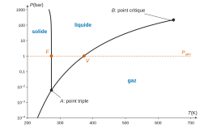
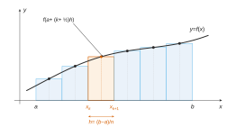
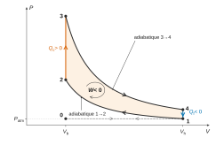
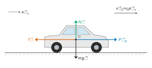
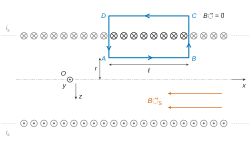
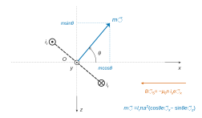

# CCINP TSI — Physique-chimie 2026 · Corrigé brut

*Corrigé rédigé par IA, non officiel. Signalez toute erreur.*

Épreuve de 4 heures, calculatrice interdite. « Changement climatique et influence humaine » : trois parties indépendantes, 69 questions.

**Incohérences d'énoncé signalées** (consigne liminaire) :

- $\kappa=0{,}0103$ « S.I. » (avant Q44) n'est pas en unités SI : cette valeur correspond à une régression faite avec $v_0$ en km·h⁻¹. En SI, $\kappa\approx0{,}48$ kg·m⁻¹.
- Les températures du cycle (300 K, 614 K, 1800 K et 879 K pour les états 1 à 4) donnent $\eta=0{,}51$. Or $\eta=0{,}59$ s'obtient avec $\gamma=1{,}4$ et $\delta=9{,}5$. On utilise $\eta=0{,}59$, comme le demande l'énoncé.
- Le sens de $\theta$ sur la figure 5 conduit à l'opposé de l'expression (11). On adopte (11) pour la suite.
- Le sujet appelle « point mort haut » le grand volume $V_h$ et « point mort bas » le petit volume $V_b$, ce qui est l'inverse de l'usage. On suit sa convention : $\delta=V_h/V_b=9{,}5>1$.

---

## Partie I — Influence de la présence des gaz à effet de serre dans l'atmosphère

### I.1 — Étude des gaz à effet de serre

### Q1

Électrons de valence : H 1, C 4, N 5, O 6.

- **CO₂** : $4+2\times6=16$ électrons, soit 8 doublets. Schéma : $\overline{\underline{\text{O}}}\!=\!\text{C}\!=\!\overline{\underline{\text{O}}}$. Deux doubles liaisons C=O, deux doublets non liants sur chaque O. L'octet est respecté partout, sans charge formelle.
- **CH₄** : $4+4=8$ électrons, 4 doublets liants. Le carbone porte quatre liaisons simples C–H et aucun doublet non liant.
- **N₂O** (N central) : $2\times5+6=16$ électrons, 8 doublets. Deux schémas de Lewis respectent l'octet sur les trois atomes ; l'énoncé en demande un, l'un ou l'autre convient :
$$\begin{aligned}
&\text{N}\equiv\overset{\oplus}{\text{N}}-\overset{\ominus}{\text{O}}\\
\text{ou}\quad&\overset{\ominus}{\text{N}}=\overset{\oplus}{\text{N}}=\text{O}
\end{aligned}$$
  - Premier schéma : un doublet non liant sur l'azote terminal, trois sur l'oxygène.
  - Second schéma : deux doublets non liants sur l'azote terminal, deux sur l'oxygène.

  Dans les deux schémas, l'azote central fait 4 liaisons sans doublet non liant : il porte la charge formelle $+1$ (4 électrons attribués pour 5 de valence). La charge $-1$ est portée soit par l'oxygène (une liaison et trois doublets, 7 électrons pour 6), soit par l'azote terminal (deux liaisons et deux doublets, 6 électrons pour 5).

### Q2

On reproduit la figure 1 (échelle des pressions logarithmique) et on la complète :



- **solide** : en haut à gauche, à gauche de la courbe de fusion (presque verticale, légèrement inclinée vers les basses températures quand $P$ augmente) et au-dessus de la courbe de sublimation ;
- **liquide** : entre la courbe de fusion et la courbe de vaporisation, qui va de $A$ à $B$ ;
- **gaz** : sous les courbes de sublimation et de vaporisation (basses pressions, hautes températures).

**$A$ est le point triple** ($\approx273$ K, $\approx6\cdot10^{-3}$ bar) : coexistence des trois phases.

**$B$ est le point critique** ($\approx647$ K, $\approx2\cdot10^2$ bar) : la courbe de vaporisation s'y arrête, et au-delà liquide et gaz ne se distinguent plus.

Sur l'isobare $P_{\text{atm}}=1$ bar, on place le **point de fusion** $F$ sur la courbe de fusion, vers 273 K. On place le **point de vaporisation** $V$ sur la courbe de vaporisation, vers 373 K.

### Q3

Dans un mélange, l'état physique d'une espèce dépend de sa **pression partielle** $p_i=x_iP$, pas de la pression totale. CO₂, CH₄ et N₂O sont minoritaires : $x_{\text{CO}_2}\approx4\cdot10^{-4}$, et quelques ppm pour les deux autres. Comme $P\le P_{\text{atm}}=1$ bar, on a $p_i\lesssim10^{-3}$ bar.

Sur la figure 2, dans la plage atmosphérique $[T_{\min},T_{\max}]=[188\ \text{K},288\ \text{K}]$, les courbes de coexistence sont croissantes. Leurs valeurs minimales, atteintes à 188 K, sont environ 0,6 bar pour CO₂ (sublimation), 1 bar pour N₂O et 10 bar pour CH₄.

On a donc $p_i\ll p_{\text{coex},i}(T)$ partout : le point $(T,p_i)$ est sous la courbe de sublimation ou de vaporisation.

**CO₂, CH₄ et N₂O sont gazeux dans toute l'atmosphère.**

(Avec la pression totale, l'argument échouerait : sous 1 bar, CO₂ pur serait solide en dessous de 195 K environ.)

### Q4

L'eau liquide est un corps pur en phase condensée, donc d'activité 1. On néglige l'influence de la pression sur son potentiel chimique :
$$\boxed{\mu_\ell(T)=\mu_\ell^\circ(T)}$$

### Q5

L'eau vapeur est un constituant d'un mélange de gaz parfaits, d'activité $p_{\text{eau}}/P^\circ$ avec $P^\circ=1$ bar :
$$\boxed{\mu_g(T)=\mu_g^\circ(T)+RT\ln\frac{p_{\text{eau}}}{P^\circ}}$$

### Q6

À l'équilibre entre phases, $\mu_\ell=\mu_g$, d'où
$$\ln\frac{p_{\text{eau}}}{P^\circ}=\frac{\mu_\ell^\circ-\mu_g^\circ}{RT}$$
$$\boxed{p_{\text{eau}}=P^\circ\exp\left(\frac{\mu_\ell^\circ-\mu_g^\circ}{RT}\right)}$$
Vérification à 298 K :
$$\begin{aligned}
\frac{\mu_\ell^\circ-\mu_g^\circ}{RT}&=\frac{-8000}{2478}\approx-3{,}2\\
p_{\text{eau}}&\approx e^{-3,2}\ \text{bar}\approx0{,}04\ \text{bar}
\end{aligned}$$
C'est la valeur annoncée.

### Q7

À 298 K sous 1 bar, le point représentatif est entre $F$ (273 K) et $V$ (373 K) sur la figure 1 : l'eau pure est **liquide**.

Dans l'air, l'eau n'est pas seule : c'est sa pression partielle qui compte, pas la pression totale. Tant que $p_{\text{eau}}<p_{\text{sat}}(T)=0{,}04$ bar, la phase vapeur est stable et l'eau liquide s'évapore. L'évaporation s'arrête quand $p_{\text{eau}}=p_{\text{sat}}$ (air saturé). Il y a donc toujours de la vapeur d'eau dans l'air, jusqu'à 4 % en fraction molaire à 25 °C.

### I.2 — Enjeux radiatifs du changement climatique

### Q8

- **Conduction** : transfert de proche en proche par agitation microscopique, sans mouvement macroscopique de matière. Il faut un milieu matériel.
- **Convection** : transfert par mouvement macroscopique d'un fluide, qui transporte son énergie interne.
- **Rayonnement** : transfert par ondes électromagnétiques émises et absorbées par la matière. Il ne demande aucun support et se propage dans le vide : c'est le seul mode d'échange entre la Terre et l'espace.

### Q9

Dans le vide, avec $\rho=0$ et $\vec\jmath=\vec0$ :
$$\begin{aligned}
&\operatorname{div}\vec E=0 &&\text{(Maxwell-Gauss)}\\
&\operatorname{div}\vec B=0 &&\text{(Maxwell-flux, ou Maxwell-Thomson)}\\
&\overrightarrow{\operatorname{rot}}\,\vec E=-\frac{\partial\vec B}{\partial t} &&\text{(Maxwell-Faraday)}\\
&\overrightarrow{\operatorname{rot}}\,\vec B=\mu_0\varepsilon_0\frac{\partial\vec E}{\partial t} &&\text{(Maxwell-Ampère)}
\end{aligned}$$

### Q10

On prend le rotationnel de Maxwell-Faraday et on intervertit les dérivées spatiales et temporelles (champs de classe $\mathcal C^2$) :
$$\begin{aligned}
\overrightarrow{\operatorname{rot}}(\overrightarrow{\operatorname{rot}}\,\vec E)&=-\frac{\partial}{\partial t}\overrightarrow{\operatorname{rot}}\,\vec B\\
&=-\mu_0\varepsilon_0\frac{\partial^2\vec E}{\partial t^2}
\end{aligned}$$
D'après le formulaire et Maxwell-Gauss :
$$\begin{aligned}
\overrightarrow{\operatorname{rot}}(\overrightarrow{\operatorname{rot}}\,\vec E)&=\overrightarrow{\operatorname{grad}}(\operatorname{div}\vec E)-\vec\Delta\vec E\\
&=-\vec\Delta\vec E
\end{aligned}$$
D'où
$$\boxed{\vec\Delta\vec E-\frac1{c^2}\frac{\partial^2\vec E}{\partial t^2}=\vec0}$$
avec
$$\boxed{c=\frac1{\sqrt{\mu_0\varepsilon_0}}\approx3{,}0\cdot10^8\ \text{m·s}^{-1}}$$

### Q11

Dans $\vec E=E_0\cos(\omega t-kz)\,\vec e_x$ :

- **plane** : $\vec E$ ne dépend que de $z$ (et de $t$). À chaque instant, le champ est uniforme sur les plans $z=$ cte, qui sont les plans d'onde ;
- **progressive** : $z$ et $t$ n'interviennent que par la combinaison $\omega t-kz=\omega(t-z/v_\varphi)$. L'onde se propage sans déformation vers les $z$ croissants ;
- **monochromatique** : le champ est sinusoïdal en temps, de pulsation unique $\omega$ ;
- **polarisée rectilignement** : la direction de $\vec E$, $\vec e_x$, est fixe.

### Q12

On calcule le rotationnel, puis on applique Maxwell-Faraday :
$$\begin{aligned}
\overrightarrow{\operatorname{rot}}\,\vec E&=\frac{\partial E_x}{\partial z}\,\vec e_y=kE_0\sin(\omega t-kz)\,\vec e_y\\
\frac{\partial\vec B}{\partial t}&=-kE_0\sin(\omega t-kz)\,\vec e_y
\end{aligned}$$
On intègre en temps, sans composante statique pour l'onde :
$$\vec B=\frac{kE_0}{\omega}\cos(\omega t-kz)\,\vec e_y$$
L'équation de d'Alembert impose la relation de dispersion $k=\omega/c$, d'où
$$\boxed{\vec B(M,t)=\frac{E_0}{c}\cos(\omega t-kz)\,\vec e_y}$$
Le trièdre $(\vec E,\vec B,\vec e_z)$ est direct.

### Q13

$$\begin{aligned}
\vec\Pi&=\frac{\vec E\wedge\vec B}{\mu_0}\\
&=\boxed{\frac{E_0^2}{\mu_0c}\cos^2(\omega t-kz)\,\vec e_z}
\end{aligned}$$
Avec $\langle\cos^2\rangle=1/2$ :
$$\begin{aligned}
\langle\vec\Pi\rangle&=\boxed{\frac{E_0^2}{2\mu_0c}\,\vec e_z}\\
&=\frac{\varepsilon_0cE_0^2}{2}\,\vec e_z
\end{aligned}$$

### Q14

Le rayonnement solaire arrive en faisceau parallèle. La Terre en intercepte la partie qui traverse son disque apparent, d'aire $\pi R_T^2$ :
$$\boxed{P_s=\Pi_{m,s}\,\pi R_T^2}$$
A.N. : $R_T^2\approx40\cdot10^{12}$ m², donc
$$P_s\approx1{,}4\cdot10^3\times3\times40\cdot10^{12}\ \text{W}\approx1{,}7\cdot10^{17}\ \text{W}$$
**Ordre de grandeur : $10^{17}$ W.**

### Q15

Premier principe appliqué à la Terre ($\Delta E_c=\Delta E_p=0$), en puissance : $\dfrac{\mathrm dU}{\mathrm dt}=0{,}70\,P_s-P_c$. La puissance réfléchie n'entre pas dans le bilan. En régime permanent $\mathrm dU/\mathrm dt=0$ :
$$\boxed{P_c=0{,}70\,P_s}$$

### Q16

Avec $S_T=4\pi R_T^2$, l'égalité $P_c=0{,}70\,P_s$ s'écrit
$$\sigma T_S^4\,4\pi R_T^2=0{,}70\,\Pi_{m,s}\pi R_T^2$$
d'où
$$\boxed{T_S=\left(\frac{0{,}70\,\Pi_{m,s}}{4\sigma}\right)^{1/4}}$$
Avec $\sigma=5{,}67\cdot10^{-8}$ W·m⁻²·K⁻⁴, on retrouve $T_S\approx2{,}6\cdot10^2$ K. Le rayon terrestre s'élimine.

### Q17

$T_S=257$ K, soit $-16\ ^\circ$C. La température moyenne observée au sol est d'environ 288 K (15 °C, valeur de $T_{\max}$). L'atmosphère **réchauffe la surface d'environ 30 K** : c'est l'effet de serre naturel, qui rend la Terre habitable. Les gaz à effet de serre absorbent une partie du rayonnement infrarouge terrestre et en renvoient une partie vers le sol.

### Q18

Les spectres de l'annexe 1 couvrent environ 3 à 21 µm : c'est le domaine **infrarouge** (moyen et lointain). C'est aussi la gamme du rayonnement thermique émis par la surface terrestre, dont le spectre sans atmosphère est tracé en pointillés sur la figure 4.

### Q19

En pointillés, la figure 4 montre le spectre d'émission de la surface sans atmosphère, spectre continu de rayonnement thermique. Le spectre mesuré au sommet de l'atmosphère présente des creux là où les gaz de l'annexe 1 absorbent :

- vers 4–5 µm : bandes intenses de CO₂ (4,3 µm) et de N₂O (4,5 µm) ;
- vers 5,5–7,5 µm : bande de H₂O (6,2 µm), puis bandes de CH₄ et de N₂O vers 7,7 µm ;
- creux profond entre 13 et 17 µm : large bande de CO₂ centrée sur 15 µm, renforcée par l'absorption continue de H₂O et par la raie de N₂O à 16,8 µm.

Entre 8 et 13 µm, les deux spectres coïncident : aucun gaz n'y absorbe fortement (H₂O seulement faiblement). C'est la **fenêtre atmosphérique**, par laquelle le rayonnement terrestre s'échappe directement vers l'espace.

La puissance qui manque au sommet a été absorbée par l'atmosphère, qui la réémet dans toutes les directions, donc en partie vers le sol : c'est l'effet de serre.

### Q20

**Méthode des rectangles.** On découpe $[a,b]$ en $n$ intervalles de largeur $h=(b-a)/n$.

Les bornes des intervalles sont $x_k=a+kh$. Sur chaque intervalle, on remplace $f$ par une constante, par exemple sa valeur au milieu. L'aire sous la courbe est alors approchée par la somme des aires des rectangles :
$$\int_a^bf(x)\,\mathrm dx\simeq h\sum_{k=0}^{n-1}f\left(a+\left(k+\tfrac12\right)h\right).$$



L'erreur tend vers 0 quand $n\to\infty$, en $1/n^2$ pour cette variante si $f$ est $\mathcal C^2$.

La **méthode des trapèzes** remplace $f$ par la corde sur chaque intervalle :
$$\int_a^bf\simeq h\sum_{k=0}^{n-1}\frac{f(x_k)+f(x_{k+1})}2$$

```python
def integrale(f, a, b, n):
    h = (b - a) / n
    s = 0.0
    for k in range(n):
        s = s + f(a + (k + 0.5) * h)
    return h * s

# integrale(lambda x: x**2, 0, 1, 1000) renvoie 0.33333325 (valeur exacte 1/3)
```

### Q21

Pour un gaz parfait à $T_0$ : $\mu=\dfrac{M_{\text{air}}P}{RT_0}$. On reporte dans (3) :
$$\boxed{\frac{\mathrm dP}{\mathrm dz}+\frac{P}{H}=0}$$
avec
$$\boxed{H=\frac{RT_0}{M_{\text{air}}\,g}}$$
Avec $T_0=288$ K :
$$H\approx\frac{8{,}31\times288}{29\cdot10^{-3}\times9{,}8}\ \text{m}\approx8{,}4\ \text{km}$$

### Q22

Équation linéaire du premier ordre avec la condition $P(0)=P_{\text{atm}}$ :
$$\boxed{P(z)=P_{\text{atm}}\,e^{-z/H}}$$

### Q23

La masse molaire se simplifie :
$$n_v=\frac{\mu}{M_{\text{air}}}=\frac{P}{RT_0}$$
D'où l'expression (4) :
$$\boxed{n_v(z)=\frac{P_{\text{atm}}}{RT_0}\exp\left(-\frac zH\right)}$$

### Q24

$40\ \text{km}=5H$, donc
$$\frac{n_v(40\ \text{km})}{n_v(0)}=e^{-5}\approx7\cdot10^{-3}$$
La fraction de la colonne d'air située au-dessus de 40 km vaut
$$\frac{\int_{5H}^\infty e^{-z/H}\,\mathrm dz}{\int_0^\infty e^{-z/H}\,\mathrm dz}=e^{-5}<1\ \%$$
**Plus de 99 % des molécules absorbantes sont sous 40 km** : les tranches supérieures ne changent pas le résultat, et les calculer ne ferait qu'alourdir le programme.

### Q25

$T(0)=T_0$ est la température au sol, la plus haute de l'atmosphère : $\boxed{T_0\approx T_{\max}=288\ \text{K}}$.

$\alpha z$ est sans dimension, donc $\boxed{\alpha\ \text{est homogène à l'inverse d'une longueur (m}^{-1})}$.

Ordre de grandeur réel dans la troposphère : environ $-6{,}5$ K·km⁻¹, soit $\alpha\approx2\cdot10^{-5}$ m⁻¹.

### Q26

On sépare les variables, avec $H=RT_0/(M_{\text{air}}g)$ :
$$\begin{aligned}
\frac{\mathrm dP}{P}&=-\frac1H\frac{\mathrm dz}{1-\alpha z}\\
\ln\frac{P}{P_{\text{atm}}}&=\frac1{\alpha H}\ln(1-\alpha z)\\
P(z)&=P_{\text{atm}}(1-\alpha z)^{1/(\alpha H)}
\end{aligned}$$
Puis $n_v=\dfrac{P}{RT(z)}$, avec $T(z)=T_0(1-\alpha z)$ :
$$\boxed{n_v(z)=\frac{P_{\text{atm}}}{RT_0}(1-\alpha z)^{\frac1{\alpha H}-1}}$$
Contrôle : quand $\alpha\to0$, $(1-\alpha z)^{1/(\alpha H)}\to e^{-z/H}$ et on retrouve (4).

### Q27

$T_s''=290$ K est très proche de la température moyenne observée, environ 288 K (écart inférieur à 1 %). Les deux modèles précédents s'écartaient de 30 K (257 K) et de 28 K (260 K). Pour rendre compte de la température de surface, il faut donc tenir compte de la décroissance de la température avec l'altitude : les couches qui rayonnent vers l'espace sont froides.

La modélisation est **satisfaisante pour la grandeur visée**, mais ses hypothèses restent grossières : modèle unidimensionnel, sans convection ni nuages, albédo fixé, gradient linéaire supposé valable jusqu'à 40 km alors qu'il s'inverse dans la stratosphère. L'accord à 1 % ne doit pas être surinterprété.

---

## Partie II — Émissions carbone d'une voiture thermique

### II.1 — Fonctionnement de la voiture thermique

### Q28

Les transferts thermiques n'ont lieu que pendant les deux isochores :

- **source chaude** : la combustion du mélange (étape $2\to3$), qui fournit $Q_c$. Sa température est au moins égale à la température maximale du cycle, $T_c=T_3=1800$ K ;
- **source froide** : l'atmosphère ambiante, qui reçoit la chaleur à l'ouverture de la soupape (étape $4\to1$), à $T_f=T_1=300$ K.

### Q29

Sur une isochore, $W=0$ et donc $Q=\Delta U=C_v\Delta T$ :

- $2\to3$ : $T$ passe de 614 K à 1800 K, donc $\boxed{Q_c>0}$ ;
- $4\to1$ : $T$ passe de 879 K à 300 K, donc $\boxed{Q_f<0}$ ;
- sur un cycle, $\Delta U=0$, donc $W=-(Q_c+Q_f)$. Or
  $$|Q_c|=C_v(1800-614)>|Q_f|=C_v(879-300)$$
  d'où $\boxed{W<0}$ : le système fournit du travail, c'est un moteur.

### Q30

Dans le diagramme $(P,V)$, les états 1 et 4 sont sur la verticale $V=V_h$ (grand volume), les états 2 et 3 sur la verticale $V=V_b$.

Les adiabatiques 1 → 2 et 3 → 4 (loi $PV^\gamma=$ cte) sont reliées par les isochores 2 → 3 et 4 → 1. L'adiabatique de détente est au-dessus de celle de compression.

L'admission $0\to1$ et l'échappement $1\to0$ suivent la même isobare $P_{\text{atm}}$ en sens opposés : leur aire est nulle.



Le cycle est parcouru dans le **sens horaire**. On a alors $W=-\oint P\,\mathrm dV<0$, ce qui est cohérent avec Q29 : c'est un **cycle moteur**, et l'aire enclose est le travail fourni à chaque cycle.

### II.2 — Étude théorique du rendement

### Q31

$$\boxed{C_p-C_v=n_eR}$$

### Q32

Avec $\gamma=C_p/C_v$ :
$$\boxed{\begin{aligned}
C_v&=\frac{n_eR}{\gamma-1}\\
C_p&=\frac{\gamma n_eR}{\gamma-1}
\end{aligned}}$$

### Q33

L'étape est isochore, donc $W_{23}=0$ et $Q_{23}=\Delta U$ (première loi de Joule) :
$$\boxed{Q_{23}=\frac{n_eR}{\gamma-1}(T_3-T_2)}$$

### Q34

$$\boxed{Q_{41}=\frac{n_eR}{\gamma-1}(T_1-T_4)}$$

### Q35

$$\begin{aligned}
\eta&=\frac{-W}{Q_{23}}=\frac{Q_{23}+Q_{41}}{Q_{23}}\\
&=\boxed{1-\frac{T_4-T_1}{T_3-T_2}}
\end{aligned}$$

### Q36

Loi de Laplace $TV^{\gamma-1}=$ cte sur l'adiabatique réversible $3\to4$ (gaz parfait, $\gamma$ constant) :
$$\boxed{T_4=T_3\left(\frac{V_b}{V_h}\right)^{\gamma-1}}$$

### Q37

Même loi sur l'adiabatique $1\to2$ :
$$\boxed{T_1=T_2\left(\frac{V_b}{V_h}\right)^{\gamma-1}}$$

### Q38

On a $T_4-T_1=(T_3-T_2)\,\delta^{1-\gamma}$, d'où
$$\begin{aligned}
\eta&=\boxed{1-\delta^{1-\gamma}}\\
&=1-\frac1{\delta^{\gamma-1}}
\end{aligned}$$
Avec $\gamma=1{,}4$ et $\delta=9{,}5$, on a $\delta^{0,4}\approx2{,}46$, donc $\eta\approx0{,}59$.

*Incohérence d'énoncé* : les températures donnent $T_2/T_1=T_3/T_4=2{,}05$. Cela correspond à $\delta^{\gamma-1}=2{,}05$, donc à $\eta=0{,}51$ (avec par exemple $\gamma\approx1{,}32$). On retient $\eta=0{,}59$, comme le demande l'énoncé.

### Q39

Moteur ditherme réversible entre $T_c=T_3$ et $T_f=T_1$ :
$$\begin{aligned}
\eta_c&=1-\frac{T_1}{T_3}\\
&=1-\frac{300}{1800}\approx\boxed{0{,}83}
\end{aligned}$$
On a bien $\eta=0{,}59<\eta_c$, comme l'impose le second principe. L'écart vient des irréversibilités : pendant les isochores, la chaleur est échangée avec des sources dont la température diffère de celle du gaz d'un écart fini. Un moteur réel fait encore moins bien (25 à 35 %) à cause des frottements, des pertes aux parois et de la combustion incomplète.

### II.3 — Expression de la puissance fournie par le moteur

### Q40

$\kappa=\|\vec f\|/v_0^2$ :
$$\boxed{[\kappa]=\frac{\text{kg·m·s}^{-2}}{\text{m}^2\text{·s}^{-2}}=\text{kg·m}^{-1}}$$

### Q41

On applique le PFD à la voiture dans le référentiel terrestre, supposé galiléen. Forces : poids, réaction normale, propulsion $\vec F_p$, traînée $\vec f$. Le mouvement est rectiligne uniforme, donc $\vec a=\vec0$.



On projette sur $\vec e_x$ :
$$\begin{aligned}
\vec F_p&=-\vec f=\kappa v_0\vec v_0\\
&=\boxed{\kappa v_0^2\,\vec e_x}
\end{aligned}$$

### Q42

Le poids et la réaction normale sont orthogonaux à la vitesse et ne travaillent pas :
$$\boxed{\mathcal P=\vec F_p\cdot\vec v_0=\kappa v_0^3}$$

### Q43

On compare les incertitudes relatives : $u(v_0^3)/v_0^3=3\,u(v_0)/v_0$.

| $v_0$ (km·h⁻¹) | 10 | 20 | 30 | 40 | 50 |
|---|---|---|---|---|---|
| $3u(v_0)/v_0$ | 3,0 % | 1,5 % | 1,0 % | 0,75 % | 0,6 % |
| $u(\mathcal P)/\mathcal P$ | 7,1 % | 1,0 % | 2,9 % | 1,4 % | 7,7 % |

Pour quatre points sur cinq, l'incertitude relative sur $v_0^3$ est 2 à 13 fois plus petite que celle sur $\mathcal P$. Le point à 20 km·h⁻¹ fait exception (1,5 % contre 1,0 %), mais les deux incertitudes y restent faibles. Les points rapides, qui pèsent le plus dans la régression, sont ceux où l'écart est le plus net. On peut donc **négliger l'incertitude sur l'abscisse en première approximation**, en sachant que l'hypothèse n'est pas vérifiée pour tous les points.

### Q44

**Remarque sur l'énoncé.** Avec $v_0$ en m·s⁻¹, $\kappa=0{,}0103$ donnerait à 50 km·h⁻¹
$$\mathcal P\approx0{,}0103\times13{,}9^3\ \text{W}\approx28\ \text{W}$$
au lieu des 1300 W mesurés. La valeur a donc été obtenue avec $v_0$ en km·h⁻¹ ; une régression refaite sur le tableau 2 donne bien une pente de 0,0103 W·(km·h⁻¹)⁻³.

En SI, $\kappa=3{,}6^3\times0{,}0103\approx0{,}48$ kg·m⁻¹, avec $u(\kappa)\approx0{,}02$ kg·m⁻¹.

À 100 km·h⁻¹ :
$$\begin{aligned}
\mathcal P_{100,\exp}&=0{,}0103\times100^3\ \text{W}\approx1{,}03\cdot10^4\ \text{W}\\
u(\mathcal P_{100,\exp})&=0{,}0004\times10^6\ \text{W}=0{,}4\ \text{kW}
\end{aligned}$$
$$\boxed{\mathcal P_{100,\exp}=(10{,}3\pm0{,}4)\ \text{kW}}$$
Écart normalisé :
$$E_N=\frac{|10{,}3-10|}{0{,}4}\approx0{,}8<2$$
**Les mesures sont compatibles avec la puissance théorique** de 10 kW (écart relatif de 3 %).

### II.4 — Émissions du véhicule

### Q45

$$\boxed{\text{C}_8\text{H}_{18}(\text{g})+\tfrac{25}{2}\,\text{O}_2(\text{g})\longrightarrow8\,\text{CO}_2(\text{g})+9\,\text{H}_2\text{O}(\text{g})}$$

### Q46

Loi de Hess :
$$\Delta_rH^\circ=8(-400)+9(-240)-(-210)-\tfrac{25}2\times0$$
soit
$$\boxed{\Delta_rH^\circ=-5{,}15\cdot10^3\ \text{kJ·mol}^{-1}}$$
$\Delta_rH^\circ<0$ : la réaction est **exothermique**, comme toute combustion. Cela fait environ 45 MJ par kilogramme d'octane.

### Q47

Pour une transformation isobare et isotherme, $Q=\Delta H=\xi\,\Delta_rH^\circ$, avec $\xi=1$ mol (combustion totale) :
$$\boxed{Q=-5{,}15\cdot10^3\ \text{kJ}}$$
Le milieu réactionnel **cède** environ 5,2 MJ à l'extérieur.

### Q48

**Chaîne énergétique** (résultats de la partie) : 100 km à 100 km·h⁻¹ prennent 1 h, soit 3600 s. On en déduit l'énergie mécanique fournie, la chaleur à fournir, puis la quantité d'octane brûlée :
$$\begin{aligned}
E&=\mathcal P_{100}\Delta t=10^4\times3600\ \text{J}=3{,}6\cdot10^7\ \text{J}\\
Q_c&=\frac E\eta=\frac{3{,}6\cdot10^7}{0{,}59}\ \text{J}\approx6{,}1\cdot10^7\ \text{J}\\
n_{\text{oct}}&=\frac{6{,}1\cdot10^7}{5{,}15\cdot10^6}\ \text{mol}\approx11{,}8\ \text{mol}
\end{aligned}$$
Cela produit $8n_{\text{oct}}$ mol de CO₂ ($M=44$ g·mol⁻¹) :
$$\boxed{m_{\text{CO}_2}=8\times11{,}8\times44\ \text{g}\approx4{,}2\ \text{kg pour 100 km}}$$

**Avec la consommation du document 1** (10 L/100 km) :
$$\begin{aligned}
m_{\text{oct}}&=10^{-2}\ \text{m}^3\times700\ \text{kg·m}^{-3}=7{,}0\ \text{kg}\\
n_{\text{oct}}&=\frac{7000}{114}\ \text{mol}\approx61\ \text{mol}\\
m_{\text{CO}_2}&=8\times61\times44\ \text{g}\approx22\ \text{kg pour 100 km}
\end{aligned}$$
On obtient environ 21 kg si l'on ne compte que 95 % d'octane.

**Commentaire.** Sur 12 000 km par an, soit 120 fois 100 km, la chaîne idéale donne environ $0{,}5$ t de CO₂ par an. C'est déjà 22 % de l'objectif de 2,3 t par habitant, toutes activités confondues. Avec la consommation annoncée, on obtient environ $2{,}6$ t par an, **plus que l'objectif à elle seule**. L'écart d'un facteur 5 vient du modèle : rendement idéal de 0,59 (contre environ 0,3 pour un moteur réel), traînée seule à vitesse constante, aucune accélération ni aucun accessoire. Dans tous les cas, la voiture thermique est difficilement compatible avec l'objectif.

---

## Partie III — Émissions carbone d'une voiture électrique

### III.1 — Émissions en fonctionnement

### Q49

$L/R=1/0{,}05=20\gg1$. Les effets de bord ne se font sentir que sur une distance de l'ordre de $R$ près des extrémités. Le rotor est au centre, à $L/2=10R$ de chaque bout : le champ y est celui d'un solénoïde infini, à quelques pour cent près.

### Q50

**Théorème d'Ampère.** En régime stationnaire, pour tout contour fermé orienté $\mathcal C$ :
$$\oint_{\mathcal C}\vec B\cdot\overrightarrow{\mathrm d\ell}=\mu_0I_{\text{enl}}$$
où l'intensité enlacée vaut
$$I_{\text{enl}}=\iint_\Sigma\vec\jmath\cdot\overrightarrow{\mathrm dS}$$
et où $\Sigma$ est une surface qui s'appuie sur $\mathcal C$, orientée en accord avec lui.

**Démonstration.** En régime stationnaire, Maxwell-Ampère s'écrit $\overrightarrow{\operatorname{rot}}\,\vec B=\mu_0\vec\jmath$. On prend le flux à travers $\Sigma$ et on applique le théorème de Stokes :
$$\begin{aligned}
\oint_{\mathcal C}\vec B\cdot\overrightarrow{\mathrm d\ell}&=\iint_\Sigma\overrightarrow{\operatorname{rot}}\,\vec B\cdot\overrightarrow{\mathrm dS}\\
&=\mu_0\iint_\Sigma\vec\jmath\cdot\overrightarrow{\mathrm dS}\\
&=\mu_0I_{\text{enl}}
\end{aligned}$$

### Q51

**Invariances.** La distribution est invariante par translation selon $(Ox)$ et par rotation autour de $(Ox)$ : en coordonnées cylindriques d'axe $(Ox)$, $\vec B$ ne dépend que de $r$.

**Symétries.** Tout plan perpendiculaire à $(Ox)$ est un plan de symétrie des courants. Le champ magnétique est orthogonal à tout plan de symétrie des courants : $\vec B=B(r)\,\vec e_x$.



**Contour.** On prend un rectangle de longueur $\ell$ parallèle à l'axe. Son côté intérieur est à la distance $r<R$ et parcouru selon $+\vec e_x$ ; son côté opposé est à l'extérieur.

La contribution extérieure est nulle ($\vec B=\vec0$) et les côtés radiaux sont orthogonaux à $\vec B$. La circulation vaut donc $B(r)\ell$.

Le rectangle enlace $n\ell$ spires. D'après la figure 5, le courant $i_s$ sort du plan $(xOz)$ du côté $z>0$ et y entre du côté $z<0$.

Avec l'orientation choisie, l'intensité enlacée vaut donc $-n\ell I_s$. On obtient $B\ell=-\mu_0n\ell I_s$, soit
$$\boxed{\vec B_S(M)=-\mu_0nI_s\,\vec e_x}$$
Le champ est uniforme à l'intérieur du solénoïde.

### Q52

La spire, d'aire $\pi a^2$, contient l'axe $(Oy)$ : sa normale est dans le plan $(xOz)$.

Sur la vue de droite de la figure 5, $\vec e_z$ pointe vers le bas et $\vec e_y$ sort du plan. Le courant sort en haut à gauche et entre en bas à droite. La règle de la main droite donne une normale dirigée vers le haut à droite, celle que repère $\theta$ à partir de $\vec e_x$ :
$$\boxed{\vec m=I_r\pi a^2\left(\cos\theta\,\vec e_x-\sin\theta\,\vec e_z\right)}$$
(L'expression (11) de l'énoncé correspond à $\vec m=I_r\pi a^2(\cos\theta\,\vec e_x+\sin\theta\,\vec e_z)$, voir Q56.)



### Q53

$\dot\theta=\omega_s$ est constant, donc $\boxed{\theta(t)=\omega_st+\theta_0}$.

### Q54

On reporte $i_s(t)$ dans (9) : $\vec B_S=-\mu_0nI_s\cos(\omega t)\,\vec e_x$, uniforme sur la spire. Comme $\vec e_z\wedge\vec e_x=\vec e_y$ :
$$\begin{aligned}
\vec\Gamma&=\vec m\wedge\vec B_S\\
&=I_r\pi a^2(\cos\theta\,\vec e_x-\sin\theta\,\vec e_z)\wedge\left(-\mu_0nI_s\cos(\omega t)\,\vec e_x\right)
\end{aligned}$$
$$\boxed{\vec\Gamma(t)=\mu_0nI_sI_r\pi a^2\cos(\omega t)\sin(\omega_st+\theta_0)\,\vec e_y}$$

### Q55

D'après le formulaire,
$$\cos(\omega t)\sin(\omega_st+\theta_0)=\frac12\left[\sin\left((\omega+\omega_s)t+\theta_0\right)-\sin\left((\omega-\omega_s)t-\theta_0\right)\right].$$
Si $\omega\neq\omega_s$, les deux termes sont des sinusoïdes de pulsations non nulles, donc de moyenne nulle : $\boxed{\langle\vec\Gamma\rangle=\vec0}$.

Un couple moyen non nul, seul capable d'entretenir la rotation, n'existe que si le rotor tourne exactement à la pulsation du courant statorique. Le rotor tourne donc **en synchronisme** avec le champ du stator, d'où le nom de moteur **synchrone**. Un tel moteur ne démarre pas seul.

### Q56

Le rotor tourne autour de $(Oy)$. Sur la figure, $\theta$ croît dans le sens direct autour de $\vec e_y$, donc $\vec\Omega=\omega_s\vec e_y$. Avec $\omega=\omega_s$ :
$$\begin{aligned}
\mathcal P_L&=\vec\Gamma\cdot\vec\Omega\\
&=\mu_0nI_sI_r\pi a^2\omega_s\cos(\omega_st)\sin(\omega_st+\theta_0)\\
&=\frac{\mu_0nI_sI_r\pi a^2\omega_s}2\left[\sin(2\omega_st+\theta_0)+\sin\theta_0\right]
\end{aligned}$$
Le terme en $2\omega_s$ est de moyenne nulle. On obtient
$$\langle\mathcal P_L\rangle=+\frac{I_sI_r\pi a^2\mu_0n\omega_s\sin\theta_0}2$$

**Incohérence d'énoncé** : ce résultat est l'opposé de (11). L'expression (11) s'obtient exactement par le même calcul avec
$$\vec m=I_r\pi a^2(\cos\theta\,\vec e_x+\sin\theta\,\vec e_z)$$
c'est-à-dire avec $\theta$ compté de $\vec e_x$ vers $+\vec e_z$. On a alors
$$\vec\Gamma=-\mu_0nI_sI_r\pi a^2\cos(\omega t)\sin\theta\,\vec e_y$$
On retient l'expression de l'énoncé pour la suite :
$$\boxed{\langle\mathcal P_L\rangle=-\frac{I_sI_r\pi a^2\mu_0n\omega_s\sin\theta_0}2}$$

### Q57

Le système est un moteur si les actions de Laplace fournissent en moyenne de la puissance au rotor, $\langle\mathcal P_L\rangle>0$. Avec (11), c'est le cas si et seulement si
$$\boxed{\sin\theta_0<0,\ \text{soit}\ \theta_0\in\left]-\pi,0\right[\ (\text{modulo }2\pi)}$$
Sinon, $\langle\mathcal P_L\rangle<0$ : le rotor doit être entraîné de l'extérieur, et la machine convertit de l'énergie mécanique en énergie électrique. C'est le **régime générateur** (fonctionnement en alternateur).

### Q58

$$\begin{aligned}
\mathcal P_{\text{él}}&=\frac{\mathcal P_{\text{méca}}}{\eta_{\text{él}}}=\frac{12}{0{,}6}\ \text{kW}\\
&=\boxed{20\ \text{kW}}
\end{aligned}$$

### Q59

100 km à 100 km·h⁻¹ prennent 1 h, donc la voiture consomme $E=20$ kWh.

Intensité carbone moyenne du mix, pondérée par les proportions :
$$I_{\text{moy}}=0{,}66\times4+0{,}12\times24+0{,}11\times15+0{,}06\times490+0{,}05\times55+0{,}002\times820\approx41\ \text{g·kWh}^{-1}.$$
D'où $\boxed{m_{\text{CO}_2}\approx20\times41\approx0{,}8\ \text{kg pour 100 km}}$.

**Commentaire.** C'est environ 5 fois moins que les 4,2 kg de la Clio calculés par la même chaîne de calcul, et environ 25 fois moins que les 22 kg déduits de sa consommation. Sur un an, cela fait environ 0,1 t, soit 4 % du budget de 2,3 t. Ce bilan ne compte que l'usage, sans la fabrication. Il dépend aussi entièrement du mix : le gaz, qui ne fournit que 6 % de l'électricité, cause environ 70 % des émissions, et avec une électricité au charbon on obtiendrait environ 16 kg/100 km.

### III.2 — Émissions liées à la production des batteries

### Q60

Le milieu poreux **sépare les deux électrodes** : il est isolant électronique et empêche le court-circuit interne. Il est aussi **perméable aux ions Li⁺**, qui y migrent d'une électrode à l'autre. Il ferme ainsi le circuit à l'intérieur de la cellule et assure l'électroneutralité, comme un pont salin.

### Q61

L'anode est le siège de l'oxydation, la cathode celui de la réduction. En décharge :

- au graphite lithié, $\text{LiC}_6\to\text{Li}^++\text{C}_6+e^-$ est une perte d'électrons (Li passe de 0 à +I), donc une oxydation : c'est l'**anode** (pôle $-$) ;
- à l'oxyde de cobalt, $\text{Li}^++e^-+\text{CoO}_2\to\text{LiCoO}_2$ est un gain d'électrons (Co passe de +IV à +III), donc une réduction : c'est la **cathode** (pôle $+$).

Les noms sont attribués pour le fonctionnement en pile (décharge). En charge, les rôles s'inversent, mais on garde ces noms par convention.

### Q62

On somme les deux demi-équations, qui échangent chacune un électron :
$$\boxed{\text{LiC}_6(\text{s})+\text{CoO}_2(\text{s})\longrightarrow\text{C}_6(\text{s})+\text{LiCoO}_2(\text{s})}$$

### Q63

Nernst à 298 K, solides d'activité 1, $c^\circ=1$ mol·L⁻¹ :
$$\boxed{\begin{aligned}
&E_1=-3{,}05+0{,}06\log\frac{[\text{Li}^+]}{c^\circ} &&\text{(Li}^+/\text{LiC}_6)\\
&E_2=0{,}65+0{,}06\log\frac{[\text{Li}^+]}{c^\circ} &&\text{(CoO}_2/\text{LiCoO}_2)
\end{aligned}}$$
(en volts, avec $\frac{RT}{\mathcal F}\ln10\approx0{,}06$ V).

### Q64

$U=E_2-E_1$ : les termes en $[\text{Li}^+]$ se compensent.
$$\begin{aligned}
U&=E_2^\circ-E_1^\circ\\
&=0{,}65-(-3{,}05)\ \text{V}\\
&=\boxed{3{,}70\ \text{V}}
\end{aligned}$$
Les 100 cellules sont en série : $\boxed{U_{\text{bat}}=100\,U=370\ \text{V}}$. C'est du même ordre que les 400 V retenus par l'énoncé.

### Q65

$$\begin{aligned}
I_{\text{bat}}&=\frac{\mathcal P}{U_{\text{bat}}}=\frac{2{,}0\cdot10^4}{400}\ \text{A}\\
&=\boxed{50\ \text{A}}
\end{aligned}$$
Chaque lithium transféré fait circuler un électron. Une cellule contient $n(\text{Li})=42/7{,}0=6{,}0$ mol de lithium, soit une charge $Q=n\mathcal F=6{,}0\cdot10^5$ C.

Les cellules sont en série et sont traversées par le même courant, donc $Q$ est la charge débitée par la batterie :
$$\begin{aligned}
\Delta t&=\frac{Q}{I_{\text{bat}}}=\frac{6{,}0\cdot10^5}{50}\ \text{s}\\
&=\boxed{1{,}2\cdot10^4\ \text{s}\approx3\ \text{h}\ 20\ \text{min}}
\end{aligned}$$
L'énergie correspondante vaut $U_{\text{bat}}Q\approx67$ kWh, ce qui est plausible.

*Remarque* : on suit l'énoncé en prenant le lithium comme réserve de charge. Strictement, les masses de carbone (environ 3,5 mol de sites LiC₆) et de cobalt (environ 0,95 mol de CoO₂) du document 3 ne permettraient pas d'insérer tout ce lithium.

### Q66

Une décharge permet de parcourir $d=v_0\Delta t=100\times3{,}33\approx3{,}3\cdot10^2$ km. Sur 1000 cycles :
$$\boxed{D=1000\,d\approx3{,}3\cdot10^5\ \text{km}}$$
À 12 000 km par an, cela représente une trentaine d'années.

### Q67

Lectures sur la figure 6 :

- Clio : environ 3,8 t à l'origine, pente d'environ 0,12 t par $10^3$ km (12 kg/100 km) ;
- Zoé : environ 5,0 t à l'origine, pente d'environ 0,012 t par $10^3$ km (1,2 kg/100 km).

Les droites se coupent en $D_p\approx(5{,}0-3{,}8)/(0{,}12-0{,}012)\approx11$, en accord avec la lecture directe :
$$\boxed{D_p^*\approx1\cdot10^4\ \text{km}}$$
Au-delà, la Zoé a émis moins que la Clio. Cela correspond à environ une année d'usage.

**Conclusion.** Pour la voiture électrique, la **production domine** : environ 5 t, dont 2 t pour la batterie, soit plus que la Clio. En revanche, l'**usage** émet environ 10 fois moins par kilomètre, ce qui est cohérent avec Q59. Pour la Clio, c'est l'usage qui domine. Sur la durée de vie de la batterie (plus de $3\cdot10^5$ km), la voiture électrique est donc nettement plus sobre en carbone, à condition de rouler suffisamment pour amortir la dette carbone de sa fabrication.

### Q68

Le Cybertruck part d'environ 22,5 t, soit 4,5 fois la Zoé, pour une pente d'usage comparable. Il ne passe sous la Clio que vers $D_p\approx(22{,}5-3{,}8)/(0{,}12-0{,}0125)\approx1{,}8\cdot10^5$ km, soit environ 15 ans d'usage moyen. Jusque-là, il émet davantage qu'une citadine thermique. Sa seule fabrication représente environ 10 ans du budget de 2,3 t d'un habitant.

**Développer des SUV électriques n'est donc pas une réponse pertinente** aux enjeux climatiques. L'électrification ne profite au climat que si l'empreinte de fabrication reste faible, c'est-à-dire avec des véhicules légers et des batteries de taille modérée. La sobriété (masse, autonomie, kilomètres parcourus) reste le premier levier.

### III.3 — Des batteries au lithium

### Q69

Population des mailles :
$$\begin{aligned}
Z_{\text{Li}}&=8\times\tfrac18+1=2 &&\text{(cubique centré)}\\
Z_{\text{Ni}}&=8\times\tfrac18+6\times\tfrac12=4 &&\text{(cubique à faces centrées)}
\end{aligned}$$
La masse volumique vaut $\rho=\dfrac{ZM}{\mathcal N_Aa^3}$. Les volumes des mailles sont
$$\begin{aligned}
(350\cdot10^{-12})^3\ \text{m}^3&\approx4{,}29\cdot10^{-29}\ \text{m}^3\\
(352\cdot10^{-12})^3\ \text{m}^3&\approx4{,}36\cdot10^{-29}\ \text{m}^3
\end{aligned}$$
d'où
$$\begin{aligned}
\rho_{\text{Li}}&=\frac{2\times7{,}0\cdot10^{-3}}{6{,}02\cdot10^{23}\times4{,}29\cdot10^{-29}}\approx\boxed{5{,}4\cdot10^2\ \text{kg·m}^{-3}}\\
\rho_{\text{Ni}}&=\frac{4\times59\cdot10^{-3}}{6{,}02\cdot10^{23}\times4{,}36\cdot10^{-29}}\approx\boxed{9{,}0\cdot10^3\ \text{kg·m}^{-3}}
\end{aligned}$$
Les paramètres de maille sont presque égaux. Le rapport des masses volumiques vaut donc environ $\dfrac{4\times59}{2\times7}\approx17$ : **à volume égal, le nickel est environ 17 fois plus lourd que le lithium**.

Pour une batterie embarquée, la masse pèse sur la consommation et donc sur les émissions d'usage. Le lithium offre de plus une grande capacité massique, puisque chaque atome léger échange un électron. Ces deux raisons justifient son emploi.

**FIN**
