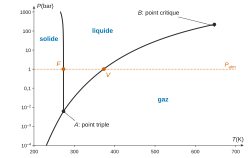
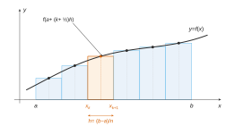
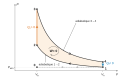
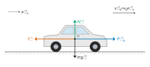
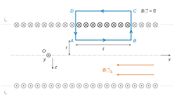
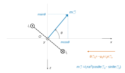

# CCINP TSI — Physique-chimie 2026 · Corrigé guidé

*Corrigé rédigé par IA, non officiel. Signalez toute erreur.*

## Présentation du sujet

**Format.** 4 heures, calculatrice interdite, 69 questions (Q1 à Q69) réparties en trois parties indépendantes, toutes construites autour du même fil : « Changement climatique et influence humaine ». Les données numériques sont « volontairement approchées » pour se calculer à la main ($6{,}37^2\approx40$, $\pi\approx3$, $\mathcal F=1\cdot10^5$ C·mol⁻¹…).

**Partie I — Effet de serre (Q1–Q27).**

- *I.1 (Q1–Q7)* : chimie de première année. Schémas de Lewis, lecture de diagrammes $(P,T)$, puis potentiel chimique de l'eau dans les deux phases et pression de vapeur saturante.
- *I.2 (Q8–Q27)* : électromagnétisme et thermique. Équations de Maxwell, équation de d'Alembert, onde plane et vecteur de Poynting (Q9–Q13) ; bilan radiatif d'une Terre sans atmosphère (Q14–Q17) ; lecture de spectres d'absorption infrarouges (Q18–Q19) ; intégration numérique (Q20) ; statique des fluides dans une atmosphère isotherme puis à gradient de température (Q21–Q27).

**Partie II — Voiture thermique (Q28–Q48).**

- *II.1–II.2 (Q28–Q39)* : cycle de Beau de Rochas traité de bout en bout. Sources, signes des échanges, diagramme de Watt, capacités thermiques, rendement en fonction de $\delta$ et $\gamma$, comparaison avec Carnot.
- *II.3 (Q40–Q44)* : mécanique et mesure. Traînée quadratique, puissance en $v_0^3$, discussion des incertitudes d'une régression linéaire.
- *II.4 (Q45–Q48)* : thermochimie. Combustion de l'octane, loi de Hess, masse de CO₂ émise sur 100 km.

**Partie III — Voiture électrique (Q49–Q69).**

- *III.1 (Q49–Q59)* : magnétostatique (solénoïde infini, théorème d'Ampère) et modèle de moteur synchrone (moment magnétique, couple, condition de synchronisme, puissance moyenne), puis intensité carbone du mix électrique français.
- *III.2 (Q60–Q68)* : accumulateur Li-ion (rôle du séparateur, anode et cathode, Nernst, tension à vide, capacité, durée de vie), puis lecture critique d'un graphe d'émissions cumulées.
- *III.3 (Q69)* : cristallographie (cubique centré et cubique à faces centrées, masse volumique).

**Notions du programme mobilisées.** Lewis et charges formelles ; diagrammes de phases ; potentiel chimique et activité ; équations de Maxwell, ondes planes, Poynting ; loi de Stefan (fournie) ; statique des fluides ; méthodes numériques d'intégration ; premier et second principes, cycles, Laplace ; PFD et puissance ; incertitudes et régression ; loi de Hess ; théorème d'Ampère, moment magnétique et couple ; Nernst, piles ; cristallographie.

**Difficulté et longueur.** Sujet long, mais fait en grande partie de questions de cours et de questions courtes. Les points délicats sont Q3 (pression partielle), Q26 (séparation des variables), Q43–Q44 (incertitudes, et unité de $\kappa$ incohérente), Q48 (chaîne de calcul), Q51–Q57 (orientations et signes du moteur synchrone) et Q65 (capacité de la batterie).

**Questions à ne pas laisser passer.** Q8–Q11, Q13–Q16, Q21–Q23, Q31–Q37, Q40–Q42, Q45–Q46, Q50, Q53, Q58, Q60–Q64, Q69 : du cours ou presque, rapide à rédiger.

**Erreurs d'énoncé à repérer et à signaler** (la consigne liminaire le demande) :

- $\kappa$ « S.I. » est en réalité exprimé avec $v_0$ en km·h⁻¹ ;
- les températures du cycle donnent $\eta=0{,}51$ et non $0{,}59$ ;
- l'orientation de $\theta$ sur la figure 5 contredit le signe de (11) ;
- les noms « point mort haut » et « point mort bas » sont inversés.

**Gestion du temps.** Environ 3,5 minutes par question en moyenne. Viser environ 1 h 30 pour la partie I, 1 h 15 pour la partie II et 1 h 15 pour la partie III. Les trois parties étant indépendantes, on commence par celle où l'on est le plus à l'aise.

---

## Partie I — Influence de la présence des gaz à effet de serre dans l'atmosphère

On justifie d'abord que les gaz à effet de serre sont bien gazeux (I.1), puis on construit un modèle radiatif de plus en plus fin de la température de surface (I.2). Outils : chimie de première année, électromagnétisme, statique des fluides.

### I.1 — Étude des gaz à effet de serre

### Question 1

> [!INDICATION]
> Comptez les électrons de valence à partir des numéros atomiques, divisez par deux pour obtenir le nombre de doublets, puis répartissez-les pour satisfaire l'octet.

> [!INDICATION]
> N₂O a autant d'électrons de valence que CO₂. Si l'octet ne peut être respecté sans charges, calculez les charges formelles atome par atome.

#### Solution

Électrons de valence : H 1, C 4, N 5, O 6.

- **CO₂** : 16 électrons, 8 doublets. O=C=O, avec deux doublets non liants sur chaque oxygène. L'octet est respecté, il n'y a aucune charge formelle.
- **CH₄** : 8 électrons, 4 doublets liants. Quatre liaisons simples C–H, pas de doublet non liant.
- **N₂O**, avec l'azote central : 16 électrons, 8 doublets. Deux schémas de Lewis respectent l'octet ; l'énoncé en demande un, l'un ou l'autre convient :
$$\begin{aligned}
&\text{N}\equiv\overset{\oplus}{\text{N}}-\overset{\ominus}{\text{O}}\\
\text{ou}\quad&\overset{\ominus}{\text{N}}=\overset{\oplus}{\text{N}}=\text{O}
\end{aligned}$$
  - Premier schéma : un doublet non liant sur l'azote terminal, trois sur l'oxygène.
  - Second schéma : deux doublets non liants sur l'azote terminal, deux sur l'oxygène.

  L'azote central, qui fait 4 liaisons sans doublet non liant, porte $+1$. La charge $-1$ est sur l'oxygène dans le premier schéma (7 électrons attribués pour 6 de valence) et sur l'azote terminal dans le second (6 pour 5).

> [!PIEGE]
> Un schéma de Lewis montre **tous** les doublets, liants et non liants. Oublier les doublets des oxygènes ou les charges formelles de N₂O, c'est donner une formule développée, pas un schéma de Lewis.

### Question 2

> [!INDICATION]
> Repérez les trois courbes de coexistence et le point où elles se rejoignent. Une courbe s'arrête brusquement : que se passe-t-il à son extrémité ?

> [!INDICATION]
> Pour placer le solide et le liquide, servez-vous d'un fait connu : sous 1 bar, l'eau gèle à 273 K et bout à 373 K.

#### Solution

On reproduit la figure 1, avec l'échelle logarithmique des pressions.



- **Solide** : en haut à gauche, à gauche de la courbe de fusion (presque verticale vers 273 K et légèrement inclinée vers la gauche quand $P$ augmente, ce qui est propre à l'eau) et au-dessus de la courbe de sublimation.
- **Liquide** : entre la courbe de fusion et la courbe de vaporisation $AB$.
- **Gaz** : sous les courbes de sublimation et de vaporisation.

$A$ est le **point triple** ($\approx273$ K, $\approx6\cdot10^{-3}$ bar), où coexistent les trois phases.

$B$ est le **point critique** ($\approx647$ K, $\approx2\cdot10^2$ bar), au-delà duquel liquide et gaz ne se distinguent plus.

Sur l'horizontale $P=1$ bar, on place le **point de fusion** $F$ (273 K) sur la courbe de fusion. On place le **point de vaporisation** $V$ (373 K) sur la courbe de vaporisation.

> [!PIEGE]
> Intervertir solide et liquide. Plaçons le point (273 K, 1 bar) : l'eau est solide juste à gauche et liquide juste à droite. La courbe de fusion de l'eau a une pente négative, ce qui est une anomalie liée à la glace moins dense que le liquide.

### Question 3

> [!INDICATION]
> Dans un mélange de gaz, qu'est-ce qui fixe l'état physique d'un constituant : la pression totale ou une autre pression ?

> [!INDICATION]
> Estimez cette pression pour des gaz présents à l'état de traces, puis comparez-la, sur la figure 2, aux pressions de coexistence dans la plage $[T_{\min},T_{\max}]$ des données. Quelle température de cette plage est la plus défavorable ?

#### Solution

L'état d'un constituant d'un mélange est fixé par sa **pression partielle** $p_i=x_iP$ (loi de Dalton). CO₂ (environ 400 ppm), CH₄ et N₂O (quelques ppm) sont très minoritaires. Comme $P\le1$ bar, on a $p_i\lesssim10^{-3}$ bar.

L'atmosphère va de $T_{\min}=188$ K à $T_{\max}=288$ K. Les courbes de coexistence de la figure 2 sont croissantes : le cas le plus défavorable est donc 188 K. On y lit environ 0,6 bar pour CO₂ (sublimation), 1 bar pour N₂O et 10 bar pour CH₄.

Partout, $p_i\ll p_{\text{coex}}(T)$ : le point représentatif est sous la courbe de changement d'état, dans le domaine **gazeux**.

**Les trois gaz sont gazeux dans toute l'atmosphère.**

> [!PIEGE]
> Raisonner avec la pression totale de 1 bar : à 188 K sous 1 bar, CO₂ pur serait solide (neige carbonique). C'est le caractère minoritaire du gaz qui fait la démonstration.

> [!METHODE]
> Pour un gaz en mélange, on lit toujours le diagramme $(P,T)$ du corps pur avec la pression partielle en ordonnée.

### Question 4

> [!INDICATION]
> Quelle est l'activité d'un corps pur en phase condensée ?

#### Solution

L'eau liquide est pure, d'activité 1. On néglige l'effet de la pression sur une phase condensée :
$$\mu_\ell(T)=\mu_\ell^\circ(T)$$

### Question 5

> [!INDICATION]
> La vapeur est un gaz parfait en mélange avec l'air. Son activité fait intervenir une pression rapportée à la pression standard.

#### Solution

$$\mu_g(T)=\mu_g^\circ(T)+RT\ln\frac{p_{\text{eau}}}{P^\circ}$$
avec $P^\circ=1$ bar.

> [!PIEGE]
> Mettre la pression totale au lieu de la pression partielle, ou oublier $P^\circ$ : le logarithme d'une grandeur qui a une dimension n'a pas de sens.

### Question 6

> [!INDICATION]
> Traduisez l'équilibre de l'eau entre les deux phases par une égalité de potentiels chimiques, puis isolez le logarithme.

#### Solution

À l'équilibre, $\mu_\ell=\mu_g$, donc
$$\mu_\ell^\circ=\mu_g^\circ+RT\ln\frac{p_{\text{eau}}}{P^\circ}$$
soit
$$p_{\text{eau}}=P^\circ\exp\left(\frac{\mu_\ell^\circ-\mu_g^\circ}{RT}\right).$$
Vérification :
$$\begin{aligned}
\frac{\mu_\ell^\circ-\mu_g^\circ}{RT}&=\frac{(-237+229)\cdot10^3}{8{,}31\times298}\approx-3{,}2\\
e^{-3,2}&\approx0{,}04
\end{aligned}$$
On retrouve les 0,04 bar annoncés.

> [!METHODE]
> Contrôlez le signe par l'ordre de grandeur : le liquide est plus stable ($\mu_\ell^\circ<\mu_g^\circ$), donc l'exponentielle est inférieure à 1 et $p_{\text{eau}}<P^\circ$. Une inversion donnerait environ 25 bar à 25 °C, ce qui est absurde.

### Question 7

> [!INDICATION]
> Placez le point (298 K, 1 bar) sur la figure 1. Pour la seconde partie, comparez la pression partielle de l'eau dans l'air à la valeur obtenue en Q6.

#### Solution

À 298 K sous 1 bar, on est entre la fusion (273 K) et l'ébullition (373 K) : l'eau pure est **liquide**.

Dans l'air, ce qui compte est la pression partielle de l'eau. Tant que $p_{\text{eau}}<p_{\text{sat}}=0{,}04$ bar, la vapeur est la phase stable et le liquide s'évapore. L'évaporation s'arrête quand $p_{\text{eau}}=p_{\text{sat}}$ (air saturé, humidité relative de 100 %). L'air contient donc de la vapeur d'eau, jusqu'à environ 4 % en fraction molaire à 25 °C.

### I.2 — Enjeux radiatifs du changement climatique

On établit les propriétés de l'onde électromagnétique, puis on écrit un bilan radiatif. On raffine ensuite le modèle d'atmosphère en trois étapes : sans atmosphère, atmosphère isotherme, atmosphère à gradient.

### Question 8

> [!INDICATION]
> Pour chaque mode, demandez-vous s'il faut un milieu matériel et si ce milieu doit se déplacer.

#### Solution

- **Conduction** : transfert de proche en proche par agitation microscopique, sans déplacement macroscopique de matière. Elle exige un milieu matériel.
- **Convection** : transfert par déplacement macroscopique d'un fluide, qui transporte son énergie.
- **Rayonnement** : transfert par ondes électromagnétiques, sans support matériel. C'est le seul mode possible dans le vide, donc le seul par lequel la Terre échange de l'énergie avec l'espace.

### Question 9

> [!INDICATION]
> Quatre équations : deux divergences, deux rotationnels. Annulez les termes de source.

#### Solution

$$\begin{aligned}
&\operatorname{div}\vec E=0 &&\text{(Maxwell-Gauss)}\\
&\operatorname{div}\vec B=0 &&\text{(Maxwell-flux)}\\
&\overrightarrow{\operatorname{rot}}\,\vec E=-\frac{\partial\vec B}{\partial t} &&\text{(Maxwell-Faraday)}\\
&\overrightarrow{\operatorname{rot}}\,\vec B=\mu_0\varepsilon_0\frac{\partial\vec E}{\partial t} &&\text{(Maxwell-Ampère)}
\end{aligned}$$

### Question 10

> [!INDICATION]
> Prenez le rotationnel de l'équation de Maxwell-Faraday et servez-vous de la formule du double rotationnel du formulaire.

> [!INDICATION]
> Deux équations de Maxwell servent ensuite : l'une fait disparaître le gradient, l'autre remplace le rotationnel de $\vec B$.

#### Solution

Avec des champs de classe $\mathcal C^2$, on peut intervertir les dérivées :
$$\begin{aligned}
\overrightarrow{\operatorname{rot}}(\overrightarrow{\operatorname{rot}}\,\vec E)&=-\frac{\partial}{\partial t}\overrightarrow{\operatorname{rot}}\,\vec B\\
&=-\mu_0\varepsilon_0\frac{\partial^2\vec E}{\partial t^2}
\end{aligned}$$
Or, d'après le formulaire et Maxwell-Gauss :
$$\begin{aligned}
\overrightarrow{\operatorname{rot}}(\overrightarrow{\operatorname{rot}}\,\vec E)&=\overrightarrow{\operatorname{grad}}(\operatorname{div}\vec E)-\vec\Delta\vec E\\
&=-\vec\Delta\vec E
\end{aligned}$$
Donc
$$\vec\Delta\vec E-\frac1{c^2}\frac{\partial^2\vec E}{\partial t^2}=\vec0$$
avec
$$c=\frac1{\sqrt{\mu_0\varepsilon_0}}\approx3{,}0\cdot10^8\ \text{m·s}^{-1}$$

> [!JURY]
> Dans une démonstration, chaque équation de Maxwell utilisée doit être citée au moment où elle sert, en particulier l'annulation de $\operatorname{div}\vec E$ dans le vide sans charge.

### Question 11

> [!INDICATION]
> Pour chaque qualificatif, cherchez dans l'expression ce qui le traduit : les variables d'espace présentes, la combinaison de $z$ et $t$, le nombre de pulsations, la direction du champ.

#### Solution

- **Plane** : $\vec E$ ne dépend que de $z$. Il est uniforme sur chaque plan $z=$ cte, qui est un plan d'onde.
- **Progressive** : $z$ et $t$ n'apparaissent que par $\omega t-kz=\omega(t-z/v_\varphi)$. Le signal se translate vers les $z$ croissants.
- **Monochromatique** : une seule pulsation $\omega$, le champ est sinusoïdal.
- **Polarisée rectilignement** : $\vec E$ garde la direction fixe $\vec e_x$.

> [!PIEGE]
> $\cos(\omega t)\cos(kz)$ est plane, monochromatique et polarisée rectilignement, mais **stationnaire**. « Progressive » tient à la combinaison $t-z/v$.

### Question 12

> [!INDICATION]
> Maxwell-Faraday relie $\partial\vec B/\partial t$ au rotationnel de $\vec E$. Calculez ce rotationnel, puis intégrez en temps.

> [!INDICATION]
> Pour éliminer $k/\omega$, injectez l'onde dans l'équation de d'Alembert.

#### Solution

On calcule le rotationnel, puis on applique Maxwell-Faraday :
$$\begin{aligned}
\overrightarrow{\operatorname{rot}}\,\vec E&=\frac{\partial E_x}{\partial z}\,\vec e_y=kE_0\sin(\omega t-kz)\,\vec e_y\\
\frac{\partial\vec B}{\partial t}&=-kE_0\sin(\omega t-kz)\,\vec e_y
\end{aligned}$$
On intègre sans garder de champ statique, qui ne fait pas partie de l'onde, et on utilise $k=\omega/c$ (relation de dispersion tirée de d'Alembert) :
$$\vec B(M,t)=\frac{E_0}{c}\cos(\omega t-kz)\,\vec e_y.$$
Le trièdre $(\vec E,\vec B,\vec e_z)$ est direct et $\|\vec B\|=\|\vec E\|/c$.

> [!METHODE]
> La structure d'une onde plane progressive dans le vide, $\vec B=\dfrac{\vec e_z\wedge\vec E}{c}$, permet de vérifier le résultat en une ligne.

### Question 13

> [!INDICATION]
> Appliquez la définition du vecteur de Poynting, puis la valeur moyenne de $\cos^2$.

#### Solution

$$\begin{aligned}
\vec\Pi&=\frac{\vec E\wedge\vec B}{\mu_0}\\
&=\frac{E_0^2}{\mu_0c}\cos^2(\omega t-kz)\,\vec e_z
\end{aligned}$$
Avec $\langle\cos^2\rangle=1/2$ :
$$\langle\vec\Pi\rangle=\frac{E_0^2}{2\mu_0c}\,\vec e_z$$
L'énergie se propage dans le sens de l'onde.

### Question 14

> [!INDICATION]
> Le Soleil est très loin : ses rayons arrivent parallèles. Quelle surface de la Terre est traversée par ce faisceau, vue depuis le Soleil ?

#### Solution

La puissance interceptée est le flux de $\langle\vec\Pi\rangle$ à travers le disque apparent de la Terre :
$$P_s=\Pi_{m,s}\,\pi R_T^2\approx1{,}4\cdot10^3\times3\times40\cdot10^{12}\approx1{,}7\cdot10^{17}\ \text{W}.$$
Ordre de grandeur : $10^{17}$ W.

> [!PIEGE]
> Prendre $4\pi R_T^2$ : la Terre **reçoit** sur un disque mais **émet** sur toute sa sphère. Ce facteur 4 se retrouve en Q16.

### Question 15

> [!INDICATION]
> Faites un bilan d'énergie interne de la Terre par unité de temps. Quelle puissance entre réellement dans le système ?

#### Solution

$\dfrac{\mathrm dU}{\mathrm dt}=0{,}70\,P_s-P_c$, la partie réfléchie n'étant jamais absorbée. En régime permanent :
$$P_c=0{,}70\,P_s.$$

### Question 16

> [!INDICATION]
> Égalez l'expression (2) et le résultat de Q15 avec la bonne surface émettrice. Le rayon terrestre doit disparaître.

#### Solution

$$\sigma T_S^4\cdot4\pi R_T^2=0{,}70\,\Pi_{m,s}\pi R_T^2$$
d'où
$$T_S=\left(\frac{0{,}70\,\Pi_{m,s}}{4\sigma}\right)^{1/4}.$$
Avec $\sigma=5{,}67\cdot10^{-8}$ SI, $T_S^4\approx4{,}3\cdot10^9$ K⁴, et deux racines carrées successives donnent $T_S\approx2{,}6\cdot10^2$ K.

### Question 17

> [!INDICATION]
> Comparez 257 K à la température moyenne réelle au sol. Les données contiennent une valeur utile.

#### Solution

$257$ K, soit $-16\ ^\circ$C, contre environ 288 K en réalité (15 °C, valeur de $T_{\max}$). L'atmosphère **réchauffe la surface d'environ 30 K** : c'est l'effet de serre naturel, qui rend la Terre habitable. Une partie du rayonnement infrarouge émis par le sol est absorbée puis réémise vers lui.

### Question 18

> [!INDICATION]
> Relevez la gamme de longueurs d'onde des spectres de l'annexe et situez-la par rapport au visible (0,4–0,8 µm).

#### Solution

De 3 à 21 µm environ : c'est le domaine **infrarouge**. C'est la gamme du rayonnement thermique émis par la surface terrestre, dont le spectre sans atmosphère est tracé en pointillés sur la figure 4.

### Question 19

> [!INDICATION]
> Repérez les longueurs d'onde où le spectre mesuré passe sous le spectre théorique. Mettez chacune en regard des pics d'absorption de l'annexe 1.

> [!INDICATION]
> Repérez aussi la zone où les deux spectres coïncident et nommez-la.

#### Solution

Les creux du spectre mesuré correspondent aux bandes d'absorption :

- vers 4–5 µm : CO₂ (4,3 µm) et N₂O (4,5 µm) ;
- vers 5,5–7,5 µm : H₂O (6,2 µm), puis CH₄ et N₂O vers 7,7 µm ;
- creux profond entre 13 et 17 µm : large bande de CO₂ à 15 µm, renforcée par H₂O et par la raie de N₂O à 16,8 µm.

Entre 8 et 13 µm, rien n'absorbe fortement : c'est la **fenêtre atmosphérique**, où le spectre mesuré rejoint le spectre théorique.

La puissance absorbée par l'atmosphère est réémise dans toutes les directions, donc en partie vers le sol : c'est le mécanisme de l'effet de serre.

> [!JURY]
> « En s'appuyant sur l'annexe » exige de citer des longueurs d'onde et des espèces précises. Une phrase générale sur l'absorption par les gaz ne suffit pas.

### Question 20

> [!INDICATION]
> L'intégrale est une aire. Par quelles figures simples peut-on la paver ?

> [!INDICATION]
> Écrivez la formule de la somme (pas, bornes, indices) et dites ce qui se passe quand le pas tend vers 0.

#### Solution

**Méthode des rectangles** : on subdivise $[a,b]$ en $n$ intervalles de pas $h=(b-a)/n$.

Les bornes des intervalles sont $x_k=a+kh$. Sur chacun, on remplace $f$ par sa valeur au milieu :
$$\int_a^bf(x)\,\mathrm dx\simeq h\sum_{k=0}^{n-1}f\left(a+\left(k+\tfrac12\right)h\right).$$



L'erreur tend vers 0 quand $n\to\infty$. Variante plus fidèle, la **méthode des trapèzes** :
$$\int_a^bf\simeq h\sum_{k=0}^{n-1}\frac{f(x_k)+f(x_{k+1})}2$$

```python
def integrale(f, a, b, n):
    h = (b - a) / n
    s = 0.0
    for k in range(n):
        s = s + f(a + (k + 0.5) * h)
    return h * s

# integrale(lambda x: x**2, 0, 1, 1000) renvoie 0.33333325 (valeur exacte 1/3)
```

### Question 21

> [!INDICATION]
> L'équation (3) contient deux inconnues, $P$ et $\mu$. Une équation d'état permet d'éliminer $\mu$.

#### Solution

Gaz parfait à $T_0$ : $\mu=\dfrac{M_{\text{air}}P}{RT_0}$. On reporte dans (3) :
$$\frac{\mathrm dP}{\mathrm dz}+\frac PH=0$$
avec
$$\begin{aligned}
H&=\frac{RT_0}{M_{\text{air}}g}\\
&\approx\frac{8{,}31\times288}{29\cdot10^{-3}\times9{,}8}\ \text{m}\approx8\ \text{km}
\end{aligned}$$

> [!PIEGE]
> $M_{\text{air}}$ doit être en kg·mol⁻¹. Avec 29 au lieu de $29\cdot10^{-3}$, on trouve 8 m au lieu de 8 km.

### Question 22

> [!INDICATION]
> Équation linéaire du premier ordre à coefficient constant. Quelle condition aux limites au sol ?

#### Solution

$$P(z)=P_{\text{atm}}\,e^{-z/H}.$$

### Question 23

> [!INDICATION]
> Combinez la définition de $n_v$ et l'expression de $\mu$ obtenue en Q21 : une grandeur se simplifie.

#### Solution

$$\begin{aligned}
n_v&=\frac{\mu}{M_{\text{air}}}=\frac{P}{RT_0}\\
n_v(z)&=\frac{P_{\text{atm}}}{RT_0}e^{-z/H}
\end{aligned}$$
C'est l'expression (4).

### Question 24

> [!INDICATION]
> Exprimez 40 km en multiples de $H$ et évaluez la fraction de l'air restant au-dessus.

#### Solution

$40\ \text{km}=5H$, donc
$$\frac{n_v(40\ \text{km})}{n_v(0)}=e^{-5}\approx7\cdot10^{-3}$$
La fraction de la colonne d'air au-dessus de 40 km vaut aussi
$$\frac{\int_{5H}^\infty e^{-z/H}\,\mathrm dz}{\int_0^\infty e^{-z/H}\,\mathrm dz}=e^{-5}$$
Moins de 1 % des molécules absorbantes sont au-dessus : les ignorer ne change pas le résultat et allège le calcul.

> [!PIEGE]
> Dire que « l'atmosphère s'arrête à 40 km ». Elle continue bien au-delà, mais elle y est très peu dense. Il faut chiffrer.

### Question 25

> [!INDICATION]
> Que vaut $T(z)$ en $z=0$ ? Où se trouve le sol ?

> [!INDICATION]
> Pour la dimension de $\alpha$, regardez à quoi le produit $\alpha z$ est soustrait.

#### Solution

$T_0=T(0)$ est la température au sol, la plus haute de l'atmosphère : $T_0\approx T_{\max}=288$ K.

$\alpha z$ est soustrait à 1, donc sans dimension : $\alpha$ est l'inverse d'une longueur (m⁻¹). Dans la troposphère réelle, le gradient vaut environ $-6{,}5$ K·km⁻¹, soit $\alpha\approx2\cdot10^{-5}$ m⁻¹.

### Question 26

> [!INDICATION]
> Mettez $\mathrm dP/P$ d'un côté, la fonction de $z$ de l'autre, et cherchez une primitive de $1/(1-\alpha z)$ (attention au facteur $-\alpha$).

> [!INDICATION]
> Pour passer à $n_v$, la température n'est plus uniforme : quelle température faut-il mettre au dénominateur ?

#### Solution

$$\begin{aligned}
\frac{\mathrm dP}{P}&=-\frac1H\frac{\mathrm dz}{1-\alpha z}\\
\ln\frac{P}{P_{\text{atm}}}&=\frac1{\alpha H}\ln(1-\alpha z)\\
P(z)&=P_{\text{atm}}(1-\alpha z)^{1/(\alpha H)}
\end{aligned}$$
Avec $n_v=P/(RT(z))$ et $T(z)=T_0(1-\alpha z)$ :
$$n_v(z)=\frac{P_{\text{atm}}}{RT_0}(1-\alpha z)^{\frac1{\alpha H}-1}.$$
Contrôle : quand $\alpha\to0$, $(1-\alpha z)^{1/(\alpha H)}\to e^{-z/H}$ et l'on retrouve (4).

> [!METHODE]
> Le passage à la limite du cas précédent ($\alpha\to0$) est le contrôle le plus rapide d'une solution généralisée. Il détecte à la fois l'erreur de primitive et l'oubli de $T(z)$.

### Question 27

> [!INDICATION]
> Comparez 290 K à la valeur réelle, puis aux deux modèles précédents. Pour conclure sur la validité du modèle, listez ses hypothèses les plus fortes.

#### Solution

$290$ K est à moins de 1 % des 288 K observés. Les modèles précédents s'écartaient de 30 K (sans atmosphère) et de 28 K (atmosphère isotherme). Il faut donc tenir compte du profil de température : les couches qui rayonnent vers l'espace sont froides.

Le modèle est **satisfaisant pour la grandeur visée**. Ses hypothèses restent pourtant grossières : modèle unidimensionnel, sans convection ni nuages, albédo constant, gradient linéaire supposé valable jusqu'à 40 km alors qu'il s'inverse dans la stratosphère. L'excellent accord ne garantit pas que la physique soit complète.

> [!JURY]
> « Conclure sur la validité » demande un jugement nuancé : un accord numérique, puis les limites du modèle.

---

## Partie II — Émissions carbone d'une voiture thermique

On calcule le rendement du moteur, puis la puissance nécessaire à 100 km·h⁻¹, puis la masse de CO₂ émise. Outils : thermodynamique des cycles, PFD, incertitudes, thermochimie.

*Convention du sujet* : $V_h$ désigne le **grand** volume et $V_b$ le petit, $\delta=V_h/V_b=9{,}5$. Les noms « point mort haut » et « point mort bas » sont inversés par rapport à l'usage, mais on les suit.

### II.1 — Fonctionnement de la voiture thermique

### Question 28

> [!INDICATION]
> Lors de quelles étapes le système échange-t-il de la chaleur ? Qui la fournit et qui la reçoit ?

#### Solution

Seules les deux isochores échangent de la chaleur.

- **Source chaude** : la combustion du mélange (étape $2\to3$), à une température au moins égale à la température maximale du cycle, $T_c=T_3=1800$ K.
- **Source froide** : l'air ambiant, qui reçoit la chaleur à l'ouverture de la soupape (étape $4\to1$), à $T_f=T_1=300$ K.

### Question 29

> [!INDICATION]
> Sur une isochore, que vaut le travail ? Le signe de $Q$ est alors celui d'une variation de température.

> [!INDICATION]
> Pour $W$, écrivez le premier principe sur un cycle complet et comparez $|Q_c|$ et $|Q_f|$.

#### Solution

Sur une isochore, $Q=\Delta U=C_v\Delta T$.

- $2\to3$ : $T$ passe de 614 K à 1800 K, donc $Q_c>0$.
- $4\to1$ : $T$ passe de 879 K à 300 K, donc $Q_f<0$.
- Sur un cycle, $W=-(Q_c+Q_f)$. Comme $C_v(1800-614)>C_v(879-300)$, on a $Q_c+Q_f>0$.

  Donc $W<0$ : le système **fournit** du travail, c'est un moteur.

> [!PIEGE]
> Dire « $W<0$ parce que c'est un moteur » est circulaire. Le signe doit se déduire du bilan.

### Question 30

> [!INDICATION]
> Placez les quatre états sur deux verticales ($V_b$ et $V_h$), puis reliez-les par les bonnes courbes. Une adiabatique est plus pentue qu'une isotherme.

> [!INDICATION]
> Le sens de parcours se déduit du signe de $W=-\oint P\,\mathrm dV$ obtenu en Q29.

#### Solution

États 1 et 4 sur la verticale $V_h$, états 2 et 3 sur la verticale $V_b$.

Adiabatiques 1 → 2 (compression) et 3 → 4 (détente, au-dessus), isochores 2 → 3 et 4 → 1. Admission et échappement parcourent la même isobare $P_{\text{atm}}$ dans les deux sens, d'aire nulle.



Le cycle est parcouru dans le **sens horaire**, donc $W<0$ : c'est un cycle **moteur**, et l'aire enclose est le travail fourni par cycle.

> [!METHODE]
> Dans le diagramme de Watt, sens horaire signifie moteur, sens trigonométrique signifie récepteur.

### II.2 — Étude théorique du rendement

### Question 31

> [!INDICATION]
> Relation de cours pour un gaz parfait, à écrire pour $n_e$ moles.

#### Solution

$$C_p-C_v=n_eR.$$

### Question 32

> [!INDICATION]
> Combinez la relation de Mayer avec la définition de $\gamma$.

#### Solution

$$\begin{aligned}
C_v&=\frac{n_eR}{\gamma-1}\\
C_p&=\frac{\gamma n_eR}{\gamma-1}
\end{aligned}$$

### Question 33

> [!INDICATION]
> Étape isochore : premier principe et première loi de Joule.

#### Solution

$$Q_{23}=\Delta U_{23}=\frac{n_eR}{\gamma-1}(T_3-T_2)>0.$$

### Question 34

> [!INDICATION]
> Même raisonnement. Attention à l'ordre « final moins initial ».

#### Solution

$$Q_{41}=\frac{n_eR}{\gamma-1}(T_1-T_4)<0.$$

### Question 35

> [!INDICATION]
> Rendement = ce qu'on récupère / ce qu'on paie. Exprimez $-W$ grâce au premier principe sur le cycle.

#### Solution

$$\begin{aligned}
\eta&=\frac{-W}{Q_{23}}=\frac{Q_{23}+Q_{41}}{Q_{23}}\\
&=1-\frac{T_4-T_1}{T_3-T_2}
\end{aligned}$$

### Question 36

> [!INDICATION]
> Adiabatique réversible d'un gaz parfait : quelle loi relie $T$ et $V$ ?

#### Solution

Loi de Laplace $TV^{\gamma-1}=$ cte entre 3 ($V_b$) et 4 ($V_h$) :
$$T_4=T_3\left(\frac{V_b}{V_h}\right)^{\gamma-1}.$$

### Question 37

> [!INDICATION]
> Même loi, sur l'autre adiabatique.

#### Solution

$$T_1=T_2\left(\frac{V_b}{V_h}\right)^{\gamma-1}.$$

> [!JURY]
> La loi de Laplace ne s'applique que sous trois hypothèses : gaz parfait, transformation adiabatique et réversible, $\gamma$ constant. Il faut les citer.

### Question 38

> [!INDICATION]
> Les deux relations précédentes font apparaître le même facteur : mettez-le en facteur au numérateur de Q35.

#### Solution

$T_4-T_1=\delta^{1-\gamma}(T_3-T_2)$, donc
$$\eta=1-\delta^{1-\gamma}.$$
Avec $\gamma=1{,}4$ et $\delta=9{,}5$ : $\eta\approx0{,}59$.

**Incohérence d'énoncé à signaler** : les températures donnent $T_2/T_1=T_3/T_4\approx2{,}05$. On en tire $\eta=1-1/2{,}05\approx0{,}51$, ce qui correspondrait à $\gamma\approx1{,}32$. On utilise $\eta=0{,}59$, comme demandé.

> [!PIEGE]
> Inverser $\delta$ : $(V_b/V_h)^{\gamma-1}=\delta^{1-\gamma}$ avec $\delta>1$. Un rendement négatif signale l'erreur.

### Question 39

> [!INDICATION]
> Le rendement de Carnot ne dépend que des températures des deux sources identifiées en Q28.

#### Solution

$$\begin{aligned}
\eta_c&=1-\frac{T_1}{T_3}\\
&=1-\frac{300}{1800}\approx0{,}83
\end{aligned}$$
On a $\eta=0{,}59<\eta_c$, comme l'impose le second principe. Le cycle est irréversible : la chaleur est échangée avec des sources dont la température diffère de celle du gaz d'un écart fini. Un moteur réel fait encore moins bien (25 à 35 %).

### II.3 — Expression de la puissance fournie par le moteur

### Question 40

> [!INDICATION]
> Isolez $\kappa$ dans (7) et décomposez le newton en unités de base.

#### Solution

$$\begin{aligned}
[\kappa]&=\frac{\text{N}}{(\text{m·s}^{-1})^2}\\
&=\frac{\text{kg·m·s}^{-2}}{\text{m}^2\text{·s}^{-2}}\\
&=\text{kg·m}^{-1}
\end{aligned}$$

> [!PIEGE]
> « N·s²·m⁻² » ne répond pas : le newton n'est pas une unité de base.

### Question 41

> [!INDICATION]
> Système, référentiel, bilan des forces : que dit le PFD pour un mouvement rectiligne uniforme ?

#### Solution

On applique le PFD à la voiture dans le référentiel terrestre, supposé galiléen. Les forces sont le poids, la réaction normale, $\vec F_p$ et $\vec f$.



Comme $\vec a=\vec0$, la projection horizontale donne
$$\begin{aligned}
\vec F_p&=-\vec f\\
&=\kappa v_0^2\,\vec e_x
\end{aligned}$$

### Question 42

> [!INDICATION]
> Puissance d'une force = produit scalaire avec la vitesse.

#### Solution

$$\mathcal P=\vec F_p\cdot\vec v_0=\kappa v_0^3.$$
Le poids et la réaction normale, orthogonaux à la vitesse, ne travaillent pas.

### Question 43

> [!INDICATION]
> On compare des incertitudes **relatives**. Comment se propage l'incertitude relative sur une puissance troisième ?

> [!INDICATION]
> « Discuter » : faites le calcul point par point et regardez s'il y a des exceptions.

#### Solution

$u(v_0^3)/v_0^3=3\,u(v_0)/v_0$.

| $v_0$ (km·h⁻¹) | 10 | 20 | 30 | 40 | 50 |
|---|---|---|---|---|---|
| $3u(v_0)/v_0$ | 3,0 % | 1,5 % | 1,0 % | 0,75 % | 0,6 % |
| $u(\mathcal P)/\mathcal P$ | 7,1 % | 1,0 % | 2,9 % | 1,4 % | 7,7 % |

Pour quatre points sur cinq, l'incertitude sur $v_0^3$ est nettement plus petite, d'un facteur 2 à 13. Seul le point à 20 km·h⁻¹ fait exception, avec des incertitudes de l'ordre du pour cent des deux côtés. Les points rapides, qui pèsent le plus dans la régression, sont ceux où l'écart est le plus net. On peut donc négliger l'incertitude sur $v_0^3$ **en première approximation**, sans que ce soit vrai pour tous les points.

> [!PIEGE]
> Oublier le facteur 3 de la propagation, ou affirmer l'hypothèse sans regarder les chiffres.

### Question 44

> [!INDICATION]
> Calculez $\kappa v_0^3$ à 100 km·h⁻¹. Avant cela, vérifiez sur un point du tableau 2 que la valeur de $\kappa$ est cohérente avec l'unité de vitesse utilisée.

> [!INDICATION]
> Pour comparer, construisez un critère quantitatif : l'écart normalisé.

#### Solution

**Erreur d'énoncé à signaler.** Avec $v_0$ en m·s⁻¹, $\kappa=0{,}0103$ donnerait 28 W à 50 km·h⁻¹, au lieu des 1300 W mesurés. La régression a donc été faite avec $v_0$ en km·h⁻¹.

En SI, on a $\kappa=3{,}6^3\times0{,}0103\approx0{,}48$ kg·m⁻¹, ce qui est plausible pour une citadine ($\frac12\rho C_xS\approx0{,}44$ kg·m⁻¹).

$$\begin{aligned}
\mathcal P_{100,\exp}&=0{,}0103\times100^3\ \text{W}\approx10{,}3\ \text{kW}\\
u(\mathcal P_{100,\exp})&=0{,}0004\times10^6\ \text{W}=0{,}4\ \text{kW}
\end{aligned}$$
soit
$$\mathcal P_{100,\exp}=(10{,}3\pm0{,}4)\ \text{kW}$$
L'écart normalisé vaut
$$E_N=\frac{|10{,}3-10|}{0{,}4}\approx0{,}8<2$$
Les résultats expérimentaux sont **compatibles** avec la théorie.

> [!METHODE]
> Comparer deux valeurs, c'est calculer $E_N=|x_1-x_2|/\sqrt{u_1^2+u_2^2}$ et le confronter au seuil usuel de 2. Une impression qualitative ne suffit pas.

### II.4 — Émissions du véhicule

### Question 45

> [!INDICATION]
> Équilibrez dans l'ordre C, H, puis O. Un coefficient fractionnaire est permis pour O₂.

#### Solution

$$\text{C}_8\text{H}_{18}(\text{g})+\tfrac{25}{2}\,\text{O}_2(\text{g})\longrightarrow8\,\text{CO}_2(\text{g})+9\,\text{H}_2\text{O}(\text{g}).$$

### Question 46

> [!INDICATION]
> Loi de Hess : produits moins réactifs, chaque enthalpie de formation étant pondérée par son coefficient stœchiométrique.

#### Solution

$$\begin{aligned}
\Delta_rH^\circ&=8(-400)+9(-240)-(-210)\\
&=-5{,}15\cdot10^3\ \text{kJ·mol}^{-1}
\end{aligned}$$
La valeur est négative : la combustion est **exothermique**.

> [!PIEGE]
> Oublier que l'octane est un réactif : on trouve alors $-5570$ kJ·mol⁻¹. Contrôle : environ 45 MJ·kg⁻¹, valeur classique du pouvoir calorifique des hydrocarbures.

### Question 47

> [!INDICATION]
> Pour une transformation isobare, quelle fonction d'état s'identifie au transfert thermique ?

#### Solution

$Q_P=\Delta H=\xi\,\Delta_rH^\circ$ avec $\xi=1$ mol, soit $Q=-5{,}15\cdot10^3$ kJ. Le milieu cède environ 5,2 MJ.

### Question 48

> [!INDICATION]
> Construisez une chaîne : énergie mécanique sur 100 km, puis chaleur de combustion grâce au rendement, puis quantité d'octane, puis quantité de CO₂.

> [!INDICATION]
> Un recoupement direct est possible avec le document 1 et la masse volumique de l'octane. Comparez les deux résultats.

> [!INDICATION]
> Pour commenter, ramenez le résultat à une année et comparez-le à l'objectif de l'introduction.

#### Solution

**Chaîne énergétique.** On parcourt 100 km en 1 h :
$$\begin{aligned}
E&=10^4\times3600\ \text{J}=3{,}6\cdot10^7\ \text{J}\\
Q_c&=\frac E\eta\approx6{,}1\cdot10^7\ \text{J}\\
n_{\text{oct}}&=\frac{6{,}1\cdot10^7}{5{,}15\cdot10^6}\ \text{mol}\approx11{,}8\ \text{mol}
\end{aligned}$$
D'où
$$m_{\text{CO}_2}=8\times11{,}8\times44\approx4{,}2\ \text{kg pour 100 km}.$$

**Avec la consommation** (10 L/100 km) : $m_{\text{oct}}=7{,}0$ kg, soit 61 mol, et $m_{\text{CO}_2}\approx8\times61\times44\approx22$ kg pour 100 km.

**Commentaire.** Sur 12 000 km par an, on obtient 0,5 t par an avec la chaîne idéale, soit 22 % du budget de 2,3 t par habitant. Avec la consommation annoncée, on obtient 2,6 t par an, plus que l'objectif à elle seule. L'écart d'un facteur 5 vient du modèle optimiste : $\eta=0{,}59$ contre environ 0,3 pour un moteur réel, traînée seule, ni accélération ni accessoires. Dans tous les cas, la voiture thermique est difficilement compatible avec l'objectif climatique.

> [!PIEGE]
> Diviser au lieu de multiplier : il faut fournir **plus** de chaleur que le travail récupéré, $Q_c=E/\eta$. Autre piège : oublier le facteur 8 entre l'octane et le CO₂.

---

## Partie III — Émissions carbone d'une voiture électrique

On modélise le moteur pour en déduire la consommation électrique, puis on évalue l'empreinte de la batterie et on compare les véhicules. Outils : magnétostatique, mécanique du solide en rotation, électrochimie, cristallographie.

### III.1 — Émissions en fonctionnement

### Question 49

> [!INDICATION]
> Comparez deux longueurs caractéristiques du solénoïde, puis demandez-vous où se trouve le rotor.

#### Solution

$L/R=20\gg1$. Les effets de bord ne s'étendent qu'à une distance de l'ordre de $R$ autour des extrémités. Le rotor est au centre, à $10R$ de chaque bout : il voit le champ d'un solénoïde infini.

### Question 50

> [!INDICATION]
> Que devient Maxwell-Ampère en régime stationnaire ? Prenez ensuite le flux à travers une surface qui s'appuie sur un contour, et utilisez le théorème de Stokes du formulaire.

#### Solution

**Énoncé.** En régime stationnaire, pour tout contour fermé orienté $\mathcal C$ :
$$\oint_{\mathcal C}\vec B\cdot\overrightarrow{\mathrm d\ell}=\mu_0I_{\text{enl}}$$
où l'intensité enlacée vaut
$$I_{\text{enl}}=\iint_\Sigma\vec\jmath\cdot\overrightarrow{\mathrm dS}$$
et où $\Sigma$ s'appuie sur $\mathcal C$, orientée en accord avec lui.

**Démonstration.** $\partial\vec E/\partial t=\vec0$, donc $\overrightarrow{\operatorname{rot}}\,\vec B=\mu_0\vec\jmath$. Par Stokes :
$$\begin{aligned}
\oint_{\mathcal C}\vec B\cdot\overrightarrow{\mathrm d\ell}&=\iint_\Sigma\overrightarrow{\operatorname{rot}}\,\vec B\cdot\overrightarrow{\mathrm dS}\\
&=\mu_0I_{\text{enl}}
\end{aligned}$$

### Question 51

> [!INDICATION]
> Commencez par les invariances (de quoi dépend $\vec B$ ?), puis les symétries (quelle direction ?).

> [!INDICATION]
> Choisissez un contour rectangulaire dont un côté est à l'intérieur, parallèle à l'axe, et un côté à l'extérieur. Le signe du résultat se lit sur le sens du bobinage de la figure 5.

#### Solution

- **Invariances** par translation selon $(Ox)$ et par rotation autour de $(Ox)$ : $\vec B$ ne dépend que de la distance $r$ à l'axe.
- **Symétries** : tout plan perpendiculaire à l'axe est plan de symétrie des courants, donc $\vec B$ lui est orthogonal, $\vec B=B(r)\,\vec e_x$.



- **Contour** : un rectangle de longueur $\ell$, avec le côté intérieur parcouru selon $+\vec e_x$. Le côté extérieur ne contribue pas ($\vec B=\vec0$).

  Les côtés radiaux ne contribuent pas non plus ($\vec B$ leur est orthogonal). La circulation vaut $B(r)\,\ell$.
- **Courant enlacé** : la figure montre $i_s$ sortant du plan du côté $z>0$ et entrant du côté $z<0$. L'intensité enlacée vaut donc $-n\ell I_s$.

On obtient
$$\vec B_S(M)=-\mu_0nI_s\,\vec e_x,$$
un champ uniforme à l'intérieur.

> [!JURY]
> Chaque contribution nulle à la circulation doit être justifiée par sa raison propre : champ nul à l'extérieur, champ orthogonal au déplacement sur les côtés radiaux.

### Question 52

> [!INDICATION]
> Moment d'une spire plane : courant fois surface fois normale. La normale est orientée par le sens du courant (règle de la main droite).

> [!INDICATION]
> Sur la vue de droite de la figure 5, relevez le sens de $\vec e_z$ et celui de $\vec e_y$, puis l'endroit où le courant sort et celui où il rentre. Repérez enfin quelle droite l'angle $\theta$ repère.

#### Solution

La spire, d'aire $\pi a^2$, contient $(Oy)$ : sa normale est dans le plan $(xOz)$.

Sur la figure, $\vec e_z$ pointe vers le bas et $\vec e_y$ sort du plan. Le courant sort en haut à gauche et rentre en bas à droite. La main droite donne une normale dirigée vers le haut à droite, celle que repère $\theta$ depuis $\vec e_x$ :
$$\vec m=I_r\pi a^2\left(\cos\theta\,\vec e_x-\sin\theta\,\vec e_z\right).$$
(Le signe de (11) correspond au choix $\vec m=I_r\pi a^2(\cos\theta\,\vec e_x+\sin\theta\,\vec e_z)$, voir Q56.)



> [!PIEGE]
> Confondre le plan de la spire et sa normale, ou orienter la normale au hasard : deux normales opposées donnent deux couples opposés.

### Question 53

> [!INDICATION]
> La vitesse angulaire est constante : intégrez.

#### Solution

$$\theta(t)=\omega_st+\theta_0.$$

### Question 54

> [!INDICATION]
> Remplacez $I_s$ par $i_s(t)$ dans (9), puis calculez $\vec m\wedge\vec B_S$. Un seul produit vectoriel de base survit.

#### Solution

$\vec B_S=-\mu_0nI_s\cos(\omega t)\,\vec e_x$, uniforme sur la spire. Avec $\vec e_x\wedge\vec e_x=\vec0$ et $\vec e_z\wedge\vec e_x=\vec e_y$ :
$$\begin{aligned}
\vec\Gamma&=\vec m\wedge\vec B_S\\
&=\mu_0nI_sI_r\pi a^2\cos(\omega t)\sin(\omega_st+\theta_0)\,\vec e_y
\end{aligned}$$
Le couple est bien porté par l'axe de rotation.

### Question 55

> [!INDICATION]
> Linéarisez le produit avec la formule trigonométrique du formulaire.

> [!INDICATION]
> Quelle est la moyenne d'une sinusoïde de pulsation non nulle ?

#### Solution

$$\cos(\omega t)\sin(\omega_st+\theta_0)=\frac12\left[\sin\left((\omega+\omega_s)t+\theta_0\right)-\sin\left((\omega-\omega_s)t-\theta_0\right)\right].$$
Si $\omega\neq\omega_s$, les deux pulsations sont non nulles et les deux termes sont de moyenne nulle : $\langle\vec\Gamma\rangle=\vec0$.

Un couple moyen non nul n'existe que si le rotor tourne exactement à la pulsation du courant : il tourne **en synchronisme** avec le champ statorique, d'où le nom de moteur synchrone. Un tel moteur ne démarre pas seul.

### Question 56

> [!INDICATION]
> Puissance d'un couple sur un solide en rotation autour d'un axe fixe : $\vec\Gamma\cdot\vec\Omega$. Reprenez la linéarisation avec $\omega=\omega_s$ : quel terme devient constant ?

> [!INDICATION]
> Comparez votre signe à celui de (11) et identifiez l'orientation qui le reproduit.

#### Solution

Sur la figure, $\theta$ croît dans le sens direct autour de $\vec e_y$, donc $\vec\Omega=\omega_s\vec e_y$. Avec $\omega=\omega_s$ :
$$\begin{aligned}
\mathcal P_L&=\vec\Gamma\cdot\vec\Omega\\
&=\mu_0nI_sI_r\pi a^2\omega_s\cos(\omega_st)\sin(\omega_st+\theta_0)\\
&=\frac{\mu_0nI_sI_r\pi a^2\omega_s}2\left[\sin(2\omega_st+\theta_0)+\sin\theta_0\right]
\end{aligned}$$
Le terme en $2\omega_s$ est de moyenne nulle, d'où
$$\langle\mathcal P_L\rangle=+\frac12I_sI_r\pi a^2\mu_0n\omega_s\sin\theta_0$$

**Incohérence à signaler** : c'est l'opposé de (11). L'expression de l'énoncé s'obtient avec
$$\vec m=I_r\pi a^2(\cos\theta\,\vec e_x+\sin\theta\,\vec e_z)$$
c'est-à-dire $\theta$ compté de $\vec e_x$ vers $+\vec e_z$. On a alors
$$\vec\Gamma=-\mu_0nI_sI_r\pi a^2\cos(\omega t)\sin\theta\,\vec e_y$$
et
$$\langle\mathcal P_L\rangle=-\frac{I_sI_r\pi a^2\mu_0n\omega_s\sin\theta_0}2.$$
On retient (11) pour la suite.

> [!METHODE]
> Devant un « montrer que » dont le signe ne sort pas, refaites d'abord vos orientations. Si elles sont justes, écrivez clairement quelle convention reproduit le résultat de l'énoncé et poursuivez avec lui : c'est exactement ce que demande la consigne liminaire.

### Question 57

> [!INDICATION]
> Moteur signifie que les actions de Laplace fournissent en moyenne de la puissance au rotor. Quel signe pour $\langle\mathcal P_L\rangle$ ?

> [!INDICATION]
> Si la conversion d'énergie se fait dans l'autre sens, comment appelle-t-on la machine ?

#### Solution

On veut $\langle\mathcal P_L\rangle>0$. D'après (11), cela équivaut à $\sin\theta_0<0$, soit
$$\theta_0\in\left]-\pi,0\right[\ (\text{modulo }2\pi).$$
Sinon, le rotor doit être entraîné de l'extérieur et la machine convertit de l'énergie mécanique en énergie électrique : c'est le **régime générateur** (alternateur).

### Question 58

> [!INDICATION]
> Rendement = puissance utile / puissance consommée.

#### Solution

$$\mathcal P_{\text{él}}=\frac{12}{0{,}6}=20\ \text{kW}.$$
On retrouve la valeur donnée plus loin pour la batterie.

> [!PIEGE]
> Multiplier par 0,6 donnerait une puissance électrique inférieure à la puissance mécanique, ce qui est impossible.

### Question 59

> [!INDICATION]
> Énergie consommée sur 100 km, puis intensité carbone **moyenne** du mix. Une moyenne de quoi, pondérée par quoi ?

> [!INDICATION]
> Pour commenter, comparez à Q48 et à l'objectif annuel, et dites de quoi dépend fortement le résultat.

#### Solution

On parcourt 100 km en 1 h, donc la voiture consomme 20 kWh. L'intensité carbone moyenne du mix, pondérée par les proportions de production, vaut
$$I_{\text{moy}}=0{,}66\times4+0{,}12\times24+0{,}11\times15+0{,}06\times490+0{,}05\times55+0{,}002\times820\approx41\ \text{g·kWh}^{-1}.$$
D'où $m_{\text{CO}_2}\approx20\times41\approx0{,}8$ kg pour 100 km.

C'est 5 fois moins que la Clio par la même chaîne (4,2 kg), et environ 25 fois moins que d'après sa consommation (22 kg). Sur un an, cela fait environ 0,1 t, soit 4 % du budget. Deux réserves : ce chiffre ne compte que l'usage, et il dépend du mix. Le gaz, avec 6 % de la production, cause environ 70 % des émissions, et une électricité au charbon donnerait environ 16 kg pour 100 km.

> [!PIEGE]
> Faire la moyenne arithmétique des six intensités (235 g·kWh⁻¹) au lieu de la moyenne pondérée.

### III.2 — Émissions liées à la production des batteries

### Question 60

> [!INDICATION]
> Que doit-il se passer entre les électrodes à l'intérieur de la cellule, et qu'est-ce qui ne doit surtout pas se passer ?

#### Solution

Le milieu poreux **sépare les électrodes** : il est isolant électronique et évite le court-circuit interne. Il **laisse passer les ions Li⁺** : il ferme le circuit à l'intérieur de la cellule et assure l'électroneutralité, comme un pont salin.

### Question 61

> [!INDICATION]
> Revenez aux définitions d'anode et de cathode en termes d'oxydation et de réduction, puis lisez les demi-équations du document 4 dans le sens de la décharge.

#### Solution

L'anode est le siège de l'oxydation, la cathode celui de la réduction. En décharge :

- au graphite, $\text{LiC}_6\to\text{Li}^++\text{C}_6+e^-$ libère un électron : c'est une oxydation, donc l'**anode** (pôle $-$) ;
- à l'oxyde de cobalt, $\text{Li}^++e^-+\text{CoO}_2\to\text{LiCoO}_2$ consomme un électron (Co passe de +IV à +III) : c'est une réduction, donc la **cathode** (pôle $+$).

Les noms se rapportent au fonctionnement en pile. En charge, les rôles s'inversent.

> [!PIEGE]
> Définir l'anode comme « le pôle $+$ » : c'est vrai pour un électrolyseur, faux pour une pile. Seule la définition par l'oxydation est toujours vraie.

### Question 62

> [!INDICATION]
> Additionnez les deux demi-équations de façon à éliminer les électrons et l'ion commun.

#### Solution

$$\text{LiC}_6(\text{s})+\text{CoO}_2(\text{s})\longrightarrow\text{C}_6(\text{s})+\text{LiCoO}_2(\text{s}).$$
Un atome de lithium passe du graphite à l'oxyde de cobalt.

### Question 63

> [!INDICATION]
> Formule de Nernst à 298 K. Quelles espèces ont une activité égale à 1 ?

#### Solution

Les solides ont une activité égale à 1 :
$$\begin{aligned}
&E_1=-3{,}05+0{,}06\log\frac{[\text{Li}^+]}{c^\circ} &&\text{(Li}^+/\text{LiC}_6)\\
&E_2=0{,}65+0{,}06\log\frac{[\text{Li}^+]}{c^\circ} &&\text{(CoO}_2/\text{LiCoO}_2)
\end{aligned}$$
Les potentiels sont en volts.

### Question 64

> [!INDICATION]
> Tension à vide : potentiel du pôle $+$ moins potentiel du pôle $-$. Que deviennent les termes de concentration ? Pour la batterie, comment les cellules sont-elles associées ?

#### Solution

$$\begin{aligned}
U&=E_2-E_1\\
&=0{,}65-(-3{,}05)\ \text{V}\\
&=3{,}70\ \text{V}
\end{aligned}$$
La tension est indépendante de $[\text{Li}^+]$. Les 100 cellules sont en série, donc $U_{\text{bat}}=370$ V, du même ordre que les 400 V retenus.

### Question 65

> [!INDICATION]
> L'intensité découle de la puissance et de la tension. Pour la durée, il faut la charge électrique disponible : quelle espèce du document 3 la fournit, et combien d'électrons par atome ?

> [!INDICATION]
> En série, les charges des cellules s'additionnent-elles ?

#### Solution

$$I_{\text{bat}}=\frac{2{,}0\cdot10^4}{400}=50\ \text{A}.$$
Chaque lithium transféré fait circuler un électron. Une cellule contient $42/7{,}0=6{,}0$ mol de Li, soit $Q=6{,}0\times10^5$ C. En série, toutes les cellules sont traversées par le même courant, donc $Q$ est la charge débitée par la batterie :
$$\begin{aligned}
\Delta t&=\frac{Q}{I_{\text{bat}}}=\frac{6{,}0\cdot10^5}{50}\ \text{s}\\
&=1{,}2\cdot10^4\ \text{s}\approx3\ \text{h}\ 20\ \text{min}
\end{aligned}$$
L'énergie stockée vaut environ 67 kWh, ce qui est plausible.

*Remarque* : on suit l'énoncé en prenant le lithium comme réserve de charge. Strictement, les masses de carbone et de cobalt données ne suffiraient pas à loger tout ce lithium.

> [!PIEGE]
> Multiplier la charge par 100 cellules : en série, ce sont les tensions qui s'ajoutent, pas les charges.

### Question 66

> [!INDICATION]
> Distance parcourue pendant une décharge, puis nombre de cycles possibles.

#### Solution

$d=100\ \text{km·h}^{-1}\times3{,}33\ \text{h}\approx3{,}3\cdot10^2$ km par décharge, donc $D=1000\,d\approx3{,}3\cdot10^5$ km, soit une trentaine d'années à 12 000 km par an.

### Question 67

> [!INDICATION]
> Repérez l'intersection des courbes Zoé et Clio. Elle est proche de l'origine : servez-vous des ordonnées à l'origine et des pentes.

> [!INDICATION]
> Pour conclure, interprétez l'ordonnée à l'origine (production) et la pente (usage) de chaque droite.

#### Solution

- Clio : environ 3,8 t à l'origine, pente d'environ 0,12 t par $10^3$ km.
- Zoé : environ 5,0 t à l'origine, pente d'environ 0,012 t par $10^3$ km.

Les droites se croisent vers $D_p\approx1{,}2/0{,}11\approx11$, soit $D_p^*\approx1\cdot10^4$ km, environ un an d'usage.

**Conclusion.** Pour l'électrique, la **production domine** (environ 5 t, dont 2 t pour la batterie, plus que pour la Clio), mais l'**usage** émet environ 10 fois moins par kilomètre, ce qui est cohérent avec Q59. Sur sa durée de vie (plus de $3\cdot10^5$ km), la Zoé est nettement plus sobre, à condition de rouler assez pour amortir sa fabrication.

> [!JURY]
> Une question en plusieurs volets (seuil chiffré, puis conclusion comparant production et usage) demande de traiter chaque volet explicitement.

### Question 68

> [!INDICATION]
> Lisez l'ordonnée à l'origine du Cybertruck et l'abscisse où sa courbe croise celle de la Clio. Rapportez ces valeurs à l'objectif annuel de 2,3 t.

#### Solution

Le Cybertruck part d'environ 22,5 t et sa pente d'usage est voisine de celle de la Zoé. Il ne passe sous la Clio que vers $1{,}8\cdot10^5$ km, soit environ 15 ans d'usage moyen. Sa seule fabrication représente environ 10 ans du budget carbone d'un habitant.

**Ce n'est pas une réponse pertinente** au changement climatique. L'électrification ne paie que si l'empreinte de fabrication reste faible : véhicules légers et batteries modestes. La sobriété (masse, autonomie, kilomètres parcourus) reste le premier levier.

### III.3 — Des batteries au lithium

### Question 69

> [!INDICATION]
> Comptez les atomes par maille en tenant compte du partage des sommets et des faces. Exprimez ensuite la masse volumique d'une maille.

> [!INDICATION]
> Les paramètres de maille sont presque égaux : le rapport des masses volumiques se calcule de tête.

#### Solution

$$\begin{aligned}
Z_{\text{Li}}&=8\times\tfrac18+1=2 &&\text{(cubique centré)}\\
Z_{\text{Ni}}&=8\times\tfrac18+6\times\tfrac12=4 &&\text{(cubique à faces centrées)}
\end{aligned}$$
La masse volumique vaut $\rho=\dfrac{ZM}{\mathcal N_Aa^3}$ :
$$\begin{aligned}
\rho_{\text{Li}}&=\frac{2\times7{,}0\cdot10^{-3}}{6{,}02\cdot10^{23}\times4{,}29\cdot10^{-29}}\approx5{,}4\cdot10^2\ \text{kg·m}^{-3}\\
\rho_{\text{Ni}}&=\frac{4\times59\cdot10^{-3}}{6{,}02\cdot10^{23}\times4{,}36\cdot10^{-29}}\approx9{,}0\cdot10^3\ \text{kg·m}^{-3}
\end{aligned}$$
Le rapport vaut environ $236/14\approx17$ : à volume égal, le nickel est environ **17 fois plus lourd**.

Pour une batterie embarquée, la masse pèse sur la consommation et donc sur les émissions. Le lithium, léger, échange en plus un électron par atome, ce qui lui donne une grande capacité massique. Ces deux raisons justifient son emploi.

> [!PIEGE]
> Oublier de convertir les picomètres en mètres ($350$ pm $=3{,}50\cdot10^{-10}$ m), ou compter l'atome central du cubique centré pour $1/8$.

---

## Bilan

**Méthodes à retenir.**

- Mélange gazeux : c'est la **pression partielle** qui fixe l'état physique et qui entre dans le potentiel chimique (Q3, Q5, Q7).
- Égalité des potentiels chimiques pour un équilibre de changement d'état (Q6).
- Enchaînement Maxwell → d'Alembert → structure de l'onde plane → Poynting (Q9–Q13), avec le contrôle $\vec B=\vec e_z\wedge\vec E/c$.
- Bilan radiatif : on reçoit sur un disque, on émet sur une sphère, d'où le facteur 4 (Q14–Q16).
- Statique des fluides et gaz parfait, puis séparation des variables, avec le contrôle par passage à la limite (Q21–Q26).
- Cycle moteur : signes des échanges à partir de $C_v\Delta T$, sens horaire, $\eta=-W/Q_c$, loi de Laplace, comparaison avec Carnot (Q28–Q39).
- Incertitudes relatives et propagation sur une puissance ; écart normalisé (Q43–Q44).
- Chaîne énergétique jusqu'à une masse de CO₂, et regard critique sur un ordre de grandeur (Q48, Q59).
- Symétries et invariances, puis contour d'Ampère (Q51) ; moment magnétique, couple et moyenne temporelle par linéarisation (Q52–Q56).
- Nernst, tension à vide, capacité $Q=n\mathcal F$ (Q63–Q65) ; $\rho=ZM/(\mathcal N_Aa^3)$ (Q69).

**Prérequis à revoir.** Lewis et charges formelles ; diagrammes de phases ; potentiel chimique ; équations de Maxwell ; premier et second principes appliqués aux cycles ; théorème d'Ampère ; piles et formule de Nernst ; cristallographie cubique.

**Questions transposables.** Température d'équilibre d'une planète ; atmosphère isotherme et hauteur d'échelle ; rendement de Beau de Rochas ; traînée quadratique et puissance en $v^3$ ; solénoïde infini ; moteur synchrone ; tension et capacité d'un accumulateur ; masse volumique d'un cristal.

**Réflexe d'épreuve.** Ce sujet contient plusieurs erreurs d'énoncé (unité de $\kappa$, températures du cycle, signe de (11)). Les repérer, les signaler en une phrase, puis continuer avec la valeur imposée, c'est exactement ce que demande la consigne liminaire. Mieux vaut cela que de s'acharner à retrouver un résultat faux.
