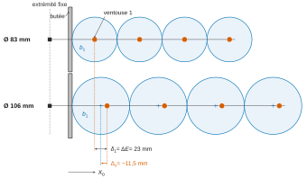
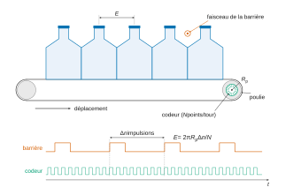
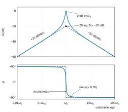
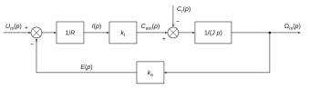
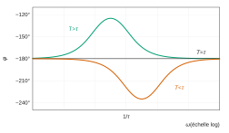

# CCINP TSI — Sciences industrielles de l'ingénieur 2026 · Corrigé brut

*Corrigé rédigé par IA, non officiel. Signalez toute erreur.*

Épreuve de 6 heures, calculatrice interdite. Unité de traitement plasma robotisée : 7 parties indépendantes, 58 questions. Le document réponse (DR) n'étant pas disponible, les schémas à compléter sont redessinés à part ou décrits en texte.

## Partie I — Détermination de la relation entre le déplacement du vérin et l'entraxe des bouteilles

### Q1

Le pantographe est formé de cinq losanges identiques (parallélogrammes déformables) entre l'extrémité fixe et l'extrémité mobile (annexe 1, figure 11). Chaque losange occupe un entraxe sur l'axe, donc dans toute configuration $D=5E$. Ce résultat est cohérent avec la référence donnée : $5\times80=400$ mm.

L'extrémité fixe est liée au châssis et le vérin déplace l'extrémité mobile de $\lambda$, donc $D=400+\lambda$ (mm) et

$$\boxed{\lambda=5E-400\quad(\text{mm})}$$

- $\lambda_{\text{bmin}}=5\times83-400=\mathbf{15\ mm}$ ;
- $\lambda_{\text{bmax}}=5\times106-400=\mathbf{130\ mm}$ ;
- $\lambda_{\text{réac}}=5\times230-400=\mathbf{750\ mm}$.

En fonctionnement, le vérin doit balayer l'intervalle $[\lambda_{\text{bmin}},\lambda_{\text{réac}}]$, d'où la course minimale :

$$\begin{aligned}
c_{\min}&=\lambda_{\text{réac}}-\lambda_{\text{bmin}}\\
&=750-15\\
&=\boxed{735\ \text{mm}}
\end{aligned}$$

Si la course est comptée depuis la position d'entraxe minimal de la figure 12 ($E=80$ mm, $\lambda=0$), le vérin doit offrir 750 mm.

### Q2

La relation est affine, donc $\Delta\lambda=5\,\Delta E$ :

$$\boxed{\Delta\lambda=5\times(106-83)=115\ \text{mm}}$$

On retrouve bien $130-15=115$ mm.

### Q3

Vue de dessus, robot, châssis et butée dans la même position pour les deux configurations, axe $\vec X_0$ orienté de la butée vers l'extrémité mobile :



La ventouse $i$ est portée par le $i$-ième nœud de l'axe, à l'abscisse $iE$ de l'extrémité fixe (figures 11 et 29). L'extrémité fixe étant liée au robot, le passage de 83 à 106 mm déplace la première ventouse, par rapport au préhenseur et en s'éloignant de la butée, de

$$\begin{aligned}
\delta_1&=\Delta E=106-83\\
&=\boxed{23\ \text{mm}}\\
&=\frac{\Delta\lambda}{5}
\end{aligned}$$

Dans le même temps, le centre de la première bouteille, en appui sur la butée, ne s'éloigne de celle-ci que de $\Delta E/2=11{,}5$ mm : la ventouse dépasse donc le centre de la bouteille de 11,5 mm.

### Q4

On prend l'origine des abscisses sur la butée. Les bouteilles sont jointives, donc l'entraxe vaut le diamètre $d=E$. Le centre de la première bouteille est alors en $x_{b1}=E/2$.

Si $x_R$ est l'abscisse de l'extrémité fixe (liée au robot), la première ventouse est en $x_R+E$. La condition de prise et la loi de Q2 donnent :

$$\begin{aligned}
x_R+E&=\frac E2\\
x_R&=-\frac E2\\
\Delta x_R&=-\frac{\Delta E}{2}\quad\text{avec}\quad\Delta E=\frac{\Delta\lambda}{5}
\end{aligned}$$

D'où

$$\boxed{\Delta_x=-\frac{\Delta\lambda}{10}}$$

Le décalage est dirigé vers la butée lorsque le vérin sort (bouteilles plus grosses). Pour le passage de 83 à 106 mm, $|\Delta_x|=11{,}5$ mm.

## Partie II — Détermination de l'entraxe

### Q5

La figure 16 montre que le terme filtré de rang $n$ est la moyenne des échantillons $n-2,\dots,n+2$ : la fenêtre est centrée sur $n$. Elle compte donc $2q+1$ points, et **$nb\_ech$ doit être impair**.

Avec un nombre pair, la moyenne serait centrée sur un demi-indice et la sortie serait décalée d'un demi-échantillon, ce qui fausserait la datation des minima utilisée en Q9.

Par ailleurs, $nb\_ech\ge3$ (sinon il n'y a pas de filtrage). Enfin, $nb\_ech$ doit rester petit devant le nombre d'échantillons entre deux bouteilles pour ne pas écraser les minima.

### Q6

```python
def moyenne_glissante(mesure, nb_ech):
    n = len(mesure)
    demi = nb_ech // 2                  # nb_ech = 2*demi + 1
    mesure_filtree = []
    for i in range(n):
        if i < demi or i > n - 1 - demi:
            mesure_filtree.append(mesure[i])     # bords recopiés
        else:
            somme = 0
            for k in range(i - demi, i + demi + 1):
                somme = somme + mesure[k]
            mesure_filtree.append(somme / nb_ech)
    return mesure_filtree
```

La liste renvoyée a la même longueur que `mesure`, et reste donc synchronisée avec `temps`.

### Q7

Un minimum local est un échantillon inférieur à ses deux voisins. L'inégalité est stricte à gauche et large à droite, pour qu'un palier ne soit compté qu'une fois. La fonction renvoie des indices :

```python
def trouver_minimum(mesure_filtree):
    echantillons_min = []
    for i in range(1, len(mesure_filtree) - 1):
        if mesure_filtree[i] < mesure_filtree[i-1] and mesure_filtree[i] <= mesure_filtree[i+1]:
            echantillons_min.append(i)
    return echantillons_min
```

### Q8

La génératrice donne la vitesse du moteur en tr·min⁻¹, que l'on convertit en rad·s⁻¹. Le réducteur donne ensuite la vitesse de la poulie :

$$\begin{aligned}
N_{\text{moteur}}&=\frac{u}{K_{gt}}\\
\omega_{\text{moteur}}&=\frac{2\pi}{60}\,\frac{u}{K_{gt}}\\
\omega_{\text{convoyeur}}&=k\,\omega_{\text{moteur}}
\end{aligned}$$

La poulie de rayon $R_p$ entraîne la courroie sans glissement :

$$\boxed{v=R_p\,k\,\frac{2\pi}{60}\,\frac{u}{K_{gt}}\quad(\text{m·s}^{-1})}$$

```python
from math import pi

vitesse_chariot = []
for u in tension_gt:
    vitesse_chariot.append(R_p * k * (u / K_gt) * 2 * pi / 60)
```

### Q9

Entre deux minimums consécutifs, le convoyeur avance d'un entraxe. Comme la vitesse n'est pas supposée constante, on intègre par la méthode des trapèzes : $E_j=\int_{t_j}^{t_{j+1}}v\,\mathrm dt$.

```python
def trouver_entraxe(echantillons_min, vitesse_chariot, temps):
    entraxes = []
    for j in range(len(echantillons_min) - 1):
        i1, i2 = echantillons_min[j], echantillons_min[j+1]
        d = 0
        for i in range(i1, i2):
            d = d + (vitesse_chariot[i] + vitesse_chariot[i+1]) / 2 * (temps[i+1] - temps[i])
        entraxes.append(d)
    return entraxes
```

Si `temps` est en secondes, les entraxes sont en mètres (en millimètres si `temps` est en ms et `vitesse_chariot` en m·s⁻¹).

### Q10

On peut associer une barrière photoélectrique tout-ou-rien à un codeur incrémental de $N$ points par tour monté sur l'arbre de la poulie (rayon $R_p$). L'émetteur et le récepteur sont placés de part et d'autre du convoyeur, et le faisceau horizontal passe **à hauteur des goulots** : les bouteilles étant jointives, un faisceau à mi-hauteur du corps serait coupé en permanence, alors qu'il est libre entre deux goulots.



Chaque goulot coupe le faisceau une fois. Deux fronts successifs de même nature du signal binaire sont donc espacés d'un entraxe, et le nombre $\Delta n$ d'impulsions du codeur compté entre eux donne

$$E=2\pi R_p\,\frac{\Delta n}{N}$$

Cette mesure ne demande ni filtrage ni hypothèse sur la vitesse. Une caméra en vue de dessus mesurant le diamètre apparent est une autre solution possible.

## Partie III — Alimentation du réacteur plasma

### III.1 — Adapter la charge pour maximiser le transfert de puissance

### Q11

En régime sinusoïdal de pulsation $\omega$, avec $R_p$ et $L_p$ en série :

$$\underline Z_{\text{plasma}}=R_p+\mathrm jL_p\omega$$

$$\boxed{\begin{aligned}
a_1&=R_p\\
b_1&=L_p\omega
\end{aligned}}$$

### Q12

On additionne les admittances :

$$\begin{aligned}
\underline Z_{EF}&=\frac{\underline Z_{\text{plasma}}}{1+\mathrm jC_p\omega\,\underline Z_{\text{plasma}}}\\
&=\frac{a_1+\mathrm jb_1}{(1-C_p\omega b_1)+\mathrm jC_p\omega a_1}
\end{aligned}$$

On multiplie haut et bas par le conjugué du dénominateur ; les termes réels croisés du numérateur se compensent :

$$\boxed{\begin{aligned}
a_2&=\frac{a_1}{\Delta}\\
b_2&=\frac{b_1-C_p\omega\,(a_1^2+b_1^2)}{\Delta}\\
\text{avec}\quad\Delta&=(1-C_p\omega b_1)^2+(C_p\omega a_1)^2
\end{aligned}}$$

### Q13

$C_s$ est en série, et $\dfrac{1}{\mathrm jC_s\omega}=-\dfrac{\mathrm j}{C_s\omega}$ :

$$\boxed{\begin{aligned}
a_3&=a_2\\
b_3&=b_2-\frac{1}{C_s\omega}
\end{aligned}}$$

### Q14

$C_p$ intervient dans $a_2=a_3$ et dans $b_2$. **$C_p$ agit donc sur $a_3$ et sur $b_3$.**

$C_s$ n'apparaît que dans $b_3$. **$C_s$ n'agit donc que sur $b_3$.**

Pour imposer $\underline Z_{AB}=50~\Omega$, il faut $a_3=50~\Omega$ et $b_3=0$.

On règle donc **d'abord $C_p$** pour obtenir $a_3=50~\Omega$, condition que $C_s$ ne peut pas modifier. On règle **ensuite $C_s$** pour annuler $b_3$.

Le réglage est découplé et ne demande pas d'itération.

### III.2 — Fonctionnement du générateur haute fréquence

### Q15

D'après la figure 20, $v_{MN}=+V_e$ sur $]0,T/2[$ et $v_{MN}=-V_e$ sur $]T/2,T[$. Le courant $i_{MN}$ est sinusoïdal, en phase : positif sur la première demi-période, négatif sur la seconde.

- **Sur $]0,T/2[$** : $K_1$ et $K_4$ sont fermés. Le courant $i_{MN}>0$ circule du pôle positif du bus vers M, puis de N vers le pôle négatif, dans le sens passant des transistors. **Les transistors $T_1$ et $T_4$ conduisent.**
- **Sur $]T/2,T[$** : $K_2$ et $K_3$ sont fermés, et $i_{MN}<0$. **Les transistors $T_2$ et $T_3$ conduisent.**
- Tension et courant s'annulent ensemble aux instants $0$, $T/2$ et $T$ : **les diodes $D_1$ à $D_4$ ne conduisent jamais.**

### Q16

Pendant une commutation, $V_{DS}$ varie sur une durée non nulle (figure 21). L'énergie dissipée dans le transistor vaut

$$W=\int v_{DS}\,i\,\mathrm dt$$

À courant nul, $W\approx0$ : **les pertes par commutation sont supprimées**. Le rendement augmente, l'échauffement diminue et l'on peut travailler à très haute fréquence ($f=\omega_0/2\pi\approx13{,}6$ MHz). Les $\mathrm di/\mathrm dt$ et les perturbations électromagnétiques sont aussi réduits.

### Q17

On identifie les coefficients des deux dénominateurs :

$$\begin{aligned}
L_tC_t&=\frac{1}{\omega_0^2}\\
R_{AB}C_t&=\frac{2\xi}{\omega_0}
\end{aligned}$$

D'où

$$\boxed{\begin{aligned}
\omega_0&=\frac{1}{\sqrt{L_tC_t}}\\
\xi&=\frac{R_{AB}C_t\omega_0}{2}=\frac{R_{AB}}{2}\sqrt{\frac{C_t}{L_t}}
\end{aligned}}$$

### Q18

On pose $u=\omega/\omega_0$, d'où

$$\underline H=\frac{2\xi\,\mathrm ju}{1-u^2+2\xi\,\mathrm ju}$$

- Pour $u\ll1$ : $\underline H\approx2\xi\,\mathrm ju$. Pente de +20 dB/décade, phase de $+90^\circ$.
- Pour $u\gg1$ : $\underline H\approx2\xi/(\mathrm ju)$. Pente de −20 dB/décade, phase de $-90^\circ$.
- Les asymptotes se coupent en $\omega_0$, à $20\log(2\xi)=20\log0{,}1=-20$ dB. La phase asymptotique saute de $+90^\circ$ à $-90^\circ$ en $\omega_0$.

| $\omega$ | $\ll\omega_0$ | $\omega_0$ | $\gg\omega_0$ |
|---|---|---|---|
| Gain asymptotique | $20\log(2\xi u)$, pente $+20$ dB/déc | $-20$ dB | $20\log(2\xi/u)$, pente $-20$ dB/déc |
| Phase asymptotique | $+90^\circ$ | saut | $-90^\circ$ |



Résonance : les formules fournies ($\omega_r=\omega_0\sqrt{1-2\xi^2}$, $Q_{dB}$) sont celles du second ordre passe-bas. Elles prévoient une résonance pour

$$\boxed{\xi<\frac{\sqrt2}{2}\approx0{,}707}$$

Pour le passe-bande étudié, $|\underline H|$ est maximal en $\omega_0$ (valeur 1) quel que soit $\xi$. La courbe réelle passe au-dessus du point de concours des asymptotes dès que $2\xi<1$, c'est-à-dire $\xi<0{,}5$.

Avec $\xi=0{,}05$, la résonance est très marquée.

### Q19

En $u=1$ :

$$\underline H(\mathrm j\omega_0)=\frac{2\xi\,\mathrm j}{2\xi\,\mathrm j}=1$$

donc

$$\boxed{\begin{aligned}
|\underline H(\mathrm j\omega_0)|&=1\ (0\ \text{dB})\\
\arg\underline H(\mathrm j\omega_0)&=0
\end{aligned}}$$

Allure réelle (figure 3) : le gain suit les asymptotes loin de $\omega_0$. Il forme ensuite un pic étroit culminant à 0 dB en $\omega_0$, 20 dB au-dessus du point de concours.

La bande passante à −3 dB vaut $2\xi\omega_0$, soit 10 % de $\omega_0$ ($Q=10$).

La phase passe continûment de $+90^\circ$ à $-90^\circ$ et vaut $0$ en $\omega_0$. La transition est d'autant plus raide que $\xi$ est petit.

### Q20

C'est un **filtre passe-bande du second ordre** centré sur $\omega_0$. Le créneau $v_{MN}$ contient les harmoniques impairs :

$$v_{MN}(t)=\frac{4V_e}{\pi}\left[\sin\omega_0t+\frac13\sin3\omega_0t+\dots\right]$$

Le filtre ne garde que le fondamental, ce qui donne un courant sinusoïdal dans le réacteur. En effet :

$$\begin{aligned}
|\underline H(3\mathrm j\omega_0)|&=\frac{0{,}3}{\sqrt{64+0{,}09}}\\
&\approx3{,}7\cdot10^{-2}\quad(-28{,}5\ \text{dB})
\end{aligned}$$

L'harmonique 3 ne représente donc plus qu'environ 1,2 % du fondamental.

La résonance est recherchée : en $\omega_0$, le gain unitaire transmet tout le fondamental, la phase nulle rend la charge vue par l'onduleur résistive, et le faible $\xi$ garantit une bonne sélectivité. Elle a une contrepartie : le filtre est sensible au désaccord, et comme $R_p$ et $L_p$ varient, il faut l'adaptation d'impédance de III.1.

### Q21

À $\omega_0$, le circuit série $L_tC_t$ est accordé : les réactances se compensent et l'onduleur voit $R_{AB}$ seule.

Le courant $i_{MN}$ est alors en phase avec le fondamental de $v_{MN}$. Il s'annule donc aux instants de commutation (figure 20), et les transistors commutent à courant nul malgré la durée non nulle des fronts de $V_{DS}$ (figure 21, Q16).

Un passe-bas dont la coupure laisserait passer le fondamental présenterait en $\omega_0$ un déphasage non nul. Le courant ne serait plus nul aux commutations, ce qui entraînerait des pertes par commutation prohibitives à 13,6 MHz. De plus, un passe-bas transmet la composante continue et les basses fréquences.

### Q22

Pour une résistance sous une tension de valeur efficace $V$, la puissance active vaut $P=\dfrac{V^2}{R}$. D'où

$$\begin{aligned}
V_{R_{AB}}&=\sqrt{P_{R_{AB}}R_{AB}}\\
&=\sqrt{2000\times50}\\
&=100\sqrt{10}\\
&\approx\boxed{316\ \text{V}}
\end{aligned}$$

### Q23

$v_{R_{AB}}$ a pour amplitude $4V_e/\pi$, donc

$$V_{R_{AB}}=\frac{4V_e}{\pi\sqrt2}=\frac{2\sqrt2}{\pi}V_e$$

et

$$\begin{aligned}
V_e&=\frac{\pi}{2\sqrt2}V_{R_{AB}}=\boxed{\frac{\pi\sqrt2}{4}V_{R_{AB}}}\\
&\approx1{,}11\times316\\
&\approx\boxed{351\ \text{V}}
\end{aligned}$$

### Q24

D'après l'énoncé :

$$V_e=\frac{2\sqrt2}{\pi}V_{r2}=\frac{2\sqrt2}{\pi}mV_r$$

En égalant avec Q23 :

$$\begin{aligned}
m&=\frac{\pi^2}{8}\frac{V_{R_{AB}}}{V_r}=\boxed{\frac{\pi^2\sqrt{P_{R_{AB}}R_{AB}}}{8V_r}}\\
&\approx\frac{9{,}87\times316}{8\times230}\\
&\approx\boxed{1{,}70}
\end{aligned}$$

Le transformateur est élévateur. En remontant la chaîne, $V_{r2}\approx391$ V et $V_e\approx352$ V.

## Partie IV — Limites dynamiques du déplacement

Toutes les bases sont directes, avec $\vec X_0=\vec X_1=\vec X_2$. Les vecteurs rotation sont

$$\begin{aligned}
\vec\Omega(1/0)&=\dot\alpha\,\vec X_0\\
\vec\Omega(2/1)&=\dot\beta\,\vec X_0
\end{aligned}$$

Les dérivées utiles, dans $R_0$, sont

$$\begin{aligned}
\frac{\mathrm d\vec Z_1}{\mathrm dt}&=-\dot\alpha\,\vec Y_1\\
\frac{\mathrm d\vec Y_1}{\mathrm dt}&=\dot\alpha\,\vec Z_1\\
\frac{\mathrm d\vec Y_2}{\mathrm dt}&=(\dot\alpha+\dot\beta)\,\vec Z_2\\
\frac{\mathrm d\vec Z_2}{\mathrm dt}&=-(\dot\alpha+\dot\beta)\,\vec Y_2
\end{aligned}$$

### Q25

$O$ est fixe dans 0 et sur l'axe du pivot, donc

$$\begin{aligned}
\vec V_{A,1/0}&=\vec\Omega(1/0)\wedge\overrightarrow{OA}\\
&=\dot\alpha\vec X_1\wedge L_1\vec Z_1\\
&=\boxed{-L_1\dot\alpha\,\vec Y_1}
\end{aligned}$$

### Q26

$A$ est sur l'axe du pivot entre 1 et 2, donc $\vec V_{A,2/0}=\vec V_{A,1/0}$, et $\vec\Omega(2/0)=(\dot\alpha+\dot\beta)\vec X_0$ :

$$\boxed{\vec V_{B,2/0}=-L_1\dot\alpha\,\vec Y_1+L_2(\dot\alpha+\dot\beta)\,\vec Z_2}$$

### Q27

On dérive dans $R_0$ en tenant compte de la rotation des vecteurs de base :

$$\boxed{\vec\Gamma_{B,2/0}=-L_1\ddot\alpha\,\vec Y_1-L_1\dot\alpha^2\,\vec Z_1+L_2(\ddot\alpha+\ddot\beta)\,\vec Z_2-L_2(\dot\alpha+\dot\beta)^2\,\vec Y_2}$$

### Q28

Pour $\alpha=\beta=0$, les trois bases sont confondues :

$$\begin{aligned}
\vec Y_1&=\vec Y_2=\vec Y_0\\
\vec Z_1&=\vec Z_2=\vec Z_0
\end{aligned}$$

En projetant sur $\vec Y_0$, les termes en $\vec Z$ disparaissent :

$$\vec\Gamma_{B,2/0}\cdot\vec Y_0=-L_1\ddot\alpha-L_2(\dot\alpha+\dot\beta)^2$$

$$\boxed{\begin{aligned}
a&=-L_1\\
b&=-L_2
\end{aligned}}$$

### Q29

On prend les valeurs maximales, avec $\ddot\alpha$ de même signe que le terme centripète (cas le plus défavorable) :

$$\begin{aligned}
|\vec\Gamma_{B,2/0}\cdot\vec Y_0|&=0{,}6\times4+0{,}75\times(2+2)^2\\
&=2{,}4+12\\
&=\boxed{14{,}4\ \text{m·s}^{-2}}
\end{aligned}$$

Comme $14{,}4>10$ m·s⁻², **l'exigence 1.1.1 n'est pas respectée** : avec ces vitesses et accélérations angulaires, les bouteilles risquent de tomber.

Il faut limiter les vitesses, car le terme centripète est prépondérant. Avec $\ddot\alpha=4$ rad·s⁻², il faut $0{,}75(\dot\alpha+\dot\beta)^2\le7{,}6$, soit $\dot\alpha+\dot\beta\le3{,}2$ rad·s⁻¹ au lieu de 4.

## Partie V — Validation des contraintes sur l'axe linéaire

### Q30

$b_1$ est en translation (encastrée sur le pantographe), donc

$$\vec R_D(b_1/0)=m_b\,\vec\Gamma(G_{b_1}/0)$$

On reprend la convention du torseur donné par l'énoncé (accélération $-\Gamma_B\vec Y_0$, c'est-à-dire une phase de freinage pour un déplacement suivant $+\vec Y_0$) :

$$\boxed{\vec R_D(b_1/0)=-m_b\,\Gamma_B\,\vec Y_0}$$

### Q31

Pour un ensemble en translation, au centre d'inertie $G$ de l'ensemble :

$$\vec\sigma_{G}=\left(\sum\overrightarrow{GM_i}\,m_i\right)\wedge\vec V(G)=\vec 0$$

Son moment dynamique y est donc nul. En notant $G_b$ le centre d'inertie de $B_{tot}$ :

$$\boxed{\vec\delta_{G_b}(B_{tot}/0)=\vec 0}$$

Si $G_b$ désigne le centre d'une seule bouteille, comme dans le tableau 2, le moment vaut $\sum_i\overrightarrow{G_bG_{b_i}}\wedge m_b\vec\Gamma$, qui n'est pas nul puisque les bouteilles sont décalées suivant $\vec X_0$. Il s'annule au centre d'inertie de l'ensemble.

### Q32

On transporte le moment de $G$ à $B$, avec $\vec X_3=\vec X_0$ et $\vec Z_3=\vec Z_0$. La figure 23 donne

$$\overrightarrow{BG}=X_G\vec X_0-Z_G\vec Z_0$$

Comme $\vec\delta_G(E/0)=\vec 0$ :

$$\begin{aligned}
\vec\delta_B(E/0)&=\overrightarrow{BG}\wedge\vec R_D(E/0)\\
&=(X_G\vec X_0-Z_G\vec Z_0)\wedge\left[-(4m_b+m_p)\Gamma_B\vec Y_0\right]
\end{aligned}$$

$$\boxed{\{\mathfrak D_{E/0}\}=\left\{\begin{array}{l}-(4m_b+m_p)\,\Gamma_B\,\vec Y_0\\-(4m_b+m_p)\,\Gamma_B\,(Z_G\,\vec X_0+X_G\,\vec Z_0)\end{array}\right\}_B}$$

### Q33

On a $4m_b+m_p=2{,}4$ kg, donc $(4m_b+m_p)\Gamma_B=24$ N, et

$$\begin{aligned}
\vec\delta_B(E/0)&=-24\,(0{,}2\,\vec X_0+0{,}1\,\vec Z_0)\\
&=-4{,}8\,\vec X_0-2{,}4\,\vec Z_0\quad(\text{N·m})
\end{aligned}$$

Le vérin a pour axe $\vec X_3=\vec X_0$, le long de la rangée de bouteilles. D'après les pictogrammes de l'annexe 4 :

- la composante de 4,8 N·m suivant $\vec X_0$ est un moment de **roulis**, autour de l'axe du vérin, comparé à $M_c=11{,}7$ N·m ;
- la composante de 2,4 N·m suivant $\vec Z_0$ est un moment de **lacet**, autour de la verticale, comparé à $M_b=6{,}8$ N·m ;
- il n'y a pas de composante suivant $\vec Y_0$ (**tangage**), donc le moment est nul face à $M_a=4{,}9$ N·m.

Les trois moments sont inférieurs aux valeurs admissibles : **le vérin supporte les effets dynamiques et l'exigence 1.3.4 est validée.** Le poids, non demandé ici, ajouterait un tangage $(4m_b+m_p)gX_G\approx2{,}4$ N·m, encore inférieur à $M_a$.

## Partie VI — Contrôle de la position de sortie du vérin pour adapter l'entraxe

### Q34

$k_t$ est un **bloc d'adaptation** : il convertit la consigne $\lambda_c$ (en m) en une consigne $N_c$ en points de codeur, homogène au retour $N_m$.

Ainsi, $\varepsilon=0$ correspond à $\lambda=\lambda_c$.

Le codeur mesure $\Theta_m$, donc

$$\begin{aligned}
\lambda&=k_{ve}k_r\,\Theta_m\\
N_m&=k_{cod}\,\Theta_m=\frac{k_{cod}}{k_rk_{ve}}\,\lambda
\end{aligned}$$

D'où

$$\boxed{k_t=\frac{k_{cod}}{k_r\,k_{ve}}}$$

### Q35

$$\boxed{\begin{aligned}
k_{cod}&=\frac{2^{n_p}}{2\pi}\ \text{pt·rad}^{-1}\\
k_h&=\frac{2U}{2^{n_b}}\ \text{V·pt}^{-1}\\
k_{ve}&=\frac{p_{vis}}{2\pi}\ \text{m·rad}^{-1}
\end{aligned}}$$

Numériquement, $k_{cod}=1024/2\pi\approx163$ pt·rad⁻¹ et $k_h=24/1024\approx23{,}4$ mV·pt⁻¹.

### Q36

Un point de codeur correspond à $2\pi/2^{n_p}$ rad sur l'arbre moteur, d'où

$$\begin{aligned}
p_\lambda&=\frac{k_rk_{ve}}{k_{cod}}=\boxed{\frac{k_r\,p_{vis}}{2^{n_p}}}\\
&=\frac{8\cdot10^{-3}}{3\times1024}\\
&\approx\boxed{2{,}6\ \mu\text{m}}
\end{aligned}$$

### Q37

Un codeur absolu fournit un code unique par position : la position est connue dès la mise sous tension, sans prise d'origine, et elle n'est pas perdue en cas de coupure ou d'impulsion manquée. On gagne ainsi du temps de cycle et de la sécurité.

Réserve : monté sur l'arbre moteur, un codeur à 10 pistes n'est absolu que sur un tour, alors que la course représente $735/(8/3)\approx276$ tours moteur. Il faut donc un codeur multitour, ou un comptage des tours sauvegardé.

### Q38

Avec $L$ négligée, les équations passées en Laplace donnent :

$$\begin{aligned}
I&=\frac{U_m-E}{R}\\
C_{em}&=k_tI\\
\Omega_m&=\frac{C_{em}-C_r}{Jp}\\
E&=k_e\Omega_m
\end{aligned}$$



### Q39

L'élimination de $I$ et $E$ donne

$$\left(Jp+\frac{k_tk_e}{R}\right)\Omega_m=\frac{k_t}{R}U_m-C_r$$

soit $\Omega_m=H_2\,(U_m-H_1C_r)$ avec

$$\boxed{\begin{aligned}
H_1(p)&=\frac{R}{k_t}\\
H_2(p)&=\frac{1/k_e}{1+\dfrac{RJ}{k_tk_e}p}
\end{aligned}}$$

On a donc $K_2=1/k_e$ et $\tau_2=RJ/(k_tk_e)$, où $J$ est l'inertie totale ramenée à l'arbre moteur.

### Q40

Hors correcteur, la boucle ouverte contient un intégrateur ($1/p$).

- **Correcteur P** : classe 1. **L'erreur statique est nulle, l'erreur de traînage est non nulle** (finie).
- **Correcteur PI** : classe 2. **Les erreurs statique et de traînage sont nulles.**

### Q41

$$H_{BO}(p)=K_c\frac{1+T_ip}{T_ip}\,k_h\,\frac{K_2}{1+\tau_2p}\,\frac1p\,k_{cod}$$

$$\boxed{\begin{aligned}
K&=\frac{K_c\,k_h\,K_2\,k_{cod}}{T_i}\\
T&=T_i\\
\tau&=\tau_2
\end{aligned}}$$

Les gains $k_r$ et $k_{ve}$ sont hors de la boucle (en aval du point de mesure).

### Q42

La phase vaut

$$\varphi(\omega)=-180^\circ+\arctan(T\omega)-\arctan(\tau\omega)$$

| Configuration | Allure du gain | Marge de phase | Marge de gain |
|---|---|---|---|
| $T>\tau$ | −40, puis −20 (après $1/T$), puis −40 dB/déc (après $1/\tau$) | positive : phase au-dessus de −180°, maximale en $1/\sqrt{T\tau}$ | non définie (la phase ne coupe jamais −180°) |
| $T=\tau$ | −40 dB/déc partout ($K/p^2$) | nulle : $\varphi=-180^\circ$ partout | non définie |
| $T<\tau$ | −40, puis −60, puis −40 dB/déc | négative : phase sous −180°, donc instable | non définie |

On ne garde que les configurations à **$T>\tau$** dont la marge de phase lue au croisement à 0 dB vaut au moins $20^\circ$ ; la marge de gain, infinie, respecte toujours les 10 dB (exigence 1.3.3). Les valeurs chiffrées et le numéro de la configuration retenue se lisent sur les diagrammes du DR, qui n'est pas fourni.



### Q43

Lectures sur la figure 28 :

- **Rapidité (1.3.1)** : la position entre dans la bande $[0{,}665;0{,}735]$ m vers $t\approx1{,}3$ s et n'en sort plus (le pic vaut environ 0,72 m). Le temps de réponse à 5 % est d'environ 1,3 s, inférieur à 2 s : **vérifiée**.
- **Précision (1.3.2)** : la position finale vaut 0,70 m, la consigne, donc l'écart statique est nul. Pendant le mouvement, la position suit la rampe de consigne de près, et la structure de classe 2 (PI) garantit un écart de traînage nul en régime établi : **vérifiée**.
- **Stabilité (1.3.3)** : la réponse est amortie et converge, avec un dépassement en position d'environ 3 % et une pointe de vitesse à 0,84 m·s⁻¹ pour une consigne de 0,7 m·s⁻¹. Le système est stable. Les marges exigées ne se lisent pas sur une réponse temporelle : elles sont garanties par le réglage choisi en Q42. **Vérifiée.**

## Partie VII — Validation des capacités du moteur d'axe linéaire

### Q44

La bouteille $b_i$ est au nœud $i$, à l'abscisse $iE=iD/5$ de l'extrémité fixe. Elle parcourt donc $i/5$ du déplacement de l'extrémité mobile :

$$\boxed{\begin{aligned}
V_{b_1}&=\frac{\dot\lambda}{5}\\
V_{b_2}&=\frac{2\dot\lambda}{5}\\
V_{b_3}&=\frac{3\dot\lambda}{5}\\
V_{b_4}&=\frac{4\dot\lambda}{5}
\end{aligned}}$$

### Q45

$b_1$ est en translation suivant $\vec X_0$ :

$$\boxed{\{\mathcal V_{b_1/0}\}=\left\{\begin{array}{l}\vec 0\\ \dfrac{\dot\lambda}{5}\vec X_0\end{array}\right\}_{G_{b_1}}}$$

### Q46

$$\boxed{\{\mathcal C_{b_1/0}\}=\left\{\begin{array}{l}\dfrac{m_b\dot\lambda}{5}\vec X_0\\ \vec 0\end{array}\right\}_{G_{b_1}}}$$

Le moment cinétique en $G_{b_1}$ est nul car $\vec\Omega(b_1/0)=\vec 0$.

### Q47

$$\boxed{E_c(b_1/0)=\frac12m_b\left(\frac{\dot\lambda}{5}\right)^2=\frac{m_b\dot\lambda^2}{50}}$$

### Q48

$$\begin{aligned}
E_c(B_{tot}/0)&=\frac12m_b\frac{\dot\lambda^2}{25}(1+4+9+16)\\
&=\frac12\cdot\frac{30m_b}{25}\dot\lambda^2
\end{aligned}$$

$$\boxed{C=\frac65m_b}$$

### Q49

$\omega_7=k_r\omega_m$, et la vis avance d'un pas par tour :

$$\boxed{\dot\lambda=\frac{p_{vis}}{2\pi}\,k_r\,\omega_m}$$

### Q50

$$\boxed{E_c(B_{tot}/0)=\frac12\,C\left(\frac{k_r\,p_{vis}}{2\pi}\right)^2\omega_m^2}$$

### Q51

$$\boxed{E_c(6/0)=\frac12J_{mot}\,\omega_m^2}$$

### Q52

$$\boxed{E_c(7/0)=\frac12J_{red}\,k_r^2\,\omega_m^2}$$

### Q53

$$\boxed{E_c(5/0)=\frac12m_e\left(\frac{k_r\,p_{vis}}{2\pi}\right)^2\omega_m^2}$$

### Q54

On somme les contributions, les ventouses étant négligées :

$$\boxed{J_{eq}=J_{mot}+k_r^2J_{red}+\left(m_e+\frac65m_b\right)\left(\frac{k_r\,p_{vis}}{2\pi}\right)^2}$$

### Q55

La force $f$ s'oppose au mouvement de l'extrémité mobile, qui se déplace à $\dot\lambda$ :

$$\boxed{\begin{aligned}
P_f&=-f\,\dot\lambda=-f\,\frac{k_r\,p_{vis}}{2\pi}\,\omega_m\\
P_m&=C_m\,\omega_m
\end{aligned}}$$

### Q56

On applique le théorème de l'énergie cinétique à l'ensemble $\{5,6,7,B_{tot}\}$ par rapport au châssis fixe, les liaisons étant parfaites hors frottement et les puissances intérieures négligées :

$$\begin{aligned}
\frac{\mathrm d}{\mathrm dt}\left(\frac12J_{eq}\omega_m^2\right)&=P_m+P_f\\
J_{eq}\omega_m\dot\omega_m&=C_m\omega_m-f\frac{k_rp_{vis}}{2\pi}\omega_m
\end{aligned}$$

En divisant par $\omega_m\neq0$ :

$$\boxed{C_m=J_{eq}\,\dot\omega_m+f\,k_r\,\frac{p_{vis}}{2\pi}}$$

### Q57

Figure 31 : pendant l'accélération, $\ddot\lambda=0{,}7/0{,}5=1{,}4$ m·s⁻². On a la même valeur, au signe près, pendant le freinage. Donc

$$\begin{aligned}
\dot\omega_m&=\frac{2\pi}{k_rp_{vis}}\,\ddot\lambda\\
&=2\pi\times375\times1{,}4\\
&\approx3{,}30\cdot10^3\ \text{rad·s}^{-2}
\end{aligned}$$

Puis, avec Q56 :

$$\begin{aligned}
C_m&=15\cdot10^{-6}\times3{,}30\cdot10^3+10\times\frac13\times\frac{8\cdot10^{-3}}{2\pi}\\
&\approx0{,}0495+0{,}0042
\end{aligned}$$

$$\boxed{C_{m,\min}\approx5{,}4\cdot10^{-2}\ \text{N·m}=54\ \text{mN·m}}$$

Pendant le freinage, $C_m\approx-45$ mN·m : la phase d'accélération est dimensionnante.

### Q58

**Critère de couple.** On compare le couple requis aux couples de démarrage $M_H$ :

- série 0824 : 3,3 mN·m, insuffisant ;
- série 1628 : 9,8 à 11 mN·m, insuffisant ;
- série 3056 : 102 à 111 mN·m, suffisant (environ deux fois 54 mN·m).

On retient donc le **moteur 3056 012 B**, alimenté en 12 V comme le hacheur ($U=12$ V).

**Critère de vitesse.** Au palier :

$$\omega_m=\frac{2\pi}{k_rp_{vis}}\times0{,}7\approx1649\ \text{rad·s}^{-1}$$

soit **15 750 tr·min⁻¹**. Or le 3056 a une vitesse à vide de 8 800 tr·min⁻¹ seulement. Sous 54 mN·m, sa caractéristique donne

$$n\approx8800-87\times54\approx4100\ \text{tr·min}^{-1}$$

**Conclusion.** Le moteur 3056 012 B est le seul choix possible en couple, mais il ne peut pas atteindre la vitesse du palier. **Les cadences de la figure 31 ne peuvent pas être respectées** avec $k_r=1/3$ et $p_{vis}=8$ mm (exigence 1.3.1 non validée), et aucun des deux autres moteurs ne convient non plus. Il faudrait revoir la transmission, par exemple avec un pas de vis plus grand, ou réduire la vitesse de palier.
