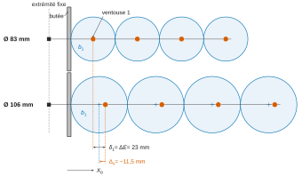
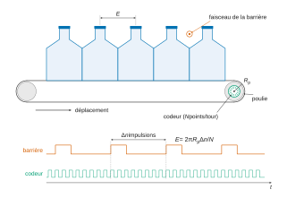
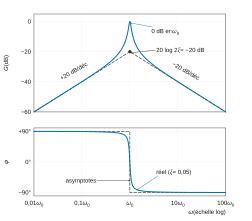
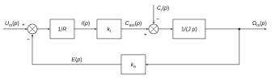
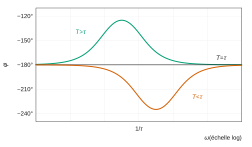

# CCINP TSI — Sciences industrielles de l'ingénieur 2026 · Corrigé guidé

*Corrigé rédigé par IA, non officiel. Signalez toute erreur.*

## Présentation du sujet

**Format.** 6 heures, calculatrice interdite, 58 questions (Q1 à Q58) réparties en sept parties indépendantes. On ne rend que le document réponse (DR, 24 pages), qui n'est pas reproduit ici : les gabarits à compléter (fonction Python de Q6, schéma-bloc de Q38, diagrammes de Bode de Q42) sont donc traités sans eux.

**Le système.** Une unité ISYTECH dépose par plasma basse pression une couche de carbone fluoré sur des bouteilles PET. Un préhenseur à quatre ventouses saisit les bouteilles jointives en sortie de convoyeur (entraxe de 83 à 106 mm) et les dépose dans quatre réacteurs (entraxe de 230 mm). L'entraxe s'adapte grâce à un pantographe à cinq losanges, commandé par un vérin électrique. Le portique d'origine est remplacé par un robot 6 axes, et le diagramme des exigences (annexe 2) sert de fil rouge.

**Les sept parties.**

- **I (Q1–Q4)** : géométrie du pantographe ; relation $\lambda(E)$, course et décalage de trajectoire.
- **II (Q5–Q10)** : traitement d'une mesure ultrasonore ; moyenne glissante, minima, vitesse, entraxe (Python).
- **III (Q11–Q24)** : électrotechnique. Adaptation d'impédance par deux condensateurs, onduleur en pont et commutation à courant nul, filtre passe-bande, bilan de puissance et rapport de transformation.
- **IV (Q25–Q29)** : cinématique d'un bras à deux pivots, accélération maximale du préhenseur.
- **V (Q30–Q33)** : dynamique d'un ensemble en translation, transport de moment, comparaison au catalogue du vérin.
- **VI (Q34–Q43)** : asservissement de position. Chaîne de mesure, codeur absolu, modèle de la MCC, classe et précision, FTBO, marges, réponse temporelle.
- **VII (Q44–Q58)** : énergétique. Énergies cinétiques, inertie équivalente, théorème de l'énergie cinétique, choix d'un moteur.

**Notions du programme mobilisées.** Lecture d'un diagramme d'exigences ; mécanismes et lois entrée-sortie ; algorithmique en Python (listes, boucles, intégration par trapèzes) ; impédances complexes ; onduleur et réversibilité des interrupteurs ; second ordre et diagrammes de Bode ; valeur efficace et puissance active ; dérivation vectorielle et composition des mouvements ; torseurs dynamique et cinétique ; schéma-bloc, classe, précision, marges ; MCC ; énergie cinétique, inertie équivalente, théorème de l'énergie cinétique.

**Difficulté et longueur.** Le sujet est long mais très guidé. Les points délicats sont Q4 (deux déplacements qui se compensent partiellement), Q12 (calcul complexe), Q15 (signe du courant), Q18 (la notion de résonance pour un passe-bande), Q33 (identifier les axes des moments admissibles), Q42 (marges d'un système de classe 2) et Q58 (vérifier la vitesse autant que le couple).

**Questions à ne pas laisser passer.** Q1–Q2, Q5, Q11, Q13, Q16–Q17, Q19, Q22–Q23, Q25–Q26, Q34–Q36, Q40–Q41, Q44–Q53 : des applications directes du cours, rapides à rédiger.

**Gestion du temps.** Environ 6 minutes par question. On peut prévoir 20 min pour la partie I, 50 min pour la II, 1 h 30 pour la III, 40 min pour la IV, 30 min pour la V, 1 h pour la VI et 1 h pour la VII. Les parties étant indépendantes, on commence par celles où l'on est le plus à l'aise ; chacune se conclut sur une exigence qu'il faut énoncer clairement.

## Partie I — Détermination de la relation entre le déplacement du vérin et l'entraxe des bouteilles

On établit la loi entrée-sortie géométrique du pantographe, puis on en déduit les positions du vérin et la correction à apporter à la trajectoire du robot. Seuls la proportionnalité et un schéma soigné sont nécessaires.

### Question 1

> [!INDICATION]
> Comptez sur l'annexe 1 combien d'entraxes $E$ se juxtaposent sous la cote $D$. Vérifiez votre relation avec le point de référence donné.

> [!INDICATION]
> $\lambda$ est un déplacement depuis la position de référence, pas la distance $D$ elle-même. La course est une amplitude entre deux positions extrêmes de fonctionnement.

#### Solution

L'annexe 1 et la figure 11 montrent cinq losanges identiques entre l'extrémité fixe et l'extrémité mobile ; chacun occupe un entraxe sur l'axe. Donc $D=5E$ dans toute configuration, ce que confirme la référence $5\times80=400$ mm.

Comme l'extrémité fixe est liée au châssis, $D=400+\lambda$, d'où

$$\boxed{\lambda=5E-400\quad(\text{mm})}$$

- $\lambda_{\text{bmin}}=415-400=\mathbf{15}$ **mm** ;
- $\lambda_{\text{bmax}}=530-400=\mathbf{130}$ **mm** ;
- $\lambda_{\text{réac}}=1150-400=\mathbf{750}$ **mm**.

Le vérin doit couvrir $[15;750]$ mm, d'où la course minimale

$$\begin{aligned}
c_{\min}&=750-15\\
&=\boxed{735\ \text{mm}}
\end{aligned}$$

Si l'on compte la course depuis la position d'entraxe minimal de la figure 12 ($\lambda=0$, $E=80$ mm), il faut 750 mm.

> [!PIEGE]
> Écrire $D=4E$ parce qu'il y a quatre bouteilles. Ce sont les cinq losanges qui comptent, et le point de référence ($400=5\times80$) permet de le vérifier.

### Question 2

> [!INDICATION]
> La relation de Q1 est affine : que devient une variation de $E$ ?

#### Solution

$$\begin{aligned}
\Delta\lambda&=5\,\Delta E\\
&=5\times23\\
&=\boxed{115\ \text{mm}}
\end{aligned}$$

On retrouve bien $130-15=115$ mm.

### Question 3

> [!INDICATION]
> Repérez sur la figure 11 (ou 29) à quel nœud de l'axe est accrochée la première ventouse, et quel point du pantographe est lié au robot.

> [!INDICATION]
> Faites le schéma des deux configurations l'une au-dessus de l'autre, butée et robot alignés, et cotez la position de la ventouse 1 et celle du centre de la première bouteille.

#### Solution

On oriente $\vec X_0$ de la butée vers l'extrémité mobile. Le schéma de dessus superpose les deux configurations, avec le robot et la butée immobiles :



La ventouse $i$ est au nœud $i$, à l'abscisse $iE$ de l'extrémité fixe, qui est liée au robot. Le passage de 83 à 106 mm déplace donc la première ventouse de

$$\begin{aligned}
\delta_1&=\Delta E\\
&=\boxed{23\ \text{mm}}\\
&=\frac{\Delta\lambda}{5}
\end{aligned}$$

Ce déplacement est mesuré par rapport au préhenseur et s'éloigne de la butée. Dans le même temps, le centre de la première bouteille ne s'éloigne de la butée que de 11,5 mm.

> [!METHODE]
> Avant de chiffrer un déplacement, précisez **par rapport à quoi** on le mesure (le robot, la butée) et dans quel sens. Le schéma sert à fixer ce repère.

### Question 4

> [!INDICATION]
> Écrivez, dans un repère lié à la butée, l'abscisse du centre de la première bouteille et celle de la première ventouse.

> [!INDICATION]
> Les bouteilles sont jointives et en appui sur la butée : la position de leur centre dépend elle aussi du diamètre.

#### Solution

On place l'origine sur la butée. Les bouteilles étant jointives, $E=d$ et le centre de $b_1$ est en $E/2$.

La ventouse 1 est en $x_R+E$, où $x_R$ est l'abscisse de l'extrémité fixe (liée au robot). La condition de prise donne

$$\begin{aligned}
x_R+E&=\frac E2\\
x_R&=-\frac E2
\end{aligned}$$

donc

$$\begin{aligned}
\Delta_x&=-\frac{\Delta E}{2}\\
&=\boxed{-\frac{\Delta\lambda}{10}}
\end{aligned}$$

La trajectoire doit être décalée vers la butée quand le vérin sort. Pour le passage de 83 à 106 mm, $|\Delta_x|=11{,}5$ mm.

> [!PIEGE]
> Compenser seulement le déplacement de la ventouse ($\Delta\lambda/5=23$ mm) en oubliant que la première bouteille se décale aussi de $\Delta d/2$. La figure 13 distingue d'ailleurs deux cotes : le « déplacement de la première ventouse » et le « décalage $\Delta_x$ à affecter à la trajectoire ».

## Partie II — Détermination de l'entraxe

On mesure l'entraxe à la volée : on filtre une mesure de distance bruitée, on date les minima (un par bouteille) et on intègre la vitesse du convoyeur entre deux minima. Python élémentaire suffit.

### Question 5

> [!INDICATION]
> Sur la figure 16, la moyenne de rang $n$ porte-t-elle sur des échantillons placés symétriquement autour de $n$ ?

#### Solution

Le terme filtré de rang $n$ est la moyenne de $y[n-2],\dots,y[n+2]$ : la fenêtre est **centrée** et compte $2q+1$ points. **$nb\_ech$ doit donc être impair.**

Avec un nombre pair, la fenêtre serait centrée sur un demi-indice et la sortie serait décalée d'un demi-échantillon, ce qui fausserait la datation des minima dont dépend l'entraxe.

De plus, $nb\_ech\ge3$, et $nb\_ech$ doit rester petit devant le nombre d'échantillons séparant deux bouteilles, sinon les minima sont écrasés.

### Question 6

> [!INDICATION]
> Deux cas selon que la fenêtre centrée sur $i$ déborde ou non de la liste. Calculez la demi-largeur de la fenêtre à partir de $nb\_ech$.

> [!INDICATION]
> La liste renvoyée doit avoir la même longueur que l'entrée, pour rester synchronisée avec `temps`.

#### Solution

```python
def moyenne_glissante(mesure, nb_ech):
    n = len(mesure)
    demi = nb_ech // 2                  # nb_ech = 2*demi + 1
    mesure_filtree = []
    for i in range(n):
        if i < demi or i > n - 1 - demi:
            mesure_filtree.append(mesure[i])     # bords recopiés
        else:
            somme = 0
            for k in range(i - demi, i + demi + 1):
                somme = somme + mesure[k]
            mesure_filtree.append(somme / nb_ech)
    return mesure_filtree
```

Par exemple, `moyenne_glissante([1, 2, 3, 4, 5, 6, 7], 3)` renvoie `[1, 2.0, 3.0, 4.0, 5.0, 6.0, 7]`.

> [!PIEGE]
> `range(i - demi, i + demi)` n'additionne que $nb\_ech-1$ termes. La borne supérieure de `range` est exclue.

### Question 7

> [!INDICATION]
> Un minimum local se compare à ses deux voisins. Quels indices peut-on tester sans sortir de la liste ?

> [!INDICATION]
> Renvoyez des indices, pas des valeurs : Q9 en a besoin pour lire les dates.

#### Solution

```python
def trouver_minimum(mesure_filtree):
    echantillons_min = []
    for i in range(1, len(mesure_filtree) - 1):
        if mesure_filtree[i] < mesure_filtree[i-1] and mesure_filtree[i] <= mesure_filtree[i+1]:
            echantillons_min.append(i)
    return echantillons_min
```

L'inégalité stricte d'un côté et large de l'autre évite de compter deux fois un palier.

### Question 8

> [!INDICATION]
> Remontez la chaîne : tension de la génératrice, vitesse moteur, réducteur, poulie. Attention à l'unité de $K_{gt}$.

#### Solution

On remonte la chaîne, de la génératrice (en tr·min⁻¹) à la poulie :

$$\begin{aligned}
N_{\text{moteur}}&=\frac{u}{K_{gt}}\\
\omega_{\text{moteur}}&=\frac{2\pi}{60}\,\frac{u}{K_{gt}}\\
\omega_{\text{convoyeur}}&=k\,\omega_{\text{moteur}}\\
v&=R_p\,\omega_{\text{convoyeur}}
\end{aligned}$$

D'où

$$\boxed{v=R_p\,k\,\frac{2\pi}{60}\,\frac{u}{K_{gt}}}$$

```python
from math import pi

vitesse_chariot = []
for u in tension_gt:
    vitesse_chariot.append(R_p * k * (u / K_gt) * 2 * pi / 60)
```

> [!PIEGE]
> Oublier le facteur $2\pi/60$, alors que $K_{gt}$ est en V·min·tr⁻¹ : toute la chaîne est fausse d'un facteur 9,55.

### Question 9

> [!INDICATION]
> Entre deux minimums consécutifs, de combien le convoyeur a-t-il avancé ?

> [!INDICATION]
> La vitesse n'est pas forcément constante : une distance est l'intégrale de la vitesse. Utilisez une méthode d'intégration numérique sur les échantillons.

#### Solution

L'entraxe est la distance parcourue entre deux minimums :

$$E_j=\int_{t_j}^{t_{j+1}}v\,\mathrm dt$$

On la calcule par la méthode des trapèzes.

```python
def trouver_entraxe(echantillons_min, vitesse_chariot, temps):
    entraxes = []
    for j in range(len(echantillons_min) - 1):
        i1, i2 = echantillons_min[j], echantillons_min[j+1]
        d = 0
        for i in range(i1, i2):
            d = d + (vitesse_chariot[i] + vitesse_chariot[i+1]) / 2 * (temps[i+1] - temps[i])
        entraxes.append(d)
    return entraxes
```

Avec `temps` en secondes, le résultat est en mètres. Sur un signal test (vitesse de 0,25 m·s⁻¹, minima espacés de 0,35 s), on obtient bien 0,0875 m.

> [!METHODE]
> Indices et dates sont deux choses distinctes : `echantillons_min` donne des indices, et `temps[i]` les convertit en secondes.

### Question 10

> [!INDICATION]
> Cherchez un capteur qui détecte directement le passage de chaque bouteille, associé à une mesure du déplacement du convoyeur.

#### Solution

On peut utiliser une barrière photoélectrique tout-ou-rien (émetteur et récepteur de part et d'autre du convoyeur), associée à un codeur incrémental de $N$ points par tour sur l'arbre de la poulie de rayon $R_p$. Le faisceau passe **à hauteur des goulots** : les bouteilles étant jointives, il serait coupé en permanence à mi-hauteur du corps, alors qu'il est libre entre deux goulots.



Chaque goulot coupe le faisceau une fois : deux fronts successifs de même nature du signal de la barrière correspondent à un entraxe. Si $\Delta n$ impulsions du codeur sont comptées entre ces fronts, alors

$$E=2\pi R_p\frac{\Delta n}{N}$$

Cette mesure ne demande ni filtrage ni hypothèse sur la vitesse. Une caméra en vue de dessus mesurant le diamètre apparent convient aussi.

## Partie III — Alimentation du réacteur plasma

III.1 étudie l'adaptation d'impédance par calcul complexe. III.2 suit la chaîne transformateur–redresseur–onduleur–filtre jusqu'au réacteur et justifie le choix du filtre par la commutation à courant nul.

### III.1 — Adapter la charge pour maximiser le transfert de puissance

### Question 11

> [!INDICATION]
> Impédances complexes de $R_p$ et de $L_p$, en série.

#### Solution

$$\underline Z_{\text{plasma}}=R_p+\mathrm jL_p\omega$$

$$\boxed{\begin{aligned}
a_1&=R_p\\
b_1&=L_p\omega
\end{aligned}}$$

### Question 12

> [!INDICATION]
> En parallèle, les admittances s'ajoutent. Écrivez $\underline Z_{EF}$ comme $\underline Z_{\text{plasma}}$ divisé par une expression simple.

> [!INDICATION]
> Pour séparer parties réelle et imaginaire, multipliez numérateur et dénominateur par le conjugué du dénominateur.

#### Solution

$$\begin{aligned}
\underline Z_{EF}&=\frac{\underline Z_{\text{plasma}}}{1+\mathrm jC_p\omega\,\underline Z_{\text{plasma}}}\\
&=\frac{a_1+\mathrm jb_1}{(1-C_p\omega b_1)+\mathrm jC_p\omega a_1}
\end{aligned}$$

Le numérateur multiplié par le conjugué vaut $a_1+\mathrm j\left[b_1-C_p\omega(a_1^2+b_1^2)\right]$, car les termes réels croisés se compensent. D'où

$$\boxed{\begin{aligned}
a_2&=\frac{a_1}{\Delta}\\
b_2&=\frac{b_1-C_p\omega(a_1^2+b_1^2)}{\Delta}\\
\text{avec}\quad\Delta&=(1-C_p\omega b_1)^2+(C_p\omega a_1)^2
\end{aligned}}$$

> [!METHODE]
> La forme $\underline Z/(1+\underline Y'\underline Z)$ est plus rapide à manipuler que $\underline Z_1\underline Z_2/(\underline Z_1+\underline Z_2)$ dès qu'une branche est un condensateur ou une bobine seuls.

### Question 13

> [!INDICATION]
> Série : on additionne les impédances. Quel est le signe de la partie imaginaire de $1/(\mathrm jC_s\omega)$ ?

#### Solution

$$\boxed{\begin{aligned}
a_3&=a_2\\
b_3&=b_2-\frac{1}{C_s\omega}
\end{aligned}}$$

### Question 14

> [!INDICATION]
> Repérez dans quelles expressions apparaissent $C_p$ et $C_s$. Lequel des deux est sélectif ?

#### Solution

**$C_p$ agit sur $a_3$ et sur $b_3$**, par $a_2$ et $b_2$.

**$C_s$ n'agit que sur $b_3$.**

Pour obtenir $\underline Z_{AB}=50~\Omega$, il faut $a_3=50~\Omega$ et $b_3=0$.

Seul $C_p$ peut fixer $a_3$ : on le règle **en premier**. Ensuite, $C_s$ annule $b_3$ sans modifier $a_3$.

Ce réglage découplé converge en une seule passe.

> [!PIEGE]
> Dire que « $C_p$ n'agit que sur la partie réelle ». Il agit sur les deux parties ; c'est $C_s$ qui est sélectif.

### III.2 — Fonctionnement du générateur haute fréquence

### Question 15

> [!INDICATION]
> Pour chaque demi-période, la tension indique quels interrupteurs sont fermés, et le signe du courant indique si c'est le transistor ou la diode qui conduit.

> [!INDICATION]
> Comparez les instants où la tension change de signe et ceux où le courant s'annule.

#### Solution

- **Sur $]0,T/2[$** : $v_{MN}=+V_e$, donc $K_1$ et $K_4$ sont fermés. Le courant étant positif, il traverse les interrupteurs dans le sens passant des transistors : **les transistors $T_1$ et $T_4$ conduisent**.
- **Sur $]T/2,T[$** : $v_{MN}=-V_e$ et $i_{MN}<0$. **Les transistors $T_2$ et $T_3$ conduisent**.
- Le courant, sinusoïdal, est en phase avec la tension et s'annule aux instants de commutation : **aucune diode ne conduit**.

> [!PIEGE]
> Faire conduire les diodes « par habitude », comme pour une charge inductive où le courant est en retard. Ici, la figure 20 montre des annulations simultanées.

### Question 16

> [!INDICATION]
> Exprimez l'énergie dissipée dans le transistor pendant une transition de $V_{DS}$, de durée non nulle (figure 21).

#### Solution

L'énergie perdue à chaque commutation vaut

$$W=\int v_{DS}\,i\,\mathrm dt$$

Si $i\approx0$ pendant la transition, $W\approx0$ : **les pertes par commutation disparaissent**. Le rendement augmente, l'échauffement diminue, et l'on peut découper à très haute fréquence ($\omega_0/2\pi\approx13{,}6$ MHz) avec moins de perturbations électromagnétiques.

### Question 17

> [!INDICATION]
> Identifiez terme à terme les coefficients de $(\mathrm j\omega)^2$, puis ceux de $\mathrm j\omega$.

#### Solution

L'identification donne

$$\begin{aligned}
L_tC_t&=\frac{1}{\omega_0^2}\\
R_{AB}C_t&=\frac{2\xi}{\omega_0}
\end{aligned}$$

donc

$$\boxed{\begin{aligned}
\omega_0&=\frac{1}{\sqrt{L_tC_t}}\\
\xi&=\frac{R_{AB}}{2}\sqrt{\frac{C_t}{L_t}}
\end{aligned}}$$

On vérifie l'homogénéité : $\sqrt{L_t/C_t}$ est une résistance, donc $\xi$ est sans dimension.

### Question 18

> [!INDICATION]
> Cherchez les équivalents de $\underline H$ pour $\omega\ll\omega_0$ et $\omega\gg\omega_0$, puis le point de concours des asymptotes.

> [!INDICATION]
> Les formules de résonance fournies correspondent-elles vraiment à un passe-bande ? Comparez avec la valeur de $|\underline H|$ en $\omega_0$.

#### Solution

Avec $u=\omega/\omega_0$, on a

$$\underline H=\frac{2\xi\,\mathrm ju}{1-u^2+2\xi\,\mathrm ju}$$

- Pour $u\ll1$ : $\underline H\approx2\xi\,\mathrm ju$. Pente +20 dB/décade, phase $+90^\circ$.
- Pour $u\gg1$ : $\underline H\approx2\xi/(\mathrm ju)$. Pente −20 dB/décade, phase $-90^\circ$.
- Les asymptotes se coupent en $\omega_0$ à $20\log(2\xi)=-20$ dB. La phase asymptotique saute de $+90^\circ$ à $-90^\circ$ en $\omega_0$.



Les formules fournies ($\omega_r=\omega_0\sqrt{1-2\xi^2}$) sont celles du passe-bas ; elles prévoient une résonance pour

$$\boxed{\xi<\frac{\sqrt2}{2}\approx0{,}707}$$

Pour le passe-bande étudié, le gain est maximal en $\omega_0$ et vaut 1 quel que soit $\xi$. La courbe réelle passe au-dessus du point de concours des asymptotes dès que $\xi<1/2$. Avec $\xi=0{,}05$, le pic est très marqué.

> [!PIEGE]
> Appliquer mécaniquement le critère du passe-bas sans dire de quoi il est le seuil. Énoncez la valeur attendue, puis précisez ce qui se passe réellement pour un passe-bande.

### Question 19

> [!INDICATION]
> Que devient le terme $1-u^2$ en $u=1$ ?

#### Solution

En $u=1$, le terme $1-u^2$ s'annule et $\underline H(\mathrm j\omega_0)=1$ :

$$\boxed{\begin{aligned}
|\underline H(\mathrm j\omega_0)|&=1\ (0\ \text{dB})\\
\arg\underline H(\mathrm j\omega_0)&=0
\end{aligned}}$$

Allure réelle (figure 3) : un pic étroit à 0 dB en $\omega_0$, soit 20 dB au-dessus du point de concours. La bande passante vaut $2\xi\omega_0$ (10 % de $\omega_0$).

La phase passe continûment de $+90^\circ$ à $-90^\circ$, très vite autour de $\omega_0$.

### Question 20

> [!INDICATION]
> Nommez le filtre d'après ses asymptotes. Que contient le spectre d'un signal créneau ?

> [!INDICATION]
> Pour l'intérêt de la résonance, pensez à trois choses : le gain et la phase en $\omega_0$, puis la sélectivité.

#### Solution

C'est un **passe-bande du second ordre** centré sur $\omega_0$. Le créneau $v_{MN}$ contient les harmoniques impairs :

$$v_{MN}(t)=\frac{4V_e}{\pi}\left[\sin\omega_0t+\frac13\sin3\omega_0t+\dots\right]$$

Le filtre ne garde que le fondamental, de sorte que le réacteur reçoit un courant sinusoïdal. On a

$$\begin{aligned}
|\underline H(3\mathrm j\omega_0)|&\approx\frac{0{,}3}{8}\\
&\approx3{,}7\cdot10^{-2}
\end{aligned}$$

donc l'harmonique 3 ne représente plus qu'environ 1 % du fondamental.

La résonance est voulue : en $\omega_0$, le gain unitaire transmet tout le fondamental et la phase nulle rend la charge résistive, ce qui permet la commutation à courant nul ; le faible $\xi$ assure la sélectivité. L'inconvénient est la sensibilité au désaccord quand $R_p$ et $L_p$ varient, d'où l'adaptation d'impédance de III.1.

### Question 21

> [!INDICATION]
> Raisonnez sur la phase en $\omega_0$ plutôt que sur l'atténuation des harmoniques : quel est le lien avec l'instant où le courant s'annule ?

#### Solution

À $\omega_0$, les réactances de $L_t$ et $C_t$ en série se compensent : l'onduleur voit $R_{AB}$ seule.

Le courant $i_{MN}$ est donc en phase avec le fondamental de $v_{MN}$. Il s'annule exactement aux commutations (figure 20), et les transistors commutent à courant nul malgré les fronts lents de $V_{DS}$ (figure 21, Q16).

Un passe-bas laissant passer le fondamental introduirait un déphasage en $\omega_0$ : la commutation se ferait à courant non nul, avec des pertes prohibitives à 13,6 MHz. Il laisserait en outre passer la composante continue.

> [!METHODE]
> Un circuit $LC$ série accordé sur la fréquence de découpage rend la charge résistive : c'est le principe des onduleurs à résonance.

### Question 22

> [!INDICATION]
> Puissance active dans une résistance en fonction de la tension **efficace**.

#### Solution

$P=V^2/R$, donc

$$\begin{aligned}
V_{R_{AB}}&=\sqrt{P_{R_{AB}}R_{AB}}\\
&=\sqrt{10^5}=100\sqrt{10}\\
&\approx\boxed{316\ \text{V}}
\end{aligned}$$

### Question 23

> [!INDICATION]
> $4V_e/\pi$ est une amplitude : comment obtient-on la valeur efficace d'une sinusoïde ?

#### Solution

$V_{R_{AB}}=\dfrac{4V_e}{\pi\sqrt2}$, donc

$$\begin{aligned}
V_e&=\boxed{\frac{\pi\sqrt2}{4}V_{R_{AB}}}\\
&\approx1{,}11\times316\\
&\approx\boxed{351\ \text{V}}
\end{aligned}$$

### Question 24

> [!INDICATION]
> Égalez les deux expressions de $V_e$ (celle de l'énoncé avec $m$, et celle de Q23), puis remplacez $V_{R_{AB}}$ en fonction de $P_{R_{AB}}$.

#### Solution

On a

$$\frac{2\sqrt2}{\pi}mV_r=\frac{\pi\sqrt2}{4}V_{R_{AB}}$$

donc

$$\begin{aligned}
m&=\boxed{\frac{\pi^2\sqrt{P_{R_{AB}}R_{AB}}}{8V_r}}\\
&\approx\frac{9{,}87\times316}{1840}\\
&\approx\boxed{1{,}70}
\end{aligned}$$

Le transformateur est élévateur. En remontant la chaîne, on retrouve $V_{r2}\approx391$ V, $V_e\approx352$ V et $P\approx2$ kW.

> [!METHODE]
> Sans calculatrice, on vérifie une chaîne d'applications numériques en la remontant ; cela tient en deux lignes et rassure le correcteur.

## Partie IV — Limites dynamiques du déplacement

On calcule l'accélération du préhenseur porté par un bras plan à deux pivots d'axe $\vec X_0$, puis on la confronte à la limite de tenue des ventouses (10 m·s⁻²). Les outils sont la dérivation vectorielle en base mobile et la relation de Varignon.

### Question 25

> [!INDICATION]
> $O$ est un point fixe situé sur l'axe du pivot : la vitesse de $A$ se réduit à un produit vectoriel.

#### Solution

$$\begin{aligned}
\vec V_{A,1/0}&=\dot\alpha\vec X_1\wedge L_1\vec Z_1\\
&=\boxed{-L_1\dot\alpha\,\vec Y_1}
\end{aligned}$$

> [!PIEGE]
> Dans une base directe, $\vec X\wedge\vec Z=-\vec Y$. Une erreur de signe ici se propage à toute la partie.

### Question 26

> [!INDICATION]
> Partez de $A$, commun aux solides 1 et 2, et composez les vecteurs rotation.

#### Solution

On a $\vec V_{A,2/0}=\vec V_{A,1/0}$ et $\vec\Omega(2/0)=(\dot\alpha+\dot\beta)\vec X_0$, donc

$$\boxed{\vec V_{B,2/0}=-L_1\dot\alpha\,\vec Y_1+L_2(\dot\alpha+\dot\beta)\,\vec Z_2}$$

### Question 27

> [!INDICATION]
> Dérivez dans $R_0$ sans oublier que $\vec Y_1$ et $\vec Z_2$ tournent : $\dfrac{\mathrm d\vec u}{\mathrm dt}\Big|_0=\vec\Omega\wedge\vec u$.

#### Solution

$$\boxed{\vec\Gamma_{B,2/0}=-L_1\ddot\alpha\,\vec Y_1-L_1\dot\alpha^2\,\vec Z_1+L_2(\ddot\alpha+\ddot\beta)\,\vec Z_2-L_2(\dot\alpha+\dot\beta)^2\,\vec Y_2}$$

> [!METHODE]
> On obtient quatre termes : deux « tangentiels » en $\ddot\alpha$ et $\ddot\alpha+\ddot\beta$, deux « centripètes » en $\dot\alpha^2$ et $(\dot\alpha+\dot\beta)^2$. Les garder séparés facilite la projection.

### Question 28

> [!INDICATION]
> Que deviennent les bases 1 et 2 quand $\alpha=\beta=0$ ? Projetez ensuite terme à terme.

#### Solution

Pour $\alpha=\beta=0$, les bases sont confondues :

$$\begin{aligned}
\vec Y_1&=\vec Y_2=\vec Y_0\\
\vec Z_1&=\vec Z_2=\vec Z_0
\end{aligned}$$

Les termes en $\vec Z$ ont une projection nulle sur $\vec Y_0$ :

$$\vec\Gamma_{B,2/0}\cdot\vec Y_0=-L_1\ddot\alpha-L_2(\dot\alpha+\dot\beta)^2$$

$$\boxed{\begin{aligned}
a&=-L_1\\
b&=-L_2
\end{aligned}}$$

### Question 29

> [!INDICATION]
> Prenez les valeurs maximales du tableau 1 avec les signes les plus défavorables, puis concluez explicitement sur l'exigence 1.1.1.

#### Solution

$$\begin{aligned}
|\vec\Gamma_{B,2/0}\cdot\vec Y_0|&=0{,}6\times4+0{,}75\times16\\
&=\boxed{14{,}4\ \text{m·s}^{-2}}\\
&>10\ \text{m·s}^{-2}
\end{aligned}$$

**L'exigence 1.1.1 n'est pas respectée.**

Le terme centripète est prépondérant : avec $\ddot\alpha=4$ rad·s⁻², il faudrait $\dot\alpha+\dot\beta\le3{,}2$ rad·s⁻¹.

> [!JURY]
> Une application numérique ne suffit pas : on attend une conclusion nette, rattachée à l'exigence du diagramme et à la valeur limite.

## Partie V — Validation des contraintes sur l'axe linéaire

On cherche le moment dynamique que l'ensemble pantographe et bouteilles, accéléré suivant $\vec Y_0$, exerce au point $B$ du vérin, puis on le compare aux moments admissibles du catalogue. Les outils sont le torseur dynamique d'un solide en translation et la formule de transport.

### Question 30

> [!INDICATION]
> Pour un solide en translation, tous les points ont la même accélération. Reprenez le sens adopté dans le torseur donné juste après.

#### Solution

$$\begin{aligned}
\vec R_D(b_1/0)&=m_b\vec\Gamma(G_{b_1}/0)\\
&=\boxed{-m_b\,\Gamma_B\,\vec Y_0}
\end{aligned}$$

Le signe suit le torseur fourni : une accélération $-\Gamma_B\vec Y_0$ correspond à une phase de freinage pour un déplacement suivant $+\vec Y_0$.

### Question 31

> [!INDICATION]
> Calculez le moment cinétique d'un ensemble en translation en son centre d'inertie, à partir de la définition.

#### Solution

En translation, au centre d'inertie $G$ et à chaque instant :

$$\vec\sigma_G=\left(\sum m_i\overrightarrow{GM_i}\right)\wedge\vec V_G=\vec 0$$

En notant $G_b$ le centre d'inertie de $B_{tot}$ :

$$\boxed{\vec\delta_{G_b}(B_{tot}/0)=\vec 0}$$

Si $G_b$ désigne le centre d'une seule bouteille (tableau 2), le moment ne s'annule plus : il vaut $\sum\overrightarrow{G_bG_{b_i}}\wedge m_b\vec\Gamma$.

### Question 32

> [!INDICATION]
> Transportez le moment de $G$ à $B$ avec $\vec\delta_B=\vec\delta_G+\overrightarrow{BG}\wedge\vec R_D$. Lisez $\overrightarrow{BG}$ sur la figure 23.

#### Solution

On a $\overrightarrow{BG}=X_G\vec X_0-Z_G\vec Z_0$, et

$$\begin{aligned}
\vec X_0\wedge\vec Y_0&=\vec Z_0\\
\vec Z_0\wedge\vec Y_0&=-\vec X_0
\end{aligned}$$

D'où

$$\boxed{\{\mathfrak D_{E/0}\}=\left\{\begin{array}{l}-(4m_b+m_p)\Gamma_B\,\vec Y_0\\-(4m_b+m_p)\Gamma_B\,(Z_G\vec X_0+X_G\vec Z_0)\end{array}\right\}_B}$$

### Question 33

> [!INDICATION]
> Faites l'application numérique, puis identifiez l'axe du vérin sur la figure 23. Il n'est pas dans la direction du déplacement du robot.

> [!INDICATION]
> Les pictogrammes de l'annexe 4 indiquent, pour chacun des moments $M_a$, $M_b$ et $M_c$, l'axe de rotation correspondant : axe du vérin, verticale ou horizontale perpendiculaire.

#### Solution

On a $(4m_b+m_p)\Gamma_B=2{,}4\times10=24$ N, donc

$$\vec\delta_B(E/0)=-4{,}8\,\vec X_0-2{,}4\,\vec Z_0\quad(\text{N·m})$$

Le vérin est orienté suivant $\vec X_3=\vec X_0$, le long de la rangée de bouteilles.

- La composante de **4,8 N·m** suivant $\vec X_0$ est un moment de **roulis** autour de l'axe du vérin : elle est inférieure à $M_c=11{,}7$ N·m.
- La composante de **2,4 N·m** suivant $\vec Z_0$ est un moment de **lacet** : elle est inférieure à $M_b=6{,}8$ N·m.
- Le moment de **tangage**, suivant $\vec Y_0$, est nul : il est inférieur à $M_a=4{,}9$ N·m.

**L'exigence 1.3.4 est validée.**

> [!PIEGE]
> Prendre $\vec Y_0$ pour l'axe du vérin, parce que c'est la direction du mouvement, et conclure qu'il n'y a pas de roulis. C'est au contraire la plus grande composante.

## Partie VI — Contrôle de la position de sortie du vérin pour adapter l'entraxe

On modélise la chaîne d'asservissement (hacheur, MCC, réducteur, vis, codeur absolu), on choisit un correcteur d'après les exigences de précision, puis on le valide par les marges et par une simulation.

### Question 34

> [!INDICATION]
> Pour que $\varepsilon$ ait un sens, $N_c$ et $N_m$ doivent être de même nature. Où le codeur prélève-t-il sa mesure ?

#### Solution

$k_t$ est un **bloc d'adaptation** : il convertit la consigne $\lambda_c$ (en m) en points de codeur, pour que $\varepsilon=0$ corresponde à $\lambda=\lambda_c$.

Le codeur mesure $\Theta_m$ et $\lambda=k_rk_{ve}\Theta_m$, donc

$$\boxed{k_t=\frac{k_{cod}}{k_r\,k_{ve}}}$$

### Question 35

> [!INDICATION]
> Pour chaque gain, divisez la plage de sortie par la plage d'entrée : nombre de positions codées sur un tour, plage de tension sur le nombre de valeurs numériques, pas de la vis sur un tour.

#### Solution

$$\boxed{\begin{aligned}
k_{cod}&=\frac{2^{n_p}}{2\pi}\\
k_h&=\frac{2U}{2^{n_b}}\\
k_{ve}&=\frac{p_{vis}}{2\pi}
\end{aligned}}$$

Numériquement, $k_{cod}\approx163$ pt·rad⁻¹ et $k_h\approx23{,}4$ mV·pt⁻¹.

### Question 36

> [!INDICATION]
> Un point de codeur correspond à une petite rotation de l'arbre moteur : propagez-la à travers le réducteur et la vis.

#### Solution

$$\begin{aligned}
p_\lambda&=\boxed{\frac{k_r\,p_{vis}}{2^{n_p}}}\\
&=\frac{8\cdot10^{-3}}{3\times1024}\\
&\approx\boxed{2{,}6\ \mu\text{m}}
\end{aligned}$$

### Question 37

> [!INDICATION]
> Comparez avec un codeur incrémental lors d'une mise sous tension.

#### Solution

Un codeur absolu donne la position dès la mise sous tension : il n'y a pas de prise d'origine, et la position n'est pas perdue en cas de coupure ou d'impulsion manquée. On y gagne en temps de cycle et en sécurité.

Réserve : placé sur l'arbre moteur, un codeur à 10 pistes n'est absolu que sur un tour, alors que la course représente environ 276 tours moteur. Il faut donc un codeur multitour, ou un compteur de tours sauvegardé.

### Question 38

> [!INDICATION]
> Passez les quatre équations en Laplace et traduisez chacune par un bloc ou un comparateur. Une boucle interne apparaît.

#### Solution

$$\begin{aligned}
I&=\frac{U_m-E}{R}\\
C_{em}&=k_tI\\
\Omega_m&=\frac{C_{em}-C_r}{Jp}\\
E&=k_e\Omega_m
\end{aligned}$$



> [!PIEGE]
> La force contre-électromotrice se **retranche** de $U_m$. Le symbole $k_t$ de la MCC n'a rien à voir avec le bloc $k_t$ de la figure 24.

### Question 39

> [!INDICATION]
> Éliminez $I$ et $E$, puis mettez le résultat sous la forme $\Omega_m=H_2\,(U_m-H_1C_r)$.

#### Solution

$$\left(Jp+\frac{k_tk_e}{R}\right)\Omega_m=\frac{k_t}{R}U_m-C_r$$

d'où

$$\boxed{\begin{aligned}
H_1&=\frac{R}{k_t}\\
H_2&=\frac{1/k_e}{1+\dfrac{RJ}{k_tk_e}p}
\end{aligned}}$$

On a donc $K_2=1/k_e$ et $\tau_2=RJ/(k_tk_e)$.

Comme $J$ est l'inertie totale ramenée au moteur, $\tau_2$ est plus grand que le $\tau_m$ du catalogue, calculé avec le seul rotor.

### Question 40

> [!INDICATION]
> Comptez les intégrateurs de la boucle ouverte avec chacun des deux correcteurs.

#### Solution

- **P** : classe 1, donc **erreur statique nulle et erreur de traînage non nulle**.
- **PI** : classe 2, donc **les deux erreurs sont nulles**.

### Question 41

> [!INDICATION]
> La boucle ouverte va de $\varepsilon$ à $N_m$. Les blocs $k_r$ et $k_{ve}$ sont-ils dans la boucle ?

#### Solution

$$H_{BO}=K_c\frac{1+T_ip}{T_ip}\,k_h\,\frac{K_2}{1+\tau_2p}\,\frac1p\,k_{cod}$$

$$\boxed{\begin{aligned}
K&=\frac{K_ck_hK_2k_{cod}}{T_i}\\
T&=T_i\\
\tau&=\tau_2
\end{aligned}}$$

### Question 42

> [!INDICATION]
> Écrivez la phase $\varphi(\omega)$. Selon l'ordre de $T$ et $\tau$, reste-t-elle au-dessus, sur ou au-dessous de $-180^\circ$ ?

> [!INDICATION]
> Une marge de gain se lit à la pulsation où la phase vaut $-180^\circ$. Cette pulsation existe-t-elle ici ?

#### Solution

$$\varphi(\omega)=-180^\circ+\arctan T\omega-\arctan\tau\omega$$

| Cas | Gain | Marge de phase | Marge de gain |
|---|---|---|---|
| $T>\tau$ | pentes −40, −20, −40 dB/déc | positive (phase au-dessus de −180°) | non définie |
| $T=\tau$ | −40 dB/déc ($K/p^2$) | nulle | non définie |
| $T<\tau$ | pentes −40, −60, −40 dB/déc | négative : instable | non définie |

On garde les configurations à **$T>\tau$** dont la marge de phase est d'au moins $20^\circ$ ; la marge de gain, infinie, satisfait l'exigence de 10 dB. La lecture chiffrée se fait sur les diagrammes du DR, non fournis.



> [!PIEGE]
> Chercher une marge de gain là où la phase ne coupe jamais $-180^\circ$. Pour un système de classe 2, la phase part de $-180^\circ$ et n'y revient qu'asymptotiquement.

### Question 43

> [!INDICATION]
> Pour chaque exigence, identifiez la grandeur à lire sur la figure 28 : temps de réponse à 5 %, écart final, allure de la réponse.

#### Solution

- **Rapidité** : la position entre dans la bande $[0{,}665;0{,}735]$ m vers 1,3 s et y reste (pic à environ 0,72 m). On a donc $t_{5\%}\approx1{,}3\ \text{s}<2$ s : **vérifiée**.
- **Précision** : la position finale est égale à la consigne (0,70 m) et la rampe est bien suivie ; le PI garantit en outre un écart de traînage nul : **vérifiée**.
- **Stabilité** : la réponse est amortie, avec environ 3 % de dépassement en position et une pointe de vitesse à 0,84 m·s⁻¹. Elle est stable ; les marges exigées découlent du réglage choisi en Q42 : **vérifiée**.

> [!JURY]
> Chaque exigence se justifie par une valeur lue sur la courbe et comparée au critère du cahier des charges. Un simple « oui » ne rapporte rien.

## Partie VII — Validation des capacités du moteur d'axe linéaire

On ramène toutes les masses et inerties mobiles à l'arbre moteur pour obtenir une inertie équivalente. On applique ensuite le théorème de l'énergie cinétique pour obtenir le couple nécessaire, que l'on confronte au catalogue.

### Question 44

> [!INDICATION]
> La bouteille $b_i$ est au nœud $i$ du pantographe. Quelle fraction de $D$ la sépare de l'extrémité fixe ?

#### Solution

$b_i$ est à l'abscisse $iD/5$ de l'extrémité fixe, donc

$$V_{b_i}=\frac{i\,\dot\lambda}{5}$$

$$\boxed{\begin{aligned}
V_{b_1}&=\frac{\dot\lambda}{5}\\
V_{b_2}&=\frac{2\dot\lambda}{5}\\
V_{b_3}&=\frac{3\dot\lambda}{5}\\
V_{b_4}&=\frac{4\dot\lambda}{5}
\end{aligned}}$$

### Question 45

> [!INDICATION]
> $b_1$ est en translation : quel est son vecteur rotation ? Dans quelle direction se déplace-t-elle (figure 29) ?

#### Solution

$$\boxed{\{\mathcal V_{b_1/0}\}=\left\{\begin{array}{l}\vec 0\\ \dfrac{\dot\lambda}{5}\vec X_0\end{array}\right\}_{G_{b_1}}}$$

### Question 46

> [!INDICATION]
> La résultante du torseur cinétique est la quantité de mouvement. Que vaut le moment cinétique en $G$ si le solide ne tourne pas ?

#### Solution

$$\boxed{\{\mathcal C_{b_1/0}\}=\left\{\begin{array}{l}\dfrac{m_b\dot\lambda}{5}\vec X_0\\ \vec 0\end{array}\right\}_{G_{b_1}}}$$

### Question 47

> [!INDICATION]
> L'énergie cinétique est la moitié du comoment des deux torseurs précédents.

#### Solution

$$\begin{aligned}
E_c(b_1/0)&=\frac12m_b\frac{\dot\lambda^2}{25}\\
&=\boxed{\frac{m_b\dot\lambda^2}{50}}
\end{aligned}$$

### Question 48

> [!INDICATION]
> L'énergie cinétique s'additionne. Élevez chaque vitesse au carré avant de sommer.

#### Solution

$$E_c(B_{tot}/0)=\frac12m_b\frac{\dot\lambda^2}{25}(1+4+9+16)$$

On identifie :

$$\begin{aligned}
C&=\frac{30}{25}m_b\\
&=\boxed{\frac65m_b}
\end{aligned}$$

> [!PIEGE]
> Calculer $\left(\sum i/5\right)^2$ au lieu de $\sum(i/5)^2$ donne $C=4m_b$ au lieu de $1{,}2\,m_b$.

### Question 49

> [!INDICATION]
> Réducteur, puis vis : une rotation d'un tour de la vis fait avancer l'écrou d'un pas.

#### Solution

$$\boxed{\dot\lambda=\frac{p_{vis}}{2\pi}\,k_r\,\omega_m}$$

### Question 50

> [!INDICATION]
> Substituez Q49 dans Q48.

#### Solution

$$\boxed{E_c(B_{tot}/0)=\frac12C\left(\frac{k_rp_{vis}}{2\pi}\right)^2\omega_m^2}$$

### Question 51

> [!INDICATION]
> Rotation autour d'un axe fixe, à la vitesse $\omega_m$.

#### Solution

$$\boxed{E_c(6/0)=\frac12J_{mot}\,\omega_m^2}$$

### Question 52

> [!INDICATION]
> À quelle vitesse tourne l'arbre 7 ?

#### Solution

$$\boxed{E_c(7/0)=\frac12J_{red}\,k_r^2\,\omega_m^2}$$

### Question 53

> [!INDICATION]
> Le solide 5 est en translation à la vitesse $\dot\lambda$.

#### Solution

$$\boxed{E_c(5/0)=\frac12m_e\left(\frac{k_rp_{vis}}{2\pi}\right)^2\omega_m^2}$$

### Question 54

> [!INDICATION]
> Additionnez les quatre énergies et factorisez par $\frac12\omega_m^2$.

#### Solution

$$\boxed{J_{eq}=J_{mot}+k_r^2J_{red}+\left(m_e+\frac65m_b\right)\left(\frac{k_rp_{vis}}{2\pi}\right)^2}$$

> [!METHODE]
> Une inertie ramenée s'obtient en écrivant toutes les vitesses en fonction de la vitesse de référence ; chaque terme est pondéré par le **carré** du rapport de transmission.

### Question 55

> [!INDICATION]
> Puissance d'une force sur un point qui se déplace, puissance d'un couple sur un arbre qui tourne. Quel est le signe pour une force résistante ?

#### Solution

$$\boxed{\begin{aligned}
P_f&=-f\,\dot\lambda=-f\frac{k_rp_{vis}}{2\pi}\omega_m\\
P_m&=C_m\,\omega_m
\end{aligned}}$$

### Question 56

> [!INDICATION]
> Dérivez $\frac12J_{eq}\omega_m^2$ par rapport au temps et égalez à la somme des puissances, en précisant l'ensemble isolé et les hypothèses sur les liaisons.

#### Solution

On isole $\{5,6,7,B_{tot}\}$ ; les liaisons sont parfaites hors frottement $f$. Le théorème de l'énergie cinétique donne

$$J_{eq}\omega_m\dot\omega_m=C_m\omega_m-f\frac{k_rp_{vis}}{2\pi}\omega_m$$

En divisant par $\omega_m\neq0$ :

$$\boxed{C_m=J_{eq}\dot\omega_m+f\,k_r\frac{p_{vis}}{2\pi}}$$

### Question 57

> [!INDICATION]
> Lisez l'accélération linéaire sur la figure 31, convertissez-la en accélération angulaire du moteur, puis appliquez Q56. Quelle phase du trapèze est la plus exigeante ?

#### Solution

On lit $\ddot\lambda=0{,}7/0{,}5=1{,}4$ m·s⁻², d'où

$$\begin{aligned}
\dot\omega_m&=\frac{2\pi}{k_rp_{vis}}\,\ddot\lambda\\
&\approx2\pi\times375\times1{,}4\\
&\approx3{,}30\cdot10^3\ \text{rad·s}^{-2}
\end{aligned}$$

Alors

$$\begin{aligned}
C_m&\approx15\cdot10^{-6}\times3{,}3\cdot10^3+10\times\frac{8\cdot10^{-3}}{6\pi}\\
&\approx49{,}5+4{,}2\ \text{mN·m}
\end{aligned}$$

$$\boxed{C_{m,\min}\approx54\ \text{mN·m}}$$

Au freinage, le frottement aide et $|C_m|\approx45$ mN·m : la phase d'accélération est dimensionnante.

### Question 58

> [!INDICATION]
> Comparez d'abord le couple requis aux couples de démarrage des trois séries.

> [!INDICATION]
> Un moteur doit aussi atteindre la vitesse du palier : calculez la vitesse de rotation qu'impose $0{,}7$ m·s⁻¹ et comparez-la aux vitesses à vide.

#### Solution

**Couple.** Les séries 0824 (3,3 mN·m) et 1628 (9,8 à 11 mN·m) sont très insuffisantes. Seule la série 3056 (102 à 111 mN·m) convient. On retient le **3056 012 B**, en 12 V comme le hacheur.

**Vitesse.** Au palier :

$$\omega_m=\frac{2\pi\times0{,}7}{k_rp_{vis}}\approx1649\ \text{rad·s}^{-1}$$

soit **15 750 tr·min⁻¹**. Le 3056 ne tourne qu'à 8 800 tr·min⁻¹ à vide. Sous le couple requis, il tourne à environ

$$8800-87\times54\approx4100\ \text{tr·min}^{-1}$$

**Conclusion.** Le 3056 012 B est le seul moteur possible en couple, mais il ne peut pas suivre le palier de vitesse. **La cadence de la figure 31 n'est pas tenue** (exigence 1.3.1 non validée) avec $k_r=1/3$ et $p_{vis}=8$ mm, et aucun autre moteur proposé ne convient. Il faut revoir la transmission (un pas plus grand, par exemple) ou le profil de vitesse.

> [!PIEGE]
> S'arrêter au critère de couple. Un choix de moteur se fait sur le couple **et** sur la vitesse.

## Bilan

**Méthodes à retenir.**

- Loi entrée-sortie d'un mécanisme par la géométrie (parallélogrammes déformables : $D=5E$, vitesses proportionnelles à la position du nœud).
- Traitement numérique d'un signal : moyenne glissante centrée, détection de minima par comparaison aux voisins, intégration par trapèzes ; on distingue indices et dates.
- Impédances complexes et réglage découplé : identifier le paramètre qui n'agit que sur une grandeur.
- Onduleur : déduire l'élément passant du signe de la tension et de celui du courant ; commutation à courant nul et rôle d'un $LC$ série accordé.
- Second ordre passe-bande : asymptotes à $\pm20$ dB/décade, gain unitaire et phase nulle en $\omega_0$, sélectivité $Q=1/(2\xi)$.
- Dérivation vectorielle en base mobile et projection dans une configuration particulière.
- Torseur dynamique d'un ensemble en translation : moment nul au centre d'inertie, transport ; identification soignée des axes avant toute comparaison à un catalogue.
- Asservissement : adaptation de la consigne, classe et précision, marges d'un système de classe 2 (marge de gain infinie, marge de phase réglée par $T>\tau$).
- Inertie équivalente et théorème de l'énergie cinétique ; choix d'un moteur sur deux critères, le couple et la vitesse.

**Prérequis à revoir.** Valeur efficace et puissance active ; série de Fourier d'un créneau ; produit vectoriel dans une base directe ; conversions tr·min⁻¹ en rad·s⁻¹ ; lecture d'un diagramme de Bode.

**Questions classiques transposables.** Le décalage de prise dû à une butée (Q4) ; le réglage d'une adaptation d'impédance en L (Q14) ; l'onduleur à résonance (Q15–Q21) ; l'accélération maximale d'un bras à deux pivots (Q28–Q29) ; les marges d'une boucle avec PI et double intégrateur (Q42) ; l'inertie équivalente puis le couple moteur sur un profil trapézoïdal (Q54–Q58).
