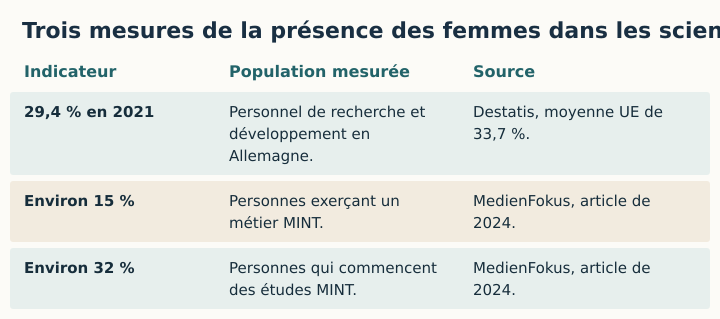

# Centrale-Supélec MP, MPI, PC, PSI et TSI — Allemand 2026 · Corrigé guidé

*Corrigé rédigé par IA, non officiel. Signalez toute erreur.*

**Rédaction** · GPT-6.2 Astra Ultra · vitesse non renseignée

**Révision (tour 1)** · GPT-6.2 Astra Ultra · vitesse non renseignée

## Présentation du sujet

Le concours accorde quatre heures pour une synthèse de 500 mots, titre inclus, avec une tolérance de 10 %. Les 4 pièces de cette option se trouvent aux pages physiques 6 à 9 du fascicule commun.

[Sujet officiel, début de l’option](https://www.concours-centrale-supelec.fr/sites/default/files/documents/G078-LV009.pdf#page=6)

## Construire la synthèse

Le Nobel de chimie pour 1944 est décerné en 1945. Le travail théorique de Meitner et Frisch est postérieur à la mise en évidence expérimentale de Hahn et Straßmann. Cette chronologie permet de restituer la controverse sans présenter les quatre personnes comme coauteurs d’un même article.

Distinguer deux mécanismes dans *Der Spiegel*. L’effacement du travail des femmes et l’avantage cumulatif des savants déjà célèbres se renforcent lorsque Wikipédia exige des références qui les citent. L’atelier d’écriture agit sur la mémoire publique. La bourse de stages modifie l’accès à un métier. Les relier explique pourquoi le dossier s’intéresse à la fois au prix Nobel et aux photographies choisies pour une petite annonce.

Lire les bases des pourcentages. Le graphique publié en 2025 donne pour 2021 la part des femmes parmi les personnes en recherche et développement. Les deux autres chiffres concernent respectivement les métiers MINT et les débuts d’études MINT.

La barre de l’Allemagne se situe 4,3 points sous celle de l’UE-27. Ce sont des points de pourcentage. Le graphique porte sur 2021 et signale l’absence de données pour le Danemark.

## Wer in der Wissenschaft sichtbar wird

Warum sind Frauen in Forschung und Technik noch immer seltener vertreten und warum erhalten selbst erfolgreiche Wissenschaftlerinnen weniger Anerkennung? Birgit Kolboske untersucht diese Fragen am Beispiel Lise Meitners, während Annick Eimer die Darstellung von Forscherinnen auf Wikipedia verfolgt. Ein Bericht von MedienFokus BW über die Vermittlung von Praktika und ein europäischer Vergleich des Statistischen Bundesamtes zeigen, welche Bedeutung der Zugang zu diesen Berufen neben der Anerkennung bereits erbrachter Leistungen hat.

Wie aus gemeinsamer Forschung der Ruhm eines Einzelnen entsteht, lässt sich an der Geschichte der Kernspaltung beobachten. Meitner hatte jahrelang mit Otto Hahn und Fritz Straßmann gearbeitet, bevor sie vor der nationalsozialistischen Verfolgung nach Schweden fliehen musste. Hahn und Straßmann gelang der experimentelle Nachweis, Meitner und Otto Robert Frisch lieferten die physikalische Erklärung. Den Nobelpreis für Chemie erhielt 1945 rückwirkend für das Vorjahr allein Hahn. Laut Kolboske trug er zu einer Darstellung bei, in der die Chemie den ganzen Erfolg für sich beanspruchte und Meitners erzwungene Abwesenheit als Argument gegen ihre Beteiligung galt. Dass sie insgesamt 48 Mal nominiert wurde, macht die Gleichsetzung von Auszeichnung und wissenschaftlicher Leistung besonders fragwürdig.

Die ungleiche Verteilung von Anerkennung setzt sich in der öffentlichen Erinnerung fort. Eimer vergleicht die kurzen Auskünfte über Isabella Karle mit dem ausführlichen Eintrag über ihren ausgezeichneten Ehemann. Wo der Beitrag einer Frau einem Mann zugerechnet wird, spricht die Wissenschaftsgeschichte vom Matilda-Effekt. Ein weiterer Mechanismus verstärkt diese Ungleichheit. Bereits bekannte Experten werden häufiger um Auskunft gebeten. Gerade solche Erwähnungen in unabhängigen Quellen brauchen wiederum diejenigen, die einen Wikipedia-Eintrag begründen möchten. Die Schreibwerkstatt der Biologin Maryam Zaringhalam setzt an dieser Stelle an. Teilnehmerinnen ergänzen etwa fehlende Auszeichnungen. Sie können die Lücken in der vorhergehenden Berichterstattung jedoch schwer allein schließen.

Die Destatis-Grafik zeigt, dass es zugleich um die tatsächliche Zusammensetzung der Forschung geht. Im Jahr 2021 waren in Deutschland 29,4 Prozent der in Forschung und Entwicklung Tätigen Frauen, gegenüber 33,7 Prozent im Durchschnitt der Europäischen Union. Der Abstand beträgt 4,3 Prozentpunkte. Für Dänemark fehlen im Schaubild die Daten. Die von MedienFokus genannten rund 15 Prozent beziehen sich auf die Beschäftigten in MINT-Berufen, die rund 32 Prozent auf Studienanfängerinnen und Studienanfänger in diesen Fächern. Die Zahlen betreffen also unterschiedliche Gruppen. Das Bild des einsamen Programmierers kann Schülerinnen bereits abschrecken, bevor sich überhaupt die Frage einer wissenschaftlichen Auszeichnung stellt.

Hier setzt die von MINTvernetzt gemeinsam mit Unternehmen getragene Initiative an. Über eine Praktikumsbörse können Jugendliche erleben, welche technischen Aufgaben es etwa in Filmstudios oder in der Spieleentwicklung gibt. Weibliche Vorbilder und eine ansprechende Ausschreibung sollen Mädchen erreichen, ohne Jungen auszuschließen. Für die beteiligten Betriebe bietet sich damit auch eine Antwort auf den Fachkräftemangel. Während die Schreibwerkstatt Leistungen nachträglich sichtbar macht, eröffnet ein Praktikum die Möglichkeit, sich eine künftige Tätigkeit überhaupt vorzustellen. Beide Ansätze verändern somit die Bedingungen, unter denen die nächste Generation entscheidet, wem sie Forschung zutraut und welche Beiträge sie im Gedächtnis behält.

*476 Wörter, einschließlich Titel.*
