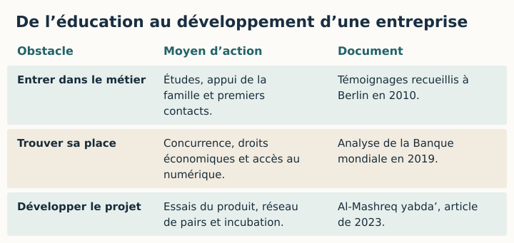

# Centrale-Supélec MP, MPI, PC, PSI et TSI — Arabe 2026 · Corrigé guidé

*Corrigé rédigé par IA, non officiel. Signalez toute erreur.*

**Rédaction** · GPT-6.2 Astra Ultra · vitesse non renseignée

## Présentation du sujet

Le concours accorde quatre heures pour une synthèse de 500 mots, titre inclus, avec une tolérance de 10 %. Les 3 pièces de cette option se trouvent aux pages physiques 10 à 12 du fascicule commun.

[Sujet officiel, début de l’option](https://www.concours-centrale-supelec.fr/sites/default/files/documents/G078-LV009.pdf#page=10)

## Construire la synthèse

La participation au marché du travail et l’activité entrepreneuriale sont deux indicateurs différents. L’écart supérieur à 40 % que cite le troisième texte concerne l’entrepreneuriat dans la région Moyen-Orient–Afrique du Nord. La comparaison du niveau scolaire et de la participation à l’emploi vient du premier texte.

Dater les témoignages avant de les rapprocher. Les propos de la participante saoudienne décrivent sa situation au moment du forum de 2010. L’article de 2019 mentionne des réformes ultérieures. Les citer au présent sans date créerait une contradiction artificielle.

Croiser les trois échelles. Le soutien familial facilite l’entrée dans le métier, les règles de concurrence conditionnent le développement des entreprises et l’incubateur aide à mettre au point un produit. Un exemple précis à chaque échelle rend inutile l’énumération de toutes les institutions.

## من التفوق الدراسي إلى الاستقلال الاقتصادي للمرأة العربية

تتقدم الشابات في عدد من البلدان العربية على الشبان في التحصيل الدراسي، بينما تظل مشاركتهن في سوق العمل من أدنى النسب في العالم. ينطلق فريد بلحاج ورباح أرزقي من هذه المفارقة في مقال نشرته مجموعة البنك الدولي سنة 2019. أما تقرير هاني غانم عن لقاء سيدات أعمال في برلين سنة 2010 فيبين، من خلال تجارب شخصية، مدى اختلاف شروط البداية بين بلد وآخر. ويعرض مقال منصة المشرق يبدأ سنة 2023 بعض المبادرات التي تحاول تحويل الكفاءة العلمية إلى مشروعات قادرة على الاستمرار.

يتضح أولا أن الشهادة، مع ما تمنحه من معرفة، لا تكفل لصاحبتها الحصول على رأس المال أو حرية التنقل. يرى كاتبا البنك الدولي أن بعض القواعد المنظمة للميراث تحد من قدرة النساء على تمويل أعمالهن، وأن تطبيق الحقوق في المناطق الأقل حظا يقتضي مواجهة تحيزات اجتماعية أيضا. وتبرز شهادات ملتقى برلين أهمية هذه المسافة بين ما يسمح به القانون وما تستطيع المرأة القيام به فعلا. فالأردنية ريم بدران تربط انطلاقتها بالتعليم العالي وبحرص أسرتها على تعليم البنات والبنين على قدم المساواة. وترى الإماراتية مريم المرشدي أن جيلا نشأ في ظروف مختلفة أصبح يساند تعلم النساء وعملهن. أما السعودية داليا راحيمي فتصف في حديثها آنذاك قيودا أشد وتؤكد أن مساندة أسرتها هي التي أتاحت لها دخول عالم الأعمال.

غير أن تعميم النجاح لا يمكن أن يتوقف على حظ كل امرأة في الحصول على هذا السند. يشدد بلحاج وأرزقي على ضرورة فتح الأسواق أمام الشركات الجديدة. فالامتيازات التي تستفيد منها مؤسسات قائمة، عامة كانت أم خاصة، تعيق الابتكار وتقلل فرص العمل المتاحة للخريجات. وقد تستطيع هيئات رقابية مستقلة الحد من المحاباة. ويذكر تقرير برلين من جهة أخرى ظهور مؤسسات مصرفية تمول أنشطة سيدات الأعمال. وهكذا يتطلب الانتقال من مشروع فردي إلى قوة اقتصادية إتاحة الائتمان وضمان إمكان المنافسة بعد تأسيس الشركة.

وتوفر التكنولوجيا فرصا تربط هذه المستويات بعضها ببعض. فتوسيع الإنترنت السريع خارج المدن الكبرى يتيح التعلم والعمل المرن والوصول إلى خدمات التمويل، بشرط أن تتمكن الشابات من استعمال الشبكة استعمالا منتجا. وفي قطاع الصحة الرقمية مثلا يساعد برنامج تسريع الأعمال الذي يعرضه مقال المشرق يبدأ مؤسسات الشركات على اختبار المنتجات وتكييفها مع السوق وتحسين نماذج العمل. وتتيح الحاضنات الافتراضية التواصل مع صاحبات تجربة سابقة، وتوجه المنصة اهتمامها أيضا إلى النازحين والأقليات الذين تضيق أمامهم فرص المشاركة الاقتصادية.

وتكشف التقديرات التي ينقلها المقال الأخير كلفة استمرار الإقصاء. فالفجوة بين الجنسين في ريادة الأعمال تجاوزت أربعين في المائة بحسب التقرير المشار إليه لعام 2019، في حين تتصل الخسائر الاقتصادية المقدرة بحرمان النساء من فرص الوصول إلى الوظائف والأسواق. لذلك تجمع الوثائق بين مكسبين مختلفين. فنجاح صاحبة المشروع يعني لها استقلالا أوسع، ويعني للمجتمع فرص عمل وأفكارا ومهارات كان سيحرم منها. وتظل المبادرات المحلية، على أهميتها في مرافقة البدايات، مرتبطة بإصلاحات أعم تضمن الحقوق وتفتح باب التمويل وتوصل البنية الرقمية إلى من بقين حتى الآن على هامش النشاط الاقتصادي.

*455 mots, titre inclus.*
