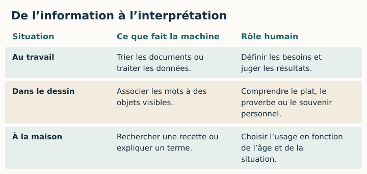

# Centrale-Supélec MP, MPI, PC, PSI et TSI — Chinois 2026 · Corrigé guidé

*Corrigé rédigé par IA, non officiel. Signalez toute erreur.*

**Rédaction** · GPT-6.2 Astra Ultra · vitesse non renseignée

## Présentation du sujet

Le concours accorde quatre heures pour une synthèse de 500 caractères chinois, titre inclus, avec une tolérance de 10 %. Les 10 pièces de cette option se trouvent aux pages physiques 30 à 33 du fascicule commun.

[Sujet officiel, début de l’option](https://www.concours-centrale-supelec.fr/sites/default/files/documents/G078-LV009.pdf#page=30)

## Construire la synthèse

Compter le titre dans la réponse. Le décompte annoncé porte sur les caractères sinographiques, avec les signes de ponctuation exclus. Garder une marge par rapport aux deux bornes de la consigne.

Les dessins de cuisine reposent sur des mots pris au pied de la lettre. Le panneau sur le proverbe ne suffit pas à exprimer qu’il faut revenir sur une erreur. Dans le récit familial, l’appareil explique correctement un autre terme. Le rapprochement de ces deux situations donne une réponse nuancée à la question du remplacement de l’humain.

Les éléments visuels ont des fonctions différentes. Les signes réunis au-dessus d’une main condensent les usages de la technologie, les dessins amusants matérialisent ses erreurs de compréhension et l’image finale associe robot et vieillissement. La grand-mère du témoignage utilise, elle, un assistant sur son téléphone.

## 人工智能走进日常生活以后

人工智能既能处理复杂任务，也能让老人和孩子在家里得到帮助。不过，机器能完成一项工作，并不等于它理解人的经历和想法。人民网和搜狐的三篇文章及配图从工作、绘画和家庭生活三个角度说明这个区别。

在工厂里，机器可以代替工人进行精密操作；在办公室里，它能整理文件。医生可以借助它检查疾病，教师也能用它了解学生的需要。一张图把许多功能的标志放在人的手掌上方，强调技术仍是供人使用的工具。文章认为，面对工作的变化，社会还须考虑谁能够分享技术进步的好处，以及怎样保护每个人的利益。

画画的例子说明了这种工具的局限。机器把童年回忆里的玩具狗画成了怪物，用钞票和粗项链表现不同国家的富人，又把可乐鸡翅画成带商标的公鸡，让烤鸭变成戴厨师帽的鸭子。画中虽然有悬崖和马，却难以传达及时改正错误的意思。这些图像能引人发笑，也能启发艺术家，但决定一幅画有没有表达原意的仍然是人。

同样的技术进入家庭，又有不同的效果。七十多岁的奶奶主动学习用手机助手找菜谱，孩子丢了平板电脑以后，用家长的手机听助手解释“伯乐”的含义。小屏幕给上课带来的不便并没有因此消失。配图中机器人和老人相对而坐，呼应了技术能够陪伴不同年龄使用者的主题。由此可见，它的价值取决于实际需要，也取决于人能否判断答案并赋予结果意义。

*499 caractères chinois, titre inclus.*
