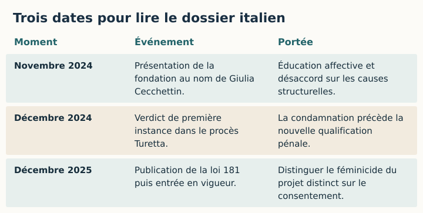

# Centrale-Supélec MP, MPI, PC, PSI et TSI — Italien 2026 · Corrigé brut

*Corrigé rédigé par IA, non officiel. Signalez toute erreur.*

**Rédaction** · GPT-6.2 Astra Ultra · vitesse non renseignée

## Dare un nome al femminicidio e prevenirlo nella vita quotidiana

Nel novembre del 2024 la nascita di una fondazione intitolata a Giulia Cecchettin riporta al centro del dibattito italiano le responsabilità collettive nella violenza contro le donne. Un anno dopo, il Parlamento riconosce il femminicidio come reato autonomo. Gli articoli di la Repubblica, del Corriere della Sera e di Wired, insieme al ritratto pubblicato da Book to Book e alla pagina della Gazzetta Ufficiale, permettono di distinguere ciò che cambia nella risposta penale da ciò che resta da cambiare nelle relazioni.

Il caso di Giulia mostra anzitutto che la gravità di un delitto poteva essere sanzionata già prima della riforma. Come ricorda Elena Tebano nel dicembre 2024, la Corte d’assise di Venezia condanna in primo grado all’ergastolo l’ex fidanzato Filippo Turetta per omicidio aggravato dalla premeditazione e altri reati, pur escludendo alcune aggravanti richieste. Gino Cecchettin non entra nel merito della pena. Nessuna decisione dei giudici può restituirgli la figlia o cancellare quanto è accaduto. Per la giornalista, le sue parole invitano a riconoscere e contrastare i rapporti di possesso prima che una donna perda la vita.

La nuova norma affronta tale problema sul piano della qualificazione giuridica. Elena Betti spiega che l’articolo 577-bis riguarda l’uccisione di una donna determinata, tra l’altro, da odio o discriminazione, dal desiderio di dominarla oppure di punirne le scelte e limitarne la libertà. Nominare questi motivi rende pubblicamente riconoscibile la matrice di genere del delitto. All’approvazione unanime della Camera il 25 novembre 2025 segue la pubblicazione della legge numero 181 nella Gazzetta Ufficiale del 2 dicembre, con entrata in vigore il 17 dicembre. Diverso è lo stato della proposta sul consenso in materia di violenza sessuale, che, al momento dell’articolo di Wired, attende ancora il voto del Senato.

Sul terreno della prevenzione il consenso politico appare meno saldo. Alla presentazione della fondazione, racconta la Repubblica, il ministro Valditara critica come ideologica la lotta al patriarcato e collega parte della violenza sessuale all’immigrazione irregolare. Le sue dichiarazioni incontrano obiezioni anche perché il caso di Giulia riguarda la violenza esercitata da un ex compagno. La ministra Roccella richiama invece la storica asimmetria di potere tra uomini e donne. Elena Cecchettin, sorella di Giulia, chiede perché debbano essere le famiglie delle vittime ad avviare iniziative per il futuro.

Il ritratto sorridente di Giulia diffuso da Book to Book accosta alla sua immagine la scelta del padre di far crescere l’amore. La fondazione traduce quella scelta in progetti di educazione affettiva. Il richiamo di Tebano al lavoro quotidiano nelle famiglie, nelle scuole e nei luoghi di lavoro raggiunge così la conclusione di Betti: il riconoscimento penale acquista efficacia protettiva quando si accompagna a servizi e interventi capaci di mettere in discussione il controllo sulla vita delle donne prima del delitto.

*462 mots, titre inclus.*

[Sujet officiel](https://www.concours-centrale-supelec.fr/sites/default/files/documents/G078-LV009.pdf#page=17)
