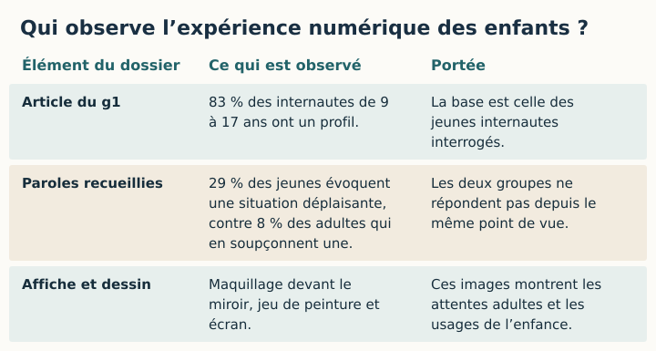

# Centrale-Supélec MP, MPI, PC, PSI et TSI — Portugais 2026 · Corrigé guidé

*Corrigé rédigé par IA, non officiel. Signalez toute erreur.*

**Rédaction** · GPT-6.2 Astra Ultra · vitesse non renseignée

## Présentation du sujet

Le concours accorde quatre heures pour une synthèse de 500 mots, titre inclus, avec une tolérance de 10 %. Les 5 pièces de cette option se trouvent aux pages physiques 21 à 25 du fascicule commun.

[Sujet officiel, début de l’option](https://www.concours-centrale-supelec.fr/sites/default/files/documents/G078-LV009.pdf#page=21)

## Construire la synthèse

L’annonce chiffrée du sujet indique quatre documents mais la liste et le fascicule en présentent cinq. La réponse traite l’affiche de Goiás, l’enquête du g1, le reportage de la BBC, le compte rendu parlementaire et la bande dessinée.

L’enquête s’applique aux internautes de neuf à dix-sept ans. Le chiffre des adultes exprime ce qu’ils croient savoir sur un mineur sous leur responsabilité. Il se compare aux déclarations des jeunes avec cette différence de point de vue.

Lis les trois cases de la bande dessinée. La répétition puis la réduction de la formule font aussi entendre la nostalgie des générations successives. Le trait d’humour croise la critique de la pression adulte dans la campagne. Le texte parlementaire rapporte un projet transmis pour sanction présidentielle à la date de l’article.

## O tempo da infância diante das expectativas adultas e das telas

Uma menina pode imaginar a profissão que terá no futuro sem ter de exercê-la hoje. Essa distinção organiza a campanha do governo de Goiás e ajuda a relacionar a pesquisa apresentada pelo g1, a reportagem da BBC News Brasil, o texto da Agência Senado e a tira de Willian Leite. Em conjunto, os documentos perguntam como preservar o tempo de brincar, aprender e amadurecer quando famílias, plataformas e públicos atribuem às crianças expectativas de adultos.

A reportagem de André Biernath mostra que a adultização pode começar longe da internet. Cuidar dos irmãos como se fosse responsável por eles ou ter de sustentar a casa impõe obrigações desproporcionais. A cobrança por resultados escolares ou esportivos também pode ignorar o estágio de desenvolvimento da criança. Confundir precocidade com maturidade leva alguns pais a se orgulharem quando os filhos abandonam os brinquedos. A campanha goiana explora justamente essa fronteira: a menina segura um pincel e manifesta vontade de ser maquiadora, mas reserva essa atividade para quando crescer. O anúncio permite reconhecer o desejo da própria criança e, ao mesmo tempo, questionar a pressa dos adultos.

As redes ampliam a exposição a modelos de comportamento, consumo e popularidade. Segundo a pesquisa de 2024 citada por Victor Hugo Silva, 83% dos internautas brasileiros de nove a dezessete anos têm perfil em plataformas sociais. Mesmo entre os que têm nove ou dez anos, a proporção chega a 60%, apesar dos limites de idade anunciados pelas principais empresas. Há ainda uma distância entre as percepções das gerações: 29% dos jovens relatam situações desagradáveis na internet, enquanto apenas 8% dos responsáveis acreditam que o menor tenha passado por alguma. A busca por aprovação pública pode acentuar a dificuldade de se desligar, sobretudo quando ainda estão se formando as capacidades de controlar impulsos.

A tira de 2012 já representava uma criança absorvida por uma tela. Entre o menino de outra época e o usuário de rede social, porém, aparece também uma criança coberta de tinta. A repetição das queixas sobre como as crianças mudaram convida a desconfiar da nostalgia dos adultos. Permite igualmente perceber o que pode desaparecer quando a brincadeira deixa de ter espaço.

O projeto aprovado pelo Senado em agosto de 2025, ainda dependente de sanção presidencial na data da reportagem, distribui responsabilidades entre empresas e famílias. Prevê mecanismos de verificação de idade, supervisão dos responsáveis e retirada de material abusivo, além de restringir a publicidade direcionada por perfis. Essas medidas respondem a riscos que uma família dificilmente controla sozinha. A orientação dos especialistas ouvidos pela BBC alcança também o cotidiano: observar mudanças de comportamento e conversar sobre experiências que os responsáveis muitas vezes desconhecem. Sob essas perspectivas, proteger a infância exige tanto limites para a exploração comercial quanto condições para que as crianças façam descobertas no seu próprio ritmo.

*474 mots, titre inclus.*
