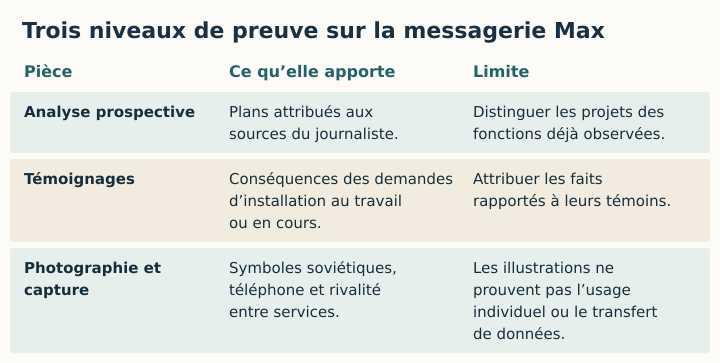

# Centrale-Supélec MP, MPI, PC, PSI et TSI — Russe 2026 · Corrigé brut

*Corrigé rédigé par IA, non officiel. Signalez toute erreur.*

**Rédaction** · GPT-6.2 Astra Ultra · vitesse non renseignée

## Национальный мессенджер между удобством и принуждением

Российский национальный мессенджер оказывается в центре спора о границах государственного контроля над повседневной жизнью. В октябрьской публикации В. Панченко речь идет о планах объединить данные о гражданах. Августовский материал «Сибирь.Реалии» и ноябрьская статья О. Ролдугина показывают, как переход на новую платформу воспринимают люди, для которых от выбора средства связи уже зависят учеба, работа или отношения с близкими. Два изображения переводят этот спор на язык повседневных предметов и знакомых символов.

В официальном представлении единая платформа должна упростить доступ к услугам и обеспечить независимость цифровой инфраструктуры страны. Для пользователя возможность получать сообщения и оформлять документы через одно приложение действительно может означать экономию времени. Однако тот же принцип объединения функций меняет положение человека, который отказывается присоединиться. В материале «Сибирь.Реалии» пример китайской системы WeChat позволяет представить, каким препятствием становится отсутствие учетной записи, если без нее трудно платить, пользоваться транспортом или предъявлять билет. Автор предлагает сравнение с возможным развитием событий в России, а не описание уже достигнутого там результата.

Панченко, ссылаясь на свои источники, рассматривает перспективу объединения сведений из разных ведомств и предупреждает о политических последствиях такого решения. Разрозненные следы покупок, общения и административных процедур приобретают иной смысл, когда их можно отнести к одному человеку. На фотографии Андрея Луковского молодой человек в шапке с советской символикой держит перед собой современный телефон. Соседство этих деталей побуждает сопоставить старые образы государственной принадлежности с нынешними средствами коммуникации. Человек здесь выступает одновременно пользователем технического устройства и участником публичной сцены. По снимку, однако, невозможно установить, какую программу использует человек или как он сам относится к контролю.

В свидетельствах, собранных журналистами, на первый план выходит разница между формальным выбором и его реальной ценой. Учителя сообщают о требованиях перевести рабочие чаты, а сотрудник торговой сети связывает потерю работы со своим отказом. Для пенсионерки важнее всего сохранить возможность общаться с детьми за границей. Ролдугин описывает также жалобы студентов и преподавателей после ноябрьского письма министерства о внедрении Max в вузах. Отчеты о числе зарегистрированных участников могут показать быстрый рост аудитории, но ничего не говорят о том, сколько людей выбрали сервис добровольно.

На изображении из видео Passky логотипы Max и Telegram противопоставлены как соперники. Между тем спор касается большего, чем сравнительные достоинства двух программ. Правозащитный проект собирает сообщения о давлении и добивается публичного рассмотрения таких случаев. Если доступ к образованию или к рабочим указаниям ставится в зависимость от установки одного приложения, коллективное решение учреждения ограничивает личный выбор. Поэтому обещание удобства можно оценить лишь с учетом того, кто получает доступ к сведениям, какие альтернативы действительно остаются у граждан и могут ли они оспорить предъявленные им требования.

*416 mots, titre inclus.*

[Sujet officiel](https://www.concours-centrale-supelec.fr/sites/default/files/documents/G078-LV009.pdf#page=26)
