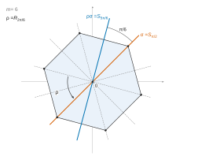
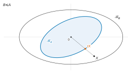
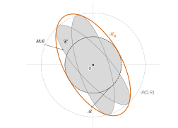
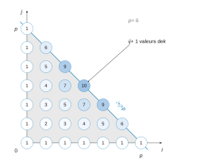

# Centrale-Supélec MP-MPI — Mathématiques 1 2026 · Corrigé brut

*Corrigé rédigé par IA, non officiel. Signalez toute erreur.*

**Sur quelques sous-groupes de $\mathrm{GL}_n(\mathbb{R})$.** Épreuve de 4 heures, calculatrice autorisée. Trois parties indépendantes. Notations : $E_{k\ell}$ désigne la base canonique de $\mathcal{M}_n(\mathbb{R})$ et $\|M\|=\sqrt{\operatorname{tr}(M^\top M)}$ la norme euclidienne canonique de $\mathcal{M}_n(\mathbb{R})$ (toutes les normes y sont équivalentes).

Trois énoncés ne sont pas exacts tels quels : **Q6.a** (il manque l'hypothèse $2\pi\in\theta\mathbb{Z}+\theta'\mathbb{Z}$), **Q38** (la majoration $|z|\leqslant|ij|$ est fausse en général) et **Q39** (il faut que $k$ soit du signe de $ij$). Chaque fois, un contre-exemple est donné et la conclusion utile pour la suite est démontrée.

---

## Partie A — Sous-groupes finis de $\mathrm{O}_n(\mathbb{R})$

### I — Généralités

#### Q1

Supposons $G$ fini, de cardinal $N\geqslant 1$.

*Trace.* $\operatorname{tr}G$ est l'image de l'ensemble fini $G$ par l'application $\operatorname{tr}$, donc $|\operatorname{tr}G|\leqslant N$ : **$\operatorname{tr}G$ est fini.**

*Exposant.* Soit $x\in G$. Le sous-groupe $\langle x\rangle\subset G$ est fini, donc $x$ est d'ordre fini $d_x=|\langle x\rangle|$.

L'ordre d'un élément d'un groupe fini divise le cardinal du groupe : $d_x\mid N$. En écrivant $N=d_xq$, on obtient

$$x^N=(x^{d_x})^q=I_n.$$

Avec $m=N\in\mathbb{N}^*$, indépendant de $x$, on a $x^m=I_n$ pour tout $x\in G$ : **$G$ est d'exposant fini.**

(Sans ce théorème, $m=\operatorname{ppcm}(d_x)_{x\in G}$, ou $m=N!$, convient aussi, puisque chaque $d_x\leqslant N$.)

#### Q2

Pour $t\in\mathbb{R}$, posons $M_t=I_n+tE_{12}$ (ce qui a un sens car $n\geqslant2$). Comme $E_{12}^2=0$,

$$M_tM_s=M_{t+s}.$$

Donc $M_0=I_n$ et l'ensemble $G=\{M_t\,;\,t\in\mathbb{R}\}$ est stable par produit. De plus $M_t^{-1}=M_{-t}\in G$ : $G$ est un sous-groupe de $\mathrm{GL}_n(\mathbb{R})$.

L'application $t\mapsto M_t$ est injective (coefficient $(1,2)$), donc $G$ est infini. Enfin $M_t$ est triangulaire à diagonale unité, donc

$$\boxed{G=\{I_n+tE_{12}\,;\,t\in\mathbb{R}\}\ \text{est infini et}\ \operatorname{tr}G=\{n\}.}$$

#### Q3

Soit $G$ l'ensemble des applications de $\mathbb{N}$ dans $\mathbb{Z}/2\mathbb{Z}$, muni de l'addition point par point. C'est un groupe commutatif (axiomes vérifiés point par point, neutre la fonction nulle).

Les fonctions $\delta_k$ (valant $\bar1$ en $k$, $\bar0$ ailleurs) sont deux à deux distinctes, donc $G$ est infini.

Pour tout $f\in G$, $f+f=0$. Donc

$$\boxed{G=(\mathbb{Z}/2\mathbb{Z})^{\mathbb{N}}\ \text{est infini et d'exposant }2.}$$

(Variante : les parties de $\mathbb{N}$ munies de la différence symétrique.)

### II — Cas particulier : les sous-groupes finis de $\mathrm{O}_2(\mathbb{R})$

#### Q4

*Existence.* Soit $A=\begin{pmatrix}a&c\\b&d\end{pmatrix}\in\mathrm{SO}_2(\mathbb{R})$. Les colonnes $C_1=(a,b)$ et $C_2=(c,d)$ forment une famille orthonormée de $\mathbb{R}^2$.

Comme $a^2+b^2=1$, il existe un unique $\theta\in[0,2\pi[$ tel que $a=\cos\theta$ et $b=\sin\theta$.

Le vecteur $C_2$ est unitaire et orthogonal à $C_1$. Or $C_1^\perp=\mathbb{R}(-b,a)$ avec $(-b,a)$ unitaire, donc $C_2=\lambda(-b,a)$ avec $\lambda=\pm1$. Enfin

$$\begin{aligned}1=\det A&=ad-bc\\&=\lambda(a^2+b^2)\\&=\lambda,\end{aligned}$$

donc $A=R_\theta$.

*Unicité.* Si $R_\theta=R_{\theta'}$ avec $\theta,\theta'\in[0,2\pi[$, alors $\cos\theta=\cos\theta'$ et $\sin\theta=\sin\theta'$.

Donc $\theta-\theta'\in2\pi\mathbb{Z}$ ; comme $|\theta-\theta'|<2\pi$, $\theta=\theta'$.

**Tout $A\in\mathrm{SO}_2(\mathbb{R})$ s'écrit de façon unique $R_\theta$ avec $\theta\in[0,2\pi[$.**

#### Q5

**a)** Par récurrence, $R_\theta^k=R_{k\theta}$ pour $k\in\mathbb{N}$. Comme $R_\theta^{-1}=R_{-\theta}$, on a $R_\theta^k=R_{k\theta}$ pour $k\in\mathbb{Z}$.

L'ensemble $H=\{R_{k\theta}\,;\,k\in\mathbb{Z}\}$ contient $I_2$ ; il est stable par inverse, et par produit car

$$R_{k\theta}R_{\ell\theta}=R_{(k+\ell)\theta}.$$

C'est un sous-groupe contenant $R_\theta$, donc $G\subset H$. Inversement $R_{k\theta}=R_\theta^k\in G$. **Donc $G=\{R_{k\theta}\,;\,k\in\mathbb{Z}\}$.**

**b)** Pour $\theta=2\pi/m$ :

$$\begin{aligned}R_{k\theta}=R_{\ell\theta}&\iff\frac{2\pi(k-\ell)}{m}\in2\pi\mathbb{Z}\\&\iff m\mid k-\ell.\end{aligned}$$

L'application $\bar k\mapsto R_{k\theta}$ de $\mathbb{Z}/m\mathbb{Z}$ dans $G$ est donc bien définie, injective, et surjective par a) :

$$\boxed{|G|=m.}$$

**c)** Supposons $\theta/\pi=a/b$ avec $a\in\mathbb{Z}$ et $b\in\mathbb{N}^*$. Alors $2b\theta=2a\pi$, donc $R_\theta^{2b}=I_2$.

Par division euclidienne $k=2bq+r$ avec $0\leqslant r<2b$, on a $R_{k\theta}=R_{r\theta}$. Ainsi $|G|\leqslant2b$ : $G$ est fini.

Réciproquement, si $G$ est fini, $k\mapsto R_{k\theta}$ n'est pas injective sur $\mathbb{Z}$ : il existe $k<\ell$ avec $R_{(\ell-k)\theta}=I_2$.

Donc $(\ell-k)\theta=2s\pi$ avec $s\in\mathbb{Z}$, et $\theta/\pi=2s/(\ell-k)\in\mathbb{Q}$.

$$\boxed{G\ \text{fini}\iff\theta/\pi\in\mathbb{Q}.}$$

**d)** Si $x^m=I_2$ pour tout $x\in G$, alors $R_{m\theta}=I_2$. Donc $m\theta=2s\pi$ et $\theta/\pi=2s/m\in\mathbb{Q}$ : **$G$ est fini** par c).

**e)** Supposons $\operatorname{tr}G$ fini. Tout élément de $G$ s'écrit de façon unique $R_\varphi$ avec $\varphi\in[0,2\pi[$ (Q4), de trace $2\cos\varphi$.

Pour $t\in\operatorname{tr}G$, l'équation $\cos\varphi=t/2$ a au plus deux solutions dans $[0,2\pi[$.

La fibre $F_t=\{A\in G\,;\,\operatorname{tr}A=t\}$ a donc au plus deux éléments. Comme $G$ est la réunion disjointe des $F_t$,

$$|G|\leqslant2\,|\operatorname{tr}G|<+\infty:\quad\textbf{G est fini.}$$

#### Q6

**a)** Posons $\Lambda=\theta\mathbb{Z}+\theta'\mathbb{Z}$, sous-groupe de $(\mathbb{R},+)$. Les rotations commutent et

$$R_\theta^aR_{\theta'}^b=R_{a\theta+b\theta'}.$$

L'ensemble $\{R_\varphi\,;\,\varphi\in\Lambda\}$ est un sous-groupe (il contient $R_0$, il est stable par produit et inverse) qui contient $R_\theta$ et $R_{\theta'}$.

Tout sous-groupe contenant $R_\theta$ et $R_{\theta'}$ le contient. Donc $G=\{R_\varphi\,;\,\varphi\in\Lambda\}$.

Posons $\Lambda'=\Lambda+2\pi\mathbb{Z}$. Comme $R_{\varphi+2k\pi}=R_\varphi$, on a aussi $G=\{R_\varphi\,;\,\varphi\in\Lambda'\}$.

L'application $u:\Lambda'\cap[0,2\pi[\,\to G$, $\varphi\mapsto R_\varphi$, est injective (unicité de Q4). Elle est surjective : pour $\varphi\in\Lambda'$, le réel

$$r=\varphi-2\pi\lfloor\varphi/2\pi\rfloor$$

appartient à $\Lambda'\cap[0,2\pi[$ et vérifie $R_r=R_\varphi$. Donc

$$\boxed{|G|=\bigl|(\theta\mathbb{Z}+\theta'\mathbb{Z}+2\pi\mathbb{Z})\cap[0,2\pi[\bigr|}$$

et **lorsque $2\pi\in\theta\mathbb{Z}+\theta'\mathbb{Z}$**, $\Lambda'=\Lambda$, ce qui donne la formule de l'énoncé $|G|=|(\theta\mathbb{Z}+\theta'\mathbb{Z})\cap[0,2\pi[|$.

*L'hypothèse ne peut pas être omise.* Pour $\theta=\theta'=4\pi/3$, l'ensemble $\Lambda\cap[0,2\pi[\,=\{0,4\pi/3\}$ a deux éléments, alors que $G=\langle R_{4\pi/3}\rangle=\{I_2,R_{2\pi/3},R_{4\pi/3}\}$ en a trois.

De même, pour $\theta=\theta'=1$, $\Lambda\cap[0,2\pi[$ a sept éléments mais $G$ est infini (Q5.c, $1/\pi\notin\mathbb{Q}$).

La formule de l'énoncé est donc à lire sous l'hypothèse $2\pi\in\Lambda$, satisfaite en b) et c).

**b)** Soient $p,q$ entiers non nuls premiers entre eux. Comme $R_{-\pi/p}=R_{\pi/p}^{-1}$ engendre le même groupe, on peut supposer $p,q\geqslant1$ (dans le cas général, remplacer $p,q$ par $|p|,|q|$).

Par Bézout, $p\mathbb{Z}+q\mathbb{Z}=\mathbb{Z}$, donc

$$\begin{aligned}\Lambda&=\frac{\pi}{p}\mathbb{Z}+\frac{\pi}{q}\mathbb{Z}\\&=\frac{\pi}{pq}(q\mathbb{Z}+p\mathbb{Z})\\&=\frac{\pi}{pq}\mathbb{Z}.\end{aligned}$$

En particulier $2\pi=2pq\cdot\frac{\pi}{pq}\in\Lambda$ et a) s'applique : $\Lambda\cap[0,2\pi[\,=\{k\pi/(pq)\,;\,0\leqslant k<2pq\}$, d'où

$$\boxed{\bigl|\langle R_{\pi/p},R_{\pi/q}\rangle\bigr|=2pq}$$

(et $2|pq|$ si l'on autorise des signes).

**c)** Soit $g=p\wedge q$ (avec $p,q\geqslant1$, quitte à changer les signes), et $p=gp'$, $q=gq'$, $p'\wedge q'=1$. Alors

$$\begin{aligned}\Lambda&=\frac{\pi}{gp'q'}(q'\mathbb{Z}+p'\mathbb{Z})\\&=\frac{\pi}{gp'q'}\mathbb{Z}\\&=\frac{\pi}{p\vee q}\mathbb{Z},\end{aligned}$$

qui contient $2\pi$. Par a),

$$\boxed{\bigl|\langle R_{\pi/p},R_{\pi/q}\rangle\bigr|=2\,(|p|\vee|q|)=\frac{2|pq|}{p\wedge q}.}$$

#### Q7

Soit $G$ un sous-groupe fini de $\mathrm{SO}_2(\mathbb{R})$. Par Q4, $G=\{R_\vartheta\,;\,\vartheta\in\Theta\}$, où $\Theta\subset[0,2\pi[$ est fini et contient $0$.

Si $\Theta=\{0\}$, $G=\langle I_2\rangle$. Sinon $\Theta\cap\,]0,2\pi[$ est fini non vide et admet un plus petit élément $\alpha$.

Soit $\vartheta\in\Theta$. Posons $k=\lfloor\vartheta/\alpha\rfloor$ et $r=\vartheta-k\alpha\in[0,\alpha[$. Alors

$$R_r=R_\vartheta R_\alpha^{-k}\in G$$

et $r\in[0,2\pi[$, donc $r\in\Theta$. Par minimalité de $\alpha$, $r=0$ et $R_\vartheta=R_\alpha^k$. Donc

$$\boxed{G=\langle R_\alpha\rangle\ \text{est monogène.}}$$

#### Q8

**a)** Posons $\rho=R_{2\pi/m}$, $\sigma=S_{\pi/2}$ et $\mathcal{C}=\langle\rho\rangle=\{R_{2k\pi/m}\,;\,0\leqslant k<m\}$, de cardinal $m$ (Q5.b).

Posons aussi $\mathcal{D}=\mathcal{C}\cup\mathcal{C}\sigma$, où $\mathcal{C}\sigma=\{S_{\pi/2+2k\pi/m}\}$ (car $R_\varphi S_{\pi/2}=S_{\varphi+\pi/2}$).

$\mathcal{D}$ est un sous-groupe. Il contient $I_2$. Soient $\varphi,\psi\in\frac{2\pi}{m}\mathbb{Z}$ et $\varphi',\psi'\in\frac{\pi}{2}+\frac{2\pi}{m}\mathbb{Z}$ ; les relations données donnent :

- $R_\varphi R_\psi=R_{\varphi+\psi}\in\mathcal{C}$ ;
- $R_\varphi S_{\psi'}=S_{\varphi+\psi'}\in\mathcal{C}\sigma$ ;
- $S_{\psi'}R_\varphi=S_{\psi'-\varphi}\in\mathcal{C}\sigma$ ;
- $S_{\varphi'}S_{\psi'}=R_{\varphi'-\psi'}\in\mathcal{C}$ ;
- enfin $R_\varphi^{-1}=R_{-\varphi}$ et $S_{\varphi'}^2=R_0=I_2$.

Le sous-groupe $\mathcal{D}$ contient $\rho$ et $\sigma$. Tout sous-groupe qui contient ces deux éléments contient $\mathcal{C}$ et $\mathcal{C}\sigma$.

Donc $\mathcal{D}_m=\mathcal{D}$.

Comme $\det R_\varphi=1$ et $\det S_\varphi=-1$, on a

$$\mathcal{D}_m\cap\mathrm{SO}_2(\mathbb{R})=\mathcal{C}=\langle R_{2\pi/m}\rangle$$

et $\mathcal{D}_m\setminus\mathrm{SO}_2(\mathbb{R})=\mathcal{C}\sigma$.

L'application $A\mapsto A\sigma$ est une bijection de $\mathcal{C}$ sur $\mathcal{C}\sigma$ (réciproque $B\mapsto B\sigma$, car $\sigma^2=I_2$). Donc

$$\boxed{|\mathcal{D}_m|=2m.}$$

**b)** Soit $G$ fini avec $G\not\subset\mathrm{SO}_2(\mathbb{R})$, et $H=G\cap\mathrm{SO}_2(\mathbb{R})$.

C'est un sous-groupe fini de $\mathrm{SO}_2(\mathbb{R})$, donc $H=\langle R_\alpha\rangle$ (Q7), de cardinal $m$.

L'ordre de $R_\alpha$ vaut $m$, donc $R_{m\alpha}=I_2$ et $\alpha\in\frac{2\pi}{m}\mathbb{Z}$.

Ainsi $H\subset\langle R_{2\pi/m}\rangle$, et ces groupes ont le même cardinal $m$ : $H=\mathcal{C}$.

Soit $\tau\in G\setminus\mathrm{SO}_2(\mathbb{R})$. On a $\det\tau=-1$ et, comme en Q4, $\tau=S_\beta$ pour un $\beta\in\mathbb{R}$ (première colonne $(\cos\beta,\sin\beta)$, seconde colonne unitaire orthogonale, signe fixé par le déterminant).

Le déterminant est un morphisme $G\to\{\pm1\}$ de noyau $H$.

Si $\det g=-1$, alors $g\tau\in H$ et $g=(g\tau)\tau$. Donc $G=H\sqcup H\tau$.

Posons $\gamma=\frac{\beta-\pi/2}{2}$ et $P=R_\gamma$. Alors

$$\begin{aligned}P\sigma P^{-1}&=R_\gamma S_{\pi/2}R_{-\gamma}\\&=S_{\gamma+\pi/2}R_{-\gamma}\\&=S_{2\gamma+\pi/2}\\&=S_\beta=\tau,\end{aligned}$$

et $P\mathcal{C}P^{-1}=\mathcal{C}=H$ (commutativité de $\mathrm{SO}_2(\mathbb{R})$). La conjugaison $\Phi:M\mapsto PMP^{-1}$ est un morphisme injectif de $\mathrm{GL}_2(\mathbb{R})$, et

$$\begin{aligned}\Phi(\mathcal{D}_m)&=\Phi(\mathcal{C})\cup\Phi(\mathcal{C})\Phi(\sigma)\\&=H\cup H\tau\\&=G.\end{aligned}$$

Donc

$$\boxed{G\simeq\mathcal{D}_m\ \text{avec}\ m=|G\cap\mathrm{SO}_2(\mathbb{R})|=|G|/2\ \text{(et même conjugué dans }\mathrm{O}_2(\mathbb{R})).}$$

### III — Une caractérisation des sous-groupes finis de $\mathrm{O}_n(\mathbb{R})$

#### Q9

**Théorème.** Pour toute $M\in\mathrm{O}_n(\mathbb{R})$, il existe $P\in\mathrm{O}_n(\mathbb{R})$ telle que

$$P^\top MP=\begin{pmatrix}I_p&&&&\\&-I_q&&&\\&&R_{\theta_1}&&\\&&&\ddots&\\&&&&R_{\theta_r}\end{pmatrix},$$

avec $p+q+2r=n$ et $\theta_i\in\,]0,\pi[$ (ou $\theta_i\in\mathbb{R}\setminus\pi\mathbb{Z}$).

Version géométrique : toute isométrie d'un espace euclidien admet, dans une base orthonormée convenable, une matrice de cette forme. En particulier $\operatorname{tr}M=p-q+2\sum_{i=1}^r\cos\theta_i$.

#### Q10

Soit $m\in\mathbb{N}^*$ tel que $M^m=I_n$ pour tout $M\in G$. Soit $M\in G$ ; avec les notations de Q9, la matrice $D=P^\top MP$ vérifie

$$D^m=P^\top M^mP=I_n.$$

Par blocs, $R_{\theta_i}^m=R_{m\theta_i}=I_2$, soit $\theta_i\in\frac{2\pi}{m}\mathbb{Z}$, et $\cos\theta_i\in C_m=\{\cos(2k\pi/m)\,;\,0\leqslant k<m\}$.

Par conséquent, $\operatorname{tr}M$ appartient à l'ensemble $T$ des réels

$$p-q+2\sum_{i=1}^rc_i,$$

où $p+q+2r=n$ et $c_1,\dots,c_r\in C_m$.

Cet ensemble est fini : au plus $(n+1)^2$ triplets $(p,q,r)$, et $m^r\leqslant m^n$ choix des $c_i$.

Comme $\operatorname{tr}G\subset T$, **$\operatorname{tr}G$ est fini.**

#### Q11

$\mathcal{F}=\mathrm{Vect}(G)$ est de dimension finie $d\leqslant n^2$. Les familles libres d'éléments de $G$ ont au plus $d$ éléments ; soit $(A_1,\dots,A_s)$ l'une d'elles, de cardinal maximal.

Soit $M\in G$. Si $M\notin\mathrm{Vect}(A_1,\dots,A_s)$, la famille $(A_1,\dots,A_s,M)$ serait libre et formée d'éléments de $G$, ce qui contredit la maximalité.

Donc $G\subset\mathrm{Vect}(A_i)$, puis $\mathcal{F}=\mathrm{Vect}(A_1,\dots,A_s)$.

**$(A_1,\dots,A_s)$ est une base de $\mathcal{F}$ formée d'éléments de $G$, et $s=d$.**

#### Q12

**a)** Chacune des $d$ matrices $A_i$ a $n^2$ coordonnées : $\boxed{C\in\mathcal{M}_{n^2,d}(\mathbb{R})}$ (la colonne $i$ contient les coordonnées de $A_i$).

**b)** La base canonique est orthonormée :

$$\begin{aligned}(E_{k\ell}|E_{k'\ell'})&=\operatorname{tr}(E_{\ell k}E_{k'\ell'})\\&=\delta_{kk'}\operatorname{tr}(E_{\ell\ell'})\\&=\delta_{kk'}\delta_{\ell\ell'}.\end{aligned}$$

Par bilinéarité, en notant $c_{\cdot i}$ la colonne $i$ de $C$,

$$\begin{aligned}(A_i|A_j)&=\sum_{k=1}^{n^2}c_{ki}c_{kj}\\&=(C^\top C)_{ij},\end{aligned}$$

donc

$$\boxed{B=C^\top C.}$$

**c)** Si $CX=0$, alors $C^\top CX=0$. Si $C^\top CX=0$, alors

$$0=X^\top C^\top CX=\|CX\|^2,$$

donc $CX=0$. Ainsi $\ker B=\ker C$ et, par le théorème du rang (les deux matrices ont $d$ colonnes), $\operatorname{rg}B=\operatorname{rg}C$.

Les colonnes de $C$ sont les coordonnées de la famille libre $(A_i)$, donc $\operatorname{rg}C=d$. **$B\in\mathcal{M}_d(\mathbb{R})$ est de rang $d$, donc inversible.**

#### Q13

Pour $i\in[\![1,d]\!]$, par linéarité,

$$\begin{aligned}(A_i|M)&=\sum_{j=1}^d(A_i|A_j)x_j\\&=(BX_M)_i.\end{aligned}$$

Donc $Y_M=BX_M$ et, $B$ étant inversible,

$$\boxed{X_M=B^{-1}Y_M.}$$

#### Q14

Soit $M\in G$. Comme $A_i\in G\subset\mathrm{O}_n(\mathbb{R})$, on a $A_i^\top=A_i^{-1}\in G$, donc $A_i^\top M\in G$ et

$$(A_i|M)=\operatorname{tr}(A_i^\top M)\in\operatorname{tr}G.$$

Ainsi $\{Y_M\,;\,M\in G\}\subset(\operatorname{tr}G)^d$, qui est fini.

L'application $M\mapsto Y_M$ est injective sur $G$ : si $Y_M=Y_{M'}$, alors $X_M=X_{M'}$ (Q13), donc $M=M'$. Une injection de $G$ dans un ensemble fini donne

$$\boxed{G\ \text{fini},\quad|G|\leqslant|\operatorname{tr}G|^d.}$$

*Bilan.* Pour $G\subset\mathrm{O}_n(\mathbb{R})$ :

- Q1 : $G$ fini $\Rightarrow$ $G$ d'exposant fini ;
- Q10 : $G$ d'exposant fini $\Rightarrow$ $\operatorname{tr}G$ fini ;
- Q11–Q14 : $\operatorname{tr}G$ fini $\Rightarrow$ $G$ fini.

Donc $G$ fini $\iff$ $G$ d'exposant fini $\iff$ $\operatorname{tr}G$ fini.

---

## Partie B — Sous-groupes compacts de $\mathrm{GL}_n(\mathbb{R})$

### I — Quelques propriétés utiles

#### Q15

On a

$$\langle X,Y\rangle_A=(AX)^\top Y=X^\top AY,$$

expression bilinéaire. Elle est symétrique car $X^\top AY$ est un scalaire, égal à sa transposée $Y^\top A^\top X=Y^\top AX$ ($A$ symétrique).

Enfin $\langle X,X\rangle_A=X^\top AX>0$ pour $X\neq0$ ($A\in\mathcal{S}_n^{++}(\mathbb{R})$). **C'est un produit scalaire.**

Pour $r>0$ et $A=r^{-2}I_n$, on a $\|X\|_A^2=\|X\|^2/r^2$, donc $\mathcal{B}_A=\{X\,;\,\|X\|\leqslant r\}=\mathcal{B}(0,r)$.

Pour $r=0$, $\mathcal{B}(0,0)=\{0\}$ n'est la boule unité d'aucune norme : elle contiendrait $X/\|X\|_A$ pour $X\ne0$. Donc

$$\boxed{\mathcal{B}(0,r)=\mathcal{B}_A\ \text{avec}\ A=r^{-2}I_n\ \text{si}\ r>0,}$$

et **aucune matrice ne convient si $r=0$.**

#### Q16

Soit $u:X\mapsto A^{-1}BX$. Pour tous $X,Y$ :

$$\begin{aligned}\langle u(X),Y\rangle_A&=(AA^{-1}BX|Y)\\&=X^\top BY,\\\langle X,u(Y)\rangle_A&=X^\top A^\top A^{-1}BY\\&=X^\top BY,\end{aligned}$$

en utilisant $B^\top=B$ et $A^\top=A$. **$u$ est autoadjoint pour $\langle\cdot,\cdot\rangle_A$.**

Par le théorème spectral dans l'espace euclidien $(\mathcal{M}_{n,1}(\mathbb{R}),\langle\cdot,\cdot\rangle_A)$, il existe une base $\langle\cdot,\cdot\rangle_A$-orthonormée $(\varepsilon_i)$ de vecteurs propres de $u$ :

$$\boxed{A^{-1}B\ \text{est diagonalisable sur}\ \mathbb{R}\ \text{(spectre réel), dans une base}\ \langle\cdot,\cdot\rangle_A\text{-orthonormée.}}$$

(En général $A^{-1}B$ n'est pas symétrique.)

#### Q17

$A-B$ est symétrique et $((A-B)X|X)=(AX|X)-(BX|X)$. Donc

$$\begin{aligned}B\preccurlyeq A&\iff\forall X,\ ((A-B)X|X)\geqslant0\\&\iff\boxed{A-B\in\mathcal{S}_n^+(\mathbb{R})}.\end{aligned}$$

#### Q18

Soit $u:X\mapsto A^{-1}BX$ ; pour tous $X,Y$, $(BX|Y)=\langle u(X),Y\rangle_A$.

*Valeurs propres positives.* Si $BX=\lambda AX$ avec $X\neq0$, alors $(BX|X)=\lambda(AX|X)$ et $\lambda=\frac{(BX|X)}{(AX|X)}>0$.

*Sens direct.* Si $B\preccurlyeq A$, ce même quotient est $\leqslant1$ : $\mathrm{Sp}(A^{-1}B)\subset\,]0,1]$.

*Réciproque.* Soit $(\varepsilon_i)$ une base $\langle\cdot,\cdot\rangle_A$-orthonormée avec $u(\varepsilon_i)=\lambda_i\varepsilon_i$ et $\lambda_i\in\,]0,1]$ (Q16). Pour $X=\sum x_i\varepsilon_i$ :

$$\begin{aligned}(AX|X)&=\langle X,X\rangle_A\\&=\sum x_i^2,\\(BX|X)&=\langle u(X),X\rangle_A\\&=\sum\lambda_ix_i^2\\&\leqslant\sum x_i^2.\end{aligned}$$

Donc $B\preccurlyeq A$.

$$\boxed{B\preccurlyeq A\iff\mathrm{Sp}(A^{-1}B)\subset\,]0,1].}$$

#### Q19

$\det A>0$ et, les valeurs propres $\lambda_1,\dots,\lambda_n$ de $A^{-1}B$ (diagonalisable) étant dans $]0,1]$ (Q18),

$$\begin{aligned}\frac{\det B}{\det A}&=\det(A^{-1}B)\\&=\prod_{i=1}^n\lambda_i\\&\leqslant1.\end{aligned}$$

Supposons $\det B=\det A$, c'est-à-dire $\prod\lambda_i=1$ avec $0<\lambda_i\leqslant1$.

Si un $\lambda_{i_0}$ était $<1$, le produit serait $\leqslant\lambda_{i_0}<1$. Donc tous les $\lambda_i$ valent $1$.

La matrice $A^{-1}B$, diagonalisable de seule valeur propre $1$, vaut alors $I_n$ : $B=A$. La réciproque est claire.

$$\boxed{\det B\leqslant\det A,\ \text{avec égalité si et seulement si}\ A=B.}$$

#### Q20

On prend $A,B\in\mathcal{S}_n^{++}(\mathbb{R})$ (pour que $\mathcal{B}_A,\mathcal{B}_B$ soient définies) ; $\mathcal{B}_A=\{X\,;\,(AX|X)\leqslant1\}$.

$(\Rightarrow)$ Si $X\in\mathcal{B}_A$, $(BX|X)\leqslant(AX|X)\leqslant1$, donc $X\in\mathcal{B}_B$.

$(\Leftarrow)$ Pour $X=0$ l'inégalité est claire. Pour $X\neq0$, posons $t=(AX|X)^{-1/2}$ ; alors $(A(tX)|tX)=1$.

Donc $tX\in\mathcal{B}_A\subset\mathcal{B}_B$ et $t^2(BX|X)\leqslant1$, soit $(BX|X)\leqslant(AX|X)$.

$$\boxed{B\preccurlyeq A\iff\mathcal{B}_A\subset\mathcal{B}_B.}$$

#### Q21

Pour $A\in\mathcal{S}_n^+(\mathbb{R})$ de valeurs propres $\mu_1,\dots,\mu_n\geqslant0$ (base orthonormée propre $(e_i)$), on a $\|A\|^2=\operatorname{tr}(A^2)=\sum\mu_i^2$.

$(\Leftarrow)$ Supposons $A\preccurlyeq\alpha I_n$ pour tout $A\in\mathcal{K}$. Alors $\mu_i=(Ae_i|e_i)\leqslant\alpha$, donc $\mu_i\in[0,\alpha]$.

Ainsi $\|A\|\leqslant\alpha\sqrt n$ : $\mathcal{K}$ est bornée.

$(\Rightarrow)$ Supposons $\|A\|\leqslant R$ ($R>0$) sur $\mathcal{K}$. L'inégalité de Cauchy-Schwarz appliquée à chaque ligne donne $\|AX\|\leqslant\|A\|\,\|X\|$, puis

$$\begin{aligned}(AX|X)&\leqslant\|AX\|\,\|X\|\\&\leqslant R\|X\|^2\\&=(RI_nX|X).\end{aligned}$$

Donc $A\preccurlyeq RI_n$.

$$\boxed{\mathcal{K}\ \text{bornée}\iff\exists\alpha>0,\ \forall A\in\mathcal{K},\ A\preccurlyeq\alpha I_n.}$$

### II — Stricte log-concavité de l'application $\det$

#### Q22

Soient $A,B\in\mathcal{S}_n^{++}(\mathbb{R})$ et $t\in[0,1]$. La matrice $M=tA+(1-t)B$ est symétrique et, pour $X\neq0$,

$$(MX|X)=t(AX|X)+(1-t)(BX|X)>0,$$

car les deux termes $(AX|X)$ et $(BX|X)$ sont $>0$, et $t,1-t\geqslant0$ ne sont pas tous deux nuls. **$\mathcal{S}_n^{++}(\mathbb{R})$ est convexe.**

#### Q23

Soient $A,B\in\mathcal{S}_n^{++}(\mathbb{R})$. Pour $t\in\{0,1\}$ il y a égalité ; soit $t\in\,]0,1[$.

*Réduction simultanée.* Par Q16 et Q18, il existe une base $(\varepsilon_i)$, $\langle\cdot,\cdot\rangle_A$-orthonormée, avec $A^{-1}B\varepsilon_i=\lambda_i\varepsilon_i$ et $\lambda_i>0$.

Soit $P$ la matrice (inversible) de colonnes $\varepsilon_i$. Alors

$$\begin{aligned}(P^\top AP)_{ij}&=\langle\varepsilon_i,\varepsilon_j\rangle_A\\&=\delta_{ij},\\(P^\top BP)_{ij}&=\langle\varepsilon_i,u(\varepsilon_j)\rangle_A\\&=\lambda_j\delta_{ij}.\end{aligned}$$

Donc $P^\top AP=I_n$ et $P^\top BP=D=\mathrm{diag}(\lambda_i)$.

*Déterminants.* Posons $c=(\det P)^2>0$. Alors

$$\begin{aligned}c\det A&=1,\\c\det B&=\prod\lambda_i,\\c\det(tA+(1-t)B)&=\prod(t+(1-t)\lambda_i).\end{aligned}$$

Donc

$$\varphi(tA+(1-t)B)-t\varphi(A)-(1-t)\varphi(B)=\sum_{i=1}^n\Bigl[\ln\bigl(t+(1-t)\lambda_i\bigr)-(1-t)\ln\lambda_i\Bigr].$$

*Inégalité scalaire.* Pour $\lambda>0$, soit $g(\lambda)=t+(1-t)\lambda-\lambda^{1-t}$. Alors

$$g'(\lambda)=(1-t)(1-\lambda^{-t}),$$

qui est $<0$ sur $]0,1[$ et $>0$ sur $]1,+\infty[$.

Donc $g\geqslant g(1)=0$, avec égalité si et seulement si $\lambda=1$. Ainsi

$$\ln(t+(1-t)\lambda)\geqslant(1-t)\ln\lambda,$$

avec égalité si et seulement si $\lambda=1$.

*Conclusion.* Chaque crochet est $\geqslant0$, donc

$$\varphi(tA+(1-t)B)\geqslant t\varphi(A)+(1-t)\varphi(B).$$

Il y a égalité si et seulement si tous les $\lambda_i$ valent $1$, c'est-à-dire $D=I_n$, soit $P^\top BP=P^\top AP$, soit $B=A$.

$$\boxed{\varphi=\ln\circ\det\ \text{est strictement concave sur}\ \mathcal{S}_n^{++}(\mathbb{R}).}$$

### III — Groupe orthogonal associé à une matrice symétrique définie positive

#### Q24

*Existence de $B$.* Par le théorème spectral, $A=Q\Delta Q^\top$ avec $Q\in\mathrm{O}_n(\mathbb{R})$ et $\Delta=\mathrm{diag}(\mu_i)$, $\mu_i>0$.

Avec $B=\Delta^{1/2}Q^\top$ (inversible), on a $B^\top B=Q\Delta Q^\top=A$.

*Sous-groupe.* Si $M^\top AM=A$, alors $(\det M)^2\det A=\det A\neq0$, donc $\det M=\pm1$ : $\mathrm{O}(A)\subset\mathrm{GL}_n(\mathbb{R})$.

Ensuite $I_n\in\mathrm{O}(A)$ et, pour $M,N\in\mathrm{O}(A)$,

$$\begin{aligned}(MN)^\top A(MN)&=N^\top(M^\top AM)N\\&=A,\\(M^{-1})^\top AM^{-1}&=(M^{-1})^\top(M^\top AM)M^{-1}\\&=A.\end{aligned}$$

*Isomorphisme.* $\Psi:N\mapsto B^{-1}NB$ est un morphisme injectif de $\mathrm{GL}_n(\mathbb{R})$ dans lui-même. Avec $M=B^{-1}NB$ :

$$M^\top AM=B^\top N^\top(B^{-1})^\top B^\top BB^{-1}NB=B^\top N^\top NB,$$

donc $M^\top AM=A=B^\top B\iff N^\top N=I_n$ ($B$ inversible). Ainsi $\Psi(\mathrm{O}_n(\mathbb{R}))=\mathrm{O}(A)$ :

$$\boxed{\Psi:N\mapsto B^{-1}NB\ \text{est un isomorphisme de}\ \mathrm{O}_n(\mathbb{R})\ \text{sur}\ \mathrm{O}(A).}$$

#### Q25

$\mathrm{O}_n(\mathbb{R})=f^{-1}(\{I_n\})$, avec $f:M\mapsto M^\top M$ continue : il est fermé. Il est borné car $\|M\|^2=\operatorname{tr}(M^\top M)=n$. En dimension finie, il est donc compact.

$\Psi$ est linéaire donc continue, et $\mathrm{O}(A)=\Psi(\mathrm{O}_n(\mathbb{R}))$ (Q24) : **$\mathrm{O}(A)$ est compact**, comme image continue d'un compact.

### IV — Sous-groupes compacts de $\mathrm{GL}_n(\mathbb{R})$

#### Q26

Soit $M\in G$ et $a=|\det M|>0$. Pour $k\in\mathbb{Z}$, $M^k\in G$ et $|\det M^k|=a^k$.

L'application continue $M\mapsto|\det M|$ est bornée sur le compact $G$, donc la suite $(a^k)_{k\in\mathbb{Z}}$ est bornée.

Or, si $a>1$, $a^k\to+\infty$ quand $k\to+\infty$.

Si $a<1$, $a^k\to+\infty$ quand $k\to-\infty$. Donc

$$\boxed{\forall M\in G,\ |\det M|=1.}$$

#### Q27

$\mathcal{B}$ est fermée bornée en dimension finie, donc compacte ; $G\times\mathcal{B}$ est compact (produit de compacts).

L'application $\Theta:(M,X)\mapsto MX$ est continue (coordonnées polynomiales). Donc $\mathcal{C}=\Theta(G\times\mathcal{B})$ **est compact.**

Comme $I_n\in G$, on a $\mathcal{B}\subset\mathcal{C}$.

Donc $\mathcal{C}$ contient la boule ouverte de centre $0$ et de rayon $1$ : **$0$ est intérieur à $\mathcal{C}$.**

#### Q28

Pour $A\in\mathcal{S}_n^+(\mathbb{R})$, on pose $\mathcal{B}_A=\{X\,;\,(AX|X)\leqslant1\}$ (ce qui prolonge la définition de la partie I), et $\mathcal{E}=\{A\in\mathcal{S}_n^+(\mathbb{R})\,;\,\mathcal{C}\subset\mathcal{B}_A\}$.

*Non vide.* $\mathcal{C}$ est borné : $\mathcal{C}\subset\mathcal{B}(0,R)$ avec $R>0$.

Par Q15, $\mathcal{B}(0,R)=\mathcal{B}_{A_0}$ avec $A_0=R^{-2}I_n$, donc $A_0\in\mathcal{E}$.

*Convexe.* Soient $A,A'\in\mathcal{E}$ et $t\in[0,1]$. On a $tA+(1-t)A'\in\mathcal{S}_n^+(\mathbb{R})$ (calcul de Q22 avec des inégalités larges).

Pour $X\in\mathcal{C}$, $((tA+(1-t)A')X|X)\leqslant t+(1-t)=1$.

*Fermé.* $\mathcal{S}_n(\mathbb{R})$ est un sous-espace, donc fermé, et pour $X$ fixé $A\mapsto(AX|X)$ est linéaire, donc continue. Ainsi

$$\mathcal{E}=\bigcap_{X\in\mathcal{M}_{n,1}(\mathbb{R})}\{A\in\mathcal{S}_n(\mathbb{R})\,;\,(AX|X)\geqslant0\}\ \cap\ \bigcap_{X\in\mathcal{C}}\{A\in\mathcal{S}_n(\mathbb{R})\,;\,(AX|X)\leqslant1\}$$

est une intersection de fermés.

*Borné.* On a $\mathcal{B}\subset\mathcal{C}$ (Q27). Soit $A\in\mathcal{E}$ et $Y\neq0$ ; alors $X=Y/\|Y\|\in\mathcal{C}$, donc $(AX|X)\leqslant1$.

Ainsi $(AY|Y)\leqslant\|Y\|^2$, c'est-à-dire $A\preccurlyeq I_n$. Par Q21, $\mathcal{E}$ est bornée.

Fermé borné en dimension finie, **$\mathcal{E}$ est compact, non vide et convexe.**

*Existence.* $\det$ est continue ; elle atteint son maximum sur $\mathcal{E}$ en un point $A_1$, et $\det A_1\geqslant\det A_0=R^{-2n}>0$.

Les valeurs propres de $A_1\in\mathcal{S}_n^+(\mathbb{R})$ sont $\geqslant0$ et de produit non nul, donc $A_1\in\mathcal{S}_n^{++}(\mathbb{R})$.

*Unicité.* Soient $A_1\neq A_2$ deux points de $\mathcal{E}$ où $\det$ vaut son maximum $m>0$ ; ils sont dans $\mathcal{S}_n^{++}(\mathbb{R})$.

La matrice $A_3=\frac12(A_1+A_2)$ appartient à $\mathcal{E}\cap\mathcal{S}_n^{++}(\mathbb{R})$ et, par Q23 avec $t=\frac12$ et $A_1\neq A_2$,

$$\begin{aligned}\ln\det A_3&>\tfrac12\ln m+\tfrac12\ln m\\&=\ln m,\end{aligned}$$

ce qui contredit la maximalité. Donc $A_1=A_2$.

Toute $A\in\mathcal{S}_n^{++}(\mathbb{R})$ telle que $\mathcal{C}\subset\mathcal{B}_A$ est dans $\mathcal{E}$, donc

$$\boxed{\text{il existe une unique}\ A\in\mathcal{S}_n^{++}(\mathbb{R})\ \text{telle que}\ \mathcal{C}\subset\mathcal{B}_A\ \text{et}\ \det A\ \text{maximal.}}$$

#### Q29

Soit $A$ la matrice de Q28, $M\in G$ et $A'=M^\top AM$.

- $A'\in\mathcal{S}_n^{++}(\mathbb{R})$ : elle est symétrique et $(A'X|X)=(AMX|MX)>0$ pour $X\neq0$, car $M$ est inversible.
- $\det A'=(\det M)^2\det A=\det A$ (Q26).
- $\mathcal{C}\subset\mathcal{B}_{A'}$ : voir ci-dessous.

Soit en effet $Y=NX\in\mathcal{C}$, avec $N\in G$ et $X\in\mathcal{B}$.

Comme $MN\in G$, on a $MY=(MN)X\in\mathcal{C}\subset\mathcal{B}_A$, donc $(A'Y|Y)=(AMY|MY)\leqslant1$.

$A'$ est donc admissible et de déterminant maximal ; par unicité (Q28), $A'=A$, soit $M^\top AM=A$ et $M\in\mathrm{O}(A)$. Comme $G$ est un groupe pour la même loi,

$$\boxed{G\ \text{est un sous-groupe de}\ \mathrm{O}(A).}$$

Par Q24, $\Psi^{-1}(G)=BGB^{-1}$ est un sous-groupe de $\mathrm{O}_n(\mathbb{R})$ isomorphe à $G$ : tout sous-groupe compact de $\mathrm{GL}_n(\mathbb{R})$ est conjugué à un sous-groupe de $\mathrm{O}_n(\mathbb{R})$.

---

## Partie C — Croissance du groupe de Heisenberg discret

Dans la définition de $\ell_{\mathcal{S}}$, les $s_i$ parcourent $\mathcal{S}$ avec répétitions possibles et $k$ est quelconque.

Ainsi $\ell_{\mathcal{S}}(g)$ est la longueur minimale d'un mot en les $s^{\pm1}$, $s\in\mathcal{S}$, représentant $g$.

### I — Croissance d'un groupe

#### Q30

Comme $\mathcal{S}$ engendre $G$, tout $g$ admet une écriture $s_1^{a_1}\cdots s_k^{a_k}$.

L'ensemble des poids $\sum|a_i|$ est une partie non vide de $\mathbb{N}$ : $\ell_{\mathcal{S}}(g)$ est bien défini.

*Inverse.* Soit $g=s_1^{a_1}\cdots s_k^{a_k}$ une écriture de poids $\ell_{\mathcal{S}}(g)$. Alors $g^{-1}=s_k^{-a_k}\cdots s_1^{-a_1}$ a le même poids, donc $\ell_{\mathcal{S}}(g^{-1})\leqslant\ell_{\mathcal{S}}(g)$.

Appliqué à $g^{-1}$, cela donne l'inégalité inverse. (Pour $g=e$ : $0=0$.)

*Produit.* Concaténons des écritures minimales de $g$ et $h$ (vides si $g=e$ ou $h=e$).

On obtient une écriture de $gh$ de poids $\ell_{\mathcal{S}}(g)+\ell_{\mathcal{S}}(h)$. Donc

$$\boxed{\begin{aligned}\ell_{\mathcal{S}}(g^{-1})&=\ell_{\mathcal{S}}(g),\\\ell_{\mathcal{S}}(gh)&\leqslant\ell_{\mathcal{S}}(g)+\ell_{\mathcal{S}}(h).\end{aligned}}$$

#### Q31

Posons $C'=\max(1,\max_{s\in\mathcal{S}}\ell_\Sigma(s))$ et $D=\max(1,\max_{\sigma\in\Sigma}\ell_{\mathcal{S}}(\sigma))$, entiers $\geqslant1$.

Par Q30, $\ell_\Sigma(s^a)\leqslant|a|\,\ell_\Sigma(s)\leqslant|a|C'$. Pour une écriture minimale $g=s_1^{a_1}\cdots s_k^{a_k}$ :

$$\begin{aligned}\ell_\Sigma(g)&\leqslant\sum_i\ell_\Sigma(s_i^{a_i})\\&\leqslant C'\sum_i|a_i|\\&=C'\ell_{\mathcal{S}}(g).\end{aligned}$$

Symétriquement $\ell_{\mathcal{S}}(g)\leqslant D\,\ell_\Sigma(g)$. Avec $C=1/D$ :

$$\boxed{\forall g\in G,\quad C\,\ell_{\mathcal{S}}(g)\leqslant\ell_\Sigma(g)\leqslant C'\,\ell_{\mathcal{S}}(g).}$$

*Conséquence.* Supposons $\alpha p^d\leqslant|\mathcal{V}_{\mathcal{S}}(p)|\leqslant\beta p^d$ pour $p\geqslant1$.

- Si $\ell_\Sigma(g)\leqslant p$, alors $\ell_{\mathcal{S}}(g)\leqslant Dp$ : $\mathcal{V}_\Sigma(p)\subset\mathcal{V}_{\mathcal{S}}(Dp)$ et $|\mathcal{V}_\Sigma(p)|\leqslant\beta D^dp^d$.
- Si $\ell_{\mathcal{S}}(g)\leqslant q:=\lfloor p/C'\rfloor$, alors $\ell_\Sigma(g)\leqslant C'q\leqslant p$ : $\mathcal{V}_{\mathcal{S}}(q)\subset\mathcal{V}_\Sigma(p)$.

Pour $p\geqslant C'$, on a $q\geqslant1$ et $q\geqslant\frac{p}{2C'}$, car $\lfloor x\rfloor\geqslant x/2$ pour $x\geqslant1$. D'où

$$|\mathcal{V}_\Sigma(p)|\geqslant\alpha(2C')^{-d}p^d.$$

Pour $1\leqslant p<C'$, $|\mathcal{V}_\Sigma(p)|\geqslant1\geqslant(p/C')^d$.

Avec $\alpha'=\min(\alpha(2C')^{-d},C'^{-d})$ et $\beta'=\beta D^d$, on a donc, pour tout $p\geqslant1$,

$$\alpha'p^d\leqslant|\mathcal{V}_\Sigma(p)|\leqslant\beta'p^d.$$

**La croissance polynomiale de degré $d$ ne dépend pas de la partie génératrice finie.**

#### Q32

Le nombre de $(x,y,z)\in\mathbb{N}^3$ avec $x+y+z=s$ vaut $\sum_{x=0}^s(s-x+1)=\binom{s+2}{2}$.

Par la formule de Pascal $\binom{s+2}{2}=\binom{s+3}{3}-\binom{s+2}{3}$, la somme télescope. Le nombre

$$N(p)=\#\{(x,y,z)\in\mathbb{N}^3\,;\,x+y+z\leqslant p\}$$

vérifie

$$\begin{aligned}N(p)&=\sum_{s=0}^p\binom{s+2}{2}\\&=\binom{p+3}{3}\\&=\boxed{\frac{(p+1)(p+2)(p+3)}{6}}.\end{aligned}$$

Pour $\mathcal{S}=\{e_1,e_2,e_3\}$ dans $(\mathbb{Z}^3,+)$, l'écriture $xe_1+ye_2+ze_3$ donne $\ell_{\mathcal{S}}(x,y,z)\leqslant|x|+|y|+|z|$.

Inversement, dans toute écriture $\sum a_ie_{j_i}$, $x$ est la somme des $a_i$ avec $j_i=1$, et de même pour $y$ et $z$.

Donc $|x|+|y|+|z|\leqslant\sum|a_i|$. Ainsi $\ell_{\mathcal{S}}(x,y,z)=|x|+|y|+|z|$ et

$$\mathcal{V}_{\mathcal{S}}(p)=\{|x|+|y|+|z|\leqslant p\}.$$

Cet ensemble contient les triplets de $\mathbb{N}^3$ de somme $\leqslant p$, et $(x,y,z)\mapsto(|x|,|y|,|z|)$ l'envoie sur ces triplets avec des fibres d'au plus $8$ éléments. Pour $p\geqslant1$ :

$$\begin{aligned}\frac{p^3}{6}\leqslant N(p)&\leqslant|\mathcal{V}_{\mathcal{S}}(p)|\\&\leqslant8N(p)\\&\leqslant\frac{8\cdot2p\cdot3p\cdot4p}{6}\\&=32p^3.\end{aligned}$$

$$\boxed{(\mathbb{Z}^3,+)\ \text{est à croissance polynomiale de degré}\ 3.}$$

(Valeur exacte : $|\mathcal{V}_{\mathcal{S}}(p)|=\frac{(2p+1)(2p^2+2p+3)}{3}$, soit $7,25,63,\dots$)

### II — Le groupe de Heisenberg discret

On note $M(i,j,k)=\begin{pmatrix}1&j&k\\0&1&i\\0&0&1\end{pmatrix}$.

#### Q33

On a $S=I_3+E_{23}$, $T=I_3+E_{12}$ et $U=I_3+E_{13}$, et $E^2=0$ pour ces trois matrices $E$.

D'où $(I_3+E)^m=I_3+mE$ pour $m\in\mathbb{N}$, puis pour $m\in\mathbb{Z}$ car $(I_3+E)^{-1}=I_3-E$.

Comme les produits $E_{23}E_{12}$, $E_{12}E_{13}$ et $E_{23}E_{13}$ sont nuls,

$$\boxed{\begin{aligned}S^iT^jU^k&=I_3+iE_{23}+jE_{12}+kE_{13}\\&=\begin{pmatrix}1&j&k\\0&1&i\\0&0&1\end{pmatrix}\\&=M(i,j,k).\end{aligned}}$$

#### Q34

Par produit matriciel,

$$M(i,j,k)M(i',j',k')=\begin{pmatrix}1&j+j'&k+k'+ji'\\0&1&i+i'\\0&0&1\end{pmatrix},$$

donc

$$\boxed{(i'',j'',k'')=(i+i',\ j+j',\ k+k'+ji').}$$

Conséquence : $K=\{M(i,j,k)\}$ est stable par produit, contient $I_3$, et $M(i,j,k)^{-1}=M(-i,-j,ij-k)$.

C'est un sous-groupe contenant $S,T,U$, donc $\mathbb{H}\subset K$, et $K\subset\mathbb{H}$ par Q33. Ainsi $\mathbb{H}=\{M(i,j,k)\,;\,(i,j,k)\in\mathbb{Z}^3\}$.

#### Q35

Par Q34, $M(i,j,k)U=M(i,j,k+1)=UM(i,j,k)$ : **$U$ commute avec tout élément de $\mathbb{H}$.** Et

$$\begin{aligned}T^jS^i&=M(0,j,0)M(i,0,0)\\&=M(i,j,ij)\\&=S^iT^jU^{ij},\end{aligned}$$

donc

$$\boxed{S^iT^jU^{ij}=T^jS^i.}$$

#### Q36

$ST=M(1,1,0)\neq M(1,1,1)=TS$ : **$\mathbb{H}$ n'est pas commutatif.**

Avec $i=j=1$, Q35 donne $STU=TS$, donc $U=T^{-1}S^{-1}TS\in\langle S,T\rangle$. Ainsi $\langle S,T\rangle$ contient $S,T,U$ :

$$\boxed{\langle S,T\rangle=\mathbb{H}.}$$

#### Q37

On a $f(i,j,k)=S^iT^jU^k\in\mathbb{H}$ : $f$ est bien définie.

Par Q33 et Q34, $f(i,j,k)=M(i,j,k)$ et tout élément de $\mathbb{H}$ est de cette forme : $f$ est surjective.

Elle est injective : les coefficients d'indices $(2,3)$, $(1,2)$, $(1,3)$ de $M(i,j,k)$ forment le triplet $(i,j,k)$.

$f$ **n'est pas un morphisme** pour $(\mathbb{Z}^3,+)$ : sinon $\mathbb{H}=f(\mathbb{Z}^3)$ serait commutatif ; concrètement $f((0,1,0)+(1,0,0))=ST\neq TS=f(0,1,0)f(1,0,0)$.

**Oui** : par transport de structure, la loi

$$\begin{aligned}(i,j,k)*(i',j',k')&=f^{-1}\bigl(f(i,j,k)f(i',j',k')\bigr)\\&=(i+i',\ j+j',\ k+k'+ji')\end{aligned}$$

est une loi de groupe sur $\mathbb{Z}^3$ (associativité héritée de $\mathbb{H}$, neutre $(0,0,0)$, symétrique $(-i,-j,ij-k)$), et $f:(\mathbb{Z}^3,*)\to\mathbb{H}$ est un isomorphisme.

#### Q38

*Lemme.* Par récurrence à partir de Q34,

$$\prod_{\ell=1}^rM(i_\ell,j_\ell,k_\ell)=M\Bigl(\sum_\ell i_\ell,\ \sum_\ell j_\ell,\ \sum_\ell k_\ell+\sum_{\ell<\ell'}j_\ell i_{\ell'}\Bigr)$$

(au rang $r+1$, le nouveau terme croisé est $\bigl(\sum_{\ell\leqslant r}j_\ell\bigr)i_{r+1}$).

*Forme normale.* Soit $M\in\mathbb{H}$ avec $\ell_{\mathcal{A}}(M)\leqslant p$, et $M=X_1^{a_1}\cdots X_r^{a_r}$ une écriture minimale.

Chaque facteur est $M(a_\ell,0,0)$, $M(0,a_\ell,0)$ ou $M(0,0,a_\ell)$ ; notons $i_\ell,j_\ell,k_\ell$ ses trois paramètres (deux sont nuls).

Le lemme donne $M=S^iT^jU^{k+z}$, avec

$$\begin{aligned}i&=\sum_\ell i_\ell,\\j&=\sum_\ell j_\ell,\\k&=\sum_\ell k_\ell,\\z&=\sum_{\ell<\ell'}j_\ell i_{\ell'}.\end{aligned}$$

Alors $|i|+|j|+|k|\leqslant\sum|a_\ell|\leqslant p$. Posons $\hat\imath=\sum|i_\ell|$ et $\hat\jmath=\sum|j_\ell|$, de sorte que $\hat\imath+\hat\jmath\leqslant p$. Alors

$$\begin{aligned}|z|&\leqslant\hat\imath\,\hat\jmath\\&\leqslant\Bigl(\frac{\hat\imath+\hat\jmath}{2}\Bigr)^2\\&\leqslant\frac{p^2}{4}.\end{aligned}$$

$$\boxed{\begin{aligned}&M=S^iT^jU^{k+z},\\&|i|+|j|+|k|\leqslant p,\\&|z|\leqslant\hat\imath\hat\jmath\leqslant p^2/4.\end{aligned}}$$

*La borne $|z|\leqslant|ij|$ de l'énoncé est fausse en général.* On l'obtient quand les blocs $S$ ont tous des exposants de même signe, ainsi que les blocs $T$ ($\hat\imath=|i|$, $\hat\jmath=|j|$).

Mais $ST^3S^{-1}=M(0,3,-3)$ (lemme) a une longueur $\leqslant5$.

Comme $f$ est bijective, toute écriture $M(0,3,-3)=S^iT^jU^{k+z}$ impose $i=0$ et $j=3$, donc $|ij|=0$.

Alors $z=0$, $k=-3$ et $|i|+|j|+|k|=6>5$.

De même, $S^{10}T^{10}S^{-10}=M(0,10,-100)$ est de longueur $\leqslant30$.

La majoration $|z|\leqslant p^2/4$ remplace celle de l'énoncé et suffit pour la suite.

*Dénombrement.* Soit $M\in\mathcal{V}_{\mathcal{A}}(p)$. Alors $M=M(i,j,m)$ avec $|i|\leqslant p$, $|j|\leqslant p$ et $|m|\leqslant|k|+|z|\leqslant p+p^2/4$.

Comme $f$ est injective, pour $p\geqslant1$,

$$\begin{aligned}|\mathcal{V}_{\mathcal{A}}(p)|&\leqslant(2p+1)^2\Bigl(2p+\frac{p^2}{2}+1\Bigr)\\&\leqslant9p^2\cdot\frac72p^2\\&\leqslant32p^4.\end{aligned}$$

$$\boxed{|\mathcal{V}_{\mathcal{A}}(p)|=O(p^4),\ \text{et même}\ |\mathcal{V}_{\mathcal{A}}(p)|\leqslant32p^4\ \text{pour}\ p\geqslant1.}$$

#### Q39

*Cas $i,j,k\in\mathbb{N}$, $i+j\leqslant p$, $k\leqslant ij$.*

Si $j=0$, alors $k=0$ et $S^i$ a un poids $i\leqslant p$.

Si $j\geqslant1$, écrivons $k=jq+r$ avec $0\leqslant r<j$ ; alors $q\leqslant i$.

Si $q<i$, on pose $(u,v)=(q+1,q)$.

Si $q=i$, alors $r=0$ et $k=ij$ ; on pose $(u,v)=(i,i)$.

Avec $a=i-u$, $b=u-v$ et $c=v$, entiers naturels de somme $i$, le mot

$$W=S^aT^rS^bT^{j-r}S^c$$

a pour poids $i+j\leqslant p$, et le lemme de Q38 donne $W=M(i,j,z)$ avec

$$\begin{aligned}z&=r(b+c)+(j-r)c\\&=ru+(j-r)v.\end{aligned}$$

Si $q<i$ : $z=r(q+1)+(j-r)q=k$. Si $q=i$ : $z=ji=k$.

Donc $W=S^iT^jU^k$ et $\ell_{\mathcal{A}}(S^iT^jU^k)\leqslant i+j\leqslant p$.

*Cas $k$ du signe de $ij$.* Les applications $\psi_1:M(i,j,k)\mapsto M(-i,j,-k)$ et $\psi_2:M(i,j,k)\mapsto M(i,-j,-k)$ sont des morphismes involutifs de $\mathbb{H}$ (vérification directe sur la formule de Q34).

Ils envoient $\{S^{\pm1},T^{\pm1},U^{\pm1}\}$ dans lui-même, donc conservent $\ell_{\mathcal{A}}$.

Supposons $|i|+|j|\leqslant p$, $|k|\leqslant|ij|$ et $k\,ij\geqslant0$.

Par $\psi_1$ et $\psi_2$, on se ramène à $i,j\geqslant0$, donc à $k\geqslant0$ (et $k=0$ si $ij=0$), et le premier cas s'applique :

$$\boxed{|i|+|j|\leqslant p,\ |k|\leqslant|ij|,\ k\,ij\geqslant0\ \Longrightarrow\ \ell_{\mathcal{A}}(S^iT^jU^k)\leqslant p.}$$

*Sans la condition de signe, l'énoncé est faux.* Prenons $(i,j,k)=(1,1,-1)$ et $p=2$.

Par le lemme, dans un mot de poids $\leqslant2$ représentant $M(1,1,-1)$, les exposants de $S$ et ceux de $T$ sont chacun de somme $1$.

Ce mot est donc formé d'un $S$ et d'un $T$ exactement, et vaut $ST=M(1,1,0)$ ou $TS=M(1,1,1)$.

Donc $\ell_{\mathcal{A}}(STU^{-1})=3>2$. Ce point est sans effet sur la suite, qui n'utilise que des triplets de $\mathbb{N}^3$.

#### Q40

À $(i,j)$ fixé, il y a $ij+1$ valeurs de $k$. Donc, pour $p\geqslant1$,

$$\begin{aligned}\mathcal{N}_p&=\sum_{i=0}^p\sum_{j=0}^{p-i}(ij+1)\\&\geqslant\sum_{i=0}^p i\,\frac{(p-i)(p-i+1)}{2}\\&\geqslant\frac12\sum_{i=0}^pi(p-i)^2\\&=\boxed{\frac{p^3}{2}\sum_{i=0}^p\frac ip\Bigl(1-\frac ip\Bigr)^2},\end{aligned}$$

en utilisant $p-i+1\geqslant p-i\geqslant0$.

Soit $h(t)=t(1-t)^2$, continue sur $[0,1]$ et nulle en $1$.

La somme $\frac1p\sum_{i=0}^ph(i/p)$ est donc égale à $\frac1p\sum_{i=0}^{p-1}h(i/p)$ : c'est une somme de Riemann, qui tend vers

$$\begin{aligned}\int_0^1t(1-t)^2\,\mathrm{d}t&=\frac12-\frac23+\frac14\\&=\frac1{12}\neq0.\end{aligned}$$

Donc

$$\boxed{\frac{p^3}{2}\sum_{i=0}^p\frac ip\Bigl(1-\frac ip\Bigr)^2\underset{p\to+\infty}{\sim}\frac{p^4}{24}.}$$

(Valeur exacte : $\sum_{i=0}^pi(p-i)^2=\frac{p^2(p^2-1)}{12}$, donc la quantité vaut $\frac{p^2(p^2-1)}{24}$.)

#### Q41

*Majoration* : $|\mathcal{V}_{\mathcal{A}}(p)|\leqslant32p^4$ pour $p\geqslant1$ (Q38).

*Minoration* : soit $(i,j,k)\in\mathbb{N}^3$ avec $i+j\leqslant p$ et $k\leqslant ij$. La condition de signe est satisfaite, donc $f(i,j,k)\in\mathcal{V}_{\mathcal{A}}(p)$ (Q39).

Ces éléments sont distincts ($f$ injective). Donc, par Q40,

$$|\mathcal{V}_{\mathcal{A}}(p)|\geqslant\mathcal{N}_p\geqslant\frac{p^2(p^2-1)}{24}.$$

Pour $p\geqslant2$, on a $p^2-1\geqslant\frac34p^2$, donc $|\mathcal{V}_{\mathcal{A}}(p)|\geqslant\frac{p^4}{32}$.

Pour $p=1$, $|\mathcal{V}_{\mathcal{A}}(1)|=7\geqslant\frac1{32}$.

Ainsi $\frac1{32}p^4\leqslant|\mathcal{V}_{\mathcal{A}}(p)|\leqslant32p^4$ pour tout $p\geqslant1$, et par Q31 la propriété ne dépend pas de la partie génératrice :

$$\boxed{\mathbb{H}\ \text{est un groupe à croissance polynomiale de degré}\ 4.}$$

En particulier, bien qu'en bijection avec $\mathbb{Z}^3$, $\mathbb{H}$ n'est pas isomorphe à $(\mathbb{Z}^3,+)$ (degré $3$, Q32).
