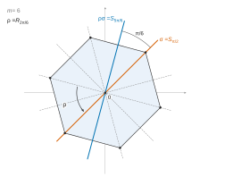
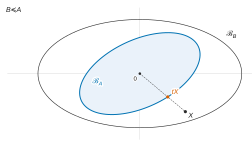
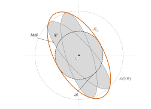
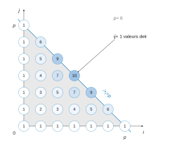

# Centrale-Supélec MP-MPI — Mathématiques 1 2026 · Corrigé guidé

*Corrigé rédigé par IA, non officiel. Signalez toute erreur.*

## Présentation du sujet

**Format.** Épreuve de 4 heures, calculatrice autorisée (elle ne sert guère), aucune donnée numérique. 41 questions numérotées Q1 à Q41, dont plusieurs à sous-questions. Le sujet annonce trois parties **indépendantes**, ce qui permet de commencer par celle où l'on est le plus à l'aise.

**Thème : « Sur quelques sous-groupes de $\mathrm{GL}_n(\mathbb{R})$ ».** Le problème regarde des sous-groupes de matrices sous trois angles.

- **Partie A — Sous-groupes finis de $\mathrm{O}_n(\mathbb{R})$ (Q1–Q14).** On montre que, pour $G\subset\mathrm{O}_n(\mathbb{R})$, les trois propriétés « $G$ fini », « $G$ d'exposant fini » et « $\operatorname{tr}G$ fini » sont équivalentes.
  - *A.I (Q1–Q3)* : généralités et exemples (un groupe infini de trace finie, un groupe infini d'exposant fini).
  - *A.II (Q4–Q8)* : le cas de $\mathrm{O}_2(\mathbb{R})$ en détail. Groupes de rotations engendrés par un ou deux éléments, sous-groupes finis de $\mathrm{SO}_2(\mathbb{R})$ (cycliques), groupe diédral $\mathcal{D}_m$.
  - *A.III (Q9–Q14)* : le cas général, par le théorème de réduction des matrices orthogonales et une matrice de Gram.
- **Partie B — Sous-groupes compacts de $\mathrm{GL}_n(\mathbb{R})$ (Q15–Q29).** Tout sous-groupe compact de $\mathrm{GL}_n(\mathbb{R})$ est conjugué à un sous-groupe de $\mathrm{O}_n(\mathbb{R})$.
  - *B.I (Q15–Q21)* : produit scalaire $\langle\cdot,\cdot\rangle_A$, ordre $\preccurlyeq$ sur les matrices symétriques, comparaison des déterminants et des boules.
  - *B.II (Q22–Q23)* : convexité de $\mathcal{S}_n^{++}(\mathbb{R})$ et stricte concavité de $\ln\circ\det$.
  - *B.III (Q24–Q25)* : groupe $\mathrm{O}(A)$, isomorphe à $\mathrm{O}_n(\mathbb{R})$ et compact.
  - *B.IV (Q26–Q29)* : l'ellipsoïde de déterminant maximal contenant un compact invariant ; son unicité force $G\subset\mathrm{O}(A)$.
- **Partie C — Croissance du groupe de Heisenberg discret (Q30–Q41).**
  - *C.I (Q30–Q32)* : longueur des mots, croissance polynomiale, indépendance vis-à-vis des générateurs, cas de $\mathbb{Z}^3$ (degré 3).
  - *C.II (Q33–Q41)* : le groupe $\mathbb{H}$ des matrices unipotentes $3\times3$ à coefficients entiers. Il est en bijection avec $\mathbb{Z}^3$ mais croît en $p^4$.

**Notions mobilisées.** Groupes, sous-groupe engendré, ordre d'un élément, groupes monogènes, sous-groupes de $(\mathbb{R},+)$, Bézout ; isométries du plan, réduction des matrices orthogonales ; extraction de base, rang, matrices de Gram ; produits scalaires, endomorphismes autoadjoints, théorème spectral, matrices symétriques positives ; convexité, étude de fonction ; topologie en dimension finie (compacité, fermés, bornés, image continue d'un compact) ; dénombrement, sommes de Riemann, équivalents.

**Trois énoncés inexacts.** Il faut le savoir pour ne pas s'acharner.
- **Q6.a** n'est vraie que si $2\pi\in\theta\mathbb{Z}+\theta'\mathbb{Z}$, ce qui est le cas dans les applications b) et c).
- **Q38** : la borne $|z|\leqslant|ij|$ est fausse en général. On démontre $|z|\leqslant p^2/4$, qui suffit.
- **Q39** : la conclusion exige que $k$ soit du signe de $ij$. Seul le cas $i,j,k\geqslant0$ sert ensuite.

Dans une copie, il vaut mieux signaler brièvement le problème, donner un contre-exemple et démontrer ce qui sert pour la suite, plutôt que « prouver » un énoncé faux.

**Difficulté et gestion du temps.** Sujet long, de difficulté progressive dans chaque partie.
- *À ne pas laisser passer* : Q1–Q5, Q7, Q9–Q13, Q15–Q17, Q22, Q24–Q27, Q30, Q33–Q37. Ce sont des questions de cours ou des calculs directs.
- *Questions techniques* : Q8.b (exhiber l'isomorphisme), Q14 (voir que $A_i^\top M\in G$), Q23 (log-concavité), Q28 (optimisation sur un compact), Q31 (constantes et parties entières), Q38–Q39 (manipulation des mots dans $\mathbb{H}$).
- *Répartition indicative* : 1 h 20 pour A, 1 h 30 pour B, 1 h 10 pour C.

---

## Partie A — Sous-groupes finis de $\mathrm{O}_n(\mathbb{R})$

### I — Généralités

Trois questions courtes qui fixent les définitions et montrent, par des exemples, qu'aucune des implications réciproques n'est vraie dans $\mathrm{GL}_n(\mathbb{R})$ en général.

### Question 1

> [!INDICATION]
> Pour la trace, il n'y a presque rien à faire : regardez $\operatorname{tr}G$ comme l'image d'un ensemble.

> [!INDICATION]
> Pour l'exposant, le même $m$ doit convenir pour tous les éléments. Quel résultat du cours relie l'ordre d'un élément au cardinal du groupe ?

#### Solution

Supposons $G$ fini, de cardinal $N\geqslant1$.

*Trace.* $\operatorname{tr}G=\{\operatorname{tr}A\,;\,A\in G\}$ est l'image directe de l'ensemble fini $G$ par $\operatorname{tr}$, donc $|\operatorname{tr}G|\leqslant N$ : **$\operatorname{tr}G$ est fini.**

*Exposant.* Soit $x\in G$. Le sous-groupe $\langle x\rangle$ est inclus dans $G$, donc fini : $x$ est d'ordre fini $d_x=|\langle x\rangle|$.

L'ordre d'un élément d'un groupe fini divise le cardinal du groupe, donc $d_x\mid N$. En écrivant $N=d_xq$, on obtient

$$x^N=(x^{d_x})^q=I_n.$$

Ainsi $m=N$ convient pour tout $x$ : **$G$ est d'exposant fini.**

On peut aussi éviter ce théorème. Chaque $d_x$ est $\leqslant N$ (principe des tiroirs sur $x^0,\dots,x^N$), donc $m=N!$, ou le ppcm des $d_x$, convient.

> [!PIEGE]
> « Tout élément est d'ordre fini » ne suffit pas : l'exposant demande un $m$ **uniforme**. Dans $\mathbb{Q}/\mathbb{Z}$, tout élément est d'ordre fini, mais les ordres ne sont pas bornés.

### Question 2

> [!INDICATION]
> Cherchez un sous-groupe infini dont toutes les matrices ont la **même** trace. Des matrices triangulaires à diagonale unité feraient l'affaire.

> [!INDICATION]
> Une matrice nilpotente $E$ telle que $E^2=0$ rend la loi $t\mapsto I_n+tE$ additive.

#### Solution

Pour $t\in\mathbb{R}$, posons $M_t=I_n+tE_{12}$ (possible car $n\geqslant2$). Comme $E_{12}^2=0$,

$$\begin{aligned}M_tM_s&=I_n+(t+s)E_{12}+tsE_{12}^2\\&=M_{t+s}.\end{aligned}$$

Donc $M_0=I_n$ et l'ensemble $G=\{M_t\,;\,t\in\mathbb{R}\}$ est stable par produit.

De plus $M_t$ est inversible d'inverse $M_{-t}\in G$ : $G$ est un sous-groupe de $\mathrm{GL}_n(\mathbb{R})$.

Il est infini ($t\mapsto M_t$ est injective, au vu du coefficient $(1,2)$), et chaque $M_t$ est triangulaire à diagonale unité :

$$\boxed{G=\{I_n+tE_{12}\,;\,t\in\mathbb{R}\}\ \text{est infini et}\ \operatorname{tr}G=\{n\}.}$$

> [!PIEGE]
> $\mathrm{SO}_2(\mathbb{R})$ ne convient pas (sa trace décrit $[-2,2]$), ni les matrices $\mathrm{diag}(t,1,\dots,1)$. Pensez à vérifier les trois points : sous-groupe, infini, trace finie.

### Question 3

> [!INDICATION]
> Un groupe d'exposant $2$ : tout élément est son propre inverse. Il faut le prendre infini.

> [!INDICATION]
> Pensez aux suites à valeurs dans $\mathbb{Z}/2\mathbb{Z}$, ou aux parties de $\mathbb{N}$ avec la différence symétrique.

#### Solution

Soit $G=(\mathbb{Z}/2\mathbb{Z})^{\mathbb{N}}$, l'ensemble des applications de $\mathbb{N}$ dans $\mathbb{Z}/2\mathbb{Z}$, muni de l'addition point par point. C'est un groupe commutatif (les axiomes se vérifient point par point, et le neutre est la fonction nulle).

Les fonctions $\delta_k$, égales à $\bar1$ en $k$ et à $\bar0$ ailleurs, sont deux à deux distinctes, donc $G$ est infini.

Pour tout $f$, $(f+f)(k)=2f(k)=\bar0$ :

$$\boxed{G=(\mathbb{Z}/2\mathbb{Z})^{\mathbb{N}}\ \text{est infini et d'exposant}\ 2.}$$

### II — Cas particulier : les sous-groupes finis de $\mathrm{O}_2(\mathbb{R})$

Tout repose sur le morphisme $\theta\mapsto R_\theta$ et sur les quatre relations fournies. On classe les sous-groupes finis de $\mathrm{O}_2(\mathbb{R})$ : cycliques s'ils sont formés de rotations, diédraux sinon.

### Question 4

> [!INDICATION]
> La première colonne d'une matrice orthogonale est un vecteur unitaire du plan : paramétrez-la par un angle.

> [!INDICATION]
> La seconde colonne est unitaire et orthogonale à la première : il ne reste qu'un signe, que le déterminant fixe. N'oubliez pas l'unicité.

#### Solution

*Existence.* Soit $A=\begin{pmatrix}a&c\\b&d\end{pmatrix}\in\mathrm{SO}_2(\mathbb{R})$. Comme $A^\top A=I_2$, les colonnes $C_1=(a,b)$ et $C_2=(c,d)$ forment une famille orthonormée.

De $a^2+b^2=1$, on tire un unique $\theta\in[0,2\pi[$ tel que $a=\cos\theta$, $b=\sin\theta$.

Or $C_1^\perp=\mathbb{R}(-b,a)$ avec $(-b,a)$ unitaire, donc $C_2=\lambda(-b,a)$ avec $\lambda=\pm1$. Enfin

$$\begin{aligned}1=\det A&=ad-bc\\&=\lambda(a^2+b^2)\\&=\lambda,\end{aligned}$$

donc $A=R_\theta$.

*Unicité.* Si $R_\theta=R_{\theta'}$ avec $\theta,\theta'\in[0,2\pi[$, alors $\cos$ et $\sin$ coïncident, donc $\theta-\theta'\in2\pi\mathbb{Z}$.

Comme $|\theta-\theta'|<2\pi$, $\theta=\theta'$.

### Question 5

> [!INDICATION]
> a) Le sous-groupe engendré par un élément est l'ensemble de ses puissances d'exposant entier relatif.

> [!INDICATION]
> b)-c) $R_\varphi=I_2$ équivaut à $\varphi\in2\pi\mathbb{Z}$ : traduisez « deux puissances coïncident ». d)-e) Ramenez-vous à c). Pour e), combien d'angles de $[0,2\pi[$ ont un cosinus donné ?

#### Solution

**a)** Par récurrence, $R_\theta^k=R_{k\theta}$ pour $k\in\mathbb{N}$. Comme $R_\theta R_{-\theta}=I_2$, on a $R_\theta^{-1}=R_{-\theta}$, et la formule vaut pour $k\in\mathbb{Z}$.

L'ensemble $H=\{R_{k\theta}\,;\,k\in\mathbb{Z}\}$ contient $I_2$ et il est stable par produit et par inverse. C'est donc un sous-groupe contenant $R_\theta$, d'où $G\subset H$.

Inversement, $R_{k\theta}=R_\theta^k\in G$. **Donc $G=\{R_{k\theta}\,;\,k\in\mathbb{Z}\}$.**

**b)** Si $\theta=2\pi/m$ :

$$\begin{aligned}R_{k\theta}=R_{\ell\theta}&\iff\frac{2\pi(k-\ell)}{m}\in2\pi\mathbb{Z}\\&\iff m\mid k-\ell.\end{aligned}$$

L'application $\mathbb{Z}/m\mathbb{Z}\to G$, $\bar k\mapsto R_{k\theta}$, est donc bien définie, injective, et surjective par a) : $\boxed{|G|=m}$.

**c)** Supposons $\theta/\pi=a/b$ avec $b\geqslant1$. Alors $R_\theta^{2b}=R_{2a\pi}=I_2$.

Par division euclidienne $k=2bq+r$, on a $R_{k\theta}=R_{r\theta}$ avec $0\leqslant r<2b$ : $G$ a au plus $2b$ éléments.

Réciproquement, si $G$ est fini, $k\mapsto R_{k\theta}$ n'est pas injective. Il existe donc $k<\ell$ tels que $R_{(\ell-k)\theta}=I_2$.

On a alors $(\ell-k)\theta=2s\pi$, d'où $\theta/\pi=2s/(\ell-k)\in\mathbb{Q}$.

$$\boxed{G\ \text{fini}\iff\theta/\pi\in\mathbb{Q}.}$$

**d)** Si $x^m=I_2$ pour tout $x\in G$, alors en particulier $R_{m\theta}=I_2$, donc $\theta/\pi=2s/m\in\mathbb{Q}$, et $G$ est fini par c).

**e)** Tout élément de $G$ s'écrit de façon unique $R_\varphi$ avec $\varphi\in[0,2\pi[$, et sa trace vaut $2\cos\varphi$.

À $t\in\operatorname{tr}G$ fixé, l'équation $\cos\varphi=t/2$ a au plus deux solutions dans $[0,2\pi[$.

Chaque fibre $\{A\in G\,;\,\operatorname{tr}A=t\}$ a donc au plus deux éléments, et

$$|G|\leqslant2|\operatorname{tr}G|<+\infty.$$

> [!METHODE]
> Pour montrer qu'un ensemble est fini à partir de la finitude de son image, majorez le cardinal des **fibres** : $|G|\leqslant(\max_t|F_t|)\cdot|\operatorname{tr}G|$.

### Question 6

> [!INDICATION]
> a) Les rotations commutent : le groupe engendré par deux rotations est formé des $R_{a\theta+b\theta'}$. Il reste à ramener les angles dans $[0,2\pi[$.

> [!INDICATION]
> a) Ramener un angle de $\theta\mathbb{Z}+\theta'\mathbb{Z}$ dans $[0,2\pi[$ revient à lui retrancher un multiple de $2\pi$. Le résultat reste-t-il dans $\theta\mathbb{Z}+\theta'\mathbb{Z}$ ? Testez $\theta=\theta'=4\pi/3$.

> [!INDICATION]
> b)-c) Calculez $\frac{\pi}{p}\mathbb{Z}+\frac{\pi}{q}\mathbb{Z}$ en mettant $\frac{\pi}{pq}$ en facteur, puis appliquez Bézout.

#### Solution

**a)** Posons $\Lambda=\theta\mathbb{Z}+\theta'\mathbb{Z}$. Comme

$$R_\theta^aR_{\theta'}^b=R_{a\theta+b\theta'},$$

l'ensemble $\{R_\varphi\,;\,\varphi\in\Lambda\}$ est un sous-groupe (il contient $R_0$ et il est stable par produit et par inverse) qui contient $R_\theta$ et $R_{\theta'}$.

Tout sous-groupe contenant ces deux rotations le contient. Donc $G=\{R_\varphi\,;\,\varphi\in\Lambda\}$.

Posons $\Lambda'=\Lambda+2\pi\mathbb{Z}$. Puisque $R_{\varphi+2k\pi}=R_\varphi$, on a aussi $G=\{R_\varphi\,;\,\varphi\in\Lambda'\}$.

L'application $\varphi\mapsto R_\varphi$, de $\Lambda'\cap[0,2\pi[$ dans $G$, est injective (unicité en Q4). Elle est surjective : pour $\varphi\in\Lambda'$, le réel

$$r=\varphi-2\pi\lfloor\varphi/2\pi\rfloor$$

est dans $\Lambda'\cap[0,2\pi[$ et vérifie $R_r=R_\varphi$. Donc

$$\boxed{|G|=\bigl|(\theta\mathbb{Z}+\theta'\mathbb{Z}+2\pi\mathbb{Z})\cap[0,2\pi[\bigr|,}$$

ce qui donne la formule de l'énoncé **lorsque $2\pi\in\theta\mathbb{Z}+\theta'\mathbb{Z}$** (alors $\Lambda'=\Lambda$).

Sans cette hypothèse, la formule de l'énoncé est fausse. Pour $\theta=\theta'=4\pi/3$, $\Lambda\cap[0,2\pi[\,=\{0,4\pi/3\}$ a deux éléments, alors que $G=\{I_2,R_{2\pi/3},R_{4\pi/3}\}$ en a trois.

Pour $\theta=\theta'=1$, l'ensemble $\Lambda\cap[0,2\pi[$ a sept éléments, mais $G$ est infini (Q5.c).

**b)** Soient $p,q$ non nuls et premiers entre eux. Remplacer $p$ par $-p$ remplace $R_{\pi/p}$ par son inverse sans changer le groupe engendré : on peut donc supposer $p,q\geqslant1$.

Par Bézout, $q\mathbb{Z}+p\mathbb{Z}=\mathbb{Z}$, d'où

$$\begin{aligned}\Lambda&=\frac{\pi}{pq}(q\mathbb{Z}+p\mathbb{Z})\\&=\frac{\pi}{pq}\mathbb{Z}\ni2\pi.\end{aligned}$$

Par a), $|G|=|\{k\pi/(pq)\,;\,0\leqslant k<2pq\}|$, soit

$$\boxed{|\langle R_{\pi/p},R_{\pi/q}\rangle|=2pq.}$$

Si l'on autorise des signes, on écrit $2|pq|$.

**c)** Soit $g=p\wedge q$ ($p,q\geqslant1$), avec $p=gp'$, $q=gq'$ et $p'\wedge q'=1$. Alors

$$\begin{aligned}\Lambda&=\frac{\pi}{gp'q'}(q'\mathbb{Z}+p'\mathbb{Z})\\&=\frac{\pi}{p\vee q}\mathbb{Z},\end{aligned}$$

qui contient $2\pi$. Donc

$$\boxed{|\langle R_{\pi/p},R_{\pi/q}\rangle|=2(p\vee q)=\frac{2pq}{p\wedge q}}$$

(avec $|p|,|q|$ en général).

Par exemple, pour $p=2$ et $q=3$, on obtient les douze rotations d'angles multiples de $\pi/6=\pi/2-\pi/3$.

> [!PIEGE]
> Passer de $\Lambda$ à $\Lambda\cap[0,2\pi[$ suppose que $\Lambda$ soit stable par translation de $2\pi$. C'est vrai en b) et c), pas en général.

> [!METHODE]
> Un sous-groupe $a\mathbb{Z}+b\mathbb{Z}$ de $\mathbb{R}$, avec $a/b$ rationnel, s'écrit $c\mathbb{Z}$ : on met en facteur un « pgcd réel » et on applique Bézout.

### Question 7

> [!INDICATION]
> Imitez la preuve « tout sous-groupe de $\mathbb{Z}$ est de la forme $a\mathbb{Z}$ ».

> [!INDICATION]
> Considérez le plus petit angle strictement positif présent dans $G$ (pourquoi existe-t-il ?), puis effectuez une division euclidienne.

#### Solution

Par Q4, $G=\{R_\vartheta\,;\,\vartheta\in\Theta\}$ avec $\Theta\subset[0,2\pi[$ fini et $0\in\Theta$.

Si $\Theta=\{0\}$, alors $G=\langle I_2\rangle$. Sinon, $\Theta\cap\,]0,2\pi[$ est fini et non vide : il admet un plus petit élément $\alpha$.

Soit $\vartheta\in\Theta$, $k=\lfloor\vartheta/\alpha\rfloor$ et $r=\vartheta-k\alpha\in[0,\alpha[$. Alors

$$R_r=R_\vartheta R_\alpha^{-k}\in G,$$

donc $r\in\Theta$, et la minimalité de $\alpha$ impose $r=0$. Ainsi $R_\vartheta=R_\alpha^k$ :

$$\boxed{G=\langle R_\alpha\rangle\ \text{est monogène.}}$$

> [!PIEGE]
> L'existence du minimum vient de la **finitude** : sur un sous-groupe infini (dense), la borne inférieure des angles positifs peut valoir $0$ sans être atteinte. Traitez à part le cas $G=\{I_2\}$.

### Question 8

> [!INDICATION]
> a) Montrez que $\mathcal{C}\cup\mathcal{C}S_{\pi/2}$, avec $\mathcal{C}=\langle R_{2\pi/m}\rangle$, est un sous-groupe, en n'utilisant que les quatre relations données. Le déterminant sépare les deux morceaux.

> [!INDICATION]
> b) Commencez par $H=G\cap\mathrm{SO}_2(\mathbb{R})$ (Q7), puis montrez que $G=H\cup H\tau$ pour toute symétrie $\tau\in G$.

> [!INDICATION]
> b) Pour l'isomorphisme, conjuguez par une rotation $R_\gamma$ : elle fixe chaque rotation et transforme $S_{\pi/2}$ en une autre symétrie. Choisissez $\gamma$ pour obtenir $\tau$.

#### Solution

**a)** Posons $\rho=R_{2\pi/m}$, $\sigma=S_{\pi/2}$ et $\mathcal{C}=\langle\rho\rangle=\{R_{2k\pi/m}\,;\,0\leqslant k<m\}$, de cardinal $m$ (Q5.b).

Posons aussi $\mathcal{D}=\mathcal{C}\cup\mathcal{C}\sigma$, avec $\mathcal{C}\sigma=\{S_{\pi/2+2k\pi/m}\}$.

Soient $\varphi,\psi\in\frac{2\pi}{m}\mathbb{Z}$ et $\varphi',\psi'\in\frac\pi2+\frac{2\pi}{m}\mathbb{Z}$. Les relations donnent :
- $R_\varphi R_\psi=R_{\varphi+\psi}\in\mathcal{C}$ ;
- $R_\varphi S_{\psi'}=S_{\varphi+\psi'}\in\mathcal{C}\sigma$ et $S_{\psi'}R_\varphi=S_{\psi'-\varphi}\in\mathcal{C}\sigma$ ;
- $S_{\varphi'}S_{\psi'}=R_{\varphi'-\psi'}\in\mathcal{C}$ ;
- $R_\varphi^{-1}=R_{-\varphi}$ et $S_{\varphi'}^{-1}=S_{\varphi'}$.

Ainsi $\mathcal{D}$ est un sous-groupe contenant $\rho$ et $\sigma$, et il est contenu dans tout sous-groupe qui les contient : $\mathcal{D}_m=\mathcal{D}$.

Comme $\det R_\varphi=1$ et $\det S_\varphi=-1$, on a

$$\mathcal{D}_m\cap\mathrm{SO}_2(\mathbb{R})=\mathcal{C}=\langle R_{2\pi/m}\rangle,$$

et $\mathcal{D}_m\setminus\mathrm{SO}_2(\mathbb{R})=\mathcal{C}\sigma$.

L'application $A\mapsto A\sigma$ est une bijection de l'un sur l'autre (elle est sa propre réciproque car $\sigma^2=I_2$). Donc $\boxed{|\mathcal{D}_m|=2m}$.

**b)** $H=G\cap\mathrm{SO}_2(\mathbb{R})$ est un sous-groupe fini de $\mathrm{SO}_2(\mathbb{R})$, donc $H=\langle R_\alpha\rangle$ (Q7), avec $|H|=m$.

Comme $R_\alpha$ est d'ordre $m$, $R_{m\alpha}=I_2$ et $\alpha\in\frac{2\pi}{m}\mathbb{Z}$.

Donc $H\subset\langle R_{2\pi/m}\rangle$, et l'égalité des cardinaux donne $H=\mathcal{C}$.

Soit $\tau\in G\setminus\mathrm{SO}_2(\mathbb{R})$. On a $\det\tau=-1$ et, comme en Q4, $\tau=S_\beta$ pour un réel $\beta$.

Le déterminant est un morphisme de $G$ dans $\{\pm1\}$, de noyau $H$.

Si $\det g=-1$, alors $g\tau\in H$ et $g=(g\tau)\tau$, d'où $G=H\sqcup H\tau$.

Avec $\gamma=\frac{\beta-\pi/2}{2}$ et $P=R_\gamma$ :

$$\begin{aligned}P\sigma P^{-1}&=R_\gamma S_{\pi/2}R_{-\gamma}\\&=S_{\gamma+\pi/2}R_{-\gamma}\\&=S_{2\gamma+\pi/2}\\&=S_\beta=\tau,\end{aligned}$$

et $P\mathcal{C}P^{-1}=\mathcal{C}$ par commutativité. La conjugaison $\Phi:M\mapsto PMP^{-1}$ est un morphisme injectif, et

$$\begin{aligned}\Phi(\mathcal{D}_m)&=\mathcal{C}\cup\mathcal{C}\tau\\&=G.\end{aligned}$$

Donc

$$\boxed{G\simeq\mathcal{D}_m\ \text{avec}\ m=|G|/2.}$$

> [!PIEGE]
> Constater que $G$ et $\mathcal{D}_m$ ont tous deux « $m$ rotations et $m$ symétries » ne prouve pas qu'ils sont isomorphes : il faut **exhiber** un isomorphisme.

> [!METHODE]
> Pour montrer que deux sous-groupes d'un même groupe sont isomorphes, cherchez d'abord une **conjugaison** : c'est automatiquement un morphisme injectif.

### III — Une caractérisation des sous-groupes finis de $\mathrm{O}_n(\mathbb{R})$

On boucle la chaîne d'implications : fini $\Rightarrow$ exposant fini (Q1), puis exposant fini $\Rightarrow$ trace finie (réduction, Q10), puis trace finie $\Rightarrow$ fini (matrice de Gram, Q11–Q14).

### Question 9

> [!INDICATION]
> C'est un rappel de cours : énoncez la forme réduite d'une matrice orthogonale dans une base orthonormée convenable.

#### Solution

Pour toute $M\in\mathrm{O}_n(\mathbb{R})$, il existe $P\in\mathrm{O}_n(\mathbb{R})$ telle que

$$P^\top MP=\mathrm{diag}\bigl(I_p,\,-I_q,\,R_{\theta_1},\dots,R_{\theta_r}\bigr),$$

avec $p+q+2r=n$ et $\theta_i\in\,]0,\pi[$ (ou $\theta_i\in\mathbb{R}\setminus\pi\mathbb{Z}$).

Géométriquement : toute isométrie d'un espace euclidien admet, dans une base orthonormée convenable, une matrice diagonale par blocs de ce type. En particulier, $\operatorname{tr}M=p-q+2\sum_i\cos\theta_i$.

> [!PIEGE]
> Ne pas confondre avec le théorème spectral : une matrice orthogonale n'est en général pas diagonalisable sur $\mathbb{R}$ ($R_{\pi/2}$ ne l'est pas).

### Question 10

> [!INDICATION]
> Élevez la forme réduite à la puissance $m$ : que deviennent les blocs $R_{\theta_i}$ ?

> [!INDICATION]
> Les angles sont alors astreints à un ensemble fini (modulo $2\pi$). Comptez les traces possibles.

#### Solution

Soit $m$ tel que $M^m=I_n$ pour tout $M\in G$. Pour $M\in G$, avec $D=P^\top MP$ comme en Q9, on a

$$D^m=P^\top M^mP=I_n.$$

Par blocs, $R_{m\theta_i}=I_2$, donc $\theta_i\in\frac{2\pi}{m}\mathbb{Z}$ et $\cos\theta_i\in C_m=\{\cos\frac{2k\pi}{m}\,;\,0\leqslant k<m\}$.

Ainsi $\operatorname{tr}M$ appartient à l'ensemble $T$ des réels

$$p-q+2\sum_{i=1}^rc_i,$$

où $p+q+2r=n$ et $c_1,\dots,c_r\in C_m$.

Cet ensemble est fini : au plus $(n+1)^2$ triplets $(p,q,r)$, et au plus $m^n$ choix des $c_i$ pour chacun. Donc $\operatorname{tr}G\subset T$ est fini.

### Question 11

> [!INDICATION]
> $G$ engendre $\mathcal{F}$ : on veut extraire une base d'une famille génératrice, qui peut être infinie.

> [!INDICATION]
> Prenez une famille libre d'éléments de $G$ de cardinal maximal.

#### Solution

$\mathcal{F}=\mathrm{Vect}(G)$ est de dimension finie $d\leqslant n^2$. Les familles libres d'éléments de $G$ ont au plus $d$ éléments ; soit $(A_1,\dots,A_s)$ l'une d'elles, de cardinal maximal.

Si un $M\in G$ n'était pas dans $\mathrm{Vect}(A_i)$, la famille $(A_1,\dots,A_s,M)$ serait libre, ce qui contredit la maximalité.

Donc $G\subset\mathrm{Vect}(A_i)$, puis $\mathcal{F}=\mathrm{Vect}(A_1,\dots,A_s)$.

**Les $A_i$, éléments de $G$, forment une base de $\mathcal{F}$**, et $s=d$.

> [!PIEGE]
> Les $A_i$ doivent être des éléments de $G$ lui-même, pas seulement de $\mathcal{F}$ : c'est indispensable en Q14.

### Question 12

> [!INDICATION]
> a) Une colonne par matrice $A_i$, une ligne par coordonnée.

> [!INDICATION]
> b) La base canonique de $\mathcal{M}_n(\mathbb{R})$ est orthonormée pour $(A|B)=\operatorname{tr}(A^\top B)$. c) Comparez les noyaux de $C$ et de $C^\top C$ via $X^\top C^\top CX$.

#### Solution

**a)** $\boxed{C\in\mathcal{M}_{n^2,d}(\mathbb{R})}$, la colonne $i$ contenant les $n^2$ coordonnées de $A_i$.

**b)** La base canonique est orthonormée :

$$\begin{aligned}(E_{k\ell}|E_{k'\ell'})&=\operatorname{tr}(E_{\ell k}E_{k'\ell'})\\&=\delta_{kk'}\delta_{\ell\ell'}.\end{aligned}$$

Par bilinéarité,

$$\begin{aligned}(A_i|A_j)&=\sum_kc_{ki}c_{kj}\\&=(C^\top C)_{ij},\end{aligned}$$

donc $\boxed{B=C^\top C}$.

**c)** Si $C^\top CX=0$, alors

$$\|CX\|^2=X^\top C^\top CX=0,$$

donc $CX=0$ ; l'inclusion inverse est claire. Ainsi $\ker B=\ker C$ et, par le théorème du rang, $\operatorname{rg}B=\operatorname{rg}C$.

Les colonnes de $C$ représentent la famille libre $(A_i)$, donc $\operatorname{rg}C=d$.

**$B$, carrée d'ordre $d$ et de rang $d$, est inversible.**

> [!METHODE]
> L'égalité $\ker(C^\top C)=\ker C$ sur $\mathbb{R}$ s'obtient toujours en écrivant $X^\top C^\top CX=\|CX\|^2$. C'est aussi la preuve qu'une matrice de Gram d'une famille libre est inversible.

### Question 13

> [!INDICATION]
> Prenez le produit scalaire de la décomposition de $M$ avec chaque $A_i$.

#### Solution

Par linéarité,

$$\begin{aligned}(A_i|M)&=\sum_j(A_i|A_j)x_j\\&=(BX_M)_i.\end{aligned}$$

Donc $Y_M=BX_M$, et puisque $B$ est inversible (Q12.c), $\boxed{X_M=B^{-1}Y_M}$.

### Question 14

> [!INDICATION]
> Montrez que chaque coordonnée $(A_i|M)$ de $Y_M$ est la trace d'un élément de $G$. Que vaut $A_i^\top$ pour une matrice orthogonale ?

> [!INDICATION]
> Pour conclure, montrez que $M\mapsto Y_M$ est injective sur $G$.

#### Solution

Comme $A_i\in G\subset\mathrm{O}_n(\mathbb{R})$, on a $A_i^\top=A_i^{-1}\in G$, donc $A_i^\top M\in G$ et

$$(A_i|M)=\operatorname{tr}(A_i^\top M)\in\operatorname{tr}G.$$

Ainsi $\{Y_M\,;\,M\in G\}\subset(\operatorname{tr}G)^d$, qui est fini.

Si $Y_M=Y_{M'}$, alors $X_M=X_{M'}$ (Q13), donc $M=M'$. L'application $M\mapsto Y_M$ est donc une injection de $G$ dans un ensemble fini :

$$\boxed{G\ \text{est fini},\ |G|\leqslant|\operatorname{tr}G|^d.}$$

Avec Q1 et Q10, pour $G\subset\mathrm{O}_n(\mathbb{R})$ : $G$ fini $\iff$ $G$ d'exposant fini $\iff$ $\operatorname{tr}G$ fini.

L'exemple de Q2 montre que l'hypothèse $G\subset\mathrm{O}_n(\mathbb{R})$ est indispensable.

> [!METHODE]
> Pour prouver la finitude d'un groupe de matrices, coder chaque élément par un nombre fini de quantités qui ne prennent qu'un nombre fini de valeurs, ici des traces, puis vérifier que ce codage est injectif.

---

## Partie B — Sous-groupes compacts de $\mathrm{GL}_n(\mathbb{R})$

### I — Quelques propriétés utiles

On construit les outils d'algèbre bilinéaire de la partie : le produit scalaire $\langle\cdot,\cdot\rangle_A$, la diagonalisation de $A^{-1}B$ dans une base adaptée et l'ordre $\preccurlyeq$.

### Question 15

> [!INDICATION]
> Vérifiez bilinéarité, symétrie (où sert $A^\top=A$ ?) et caractère défini positif.

> [!INDICATION]
> Pour la boule, cherchez $A$ multiple de $I_n$. N'oubliez pas le cas $r=0$.

#### Solution

$\langle X,Y\rangle_A=X^\top AY$ est bilinéaire. Elle est symétrique, car $X^\top AY$ est un scalaire égal à sa transposée $Y^\top A^\top X=Y^\top AX$.

Enfin $\langle X,X\rangle_A=X^\top AX>0$ pour $X\neq0$. **C'est un produit scalaire.**

Pour $r>0$, $A=r^{-2}I_n$ donne $\|X\|_A=\|X\|/r$, donc $\mathcal{B}_A=\mathcal{B}(0,r)$.

Pour $r=0$, $\mathcal{B}(0,0)=\{0\}$ n'est la boule unité d'aucune norme.

**Une telle $A$ existe si et seulement si $r>0$** ; par exemple $A=r^{-2}I_n$.

### Question 16

> [!INDICATION]
> Calculez $\langle A^{-1}BX,Y\rangle_A$ et $\langle X,A^{-1}BY\rangle_A$ : les deux se ramènent à la même expression.

> [!INDICATION]
> Un endomorphisme autoadjoint d'un espace euclidien relève d'un théorème bien connu, à appliquer pour le produit scalaire $\langle\cdot,\cdot\rangle_A$.

#### Solution

Pour $u:X\mapsto A^{-1}BX$ :

$$\begin{aligned}\langle u(X),Y\rangle_A&=(BX|Y)\\&=X^\top BY,\\\langle X,u(Y)\rangle_A&=X^\top A^\top A^{-1}BY\\&=X^\top BY.\end{aligned}$$

Donc $u$ est autoadjoint pour $\langle\cdot,\cdot\rangle_A$. Par le théorème spectral dans $(\mathcal{M}_{n,1}(\mathbb{R}),\langle\cdot,\cdot\rangle_A)$ :

$$\boxed{A^{-1}B\ \text{est diagonalisable sur}\ \mathbb{R},\ \text{dans une base de vecteurs propres}\ \langle\cdot,\cdot\rangle_A\text{-orthonormée.}}$$

> [!PIEGE]
> $A^{-1}B$ n'est pas symétrique en général. La base propre est orthonormée pour $\langle\cdot,\cdot\rangle_A$, **pas** pour le produit scalaire canonique.

### Question 17

> [!INDICATION]
> Écrivez $((A-B)X|X)$, sans oublier de dire que $A-B$ est symétrique.

#### Solution

$A-B\in\mathcal{S}_n(\mathbb{R})$ et $((A-B)X|X)=(AX|X)-(BX|X)$. Donc

$$\begin{aligned}B\preccurlyeq A&\iff\forall X,\ ((A-B)X|X)\geqslant0\\&\iff A-B\in\mathcal{S}_n^+(\mathbb{R}).\end{aligned}$$

### Question 18

> [!INDICATION]
> Sens direct : évaluez l'inégalité $(BX|X)\leqslant(AX|X)$ sur un vecteur propre de $A^{-1}B$. Pourquoi la valeur propre est-elle $>0$ ?

> [!INDICATION]
> Réciproque : dans la base $\langle\cdot,\cdot\rangle_A$-orthonormée de Q16, exprimez $(AX|X)$ et $(BX|X)$ en fonction des coordonnées de $X$.

#### Solution

Notons $u:X\mapsto A^{-1}BX$ ; on a $(BX|Y)=\langle u(X),Y\rangle_A$.

*Positivité.* Si $BX=\lambda AX$ avec $X\neq0$, alors $\lambda=\frac{(BX|X)}{(AX|X)}>0$.

*Sens direct.* Si $B\preccurlyeq A$, ce quotient est $\leqslant1$, donc $\mathrm{Sp}(A^{-1}B)\subset\,]0,1]$.

*Réciproque.* Soit $(\varepsilon_i)$ une base $\langle\cdot,\cdot\rangle_A$-orthonormée avec $u(\varepsilon_i)=\lambda_i\varepsilon_i$ et $0<\lambda_i\leqslant1$. Pour $X=\sum x_i\varepsilon_i$ :

$$\begin{aligned}(AX|X)&=\langle X,X\rangle_A\\&=\sum x_i^2,\\(BX|X)&=\langle u(X),X\rangle_A\\&=\sum\lambda_ix_i^2\\&\leqslant\sum x_i^2.\end{aligned}$$

$$\boxed{B\preccurlyeq A\iff\mathrm{Sp}(A^{-1}B)\subset\,]0,1].}$$

> [!METHODE]
> Dans une base $\langle\cdot,\cdot\rangle_A$-orthonormée de vecteurs propres de $A^{-1}B$, les deux formes quadratiques $X\mapsto(AX|X)$ et $X\mapsto(BX|X)$ sont **simultanément diagonales**. C'est l'outil de toute la partie.

### Question 19

> [!INDICATION]
> Le quotient $\det B/\det A$ est le déterminant de $A^{-1}B$, donc un produit de valeurs propres situées dans $]0,1]$.

> [!INDICATION]
> Cas d'égalité : un produit de nombres de $]0,1]$ égal à $1$… puis utilisez la diagonalisabilité.

#### Solution

$\det A>0$ et, avec $\lambda_i\in\,]0,1]$ (Q18),

$$\begin{aligned}\frac{\det B}{\det A}&=\det(A^{-1}B)\\&=\prod\lambda_i\\&\leqslant1.\end{aligned}$$

En cas d'égalité, si un $\lambda_{i_0}$ était $<1$, le produit serait $\leqslant\lambda_{i_0}<1$. Donc tous les $\lambda_i$ valent $1$.

La matrice $A^{-1}B$, diagonalisable de seule valeur propre $1$, est alors égale à $I_n$ : $B=A$. La réciproque est claire.

$$\boxed{\det B\leqslant\det A,\ \text{avec égalité si et seulement si}\ A=B.}$$

> [!PIEGE]
> « Spectre réduit à $\{1\}$ » n'entraîne « $=I_n$ » que pour une matrice **diagonalisable** : une matrice unipotente non triviale a ce spectre sans être l'identité.

### Question 20

> [!INDICATION]
> Un sens est immédiat. Pour l'autre, normalisez $X$ pour le placer sur le bord de $\mathcal{B}_A$.

#### Solution

On prend $A,B\in\mathcal{S}_n^{++}(\mathbb{R})$.

Si $B\preccurlyeq A$ et $X\in\mathcal{B}_A$, alors $(BX|X)\leqslant(AX|X)\leqslant1$ : $\mathcal{B}_A\subset\mathcal{B}_B$.

Réciproquement, supposons $\mathcal{B}_A\subset\mathcal{B}_B$ et soit $X\neq0$. Avec $t=(AX|X)^{-1/2}$, on a $(A(tX)|tX)=1$.

Donc $tX\in\mathcal{B}_A\subset\mathcal{B}_B$, d'où $t^2(BX|X)\leqslant1$, soit $(BX|X)\leqslant(AX|X)$.

$$\boxed{B\preccurlyeq A\iff\mathcal{B}_A\subset\mathcal{B}_B.}$$

> [!PIEGE]
> L'inclusion est renversée par rapport à l'ordre : plus $A$ est « grande », plus sa boule $\mathcal{B}_A$ est petite.

### Question 21

> [!INDICATION]
> Reliez la norme d'une matrice symétrique positive à ses valeurs propres (théorème spectral, norme $\sqrt{\operatorname{tr}(A^\top A)}$).

> [!INDICATION]
> Dans l'autre sens, majorez $(AX|X)$ par $\|A\|\,\|X\|^2$ avec Cauchy-Schwarz.

#### Solution

On munit $\mathcal{M}_n(\mathbb{R})$ de $\|M\|=\sqrt{\operatorname{tr}(M^\top M)}$ ; le choix de la norme est indifférent en dimension finie.

Pour $A\in\mathcal{S}_n^+(\mathbb{R})$, de valeurs propres $\mu_i\geqslant0$ dans une base orthonormée propre $(e_i)$, on a $\|A\|^2=\operatorname{tr}(A^2)=\sum\mu_i^2$.

$(\Leftarrow)$ Si $A\preccurlyeq\alpha I_n$, alors $\mu_i=(Ae_i|e_i)\leqslant\alpha$, donc $0\leqslant\mu_i\leqslant\alpha$ et $\|A\|\leqslant\alpha\sqrt n$.

$(\Rightarrow)$ Si $\|A\|\leqslant R$ sur $\mathcal{K}$ (avec $R>0$), Cauchy-Schwarz, ligne par ligne, donne $\|AX\|\leqslant\|A\|\|X\|$. Donc

$$\begin{aligned}(AX|X)&\leqslant\|AX\|\|X\|\\&\leqslant R\|X\|^2,\end{aligned}$$

c'est-à-dire $A\preccurlyeq RI_n$.

$$\boxed{\mathcal{K}\ \text{bornée}\iff\exists\alpha>0,\ \forall A\in\mathcal{K},\ A\preccurlyeq\alpha I_n.}$$

> [!PIEGE]
> Le sens $(\Leftarrow)$ utilise $\mu_i\geqslant0$ : sans la positivité, $\mu_i\leqslant\alpha$ ne borne pas $|\mu_i|$.

### II — Stricte log-concavité de l'application $\det$

Le résultat clé de la partie : $\ln\circ\det$ est strictement concave. C'est lui qui donne l'unicité de l'ellipsoïde en Q28.

### Question 22

> [!INDICATION]
> Combinaison convexe de formes quadratiques définies positives : pourquoi la somme reste-t-elle strictement positive, y compris pour $t\in\{0,1\}$ ?

#### Solution

Pour $A,B\in\mathcal{S}_n^{++}(\mathbb{R})$ et $t\in[0,1]$, $M=tA+(1-t)B$ est symétrique et, pour $X\neq0$,

$$(MX|X)=t(AX|X)+(1-t)(BX|X)>0.$$

En effet, les deux termes sont $>0$ et $t$, $1-t$, positifs, ne sont pas tous deux nuls. **$\mathcal{S}_n^{++}(\mathbb{R})$ est convexe.**

### Question 23

> [!INDICATION]
> Suivez l'indication : avec la base de Q16, construisez $P$ inversible telle que $P^\top AP=I_n$ et $P^\top BP$ soit diagonale.

> [!INDICATION]
> Tout se ramène alors à une inégalité entre réels portant sur chaque valeur propre $\lambda_i>0$, du type « concavité du logarithme ». Démontrez-la avec son cas d'égalité, par une étude de fonction.

#### Solution

Soient $A,B\in\mathcal{S}_n^{++}(\mathbb{R})$ et $t\in\,]0,1[$ (pour $t\in\{0,1\}$, il y a égalité).

*Réduction simultanée.* Soit $(\varepsilon_i)$ une base $\langle\cdot,\cdot\rangle_A$-orthonormée de vecteurs propres de $u=A^{-1}B$, de valeurs propres $\lambda_i>0$ (Q16, Q18).

Soit $P$ la matrice de colonnes $\varepsilon_i$. Alors

$$\begin{aligned}(P^\top AP)_{ij}&=\langle\varepsilon_i,\varepsilon_j\rangle_A\\&=\delta_{ij},\\(P^\top BP)_{ij}&=\langle\varepsilon_i,u(\varepsilon_j)\rangle_A\\&=\lambda_j\delta_{ij}.\end{aligned}$$

Donc $P^\top AP=I_n$ et $P^\top BP=\mathrm{diag}(\lambda_i)$.

*Déterminants.* Avec $c=(\det P)^2>0$ :

$$\begin{aligned}c\det A&=1,\\c\det B&=\prod\lambda_i,\\c\det(tA+(1-t)B)&=\prod(t+(1-t)\lambda_i).\end{aligned}$$

En prenant les logarithmes (le facteur $\ln c$ se simplifie),

$$\varphi(tA+(1-t)B)-t\varphi(A)-(1-t)\varphi(B)=\sum_i\Bigl[\ln(t+(1-t)\lambda_i)-(1-t)\ln\lambda_i\Bigr].$$

*Inégalité scalaire.* Pour $\lambda>0$, posons $g(\lambda)=t+(1-t)\lambda-\lambda^{1-t}$. Alors

$$g'(\lambda)=(1-t)(1-\lambda^{-t}),$$

qui est $<0$ sur $]0,1[$ et $>0$ sur $]1,+\infty[$.

Donc $g\geqslant g(1)=0$, avec égalité seulement en $\lambda=1$. Autrement dit,

$$\ln(t+(1-t)\lambda)\geqslant(1-t)\ln\lambda,$$

avec égalité si et seulement si $\lambda=1$.

*Conclusion.* La somme est $\geqslant0$, et elle est nulle si et seulement si tous les $\lambda_i$ valent $1$, c'est-à-dire $P^\top BP=P^\top AP$, soit $A=B$.

$$\boxed{\varphi=\ln\circ\det\ \text{est strictement concave sur}\ \mathcal{S}_n^{++}(\mathbb{R}).}$$

> [!PIEGE]
> On ne peut pas diagonaliser $A$ et $B$ dans une même base orthonormée **usuelle**. Ici $P$ est seulement inversible, ce qui suffit car seuls les déterminants interviennent.

> [!METHODE]
> Réduction simultanée : si $A\in\mathcal{S}_n^{++}$ et $B\in\mathcal{S}_n$, il existe $P$ inversible telle que $P^\top AP=I_n$ et $P^\top BP$ soit diagonale. Elle ramène de nombreuses inégalités matricielles (déterminant, trace) à des inégalités entre réels.

### III — Groupe orthogonal associé à une matrice symétrique définie positive

$\mathrm{O}(A)$ est le groupe des isométries de $\langle\cdot,\cdot\rangle_A$. C'est un « groupe orthogonal déguisé », et en particulier un compact.

### Question 24

> [!INDICATION]
> Pour écrire $A=B^\top B$, utilisez le théorème spectral et une « racine carrée » diagonale.

> [!INDICATION]
> Vérifiez que $N\in\mathrm{O}_n(\mathbb{R})\iff B^{-1}NB\in\mathrm{O}(A)$ : les deux sens donnent la bijection.

#### Solution

*Existence de $B$.* $A=Q\Delta Q^\top$ avec $Q$ orthogonale et $\Delta=\mathrm{diag}(\mu_i)$, $\mu_i>0$.

Avec $B=\Delta^{1/2}Q^\top$ (inversible), on obtient $B^\top B=A$.

*Sous-groupe.* Si $M^\top AM=A$, alors $(\det M)^2\det A=\det A\neq0$, donc $M$ est inversible.

On a $I_n\in\mathrm{O}(A)$ et, pour $M,N\in\mathrm{O}(A)$,

$$\begin{aligned}(MN)^\top A(MN)&=N^\top AN\\&=A.\end{aligned}$$

Enfin $(M^{-1})^\top AM^{-1}=A$ : multiplier $M^\top AM=A$ à gauche par $(M^{-1})^\top$ et à droite par $M^{-1}$.

*Isomorphisme.* $\Psi:N\mapsto B^{-1}NB$ est un morphisme injectif de $\mathrm{GL}_n(\mathbb{R})$. Avec $M=B^{-1}NB$, on a

$$M^\top AM=B^\top N^\top NB,$$

donc $M^\top AM=A=B^\top B\iff N^\top N=I_n$. Ainsi $\Psi$ envoie $\mathrm{O}_n(\mathbb{R})$ **sur** $\mathrm{O}(A)$ :

$$\boxed{\Psi:\mathrm{O}_n(\mathbb{R})\to\mathrm{O}(A),\ N\mapsto B^{-1}NB\ \text{est un isomorphisme.}}$$

> [!PIEGE]
> L'énoncé définit $\mathrm{O}(A)$ dans $\mathcal{M}_n(\mathbb{R})$ : il faut justifier que ses éléments sont inversibles. Il faut aussi une **équivalence**, sinon on n'obtient qu'un isomorphisme sur un sous-groupe de $\mathrm{O}(A)$.

### Question 25

> [!INDICATION]
> $\mathrm{O}_n(\mathbb{R})$ est fermé et borné ; regardez $\mathrm{O}(A)$ comme une image continue.

#### Solution

$\mathrm{O}_n(\mathbb{R})=f^{-1}(\{I_n\})$ avec $f:M\mapsto M^\top M$ continue : il est fermé. Il est borné ($\|M\|^2=\operatorname{tr}(M^\top M)=n$), donc compact en dimension finie.

$\Psi$ est linéaire, donc continue, et $\mathrm{O}(A)=\Psi(\mathrm{O}_n(\mathbb{R}))$ : **$\mathrm{O}(A)$ est compact.**

### IV — Sous-groupes compacts de $\mathrm{GL}_n(\mathbb{R})$

Idée géométrique : $G$ laisse invariant le compact $\mathcal{C}=G\cdot\mathcal{B}$. On l'enferme dans l'unique ellipsoïde $\mathcal{B}_A$ de « volume minimal », c'est-à-dire de $\det A$ maximal (ellipsoïde de John). Par unicité, $G$ préserve cet ellipsoïde, donc la forme $\langle\cdot,\cdot\rangle_A$.

### Question 26

> [!INDICATION]
> $\det(G)$ est borné (image continue d'un compact). Que dire de $|\det M|^k$ pour $k\in\mathbb{Z}$ ?

#### Solution

Soit $a=|\det M|>0$. Pour tout $k\in\mathbb{Z}$, $M^k\in G$ et $|\det M^k|=a^k$.

Par continuité de $\det$ sur le compact $G$, la suite $(a^k)_{k\in\mathbb{Z}}$ est bornée.

Or $a^k\to+\infty$ quand $k\to+\infty$ si $a>1$, et quand $k\to-\infty$ si $a<1$.

Donc $\boxed{|\det M|=1}$.

> [!PIEGE]
> Les puissances positives seules n'excluent pas $a<1$ : utilisez aussi $M^{-1}\in G$.

### Question 27

> [!INDICATION]
> $\mathcal{C}$ est l'image d'un compact par une application continue. Pour le point intérieur, quel élément de $G$ est toujours disponible ?

#### Solution

$\mathcal{B}$ est compacte (fermée bornée en dimension finie), donc $G\times\mathcal{B}$ aussi, et $(M,X)\mapsto MX$ est continue. Ainsi **$\mathcal{C}$ est compact.**

Comme $I_n\in G$, on a $\mathcal{B}\subset\mathcal{C}$.

Donc $\mathcal{C}$ contient la boule ouverte de rayon $1$ centrée en $0$, et **$0$ est intérieur à $\mathcal{C}$.**

### Question 28

> [!INDICATION]
> Suivez le plan proposé. Il faut d'abord donner un sens à $\mathcal{B}_A$ pour $A\in\mathcal{S}_n^+(\mathbb{R})$ ; montrez ensuite que $\mathcal{E}$ est non vide (Q15), convexe, fermé, et borné (utilisez $\mathcal{B}\subset\mathcal{C}$ puis Q21).

> [!INDICATION]
> Existence : une fonction continue sur un compact non vide atteint son maximum. Pourquoi le maximiseur est-il défini positif ?

> [!INDICATION]
> Unicité : si deux maximiseurs distincts existaient, que dirait Q23 de leur milieu ?

#### Solution

Pour $A\in\mathcal{S}_n^+(\mathbb{R})$, on pose $\mathcal{B}_A=\{X\,;\,(AX|X)\leqslant1\}$ et $\mathcal{E}=\{A\in\mathcal{S}_n^+(\mathbb{R})\,;\,\mathcal{C}\subset\mathcal{B}_A\}$.

*Non vide.* $\mathcal{C}\subset\mathcal{B}(0,R)=\mathcal{B}_{A_0}$ avec $A_0=R^{-2}I_n$ (Q15), donc $A_0\in\mathcal{E}$.

*Convexe.* $tA+(1-t)A'$ est symétrique positive et, pour $X\in\mathcal{C}$, $((tA+(1-t)A')X|X)\leqslant t+(1-t)=1$.

*Fermé.* $\mathcal{E}$ est l'intersection des fermés $\{A\in\mathcal{S}_n(\mathbb{R})\,;\,(AX|X)\geqslant0\}$ pour $X\in\mathcal{M}_{n,1}(\mathbb{R})$, et $\{A\in\mathcal{S}_n(\mathbb{R})\,;\,(AX|X)\leqslant1\}$ pour $X\in\mathcal{C}$.

En effet $A\mapsto(AX|X)$ est linéaire et $\mathcal{S}_n(\mathbb{R})$ est un sous-espace fermé.

*Borné.* Comme $\mathcal{B}\subset\mathcal{C}$, pour $A\in\mathcal{E}$ et $Y\neq0$, on a $Y/\|Y\|\in\mathcal{C}$.

Donc $(AY|Y)\leqslant\|Y\|^2$, soit $A\preccurlyeq I_n$. Par Q21, $\mathcal{E}$ est bornée.

Donc $\mathcal{E}$ est compact, non vide et convexe.

*Existence.* $\det$ atteint son maximum sur $\mathcal{E}$ en un point $A_1$, et $\det A_1\geqslant\det A_0=R^{-2n}>0$.

Les valeurs propres de $A_1$ sont $\geqslant0$ et de produit non nul, donc $A_1\in\mathcal{S}_n^{++}(\mathbb{R})$.

*Unicité.* Si $A_1\neq A_2$ réalisent tous deux le maximum $m>0$, ils sont dans $\mathcal{S}_n^{++}(\mathbb{R})$.

Leur milieu $A_3$ est dans $\mathcal{E}\cap\mathcal{S}_n^{++}(\mathbb{R})$ et, par Q23,

$$\begin{aligned}\ln\det A_3&>\tfrac12\ln m+\tfrac12\ln m\\&=\ln m,\end{aligned}$$

ce qui contredit la maximalité.

Comme toute $A\in\mathcal{S}_n^{++}(\mathbb{R})$ vérifiant $\mathcal{C}\subset\mathcal{B}_A$ appartient à $\mathcal{E}$, on conclut :

$$\boxed{\text{il existe une unique}\ A\in\mathcal{S}_n^{++}(\mathbb{R})\ \text{telle que}\ \mathcal{C}\subset\mathcal{B}_A\ \text{et}\ \det A\ \text{maximal.}}$$

Déterminant maximal signifie aire minimale : on retient la plus petite ellipse centrée en $0$ qui contient $\mathcal{C}$.

> [!PIEGE]
> Sans $0$ intérieur à $\mathcal{C}$, $\mathcal{E}$ ne serait pas bornée : une matrice très grande dans une direction orthogonale à $\mathcal{C}$ resterait admissible. C'est pour cela que Q27 demandait ce point.

> [!METHODE]
> Schéma d'optimisation : ensemble admissible **compact** et non vide pour l'existence, **convexe** avec une fonction objectif **strictement concave** pour l'unicité, en testant le milieu de deux maximiseurs.

### Question 29

> [!INDICATION]
> Pour $M\in G$, montrez que $M^\top AM$ est encore admissible et a le même déterminant que $A$.

> [!INDICATION]
> L'invariance $M\mathcal{C}\subset\mathcal{C}$ vient de ce que $G$ est un groupe. Concluez par l'unicité de Q28.

#### Solution

Soit $M\in G$ et $A'=M^\top AM$.
- $A'\in\mathcal{S}_n^{++}(\mathbb{R})$, car $(A'X|X)=(AMX|MX)>0$ pour $X\neq0$.
- $\det A'=(\det M)^2\det A=\det A$ (Q26).
- Si $Y=NX\in\mathcal{C}$, alors $MY=(MN)X\in\mathcal{C}\subset\mathcal{B}_A$, donc $(A'Y|Y)=(AMY|MY)\leqslant1$ : $\mathcal{C}\subset\mathcal{B}_{A'}$.

Par l'unicité de Q28, $A'=A$, soit $M\in\mathrm{O}(A)$. Donc $\boxed{G\ \text{est un sous-groupe de}\ \mathrm{O}(A)}$.

Par Q24, $BGB^{-1}$ est un sous-groupe de $\mathrm{O}_n(\mathbb{R})$ isomorphe à $G$ : tout sous-groupe compact de $\mathrm{GL}_n(\mathbb{R})$ est conjugué à un sous-groupe du groupe orthogonal.

> [!METHODE]
> Un objet défini de façon **unique** par une propriété invariante sous l'action d'un groupe est fixé par ce groupe. C'est l'argument d'unicité, très fréquent en algèbre.

---

## Partie C — Croissance du groupe de Heisenberg discret

### I — Croissance d'un groupe

On définit la longueur des mots et la croissance polynomiale, on vérifie qu'elle ne dépend pas des générateurs, puis on la calcule pour $\mathbb{Z}^3$. Dans la définition de $\ell_{\mathcal{S}}$, les $s_i$ parcourent $\mathcal{S}$ **avec répétitions**.

Ainsi $\ell_{\mathcal{S}}(g)$ est la longueur minimale d'un mot en les $s^{\pm1}$ qui représente $g$.

### Question 30

> [!INDICATION]
> Partez d'une écriture minimale. Que donne l'écriture « retournée » pour $g^{-1}$, et la concaténation pour $gh$ ?

#### Solution

$\ell_{\mathcal{S}}$ est bien défini, car l'ensemble des poids des écritures de $g$ est une partie non vide de $\mathbb{N}$ ($\mathcal{S}$ engendre $G$).

Si $g=s_1^{a_1}\cdots s_k^{a_k}$ est une écriture minimale, alors $g^{-1}=s_k^{-a_k}\cdots s_1^{-a_1}$ a le même poids, donc $\ell_{\mathcal{S}}(g^{-1})\leqslant\ell_{\mathcal{S}}(g)$.

En appliquant cela à $g^{-1}$, on obtient l'égalité.

La concaténation d'écritures minimales de $g$ et $h$ est une écriture de $gh$ de poids $\ell_{\mathcal{S}}(g)+\ell_{\mathcal{S}}(h)$ (écriture vide pour $e$).

$$\boxed{\begin{aligned}\ell_{\mathcal{S}}(g^{-1})&=\ell_{\mathcal{S}}(g),\\\ell_{\mathcal{S}}(gh)&\leqslant\ell_{\mathcal{S}}(g)+\ell_{\mathcal{S}}(h).\end{aligned}}$$

### Question 31

> [!INDICATION]
> Chaque élément de $\mathcal{S}$ s'écrit avec $\Sigma$, et il n'y en a qu'un nombre fini : prenez le maximum des longueurs, puis utilisez la sous-additivité.

> [!INDICATION]
> Pour la croissance, encadrez $\mathcal{V}_\Sigma(p)$ entre deux boules pour $\ell_{\mathcal{S}}$. Attention aux parties entières et aux petites valeurs de $p$.

#### Solution

Posons $C'=\max(1,\max_{s\in\mathcal{S}}\ell_\Sigma(s))$ et $D=\max(1,\max_{\sigma\in\Sigma}\ell_{\mathcal{S}}(\sigma))$, entiers $\geqslant1$. Par Q30, $\ell_\Sigma(s^a)\leqslant|a|C'$.

Pour une écriture minimale $g=s_1^{a_1}\cdots s_k^{a_k}$, on obtient

$$\begin{aligned}\ell_\Sigma(g)&\leqslant C'\sum|a_i|\\&=C'\ell_{\mathcal{S}}(g).\end{aligned}$$

Symétriquement, $\ell_{\mathcal{S}}(g)\leqslant D\ell_\Sigma(g)$. Avec $C=1/D$ :

$$\boxed{C\,\ell_{\mathcal{S}}(g)\leqslant\ell_\Sigma(g)\leqslant C'\,\ell_{\mathcal{S}}(g).}$$

Supposons $\alpha p^d\leqslant|\mathcal{V}_{\mathcal{S}}(p)|\leqslant\beta p^d$ pour $p\geqslant1$.
- *Majoration.* $\mathcal{V}_\Sigma(p)\subset\mathcal{V}_{\mathcal{S}}(Dp)$, donc $|\mathcal{V}_\Sigma(p)|\leqslant\beta D^dp^d$.
- *Minoration.* Avec $q=\lfloor p/C'\rfloor$, on a $\mathcal{V}_{\mathcal{S}}(q)\subset\mathcal{V}_\Sigma(p)$.

Pour $p\geqslant C'$, $q\geqslant\max(1,\frac{p}{2C'})$, d'où

$$|\mathcal{V}_\Sigma(p)|\geqslant\alpha(2C')^{-d}p^d.$$

Pour $1\leqslant p<C'$, $|\mathcal{V}_\Sigma(p)|\geqslant1\geqslant(p/C')^d$.

L'encadrement vaut donc pour $\Sigma$ avec $\alpha'=\min(\alpha(2C')^{-d},C'^{-d})$ et $\beta'=\beta D^d$ : **la notion ne dépend pas de la partie génératrice.**

> [!PIEGE]
> L'hypothèse $\alpha q^d\leqslant|\mathcal{V}_{\mathcal{S}}(q)|$ ne vaut que pour $q\geqslant1$. Prenez des constantes entières $\geqslant1$ et traitez à part les petites valeurs de $p$.

### Question 32

> [!INDICATION]
> Comptez d'abord les triplets de somme exactement $s$, puis sommez (formule de Pascal), ou ajoutez une variable d'écart.

> [!INDICATION]
> Pour $\mathbb{Z}^3$ avec la base canonique, identifiez $\ell_{\mathcal{S}}$ à une norme connue, puis comparez la boule à sa partie à coordonnées positives (gestion des signes).

#### Solution

Le nombre de triplets de somme $s$ vaut $\sum_{x=0}^s(s-x+1)=\binom{s+2}{2}$. Par télescopage de la formule de Pascal :

$$\begin{aligned}N(p)&=\sum_{s=0}^p\binom{s+2}{2}\\&=\binom{p+3}{3}\\&=\boxed{\frac{(p+1)(p+2)(p+3)}{6}}.\end{aligned}$$

Pour $\mathcal{S}=\{e_1,e_2,e_3\}$, on a $\ell_{\mathcal{S}}(x,y,z)=|x|+|y|+|z|$.

En effet, l'écriture canonique a ce poids. Dans toute écriture, $x$ est la somme des coefficients portant sur $e_1$, et de même pour $y$ et $z$.

Donc $|x|+|y|+|z|\leqslant\sum|a_i|$.

L'application $(x,y,z)\mapsto(|x|,|y|,|z|)$ envoie $\mathcal{V}_{\mathcal{S}}(p)$ sur les triplets de $\mathbb{N}^3$ de somme $\leqslant p$, avec des fibres d'au plus $8$ éléments.

Pour $p\geqslant1$ :

$$\begin{aligned}\frac{p^3}{6}\leqslant N(p)&\leqslant|\mathcal{V}_{\mathcal{S}}(p)|\\&\leqslant8N(p)\\&\leqslant32p^3.\end{aligned}$$

$$\boxed{(\mathbb{Z}^3,+)\ \text{est à croissance polynomiale de degré}\ 3.}$$

### II — Le groupe de Heisenberg discret

On note $M(i,j,k)=\begin{pmatrix}1&j&k\\0&1&i\\0&0&1\end{pmatrix}$. Toute la partie repose sur la loi $M(i,j,k)M(i',j',k')=M(i+i',j+j',k+k'+ji')$, dont le terme croisé $ji'$ produit des exposants de $U$ d'ordre $p^2$.

### Question 33

> [!INDICATION]
> Écrivez $S$, $T$, $U$ sous la forme $I_3+E$ avec $E^2=0$, et calculez les puissances, y compris négatives.

> [!INDICATION]
> Utilisez $E_{ab}E_{cd}=\delta_{bc}E_{ad}$ pour les produits croisés, en respectant l'ordre des facteurs.

#### Solution

$S=I_3+E_{23}$, $T=I_3+E_{12}$, $U=I_3+E_{13}$, de carrés nilpotents nuls.

Ainsi $(I_3+E)^m=I_3+mE$ pour $m\in\mathbb{Z}$ (car $(I_3+E)^{-1}=I_3-E$).

Comme les produits $E_{23}E_{12}$, $E_{12}E_{13}$ et $E_{23}E_{13}$ sont nuls,

$$\boxed{\begin{aligned}S^iT^jU^k&=I_3+iE_{23}+jE_{12}+kE_{13}\\&=\begin{pmatrix}1&j&k\\0&1&i\\0&0&1\end{pmatrix}.\end{aligned}}$$

> [!PIEGE]
> $E_{12}E_{23}=E_{13}\neq0$ : $T^jS^i$ ne se calcule pas comme $S^iT^j$.

### Question 34

> [!INDICATION]
> Multipliez les deux matrices obtenues en Q33 et lisez les trois coefficients.

#### Solution

$$M(i,j,k)M(i',j',k')=\begin{pmatrix}1&j+j'&k'+ji'+k\\0&1&i+i'\\0&0&1\end{pmatrix},$$

donc

$$\boxed{(i'',j'',k'')=(i+i',\ j+j',\ k+k'+ji').}$$

On en déduit que $\{M(i,j,k)\}$ est un sous-groupe (inverse $M(-i,-j,ij-k)$) qui contient $S,T,U$ et est contenu dans $\mathbb{H}$ : $\mathbb{H}=\{M(i,j,k)\,;\,(i,j,k)\in\mathbb{Z}^3\}$.

> [!PIEGE]
> Le terme croisé est $ji'$ (exposant de $T$ du premier facteur, exposant de $S$ du second), et non $ij'$.

### Question 35

> [!INDICATION]
> Utilisez la formule de Q34 avec $U=M(0,0,1)$, puis avec $T^j=M(0,j,0)$ et $S^i=M(i,0,0)$.

#### Solution

$M(i,j,k)U=M(i,j,k+1)=UM(i,j,k)$, et tout élément de $\mathbb{H}$ est de la forme $M(i,j,k)$ : **$U$ est central.** Puis

$$\begin{aligned}T^jS^i&=M(0,j,0)M(i,0,0)\\&=M(i,j,ij)\\&=S^iT^jU^{ij},\end{aligned}$$

d'où

$$\boxed{S^iT^jU^{ij}=T^jS^i.}$$

### Question 36

> [!INDICATION]
> Comparez $ST$ et $TS$. Écrivez ensuite $U$ à l'aide de $S$ et $T$ en utilisant Q35 avec $i=j=1$.

#### Solution

$ST=M(1,1,0)\neq M(1,1,1)=TS$ : **$\mathbb{H}$ n'est pas commutatif.**

Q35 avec $i=j=1$ donne $STU=TS$, donc $U=T^{-1}S^{-1}TS\in\langle S,T\rangle$. Ainsi $\boxed{\langle S,T\rangle=\mathbb{H}}$.

> [!METHODE]
> $U$ est le **commutateur** $T^{-1}S^{-1}TS$ de $S$ et $T$ : c'est la structure même du groupe de Heisenberg.

### Question 37

> [!INDICATION]
> Bijectivité : lisez $(i,j,k)$ sur la matrice $M(i,j,k)$. Morphisme : un groupe commutatif peut-il avoir une image non commutative ?

> [!INDICATION]
> Dernière partie : une bijection permet toujours de transporter une loi de groupe.

#### Solution

$f(i,j,k)=S^iT^jU^k\in\mathbb{H}$, et $f(i,j,k)=M(i,j,k)$. Par Q34, $f$ est surjective.

Elle est injective : les coefficients d'indices $(2,3)$, $(1,2)$, $(1,3)$ de $M(i,j,k)$ redonnent le triplet $(i,j,k)$.

Ce n'est pas un morphisme pour $+$ : sinon $\mathbb{H}=f(\mathbb{Z}^3)$ serait commutatif. Concrètement, $f((0,1,0)+(1,0,0))=ST\neq TS=f(0,1,0)f(1,0,0)$.

On peut en revanche munir $\mathbb{Z}^3$ de la loi transportée

$$(i,j,k)*(i',j',k')=(i+i',\ j+j',\ k+k'+ji'),$$

qui est une loi de groupe (neutre $(0,0,0)$, symétrique $(-i,-j,ij-k)$, associativité héritée de $\mathbb{H}$). Alors $\boxed{f:(\mathbb{Z}^3,*)\to\mathbb{H}\ \text{est un isomorphisme}}$.

### Question 38

> [!INDICATION]
> Établissez par récurrence une formule pour le produit de $r$ matrices $M(i_\ell,j_\ell,k_\ell)$ : le terme croisé est une somme sur les couples $\ell<\ell'$.

> [!INDICATION]
> Appliquez-la à une écriture minimale. Majorez le terme croisé à l'aide des sommes des $|a_\ell|$ portant sur $S$ d'une part, sur $T$ d'autre part. Que se passe-t-il si les exposants de $S$ changent de signe ? Testez $ST^3S^{-1}$.

> [!INDICATION]
> Pour le $O(p^4)$, l'élément ne dépend que de $(i,j,k+z)$ : deux paramètres d'ordre $p$, un d'ordre $p^2$.

#### Solution

*Lemme.* Par récurrence à partir de Q34 :

$$\prod_{\ell=1}^rM(i_\ell,j_\ell,k_\ell)=M\Bigl(\sum i_\ell,\ \sum j_\ell,\ \sum k_\ell+\sum_{\ell<\ell'}j_\ell i_{\ell'}\Bigr).$$

Au rang $r+1$, le nouveau terme croisé vaut $(\sum_{\ell\leqslant r}j_\ell)\,i_{r+1}$.

*Forme normale.* Soit $M=X_1^{a_1}\cdots X_r^{a_r}$ une écriture minimale, de poids $\leqslant p$. Le facteur $X_\ell^{a_\ell}$ vaut $M(i_\ell,j_\ell,k_\ell)$ avec deux paramètres nuls.

Le lemme donne $M=S^iT^jU^{k+z}$, avec

$$\begin{aligned}i&=\sum_\ell i_\ell,\\j&=\sum_\ell j_\ell,\\k&=\sum_\ell k_\ell,\\z&=\sum_{\ell<\ell'}j_\ell i_{\ell'}.\end{aligned}$$

Autrement dit, $i$, $j$ et $k$ sont les sommes des exposants portant sur $S$, sur $T$ et sur $U$.

On a $|i|+|j|+|k|\leqslant p$. Avec $\hat\imath=\sum|i_\ell|$ et $\hat\jmath=\sum|j_\ell|$, de somme $\leqslant p$ :

$$\begin{aligned}|z|&\leqslant\hat\imath\hat\jmath\\&\leqslant\Bigl(\frac{\hat\imath+\hat\jmath}{2}\Bigr)^2\\&\leqslant\frac{p^2}{4}.\end{aligned}$$

**La borne $|z|\leqslant|ij|$ de l'énoncé est fausse en général.** Elle vaut si les exposants de $S$ sont de même signe, ainsi que ceux de $T$.

Contre-exemple : $ST^3S^{-1}=M(0,3,-3)$ est de longueur $\leqslant5$.

Puisque $f$ est bijective, toute écriture $S^iT^jU^{k+z}$ de cet élément impose $i=0$ et $j=3$.

Donc $z=0$ et $k=-3$, et alors $|i|+|j|+|k|=6>5$. On retient la borne $|z|\leqslant p^2/4$.

*Dénombrement.* Pour $M\in\mathcal{V}_{\mathcal{A}}(p)$, $M=M(i,j,m)$ avec $|i|,|j|\leqslant p$ et $|m|\leqslant p+p^2/4$.

Comme $f$ est injective, pour $p\geqslant1$,

$$\begin{aligned}|\mathcal{V}_{\mathcal{A}}(p)|&\leqslant(2p+1)^2\Bigl(2p+\frac{p^2}{2}+1\Bigr)\\&\leqslant32p^4,\end{aligned}$$

donc

$$\boxed{|\mathcal{V}_{\mathcal{A}}(p)|=O(p^4).}$$

> [!PIEGE]
> Compter séparément $k$ et $z$ donnerait $O(p^5)$. L'élément ne dépend que de la somme $k+z$, et c'est elle qu'il faut borner.

> [!JURY]
> Face à un énoncé qui paraît faux, la démarche attendue d'une bonne copie est de le signaler sobrement, de donner un contre-exemple vérifiable et de démontrer la version qui sert pour la suite. Une « preuve » d'un énoncé faux n'a aucune valeur.

### Question 39

> [!INDICATION]
> Traitez d'abord $i,j,k\geqslant0$. Il faut fabriquer un mot de poids $i+j$, formé uniquement de lettres $S$ et $T$, dont le terme croisé vaut exactement $k$.
>
> Chaque couple « un $T$ placé avant un $S$ » apporte $1$.

> [!INDICATION]
> Découpez $S^i$ en trois blocs et $T^j$ en deux blocs, et réglez les longueurs par une division euclidienne de $k$ par $j$.

> [!INDICATION]
> Pour les signes, cherchez des automorphismes de $\mathbb{H}$ qui changent $S$ en $S^{-1}$ (ou $T$ en $T^{-1}$) et préservent les longueurs.
>
> Le résultat demandé reste-t-il vrai si $k$ et $ij$ sont de signes opposés ? Testez $(1,1,-1)$.

#### Solution

*Cas $i,j,k\geqslant0$, $i+j\leqslant p$, $k\leqslant ij$.*

Si $j=0$, alors $k=0$ et $S^i$ est de poids $i$.

Si $j\geqslant1$, écrivons $k=jq+r$ avec $0\leqslant r<j$, de sorte que $q\leqslant i$.

On pose $(u,v)=(q+1,q)$ si $q<i$.

On pose $(u,v)=(i,i)$ si $q=i$ ; dans ce cas $r=0$ et $k=ij$.

On pose ensuite $a=i-u$, $b=u-v$ et $c=v$. Le mot

$$W=S^aT^rS^bT^{j-r}S^c$$

a pour poids $i+j\leqslant p$ et, par le lemme de Q38, $W=M(i,j,z)$ avec

$$\begin{aligned}z&=r(b+c)+(j-r)c\\&=ru+(j-r)v.\end{aligned}$$

On trouve $z=jq+r=k$ si $q<i$, et $z=ij=k$ si $q=i$.

Donc $\ell_{\mathcal{A}}(S^iT^jU^k)\leqslant p$.

*Signes.* $\psi_1:M(i,j,k)\mapsto M(-i,j,-k)$ et $\psi_2:M(i,j,k)\mapsto M(i,-j,-k)$ sont des morphismes involutifs (vérification sur la formule de Q34).

Ils permutent $\{S^{\pm1},T^{\pm1},U^{\pm1}\}$, donc conservent $\ell_{\mathcal{A}}$. Si $k\,ij\geqslant0$, ils ramènent au cas positif :

$$\boxed{|i|+|j|\leqslant p,\ |k|\leqslant|ij|,\ k\,ij\geqslant0\ \Longrightarrow\ \ell_{\mathcal{A}}(S^iT^jU^k)\leqslant p.}$$

**Sans la condition de signe, l'énoncé est faux.** Un mot de poids $\leqslant2$ représentant $M(1,1,-1)$ est formé d'un $S$ et d'un $T$ exactement (le lemme impose des sommes d'exposants égales à $1$).

Il vaut donc $ST=M(1,1,0)$ ou $TS=M(1,1,1)$. Ainsi $\ell_{\mathcal{A}}(STU^{-1})=3>2$. La suite n'utilise que le cas $i,j,k\geqslant0$.

> [!METHODE]
> Dans un mot formé de $i$ lettres $S$ et de $j$ lettres $T$, toutes positives, l'exposant obtenu pour $U$ est le **nombre d'inversions**.
>
> C'est le nombre de couples formés d'un $T$ placé avant un $S$ ; il décrit tous les entiers de $0$ à $ij$.

### Question 40

> [!INDICATION]
> À $(i,j)$ fixé, combien de valeurs de $k$ ? Minorez ensuite la somme double en minorant $(p-i)(p-i+1)$.

> [!INDICATION]
> Pour l'équivalent, reconnaissez une somme de Riemann d'une fonction polynomiale sur $[0,1]$.

#### Solution

À $(i,j)$ fixé, il y a $ij+1$ valeurs de $k$. Pour $p\geqslant1$, en utilisant $p-i+1\geqslant p-i\geqslant0$ :

$$\begin{aligned}\mathcal{N}_p&=\sum_{i=0}^p\sum_{j=0}^{p-i}(ij+1)\\&\geqslant\sum_{i=0}^pi\,\frac{(p-i)(p-i+1)}2\\&\geqslant\frac12\sum_{i=0}^pi(p-i)^2\\&=\boxed{\frac{p^3}{2}\sum_{i=0}^p\frac ip\Bigl(1-\frac ip\Bigr)^2}.\end{aligned}$$

Soit $h(t)=t(1-t)^2$, continue et nulle en $1$.

La somme $\frac1p\sum_{i=0}^ph(i/p)$ est égale à $\frac1p\sum_{i=0}^{p-1}h(i/p)$ : c'est une somme de Riemann, qui tend vers

$$\begin{aligned}\int_0^1h&=\frac12-\frac23+\frac14\\&=\frac1{12}\neq0.\end{aligned}$$

Donc

$$\boxed{\frac{p^3}{2}\sum_{i=0}^p\frac ip\Bigl(1-\frac ip\Bigr)^2\sim\frac{p^4}{24}.}$$

Valeur exacte : $\sum_{i=0}^pi(p-i)^2=\frac{p^2(p^2-1)}{12}$, donc la quantité vaut exactement $\frac{p^2(p^2-1)}{24}$.

> [!PIEGE]
> La somme a $p+1$ termes et n'est pas divisée par $p$ : factorisez $\frac1p$ et remarquez que le terme $i=p$ est nul pour reconnaître la somme de Riemann standard. Un équivalent exige une limite **non nulle**.

### Question 41

> [!INDICATION]
> La majoration est déjà acquise. Pour la minoration, combinez Q39 (dans le cas positif) et l'injectivité de $f$ avec Q40.

> [!INDICATION]
> La définition exige l'encadrement pour **tout** $p\geqslant1$ : ajustez la constante pour les petites valeurs de $p$.

#### Solution

*Majoration* : $|\mathcal{V}_{\mathcal{A}}(p)|\leqslant32p^4$ pour $p\geqslant1$ (Q38).

*Minoration* : pour $(i,j,k)\in\mathbb{N}^3$ avec $i+j\leqslant p$ et $k\leqslant ij$, la condition de signe est vérifiée, donc $f(i,j,k)\in\mathcal{V}_{\mathcal{A}}(p)$ (Q39), et ces éléments sont distincts ($f$ injective).

Par Q40, pour $p\geqslant2$,

$$|\mathcal{V}_{\mathcal{A}}(p)|\geqslant\frac{p^2(p^2-1)}{24}\geqslant\frac{p^4}{32},$$

car $p^2-1\geqslant\frac34p^2$. Enfin $|\mathcal{V}_{\mathcal{A}}(1)|=7\geqslant\frac1{32}$.

Donc $\frac{p^4}{32}\leqslant|\mathcal{V}_{\mathcal{A}}(p)|\leqslant32p^4$ pour tout $p\geqslant1$, et par Q31 ce résultat ne dépend pas des générateurs :

$$\boxed{\mathbb{H}\ \text{est un groupe à croissance polynomiale de degré}\ 4.}$$

Conséquence : $\mathbb{H}$ est en bijection avec $\mathbb{Z}^3$ mais ne lui est pas isomorphe, puisque la croissance de $\mathbb{Z}^3$ est de degré $3$ (Q32). La non-commutativité « coûte une dimension ».

> [!PIEGE]
> Sans l'injectivité de $f$, le dénombrement de Q40 compterait des triplets et non des **éléments** distincts de $\mathcal{V}_{\mathcal{A}}(p)$.

---

## Bilan

**Méthodes à retenir.**
- Groupes et finitude : un exposant doit être uniforme ; pour montrer qu'un ensemble est fini, majorer les fibres d'une application à image finie (Q5.e) ou injecter dans un ensemble fini (Q14).
- Sous-groupes de $(\mathbb{R},+)$ engendrés par deux réels : Bézout après mise en facteur (Q6). La réduction modulo $2\pi$ demande que le réseau soit stable par translation de $2\pi$.
- Classification des sous-groupes finis de $\mathrm{O}_2(\mathbb{R})$ : cycliques (division euclidienne sur les angles, Q7) ou diédraux (conjugaison par une rotation, Q8).
- Matrices de Gram : $\ker(C^\top C)=\ker C$, inversibilité pour une famille libre (Q12).
- Réduction simultanée de deux formes quadratiques, l'une définie positive (Q16, Q18, Q23) : l'outil standard des inégalités sur $\det$ et sur l'ordre $\preccurlyeq$.
- Optimisation : compacité pour l'existence, stricte concavité pour l'unicité (Q28) ; puis un objet unique est invariant par le groupe (Q29).
- Croissance des groupes : sous-additivité de la longueur, équivalence des longueurs pour deux systèmes générateurs, dénombrement par tranches et sommes de Riemann.

**Prérequis à revoir.** Ordre d'un élément et groupes monogènes ; réduction des matrices orthogonales ; théorème spectral et matrices symétriques positives ; compacité en dimension finie ; formule de Pascal et sommes de Riemann.

**Questions classiques transposables.** Les sous-groupes finis de $\mathrm{SO}_2(\mathbb{R})$ sont cycliques ; le groupe diédral ; $\operatorname{rg}(C^\top C)=\operatorname{rg}C$ ; la log-concavité du déterminant ($\det(tA+(1-t)B)\geqslant(\det A)^t(\det B)^{1-t}$, inégalité de Ky Fan) ; tout sous-groupe compact de $\mathrm{GL}_n(\mathbb{R})$ est conjugué à un sous-groupe de $\mathrm{O}_n(\mathbb{R})$ ; le groupe de Heisenberg et ses commutateurs.

**Sur les énoncés.** Trois questions (Q6.a, Q38, Q39) sont inexactes telles qu'écrites. Dans chaque cas, la version corrigée suffit pour la suite du problème. Savoir le repérer et le rédiger proprement fait partie des compétences évaluées.
