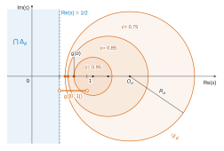
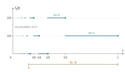
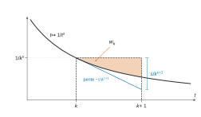
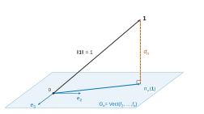

# Centrale-Supélec MP-MPI — Mathématiques 2 2026 · Corrigé brut

*Corrigé rédigé par IA, non officiel. Signalez toute erreur.*

Épreuve de 4 heures, calculatrice autorisée. Notations :

- $\lfloor u\rfloor$ désigne la partie entière, caractérisée par $\lfloor u\rfloor\in\mathbb Z$ et $\lfloor u\rfloor\leqslant u<\lfloor u\rfloor+1$ ;
- pour $s\in\mathbb C$, on note $x=\operatorname{Re}(s)$ ;
- pour $k\geqslant 2$ et $t\in\,]0,1]$, on note $f_k(t)=\frac1k\lfloor\frac1t\rfloor-\lfloor\frac1{kt}\rfloor$.

## Partie A — Questions préliminaires

### A.I — La fonction $\zeta$ sur l'intervalle $]1,+\infty[$

### Q1

Pour $k\geqslant 1$, $s\mapsto k^{-s}=e^{-s\ln k}$ est décroissante sur $\mathbb R$ ($\ln k\geqslant 0$), donc
$$\sup_{s>1}|u_k(s)|=\lim_{s\to1^+}k^{-s}=\frac1k .$$
La série harmonique $\sum\frac1k$ diverge, donc $\sum\|u_k\|_{\infty,]1,+\infty[}$ diverge :

**la série $\sum u_k$ ne converge pas normalement sur $]1,+\infty[$.**

En revanche, pour tout $a>1$, $\|u_k\|_{\infty,[a,+\infty[}=k^{-a}$ et $\sum k^{-a}$ converge : la convergence est normale sur tout $[a,+\infty[$, $a>1$.

### Q2

Soit $s_0>1$ et $a=\frac{1+s_0}{2}\in\,]1,s_0[$. Chaque $u_k$ est continue sur $[a,+\infty[$.

La série $\sum u_k$ y converge normalement (Q1), donc uniformément. Par le théorème de continuité de la somme d'une série de fonctions, $\zeta$ est continue sur $[a,+\infty[$.

Elle est donc continue en $s_0$, intérieur à cet intervalle. Ainsi **$\zeta$ est continue sur $]1,+\infty[$**.

### Q3

Pour $s>1$, tous les termes $k^{-s}$ sont strictement positifs, donc la somme majore toute somme partielle :
$$\boxed{\zeta(s)\geqslant \frac1{1^s}=1>0.}$$
**$\zeta$ ne s'annule pas sur $]1,+\infty[$ et y est strictement positive.**

### A.II — Cas de la variable complexe

### Q4

Avec $s=x+iy$ et $t>0$, $s\ln t=x\ln t+iy\ln t$ et $|e^z|=e^{\operatorname{Re} z}$, donc
$$\boxed{|t^s|=e^{x\ln t}=t^{\operatorname{Re}(s)}}$$
indépendamment de $\operatorname{Im}(s)$ (le facteur $e^{iy\ln t}$ est de module $1$).

### Q5

Pour $x=\operatorname{Re}(s)>1$, Q4 donne $\left|\frac1{k^s}\right|=\frac1{k^x}$, terme général d'une série de Riemann convergente. **La série $\sum\frac1{k^s}$ converge absolument**, donc converge.

### Q6

Pour $a,b>0$, $(ab)^s=e^{s\ln a+s\ln b}=a^sb^s$ et $(p^m)^s=(p^s)^m$. Avec $q_i=p_i^{-s}$,
$$\frac{1}{(p_1^{m_1}\cdots p_n^{m_n})^s}=\prod_{i=1}^n q_i^{m_i}.$$
Par Q4, $|q_i|=p_i^{-x}\leqslant 2^{-x}<1$. La famille géométrique $(q_i^m)_{m\in\mathbb N}$ est donc sommable (car $\sum_m|q_i|^m<+\infty$), de somme $\frac1{1-q_i}$.

Par le théorème du produit d'un nombre fini de familles sommables (récurrence à partir du cas de deux familles), la famille $\bigl(\prod_i q_i^{m_i}\bigr)_{(m_1,\dots,m_n)\in\mathbb N^n}$ est sommable et
$$\boxed{\begin{aligned}S_n(s)&=\prod_{i=1}^n\sum_{m=0}^{+\infty}q_i^m\\&=\prod_{i=1}^n\frac{1}{1-\frac1{p_i^s}}.\end{aligned}}$$

### Q7

Par le théorème fondamental de l'arithmétique (existence et unicité de la décomposition), $\varphi:(m_1,\dots,m_n)\mapsto p_1^{m_1}\cdots p_n^{m_n}$ est une bijection de $\mathbb N^n$ sur $\mathbb N_n$. La somme d'une famille sommable étant invariante par réindexation,
$$S_n(s)=\sum_{k\in\mathbb N_n}\frac1{k^s}.$$
La famille $(k^{-s})_{k\geqslant1}$ est sommable (Q5) ; par sommation par paquets sur $\mathbb N^*=\mathbb N_n\sqcup(\mathbb N^*\setminus\mathbb N_n)$,
$$|\zeta(s)-S_n(s)|=\Bigl|\sum_{k\notin\mathbb N_n}\frac1{k^s}\Bigr|\leqslant\sum_{k\notin\mathbb N_n}\frac1{k^x}.$$
Si $k\leqslant p_n$, tous les facteurs premiers de $k$ sont $\leqslant p_n$, donc $k\in\mathbb N_n$ (y compris $k=1$). Ainsi $k\notin\mathbb N_n\Rightarrow k>p_n$ et
$$|\zeta(s)-S_n(s)|\leqslant\sum_{k>p_n}\frac1{k^x}\xrightarrow[n\to+\infty]{}0,$$
reste d'une série convergente, puisque $p_n\to+\infty$. Donc
$$\boxed{\lim_{n\to+\infty}S_n(s)=\zeta(s).}$$

### Q8

Pour $s=x>1$ réel, $S_n(x)=\prod_{i\leqslant n}(1-p_i^{-x})^{-1}>0$ et $S_n(x)\to\zeta(x)\geqslant1$ (Q7, Q3). Par continuité de $\ln$ en $\zeta(x)>0$,
$$\ln S_n(x)=\sum_{i=1}^n-\ln\bigl(1-p_i^{-x}\bigr)\xrightarrow[n\to+\infty]{}\ln\zeta(x).$$
Les termes $-\ln(1-p_i^{-x})$ sont positifs et les sommes partielles convergent : la série $\sum_i-\ln(1-p_i^{-x})$ converge.

Or, pour $u\in[0,1[$, la fonction $\psi(u)=-\ln(1-u)-u$ vérifie $\psi(0)=0$ et $\psi'(u)=\frac{u}{1-u}\geqslant0$. Donc $0\leqslant u\leqslant-\ln(1-u)$. Par comparaison de séries à termes positifs :

**la série $\sum_i\frac1{p_i^x}$ converge.**

### Q9

On a $\frac{p_i^x}{p_i^x+1}=\frac{1}{1+p_i^{-x}}\in\,]0,1[$, donc $a_n>0$ et
$$\ln a_n=-\sum_{i=1}^n\ln(1+p_i^{-x}).$$
Pour $u\geqslant0$, $0\leqslant\ln(1+u)\leqslant u$ : la dérivée de $u-\ln(1+u)$ vaut $\frac u{1+u}\geqslant0$.

Par Q8 et comparaison, $\sum_i\ln(1+p_i^{-x})$ converge, de somme $L\in\mathbb R_+$. Donc $\ln a_n\to-L$ et, par continuité de $\exp$,
$$\boxed{a_n\xrightarrow[n\to+\infty]{}e^{-L}>0.}$$

### Q10

Pour tout $i$, $|p_i^{-s}|=p_i^{-x}<1$, donc $1-p_i^{-s}\neq0$ et, par l'inégalité triangulaire,
$$0<\bigl|1-p_i^{-s}\bigr|\leqslant1+p_i^{-x}=\frac{p_i^x+1}{p_i^x}.$$
En passant aux inverses et en faisant le produit :
$$\begin{aligned}|S_n(s)|&=\prod_{i=1}^n\frac{1}{|1-p_i^{-s}|}\\&\geqslant\prod_{i=1}^n\frac{p_i^x}{p_i^x+1}\\&=a_n.\end{aligned}$$
Par Q7, $|S_n(s)|\to|\zeta(s)|$ ; par Q9, $a_n\to e^{-L}$. Le passage à la limite dans l'inégalité large donne $|\zeta(s)|\geqslant e^{-L}>0$ :

**$\zeta(s)\neq0$ pour tout $s$ tel que $\operatorname{Re}(s)>1$.**

### A.III — Un calcul d'intégrale

### Q11

Soit $x=\operatorname{Re}(s)>\frac12$. La fonction $t\mapsto t^{2(s-1)}$ est continue sur $]0,1]$ et, par Q4,
$$|t^{2(s-1)}|=t^{2(x-1)}=t^{-(2-2x)},$$
avec $2-2x<1$ : intégrale de Riemann convergente en $0$. Donc $t\mapsto t^{2(s-1)}$ est intégrable sur $]0,1]$.

De plus $|t^{s-1}|^2=t^{2x-2}$ et $2x-1>0$, d'où
$$\begin{aligned}\int_0^1|t^{s-1}|^2\,\mathrm dt&=\lim_{\varepsilon\to0^+}\Bigl[\frac{t^{2x-1}}{2x-1}\Bigr]_\varepsilon^1\\&=\boxed{\frac{1}{2\operatorname{Re}(s)-1}}.\end{aligned}$$

### A.IV — Une étude géométrique

### Q12

Avec $s=X+iY$, en divisant par $d^2>0$ et en complétant le carré :
$$\begin{aligned}s\in\Delta_d&\iff X^2+Y^2-\frac{2X}{d^2}+\frac1{d^2}\geqslant0\\&\iff\Bigl(X-\frac1{d^2}\Bigr)^2+Y^2\geqslant\frac{1}{d^4}-\frac1{d^2}\\&\iff\Bigl(X-\frac1{d^2}\Bigr)^2+Y^2\geqslant\frac{1-d^2}{d^4}.\end{aligned}$$
Comme $0<d<1$, $1-d^2>0$. Donc $\Delta_d=\mathbb C\setminus\mathcal D_d$ où $\mathcal D_d$ est le **disque ouvert** de
$$\boxed{\begin{aligned}{}&\text{centre } O_d \text{ d'affixe } \frac1{d^2},\\&\text{rayon } R_d=\frac{\sqrt{1-d^2}}{d^2}.\end{aligned}}$$

### Q13

Par la quantité conjuguée,
$$\begin{aligned}g(d)&=\frac{1-\sqrt{1-d^2}}{d^2}\\&=\frac{1-(1-d^2)}{d^2\bigl(1+\sqrt{1-d^2}\bigr)}\\&=\frac{1}{1+\sqrt{1-d^2}}.\end{aligned}$$
Sur $]0,1[$, $d\mapsto\sqrt{1-d^2}$ est continue et strictement décroissante, de limite $1$ en $0^+$ et $0$ en $1^-$.

Donc $g$ est continue et strictement croissante, de limite $\frac12$ en $0^+$ et $1$ en $1^-$. Par le théorème de la bijection,
$$\boxed{g\bigl(]0,1[\bigr)=\Bigl]\frac12,1\Bigr[.}$$
($g(d)=O_d-R_d$ est l'abscisse du point le plus à gauche de $\mathcal D_d$.)

### Q14

Si $\operatorname{Re}(s)\leqslant\frac12$, alors $2\operatorname{Re}(s)-1\leqslant0\leqslant d^2|s|^2$ pour tout $d$, donc $s\in\Delta_d$ pour tout $d\in\,]0,1[$.

Réciproquement, supposons $s\in\Delta_d$ pour tout $d\in\,]0,1[$. Alors, pour tout $d$,
$$2\operatorname{Re}(s)-1\leqslant d^2|s|^2.$$
En faisant tendre $d$ vers $0^+$ ($s$ fixé), on obtient $2\operatorname{Re}(s)-1\leqslant0$.

Par double inclusion,
$$\boxed{\bigcap_{d\in]0,1[}\Delta_d=\Bigl\{s\in\mathbb C:\ \operatorname{Re}(s)\leqslant\frac12\Bigr\}.}$$
De façon équivalente, la réunion des disques $\mathcal D_d$ est le demi-plan ouvert $\operatorname{Re}(s)>\frac12$.

## Partie B — Étude analytique

### B.I — Transformée de Mellin des fonctions $f_k$

### Q15

Pour $t=\frac1i$, on a $\lfloor\frac1t\rfloor=i$ et $\frac1{kt}=\frac ik$.

Si $1\leqslant i\leqslant k-1$, $0<\frac ik<1$ donc $\lfloor\frac ik\rfloor=0$ ; si $i=k$, $\lfloor1\rfloor=1$. Ainsi
$$\boxed{\begin{aligned}f_k\Bigl(\frac1i\Bigr)&=\frac ik\qquad(1\leqslant i\leqslant k-1),\\f_k\Bigl(\frac1k\Bigr)&=0.\end{aligned}}$$

### Q16

Soit $t\in\,]0,1]$ et $m=\lfloor\frac1{kt}\rfloor\in\mathbb N$. Par définition, $m\leqslant\frac1{kt}<m+1$, donc
$$km\leqslant\frac1t<km+k.$$
L'entier $km$ est inférieur ou égal à $\frac1t$, donc à $\lfloor\frac1t\rfloor$ (plus grand entier $\leqslant\frac1t$).

Et $\lfloor\frac1t\rfloor\leqslant\frac1t<km+k$ avec des entiers, donc $\lfloor\frac1t\rfloor\leqslant km+k-1$. Ainsi
$$0\leqslant\Bigl\lfloor\frac1t\Bigr\rfloor-km\leqslant k-1,$$
et en divisant par $k$ :
$$\boxed{0\leqslant f_k(t)\leqslant\frac{k-1}{k}.}$$

### Q17

D'après Q16, $kf_k(t)=\lfloor\frac1t\rfloor-k\lfloor\frac1{kt}\rfloor$ est un entier compris entre $0$ et $k-1$. Donc
$$f_k(]0,1])\subset\Bigl\{\frac jk:0\leqslant j\leqslant k-1\Bigr\}.$$
Réciproquement, Q15 montre que $\frac1k,\dots,\frac{k-1}k$ sont atteints (en $t=\frac1i$), et $0$ aussi (en $t=\frac1k$). Donc
$$\boxed{f_k\bigl(]0,1]\bigr)=\Bigl\{0,\frac1k,\frac2k,\dots,\frac{k-1}k\Bigr\}.}$$

### Q18

*Lemme des paliers.* Soit $m\in\mathbb N^*$ et $t\in\,]\frac1{m+1},\frac1m]$. Alors $m\leqslant\frac1t<m+1$, donc $\lfloor\frac1t\rfloor=m$.

Écrivons $m=kq+r$ (division euclidienne, $0\leqslant r\leqslant k-1$). On a
$$\frac mk\leqslant\frac1{kt}<\frac{m+1}k=q+\frac{r+1}k\leqslant q+1.$$
On en tire $q\leqslant\frac1{kt}<q+1$, donc $\lfloor\frac1{kt}\rfloor=q=\lfloor\frac mk\rfloor$. Ainsi
$$f_k(t)=\frac mk-\Bigl\lfloor\frac mk\Bigr\rfloor\quad\text{pour } t\in\Bigl]\frac1{m+1},\frac1m\Bigr],$$
et $f_k$ est constante sur chacun de ces intervalles.

*Continuité par morceaux.* Soit $a\in\,]0,1]$. Le segment $[a,1]$ est recouvert par les intervalles $]\frac1{m+1},\frac1m]$, $1\leqslant m\leqslant\lfloor\frac1a\rfloor$, en nombre fini.

Donc $f_k$ est en escalier sur $[a,1]$. Elle est continue par morceaux sur tout segment de $]0,1]$, c'est-à-dire sur $]0,1]$.

*Intégrabilité.* $|f_k|\leqslant\frac{k-1}k$ (Q16), constante intégrable sur l'intervalle borné $]0,1]$. **$f_k$ est continue par morceaux et intégrable sur $]0,1]$.**

### Q19

Soit $k\geqslant1$ et $s>1$. La démonstration du lemme des paliers montre que $t\mapsto\lfloor\frac1{kt}\rfloor$ vaut $\lfloor\frac mk\rfloor$ sur $]\frac1{m+1},\frac1m]$.

Elle est donc en escalier sur tout segment de $]0,1]$, et son produit par $t\mapsto t^{s-1}$ est continu par morceaux. Comme $0\leqslant\lfloor u\rfloor\leqslant u$ pour $u>0$,
$$0\leqslant\Bigl\lfloor\frac1{kt}\Bigr\rfloor t^{s-1}\leqslant\frac1k\,t^{s-2}.$$
Or $t\mapsto t^{s-2}=t^{-(2-s)}$ est intégrable sur $]0,1]$ car $2-s<1$. Par comparaison de fonctions positives, **$\int_0^1\lfloor\frac1{kt}\rfloor t^{s-1}\,\mathrm dt$ converge.**

### Q20

Sur $]\frac1{j+1},\frac1j]$, $\lfloor\frac1t\rfloor=j$. Par Chasles, pour $N\geqslant1$,
$$\int_{1/(N+1)}^1\Bigl\lfloor\frac1t\Bigr\rfloor t^{s-1}\,\mathrm dt=\sum_{j=1}^N j\int_{1/(j+1)}^{1/j}t^{s-1}\,\mathrm dt.$$
Le membre de gauche tend vers $F(s)$ (convergence, Q19 avec $k=1$). Donc la série converge et $F(s)=\sum_{j\geqslant1}j\int_{1/(j+1)}^{1/j}t^{s-1}\,\mathrm dt$.

Ensuite $\int_{1/(j+1)}^{1/j}t^{s-1}\,\mathrm dt=\frac1s\bigl(j^{-s}-(j+1)^{-s}\bigr)$. Par décalage d'indice,
$$\begin{aligned}T_N&=\sum_{j=1}^N j\bigl(j^{-s}-(j+1)^{-s}\bigr)\\&=\sum_{j=1}^N j^{1-s}-\sum_{i=2}^{N+1}(i-1)i^{-s}\\&=\sum_{i=1}^{N+1}\frac1{i^s}-(N+1)^{1-s}\\&\xrightarrow[N\to+\infty]{}\zeta(s)\end{aligned}$$
car $1-s<0$. Donc
$$\boxed{\begin{aligned}F(s)&=\sum_{j=1}^{+\infty}j\int_{1/(j+1)}^{1/j}t^{s-1}\,\mathrm dt\\&=\frac1s\,\zeta(s).\end{aligned}}$$

### Q21

Les intégrales $F(s)$ et $I_k(s)=\int_0^1\lfloor\frac1{kt}\rfloor t^{s-1}\,\mathrm dt$ convergent (Q19), donc par linéarité
$$\int_0^1f_k(t)t^{s-1}\,\mathrm dt=\frac1kF(s)-I_k(s).$$
Pour $t\in\,]\frac1k,1]$, $\lfloor\frac1{kt}\rfloor=0$ ; pour $j\geqslant1$, $\lfloor\frac1{kt}\rfloor=j\iff t\in\,]\frac1{k(j+1)},\frac1{kj}]$. Comme en Q20 (Chasles puis passage à la limite, licite par Q19),
$$\begin{aligned}I_k(s)&=\sum_{j=1}^{+\infty}\frac js\Bigl(\frac1{(kj)^s}-\frac1{(k(j+1))^s}\Bigr)\\&=\frac1{k^s}\cdot\frac1s\sum_{j=1}^{+\infty}j\bigl(j^{-s}-(j+1)^{-s}\bigr)\\&=\frac{\zeta(s)}{s\,k^s}.\end{aligned}$$
Avec $F(s)=\frac{\zeta(s)}s$ :
$$\boxed{\int_0^1f_k(t)t^{s-1}\,\mathrm dt=\frac1s\Bigl(\frac1k-\frac1{k^s}\Bigr)\zeta(s).}$$

### B.II — Prolongement de la fonction $\zeta$

### Q22

$h'(t)=-s\,t^{-s-1}$, donc $|h'(t)|=\frac{s}{t^{s+1}}$, strictement décroissante sur $[k,k+1]$ ($s+1>0$). Le maximum est atteint en $t=k$ :
$$\boxed{\max_{[k,k+1]}|h'|=\frac{s}{k^{s+1}}.}$$

### Q23

Notons $w_k=\int_k^{k+1}\bigl(\frac1{k^s}-\frac1{t^s}\bigr)\mathrm dt$. Pour $t\in[k,k+1]$, $t^s\geqslant k^s$ ($s>0$), donc l'intégrande est positif et $w_k\geqslant0$. Par l'inégalité des accroissements finis et Q22,
$$0\leqslant\frac1{k^s}-\frac1{t^s}\leqslant\frac{s}{k^{s+1}}(t-k)\leqslant\frac{s}{k^{s+1}},$$
d'où $0\leqslant w_k\leqslant\frac{s}{k^{s+1}}$. La série $\sum\frac{s}{k^{s+1}}$ converge ($s+1>1$), de somme $s\zeta(s+1)$. Par comparaison, $\sum w_k$ est une série à termes positifs convergente, et
$$\boxed{0\leqslant G(s)\leqslant s\,\zeta(s+1).}$$

### Q24

Pour $s>1$ et $N\geqslant1$, par Chasles,
$$\begin{aligned}\sum_{k=1}^Nw_k&=\sum_{k=1}^N\frac1{k^s}-\int_1^{N+1}\frac{\mathrm dt}{t^s}\\&=\sum_{k=1}^N\frac1{k^s}-\frac{1-(N+1)^{1-s}}{s-1}\\&\xrightarrow[N\to+\infty]{}\zeta(s)-\frac1{s-1}.\end{aligned}$$
Donc
$$\boxed{\zeta(s)-G(s)=\frac1{s-1}.}$$
Soit $s\in\,]1,2]$. La fonction $\zeta$ est décroissante sur $]1,+\infty[$, car chaque $u\mapsto k^{-u}$ décroît. Avec Q23, on obtient
$$0\leqslant G(s)\leqslant s\zeta(s+1)\leqslant2\zeta(2).$$
Ainsi $G$ est bornée au voisinage de $1^+$ et
$$\boxed{\zeta(s)=\frac1{s-1}+O(1)\quad(s\to1^+).}$$

### B.III — Intégrale des fonctions $f_k$

### Q25

Pour $s>1$ et $t\in\,]0,1]$, $0<t^{s-1}\leqslant1$, donc $0\leqslant1-t^{s-1}\leqslant1$ et, par Q16,
$$\begin{aligned}\Bigl|\int_0^1f_k(t)t^{s-1}\,\mathrm dt-\int_0^1f_k(t)\,\mathrm dt\Bigr|&\leqslant\frac{k-1}{k}\int_0^1\bigl(1-t^{s-1}\bigr)\mathrm dt\\&=\frac{k-1}{k}\Bigl(1-\frac1s\Bigr)\\&\xrightarrow[s\to1^+]{}0.\end{aligned}$$
(Les deux intégrales convergent : $f_k$ est bornée, continue par morceaux, Q18.) Donc
$$\boxed{\int_0^1f_k(t)t^{s-1}\,\mathrm dt\xrightarrow[s\to1^+]{}\int_0^1f_k(t)\,\mathrm dt.}$$
(Le théorème de convergence dominée à paramètre réel, avec la domination $\frac{k-1}k$, conduit au même résultat.)

### Q26

Pour $s\in\,]1,2]$, Q21 et Q24 donnent
$$\int_0^1f_k(t)t^{s-1}\,\mathrm dt=\frac1s\cdot\frac{\frac1k-\frac1{k^s}}{s-1}+\frac1s\Bigl(\frac1k-\frac1{k^s}\Bigr)G(s).$$
Avec $u=(s-1)\ln k\to0^+$ ($k\geqslant2$) :
$$\frac{\frac1k-\frac1{k^s}}{s-1}=\frac{\ln k}{k}\cdot\frac{1-e^{-u}}{u}\xrightarrow[s\to1^+]{}\frac{\ln k}{k}.$$
Le second terme tend vers $0$, produit de $\frac1k-\frac1{k^s}\to0$ par $G(s)$ bornée (Q24). Donc le membre de gauche tend vers $\frac{\ln k}{k}$ ; par Q25 il tend aussi vers $\int_0^1f_k$. Par unicité de la limite,
$$\boxed{\int_0^1f_k(t)\,\mathrm dt=\frac{\ln k}{k}.}$$

## Partie C — Étude algébrique et géométrique

### C.I — Une forme bilinéaire symétrique positive

### Q27

**a) Vraie.** Si $|f|\leqslant M$, alors $0\leqslant f^2\leqslant M^2$, constante intégrable sur l'intervalle borné $]0,1]$ ; par comparaison, $\int_0^1f^2$ converge et $f\in L^2$.

**b) Fausse.** La fonction $f:t\mapsto\frac1t$ est continue sur $]0,1]$, donc dans $E$. Mais $\int_\varepsilon^1\frac{\mathrm dt}{t^2}=\frac1\varepsilon-1\to+\infty$ : $f\notin L^2$. Donc $L^2\neq E$.

**c) Fausse.** La fonction $f:t\mapsto\frac1{\sqrt t}$ est intégrable sur $]0,1]$, car $\int_0^1t^{-1/2}\,\mathrm dt=2$. Mais $f^2=\frac1t$ ne l'est pas ($\int_\varepsilon^1\frac{\mathrm dt}t=-\ln\varepsilon\to+\infty$) : $f\notin L^2$.

### Q28

De $(|f(t)|-|g(t)|)^2\geqslant0$ on tire $|f(t)g(t)|\leqslant\frac12\bigl(f(t)^2+g(t)^2\bigr)$. Pour $f,g\in L^2$, le majorant est intégrable, donc **$\int_0^1fg$ converge absolument** par comparaison.

$L^2\subset E$ contient la fonction nulle. Soit $f,g\in L^2$ et $\lambda\in\mathbb R$. Alors $f+\lambda g\in E$ et
$$(f+\lambda g)^2=f^2+2\lambda fg+\lambda^2g^2.$$
Les trois intégrales $\int f^2$, $\int fg$, $\int g^2$ convergent. Donc $\int(f+\lambda g)^2$ converge et $f+\lambda g\in L^2$.

**$L^2$ est un sous-espace vectoriel de $E$.**

### Q29

Par Q28, $(f|g)$ est bien défini pour $f,g\in L^2$. La linéarité de l'intégrale (intégrales convergentes) donne $(f+\lambda g|h)=(f|h)+\lambda(g|h)$.

La symétrie $(f|g)=(g|f)$ est évidente et entraîne la linéarité à droite ; enfin $(f|f)=\int_0^1f^2\geqslant0$. **C'est une forme bilinéaire symétrique positive.**

Elle n'est pas définie. Soit $u$ définie par $u(1)=1$ et $u(t)=0$ pour $t\in\,]0,1[$.

Elle est continue par morceaux et bornée, donc dans $L^2$, non nulle, et $(u|u)=\int_0^1u^2=0$. **Ce n'est pas un produit scalaire sur $L^2$.**

### C.II — Un espace préhilbertien réel

### Q30

Soit $t\in\,]\frac12,1]$. Alors $\frac1t\in[1,2[$ donc $\lfloor\frac1t\rfloor=1$.

Pour $k\geqslant2$, $0<\frac1{kt}<\frac2k\leqslant1$ donc $\lfloor\frac1{kt}\rfloor=0$. Ainsi $f_k(t)=\frac1k$, et la relation, évaluée en un tel $t$ (par exemple $t=1$), donne
$$\boxed{\sum_{k=2}^n\frac{\lambda_k}{k}=0.}$$

### Q31

Évaluons en $t=\frac1\ell$ : par Q18 (ou directement), $f_k(\frac1\ell)=\frac\ell k-\lfloor\frac\ell k\rfloor$.

- Pour $k>\ell$, $\lfloor\frac\ell k\rfloor=0$ et le terme vaut $\lambda_k\frac\ell k$.
- Pour $k=\ell$, il vaut $\lambda_\ell(1-1)=0$.
- Pour $2\leqslant k\leqslant\ell-1$, il reste $\lambda_k(\frac\ell k-\lfloor\frac\ell k\rfloor)$.

D'où
$$\boxed{\begin{aligned}{}&\sum_{k=\ell+1}^n\lambda_k\frac\ell k\\&\quad+\sum_{k=2}^{\ell-1}\lambda_k\Bigl(\frac\ell k-\Bigl\lfloor\frac\ell k\Bigr\rfloor\Bigr)=0.\end{aligned}}$$

### Q32

Si $n=2$, Q30 donne directement $\lambda_2=0$.

Supposons $n\geqslant3$. Q31 pour $\ell=2$ donne $\sum_{k=3}^n\frac{2\lambda_k}{k}=0$. En retranchant de Q30, $\frac{\lambda_2}2=0$, donc **$\lambda_2=0$**.

Montrons par récurrence sur $\ell\in\{2,\dots,n\}$ la propriété $(\mathcal H_\ell)$ :
$$\begin{aligned}{}&\lambda_2=\dots=\lambda_{\ell-1}=0\\&\text{et}\ \sum_{k=\ell}^n\frac{\lambda_k}k=0.\end{aligned}$$
$(\mathcal H_2)$ est Q30. Supposons $(\mathcal H_\ell)$ vraie avec $\ell\leqslant n-1$.

Dans Q31 au rang $\ell$, la seconde somme ne fait intervenir que des $\lambda_k$ nuls ; il reste $\sum_{k=\ell+1}^n\frac{\lambda_k}k=0$. La différence avec $(\mathcal H_\ell)$ donne $\lambda_\ell=0$, d'où $(\mathcal H_{\ell+1})$.

Enfin $(\mathcal H_n)$ donne $\lambda_2=\dots=\lambda_{n-1}=0$ et $\frac{\lambda_n}n=0$.

Tous les $\lambda_k$ sont nuls : $(f_2,\dots,f_n)$ est libre pour tout $n$. Comme toute sous-famille finie de $(f_k)_{k\geqslant2}$ est incluse dans l'une d'elles,
$$\boxed{\text{la famille }(f_k)_{k\geqslant2}\text{ est libre.}}$$

### Q33

Les $f_k$ et $\mathbf 1$ sont bornées et continues par morceaux, donc dans $L^2$ (Q27 a) : $F\subset L^2$ et la restriction de $(\cdot|\cdot)$ à $F$ est bilinéaire symétrique positive (Q29). Reste le caractère défini.

Soit $f=a\mathbf 1+\sum_{k=2}^n\lambda_kf_k\in F$ avec $(f|f)=0$. Par le lemme des paliers (Q18), $f$ est constante, égale à un réel $c_m$, sur chaque intervalle $]\frac1{m+1},\frac1m]$. Par positivité et Chasles,
$$\begin{aligned}0\leqslant c_m^2\Bigl(\frac1m-\frac1{m+1}\Bigr)&=\int_{1/(m+1)}^{1/m}f^2\\&\leqslant\int_0^1f^2=0,\end{aligned}$$
donc $c_m=0$ pour tout $m\geqslant1$. Ces intervalles recouvrent $]0,1]$, donc $f=0$. **$(\cdot|\cdot)$ est un produit scalaire sur $F$.**

### C.III — Distance d'un vecteur à des sous-espaces

### Q34

$(F,(\cdot|\cdot))$ est préhilbertien (Q33) et $(f_2,\dots,f_n)$ est libre (Q32). Notons $V_p=\operatorname{Vect}(f_2,\dots,f_p)$. Raisonnons par récurrence sur $p$.

*$p=2$.* La condition $\operatorname{Vect}(e_2)=\operatorname{Vect}(f_2)$ impose $e_2=\mu f_2$, avec $\mu\neq0$.

Les conditions $\|e_2\|=1$ et $(e_2|f_2)=\mu\|f_2\|^2>0$ imposent $\mu=\frac1{\|f_2\|}$ ($\|f_2\|>0$ car $f_2\neq0$).

Donc $e_2=\frac{f_2}{\|f_2\|}$, et ce choix convient.

*Hérédité.* Supposons $(e_2,\dots,e_{p-1})$ construite et unique, base orthonormée de $V_{p-1}$. Posons
$$w=f_p-\sum_{j=2}^{p-1}(f_p|e_j)e_j.$$
Alors $w\perp V_{p-1}$, et $w\neq0$ car $f_p\notin V_{p-1}$ (liberté). Posons $e_p=\frac w{\|w\|}$ : la famille $(e_2,\dots,e_p)$ est orthonormale, et
$$\begin{aligned}\operatorname{Vect}(e_2,\dots,e_p)&=V_{p-1}+\mathbb Rw\\&=V_{p-1}+\mathbb Rf_p\\&=V_p.\end{aligned}$$
Enfin, comme $f_p-w\in V_{p-1}$,
$$(e_p|f_p)=\frac{(w|w+(f_p-w))}{\|w\|}=\|w\|>0.$$
Donc $e_p$ convient.

Unicité : si $e'_p$ convient, $e'_p\in V_p\cap V_{p-1}^\perp$. Or $V_p=V_{p-1}\oplus\mathbb Rw$.

Écrivons $e'_p=u+\alpha w$ avec $u\in V_{p-1}$. Alors $0=(e'_p|u)=\|u\|^2$, donc $e'_p=\alpha w$.

Puis $\|e'_p\|=1$ et $(e'_p|f_p)=\alpha\|w\|^2>0$ imposent $\alpha=\frac1{\|w\|}$, soit $e'_p=e_p$.

**Il existe une unique famille orthonormale $(e_k)_{2\leqslant k\leqslant n}$ d'éléments de $F\subset L^2$ telle que, pour $2\leqslant p\leqslant n$, $\operatorname{Vect}(e_2,\dots,e_p)=\operatorname{Vect}(f_2,\dots,f_p)$ et $(e_p|f_p)>0$.**

(Par unicité, la famille obtenue pour $n+1$ prolonge celle obtenue pour $n$.)

### Q35

Soit $G_n=\operatorname{Vect}(f_2,\dots,f_n)=\operatorname{Vect}(e_2,\dots,e_n)$, de dimension finie, et $\pi_n$ la projection orthogonale sur $G_n$. On a
$$\pi_n(\mathbf 1)=\sum_{k=2}^n(\mathbf 1|e_k)e_k,$$
et $d_n=\|\mathbf 1-\pi_n(\mathbf 1)\|$ (le projeté réalise la distance). Comme $\mathbf 1-\pi_n(\mathbf 1)\in G_n^\perp$ et $\pi_n(\mathbf 1)\in G_n$, Pythagore donne
$$\begin{aligned}\|\mathbf 1\|^2&=\|\pi_n(\mathbf 1)\|^2+d_n^2\\&=\sum_{k=2}^n(\mathbf 1|e_k)^2+d_n^2 .\end{aligned}$$
Comme $\|\mathbf 1\|^2=\int_0^11\,\mathrm dt=1$,
$$\boxed{d_n^2=1-\sum_{k=2}^n(\mathbf 1|e_k)^2.}$$

### Q36

Comme $G_n\subset G_{n+1}$,
$$d_{n+1}=\inf_{g\in G_{n+1}}\|\mathbf 1-g\|\leqslant\inf_{g\in G_n}\|\mathbf 1-g\|=d_n.$$
On peut aussi lire $d_{n+1}^2=d_n^2-(\mathbf 1|e_{n+1})^2$ sur Q35, la famille $(e_k)$ ne dépendant pas de $n$.

La suite $(d_n)$ est décroissante et minorée par $0$ : **elle converge** (théorème de la limite monotone).

## Partie D — Synthèse

### Q37

Posons $u=1-\sum_{k=2}^n\lambda_kf_k$ (réelle) et $v:t\mapsto t^{s-1}$ (complexe).

La fonction $u$ est continue par morceaux (Q18) et bornée par $1+\sum|\lambda_k|$ (Q16). Donc $u^2$ est intégrable sur $]0,1]$ (Q27 a).

La fonction $v$ est continue sur $]0,1]$, et $|v(t)|^2=t^{2(x-1)}=|t^{2(s-1)}|$ (Q4) est intégrable car $x>\frac12$ (Q11).

L'inégalité de Cauchy-Schwarz admise s'applique au couple $(u,v)$, avec $|u|^2=u^2$ :
$$\boxed{\Bigl|\int_0^1\Bigl(1-\sum_{k=2}^n\lambda_kf_k(t)\Bigr)t^{s-1}\,\mathrm dt\Bigr|^2\leqslant\int_0^1\Bigl(1-\sum_{k=2}^n\lambda_kf_k(t)\Bigr)^2\mathrm dt\times\int_0^1|t^{2(s-1)}|\,\mathrm dt.}$$

### Q38

Soit $s\neq1$ avec $x=\operatorname{Re}(s)>\frac12$ et $\zeta(s)=0$.

*Intégrale de $t^{s-1}$.* $|t^{s-1}|=t^{x-1}$ est intégrable sur $]0,1]$ ($x-1>-1$) et $t\mapsto\frac{t^s}s$ est une primitive ($s\neq0$).

Comme $|\varepsilon^s|=\varepsilon^x\to0$,
$$\begin{aligned}\int_0^1t^{s-1}\,\mathrm dt&=\lim_{\varepsilon\to0^+}\frac{1-\varepsilon^s}{s}\\&=\frac1s.\end{aligned}$$

*Intégrales des $f_k$.* L'égalité de Q21 est admise pour $s$ complexe de partie réelle $>0$ distinct de $1$. Les intégrales sont absolument convergentes car $|f_k(t)t^{s-1}|\leqslant t^{x-1}$. Pour tout $k\geqslant2$,
$$\int_0^1f_k(t)t^{s-1}\,\mathrm dt=\frac1s\Bigl(\frac1k-\frac1{k^s}\Bigr)\zeta(s)=0.$$

*Inégalité.* Par linéarité, pour toute famille réelle $(\lambda_k)$, $\int_0^1\bigl(1-\sum\lambda_kf_k\bigr)t^{s-1}\,\mathrm dt=\frac1s$, et Q37 avec Q11 donne
$$\frac1{|s|^2}\leqslant\Bigl\|\mathbf 1-\sum_{k=2}^n\lambda_kf_k\Bigr\|^2\cdot\frac1{2x-1}.$$
Ceci vaut pour toute famille $(\lambda_k)$, en particulier pour celle qui donne $\sum\lambda_kf_k=\pi_n(\mathbf 1)$, pour laquelle la norme vaut $d_n$ (Q35). Ainsi
$$\boxed{d_n^2|s|^2\geqslant2\operatorname{Re}(s)-1\qquad\text{pour tout }n\geqslant2.}$$

*Conclusion.* Si $d_n\to0$, le passage à la limite donne $0\geqslant2\operatorname{Re}(s)-1$, soit $\operatorname{Re}(s)\leqslant\frac12$ : contradiction.

*Lecture géométrique.* L'inégalité dit $s\in\Delta_{d_n}$. On a $0<d_n\leqslant d_2=\sqrt{1-\ln2}<1$.

En effet, soit $L=\operatorname{ppcm}(2,\dots,n)$ : tout élément de $G_n$ s'annule en $\frac1L$, donc $\mathbf 1\notin G_n$ et $d_n>0$.

De plus $f_2^2=\frac12f_2$, donc $\|f_2\|^2=\frac{\ln2}4$ par Q26, et
$$\begin{aligned}d_2^2&=1-\frac{(\mathbf 1|f_2)^2}{\|f_2\|^2}\\&=1-\frac{(\ln2/2)^2}{\ln2/4}\\&=1-\ln2.\end{aligned}$$
Comme $\Delta_d\subset\Delta_{d'}$ pour $d\leqslant d'$, $d_n\to0$ placerait $s$ dans $\bigcap_d\Delta_d=\{\operatorname{Re}\leqslant\frac12\}$ par Q14. Par conséquent :

**si $\lim d_n=0$, la fonction $\zeta$ prolongée ne s'annule en aucun $s$ tel que $\operatorname{Re}(s)>\frac12$** (en $s=1$, elle n'est pas définie : c'est un pôle).
