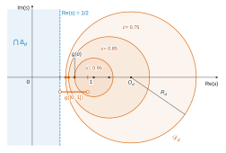
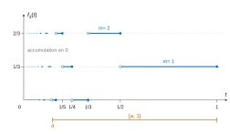
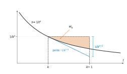
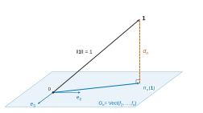

# Centrale-Supélec MP-MPI — Mathématiques 2 2026 · Corrigé guidé

*Corrigé rédigé par IA, non officiel. Signalez toute erreur.*

## Présentation du sujet

**Thème.** Le sujet construit une *condition suffisante* pour que la fonction $\zeta$ de Riemann ne s'annule pas dans le demi-plan $\operatorname{Re}(s)>\frac12$ (forme de l'hypothèse de Riemann). Cette condition est géométrique : si la distance $d_n$, dans un espace de fonctions de carré intégrable sur $]0,1]$, de la fonction constante $\mathbf 1$ au sous-espace engendré par $f_2,\dots,f_n$, où
$$f_k(t)=\frac1k\Bigl\lfloor\frac1t\Bigr\rfloor-\Bigl\lfloor\frac1{kt}\Bigr\rfloor,$$
tend vers $0$, alors $\zeta$ n'a pas de zéro de partie réelle $>\frac12$. Le résultat appartient à la famille des critères dits de Nyman-Beurling ; le sujet n'en démontre qu'un sens et ne prétend évidemment pas établir que $d_n\to0$.

**Découpage.**

| Partie | Questions | Contenu | Outils |
|---|---|---|---|
| A-I | Q1–Q3 | $\zeta$ sur $]1,+\infty[$ : convergence normale, continuité, signe | séries de fonctions |
| A-II | Q4–Q10 | produit eulérien, non-annulation sur $\operatorname{Re}(s)>1$ | familles sommables, séries numériques, logarithme |
| A-III | Q11 | $\int_0^1|t^{s-1}|^2=\frac1{2\operatorname{Re}(s)-1}$ | intégrales de Riemann |
| A-IV | Q12–Q14 | disques $\mathcal D_d$, intersection des $\Delta_d$ | géométrie du plan complexe, étude de fonction |
| B-I | Q15–Q21 | valeurs et paliers des $f_k$, transformée de Mellin | partie entière, intégrales généralisées |
| B-II | Q22–Q24 | prolongement $\zeta(s)=\frac1{s-1}+G(s)$ | comparaison série-intégrale, accroissements finis |
| B-III | Q25–Q26 | $\int_0^1f_k=\frac{\ln k}k$ | passage à la limite, développement limité |
| C-I | Q27–Q29 | l'espace $L^2$ et la forme $(f|g)=\int fg$ | intégrabilité, comparaison |
| C-II | Q30–Q33 | liberté de $(f_k)$, produit scalaire sur $F$ | algèbre linéaire, partie entière |
| C-III | Q34–Q36 | Gram-Schmidt, distance $d_n$ | espaces préhilbertiens |
| D | Q37–Q38 | Cauchy-Schwarz et conclusion | synthèse |

**Notions du programme mobilisées.** Convergence normale et continuité des séries de fonctions ; familles sommables (produit, sommation par paquets, réindexation) ; séries à termes positifs ; intégrales généralisées et comparaison ; théorème de convergence dominée (ou majoration directe) ; espaces préhilbertiens, Gram-Schmidt, projection orthogonale, Pythagore ; nombres complexes.

**Difficulté et longueur.** Sujet long (38 questions en 4 heures, soit un peu plus de 6 minutes par question) mais très progressif : la plupart des questions sont des applications directes du cours, et la difficulté se concentre sur quelques points (Q7, Q16, Q20–Q21, Q26, Q32–Q34, Q38). Les parties sont largement indépendantes : A-III et A-IV ne dépendent de rien, B-II ne dépend pas de B-I, et la partie D peut se traiter en admettant Q11, Q21 et Q35.

**Questions abordables à ne pas laisser passer.** Q1–Q5, Q11, Q12–Q14, Q15, Q17, Q22–Q23, Q27–Q30, Q35–Q37. Elles représentent près de la moitié du sujet.

**Gestion du temps.** Viser environ 1 h pour la partie A, 1 h 15 pour la partie B, 1 h 15 pour la partie C et 30 min pour la partie D. Ne pas s'enliser dans les questions de rédaction délicate (Q7, Q20) : leurs résultats sont donnés et utilisables pour la suite.

## Partie A — Questions préliminaires

Cette partie rassemble les propriétés de base de $\zeta$ sur $]1,+\infty[$ puis sur $\operatorname{Re}(s)>1$, où l'on montre la non-annulation grâce au produit eulérien. Elle prépare aussi deux outils autonomes : l'intégrale de Q11 et la famille de disques de Q12–Q14.

### A.I — La fonction $\zeta$ sur l'intervalle $]1,+\infty[$

### Question 1

> [!INDICATION]
> Calculer la norme infinie de $u_k$ sur $]1,+\infty[$ : où le maximum de $s\mapsto k^{-s}$ est-il « approché » ?

> [!INDICATION]
> La norme obtenue est une borne supérieure non atteinte ; reconnaître la série numérique associée.

#### Solution

Pour $k\geqslant1$, $s\mapsto k^{-s}=e^{-s\ln k}$ est décroissante ($\ln k\geqslant0$), donc
$$\begin{aligned}\|u_k\|_{\infty,]1,+\infty[}&=\sup_{s>1}k^{-s}\\&=\lim_{s\to1^+}k^{-s}\\&=\frac1k.\end{aligned}$$
La série harmonique diverge : **la série $\sum u_k$ ne converge pas normalement sur $]1,+\infty[$.**

En revanche, sur $[a,+\infty[$ avec $a>1$, $\|u_k\|_\infty=k^{-a}$ et $\sum k^{-a}$ converge : la convergence y est normale.

> [!PIEGE]
> Majorer $k^{-s}$ par $k^{-s_0}$ pour un $s_0>1$ fixé ne donne pas une majoration valable pour *tous* les $s>1$. La convergence normale est une propriété uniforme sur l'intervalle entier.

### Question 2

> [!INDICATION]
> La continuité est une propriété locale : il suffit d'avoir convergence uniforme au voisinage de chaque point.

> [!INDICATION]
> Autour de $s_0>1$, choisir un intervalle $[a,+\infty[$ avec $1<a<s_0$ et utiliser la fin de Q1.

#### Solution

Soit $s_0>1$ et $a=\frac{1+s_0}2\in\,]1,s_0[$. Les $u_k$ sont continues et $\sum u_k$ converge normalement, donc uniformément, sur $[a,+\infty[$.

Par le théorème de continuité de la somme d'une série de fonctions, $\zeta$ est continue sur $[a,+\infty[$, donc en $s_0$ (point intérieur). Comme $s_0$ est quelconque, **$\zeta$ est continue sur $]1,+\infty[$.**

> [!METHODE]
> Quand la convergence normale échoue sur l'intervalle entier à cause d'une borne, on la cherche sur tout segment ou sur tout $[a,+\infty[$ intérieur, puis on conclut par le caractère local de la continuité.

### Question 3

> [!INDICATION]
> Une somme de termes strictement positifs majore chacune de ses sommes partielles.

#### Solution

Pour $s>1$, les termes $k^{-s}$ sont strictement positifs, donc $\zeta(s)\geqslant1^{-s}=1$ :
$$\boxed{\zeta(s)\geqslant1>0.}$$
**$\zeta$ ne s'annule pas sur $]1,+\infty[$ et y est strictement positive.**

### A.II — Cas de la variable complexe

### Question 4

> [!INDICATION]
> Revenir à la définition $t^s=e^{s\ln t}$ et au module d'une exponentielle complexe.

#### Solution

Avec $s=x+iy$, $s\ln t=x\ln t+iy\ln t$ et $|e^z|=e^{\operatorname{Re}z}$, donc
$$\boxed{|t^s|=t^{\operatorname{Re}(s)}}$$
et $\operatorname{Im}(s)$ n'intervient pas (le facteur $e^{iy\ln t}$ est de module $1$).

> [!PIEGE]
> Écrire $|t^s|=t^{|s|}$ est une faute grave : seule la partie réelle compte. Ce résultat sera utilisé à chaque majoration de la suite.

### Question 5

> [!INDICATION]
> Calculer le module du terme général grâce à Q4 et reconnaître une série de référence.

#### Solution

Par Q4, $|k^{-s}|=k^{-x}$ avec $x=\operatorname{Re}(s)>1$ : série de Riemann convergente. **La série $\sum k^{-s}$ converge absolument**, donc converge dans $\mathbb C$.

### Question 6

> [!INDICATION]
> Écrire le terme général comme un produit de $n$ facteurs, chacun ne dépendant que d'un $m_i$.

> [!INDICATION]
> Chaque facteur décrit une famille géométrique ; vérifier que sa raison est de module $<1$, puis invoquer le théorème sur le produit de familles sommables.

#### Solution

Pour $a,b>0$, $(ab)^s=a^sb^s$ et $(p^m)^s=(p^s)^m$ (propriétés de l'exponentielle). Avec $q_i=p_i^{-s}$,
$$\frac1{(p_1^{m_1}\cdots p_n^{m_n})^s}=\prod_{i=1}^nq_i^{m_i}.$$
Par Q4, $|q_i|=p_i^{-x}\leqslant2^{-x}<1$, donc la famille $(q_i^m)_{m\in\mathbb N}$ est sommable, de somme $\frac1{1-q_i}$. Le théorème du produit de familles sommables (cas de deux familles, puis récurrence sur $n$) donne la sommabilité de la famille produit indexée par $\mathbb N^n$ et
$$\boxed{S_n(s)=\prod_{i=1}^n\frac1{1-\frac1{p_i^s}}.}$$

> [!METHODE]
> Une somme sur $\mathbb N^n$ dont le terme général est un produit de fonctions de chaque indice se calcule comme produit de sommes, à condition d'avoir établi la sommabilité de chaque facteur.

### Question 7

> [!INDICATION]
> Le théorème fondamental de l'arithmétique fournit une bijection entre $\mathbb N^n$ et $\mathbb N_n$.

> [!INDICATION]
> Pour la limite, majorer $|\zeta(s)-S_n(s)|$ par une somme portant sur les entiers qui ne sont pas dans $\mathbb N_n$, et remarquer que ces entiers sont tous grands.

#### Solution

L'application $(m_1,\dots,m_n)\mapsto p_1^{m_1}\cdots p_n^{m_n}$ est une bijection de $\mathbb N^n$ sur $\mathbb N_n$ (existence et unicité de la décomposition en facteurs premiers). La somme d'une famille sommable ne dépendant pas de l'indexation,
$$S_n(s)=\sum_{k\in\mathbb N_n}\frac1{k^s}.$$
La famille $(k^{-s})_{k\geqslant1}$ est sommable (Q5) ; par sommation par paquets,
$$|\zeta(s)-S_n(s)|=\Bigl|\sum_{k\in\mathbb N^*\setminus\mathbb N_n}k^{-s}\Bigr|\leqslant\sum_{k\in\mathbb N^*\setminus\mathbb N_n}k^{-x}.$$
Tout entier $k\leqslant p_n$ n'a que des facteurs premiers $\leqslant p_n$, donc appartient à $\mathbb N_n$. Par contraposée,
$$|\zeta(s)-S_n(s)|\leqslant\sum_{k>p_n}\frac1{k^x}\xrightarrow[n\to+\infty]{}0$$
(reste d'une série convergente, $p_n\to+\infty$). Donc
$$\boxed{\lim_{n\to+\infty}S_n(s)=\zeta(s).}$$

> [!PIEGE]
> Le reste se coupe en $p_n$, pas en $n$. Et l'argument arithmétique « tout $k\leqslant p_n$ est dans $\mathbb N_n$ » est le cœur de la question : il doit être écrit.

### Question 8

> [!INDICATION]
> Prendre le logarithme de $S_n(x)$ (produit fini) : on obtient la somme partielle d'une série à termes positifs.

> [!INDICATION]
> Comparer ensuite $-\ln(1-u)$ et $u$ pour $u\in[0,1[$.

#### Solution

Pour $x>1$ réel, $S_n(x)>0$ et $S_n(x)\to\zeta(x)\geqslant1$ (Q7, Q3), donc
$$\ln S_n(x)=\sum_{i=1}^n-\ln(1-p_i^{-x})\xrightarrow[n\to+\infty]{}\ln\zeta(x).$$
La série à termes positifs $\sum_i-\ln(1-p_i^{-x})$ a des sommes partielles convergentes, donc converge.

L'étude de $\psi(u)=-\ln(1-u)-u$ ($\psi(0)=0$, $\psi'(u)=\frac u{1-u}\geqslant0$) donne $0\leqslant u\leqslant-\ln(1-u)$ sur $[0,1[$. Par comparaison, **$\sum_i p_i^{-x}$ converge.**

> [!METHODE]
> Pour étudier un produit, on passe au logarithme d'un produit *fini*, puis on fait tendre $n$ vers l'infini. Les inégalités $u\leqslant-\ln(1-u)$ et $\ln(1+u)\leqslant u$ se démontrent en une ligne par étude de fonction.

### Question 9

> [!INDICATION]
> Suivre l'énoncé : $\ln a_n$ est la somme partielle d'une série de signe constant.

> [!INDICATION]
> Majorer $\ln(1+u)$ par $u$ et utiliser Q8 ; la stricte positivité de la limite vient de ce que le logarithme converge vers un réel fini.

#### Solution

On a $\frac{p_i^x}{p_i^x+1}=\frac1{1+p_i^{-x}}$, donc
$$\ln a_n=-\sum_{i=1}^n\ln(1+p_i^{-x}).$$
Comme $0\leqslant\ln(1+u)\leqslant u$ pour $u\geqslant0$, Q8 et la comparaison donnent la convergence de $\sum\ln(1+p_i^{-x})$, de somme $L\geqslant0$.

Ainsi $\ln a_n\to-L$ et
$$\boxed{a_n\to e^{-L}>0.}$$

> [!PIEGE]
> La suite $(a_n)$ est décroissante et positive, donc convergente, mais cela ne dit rien du signe strict de la limite. C'est la convergence de $\ln a_n$ vers un réel qui l'assure.

### Question 10

> [!INDICATION]
> Minorer $|S_n(s)|$ facteur par facteur : il faut *majorer* chaque $|1-p_i^{-s}|$.

> [!INDICATION]
> Passer ensuite à la limite avec Q7 et Q9.

#### Solution

Comme $|p_i^{-s}|=p_i^{-x}<1$, on a $1-p_i^{-s}\neq0$ et
$$|1-p_i^{-s}|\leqslant1+p_i^{-x}=\frac{p_i^x+1}{p_i^x}.$$
En inversant et en multipliant :
$$|S_n(s)|=\prod_{i=1}^n\frac1{|1-p_i^{-s}|}\geqslant a_n.$$
Par passage à la limite (Q7, Q9), $|\zeta(s)|\geqslant e^{-L}>0$. **Donc $\zeta(s)\neq0$ pour $\operatorname{Re}(s)>1$.**

> [!PIEGE]
> C'est l'inégalité triangulaire $|1-z|\leqslant1+|z|$ qui sert, pas $|1-z|\geqslant1-|z|$. Penser aussi à justifier que les facteurs sont non nuls avant d'inverser.

### A.III — Un calcul d'intégrale

### Question 11

> [!INDICATION]
> Par Q4, le module de $t^{2(s-1)}$ est une puissance réelle de $t$ ; reconnaître une intégrale de Riemann en $0$.

#### Solution

Avec $x=\operatorname{Re}(s)>\frac12$, Q4 donne
$$|t^{2(s-1)}|=t^{2x-2}=t^{-(2-2x)},$$
avec $2-2x<1$ : intégrale de Riemann convergente en $0$. Donc $t\mapsto t^{2(s-1)}$ (continue sur $]0,1]$) est intégrable.

Comme $|t^{s-1}|^2=t^{2x-2}$,
$$\begin{aligned}\int_0^1|t^{s-1}|^2\,\mathrm dt&=\lim_{\varepsilon\to0^+}\Bigl[\frac{t^{2x-1}}{2x-1}\Bigr]_\varepsilon^1\\&=\boxed{\frac1{2\operatorname{Re}(s)-1}}.\end{aligned}$$

> [!METHODE]
> Pour une puissance complexe, on intègre le module : $|t^{\alpha}|=t^{\operatorname{Re}\alpha}$ ramène tout au critère de Riemann. C'est ici qu'apparaît la droite $\operatorname{Re}(s)=\frac12$.

### A.IV — Une étude géométrique

### Question 12

> [!INDICATION]
> Écrire $s=X+iY$ et diviser par $d^2$.

> [!INDICATION]
> Compléter le carré en $X$ pour reconnaître l'équation d'un cercle.

#### Solution

$$\begin{aligned}s\in\Delta_d&\iff X^2+Y^2-\frac{2X}{d^2}+\frac1{d^2}\geqslant0\\&\iff\Bigl(X-\frac1{d^2}\Bigr)^2+Y^2\geqslant\frac{1-d^2}{d^4}.\end{aligned}$$
Comme $1-d^2>0$, $\Delta_d$ est le complémentaire du **disque ouvert** $\mathcal D_d$ de
$$\boxed{\begin{aligned}{}&\text{centre }O_d=\frac1{d^2},\\&\text{rayon }R_d=\frac{\sqrt{1-d^2}}{d^2}.\end{aligned}}$$

> [!PIEGE]
> L'inégalité est large, donc le cercle appartient à $\Delta_d$ et le disque retiré est ouvert.

### Question 13

> [!INDICATION]
> L'expression est indéterminée en $0$ : multiplier par la quantité conjuguée.

> [!INDICATION]
> Sous la forme obtenue, la monotonie se lit sans dériver.

#### Solution

$$\begin{aligned}g(d)&=\frac{1-\sqrt{1-d^2}}{d^2}\\&=\frac{1}{1+\sqrt{1-d^2}}.\end{aligned}$$
La fonction $d\mapsto\sqrt{1-d^2}$ est continue, strictement décroissante sur $]0,1[$, de limites $1$ en $0^+$ et $0$ en $1^-$.

Donc $g$ est continue, strictement croissante, de limites $\frac12$ et $1$, et par le théorème de la bijection
$$\boxed{g(]0,1[)=\Bigl]\frac12,1\Bigr[.}$$
Interprétation : $g(d)=O_d-R_d$ est l'abscisse du point le plus à gauche de $\mathcal D_d$.

### Question 14

> [!INDICATION]
> Raisonner par double inclusion ; l'une des inclusions est immédiate selon le signe de $2\operatorname{Re}(s)-1$.

> [!INDICATION]
> Pour l'autre, faire tendre $d$ vers $0$ dans l'inégalité large.

#### Solution

Si $\operatorname{Re}(s)\leqslant\frac12$, alors $2\operatorname{Re}(s)-1\leqslant0\leqslant d^2|s|^2$ : $s\in\Delta_d$ pour tout $d$.

Réciproquement, si $2\operatorname{Re}(s)-1\leqslant d^2|s|^2$ pour tout $d\in\,]0,1[$, le passage à la limite $d\to0^+$ donne $2\operatorname{Re}(s)-1\leqslant0$. Donc
$$\boxed{\bigcap_{d\in]0,1[}\Delta_d=\Bigl\{s:\operatorname{Re}(s)\leqslant\frac12\Bigr\}.}$$

Quand $d\to0^+$, centre et rayon tendent vers $+\infty$ : la réunion des disques $\mathcal D_d$ est le demi-plan ouvert $\operatorname{Re}(s)>\frac12$.

> [!PIEGE]
> On ne peut pas « prendre $d=0$ », qui n'est pas dans $]0,1[$ : on passe à la limite dans une inégalité large.

## Partie B — Étude analytique

On étudie les fonctions $f_k$ : leurs valeurs (Q15–Q17), leur structure en paliers (Q18), puis leur transformée de Mellin $\int_0^1f_k(t)t^{s-1}\,\mathrm dt$, qui fait apparaître $\zeta$ en facteur (Q19–Q21). On prolonge ensuite $\zeta$ à $\operatorname{Re}(s)>0$ et on en déduit $\int_0^1f_k$.

### B.I — Transformée de Mellin des fonctions $f_k$

### Question 15

> [!INDICATION]
> En $t=\frac1i$, la première partie entière est immédiate ; distinguer $i<k$ et $i=k$ pour la seconde.

#### Solution

$\lfloor\frac1t\rfloor=i$ et $\lfloor\frac1{kt}\rfloor=\lfloor\frac ik\rfloor$, nul si $i<k$, égal à $1$ si $i=k$ :
$$\boxed{\begin{aligned}f_k\Bigl(\frac1i\Bigr)&=\frac ik\qquad(1\leqslant i\leqslant k-1),\\f_k\Bigl(\frac1k\Bigr)&=0.\end{aligned}}$$

> [!PIEGE]
> Traiter $i=k$ avec les autres donnerait $f_k(\frac1k)=1$, en contradiction avec Q16.

### Question 16

> [!INDICATION]
> Partir de l'encadrement définissant $m=\lfloor\frac1{kt}\rfloor$ et le multiplier par $k$.

> [!INDICATION]
> On obtient un encadrement de $\frac1t$ par deux entiers ; le transférer à $\lfloor\frac1t\rfloor$ en utilisant qu'une inégalité stricte entre entiers fait gagner $1$.

#### Solution

Avec $m=\lfloor\frac1{kt}\rfloor$ : $m\leqslant\frac1{kt}<m+1$, donc
$$km\leqslant\frac1t<km+k.$$
L'entier $km$ est $\leqslant\frac1t$, donc $\leqslant\lfloor\frac1t\rfloor$. Et $\lfloor\frac1t\rfloor<km+k$ entre entiers donne $\lfloor\frac1t\rfloor\leqslant km+k-1$. Donc
$$0\leqslant\Bigl\lfloor\frac1t\Bigr\rfloor-km\leqslant k-1,$$
et en divisant par $k$ :
$$\boxed{0\leqslant f_k(t)\leqslant\frac{k-1}k.}$$

> [!METHODE]
> Pour encadrer une expression en parties entières, on encadre la quantité réelle par des entiers, puis on utilise que $\lfloor u\rfloor$ est le plus grand entier $\leqslant u$.

### Question 17

> [!INDICATION]
> Que dire de $kf_k(t)$ ? Combiner avec Q16, puis vérifier avec Q15 que toutes les valeurs candidates sont atteintes.

#### Solution

$kf_k(t)=\lfloor\frac1t\rfloor-k\lfloor\frac1{kt}\rfloor$ est un entier de $\{0,\dots,k-1\}$ (Q16). Réciproquement, Q15 montre que $\frac ik$ ($1\leqslant i\leqslant k-1$) et $0$ sont atteints. Par double inclusion,
$$\boxed{f_k(]0,1])=\Bigl\{0,\frac1k,\dots,\frac{k-1}k\Bigr\}.}$$

### Question 18

> [!INDICATION]
> Étudier $f_k$ sur un intervalle où $\lfloor\frac1t\rfloor$ est constant, c'est-à-dire sur $]\frac1{m+1},\frac1m]$.

> [!INDICATION]
> Montrer que $\lfloor\frac1{kt}\rfloor$ y est aussi constant, à l'aide de la division euclidienne de $m$ par $k$. Pour l'intégrabilité, penser à Q16.

#### Solution

*Lemme des paliers.* Pour $t\in\,]\frac1{m+1},\frac1m]$, $\lfloor\frac1t\rfloor=m$. Avec $m=kq+r$, $0\leqslant r\leqslant k-1$ : $q\leqslant\frac mk\leqslant\frac1{kt}<\frac{m+1}k=q+\frac{r+1}k\leqslant q+1$, donc $\lfloor\frac1{kt}\rfloor=q=\lfloor\frac mk\rfloor$ et
$$f_k(t)=\frac mk-\Bigl\lfloor\frac mk\Bigr\rfloor\quad\text{sur }\Bigl]\frac1{m+1},\frac1m\Bigr].$$
*Continuité par morceaux.* Sur $[a,1]$, $a>0$, seuls les paliers $m\leqslant\lfloor\frac1a\rfloor$ interviennent : $f_k$ y est en escalier. Elle est donc continue par morceaux sur tout segment de $]0,1]$.

*Intégrabilité.* $|f_k|\leqslant\frac{k-1}k$ (Q16), constante intégrable sur l'intervalle borné $]0,1]$. **$f_k$ est continue par morceaux et intégrable sur $]0,1]$.**

> [!PIEGE]
> $f_k$ a une infinité de discontinuités (aux points $\frac1m$), mais elles ne s'accumulent qu'en $0$, borne exclue : c'est compatible avec la continuité par morceaux sur $]0,1]$, qui s'entend sur tout segment inclus dans $]0,1]$.

> [!METHODE]
> Le lemme des paliers resservira en Q19, Q30, Q31 et Q33 : il vaut la peine de l'énoncer une fois pour toutes.

### Question 19

> [!INDICATION]
> Majorer la partie entière par son argument : on obtient une puissance de $t$.

> [!INDICATION]
> Comparer à une intégrale de Riemann en $0$ ; préciser l'exposant critique.

#### Solution

Par la preuve du lemme des paliers, $t\mapsto\lfloor\frac1{kt}\rfloor$ est en escalier sur tout segment de $]0,1]$, et son produit par $t^{s-1}$ est continu par morceaux. Comme $0\leqslant\lfloor u\rfloor\leqslant u$,
$$0\leqslant\Bigl\lfloor\frac1{kt}\Bigr\rfloor t^{s-1}\leqslant\frac1kt^{s-2},$$
et $t^{s-2}=t^{-(2-s)}$ est intégrable sur $]0,1]$ puisque $2-s<1$. **L'intégrale converge** par comparaison de fonctions positives.

### Question 20

> [!INDICATION]
> Découper $]0,1]$ selon les intervalles où $\lfloor\frac1t\rfloor$ est constant, en se limitant d'abord à $[\frac1{N+1},1]$.

> [!INDICATION]
> Faire tendre $N$ vers l'infini grâce à Q19, puis calculer la somme partielle obtenue par un décalage d'indice (elle n'est pas directement télescopique).

#### Solution

Sur $]\frac1{j+1},\frac1j]$, $\lfloor\frac1t\rfloor=j$. Par Chasles,
$$\int_{1/(N+1)}^1\Bigl\lfloor\frac1t\Bigr\rfloor t^{s-1}\,\mathrm dt=\sum_{j=1}^Nj\int_{1/(j+1)}^{1/j}t^{s-1}\,\mathrm dt,$$
et le membre de gauche tend vers $F(s)$ (Q19, $k=1$) : la série converge, de somme $F(s)$. Puis $\int_{1/(j+1)}^{1/j}t^{s-1}\,\mathrm dt=\frac1s(j^{-s}-(j+1)^{-s})$ et
$$\begin{aligned}\sum_{j=1}^Nj\bigl(j^{-s}-(j+1)^{-s}\bigr)&=\sum_{j=1}^Nj^{1-s}-\sum_{i=2}^{N+1}(i-1)i^{-s}\\&=\sum_{i=1}^{N+1}i^{-s}-(N+1)^{1-s}\\&\xrightarrow[N\to+\infty]{}\zeta(s).\end{aligned}$$
Donc
$$\boxed{\begin{aligned}F(s)&=\sum_{j=1}^{+\infty}j\int_{1/(j+1)}^{1/j}t^{s-1}\,\mathrm dt\\&=\frac{\zeta(s)}s.\end{aligned}}$$

> [!METHODE]
> Pour intégrer une fonction en escalier à infinité de paliers sur $]0,1]$, on applique Chasles sur un segment $[\varepsilon_N,1]$ puis on passe à la limite grâce à la convergence de l'intégrale. Aucun théorème d'interversion n'est nécessaire.

> [!PIEGE]
> Ne pas perdre le terme $-(N+1)^{1-s}$ dans le décalage d'indice : il tend vers $0$ parce que $s>1$, et c'est là que sert l'hypothèse.

### Question 21

> [!INDICATION]
> Par linéarité (deux intégrales convergentes), il suffit de calculer $\int_0^1\lfloor\frac1{kt}\rfloor t^{s-1}\,\mathrm dt$.

> [!INDICATION]
> Déterminer les intervalles où $\lfloor\frac1{kt}\rfloor=j$ et refaire le calcul de Q20 : un facteur $k^{-s}$ apparaît.

#### Solution

Les deux intégrales $F(s)$ et $I_k(s)=\int_0^1\lfloor\frac1{kt}\rfloor t^{s-1}\,\mathrm dt$ convergent (Q19), donc
$$\int_0^1f_kt^{s-1}=\frac1kF(s)-I_k(s).$$
L'intégrande de $I_k$ est nul sur $]\frac1k,1]$, et $\lfloor\frac1{kt}\rfloor=j$ sur $]\frac1{k(j+1)},\frac1{kj}]$. Comme en Q20,
$$\begin{aligned}I_k(s)&=\sum_{j\geqslant1}\frac js\Bigl(\frac1{(kj)^s}-\frac1{(k(j+1))^s}\Bigr)\\&=\frac1{k^s}\cdot\frac1s\sum_{j\geqslant1}j\bigl(j^{-s}-(j+1)^{-s}\bigr)\\&=\frac{\zeta(s)}{s\,k^s}.\end{aligned}$$
D'où
$$\boxed{\int_0^1f_k(t)t^{s-1}\,\mathrm dt=\frac1s\Bigl(\frac1k-\frac1{k^s}\Bigr)\zeta(s).}$$

> [!PIEGE]
> Le changement de variable $u=kt$ est tentant, mais le théorème du programme pour les intégrales généralisées suppose la fonction continue ; le découpage en paliers (ou un changement de variable sur chaque palier) évite la difficulté.

> [!METHODE]
> C'est la formule pivot du sujet : $\zeta$ apparaît en facteur, donc tout zéro de $\zeta$ annule simultanément toutes ces intégrales. C'est exactement ce qu'exploite Q38.

### B.II — Prolongement de la fonction $\zeta$

### Question 22

> [!INDICATION]
> Dériver et étudier la monotonie de $|h'|$.

#### Solution

$|h'(t)|=\frac s{t^{s+1}}$ est décroissante sur $[k,k+1]$, d'où
$$\boxed{\max_{[k,k+1]}|h'|=\frac s{k^{s+1}}.}$$

### Question 23

> [!INDICATION]
> Positivité : monotonie de $t\mapsto t^{-s}$. Majoration : inégalité des accroissements finis avec Q22.

> [!INDICATION]
> Sommer les majorations et reconnaître $\zeta(s+1)$, qui existe car $s+1>1$ même si $s\leqslant1$.

#### Solution

Pour $t\in[k,k+1]$, $t^{-s}\leqslant k^{-s}$, donc $w_k=\int_k^{k+1}(k^{-s}-t^{-s})\,\mathrm dt\geqslant0$. Par l'inégalité des accroissements finis et Q22,
$$0\leqslant k^{-s}-t^{-s}\leqslant\frac s{k^{s+1}}(t-k)\leqslant\frac s{k^{s+1}},$$
donc $0\leqslant w_k\leqslant\frac s{k^{s+1}}$. La série $\sum\frac s{k^{s+1}}=s\zeta(s+1)$ converge, d'où la convergence de $\sum w_k$ et
$$\boxed{0\leqslant G(s)\leqslant s\,\zeta(s+1).}$$

> [!PIEGE]
> Majorer $w_k$ par $k^{-s}$ donnerait une série divergente pour $s\leqslant1$, précisément le cas qui intéresse le prolongement.

### Question 24

> [!INDICATION]
> Calculer les sommes partielles de $G(s)$ par Chasles : on obtient une somme partielle de $\zeta$ moins une intégrale explicite.

> [!INDICATION]
> Pour le $O(1)$, borner $G$ sur un intervalle $]1,2]$ en utilisant la monotonie de $\zeta$.

#### Solution

Pour $s>1$,
$$\begin{aligned}\sum_{k=1}^Nw_k&=\sum_{k=1}^Nk^{-s}-\int_1^{N+1}t^{-s}\,\mathrm dt\\&=\sum_{k=1}^Nk^{-s}-\frac{1-(N+1)^{1-s}}{s-1}\\&\xrightarrow[N\to+\infty]{}\zeta(s)-\frac1{s-1},\end{aligned}$$
d'où
$$\boxed{\zeta(s)-G(s)=\frac1{s-1}.}$$
Pour $s\in\,]1,2]$, comme $\zeta$ est décroissante,
$$0\leqslant G(s)\leqslant s\zeta(s+1)\leqslant2\zeta(2),$$
donc $G(s)=O(1)$ et
$$\boxed{\zeta(s)=\frac1{s-1}+O(1)\quad(s\to1^+).}$$

> [!METHODE]
> Comparaison série-intégrale : la différence $\sum k^{-s}-\int t^{-s}$ reste contrôlée même quand chacun des deux termes diverge. C'est ce qui permet de *définir* $\zeta(s)=\frac1{s-1}+G(s)$ pour $0<\operatorname{Re}(s)\leqslant1$, $s\neq1$.

### B.III — Intégrale des fonctions $f_k$

### Question 25

> [!INDICATION]
> Pour $s>1$ et $t\in\,]0,1]$, comparer $t^{s-1}$ à $1$.

> [!INDICATION]
> Majorer l'écart entre les deux intégrales en utilisant la borne de Q16 ; ou appliquer la convergence dominée avec une domination indépendante de $s$.

#### Solution

Pour $s>1$, $0<t^{s-1}\leqslant1$ sur $]0,1]$, donc par Q16
$$\begin{aligned}\Bigl|\int_0^1f_k(t)\bigl(t^{s-1}-1\bigr)\mathrm dt\Bigr|&\leqslant\frac{k-1}k\int_0^1(1-t^{s-1})\,\mathrm dt\\&=\frac{k-1}k\Bigl(1-\frac1s\Bigr)\\&\xrightarrow[s\to1^+]{}0.\end{aligned}$$
Donc
$$\boxed{\int_0^1f_k(t)t^{s-1}\,\mathrm dt\xrightarrow[s\to1^+]{}\int_0^1f_k(t)\,\mathrm dt.}$$
Le théorème de convergence dominée à paramètre réel, avec la domination $|f_k(t)t^{s-1}|\leqslant\frac{k-1}k$ indépendante de $s$, donne le même résultat.

### Question 26

> [!INDICATION]
> Faire tendre $s$ vers $1^+$ dans Q21 : forme indéterminée $0\times\infty$.

> [!INDICATION]
> Remplacer $\zeta(s)$ par $\frac1{s-1}+G(s)$ (Q24) et traiter séparément les deux termes ; pour le premier, faire apparaître un taux d'accroissement de l'exponentielle.

#### Solution

Pour $s\in\,]1,2]$,
$$\int_0^1f_kt^{s-1}=\frac1s\cdot\frac{\frac1k-k^{-s}}{s-1}+\frac1s\Bigl(\frac1k-k^{-s}\Bigr)G(s).$$
Avec $u=(s-1)\ln k$,
$$\frac{\frac1k-k^{-s}}{s-1}=\frac{\ln k}k\cdot\frac{1-e^{-u}}u\xrightarrow[s\to1^+]{}\frac{\ln k}k.$$
Le second terme tend vers $0$ ($G$ bornée, Q24). Par Q25 et unicité de la limite :
$$\boxed{\int_0^1f_k(t)\,\mathrm dt=\frac{\ln k}k.}$$
Contrôle : $\int_0^1f_2=\frac{\ln2}2\approx0{,}347\in[0,\frac12]$, cohérent avec Q16.

> [!PIEGE]
> Écrire « $\zeta(s)\sim\frac1{s-1}$ donc le produit tend vers $\frac{\ln k}k$ » est acceptable à condition de montrer que l'autre facteur divisé par $s-1$ a une limite finie ; la décomposition par $G$ évite toute ambiguïté.

## Partie C — Étude algébrique et géométrique

On construit le cadre préhilbertien : l'espace $L^2$ des fonctions continues par morceaux de carré intégrable sur $]0,1]$, puis la forme $(f|g)=\int_0^1fg$.

Cette forme n'est que positive sur $L^2$, mais elle est définie sur $F=\operatorname{Vect}(\mathbf 1,f_2,f_3,\dots)$. Viennent ensuite la liberté de $(f_k)$, puis la distance $d_n$.

### C.I — Une forme bilinéaire symétrique positive

### Question 27

> [!INDICATION]
> Une affirmation vraie se démontre, une affirmation fausse se réfute par un contre-exemple dont on vérifie les deux propriétés.

> [!INDICATION]
> Penser aux fonctions $t\mapsto t^{-\alpha}$ : pour quels $\alpha$ sont-elles intégrables, de carré intégrable sur $]0,1]$ ?

#### Solution

**a) Vraie** : si $|f|\leqslant M$, $f^2\leqslant M^2$, intégrable sur l'intervalle borné $]0,1]$.

**b) Fausse** : $t\mapsto\frac1t\in E$ mais $\int_\varepsilon^1t^{-2}\,\mathrm dt=\frac1\varepsilon-1\to+\infty$.

**c) Fausse** : $t\mapsto t^{-1/2}$ est intégrable ($\int_0^1t^{-1/2}=2$) mais son carré $\frac1t$ ne l'est pas.

> [!METHODE]
> Sur $]0,1]$, $t^{-\alpha}$ est intégrable si et seulement si $\alpha<1$, de carré intégrable si et seulement si $\alpha<\frac12$ : les contre-exemples se prennent dans la bande $\frac12\leqslant\alpha<1$.

### Question 28

> [!INDICATION]
> Développer $(|f|-|g|)^2\geqslant0$.

> [!INDICATION]
> Pour la stabilité, développer $(f+\lambda g)^2$ : les trois intégrales qui apparaissent convergent.

#### Solution

$(|f|-|g|)^2\geqslant0$ donne $|fg|\leqslant\frac12(f^2+g^2)$, majorant intégrable si $f,g\in L^2$ : **$\int_0^1fg$ converge absolument.**

Ensuite $0\in L^2$. Pour $f,g\in L^2$ et $\lambda\in\mathbb R$, la fonction
$$(f+\lambda g)^2=f^2+2\lambda fg+\lambda^2g^2$$
a une intégrale convergente : $f+\lambda g\in L^2$. **$L^2$ est un sous-espace vectoriel de $E$.**

> [!PIEGE]
> Invoquer Cauchy-Schwarz ici serait circulaire : la forme $(\cdot|\cdot)$ n'est pas encore définie. L'ordre logique est : convergence de $\int fg$, puis stabilité.

### Question 29

> [!INDICATION]
> Bilinéarité, symétrie et positivité découlent des propriétés de l'intégrale.

> [!INDICATION]
> Pour le contre-exemple, chercher une fonction continue par morceaux, non nulle, mais nulle sauf en un point.

#### Solution

$(f|g)$ est défini par Q28 ; la linéarité de l'intégrale donne la linéarité à gauche, la symétrie est évidente (d'où la linéarité à droite), et $(f|f)=\int_0^1f^2\geqslant0$. **C'est une forme bilinéaire symétrique positive.**

Soit $u$ définie par $u(1)=1$ et $u=0$ sur $]0,1[$. Elle est continue par morceaux, bornée, donc dans $L^2$.

Elle est non nulle, et $(u|u)=0$. **Ce n'est pas un produit scalaire sur $L^2$.**

> [!PIEGE]
> Le contre-exemple doit être continu par morceaux : l'indicatrice de $\mathbb Q$ ne convient pas.

### C.II — Un espace préhilbertien réel

### Question 30

> [!INDICATION]
> Que valent les deux parties entières pour $t\in\,]\frac12,1]$ et $k\geqslant2$ ?

#### Solution

Pour $t\in\,]\frac12,1]$, $\lfloor\frac1t\rfloor=1$ et $0<\frac1{kt}<\frac2k\leqslant1$, donc $\lfloor\frac1{kt}\rfloor=0$ et $f_k(t)=\frac1k$. En évaluant la relation en un tel $t$ :
$$\boxed{\sum_{k=2}^n\frac{\lambda_k}k=0.}$$

> [!PIEGE]
> L'inégalité $t>\frac12$ doit être stricte : en $t=\frac12$, $f_2(\frac12)=0$.

### Question 31

> [!INDICATION]
> Évaluer en $t=\frac1\ell$.

> [!INDICATION]
> Séparer les indices $k>\ell$, $k=\ell$ et $k<\ell$ ; le terme $k=\ell$ a une valeur remarquable.

#### Solution

En $t=\frac1\ell$, on a $f_k(\frac1\ell)=\frac\ell k-\lfloor\frac\ell k\rfloor$.

Ce nombre vaut $\frac\ell k$ si $k>\ell$ et $0$ si $k=\ell$ ; il reste tel quel si $k<\ell$.

D'où
$$\boxed{\begin{aligned}{}&\sum_{k=\ell+1}^n\lambda_k\frac\ell k\\&\quad+\sum_{k=2}^{\ell-1}\lambda_k\Bigl(\frac\ell k-\Bigl\lfloor\frac\ell k\Bigr\rfloor\Bigr)=0.\end{aligned}}$$

> [!METHODE]
> Évaluer une relation fonctionnelle en des points bien choisis transforme une identité entre fonctions en un système linéaire, ici triangulaire grâce à l'annulation du terme $k=\ell$.

### Question 32

> [!INDICATION]
> Soustraire Q31 pour $\ell=2$ (divisée par $2$) de Q30.

> [!INDICATION]
> Pour la suite, formuler une récurrence portant à la fois sur l'annulation des premiers $\lambda_k$ et sur une relation du type de Q30 commençant à l'indice $\ell$. Ne pas oublier le dernier coefficient.

#### Solution

Si $n=2$, Q30 donne $\lambda_2=0$. Sinon, Q31 pour $\ell=2$ donne $\sum_{k=3}^n\frac{\lambda_k}k=0$, et la différence avec Q30 donne $\lambda_2=0$.

Récurrence : pour $2\leqslant\ell\leqslant n$, on note $(\mathcal H_\ell)$ la propriété
$$\begin{aligned}{}&\lambda_2=\dots=\lambda_{\ell-1}=0\\&\text{et}\ \sum_{k=\ell}^n\frac{\lambda_k}k=0.\end{aligned}$$
$(\mathcal H_2)$ est Q30. Supposons $(\mathcal H_\ell)$ vraie avec $\ell\leqslant n-1$.

Q31 au rang $\ell$ se réduit à $\ell\sum_{k=\ell+1}^n\frac{\lambda_k}k=0$. La différence avec $(\mathcal H_\ell)$ donne $\lambda_\ell=0$ : $(\mathcal H_{\ell+1})$ est vraie.

$(\mathcal H_n)$ donne enfin $\lambda_n=0$.

Tous les $\lambda_k$ sont nuls : **la famille $(f_k)_{k\geqslant2}$ est libre** (toute sous-famille finie est incluse dans une famille $(f_2,\dots,f_n)$).

> [!PIEGE]
> Le cas terminal $\lambda_n$ n'est pas couvert par Q31 (qui exige $\ell\leqslant n-1$) : il se lit sur la dernière relation. Et « de même pour $\lambda_3$, etc. » ne constitue pas une preuve.

### Question 33

> [!INDICATION]
> Bilinéarité, symétrie et positivité sont héritées de Q29 ; il reste le caractère défini, qui échouait sur $L^2$.

> [!INDICATION]
> Qu'ont de particulier les éléments de $F$ sur chaque intervalle $]\frac1{m+1},\frac1m]$ ?

#### Solution

$\mathbf 1$ et les $f_k$ sont bornées, donc dans $L^2$ : $F\subset L^2$ et $(\cdot|\cdot)$ y est bilinéaire symétrique positive.

Soit $f=a\mathbf 1+\sum_{k=2}^n\lambda_kf_k$ avec $(f|f)=0$. Par le lemme des paliers, $f$ vaut une constante $c_m$ sur $]\frac1{m+1},\frac1m]$, et
$$\begin{aligned}0\leqslant c_m^2\Bigl(\frac1m-\frac1{m+1}\Bigr)&=\int_{1/(m+1)}^{1/m}f^2\\&\leqslant\int_0^1f^2=0,\end{aligned}$$
donc $c_m=0$ pour tout $m$, et $f=0$ sur $]0,1]$. **$(\cdot|\cdot)$ est un produit scalaire sur $F$.**

> [!PIEGE]
> « $\int f^2=0$ et $f$ continue par morceaux, donc $f=0$ » est faux : c'est exactement le contre-exemple de Q29. Il faut utiliser que les éléments de $F$ sont constants sur des intervalles de longueur non nulle, y compris aux extrémités $\frac1m$.

### C.III — Distance d'un vecteur à des sous-espaces

### Question 34

> [!INDICATION]
> Reconnaître le procédé de Gram-Schmidt ; quelles hypothèses demande-t-il ? (Q32, Q33.)

> [!INDICATION]
> Pour l'unicité, raisonner par récurrence : $e_p$ doit appartenir à $\operatorname{Vect}(f_2,\dots,f_p)$ et être orthogonal à $\operatorname{Vect}(f_2,\dots,f_{p-1})$ ; quelle est la dimension de cet ensemble ?

#### Solution

$(F,(\cdot|\cdot))$ est préhilbertien (Q33) et $(f_2,\dots,f_n)$ est libre (Q32). Notons $V_p=\operatorname{Vect}(f_2,\dots,f_p)$.

*$p=2$* : $e_2=\mu f_2$ avec $|\mu|\,\|f_2\|=1$ et $\mu\|f_2\|^2>0$, d'où l'unique choix $e_2=\frac{f_2}{\|f_2\|}$.

*Hérédité* : supposons $(e_2,\dots,e_{p-1})$ existante et unique, base orthonormée de $V_{p-1}$. Le vecteur
$$w=f_p-\sum_{j<p}(f_p|e_j)e_j$$
est orthogonal à $V_{p-1}$ et non nul ($f_p\notin V_{p-1}$).

Le vecteur $e_p=\frac w{\|w\|}$ convient : la famille est orthonormale et $\operatorname{Vect}(e_2,\dots,e_p)=V_{p-1}+\mathbb Rf_p=V_p$. De plus $(e_p|f_p)=\|w\|>0$, car $f_p-w\in V_{p-1}\perp w$.

Si $e'_p$ convient, $e'_p\in V_p\cap V_{p-1}^\perp$. Écrivons $e'_p=u+\alpha w$ avec $u\in V_{p-1}$ : on a $\|u\|^2=(e'_p|u)=0$, donc $e'_p=\alpha w$.

Les conditions de norme et de signe imposent alors $\alpha=\frac1{\|w\|}$.

**Il existe une unique famille orthonormale $(e_k)_{2\leqslant k\leqslant n}$ de $F\subset L^2$ vérifiant les conditions demandées.** Par unicité, la famille obtenue pour $n+1$ prolonge celle obtenue pour $n$.

> [!METHODE]
> La condition de drapeau $\operatorname{Vect}(e_2,\dots,e_p)=\operatorname{Vect}(f_2,\dots,f_p)$ force $e_p$ à être colinéaire au vecteur de Gram-Schmidt ; la condition de signe choisit entre les deux vecteurs unitaires possibles.

### Question 35

> [!INDICATION]
> La distance à un sous-espace de dimension finie est réalisée par le projeté orthogonal, dont on connaît l'expression dans une base orthonormée.

> [!INDICATION]
> Appliquer Pythagore et calculer $\|\mathbf 1\|^2$.

#### Solution

Soit $G_n=\operatorname{Vect}(e_2,\dots,e_n)=\operatorname{Vect}(f_2,\dots,f_n)$ et $\pi_n$ la projection orthogonale sur $G_n$ : $\pi_n(\mathbf 1)=\sum_{k=2}^n(\mathbf 1|e_k)e_k$ et $d_n=\|\mathbf 1-\pi_n(\mathbf 1)\|$. Par Pythagore ($\mathbf 1-\pi_n(\mathbf 1)\perp G_n$) :
$$\begin{aligned}1=\|\mathbf 1\|^2&=\|\pi_n(\mathbf 1)\|^2+d_n^2\\&=\sum_{k=2}^n(\mathbf 1|e_k)^2+d_n^2,\end{aligned}$$
soit
$$\boxed{d_n^2=1-\sum_{k=2}^n(\mathbf 1|e_k)^2.}$$

### Question 36

> [!INDICATION]
> Comparer $G_n$ et $G_{n+1}$, ou lire la monotonie sur Q35.

#### Solution

$G_n\subset G_{n+1}$, donc $d_{n+1}=\inf_{g\in G_{n+1}}\|\mathbf 1-g\|\leqslant d_n$.

De façon équivalente, $d_{n+1}^2=d_n^2-(\mathbf 1|e_{n+1})^2$ (la famille $(e_k)$ ne dépend pas de $n$). La suite $(d_n)$, décroissante et minorée par $0$, **converge** par le théorème de la limite monotone.

> [!PIEGE]
> Rien ne permet de calculer la limite : savoir si elle est nulle est précisément la question ouverte que le sujet relie à l'hypothèse de Riemann.

## Partie D — Synthèse

On assemble : si $\zeta(s)=0$, Q21 annule toutes les intégrales $\int f_kt^{s-1}$ ; Cauchy-Schwarz relie alors $\int t^{s-1}=\frac1s$ à $d_n$, ce qui donne $d_n^2|s|^2\geqslant2\operatorname{Re}(s)-1$, incompatible avec $d_n\to0$.

### Question 37

> [!INDICATION]
> Appliquer l'inégalité admise à deux fonctions bien choisies ; tout le travail est de vérifier ses hypothèses.

> [!INDICATION]
> Pour la première fonction, utiliser Q16 et Q27 ; pour la seconde, Q4 et Q11.

#### Solution

Soit $u=1-\sum_{k=2}^n\lambda_kf_k$ : elle est continue par morceaux, réelle, bornée par $1+\sum|\lambda_k|$ (Q16), donc de carré intégrable (Q27 a).

Soit $v:t\mapsto t^{s-1}$, continue : $|v|^2=t^{2(x-1)}=|t^{2(s-1)}|$ est intégrable car $x>\frac12$ (Q11).

Cauchy-Schwarz admise, avec $|u|^2=u^2$, donne
$$\boxed{\Bigl|\int_0^1\Bigl(1-\sum_{k=2}^n\lambda_kf_k(t)\Bigr)t^{s-1}\,\mathrm dt\Bigr|^2\leqslant\int_0^1\Bigl(1-\sum_{k=2}^n\lambda_kf_k(t)\Bigr)^2\mathrm dt\times\int_0^1|t^{2(s-1)}|\,\mathrm dt.}$$

> [!JURY]
> Un résultat admis par l'énoncé s'applique en vérifiant explicitement chacune de ses hypothèses ; c'est ce qui est évalué dans ce type de question.

### Question 38

> [!INDICATION]
> Que devient le membre de gauche de Q37 si $\zeta(s)=0$ ? Calculer $\int_0^1t^{s-1}\,\mathrm dt$.

> [!INDICATION]
> La minoration obtenue vaut pour toute famille $(\lambda_k)$ : choisir celle qui réalise la distance $d_n$.

> [!INDICATION]
> Pour conclure, faire tendre $n$ vers l'infini (ou relire Q14).

#### Solution

Soit $s\neq1$, $x=\operatorname{Re}(s)>\frac12$, avec $\zeta(s)=0$.

*Intégrale de $t^{s-1}$* : $|t^{s-1}|=t^{x-1}$ est intégrable ($x-1>-1$) et $\frac{t^s}s$ est une primitive. Comme $|\varepsilon^s|=\varepsilon^x\to0$,
$$\begin{aligned}\int_0^1t^{s-1}\,\mathrm dt&=\lim_{\varepsilon\to0^+}\frac{1-\varepsilon^s}s\\&=\frac1s.\end{aligned}$$

*Intégrales des $f_k$* : Q21 est admise pour $s$ complexe, $\operatorname{Re}(s)>0$, $s\neq1$. Ces intégrales convergent absolument car $|f_kt^{s-1}|\leqslant t^{x-1}$, et
$$\int_0^1f_k(t)t^{s-1}\,\mathrm dt=\frac1s\Bigl(\frac1k-k^{-s}\Bigr)\zeta(s)=0.$$

*Inégalité* : par linéarité, $\int_0^1(1-\sum\lambda_kf_k)t^{s-1}\,\mathrm dt=\frac1s$ pour toute famille réelle $(\lambda_k)$, et Q37 avec Q11 donne
$$\frac1{|s|^2}\leqslant\frac{\|\mathbf 1-\sum_{k=2}^n\lambda_kf_k\|^2}{2x-1}.$$
En choisissant les $\lambda_k$ tels que $\sum\lambda_kf_k=\pi_n(\mathbf 1)$, la norme vaut $d_n$ (Q35) :
$$\boxed{d_n^2|s|^2\geqslant2\operatorname{Re}(s)-1\quad\text{pour tout }n\geqslant2.}$$

*Conclusion* : si $d_n\to0$, le passage à la limite donne $0\geqslant2\operatorname{Re}(s)-1$, soit $\operatorname{Re}(s)\leqslant\frac12$ : contradiction.

**Si $\lim d_n=0$, $\zeta$ prolongée ne s'annule en aucun $s$ de partie réelle $>\frac12$** ($s=1$ est un pôle, exclu de l'étude).

*Lecture géométrique (facultative).* L'inégalité encadrée signifie $s\in\Delta_{d_n}$, c'est-à-dire $s\notin\mathcal D_{d_n}$. On a bien $d_n\in\,]0,1[$.

- Soit $L=\operatorname{ppcm}(2,\dots,n)$. Tout élément de $G_n$ s'annule en $\frac1L$, car $f_k(\frac1L)=\frac Lk-\lfloor\frac Lk\rfloor=0$. Donc $\mathbf 1\notin G_n$ et $d_n>0$.
- On a $d_n\leqslant d_2$. Comme $f_2$ ne prend que les valeurs $0$ et $\frac12$, $\|f_2\|^2=\frac12\int_0^1f_2=\frac{\ln2}4$ ; et $(\mathbf 1|f_2)=\frac{\ln2}2$ (Q26). Donc
$$d_2^2=1-\frac{(\mathbf 1|f_2)^2}{\|f_2\|^2}=1-\ln2.$$

Comme $\Delta_d\subset\Delta_{d'}$ pour $d\leqslant d'$, si $d_n\to0$ alors $s\in\Delta_d$ pour tout $d\in\,]0,1[$. Donc $\operatorname{Re}(s)\leqslant\frac12$ par Q14.

C'est la même contradiction, lue sur les disques de la partie A, qui envahissent le demi-plan $\operatorname{Re}(s)>\frac12$ quand $d\to0$.

> [!METHODE]
> Une minoration valable pour *tous* les paramètres $\lambda_k$ passe à la borne inférieure : c'est ainsi qu'une inégalité d'analyse devient une inégalité sur une distance.

> [!PIEGE]
> Le sujet démontre une implication (« $d_n\to0\Rightarrow$ non-annulation »), pas l'hypothèse de Riemann. Conclure que $\zeta$ ne s'annule pas serait un contresens.

## Bilan

**Méthodes à retenir.**

- Convergence normale sur un intervalle contre convergence normale sur tout $[a,+\infty[$ intérieur, et conclusion locale pour la continuité (Q1–Q2).
- Familles sommables : produit de familles géométriques, réindexation par une bijection, sommation par paquets pour contrôler un reste (Q6–Q7).
- Passage au logarithme d'un produit *fini*, inégalités $u\leqslant-\ln(1-u)$ et $\ln(1+u)\leqslant u$ (Q8–Q9).
- Manipulation des parties entières : encadrer par des entiers, puis exploiter qu'une inégalité stricte entre entiers fait gagner $1$ (Q16, Q18).
- Intégrale d'une fonction en escalier à infinité de paliers : Chasles sur $[\varepsilon,1]$, puis limite (Q20–Q21).
- Comparaison série-intégrale par les accroissements finis, et prolongement d'une fonction en isolant son pôle (Q23–Q24).
- Lever une forme $0\times\infty$ en séparant le pôle d'un reste borné (Q26).
- Caractère défini d'une forme intégrale : il échoue en général pour les fonctions continues par morceaux, et doit être justifié par la structure particulière du sous-espace (Q29, Q33).
- Gram-Schmidt avec unicité, projection orthogonale et Pythagore (Q34–Q35).

**Prérequis à revoir.** Théorèmes sur les séries de fonctions ; familles sommables ; critères d'intégrabilité de Riemann en $0$ ; espaces préhilbertiens (projection sur un sous-espace de dimension finie) ; module d'une puissance complexe.

**Questions classiques transposables.** Le produit eulérien et la non-annulation de $\zeta$ sur $\operatorname{Re}(s)>1$.

La formule $\zeta(s)=\frac1{s-1}+O(1)$ en $1^+$ ; les contre-exemples $t^{-\alpha}$ sur $]0,1]$ ; la distance à un sous-espace via Gram-Schmidt et la décroissance de $d_n$ (inégalité de Bessel) ; l'usage de Cauchy-Schwarz pour transformer une identité intégrale en minoration de distance.
