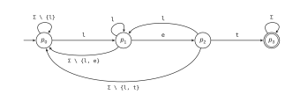
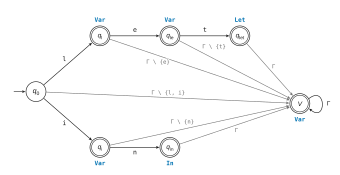
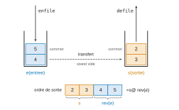
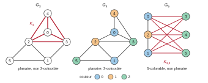
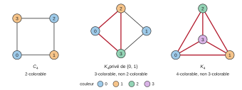
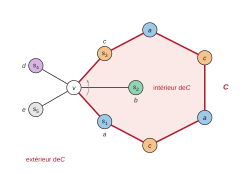

# Centrale-Supélec MP — Option Informatique 2026 · Corrigé brut

*Corrigé rédigé par IA, non officiel. Signalez toute erreur.*

Épreuve de 4 heures, calculatrice autorisée, « Coloriages ». Programmation exclusivement en OCaml (modules `Array` et `List` autorisés ; `Queue` et `Stack` interdits en I.3).

Les types de l'énoncé sont supposés déclarés :

```ocaml
type token = | Let | In | Var of string | Int of int | Lpar | Rpar | Add | Equal
type graphe = {nbr : int ; adj : int list array}
type col = int array
type 'a pile = 'a list
type 'a file = { entree : 'a pile ; sortie : 'a pile }
```

## Partie A — Exercice : coloration syntaxique

### Q1

Un mot est l'écriture binaire d'un entier s'il est égal à $0$ ou s'il commence par $1$, suivi d'un mot quelconque (éventuellement vide) sur $\{0,1\}$ :

$$\boxed{\,e = 0 \mid 1\,(0 \mid 1)^*\,}$$

Sa dénotation est $\{0\} \cup \{1w \mid w \in \{0,1\}^*\}$ : le mot vide n'y est pas, et le seul mot commençant par $0$ est $0$.

### Q2

Automate déterministe complet $\mathcal A = (\{q_i, q_z, q_u, q_p\}, \{0,1\}, q_i, \{q_z, q_u\}, \delta)$ :

| état | lecture de $0$ | lecture de $1$ | rôle |
|---|---|---|---|
| $q_i$ (initial) | $q_z$ | $q_u$ | rien lu |
| $q_z$ (final) | $q_p$ | $q_p$ | on a lu exactement $0$ |
| $q_u$ (final) | $q_u$ | $q_u$ | on a lu $1w$ |
| $q_p$ | $q_p$ | $q_p$ | puits |

On a :

$$\begin{aligned}
\delta^*(q_i, \varepsilon) &= q_i \quad \text{(non final)} \\
\delta^*(q_i, 0) &= q_z \quad \text{(final)} \\
\delta^*(q_i, 0w) &= q_p \quad \text{pour } w \neq \varepsilon \text{ (non final)} \\
\delta^*(q_i, 1w) &= q_u \quad \text{(final)}
\end{aligned}$$

Le langage reconnu est donc celui de Q1. On peut supprimer le puits $q_p$ si l'on accepte un automate déterministe non complet.

**Base 10.** On garde les quatre états et les mêmes états finaux, sur l'alphabet $\{0, \dots, 9\}$ :

$$\begin{aligned}
\delta(q_i, 0) &= q_z \\
\delta(q_i, d) &= q_u \quad \text{pour } 1 \le d \le 9 \\
\delta(q_u, d) &= q_u \quad \text{pour tout chiffre } d \\
\delta(q_z, d) &= q_p \quad \text{pour tout chiffre } d \\
\delta(q_p, d) &= q_p \quad \text{pour tout chiffre } d
\end{aligned}$$

**Seules les étiquettes changent : « 1 » devient « 1, …, 9 » et « 0, 1 » devient « 0, …, 9 ».**

### Q3

L'état 1 est initial, l'état 4 final, tous deux portent une boucle étiquetée $\Sigma$ (ici l'alphabet des caractères), et le chemin $1 \to 2 \to 3 \to 4$ lit `l`, `e`, `t`. Un calcul acceptant lit un mot $x$ en bouclant sur 1, puis `let`, puis un mot $y$ en bouclant sur 4 :

$$\boxed{\,L(A_l) = \Sigma^*\,\texttt{let}\,\Sigma^* \text{ : les mots qui contiennent le facteur } \texttt{let}\,}$$

**Automate déterministe.** L'état $p_k$ ($0 \le k \le 2$) signifie « `let` n'a pas encore été lu et le plus long suffixe du mot lu qui est préfixe de `let` est de longueur $k$ » ; $p_3$ signifie « `let` a été lu ». État initial $p_0$, état final $p_3$ :

| état | `l` | `e` | `t` | autre lettre |
|---|---|---|---|---|
| $p_0$ | $p_1$ | $p_0$ | $p_0$ | $p_0$ |
| $p_1$ | $p_1$ | $p_2$ | $p_0$ | $p_0$ |
| $p_2$ | $p_1$ | $p_0$ | $p_3$ | $p_0$ |
| $p_3$ | $p_3$ | $p_3$ | $p_3$ | $p_3$ |



Notons $f(u)$ la longueur définie ci-dessus. Par récurrence sur la longueur du mot lu $u$ :

$$\delta^*(p_0, u) = \begin{cases} p_{f(u)} & \text{tant que } \texttt{let} \text{ n'est pas facteur de } u \\ p_3 & \text{ensuite.} \end{cases}$$

En effet, depuis $p_1$ ou $p_2$, la lecture de `l` redonne le suffixe `l`, et toute lettre qui ne prolonge pas le motif ramène au suffixe vide.

Cet automate est aussi celui que donne la construction des parties : $\{1\},\ \{1,2\},\ \{1,3\}$, puis les parties contenant $4$, toutes finales et fusionnables.

### Q4

Notons $\Gamma = \{\texttt a, \dots, \texttt z\}$ et $C = \{\texttt 0, \dots, \texttt 9\}$. Les lexèmes forment l'union de huit langages :

- $\{\texttt{let}\}$, $\{\texttt{in}\}$, $\{\texttt (\}$, $\{\texttt )\}$, $\{\texttt +\}$, $\{\texttt =\}$ : langages finis, donc réguliers ;
- les entiers, dénotés par $\texttt 0 \mid (\texttt 1 \mid \dots \mid \texttt 9)(\texttt 0 \mid \dots \mid \texttt 9)^*$ (Q2), donc réguliers ;
- les noms de variables $M \setminus \{\texttt{let}, \texttt{in}\}$ où $M = \Gamma\Gamma^*$ est régulier. Un langage régulier est reconnu par un automate déterministe complet ; en échangeant états finaux et non finaux on reconnaît son complémentaire, et l'automate produit reconnaît l'intersection de deux langages reconnaissables. Donc $M \cap \overline{\{\texttt{let}, \texttt{in}\}}$ est régulier.

Les langages réguliers sont stables par union finie, donc l'ensemble des lexèmes est régulier. Par le théorème de Kleene, il est reconnu par un automate fini, que l'on peut déterminiser (construction des parties). **Il existe donc un automate fini déterministe reconnaissant l'ensemble des lexèmes du type `token`.**

### Q5

Sur $\Gamma$, on prend l'état initial $q_0$ et les états

$$q_{\texttt l},\ q_{\texttt{le}},\ q_{\texttt{let}},\ q_{\texttt i},\ q_{\texttt{in}},\ V,$$

avec les transitions

$$\begin{aligned}
\delta(q_0, \texttt l) &= q_{\texttt l} \\
\delta(q_{\texttt l}, \texttt e) &= q_{\texttt{le}} \\
\delta(q_{\texttt{le}}, \texttt t) &= q_{\texttt{let}} \\
\delta(q_0, \texttt i) &= q_{\texttt i} \\
\delta(q_{\texttt i}, \texttt n) &= q_{\texttt{in}}
\end{aligned}$$

toutes les autres transitions menant à $V$, et $\delta(V, x) = V$ pour toute lettre $x$. Tous les états sauf $q_0$ sont finaux, avec les constructeurs :

| état final | constructeur |
|---|---|
| $q_{\texttt{let}}$ | `Let` |
| $q_{\texttt{in}}$ | `In` |
| $q_{\texttt l}$, $q_{\texttt{le}}$, $q_{\texttt i}$, $V$ | `Var` |



L'automate est déterministe et complet. Un mot non vide de $\Gamma^+$ mène en $q_{\texttt{let}}$ si et seulement s'il vaut `let`, en $q_{\texttt{in}}$ si et seulement s'il vaut `in`, et dans un état étiqueté `Var` sinon : `l`, `le`, `i` sont des noms de variables, de même que `lets` ou `ink`. La priorité des mots clés sur les variables est respectée.

### Q6

Soit $n$ le nombre de caractères et $k$ le nombre de lexèmes. Les séparateurs sont ignorés en $O(1)$ chacun.

La lecture du $j$-ième lexème parcourt ses caractères puis le caractère qui provoque l'échec, relu ensuite au début du lexème suivant. Le nombre total de transitions est donc au plus $n + k \le 2n$. Chaque transition coûte $O(1)$ : l'alphabet est fixé, et avancer dans une liste coûte $O(1)$.

Il n'y a jamais de retour arrière : dans l'automate des lexèmes, tout état autre que l'état initial est final (un préfixe non vide d'un nom de variable est un nom de variable ou un mot clé, un préfixe non vide d'un entier commençant par un chiffre non nul est un entier), donc un échec se produit toujours depuis un état final ou depuis l'état initial (caractère illégal).

Construire un `Var` ou un `Int` coûte un temps proportionnel à la longueur du lexème, soit $O(n)$ au total. En ajoutant chaque token en tête d'une liste puis en la renversant une fois à la fin (et non avec `@` à chaque ajout, ce qui coûterait $O(k^2)$), l'accumulation coûte $O(k)$.

$$\boxed{\,\text{L'analyse lexicale est en } \Theta(n).\,}$$

### Q7

Ici $\Sigma$ désigne un alphabet contenant les deux parenthèses. Supposons $L$ reconnu par un automate déterministe complet à $N$ états, de fonction de transition étendue $\delta^*$ et d'état initial $q_0$.

Les $N+1$ mots $\texttt{(}^i$, pour $0 \le i \le N$, mènent à des états pris parmi $N$ seulement. Par le principe des tiroirs, il existe $i < j$ tels que

$$\delta^*(q_0, \texttt{(}^i) = \delta^*(q_0, \texttt{(}^j).$$

Alors

$$\begin{aligned}
\delta^*(q_0, \texttt{(}^j\,\texttt{)}^i) &= \delta^*\big(\delta^*(q_0, \texttt{(}^j), \texttt{)}^i\big) \\
&= \delta^*\big(\delta^*(q_0, \texttt{(}^i), \texttt{)}^i\big) \\
&= \delta^*(q_0, \texttt{(}^i\,\texttt{)}^i).
\end{aligned}$$

Or $\texttt{(}^i\texttt{)}^i \in L$, donc cet état est final et $\texttt{(}^j\texttt{)}^i$ est accepté. Ce mot contient pourtant $j \neq i$ parenthèses ouvrantes et $i$ fermantes : contradiction. (C'est l'argument du lemme de l'étoile, appliqué à $\texttt{(}^N\texttt{)}^N$.)

$$\boxed{\,L \text{ n'est pas régulier.}\,}$$

### Q8

On parcourt une fois la liste de tokens avec un compteur $h$ initialisé à $0$ : `Lpar` incrémente $h$, `Rpar` le décrémente, les autres tokens sont ignorés. Si $h$ devient strictement négatif, on s'arrête : la liste est mal parenthésée. À la fin, la liste est bien parenthésée si et seulement si $h = 0$.

Après $j$ tokens, $h$ vaut le nombre de `Lpar` moins le nombre de `Rpar` parmi eux, et un mot de parenthèses est bien parenthésé si et seulement si ces différences sont toutes positives ou nulles et la différence finale est nulle. Coût : $O(1)$ par token, donc **temps linéaire**.

Sur `[Int 3; Lpar; Equal; Rpar]`, $h$ prend les valeurs $0, 1, 1, 0$ : bien parenthésé. Sur `[Lpar; Int 2; Add; Int 3; Rpar; Rpar; Lpar]`, $h$ prend les valeurs $1, 1, 1, 1, 0, -1$ : on rejette au sixième token. Le seul test final ne suffit pas (`[Rpar; Lpar]` finit à $0$). Ce compteur non borné n'est pas une mémoire finie, ce qui est cohérent avec Q7.

## Partie B — Problème : coloration de graphes

### I — Cas de la 2-COLORATION

### I.1 — graphes bipartis

### Q9

$G = (S, A)$ est biparti s'il existe une partition $S = S_0 \sqcup S_1$ (une classe pouvant être vide) telle que toute arête ait une extrémité dans $S_0$ et l'autre dans $S_1$.

Soit $c : S \to \{0,1\}$ une 2-coloration valide. Les ensembles

$$\begin{aligned}
S_0 &= c^{-1}(\{0\}) \\
S_1 &= c^{-1}(\{1\})
\end{aligned}$$


partitionnent $S$. Pour $\{u,v\} \in A$, la relation $c(u) \neq c(v)$ place $u$ et $v$ dans des classes différentes : $G$ est biparti.

Réciproquement, soit $S = S_0 \sqcup S_1$ une bipartition. On pose

$$c(u) = \begin{cases} 0 & \text{si } u \in S_0 \\ 1 & \text{si } u \in S_1, \end{cases}$$

application à valeurs dans $[\![0,1]\!]$. Toute arête joint deux classes distinctes, donc deux couleurs distinctes.

**Un graphe est 2-colorable si et seulement s'il est biparti.**

### Q10

Soit $s_0, s_1, \dots, s_p = s_0$ un cycle de longueur $p$ impaire, et supposons une 2-coloration valide $c$.

Pour $0 \le i < p$, on a $c(s_{i+1}) \neq c(s_i)$ avec deux couleurs seulement, donc

$$c(s_{i+1}) \equiv c(s_i) + 1 \pmod 2.$$

Par récurrence, pour $0 \le i \le p$ :

$$c(s_i) \equiv c(s_0) + i \pmod 2.$$

En $i = p$, on obtient

$$c(s_0) = c(s_p) \equiv c(s_0) + p \pmod 2,$$

donc $p$ est pair : contradiction.

**Un graphe qui contient un cycle impair n'est pas 2-colorable.**

### Q11

Récurrence forte sur le nombre $m$ d'arêtes : $\mathcal P(m)$ : « tout graphe à $m$ arêtes sans cycle impair est 2-colorable ».

$\mathcal P(0)$ : la coloration constante $0$ est valide.

Soit $m \ge 1$ et $G = (S, A)$ sans cycle impair avec $|A| = m$. Soit $a = \{u, v\} \in A$ et

$$G' = (S, A \setminus \{a\}).$$

Tout cycle de $G'$ est un cycle de $G$, donc $G'$ n'a pas de cycle impair. Par hypothèse de récurrence, il admet une 2-coloration valide $c'$. Seule l'arête $a$ reste à examiner.

*Cas 1 : $u$ et $v$ sont reliés dans $G'$.* Soit $u = s_0, s_1, \dots, s_\ell = v$ un chemin de $G'$ de longueur minimale. Ses sommets sont distincts (sinon on raccourcirait le chemin).

On a $\ell \ge 2$ : d'une part $u \neq v$, d'autre part $\ell = 1$ voudrait dire $\{u,v\} \in A \setminus \{a\}$.

Si l'on avait $c'(u) = c'(v)$, le calcul de Q10 donnerait $\ell$ pair. Alors $s_0, \dots, s_\ell, s_0$ (en revenant par $a$) serait un cycle de $G$ de longueur impaire $\ell + 1 \ge 3$ : contradiction.

Donc $c'(u) \neq c'(v)$ et $c'$ est valide pour $G$.

*Cas 2 : $u$ et $v$ ne sont pas reliés dans $G'$.* Si $c'(u) \neq c'(v)$, $c'$ convient.

Sinon, soit $K$ la composante connexe de $v$ dans $G'$, qui ne contient pas $u$. On pose

$$c(x) = \begin{cases} 1 - c'(x) & \text{si } x \in K \\ c'(x) & \text{sinon.} \end{cases}$$

Aucune arête de $G'$ n'a exactement une extrémité dans $K$, donc les arêtes de $G'$ restent bicolores. Enfin :

$$\begin{aligned}
c(u) &= c'(u) \\
&= c'(v) \\
&\neq c(v).
\end{aligned}$$

Dans les deux cas $G$ est 2-colorable. Avec Q10 : **un graphe est 2-colorable si et seulement s'il ne contient pas de cycle impair.**

### I.2 — Une solution naïve

### Q12

On ajoute $1$ en base 2, le bit de poids faible étant à l'indice $0$. On remet à zéro les bits de tête égaux à $1$, puis on met à $1$ le premier bit nul rencontré. Si tous les bits valent $1$, il n'y a pas de suivante.

```ocaml
let suivante (c : col) : bool =
  let n = Array.length c in
  let i = ref 0 in
  while !i < n && c.(!i) = 1 do
    c.(!i) <- 0;
    incr i
  done;
  if !i = n then false
  else begin c.(!i) <- 1; true end
```

Invariant : les cases d'indice $< i$ valaient $1$ et valent $0$. En sortie, deux cas se présentent.

- Soit $i = n$ : l'entier valait $2^n - 1$, il n'y a pas de suivante, et le tableau est remis à zéro.
- Soit la case $c.(i)$, qui valait $0$, devient $1$, ce qui réalise $\sum_{j<i} 2^j + 1 = 2^i$.

**Meilleur cas ($c.(0) = 0$) : $\Theta(1)$** ; pire cas $\Theta(n)$. La conjonction paresseuse `&&` protège l'accès `c.(!i)`.

### Q13

```ocaml
let valide (g : graphe) (c : col) : bool =
  let ok = ref true in
  for u = 0 to g.nbr - 1 do
    List.iter (fun v -> if c.(u) = c.(v) then ok := false) g.adj.(u)
  done;
  !ok
```

`ok` passe à `false` si et seulement s'il existe $u$ et un voisin $v$ de $u$ de même couleur, c'est-à-dire une arête monochrome. Coût $\Theta(|S| + \sum_u \deg(u)) = \Theta(|S| + |A|)$.

### Q14

```ocaml
let bicolnaif (g : graphe) : bool * col =
  let c = Array.make g.nbr 0 in
  let trouve = ref (valide g c) in
  let encore = ref true in
  while not !trouve && !encore do
    encore := suivante c;
    if !encore then trouve := valide g c
  done;
  (!trouve, c)
```

La coloration nulle est testée d'abord, puis `suivante` parcourt les entiers $1, 2, \dots, 2^{|S|} - 1$, soit toutes les bicolorations (bijection entre $[\![0, 2^{|S|} - 1]\!]$ et $\{0,1\}^S$). La boucle termine car l'entier associé croît strictement et est majoré. On renvoie `(true, c)` avec $c$ valide dès qu'une bicoloration valide est trouvée, `(false, _)` sinon (le tableau n'a alors pas de signification). Sur $G_2$, on obtient `(true, [|1; 1; 0; 1; 0; 0|])`, la bicoloration de la figure 3 (entier 11).

### Q15

Notons $n = |S|$ et $m = |A|$. Le pire cas est celui d'un graphe non 2-colorable (par exemple $G_1$, qui contient le triangle $0, 2, 3$). Les $2^n$ colorations sont alors testées, chacune en $\Theta(n + m)$.

Le coût cumulé des appels à `suivante` est le nombre total de bits modifiés. Le bit $j$ est modifié au plus $2^{n-j}$ fois, d'où un total négligeable :

$$\sum_j 2^{n-j} \le 2^{n+1}.$$

$$\boxed{\,C_{\text{pire}} = \Theta\big(2^{|S|}(|S| + |A|)\big) = O\big(2^{|S|}\,|S|^2\big)\,}$$

La complexité est exponentielle en le nombre de sommets.

### I.3 — un détour par les structures de données

### Q16

Une liste OCaml réalise toutes les opérations d'une pile en temps constant : la pile vide est `[]` ; empiler `x` sur `p` s'écrit `x :: p` (un seul maillon alloué, `p` est partagée et non recopiée) ; tester la vacuité et dépiler se font par un filtrage `match p with [] -> … | x :: r -> …`, qui donne en $O(1)$ le sommet et le reste. L'accès se fait par la tête, qui est le dernier élément ajouté : c'est la discipline LIFO. Les opérations coûteuses sur les listes (accès au $i$-ième élément, `@`, longueur) sont précisément celles dont une pile n'a pas besoin. La structure est de plus immuable (persistante) et polymorphe.

### Q17

```ocaml
(* transfert e s : dépile tous les éléments de e et les empile sur s *)
let rec transfert (e : 'a pile) (s : 'a pile) : 'a pile =
  match e with
  | [] -> s
  | x :: r -> transfert r (x :: s)

(* a. *)
let initFile () : 'a file = { entree = [] ; sortie = [] }

(* b. *)
let estVideFile (f : 'a file) : bool = f.entree = [] && f.sortie = []

(* c. *)
let enfile ((x, f) : 'a * 'a file) : 'a file =
  { entree = x :: f.entree ; sortie = f.sortie }

(* d. *)
let defile (f : 'a file) : 'a * 'a file =
  match f.sortie with
  | x :: r -> (x, { entree = f.entree ; sortie = r })
  | [] ->
    begin match transfert f.entree [] with
    | [] -> failwith "defile : file vide"
    | x :: r -> (x, { entree = [] ; sortie = r })
    end
```

`enfile` prend un couple (signature non curryfiée imposée). `defile` ne transfère que si « sortie » est vide, conformément à l'algorithme de l'énoncé, et échoue sur une file vide.

### Q18

Pour $f = \{\texttt{entree} = e ; \texttt{sortie} = s\}$, posons $\mathrm{cont}(f) = s \mathbin{@} \mathrm{rev}(e)$. Montrons par récurrence sur le nombre d'opérations l'invariant : *$\mathrm{cont}(f)$ est la liste des éléments présents, du plus ancien au plus récent.*



- Pour la file vide, $\mathrm{cont} = [\,]$.
- `enfile (x, f)` : $\mathrm{cont} = s \mathbin{@} \mathrm{rev}(x :: e) = s \mathbin{@} \mathrm{rev}(e) \mathbin{@} [x]$ : $x$ est ajouté en dernier, c'est le plus récent.
- `defile f` avec $s = x :: r$ : $x$ est la tête de $\mathrm{cont}(f)$, donc le plus ancien, et la nouvelle file a pour contenu $r \mathbin{@} \mathrm{rev}(e)$, c'est-à-dire $\mathrm{cont}(f)$ privé de sa tête.
- `defile f` avec $s = [\,]$ : le transfert donne $s' = \mathrm{rev}(e)$, $e' = [\,]$, et $\mathrm{cont}$ vaut toujours $\mathrm{rev}(e)$ : le transfert ne modifie pas le contenu, et l'on est ramené au cas précédent.

Chaque `defile` renvoie donc le plus ancien élément présent : **les éléments sortent dans l'ordre où ils sont entrés.**

### Q19

Si « sortie » est non vide, `defile` coûte $\Theta(1)$. Sinon, le transfert de $p$ éléments coûte $\Theta(p)$. Le pire cas est atteint après $p$ enfilements consécutifs sur une file vide, suivis d'un `defile` :

$$\boxed{\,\texttt{defile} \text{ est en } \Theta(p) \text{ dans le pire cas, } p \text{ étant le nombre d'éléments de la file.}\,}$$

### Q20

Un élément $x$ subit au plus, dans cet ordre : (1) un empilement sur « entrée » lors de son `enfile` (toujours) ; (2) un dépilement de « entrée » et (3) un empilement sur « sortie » lors d'un transfert ; (4) un dépilement de « sortie » quand il sort. Les opérations (2) et (3) ont lieu ensemble et **au plus une fois**, car aucun élément ne revient de « sortie » vers « entrée ». L'opération (4) suppose (2) et (3).

$$\boxed{\,1 \le \text{nombre d'empilements et de dépilements subis par } x \le 4\,}$$

Les deux bornes sont atteintes : $1$ pour un élément resté dans « entrée », $4$ pour un élément transféré puis sorti.

### Q21

Soit une suite de $n$ opérations légales, dont $k$ `enfile` et $d$ `defile`. On a $n = k + d$ et $d \le k$, donc $\frac n2 \le k \le n$.

Exactement $k$ éléments transitent. Par Q20, le nombre total $N$ d'empilements et de dépilements vérifie $k \le N \le 4k$, d'où **$\frac n2 \le N \le 4n$**.

On affine en comptant par opération. Soit $t$ le nombre d'éléments transférés. Chaque `enfile` fait un empilement, chaque transfert d'élément deux opérations, chaque `defile` un dépilement de « sortie », donc

$$N = k + 2t + d.$$

Un élément sorti a été transféré et un élément transféré est entré, donc $d \le t \le k$, et

$$\begin{aligned}
N &\ge k + d \\
&= n, \\
N &\le k + 2k + d \\
&= n + 2k \\
&\le 3n.
\end{aligned}$$

$$\boxed{\,n \le N \le 3n\,}$$

Hors opérations de pile, chaque `enfile` ou `defile` fait un travail borné, et chaque opération de pile coûte $O(1)$ (Q16). Le coût total de $n$ opérations est donc $\Theta(n)$ : **`enfile` et `defile` ont une complexité amortie constante**, bien qu'un `defile` isolé puisse coûter $\Theta(p)$. Aucune probabilité n'intervient : c'est une garantie sur toute suite d'opérations.

### I.4 — Une solution plus efficace

### Q22

On colorie le sommet $0$ avec $0$, puis chaque sommet découvert reçoit la couleur opposée à celle du sommet qui le découvre ; $-1$ marque les sommets non découverts. On s'arrête dès qu'une arête monochrome est détectée.

```ocaml
let bicol (g : graphe) : bool * col =
  let c = Array.make g.nbr (-1) in
  let ok = ref true in
  if g.nbr > 0 then begin
    c.(0) <- 0;
    let f = ref (enfile (0, initFile ())) in
    while !ok && not (estVideFile !f) do
      let (u, reste) = defile !f in
      f := reste;
      List.iter
        (fun v ->
           if c.(v) = -1 then begin
             c.(v) <- 1 - c.(u);
             f := enfile (v, !f)
           end
           else if c.(v) = c.(u) then ok := false)
        g.adj.(u)
    done
  end;
  (!ok, c)
```

Sur $G_2$, on obtient `(true, [|0; 0; 1; 0; 1; 1|])` (couleur = parité de la distance au sommet $0$) ; sur $G_1$, `false`.

### Q23

Un sommet n'est enfilé que dans la branche `c.(v) = -1`, et il reçoit aussitôt une couleur $0$ ou $1$ ; aucune instruction ne remet une case à $-1$.

Chaque sommet est donc enfilé au plus une fois, et il y a au plus $|S|$ enfilements au total (sommet $0$ compris). Chaque tour de boucle effectue un `defile`, donc il y a au plus $|S|$ tours, et chaque tour termine (parcours d'une liste finie).

Formellement, (nombre de sommets non découverts) + (taille de la file) est un entier positif qui diminue de $1$ à chaque tour (un défilement, et chaque enfilement fait passer un sommet de « non découvert » à « dans la file »). **`bicol` termine.**

### Q24

Posons $n = |S|$ et $m = |A|$. L'initialisation coûte $\Theta(n)$.

Il y a au plus $n$ enfilements et $n$ défilements, de coût total $O(n)$ par la complexité amortie (Q21). La majoration naïve d'un `defile` par $\Theta(n)$ ne donnerait que $O(n^2)$.

Chaque sommet $u$ est défilé au plus une fois et son traitement coûte $\Theta(1 + \deg(u))$, d'où un total

$$\sum_u \Theta(1 + \deg u) = \Theta(n + 2m).$$

$$\boxed{\,C(\texttt{bicol}) = O(|S| + |A|)\,}$$

avec égalité $\Theta(|S| + |A|)$ lorsque le graphe est biparti (parcours complet) : c'est linéaire en la taille du graphe.

### Q25

On suppose $G$ connexe et $|S| \ge 1$. Notons $c$ le tableau final. Une case ne change plus une fois différente de $-1$.

Si $x$ est colorié depuis $u$, alors $\{u, x\} \in A$ et $c(x) = 1 - c(u)$.

**Si `bicol` renvoie `true`.** La boucle s'est arrêtée parce que la file est vide, `ok` étant resté vrai. Tout sommet colorié a été enfilé, donc défilé et traité en entier.

Supposons qu'un sommet reste à $-1$. Un chemin depuis $0$ (connexité) fournirait une arête $\{u, v\}$ avec $u$ colorié et $v$ non colorié.

Mais le traitement de $u$ aurait colorié $v$. Donc tous les sommets sont coloriés.

Soit $\{u, v\} \in A$. Lors du traitement de $u$, deux cas sont possibles :

- ou bien $v$ était à $-1$ et reçoit $1 - c(u)$ ;
- ou bien le test `c.(v) = c.(u)` a été fait et a échoué, puisque `ok` est vrai.

Toute arête est bicolore : **$c$ est une bicoloration valide**.

**Si `bicol` renvoie `false`.** Il existe une arête $\{u, v\}$ entre deux sommets coloriés avec $c(u) = c(v)$. Supposons qu'il existe une bicoloration valide $c^*$.

Montrons par récurrence sur l'ordre de coloriage que tout sommet colorié $x$ vérifie

$$c(x) \equiv c^*(x) + c^*(0) \pmod 2.$$

C'est vrai pour $0$. Si $x$ est colorié depuis $u$, on a $c^*(x) \equiv c^*(u) + 1$, donc

$$\begin{aligned}
c(x) &\equiv c(u) + 1 \\
&\equiv c^*(u) + c^*(0) + 1 \\
&\equiv c^*(x) + c^*(0) \pmod 2.
\end{aligned}$$

Appliqué à $u$ et $v$, cela donne $c^*(u) = c^*(v)$, ce qui contredit la validité de $c^*$. **Le graphe n'est pas 2-colorable.**

Donc `bicol g` renvoie `true` si et seulement si $g$ est 2-colorable, et dans ce cas une bicoloration valide.

### Q26

Aucune arête ne relie deux composantes connexes : un graphe est 2-colorable si et seulement si chacune de ses composantes l'est, et des bicolorations des composantes se recollent. On relance donc le parcours depuis chaque sommet encore non colorié, en conservant le même drapeau.

```ocaml
let bicol_general (g : graphe) : bool * col =
  let c = Array.make g.nbr (-1) in
  let ok = ref true in
  for s = 0 to g.nbr - 1 do
    if !ok && c.(s) = -1 then begin      (* nouvelle composante *)
      c.(s) <- 0;
      let f = ref (enfile (s, initFile ())) in
      while !ok && not (estVideFile !f) do
        let (u, reste) = defile !f in
        f := reste;
        List.iter
          (fun v ->
             if c.(v) = -1 then begin
               c.(v) <- 1 - c.(u);
               f := enfile (v, !f)
             end
             else if c.(v) = c.(u) then ok := false)
          g.adj.(u)
      done
    end
  done;
  (!ok, c)
```

Chaque parcours colorie exactement la composante de $s$ (Q25 appliqué à cette composante), la correction se déduit de Q25 composante par composante, et la complexité reste $O(|S| + |A|)$.

### Q27

La preuve de Q25 n'utilise pas l'ordre FIFO : seulement que chaque sommet est colorié une fois, depuis un voisin, de la couleur opposée, et que chaque sommet colorié est traité. On peut donc remplacer la file par une pile (liste de I.3), ou écrire le parcours en profondeur récursif, la pile d'appels jouant le rôle de la file :

```ocaml
let bicol_profondeur (g : graphe) : bool * col =
  let c = Array.make g.nbr (-1) in
  let ok = ref true in
  let rec visite (u : int) : unit =
    List.iter
      (fun v ->
         if c.(v) = -1 then begin
           c.(v) <- 1 - c.(u);
           visite v                  (* on descend immédiatement *)
         end
         else if c.(v) = c.(u) then ok := false)
      g.adj.(u)
  in
  if g.nbr > 0 then begin c.(0) <- 0; visite 0 end;
  (!ok, c)
```

`visite` n'est appelée que sur un sommet qui vient d'être colorié, donc au plus une fois par sommet : terminaison et complexité $\Theta(|S| + |A|)$ comme en Q23 et Q24. La correction se démontre mot pour mot comme en Q25. La profondeur de récursion peut atteindre $|S|$.

### II — Cas de la 3-COLORATION

### Q28

```ocaml
let partial (g : graphe) (c : col) (s : int) : bool =
  List.for_all (fun v -> c.(v) <> c.(s)) g.adj.(s)
```

Comme $c(s) \neq -1$, un voisin non colorié ($c(v) = -1$) ne provoque jamais d'échec, conformément à la convention de l'énoncé. Coût $\Theta(\deg(s))$.

### Q29

On colorie les sommets dans l'ordre $0, 1, \dots, n-1$. Pour le sommet $s$, on essaie les couleurs $0, 1, 2$ ; on ne poursuit que si la coloration reste localement valide ; si aucune couleur ne convient, on remet $s$ à $-1$ et on revient en arrière.

```ocaml
let backtracking (g : graphe) : bool * col =
  let n = g.nbr in
  let c = Array.make n (-1) in
  let rec explore (s : int) : bool =
    if s = n then true
    else begin
      let trouve = ref false in
      let k = ref 0 in
      while not !trouve && !k < 3 do
        c.(s) <- !k;
        if partial g c s && explore (s + 1) then trouve := true
        else incr k
      done;
      if not !trouve then c.(s) <- -1;   (* retour sur trace *)
      !trouve
    end
  in
  let b = explore 0 in
  (b, c)
```

Par récurrence descendante sur $s$, on montre l'énoncé suivant. Si les sommets $0, \dots, s-1$ sont coloriés sans arête monochrome entre eux et si les autres valent $-1$, alors `explore s` renvoie `true` si et seulement si cette coloration partielle se prolonge en une 3-coloration valide ; elle laisse dans `c` un tel prolongement en cas de succès et restaure `c` en cas d'échec.

En effet, après `c.(s) <- k`, les seules arêtes nouvellement entre sommets coloriés sont les $\{s, v\}$ avec $v < s$, et `partial g c s` teste exactement celles-là. `explore 0` répond donc à la question.

Terminaison : $n - s$ décroît à chaque appel et chaque boucle fait au plus 3 tours. Sur $G_3$, on obtient `false` ; sur $G_4$, `(true, [|0; 0; 1; 2; 1; 2|])`.

### Q30

Notons $n = |S|$ et $\Delta$ le degré maximal. L'arbre des appels a au plus $3^s$ nœuds à la profondeur $s$, donc au plus

$$\sum_{s=0}^{n} 3^s = \frac{3^{n+1} - 1}{2}$$

nœuds. Chaque nœud coûte au plus trois appels à `partial`, soit $O(\Delta)$ :

$$\boxed{\,C_{\text{pire}} = O\big(\Delta\, 3^{|S|}\big) = O\big(|S|\, 3^{|S|}\big)\,}$$

Cette borne est atteinte à un facteur polynomial près. Soit $H_n$ ($n \ge 5$) le graphe connexe où $n-4, n-3, n-2, n-1$ forment un $K_4$ et où chaque sommet $s \le n-5$ est relié au seul sommet $n-1$.

Quand on colorie un sommet $s \le n-5$, son unique voisin vaut $-1$, donc les trois couleurs passent le test. Les $3^{n-4}$ colorations des premiers sommets sont toutes explorées, et chacune échoue sur le $K_4$, qui n'est pas 3-colorable. Il y a donc au moins $3^{n-4}$ appels : **le pire cas est exponentiel, en $3^{|S|}$ à un facteur polynomial près.** Ce constat est cohérent avec l'énoncé, qui indique qu'on ne sait pas résoudre ce problème en temps polynomial.

### III — Graphes planaires

On admet deux faits de topologie du plan : (G1) un arc attaché au tracé par une seule extrémité ne sépare pas la face où il est tracé ; (G2) (théorème de Jordan) une courbe fermée simple sépare le plan en deux régions, une bornée et une non bornée, et tout arc joignant les deux la rencontre.

### III.1 — Formule d'Euler pour un graphe connexe

### Q31

**Sommets.** En comptant les couples $(s, a)$ avec $s \in a$, on obtient $\sum_s \deg(s)$, et aussi $2|A|$ puisque chaque arête a deux extrémités distinctes :

$$\boxed{\,\sum_{s \in S} \deg(s) = 2|A|\,}$$

**Faces.** Chaque arête a deux côtés. Si ces côtés bordent deux faces distinctes, l'arête figure une fois dans le parcours de frontière minimal de chacune. Si les deux côtés bordent la même face (cas d'un isthme, arête dont la suppression déconnecte le graphe), le parcours de frontière de cette face l'emprunte deux fois, une fois dans chaque sens. Chaque arête est donc comptée deux fois :

$$\boxed{\,\sum_{f \in F} \deg(f) = 2|A|\,}$$

Sur la figure 4 : $|A| = 7$, degrés des sommets $2 + 2 + 3 + 3 + 2 + 2 = 14$, degrés des faces $3 + 3 + 8 = 14$ (l'isthme $cd$ est parcouru deux fois par la frontière de la face 3).

### Q32

Un arbre est un graphe connexe sans cycle.

*Feuille.* Un arbre à au moins deux sommets a un sommet de degré 1. Soit en effet $s_0, \dots, s_k$ un chemin à sommets distincts de longueur maximale ($k \ge 1$ par connexité), et $w \neq s_{k-1}$ un voisin de $s_k$.

- Si $w$ est hors du chemin, il le prolonge.
- Si $w = s_i$ avec $i \le k-2$, il ferme un cycle $s_i, \dots, s_k, s_i$ de longueur $\ge 3$.

Les deux cas sont exclus, donc $\deg(s_k) = 1$.

*Arêtes.* On montre $|A| = |S| - 1$ par récurrence sur $|S|$. C'est vrai pour un sommet seul ; sinon on retire une feuille $v$ et son arête.

Le graphe obtenu est sans cycle et connexe : un chemin entre deux sommets autres que $v$ ne passe pas par $v$, de degré 1. C'est un arbre à $|S| - 1$ sommets et $|A| - 1$ arêtes.

*Faces.* Un arbre tracé a une seule face, par récurrence sur $|S|$ : un point ne sépare pas le plan ; en rajoutant une feuille, on ajoute dans l'unique face un arc attaché par une seule extrémité, qui ne la sépare pas (G1).

Donc

$$\begin{aligned}
|S| - |A| + |F| &= |S| - (|S| - 1) + 1 \\
&= 2,
\end{aligned}$$

et **la formule d'Euler est vraie pour les arbres.**

### Q33

Récurrence forte sur $|A|$, pour $G$ connexe planaire non vide muni d'un tracé sans croisement.

Si $G$ n'a pas de cycle, c'est un arbre (en particulier si $|A| = 0$) : Q32.

Sinon, soit $C$ un cycle, $a = \{u, v\}$ une arête de $C$, et $G' = G - a$ (même tracé, arc de $a$ effacé).

Le graphe $G'$ est planaire, et connexe : dans un chemin, on remplace $a$ par le reste de $C$.

Le cycle $C$ est tracé comme une courbe fermée simple : par (G2), il sépare l'intérieur de l'extérieur. Une face de $G$, connexe par arcs et disjointe du tracé de $C$, est contenue dans l'un des deux. Or les deux côtés de l'arc $a$ sont l'un à l'intérieur, l'autre à l'extérieur de $C$.

Les faces $f_1$ et $f_2$ bordant $a$ sont donc distinctes. Effacer $a$ les fusionne en une seule face, car $f_1 \cup f_2 \cup \mathring a$ est connexe par arcs ; les autres faces sont inchangées. Ainsi

$$\begin{aligned}
|S'| &= |S| \\
|A'| &= |A| - 1 \\
|F'| &= |F| - 1
\end{aligned}$$

et

$$\begin{aligned}
|S| - |A| + |F| &= |S'| - |A'| + |F'| \\
&= 2
\end{aligned}$$

par hypothèse de récurrence. **Tout graphe planaire connexe non vide vérifie $|S| - |A| + |F| = 2$.**

### Q34

Soit $G$ connexe planaire avec $|S| \ge 3$. Montrons que toute face $f$ a un degré $d \ge 3$.

- Le cas $d = 1$ demanderait une boucle.
- Le cas $d = 2$ demanderait deux arêtes entre deux mêmes sommets (exclu), ou une frontière réduite à une seule arête $\{x, y\}$ parcourue aller-retour.

Dans ce dernier cas, $G$ étant connexe avec au moins trois sommets, l'une des extrémités, disons $x$, a un autre voisin. Autour de $x$, les arcs incidents découpent un petit disque en au moins deux secteurs. Le secteur contenu dans $f$ est bordé par deux arcs distincts, qui sont tous deux dans la frontière de $f$ : contradiction.

Par Q31 puis par Q33 :

$$\begin{aligned}
2|A| &= \sum_f \deg(f) \\
&\ge 3|F| \\
&= 3(2 - |S| + |A|).
\end{aligned}$$

On en tire :

$$\boxed{\,|A| \le 3|S| - 6\,}$$

$K_5$ est connexe avec $|S| = 5$ et $|A| = \binom 52 = 10$ ; s'il était planaire, on aurait $10 \le 9$. **$K_5$ n'est pas planaire.**

### Q35

Soit $G$ connexe planaire. Si $|S| \le 2$, tout sommet est de degré au plus 1. Si $|S| \ge 3$ et si tous les degrés étaient au moins 6, Q31 donnerait $2|A| \ge 6|S|$, soit $|A| \ge 3|S|$. C'est incompatible avec $|A| \le 3|S| - 6$ (Q34).

**Tout graphe planaire connexe a un sommet de degré au plus 5.** Le résultat vaut
 pour un graphe planaire quelconque, en l'appliquant à une composante connexe (le degré d'un sommet est le même dans sa composante).

### Q36

Soit $G$ connexe planaire biparti avec $|S| \ge 3$. Un parcours de frontière $x_0, \dots, x_d = x_0$ est un parcours fermé. Deux sommets consécutifs sont dans des classes différentes, donc la classe de $x_i$ dépend de la parité de $i$, et $d$ est pair.

Comme $d \ge 3$ (Q34), on a $d \ge 4$. Alors

$$\begin{aligned}
2|A| &\ge 4|F| \\
&= 4(2 - |S| + |A|),
\end{aligned}$$

soit

$$\boxed{\,|A| \le 2|S| - 4\,}$$

$K_{3,3}$ est connexe, biparti, avec $|S| = 6$ et $|A| = 9$ ; s'il était planaire, on aurait $9 \le 8$. **$K_{3,3}$ n'est pas planaire** (alors qu'il passe le test de Q34 : $9 \le 12$).

### III.2 — Cas du problème Planar-2-COL

### Q37

On applique `bicol_general` (Q26) : parcours en largeur depuis chaque sommet non colorié, réponse `true` si et seulement si aucune arête monochrome n'apparaît. La correction (Q25, Q26) n'utilise pas la planarité. Le coût est $O(|S| + |A|)$.

Or, pour un graphe planaire, notons $(n_i, m_i)$ les nombres de sommets et d'arêtes de ses composantes connexes :

$$\begin{aligned}
m_i &\le 3n_i - 6 && \text{si } n_i \ge 3 \text{ (Q34)} \\
m_i &\le 1 && \text{si } n_i \le 2
\end{aligned}$$

Dans les deux cas $m_i \le 3n_i$, et en sommant, $|A| \le 3|S|$.

$$\boxed{\,\text{Planar-2-COL se résout en } O(|S|) \text{ : temps linéaire en le nombre de sommets.}\,}$$

### III.3 — Cas du problème Planar-3-COL

### Q38

Relevé des arêtes sur la figure 5 (sommets $0$ à $5$) :

| graphe | arêtes | nombre |
|---|---|---|
| $G_3$ | $\{0,2\},\{0,3\},\{0,4\},\{1,2\},\{1,3\},\{1,5\},\{2,3\},\{2,4\},\{2,5\},\{3,4\}$ | 10 |
| $G_4$ | celles de $G_3$ sauf $\{2,4\}$ | 9 |
| $G_5$ | $\{0,3\},\{0,4\},\{0,5\},\{1,3\},\{1,4\},\{1,5\},\{2,3\},\{2,4\},\{2,5\},\{0,2\},\{1,2\}$ | 11 |



**$G_3$ : planaire, non 3-colorable.** Les sommets $0, 2, 3, 4$ sont deux à deux adjacents : $G_3$ contient $K_4$, il faut au moins 4 couleurs.

Il est planaire. On place les sommets ainsi, et on trace les arêtes en segments, sans aucun croisement :

| sommet | $2$ | $3$ | $4$ | $0$ | $1$ | $5$ |
|---|---|---|---|---|---|---|
| position | $(0,0)$ | $(4,0)$ | $(2,3)$ | $(2,1)$ | $(2,-2)$ | $(-2,-2)$ |

Le sommet $0$ est à l'intérieur du triangle $2, 3, 4$. Le tracé a 6 faces, conformément à $6 - 10 + 6 = 2$ :

- les triangles $0\,2\,3$, $0\,3\,4$, $0\,4\,2$ ;
- les triangles $2\,3\,1$ et $2\,1\,5$ ;
- la face non bornée $4\,3\,1\,5\,2$.

**$G_4$ : planaire et 3-colorable.** Il est planaire (même tracé, sans l'arête $\{2,4\}$). La coloration suivante est valide :

$$\begin{aligned}
c(0) &= c(1) = 0 \\
c(2) &= c(4) = 1 \\
c(3) &= c(5) = 2
\end{aligned}$$

Les neuf arêtes joignent en effet des couleurs distinctes :

| arête | couleurs |
|---|---|
| $\{0,2\}$ | $(0,1)$ |
| $\{0,3\}$ | $(0,2)$ |
| $\{0,4\}$ | $(0,1)$ |
| $\{1,2\}$ | $(0,1)$ |
| $\{1,3\}$ | $(0,2)$ |
| $\{1,5\}$ | $(0,2)$ |
| $\{2,3\}$ | $(1,2)$ |
| $\{2,5\}$ | $(1,2)$ |
| $\{3,4\}$ | $(2,1)$ |

Il n'est pas 2-colorable (triangle $0, 2, 3$).

**$G_5$ : 3-colorable, non planaire.** La coloration suivante est valide :

$$\begin{aligned}
c(0) &= c(1) = 0 \\
c(2) &= 1 \\
c(3) &= c(4) = c(5) = 2
\end{aligned}$$

En effet, $\{0,2\}$ et $\{1,2\}$ joignent $0$ et $1$, et les neuf autres arêtes joignent $\{0,1,2\}$ à $\{3,4,5\}$.

Mais $G_5$ contient les neuf arêtes de $K_{3,3}$ de parts $\{0,1,2\}$ et $\{3,4,5\}$.

Un tracé planaire de $G_5$, privé de $\{0,2\}$ et $\{1,2\}$, serait un tracé planaire de $K_{3,3}$, ce qui contredit Q36.

**Seul $G_4$ est à la fois planaire et 3-colorable.**

### Q39

- **2-colorable** : le cycle $C_4$, d'arêtes $\{0,1\}, \{1,2\}, \{2,3\}, \{3,0\}$, tracé en carré ; on prend $c(0) = c(2) = 0$ et $c(1) = c(3) = 1$.
- **3-colorable, non 2-colorable** : le « diamant » ($K_4$ privé de $\{0,1\}$), d'arêtes $\{0,2\}, \{0,3\}, \{1,2\}, \{1,3\}, \{2,3\}$, tracé en losange avec la diagonale $\{2,3\}$.
  On prend $c(0) = c(1) = 0$, $c(2) = 1$ et $c(3) = 2$.
  Le triangle $0, 2, 3$ interdit 2 couleurs (Q10).
- **4-colorable, ni 2- ni 3-colorable** : $K_4$, tracé avec le sommet $3$ à l'intérieur du triangle $0, 1, 2$ (aucun croisement, $4 - 6 + 4 = 2$) ; $c(i) = i$ convient, et quatre sommets deux à deux adjacents exigent quatre couleurs.



Les trois graphes sont connexes, planaires, à 4 sommets.

### III.4 — Cas $k \geqslant 4$

### Q40

Soit $G$ planaire à $n + 1$ sommets ($n \ge 5$) et $v$ de degré au plus 5 (Q35).

Le graphe $G' = G - v$ est planaire à $n$ sommets, donc admet une 5-coloration valide $c'$.

Si $\deg(v) \le 4$, les voisins de $v$ utilisent au plus 4 des 5 couleurs : soit $\gamma$ une couleur non utilisée. On pose $c = c'$ hors de $v$ et $c(v) = \gamma$.

Les arêtes de $G'$ restent bicolores, et les arêtes $\{v, v_i\}$ aussi par choix de $\gamma$. **$G$ est 5-colorable.** Le même argument traite le cas $\deg(v) = 5$ où deux voisins ont la même couleur.

### Q41

Notons $\varphi$ la 5-coloration de $G'$ (pour ne pas confondre avec la couleur $c$).

Notons $H$ le sous-graphe de $G'$ induit par les sommets colorés $a$ ou $c$.

L'ensemble $E$ est la composante connexe de $s_1$ dans $H$ : le long d'un chemin de $H$, les couleurs alternent automatiquement entre $a$ et $c$.

On échange $a$ et $c$ sur $E$ :

$$\psi(x) = \begin{cases} c & \text{si } x \in E \text{ et } \varphi(x) = a \\ a & \text{si } x \in E \text{ et } \varphi(x) = c \\ \varphi(x) & \text{sinon.} \end{cases}$$

$\psi$ est valide sur $G'$ :

- une arête interne à $E$ garde deux couleurs distinctes de $\{a, c\}$ ;
- une arête hors de $E$ est inchangée ;
- soit $\{x, y\}$ une arête avec $x \in E$ et $y \notin E$.
  On a $\varphi(y) \notin \{a, c\}$ : sinon $y$ serait dans $H$, adjacent à $x$, donc dans $E$.
  Alors $\psi(x) \in \{a, c\}$ diffère de $\psi(y) = \varphi(y)$.

Supposons $s_3 \notin E$. Alors $s_1$ passe de $a$ à $c$, et $s_3$ garde $c$.

Les sommets $s_2, s_4, s_5$ (colorés $b, d, e$) ne sont pas dans $E$ et gardent leur couleur.

La couleur $a$ n'apparaît plus parmi les voisins de $v$ ; on pose $\psi(v) = a$. **$G$ est 5-colorable.**

### Q42

Si $s_3 \in E$, il existe un chemin de $s_1$ à $s_3$ dans $H$. Prenons-le de longueur minimale, $s_1 = x_0, \dots, x_p = s_3$ : il est à sommets distincts et $p \ge 1$.

Le sommet $v$ n'est pas dans $G'$, donc pas sur ce chemin. Ainsi $C : v, x_0, \dots, x_p, v$ est un chemin fermé de longueur $p + 2 \ge 3$ à sommets distincts.

C'est **un cycle de $G$ qui utilise $\{v, s_1\}$ et $\{v, s_3\}$.**

Ni $s_2$ ni $s_4$ ne sont sur $C$.

En effet, les sommets de $C$ autres que $v$ sont colorés $a$ ou $c$.


Or $s_2$ et $s_4$ sont colorés $b$ et $d$.

Le cycle $C$ est tracé comme une courbe fermée simple qui sépare le plan en deux zones (G2). Autour de $v$, les arcs vers $s_1, \dots, s_5$ partent dans l'ordre trigonométrique.

Les arcs $vs_1$ et $vs_3$, qui sont sur $C$, découpent un petit disque centré en $v$ en deux secteurs, situés de part et d'autre de $C$ :

- l'un contient le départ de $vs_2$ ;
- l'autre contient ceux de $vs_4$ et $vs_5$.

L'arc $vs_2$ ne recoupe pas $C$ (tracé planaire, $s_2 \notin C$), donc $s_2$ est du côté où part cet arc ; de même pour $s_4$.



Sur la figure 6, les voisins de $v$ sont placés dans le sens trigonométrique. L'arc $vs_2$ part entre $vs_1$ et $vs_3$, du côté intérieur de $C$, et $s_2$ est à l'intérieur.

Les sommets $s_4$ et $s_5$ sont à l'extérieur.

**Non : $s_2$ et $s_4$ sont nécessairement de part et d'autre du cycle, l'un à l'intérieur, l'autre à l'extérieur.**

### Q43

On est dans le cas $\deg(v) = 5$, les voisins de $v$ ont cinq couleurs distinctes et $s_3 \in E$.

Soit $C$ le cycle de Q42 ; quitte à échanger intérieur et extérieur, $s_2$ est à l'intérieur et $s_4$ à l'extérieur.

Soit $E'$ la composante connexe de $s_2$ dans le sous-graphe de $G'$ induit par les sommets colorés $b$ ou $d$.

On a $s_4 \notin E'$. Sinon, un chemin de $s_2$ à $s_4$ formé de sommets colorés $b$ ou $d$ joindrait l'intérieur à l'extérieur de $C$.

Ce chemin rencontrerait donc $C$ (G2). Or il ne peut le rencontrer :

- ni en un sommet, car $v \notin G'$ et les autres sommets de $C$ sont colorés $a$ ou $c$ ;
- ni en un point intérieur d'une arête, car le tracé est planaire.

C'est une contradiction.

On échange $b$ et $d$ sur $E'$ : comme en Q41, on obtient une 5-coloration valide de $G'$.

Le sommet $s_2$ passe à $d$, et $s_4 \notin E'$ garde $d$. Les sommets $s_1, s_3, s_5$ (colorés $a, c, e$) sont inchangés.

La couleur $b$ est libre pour $v$.

**Conclusion de la récurrence.** Pour $n \le 5$, on donne des couleurs distinctes aux sommets.

Soit $G$ planaire à $n + 1$ sommets, $v$ de degré au plus 5, et $G' = G - v$, 5-colorable par hypothèse de récurrence.

- Si $\deg(v) \le 4$ ou si deux voisins partagent une couleur, Q40 conclut.
- Sinon, Q41 conclut si $s_3 \notin E$, et l'échange $(b, d)$ ci-dessus conclut si $s_3 \in E$.

$$\boxed{\,\text{Tout graphe planaire est 5-colorable.}\,}$$
