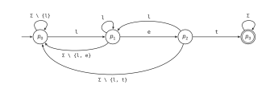
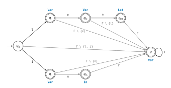
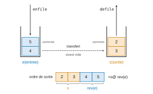
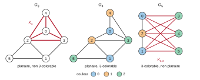
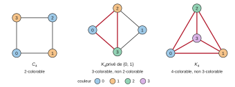
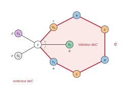

# Centrale-Supélec MP — Option Informatique 2026 · Corrigé guidé

*Corrigé rédigé par IA, non officiel. Signalez toute erreur.*

## Présentation du sujet

**Thème.** « Coloriages » : le sujet colorie d'abord du texte, puis des graphes. L'exercice (partie A) étudie l'analyse lexicale d'un code OCaml par automate, la première étape d'une coloration syntaxique. Le problème (partie B) étudie la coloration des sommets d'un graphe : le cas de deux couleurs, qui se résout en temps linéaire, le cas de trois couleurs, pour lequel on ne connaît que des algorithmes exponentiels, puis les graphes planaires, jusqu'au théorème des cinq couleurs.

**Format.** 4 heures, calculatrice autorisée (inutile en pratique), 43 questions. Toute la programmation se fait en OCaml ; les fonctions classiques de `Array` et `List` sont autorisées, et une partie de leur documentation est donnée en annexe. Les modules `Queue` et `Stack` sont interdits en I.3. Toute fonction demandée peut être réutilisée plus loin même si la question n'a pas été traitée.

**Découpage.**

| Partie | Questions | Contenu |
|---|---|---|
| A — Coloration syntaxique | Q1–Q8 | expressions régulières, automates déterministes, déterminisation, stabilité des langages réguliers, analyse lexicale par plus long lexème, non-régularité, bon parenthésage |
| B.I.1 Graphes bipartis | Q9–Q11 | 2-colorable $\iff$ biparti $\iff$ sans cycle impair |
| B.I.2 Solution naïve | Q12–Q15 | énumération des bicolorations comme entiers binaires, coût exponentiel |
| B.I.3 Structures de données | Q16–Q21 | pile = liste, file à deux piles, invariant, complexité amortie |
| B.I.4 Solution efficace | Q22–Q27 | bicoloration par parcours en largeur : terminaison, complexité, correction, non-connexité, parcours en profondeur |
| B.II 3-coloration | Q28–Q30 | retour sur trace, pire cas exponentiel |
| B.III.1 Formule d'Euler | Q31–Q36 | degrés des sommets et des faces, Euler, $\lvert A\rvert \le 3\lvert S\rvert - 6$, $K_5$, $K_{3,3}$, sommet de degré $\le 5$ |
| B.III.2 et III.3 | Q37–Q39 | Planar-2-COL linéaire, exemples de graphes planaires et de nombres chromatiques |
| B.III.4 Cinq couleurs | Q40–Q43 | récurrence, chaînes de Kempe |

**Notions mobilisées.** Expressions régulières, automates déterministes et non déterministes, théorème de Kleene, stabilité par union, intersection et complémentaire ; principe des tiroirs ; graphes non orientés, connexité, cycles, degrés ; récurrences sur le nombre d'arêtes ou de sommets ; piles, files, analyse amortie ; parcours en largeur et en profondeur ; preuves de terminaison et de correction (invariant, variant) ; retour sur trace.

**Difficulté.** Sujet long mais très progressif. Les questions de programmation sont courtes ; la difficulté est dans les justifications : Q11 (deux cas dans l'hérédité), Q18 (invariant), Q21 (amorti), Q25 (correction dans les deux sens), Q33 (formule d'Euler) et Q41–Q43 (chaînes de Kempe). La partie III, hors des sentiers habituels du programme, est entièrement définie par l'énoncé, qui précise que « tout dessin visant à illustrer l'argumentation sera valorisé ».

**À ne pas laisser passer.** Q1, Q2, Q3, Q5, Q8, Q9, Q10, Q12, Q13, Q16, Q17, Q19, Q20, Q22, Q28, Q31, Q34, Q35, Q36, Q38, Q39, Q40 sont abordables en quelques minutes chacune. Les sous-parties étant largement indépendantes, on ne reste pas bloqué : I.3 et III.1 ne dépendent d'aucun code antérieur.

**Gestion du temps.** Environ 40 minutes pour la partie A, 1 h 45 pour les parties B.I et B.II (dont 30 minutes pour I.4), 1 h 15 pour la partie III, et une relecture des codes (types, `begin … end`, exhaustivité des filtrages).

## Partie A — Exercice : coloration syntaxique

On construit pas à pas un automate qui découpe un texte en lexèmes, on évalue le coût de ce découpage, puis on montre qu'un automate ne peut pas vérifier le parenthésage, ce qui demande un compteur.

### Question 1

> [!INDICATION]
> Séparez le langage en deux cas : le mot réduit à $0$, et les autres.

> [!INDICATION]
> Un mot du second cas commence par une lettre imposée, puis n'importe quoi.

#### Solution

Une écriture binaire normalisée est soit le mot $0$, soit un mot commençant par $1$ suivi d'un mot quelconque sur $\{0,1\}$ :

$$\boxed{\,e = 0 \mid 1\,(0 \mid 1)^*\,}$$

Sa dénotation est $\{0\} \cup \{1w \mid w \in \{0,1\}^*\}$, qui ne contient ni le mot vide ni de mot à zéro de tête autre que $0$.

> [!PIEGE]
> $(0 \mid 1)^*$ accepte $0101$ et le mot vide ; $1(0 \mid 1)^*$ oublie le mot $0$. Vérifiez toujours les cas limites : le mot vide, le mot $0$, un mot à zéro de tête.

### Question 2

> [!INDICATION]
> Suivez l'expression de Q1 : un état après la lecture d'un $0$ initial, un autre après la lecture d'un $1$ initial.

> [!INDICATION]
> Après un $0$ initial, plus aucune lettre n'est permise : il faut un endroit où envoyer les lectures interdites si l'on veut un automate complet.

#### Solution

Automate déterministe complet, d'état initial $q_i$ et d'états finaux $q_z$ et $q_u$ :

| état | lecture de $0$ | lecture de $1$ | signification |
|---|---|---|---|
| $q_i$ (initial) | $q_z$ | $q_u$ | rien n'a été lu |
| $q_z$ (final) | $q_p$ | $q_p$ | on a lu exactement $0$ |
| $q_u$ (final) | $q_u$ | $q_u$ | on a lu un mot $1w$ |
| $q_p$ | $q_p$ | $q_p$ | puits |

On vérifie :

$$\begin{aligned}
\delta^*(q_i, \varepsilon) &= q_i \quad \text{(non final)} \\
\delta^*(q_i, 0) &= q_z \quad \text{(final)} \\
\delta^*(q_i, 0w) &= q_p \quad \text{si } w \neq \varepsilon \text{ (non final)} \\
\delta^*(q_i, 1w) &= q_u \quad \text{(final)}
\end{aligned}$$

Si l'on accepte un automate non complet, on peut supprimer $q_p$.

Pour la base 10, on garde les quatre états et les mêmes états finaux sur l'alphabet $\{0, \dots, 9\}$ : la transition $q_i \to q_u$ est étiquetée par $1, \dots, 9$, et les boucles et les transitions vers le puits par $0, \dots, 9$. L'expression correspondante est $0 \mid (1 \mid \dots \mid 9)(0 \mid \dots \mid 9)^*$.

> [!METHODE]
> Pour un automate déterministe, donnez soit un dessin propre, soit une table de transitions, et précisez s'il est complet. Une table évite les ambiguïtés d'un dessin chargé.

### Question 3

> [!INDICATION]
> Décrivez un calcul acceptant : où l'automate peut-il « attendre », et que doit-il lire pour passer de l'état 1 à l'état 4 ?

> [!INDICATION]
> Pour l'automate déterministe, un état doit retenir la plus grande partie du motif qui vient d'être lue. Que se passe-t-il quand on lit `l` alors qu'on avait commencé le motif ?

#### Solution

L'état 1 est initial, l'état 4 final ; tous deux bouclent sur toutes les lettres, et le chemin $1 \to 2 \to 3 \to 4$ lit `l`, `e`, `t`. Un calcul acceptant lit un mot $x$ en restant en 1, puis `let`, puis un mot $y$ en restant en 4 :

$$\boxed{\,L(A_l) = \Sigma^*\,\texttt{let}\,\Sigma^* \text{, ensemble des mots qui contiennent le facteur } \texttt{let}\,}$$

Ici $\Sigma$ est l'alphabet des caractères (il contient `l`, `e`, `t`). Automate déterministe : l'état $p_k$, pour $k \le 2$, signifie que `let` n'a pas encore été lu et que le plus long suffixe du mot lu qui est préfixe de `let` a $k$ lettres ; $p_3$ signifie que `let` a été lu.

| état | `l` | `e` | `t` | autre lettre |
|---|---|---|---|---|
| $p_0$ (initial) | $p_1$ | $p_0$ | $p_0$ | $p_0$ |
| $p_1$ | $p_1$ | $p_2$ | $p_0$ | $p_0$ |
| $p_2$ | $p_1$ | $p_0$ | $p_3$ | $p_0$ |
| $p_3$ (final) | $p_3$ | $p_3$ | $p_3$ | $p_3$ |



Une récurrence sur la longueur du mot lu montre que l'état atteint est bien celui que décrit sa signification :

- depuis $p_1$ ou $p_2$, lire `l` laisse le suffixe `l` ;
- toute lettre qui ne prolonge pas le motif ramène au suffixe vide ;
- $p_3$ est absorbant.

La construction des parties donne le même automate : $\{1\},\ \{1,2\},\ \{1,3\}$, puis des parties contenant $4$, toutes finales, que l'on fusionne.

> [!PIEGE]
> Oublier les transitions $p_1 \xrightarrow{\texttt l} p_1$ et $p_2 \xrightarrow{\texttt l} p_1$ : l'automate refuserait alors `lelet`. Testez un automate de recherche de motif sur un mot où le motif redémarre au milieu d'une tentative avortée.

### Question 4

> [!INDICATION]
> Écrivez l'ensemble des lexèmes comme une union de langages simples, et identifiez pour chacun pourquoi il est régulier.

> [!INDICATION]
> Les noms de variables sont « les mots de minuscules, sauf deux mots » : quelle propriété de stabilité traduit ce « sauf » ?

#### Solution

Avec $\Gamma = \{\texttt a, \dots, \texttt z\}$, les lexèmes forment l'union de huit langages :

- $\{\texttt{let}\}$, $\{\texttt{in}\}$, $\{\texttt (\}$, $\{\texttt )\}$, $\{\texttt +\}$, $\{\texttt =\}$, finis donc réguliers ;
- les entiers, dénotés par $\texttt 0 \mid (\texttt 1 \mid \dots \mid \texttt 9)(\texttt 0 \mid \dots \mid \texttt 9)^*$ ;
- les noms de variables $\Gamma\Gamma^* \cap \overline{\{\texttt{let}, \texttt{in}\}}$. Un langage régulier est reconnu par un automate déterministe complet ; échanger ses états finaux et non finaux reconnaît le complémentaire ; l'automate produit de deux automates déterministes complets reconnaît l'intersection. Ce langage est donc régulier.

Les langages réguliers sont stables par union finie : l'ensemble des lexèmes est régulier. Par le théorème de Kleene, il est reconnu par un automate fini, qu'on déterminise par la construction des parties. **Il existe donc un automate fini déterministe qui reconnaît tous les lexèmes du type `token`.**

> [!METHODE]
> « Justifier qu'un automate existe » se fait presque toujours par des propriétés de stabilité des langages réguliers, en nommant chacune (union, intersection, complémentaire, concaténation, étoile), puis par Kleene et la déterminisation.

### Question 5

> [!INDICATION]
> Partez de l'arbre des préfixes de `let` et `in`, puis ajoutez un état qui représente « n'importe quel autre mot de minuscules ».

> [!INDICATION]
> Demandez-vous si `l`, `le`, `i`, `lets` et `ink` sont des noms de variables, et dans quel état chacun doit aboutir.

#### Solution

États : l'état initial $q_0$, puis

$$q_{\texttt l},\ q_{\texttt{le}},\ q_{\texttt{let}},\ q_{\texttt i},\ q_{\texttt{in}},\ V.$$

Transitions :

$$\begin{aligned}
\delta(q_0, \texttt l) &= q_{\texttt l} \\
\delta(q_{\texttt l}, \texttt e) &= q_{\texttt{le}} \\
\delta(q_{\texttt{le}}, \texttt t) &= q_{\texttt{let}} \\
\delta(q_0, \texttt i) &= q_{\texttt i} \\
\delta(q_{\texttt i}, \texttt n) &= q_{\texttt{in}}
\end{aligned}$$

toutes les autres transitions mènent à $V$, et $V$ boucle sur toutes les lettres. Tous les états sauf $q_0$ sont finaux :

| état final | constructeur |
|---|---|
| $q_{\texttt{let}}$ | `Let` |
| $q_{\texttt{in}}$ | `In` |
| $q_{\texttt l}$, $q_{\texttt{le}}$, $q_{\texttt i}$, $V$ | `Var` |



Un mot non vide de minuscules aboutit en $q_{\texttt{let}}$ s'il vaut `let`, en $q_{\texttt{in}}$ s'il vaut `in`, et dans un état étiqueté `Var` sinon (par exemple `lets` passe de $q_{\texttt{let}}$ à $V$). Les mots clés sont prioritaires, comme l'exige l'énoncé.

> [!PIEGE]
> Rendre $q_{\texttt l}$, $q_{\texttt{le}}$, $q_{\texttt i}$ non finaux, ou envoyer $q_{\texttt{let}}$ vers un puits : `x`, `le` ou `lets` ne seraient plus reconnus. Et ne pas oublier de donner le constructeur de chaque état final, qui est la moitié de la question.

### Question 6

> [!INDICATION]
> Combien de fois un même caractère peut-il être lu par l'automate au cours de toute l'analyse ?

> [!INDICATION]
> N'oubliez pas les coûts annexes : construction de la chaîne ou de l'entier d'un token, et ajout du token à la liste résultat.

#### Solution

Soit $n$ le nombre de caractères et $k$ le nombre de lexèmes. Les séparateurs sont ignorés en $O(1)$ chacun. Un lexème est lu jusqu'au caractère qui fait échouer l'automate, et ce caractère est relu une seule fois, au début du lexème suivant. Le nombre total de transitions est donc au plus $n + k \le 2n$, chacune en $O(1)$.

Il n'y a jamais de retour arrière, car dans l'automate des lexèmes tout état autre que l'état initial est final (tout préfixe non vide d'un nom de variable ou d'un entier est encore un lexème) : l'échec survient toujours depuis un état final, sauf caractère illégal.

Construire `Var s` ou `Int x` coûte un temps proportionnel à la longueur du lexème, soit $O(n)$ au total ; ajouter chaque token en tête d'une liste, puis la renverser une fois, coûte $O(k)$.

$$\boxed{\,\text{L'analyse lexicale est en } \Theta(n).\,}$$

> [!PIEGE]
> Accumuler les tokens par `liste @ [t]` coûte $O(k)$ par ajout, soit $O(n^2)$ au total. Et la recherche du plus long lexème avec retour arrière (si des états non finaux pouvaient être traversés) peut, elle aussi, devenir quadratique : il faut dire pourquoi ce n'est pas le cas ici.

### Question 7

> [!INDICATION]
> Raisonnez par l'absurde avec un automate déterministe à $N$ états, et regardez les états atteints après avoir lu des parenthèses ouvrantes seulement.

> [!INDICATION]
> Principe des tiroirs : deux nombres différents de parenthèses ouvrantes mènent au même état. Que lisez-vous ensuite ?

#### Solution

L'alphabet $\Sigma$ contient ici les deux parenthèses (avec $\Sigma = \{0,1\}$ de Q1, $L$ serait $\Sigma^*$, régulier).

Supposons $L$ reconnu par un automate déterministe complet à $N$ états, d'état initial $q_0$.

Les $N + 1$ mots $\texttt{(}^i$, pour $0 \le i \le N$, mènent à au plus $N$ états. Il existe donc $i < j$ avec

$$\delta^*(q_0, \texttt{(}^i) = \delta^*(q_0, \texttt{(}^j).$$

Alors

$$\begin{aligned}
\delta^*(q_0, \texttt{(}^j\,\texttt{)}^i) &= \delta^*\big(\delta^*(q_0, \texttt{(}^i), \texttt{)}^i\big) \\
&= \delta^*(q_0, \texttt{(}^i\,\texttt{)}^i),
\end{aligned}$$

qui est final puisque $\texttt{(}^i\texttt{)}^i \in L$. Donc $\texttt{(}^j\texttt{)}^i$ est accepté.

Ce mot a pourtant $j \neq i$ parenthèses ouvrantes et $i$ fermantes : contradiction.

$$\boxed{\,L \text{ n'est pas régulier.}\,}$$

> [!METHODE]
> Le même raisonnement, appliqué au mot $\texttt{(}^N\texttt{)}^N$ avec la condition « facteur itérant dans les $N$ premières lettres », est le lemme de l'étoile. Dans les deux cas, le mot témoin doit dépendre de $N$ et l'on doit exploiter le fait que la partie répétée ne contient que des parenthèses ouvrantes.

### Question 8

> [!INDICATION]
> Avec une seule sorte de parenthèse, une pile n'a besoin de retenir que sa hauteur.

> [!INDICATION]
> Deux conditions caractérisent le bon parenthésage : l'une est vérifiée en cours de lecture, l'autre à la fin. Testez-les sur les deux exemples de l'énoncé.

#### Solution

On parcourt la liste une fois avec un compteur $h$ initialisé à $0$ : `Lpar` incrémente $h$, `Rpar` le décrémente, les autres tokens sont ignorés. Si $h < 0$ à un moment, on rejette aussitôt ; à la fin, on accepte si et seulement si $h = 0$.

Après $j$ tokens, $h$ est la différence entre les nombres de `Lpar` et de `Rpar` lus, et une suite de parenthèses est bien parenthésée si et seulement si toutes ces différences sont positives ou nulles et la dernière est nulle. Le travail est en $O(1)$ par token : **temps linéaire**.

Sur `[Int 3; Lpar; Equal; Rpar]` : $h = 0, 1, 1, 0$, accepté. Sur `[Lpar; Int 2; Add; Int 3; Rpar; Rpar; Lpar]` : $h = 1, 1, 1, 1, 0, -1$, rejeté au sixième token.

> [!PIEGE]
> Le seul test $h = 0$ à la fin accepterait `[Rpar; Lpar]`. Et il n'y a pas de contradiction avec Q7 : un compteur non borné n'est pas une mémoire finie.

## Partie B — Problème : coloration de graphes

## I — Cas de la 2-COLORATION

On caractérise les graphes 2-colorables, puis on compare deux algorithmes : une recherche exhaustive exponentielle et un parcours en largeur linéaire, qui demande une file efficace, construite en I.3.

### Question 9

> [!INDICATION]
> Rappelez la définition d'un graphe biparti, puis passez d'une coloration à une partition et inversement.

#### Solution

$G = (S, A)$ est biparti s'il existe une partition $S = S_0 \sqcup S_1$ (une classe pouvant être vide) telle que toute arête relie $S_0$ à $S_1$.

Soit $c : S \to \{0,1\}$ une 2-coloration valide. Les ensembles

$$\begin{aligned}
S_0 &= c^{-1}(\{0\}) \\
S_1 &= c^{-1}(\{1\})
\end{aligned}$$

partitionnent $S$. Une arête $\{u, v\}$ vérifie $c(u) \neq c(v)$, donc relie les deux classes.

Réciproquement, d'une bipartition on déduit $c(u) = 0$ sur $S_0$ et $c(u) = 1$ sur $S_1$, application à valeurs dans $[\![0,1]\!]$. Toute arête relie deux classes, donc deux couleurs différentes.

**Un graphe est 2-colorable si et seulement s'il est biparti.**

> [!PIEGE]
> Écrire un seul sens. Et préciser la convention sur les classes vides : sans elle, un graphe à un seul sommet ne serait pas biparti.

### Question 10

> [!INDICATION]
> Le long d'un cycle, comment la couleur d'un sommet se déduit-elle de celle du précédent quand il n'y a que deux couleurs ?

> [!INDICATION]
> Exprimez la couleur du $i$-ième sommet en fonction de celle du premier et de $i$, puis faites le tour complet.

#### Solution

Soit $s_0, s_1, \dots, s_p = s_0$ un cycle de longueur $p$ impaire et $c$ une 2-coloration valide.

Pour $i < p$, on a $c(s_{i+1}) \neq c(s_i)$ avec deux couleurs, donc

$$c(s_{i+1}) \equiv c(s_i) + 1 \pmod 2,$$

et par récurrence

$$c(s_i) \equiv c(s_0) + i \pmod 2.$$

En $i = p$, on obtient $c(s_0) \equiv c(s_0) + p$, donc $p$ est pair, ce qui est absurde.

**Un graphe qui contient un cycle impair n'est pas 2-colorable.**

### Question 11

> [!INDICATION]
> Retirez une arête $\{u, v\}$, coloriez le graphe obtenu par hypothèse de récurrence, et regardez si $u$ et $v$ ont des couleurs différentes.

> [!INDICATION]
> Deux situations : $u$ et $v$ sont reliés ou non dans le graphe privé de l'arête. Dans le premier cas, un chemin bien choisi fournit un cycle ; dans le second, on peut modifier la coloration sur une partie du graphe.

> [!INDICATION]
> Pour obtenir un vrai cycle (sommets distincts), prenez un chemin de longueur minimale.

#### Solution

Récurrence forte sur le nombre $m$ d'arêtes : « tout graphe à $m$ arêtes sans cycle impair est 2-colorable ». Pour $m = 0$, la coloration constante $0$ convient.

Soit $G$ sans cycle impair à $m \ge 1$ arêtes, $a = \{u, v\} \in A$ et

$$G' = (S, A \setminus \{a\}).$$

Les cycles de $G'$ sont des cycles de $G$, donc $G'$ est sans cycle impair et admet une 2-coloration valide $c'$. Seule l'arête $a$ est à vérifier.

*Cas 1 : $u$ et $v$ sont reliés dans $G'$.* Soit $u = s_0, \dots, s_\ell = v$ un chemin de $G'$ de longueur minimale. Ses sommets sont distincts (sinon on le raccourcit).

On a $\ell \ge 2$, car $u \neq v$ et $\{u, v\} \notin A \setminus \{a\}$.

Si $c'(u) = c'(v)$, le calcul de Q10 montre que $\ell$ est pair. Alors $s_0, \dots, s_\ell, s_0$, refermé par $a$, est un cycle de $G$ de longueur impaire $\ell + 1 \ge 3$ : contradiction.

Donc $c'(u) \neq c'(v)$ et $c'$ convient pour $G$.

*Cas 2 : $u$ et $v$ ne sont pas reliés dans $G'$.* Supposons $c'(u) = c'(v)$.

On inverse alors les couleurs sur la composante connexe $K$ de $v$ dans $G'$, qui ne contient pas $u$.

Aucune arête de $G'$ n'a une seule extrémité dans $K$, donc la coloration reste valide sur $G'$. Désormais $u$ et $v$ ont des couleurs différentes.

Dans les deux cas $G$ est 2-colorable. Avec Q10 : **2-colorable $\iff$ biparti $\iff$ sans cycle impair.**

> [!PIEGE]
> Oublier le cas 2 : si $u$ et $v$ sont dans deux composantes différentes de $G'$, rien n'oblige $c'$ à les colorier différemment. Autre faute : refermer un chemin quelconque, qui donne un chemin fermé impair mais pas forcément un cycle au sens de l'énoncé.

### Question 12

> [!INDICATION]
> Passer à la bicoloration suivante, c'est ajouter $1$ en binaire, le bit de poids faible étant en position $0$. Comment se propage la retenue ?

> [!INDICATION]
> Dans le meilleur cas, aucune retenue ne se propage : la boucle doit pouvoir s'arrêter dès la première case.

#### Solution

```ocaml
let suivante (c : col) : bool =
  let n = Array.length c in
  let i = ref 0 in
  while !i < n && c.(!i) = 1 do
    c.(!i) <- 0;
    incr i
  done;
  if !i = n then false
  else begin c.(!i) <- 1; true end
```

Invariant : les cases d'indice $< i$ valaient $1$ et valent maintenant $0$. En sortie, deux cas se présentent.

- Ou bien $i = n$ : l'entier valait $2^n - 1$, il n'y a pas de suivante et le tableau est remis à zéro.
- Ou bien la case $i$ passe de $0$ à $1$, ce qui ajoute $2^i - \sum_{j < i} 2^j = 1$.

Meilleur cas ($c.(0) = 0$) : $\Theta(1)$ ; pire cas : $\Theta(n)$.

> [!PIEGE]
> Convertir le tableau en entier, ajouter $1$ et reconvertir coûte $\Theta(n)$ dans tous les cas (contraire à l'exigence de l'énoncé) et déborde dès $n \ge 63$. Et l'ordre des deux tests dans `while` compte : `&&` est paresseux et protège l'accès `c.(!i)`.

### Question 13

> [!INDICATION]
> Une arête est vue depuis chacune de ses extrémités dans les listes d'adjacence : il suffit de parcourir toutes les listes.

#### Solution

```ocaml
let valide (g : graphe) (c : col) : bool =
  let ok = ref true in
  for u = 0 to g.nbr - 1 do
    List.iter (fun v -> if c.(u) = c.(v) then ok := false) g.adj.(u)
  done;
  !ok
```

`ok` passe à `false` si et seulement s'il existe une arête monochrome. Coût $\Theta(|S| + |A|)$, puisque $\sum_u \deg(u) = 2|A|$.

> [!PIEGE]
> Écrire `if c.(u) = c.(v) then false` dans la fonction passée à `List.iter` : cette fonction doit renvoyer `unit`, le code ne compile pas. Vérifiez le type de chaque expression.

### Question 14

> [!INDICATION]
> Combinez `valide` et `suivante` dans une boucle, en partant de la coloration nulle.

> [!INDICATION]
> Ne sautez pas la première coloration, et prévoyez l'arrêt quand `suivante` renvoie `false`.

#### Solution

```ocaml
let bicolnaif (g : graphe) : bool * col =
  let c = Array.make g.nbr 0 in
  let trouve = ref (valide g c) in
  let encore = ref true in
  while not !trouve && !encore do
    encore := suivante c;
    if !encore then trouve := valide g c
  done;
  (!trouve, c)
```

Les colorations examinées correspondent aux entiers $0, 1, \dots, 2^{|S|} - 1$, c'est-à-dire à toutes les bicolorations. La boucle termine car l'entier associé croît strictement et reste majoré. On renvoie `(true, c)` à la première coloration valide, `(false, _)` sinon. Sur $G_2$, on obtient `(true, [|1; 1; 0; 1; 0; 0|])` : la bicoloration de la figure 3, d'entier 11, est la plus petite des deux bicolorations valides (l'autre a pour entier 52).

### Question 15

> [!INDICATION]
> Dans le pire cas, combien de colorations sont testées, et combien coûte chaque test ?

> [!INDICATION]
> Pour le coût cumulé des appels à `suivante`, comptez combien de fois chaque bit change en tout.

#### Solution

Le pire cas est celui d'un graphe non 2-colorable (par exemple $G_1$, qui contient le triangle $0, 2, 3$). Notons $n = |S|$ et $m = |A|$ : les $2^n$ colorations sont testées, chacune en $\Theta(n + m)$.

Le bit $j$ est modifié au plus $2^{n-j}$ fois. Les appels à `suivante` coûtent donc au total au plus $2^{n+1}$ opérations, ce qui est négligeable.

$$\boxed{\,C_{\text{pire}} = \Theta\big(2^{|S|}(|S| + |A|)\big) = O\big(2^{|S|}\,|S|^2\big)\,}$$

> [!METHODE]
> Le coût total d'un compteur binaire incrémenté $2^n$ fois est en $O(2^n)$ et non $O(n\,2^n)$ : c'est le premier exemple classique d'analyse amortie, qu'on retrouve en Q21.

### Question 16

> [!INDICATION]
> Listez les opérations d'une pile et cherchez, pour chacune, l'opération de liste correspondante et son coût.

#### Solution

La pile vide est `[]`. Empiler $x$ sur $p$ s'écrit `x :: p`, en $O(1)$ : un seul maillon est alloué, et $p$ est partagée, pas recopiée. Tester la vacuité et dépiler se font par filtrage (`match p with [] -> … | x :: r -> …`), qui donne en $O(1)$ le sommet et le reste. La tête est le dernier élément ajouté : c'est exactement la discipline « dernier entré, premier sorti ». Les opérations coûteuses sur les listes (accès au $i$-ième élément, `@`, longueur) ne servent jamais pour une pile. La structure est de plus immuable et polymorphe.

### Question 17

> [!INDICATION]
> Écrivez d'abord une fonction auxiliaire qui réalise la boucle « TANT QUE entrée non vide : dépiler, empiler sur sortie ».

> [!INDICATION]
> Respectez les signatures : `enfile` prend un couple et `defile` renvoie un couple. Pensez au cas de la file vide.

#### Solution

```ocaml
let rec transfert (e : 'a pile) (s : 'a pile) : 'a pile =
  match e with
  | [] -> s
  | x :: r -> transfert r (x :: s)

let initFile () : 'a file = { entree = [] ; sortie = [] }

let estVideFile (f : 'a file) : bool = f.entree = [] && f.sortie = []

let enfile ((x, f) : 'a * 'a file) : 'a file =
  { entree = x :: f.entree ; sortie = f.sortie }

let defile (f : 'a file) : 'a * 'a file =
  match f.sortie with
  | x :: r -> (x, { entree = f.entree ; sortie = r })
  | [] ->
    begin match transfert f.entree [] with
    | [] -> failwith "defile : file vide"
    | x :: r -> (x, { entree = [] ; sortie = r })
    end
```

Le transfert n'a lieu que si « sortie » est vide, conformément à l'algorithme de l'énoncé.

> [!PIEGE]
> Un `match` imbriqué sans `begin … end` (ou parenthèses) absorbe les cas suivants. Et transférer systématiquement, même quand « sortie » est non vide, casse l'ordre de sortie.

### Question 18

> [!INDICATION]
> Trouvez une expression, construite à partir des deux piles, qui donne la liste des éléments présents dans l'ordre d'arrivée.

> [!INDICATION]
> Vérifiez que cette expression évolue comme il faut pour chacune des trois transitions possibles : `enfile`, `defile` sans transfert, `defile` avec transfert.

#### Solution

Pour $f = \{\texttt{entree} = e ; \texttt{sortie} = s\}$, posons $\mathrm{cont}(f) = s \mathbin{@} \mathrm{rev}(e)$. Invariant, démontré par récurrence sur le nombre d'opérations : *$\mathrm{cont}(f)$ est la liste des éléments présents, du plus ancien au plus récent.*



- File vide : $\mathrm{cont} = [\,]$.
- `enfile (x, f)` : $\mathrm{cont} = s \mathbin{@} \mathrm{rev}(e) \mathbin{@} [x]$, et $x$ est le plus récent.
- `defile f` avec $s = x :: r$ : $x$, tête de $\mathrm{cont}(f)$, est le plus ancien, et le nouveau contenu est $r \mathbin{@} \mathrm{rev}(e)$.
- `defile f` avec $s = [\,]$ : après transfert, $s' = \mathrm{rev}(e)$ et $e' = [\,]$, le contenu est inchangé, et l'on est ramené au cas précédent.

Chaque `defile` renvoie le plus ancien élément présent : **l'ordre de sortie est l'ordre d'entrée.**

> [!METHODE]
> Pour une structure de données, on prouve la correction par un invariant de représentation : une fonction d'abstraction (ici $\mathrm{cont}$) qui relie la représentation concrète à l'objet abstrait, et que chaque opération fait évoluer comme l'opération abstraite.

### Question 19

> [!INDICATION]
> Quand `defile` coûte-t-il plus qu'un nombre constant d'opérations ? Construisez une suite d'opérations qui réalise ce cas.

#### Solution

Si « sortie » est non vide, `defile` est en $\Theta(1)$ ; sinon le transfert de $p$ éléments coûte $\Theta(p)$. Après $p$ enfilements consécutifs sur une file vide, un `defile` transfère les $p$ éléments :

$$\boxed{\,\texttt{defile} \text{ est en } \Theta(p) \text{ dans le pire cas, } p \text{ étant le nombre d'éléments présents.}\,}$$

### Question 20

> [!INDICATION]
> Suivez un élément de son entrée à sa sortie : sur quelles piles passe-t-il, et peut-il revenir en arrière ?

#### Solution

Un élément subit au plus : un empilement sur « entrée » (toujours), un dépilement de « entrée » et un empilement sur « sortie » lors d'un transfert, puis un dépilement de « sortie » s'il sort. Le transfert a lieu au plus une fois, car rien ne revient de « sortie » vers « entrée ».

$$\boxed{\,1 \le \text{nombre d'empilements et dépilements subis par un élément} \le 4\,}$$

Les bornes sont atteintes : $1$ pour un élément resté dans « entrée », $4$ pour un élément transféré puis sorti.

### Question 21

> [!INDICATION]
> Reliez le nombre d'éléments qui transitent au nombre $n$ d'opérations : combien d'`enfile` au moins et au plus ?

> [!INDICATION]
> Pour un encadrement plus fin, comptez les opérations de pile par type d'opération (`enfile`, transfert, `defile`).

#### Solution

Soit $k$ le nombre d'`enfile` et $d$ celui de `defile`. On a $n = k + d$ et $d \le k$ (on ne défile pas une file vide), donc $\frac n2 \le k \le n$.

Exactement $k$ éléments transitent. Pour le nombre total $N$ d'empilements et de dépilements, Q20 donne $k \le N \le 4k$, d'où $\frac n2 \le N \le 4n$.

Plus finement, si $t$ éléments sont transférés, alors

$$N = k + 2t + d,$$

avec $d \le t \le k$ (un élément sorti a été transféré). Donc

$$\begin{aligned}
N &\ge k + d \\
&= n, \\
N &\le n + 2k \\
&\le 3n.
\end{aligned}$$

$$\boxed{\,n \le N \le 3n\,}$$

Chaque opération de pile coûte $O(1)$ et le reste du travail de chaque `enfile` ou `defile` est borné : $n$ opérations coûtent $\Theta(n)$ au total. **La complexité amortie de `enfile` et de `defile` est constante**, bien qu'un `defile` isolé puisse coûter $\Theta(p)$.

> [!PIEGE]
> Confondre complexité amortie et complexité en moyenne. L'amortie est une garantie déterministe sur toute suite d'opérations ; aucune distribution de probabilité n'intervient.

### Question 22

> [!INDICATION]
> Dans un graphe connexe, la couleur d'un seul sommet détermine toutes les autres : propagez-la avec un parcours en largeur.

> [!INDICATION]
> Utilisez le tableau des couleurs, initialisé à $-1$, comme marquage des sommets découverts, et la file de I.3. Coloriez un sommet au moment où vous le découvrez.

#### Solution

```ocaml
let bicol (g : graphe) : bool * col =
  let c = Array.make g.nbr (-1) in
  let ok = ref true in
  if g.nbr > 0 then begin
    c.(0) <- 0;
    let f = ref (enfile (0, initFile ())) in
    while !ok && not (estVideFile !f) do
      let (u, reste) = defile !f in
      f := reste;
      List.iter
        (fun v ->
           if c.(v) = -1 then begin
             c.(v) <- 1 - c.(u);
             f := enfile (v, !f)
           end
           else if c.(v) = c.(u) then ok := false)
        g.adj.(u)
    done
  end;
  (!ok, c)
```

Un sommet découvert reçoit la couleur opposée à celle du sommet qui le découvre ; une arête monochrome met `ok` à `false` et arrête le parcours. Sur $G_2$ : `(true, [|0; 0; 1; 0; 1; 1|])`, la parité de la distance au sommet $0$.

> [!PIEGE]
> Colorier un sommet quand on le défile plutôt que quand on l'enfile : il peut alors être enfilé plusieurs fois, et le parcours n'est plus linéaire.

### Question 23

> [!INDICATION]
> Combien de fois au plus un sommet peut-il être enfilé ? Désignez l'instruction qui l'empêche d'être enfilé deux fois.

#### Solution

Un sommet n'est enfilé que si `c.(v) = -1`, et il reçoit aussitôt une couleur $0$ ou $1$ ; aucune instruction ne remet une case à $-1$. Chaque sommet est donc enfilé au plus une fois, soit au plus $|S|$ enfilements. Chaque tour de boucle défile un élément : il y a au plus $|S|$ tours, chacun fini. Un variant : (sommets non découverts) + (taille de la file), entier positif qui diminue de $1$ à chaque tour. **`bicol` termine.**

### Question 24

> [!INDICATION]
> Séparez trois coûts : initialisation, opérations de file, parcours des listes d'adjacence.

> [!INDICATION]
> Pour les opérations de file, utilisez le résultat global de Q21 plutôt que le pire cas de Q19.

#### Solution

Notons $n = |S|$ et $m = |A|$.

- L'initialisation coûte $\Theta(n)$.
- Il y a au plus $n$ enfilements et $n$ défilements, de coût total $O(n)$ (Q21).
- Chaque sommet $u$ défilé est traité en $\Theta(1 + \deg(u))$, soit au total $O(n + 2m)$.

$$\boxed{\,C(\texttt{bicol}) = O(|S| + |A|)\,}$$

C'est un $\Theta(|S| + |A|)$ quand le graphe est biparti (le parcours est complet) : coût linéaire en la taille du graphe, à comparer au coût exponentiel de Q15.

> [!PIEGE]
> Majorer chaque `defile` par $\Theta(n)$ donne $O(n^2)$ : c'est juste, mais cela manque la linéarité, qui est l'objet de la question et la raison d'être de I.3.

### Question 25

> [!INDICATION]
> Il y a deux énoncés à prouver, un pour chaque valeur renvoyée.

> [!INDICATION]
> Pour `true` : montrez que tous les sommets sont coloriés (connexité) et que chaque arête a été contrôlée. Pour `false` : montrez que la coloration construite est imposée par n'importe quelle bicoloration valide, à échange des couleurs près.

#### Solution

On suppose $G$ connexe, $|S| \ge 1$, et on note $c$ le tableau final. Une case ne change plus une fois coloriée.

Un sommet $x$ colorié depuis $u$ vérifie $\{u, x\} \in A$ et $c(x) = 1 - c(u)$.

**Réponse `true`.** La boucle s'arrête parce que la file est vide, `ok` restant vrai : tout sommet colorié a été défilé et entièrement traité.

Si un sommet restait à $-1$, un chemin depuis $0$ fournirait une arête $\{u, v\}$, $u$ colorié et $v$ non.

Mais traiter $u$ colorie $v$. Tous les sommets sont donc coloriés.

Soit $\{u, v\} \in A$. Lors du traitement de $u$, ou bien $v$ reçoit $1 - c(u)$, ou bien le test `c.(v) = c.(u)` est effectué et échoue. **$c$ est une bicoloration valide.**

**Réponse `false`.** Il existe une arête $\{u, v\}$ entre sommets coloriés avec $c(u) = c(v)$. Supposons que $c^*$ soit une bicoloration valide.

Une récurrence sur l'ordre de coloriage donne, pour tout sommet colorié $x$ :

$$c(x) \equiv c^*(x) + c^*(0) \pmod 2.$$

C'est vrai pour $0$. Si $x$ est colorié depuis $u$ :

$$\begin{aligned}
c(x) &\equiv c(u) + 1 \\
&\equiv c^*(u) + 1 + c^*(0) \\
&\equiv c^*(x) + c^*(0) \pmod 2.
\end{aligned}$$

En $u$ et $v$, on obtiendrait $c^*(u) = c^*(v)$ : contradiction. **Le graphe n'est pas 2-colorable.**

> [!METHODE]
> Pour un algorithme qui répond oui ou non, la correction a deux sens : « si oui, le témoin renvoyé est valide » et « si non, aucun témoin n'existe ». Le second porte l'idée de l'algorithme : ici, la bicoloration d'un graphe connexe est unique à échange des couleurs près.

### Question 26

> [!INDICATION]
> Un graphe est 2-colorable si et seulement si chacune de ses composantes connexes l'est. Comment atteindre toutes les composantes ?

#### Solution

On relance le parcours depuis chaque sommet encore non colorié, avec un drapeau commun :

```ocaml
let bicol_general (g : graphe) : bool * col =
  let c = Array.make g.nbr (-1) in
  let ok = ref true in
  for s = 0 to g.nbr - 1 do
    if !ok && c.(s) = -1 then begin
      c.(s) <- 0;
      let f = ref (enfile (s, initFile ())) in
      while !ok && not (estVideFile !f) do
        let (u, reste) = defile !f in
        f := reste;
        List.iter
          (fun v ->
             if c.(v) = -1 then begin
               c.(v) <- 1 - c.(u);
               f := enfile (v, !f)
             end
             else if c.(v) = c.(u) then ok := false)
          g.adj.(u)
      done
    end
  done;
  (!ok, c)
```

Chaque parcours colorie exactement une composante. Aucune arête ne relie deux composantes, donc des bicolorations des composantes se recollent, et Q25, appliquée à chaque composante, donne la correction. La complexité reste $O(|S| + |A|)$.

> [!PIEGE]
> Réinitialiser `ok` pour chaque composante : une seule composante non bipartie suffit à rendre le graphe non 2-colorable.

### Question 27

> [!INDICATION]
> Relisez la preuve de Q25 : à quel moment a-t-on utilisé l'ordre dans lequel les sommets sortent de la file ?

> [!INDICATION]
> On peut remplacer la file par une pile, ou utiliser la récursivité.

#### Solution

La preuve de Q25 n'utilise que trois faits : chaque sommet est colorié une fois, depuis un voisin, de la couleur opposée ; chaque sommet colorié est traité ; chaque arête est examinée. N'importe quel parcours convient, en particulier le parcours en profondeur, écrit récursivement :

```ocaml
let bicol_profondeur (g : graphe) : bool * col =
  let c = Array.make g.nbr (-1) in
  let ok = ref true in
  let rec visite (u : int) : unit =
    List.iter
      (fun v ->
         if c.(v) = -1 then begin
           c.(v) <- 1 - c.(u);
           visite v
         end
         else if c.(v) = c.(u) then ok := false)
      g.adj.(u)
  in
  if g.nbr > 0 then begin c.(0) <- 0; visite 0 end;
  (!ok, c)
```

`visite` n'est appelée qu'une fois par sommet (sur un sommet qui vient d'être colorié) : terminaison et complexité $\Theta(|S| + |A|)$ comme pour le parcours en largeur. On peut aussi garder la boucle de Q22 en remplaçant la file par une pile (`x :: p` pour empiler, filtrage pour dépiler).

> [!METHODE]
> Changer de structure de données (file ou pile) change l'ordre du parcours, pas sa correction. Il faut dire pourquoi la preuve survit au changement, pas seulement l'affirmer. La version récursive consomme une pile d'appels de profondeur jusqu'à $|S|$.

## II — Cas de la 3-COLORATION

Avec trois couleurs, la couleur d'un sommet n'est plus imposée par celle d'un voisin : il faut essayer, et revenir en arrière en cas d'échec.

### Question 28

> [!INDICATION]
> Il suffit de comparer la couleur de $s$ à celle de chacun de ses voisins. Que donne cette comparaison pour un voisin non colorié ?

#### Solution

```ocaml
let partial (g : graphe) (c : col) (s : int) : bool =
  List.for_all (fun v -> c.(v) <> c.(s)) g.adj.(s)
```

Comme $c(s) \neq -1$, un voisin non colorié ($c(v) = -1$) ne provoque jamais d'échec, conformément à la convention de l'énoncé. Coût $\Theta(\deg(s))$.

> [!PIEGE]
> Réutiliser `valide` de Q13 : elle coûte $\Theta(|S| + |A|)$ et déclare invalide toute coloration partielle où deux sommets voisins valent encore $-1$.

### Question 29

> [!INDICATION]
> Coloriez les sommets un par un dans un ordre fixé ; pour chacun, essayez les trois couleurs et ne descendez que si `partial` réussit.

> [!INDICATION]
> En cas d'échec des trois couleurs, que faut-il rétablir avant de remonter ?

#### Solution

```ocaml
let backtracking (g : graphe) : bool * col =
  let n = g.nbr in
  let c = Array.make n (-1) in
  let rec explore (s : int) : bool =
    if s = n then true
    else begin
      let trouve = ref false in
      let k = ref 0 in
      while not !trouve && !k < 3 do
        c.(s) <- !k;
        if partial g c s && explore (s + 1) then trouve := true
        else incr k
      done;
      if not !trouve then c.(s) <- -1;
      !trouve
    end
  in
  let b = explore 0 in
  (b, c)
```

Par récurrence descendante sur $s$ : si $0, \dots, s-1$ sont coloriés sans arête monochrome entre eux et les autres sommets valent $-1$, `explore s` renvoie `true` si et seulement si cette coloration partielle se prolonge en une 3-coloration valide, en laissant un tel prolongement dans `c`, et restaure `c` en cas d'échec.

Après `c.(s) <- k`, les arêtes nouvellement entre sommets coloriés sont les $\{s, v\}$ avec $v < s$, exactement celles que teste `partial g c s`.

La terminaison vient de ce que $n - s$ décroît. Sur $G_3$ on obtient `false`, sur $G_4$ une 3-coloration.

> [!PIEGE]
> Oublier `c.(s) <- -1` en cas d'échec : la couleur fantôme fausse les tests `partial` des branches suivantes. La paresse de `&&` réalise l'élagage : on ne descend que si le choix courant est localement valide.

> [!METHODE]
> En pratique, colorier dans l'ordre d'un parcours du graphe (supposé connexe) fait échouer `partial` plus tôt, car chaque nouveau sommet a déjà un voisin colorié. Le pire cas reste exponentiel.

### Question 30

> [!INDICATION]
> Majorez le nombre de nœuds de l'arbre des appels, puis le coût d'un nœud.

> [!INDICATION]
> Pour montrer que la majoration est atteinte, construisez un graphe connexe non 3-colorable dont l'obstacle n'est découvert qu'après avoir colorié presque tous les sommets de toutes les manières possibles.

#### Solution

L'arbre des appels a au plus $3^s$ nœuds à la profondeur $s$, donc au plus $\frac{3^{n+1} - 1}{2}$ nœuds ($n = |S|$), et chaque nœud fait au plus trois appels à `partial`, chacun en $O(\Delta)$ ($\Delta$ degré maximal) :

$$\boxed{\,C_{\text{pire}} = O\big(\Delta\,3^{|S|}\big) = O\big(|S|\,3^{|S|}\big)\,}$$

La borne est atteinte à un facteur polynomial près. Considérons le graphe $H_n$ ($n \ge 5$) où $n-4, \dots, n-1$ forment un $K_4$ et où chaque sommet $s \le n-5$ n'est relié qu'à $n-1$.

Les sommets $0, \dots, n-5$ ont leur unique voisin non colorié au moment où on les colorie. Les $3^{n-4}$ colorations de ces sommets sont donc toutes explorées, et chacune échoue sur le $K_4$, non 3-colorable. **Le pire cas est exponentiel**, ce qui est cohérent avec l'énoncé : on ne sait pas résoudre la 3-coloration en temps polynomial.

> [!PIEGE]
> Annoncer $O(3^n)$ sans dire d'où vient le $3^n$ ni le coût d'un nœud. Et confondre « le pire cas est exponentiel » avec « l'algorithme est toujours lent ».

## III — Graphes planaires

La partie III quitte l'algorithmique pour la combinatoire des graphes planaires : formule d'Euler, inégalités sur le nombre d'arêtes, puis conséquences pour la coloration. Deux faits de topologie du plan sont admis, comme le fait implicitement l'énoncé : (G1) un arc attaché au tracé par une seule extrémité ne sépare pas la face où il est tracé ; (G2) (théorème de Jordan) une courbe fermée simple sépare le plan en une région bornée et une région non bornée, et tout arc qui joint les deux la rencontre. Les dessins sont valorisés : faites-en.

### Question 31

> [!INDICATION]
> Comptez de deux façons les couples (sommet, arête) incidents.

> [!INDICATION]
> Pour les faces, chaque arête a deux côtés. Examinez à part le cas d'une arête qui a la même face des deux côtés, comme $cd$ sur la figure 4.

#### Solution

**Sommets.** Les couples $(s, a)$ avec $s \in a$ sont au nombre de $\sum_s \deg(s)$, et aussi de $2|A|$ (deux extrémités distinctes par arête) :

$$\boxed{\,\sum_{s \in S} \deg(s) = 2|A|\,}$$

**Faces.** Si les deux côtés d'une arête bordent deux faces distinctes, l'arête figure une fois dans le parcours de frontière de chacune. Si les deux côtés bordent la même face (cas d'un isthme, arête dont la suppression déconnecte le graphe), le parcours de frontière de cette face l'emprunte deux fois, une fois dans chaque sens. Dans les deux cas l'arête compte deux fois :

$$\boxed{\,\sum_{f \in F} \deg(f) = 2|A|\,}$$

Vérification sur la figure 4 : $|A| = 7$, degrés des sommets $2 + 2 + 3 + 3 + 2 + 2 = 14$, degrés des faces $3 + 3 + 8 = 14$.

> [!PIEGE]
> « Chaque arête sépare deux faces » est faux pour un isthme : la formule reste vraie, mais pour une autre raison. L'exemple de l'énoncé (face 3 de degré 8 avec 7 arêtes) est là pour le rappeler.

### Question 32

> [!INDICATION]
> Pour un arbre, calculez séparément $|A|$ en fonction de $|S|$, et $|F|$.

> [!INDICATION]
> Une récurrence qui retire une feuille sert pour les deux calculs. Il faut d'abord prouver qu'une feuille existe : regardez l'extrémité d'un chemin le plus long possible.

#### Solution

Un arbre est un graphe connexe sans cycle.

*Existence d'une feuille* (arbre à au moins deux sommets). Soit $s_0, \dots, s_k$ un chemin à sommets distincts de longueur maximale ($k \ge 1$), et $w \neq s_{k-1}$ un voisin de $s_k$.

- S'il est absent du chemin, $w$ le prolongerait.
- Si $w = s_i$ avec $i \le k-2$, il fermerait un cycle $s_i, \dots, s_k, s_i$ de longueur au moins 3.

Donc $\deg(s_k) = 1$.

*$|A| = |S| - 1$*, par récurrence sur $|S|$ : vrai pour un sommet seul. Sinon, retirer une feuille et son arête donne un graphe sans cycle et connexe (un chemin entre deux autres sommets ne traverse pas un sommet de degré 1), donc un arbre à $|S| - 1$ sommets et $|A| - 1$ arêtes.

*$|F| = 1$*, par récurrence sur $|S|$ : un point ne sépare pas le plan ; ajouter une feuille revient à tracer dans l'unique face un arc attaché par une seule extrémité, qui ne la sépare pas (G1).

Donc

$$\begin{aligned}
|S| - |A| + |F| &= |S| - (|S| - 1) + 1 \\
&= 2,
\end{aligned}$$

et **la formule d'Euler est vraie pour tout arbre.**

> [!PIEGE]
> Affirmer $|F| = 1$ sans justification : c'est pourtant le seul point proprement planaire de la question, qui demande une preuve « en détail ».

### Question 33

> [!INDICATION]
> Récurrence sur le nombre d'arêtes, en prenant les arbres comme cas de base.

> [!INDICATION]
> Si le graphe n'est pas un arbre, il a un cycle. Quelle arête retirer pour garder la connexité, et combien de faces disparaissent alors ?

#### Solution

Récurrence forte sur $|A|$ pour un graphe connexe planaire non vide, muni d'un tracé sans croisement. Si $G$ n'a pas de cycle (en particulier si $|A| = 0$), c'est un arbre : Q32.

Sinon, soit $a = \{u, v\}$ une arête d'un cycle $C$, et $G' = G - a$. Le graphe $G'$ est planaire, et connexe : on remplace $a$ par le reste de $C$ dans tout chemin.

Le tracé de $C$ est une courbe fermée simple qui sépare l'intérieur de l'extérieur (G2). Une face de $G$ est connexe par arcs et ne rencontre pas $C$, donc elle est tout entière d'un côté. Or les deux côtés de l'arc $a$ sont de part et d'autre de $C$.

Les deux faces qui bordent $a$ sont donc distinctes, et effacer $a$ les fusionne en une seule, sans changer les autres. Ainsi

$$\begin{aligned}
|S'| &= |S| \\
|A'| &= |A| - 1 \\
|F'| &= |F| - 1
\end{aligned}$$

et

$$\begin{aligned}
|S| - |A| + |F| &= |S'| - |A'| + |F'| \\
&= 2.
\end{aligned}$$

**Tout graphe planaire connexe non vide vérifie $|S| - |A| + |F| = 2$.**

> [!METHODE]
> Choisir l'arête sur un cycle est le point clé : elle borde deux faces distinctes, ce qui est faux pour un isthme. Un dessin (un carré avec une arête que l'on efface, deux faces qui fusionnent) illustre bien l'hérédité.

### Question 34

> [!INDICATION]
> Minorez le degré de chaque face, puis combinez Q31 et la formule d'Euler pour éliminer $|F|$.

> [!INDICATION]
> Pour la minoration, éliminez les degrés 1 et 2 en utilisant l'absence de boucle et d'arête multiple, puis l'hypothèse $|S| \ge 3$.

#### Solution

Soit $G$ connexe planaire avec $|S| \ge 3$. Toute face $f$ est de degré au moins 3 :

- un degré 1 demanderait une boucle ;
- un degré 2 demanderait deux arêtes entre les mêmes sommets, ou une frontière réduite à une seule arête $\{x, y\}$ parcourue aller-retour.

Dans ce dernier cas, comme $G$ est connexe avec au moins trois sommets, $x$ (par exemple) a un autre voisin ; autour de $x$, les arcs incidents découpent un petit disque en au moins deux secteurs, et le secteur contenu dans $f$ est bordé par deux arcs distincts, tous deux sur la frontière de $f$ : contradiction.

Par Q31 et Q33 :

$$\begin{aligned}
2|A| &= \sum_f \deg(f) \\
&\ge 3|F| \\
&= 3(2 - |S| + |A|).
\end{aligned}$$

On en tire :

$$\boxed{\,|A| \le 3|S| - 6\,}$$

$K_5$ est connexe, avec $|S| = 5$ et $|A| = 10$ ; s'il était planaire, on aurait $10 \le 9$. **$K_5$ n'est pas planaire.**

> [!PIEGE]
> Oublier l'hypothèse $|S| \ge 3$ : le graphe à deux sommets et une arête a une face de degré 2 et viole l'inégalité ($1 \le 0$ est faux). Et l'inégalité n'est qu'une condition nécessaire de planarité.

### Question 35

> [!INDICATION]
> Raisonnez par l'absurde et comparez le lemme des poignées de main à Q34.

#### Solution

Si $|S| \le 2$, tout sommet est de degré au plus 1. Si $|S| \ge 3$ et si tous les degrés valaient au moins 6, on aurait

$$\begin{aligned}
2|A| &= \sum_s \deg(s) \\
&\ge 6|S|,
\end{aligned}$$

donc $|A| \ge 3|S|$, ce qui contredit $|A| \le 3|S| - 6$ (Q34).

**Tout graphe
 planaire connexe a un sommet de degré au plus 5.** Pour un graphe planaire quelconque, on l'applique à une composante connexe.

> [!METHODE]
> « En déduire » impose de partir de Q34 : traitez à part les petits cas où son hypothèse ($|S| \ge 3$) n'est pas satisfaite.

### Question 36

> [!INDICATION]
> Même schéma qu'en Q34 : seule la minoration du degré des faces change. Que dire de la longueur d'un parcours fermé dans un graphe biparti ?

#### Solution

Soit $G$ connexe planaire biparti avec $|S| \ge 3$. Un parcours de frontière $x_0, \dots, x_d = x_0$ alterne entre les deux classes. La classe de $x_i$ ne dépend donc que de la parité de $i$, et $d$ est pair.

Comme $d \ge 3$ (Q34), on a $d \ge 4$. Ainsi

$$\begin{aligned}
2|A| &\ge 4|F| \\
&= 4(2 - |S| + |A|),
\end{aligned}$$

d'où :

$$\boxed{\,|A| \le 2|S| - 4\,}$$

$K_{3,3}$ est connexe et biparti, avec $|S| = 6$ et $|A| = 9$ ; s'il était planaire, on aurait $9 \le 8$. **$K_{3,3}$ n'est pas planaire.**

> [!PIEGE]
> Le parcours de frontière peut repasser par un sommet : l'argument de parité doit porter sur un parcours fermé quelconque, pas seulement sur un cycle. Remarquez que $K_{3,3}$ satisfait l'inégalité de Q34 ($9 \le 12$), d'où la nécessité de cette seconde inégalité.

### Question 37

> [!INDICATION]
> Vous disposez déjà d'un algorithme pour la 2-coloration : quelle est sa complexité, et que vous apprend Q34 sur le nombre d'arêtes d'un graphe planaire ?

> [!INDICATION]
> Pensez aux graphes planaires non connexes et à ceux qui ont peu de sommets.

#### Solution

On applique `bicol_general` (Q26), dont la correction n'utilise pas la planarité, et dont le coût est $O(|S| + |A|)$.

Pour un graphe planaire de composantes connexes de tailles $(n_i, m_i)$ :

$$\begin{aligned}
m_i &\le 3n_i - 6 && \text{si } n_i \ge 3 \\
m_i &\le 1 && \text{sinon.}
\end{aligned}$$

Dans les deux cas $m_i \le 3n_i$. Donc $|A| \le 3|S|$ et


$$\boxed{\,\text{Planar-2-COL se résout en } O(|S|) \text{, temps linéaire en le nombre de sommets.}\,}$$

> [!PIEGE]
> Répondre « un parcours en largeur » sans exploiter la planarité : l'énoncé demande une complexité linéaire en le nombre de sommets, et c'est la majoration $|A| = O(|S|)$ qui la donne.

## III.3 — Cas du problème Planar-3-COL

### Question 38

> [!INDICATION]
> Commencez par relever soigneusement les arêtes de chaque graphe. Pour la 3-colorabilité, cherchez soit une coloration explicite, soit quatre sommets deux à deux adjacents.

> [!INDICATION]
> Pour la planarité, cherchez soit un tracé sans croisement (déplacez un sommet à l'intérieur d'un triangle), soit un sous-graphe dont Q34 ou Q36 interdit la planarité.

#### Solution

Relevé des arêtes (sommets $0$ à $5$) :

| graphe | arêtes | nombre |
|---|---|---|
| $G_3$ | $\{0,2\},\{0,3\},\{0,4\},\{1,2\},\{1,3\},\{1,5\},\{2,3\},\{2,4\},\{2,5\},\{3,4\}$ | 10 |
| $G_4$ | celles de $G_3$ sauf $\{2,4\}$ | 9 |
| $G_5$ | $\{0,3\},\{0,4\},\{0,5\},\{1,3\},\{1,4\},\{1,5\},\{2,3\},\{2,4\},\{2,5\},\{0,2\},\{1,2\}$ | 11 |



**$G_3$ : planaire, non 3-colorable.** Les sommets $0, 2, 3, 4$ sont deux à deux adjacents : $G_3$ contient $K_4$ et demande quatre couleurs.

Tracé planaire : on place les sommets comme suit, $0$ à l'intérieur du triangle $2, 3, 4$, puis $1$ et $5$ sous la base.

| sommet | $2$ | $3$ | $4$ | $0$ | $1$ | $5$ |
|---|---|---|---|---|---|---|
| position | $(0,0)$ | $(4,0)$ | $(2,3)$ | $(2,1)$ | $(2,-2)$ | $(-2,-2)$ |

Toutes les arêtes, tracées en segments, ne se coupent qu'aux sommets. Les six faces sont, en accord avec $6 - 10 + 6 = 2$ :

- les triangles $0\,2\,3$, $0\,3\,4$, $0\,4\,2$ ;
- les triangles $2\,3\,1$ et $2\,1\,5$ ;
- la face non bornée de bord $4\,3\,1\,5\,2$.

**$G_4$ : planaire et 3-colorable.** Le même tracé sans $\{2,4\}$ est planaire. La coloration suivante est valide (on vérifie les neuf arêtes une à une) :

$$\begin{aligned}
c(0) &= c(1) = 0 \\
c(2) &= c(4) = 1 \\
c(3) &= c(5) = 2
\end{aligned}$$

Le triangle $0, 2, 3$ interdit deux couleurs.

**$G_5$ : 3-colorable, non planaire.** La coloration suivante est valide :

$$\begin{aligned}
c(0) &= c(1) = 0 \\
c(2) &= 1 \\
c(3) &= c(4) = c(5) = 2
\end{aligned}$$

Mais $G_5$ contient les neuf arêtes de $K_{3,3}$ de parts $\{0,1,2\}$ et $\{3,4,5\}$.

Un tracé planaire de $G_5$ privé de $\{0,2\}$ et $\{1,2\}$ serait un tracé planaire de $K_{3,3}$, ce que Q36 interdit.

**Seul $G_4$ est à la fois planaire et 3-colorable.**

> [!PIEGE]
> $G_3$ et $G_4$ ne diffèrent que d'une arête, précisément celle qui ferme le $K_4$ : un relevé hâtif de la figure fausse toute la question. Pour prouver la planarité, il faut un tracé effectif ; dire « on peut le redessiner » ne prouve rien.

### Question 39

> [!INDICATION]
> Pour chaque exemple, il faut une coloration explicite (existence) et un argument d'impossibilité pour le nombre de couleurs inférieur.

> [!INDICATION]
> Un cycle impair interdit deux couleurs ; quatre sommets deux à deux adjacents en interdisent trois. Le graphe complet à quatre sommets est-il planaire ?

#### Solution

- **2-colorable** : le cycle $C_4$ (arêtes $\{0,1\}, \{1,2\}, \{2,3\}, \{3,0\}$), tracé en carré, avec $c(0) = c(2) = 0$ et $c(1) = c(3) = 1$.
- **3-colorable, pas 2-colorable** : $K_4$ privé de $\{0,1\}$ (arêtes $\{0,2\}, \{0,3\}, \{1,2\}, \{1,3\}, \{2,3\}$), tracé en losange avec une diagonale.
  On prend $c(0) = c(1) = 0$, $c(2) = 1$ et $c(3) = 2$.
  Le triangle $0, 2, 3$ interdit deux couleurs.
- **4-colorable, ni 2- ni 3-colorable** : $K_4$, tracé avec un sommet à l'intérieur du triangle formé par les trois autres ; $c(i) = i$ convient, et quatre sommets deux à deux adjacents exigent quatre couleurs.



Les trois graphes sont connexes, planaires et ont quatre sommets.

> [!PIEGE]
> Proposer pour le dernier cas un graphe non planaire, ou oublier de justifier la non-colorabilité avec moins de couleurs.

## III.4 — Cas $k \geqslant 4$

On démontre le théorème des cinq couleurs par récurrence sur le nombre de sommets, en retirant un sommet de degré au plus 5 (Q35). Le seul cas difficile est celui où ses cinq voisins portent cinq couleurs distinctes : on libère alors une couleur en échangeant deux couleurs sur une « chaîne de Kempe ».

### Question 40

> [!INDICATION]
> Retirez $v$, coloriez le reste par hypothèse de récurrence, et comptez les couleurs utilisées par les voisins de $v$.

#### Solution

Soit $G$ planaire à $n + 1$ sommets ($n \ge 5$) et $v$ de degré au plus 5 (Q35).

Le graphe $G' = G - v$ est planaire à $n$ sommets, donc 5-colorable par une coloration $c'$.

Si $\deg(v) \le 4$, les voisins de $v$ utilisent au plus 4 couleurs sur 5 : soit $\gamma$ une couleur libre. Posons $c = c'$ hors de $v$ et $c(v) = \gamma$.

Les arêtes de $G'$ restent bicolores, et les arêtes issues de $v$ aussi. **$G$ est 5-colorable.** Le même argument règle le cas $\deg(v) = 5$ où deux voisins ont la même couleur.

### Question 41

> [!INDICATION]
> Décrivez $E$ autrement : c'est l'ensemble des sommets accessibles depuis $s_1$ par des chemins d'un certain type. Lequel ?

> [!INDICATION]
> Échangez deux couleurs sur $E$. Pourquoi la coloration reste-t-elle valide, en particulier sur une arête qui sort de $E$ ? Quelle couleur est alors libérée pour $v$ ?

#### Solution

Notons $\varphi$ la 5-coloration de $G'$ (la lettre $c$ désigne une couleur).

Notons $H$ le sous-graphe de $G'$ induit par les sommets colorés $a$ ou $c$.

$E$ est la composante connexe de $s_1$ dans $H$ : le long d'un chemin de $H$, les couleurs alternent forcément entre $a$ et $c$.

On échange $a$ et $c$ sur $E$, ce qui donne $\psi$. C'est une coloration valide de $G'$ :

- une arête interne à $E$ garde deux couleurs distinctes ;
- une arête hors de $E$ ne change pas ;
- soit $\{x, y\}$ une arête avec $x \in E$ et $y \notin E$.
  On a $\varphi(y) \notin \{a, c\}$ : sinon $y$, adjacent à $x$ dans $H$, serait dans $E$.
  Or $\psi(x) \in \{a, c\}$.

Supposons $s_3 \notin E$. Alors $s_1$ passe de $a$ à $c$ et $s_3$ garde $c$.

Les sommets $s_2, s_4, s_5$ (colorés $b, d, e$) ne sont pas dans $E$.

Aucun voisin de $v$ n'a plus la couleur $a$, que l'on donne à $v$. **$G$ est 5-colorable.**

> [!PIEGE]
> Le cas d'une arête qui sort de $E$ est le cœur de la preuve : c'est la maximalité de $E$ (composante connexe) qui empêche un voisin extérieur d'avoir la couleur $a$ ou $c$.

### Question 42

> [!INDICATION]
> Si $s_3 \in E$, un chemin relie $s_1$ à $s_3$ dans $G'$ : refermez-le en passant par $v$. Comment garantir que c'est un cycle ?

> [!INDICATION]
> Dessinez $v$, ses cinq voisins dans l'ordre trigonométrique et le cycle. Où partent les arêtes $vs_2$ et $vs_4$ par rapport aux deux arêtes $vs_1$ et $vs_3$ du cycle ?

#### Solution

Si $s_3 \in E$, prenons un chemin de $s_1$ à $s_3$ dans $H$ de longueur minimale, $s_1 = x_0, \dots, x_p = s_3$ : ses sommets sont distincts et $p \ge 1$.

Comme $v \notin G'$, $C : v, x_0, \dots, x_p, v$ est un chemin fermé de longueur $p + 2 \ge 3$ à sommets distincts.

C'est **un cycle de $G$ qui utilise les arêtes $\{v, s_1\}$ et $\{v, s_3\}$.**

Les sommets $s_2$ et $s_4$ ne sont pas sur $C$.

En effet, les sommets de $C$ autres que $v$ sont colorés $a$ ou $c$.

Or $s_2$ et $s_4$ sont colorés $b$ et $d$.

Le tracé de $C$ est une courbe fermée simple qui sépare le plan en deux zones (G2). Autour de $v$, les arêtes partent dans l'ordre $s_1, s_2, s_3, s_4, s_5$.

Les arcs $vs_1$ et $vs_3$, qui sont sur $C$, découpent un petit disque centré en $v$ en deux secteurs, situés de part et d'autre de $C$ :

- l'un contient le départ de $vs_2$ ;
- l'autre contient ceux de $vs_4$ et $vs_5$.

Comme les arcs $vs_2$ et $vs_4$ ne recoupent pas $C$, les sommets $s_2$ et $s_4$ sont de part et d'autre de $C$.



Sur la figure 6, les voisins de $v$ sont placés dans le sens trigonométrique. L'arête $vs_2$ part entre $vs_1$ et $vs_3$, du côté intérieur du cycle, et $s_2$ est dedans.

Les sommets $s_4$ et $s_5$, dont les arêtes partent de l'autre côté, sont dehors.

**Non : $s_2$ et $s_4$ ne peuvent être ni tous deux à l'intérieur ni tous deux à l'extérieur ; l'un est dedans, l'autre dehors.**

> [!PIEGE]
> Oublier de vérifier que $s_2$ et $s_4$ ne sont pas sur le cycle : c'est leur couleur, différente de $a$ et de $c$, qui le garantit.

### Question 43

> [!INDICATION]
> Recommencez le raisonnement de Q41 avec les couleurs de $s_2$ et $s_4$.

> [!INDICATION]
> Une chaîne de couleurs $b$ et $d$ peut-elle relier l'intérieur et l'extérieur du cycle de Q42 ? Elle devrait le traverser : par un sommet ou par une arête ?

> [!INDICATION]
> N'oubliez pas de récapituler tous les cas pour refermer la récurrence.

#### Solution

On est dans le cas $\deg(v) = 5$, cinq couleurs distinctes et $s_3 \in E$.

Soit $C$ le cycle de Q42 ; quitte à échanger intérieur et extérieur, $s_2$ est à l'intérieur et $s_4$ à l'extérieur.

Soit $E'$ la composante connexe de $s_2$ dans le sous-graphe de $G'$ induit par les sommets colorés $b$ ou $d$.

On a $s_4 \notin E'$. Sinon, un chemin de sommets colorés $b$ ou $d$ joindrait l'intérieur à l'extérieur de $C$ et rencontrerait $C$ (G2). Il ne peut le faire :

- ni en un sommet, car $v \notin G'$ et les autres sommets de $C$ sont colorés $a$ ou $c$ ;
- ni en un point intérieur d'une arête, car le tracé est planaire.

Contradiction.

On échange $b$ et $d$ sur $E'$ : comme en Q41, la coloration de $G'$ reste valide.

Le sommet $s_2$ passe à $d$ et $s_4$ garde $d$ ; les sommets $s_1, s_3, s_5$ gardent $a, c, e$.

La couleur $b$ est libre pour $v$.


**Récapitulatif.** Pour $n \le 5$, des couleurs distinctes suffisent.

Pour $G$ planaire à $n + 1$ sommets, on retire $v$ de degré au plus 5 et on colorie $G - v$ par hypothèse de récurrence.

- Si $\deg(v) \le 4$ ou si deux voisins de $v$ partagent une couleur : Q40.
- Sinon : Q41 si $s_3 \notin E$, l'échange $(b, d)$ ci-dessus si $s_3 \in E$.


$$\boxed{\,\text{Tout graphe planaire est 5-colorable.}\,}$$

> [!METHODE]
> C'est l'argument des chaînes de Kempe. Avec quatre couleurs, il faudrait parfois deux échanges simultanés, qui peuvent interférer : c'est la faille de la preuve de Kempe (1879) relevée par Heawood (1890), mentionnée en fin d'énoncé.

## Bilan

**Méthodes à retenir.**

- Automates : construire un automate déterministe en donnant à chaque état une signification (« ce qui a été lu du motif ») ; justifier l'existence d'un automate par les stabilités des langages réguliers, puis Kleene et la déterminisation ; prouver la non-régularité par le principe des tiroirs sur les états (ou le lemme de l'étoile) avec un mot témoin qui dépend du nombre d'états.
- Graphes et 2-coloration : 2-colorable $\iff$ biparti $\iff$ sans cycle impair ; la couleur d'un sommet est imposée par celle de ses voisins, d'où un parcours linéaire.
- Preuves d'algorithmes : variant pour la terminaison, invariant pour la correction, et pour un algorithme qui répond oui ou non, preuve des deux sens.
- Structures de données : file à deux piles, invariant de représentation $s \mathbin{@} \mathrm{rev}(e)$, analyse amortie par comptage des opérations subies par chaque élément.
- Retour sur trace : essayer, tester localement, descendre, défaire en cas d'échec ; le pire cas reste exponentiel.
- Graphes planaires : double comptage ($\sum \deg = 2|A|$ pour les sommets et pour les faces), formule d'Euler par récurrence sur les arêtes, inégalités $|A| \le 3|S| - 6$ et $|A| \le 2|S| - 4$, existence d'un sommet de degré au plus 5.

**Prérequis à revoir.** Construction des parties et automate produit ; lemme de l'étoile ; parcours en largeur et en profondeur en OCaml (marquage au moment de la découverte) ; types enregistrements et filtrage imbriqué ; récurrence forte.

**Questions classiques transposables.** Expression régulière et automate des entiers ; automate de recherche d'un motif ; non-régularité des mots bien parenthésés ; caractérisation des graphes bipartis ; file à deux piles et coût amorti ; bicoloration par parcours ; formule d'Euler et non-planarité de $K_5$ et $K_{3,3}$ ; théorème des cinq couleurs.
