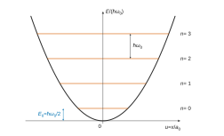
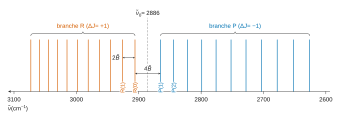
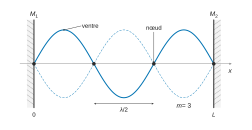
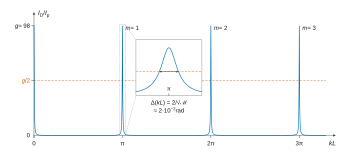
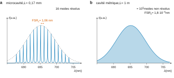

# Centrale-Supélec MP — Physique-chimie 1 2026 · Corrigé brut

*Corrigé rédigé par IA, non officiel. Signalez toute erreur.*

Épreuve de 4 heures, calculatrice autorisée. « Spectroscopie rovibrationnelle et laser » : 46 questions. Constantes utilisées :

- $h=6{,}626\times10^{-34}$ J·s et $\hbar=1{,}0546\times10^{-34}$ J·s ;
- $c=2{,}998\times10^{8}$ m·s⁻¹ ;
- $1\ \mathrm{cm^{-1}}\leftrightarrow1{,}9863\times10^{-23}\ \mathrm J$ ;
- $m_{\mathrm H}=1{,}66\times10^{-27}$ kg ;
- en Q12, la constante de Boltzmann $k_B=1{,}38\times10^{-23}$ J·K⁻¹ (non fournie).

## Partie A — Spectroscopie rovibrationnelle

### I — Vibration de HCl

**Q1.** La force de rappel vaut $F_x=-\dfrac{\mathrm dE_p}{\mathrm dx}=-\mu\omega_0^2x$. Le principe fondamental de la dynamique, projeté sur $(Ox)$ dans un référentiel galiléen, donne

$$\boxed{\ddot x+\omega_0^2x=0}$$

L'équation caractéristique $r^2+\omega_0^2=0$ a pour racines $\pm j\omega_0$ ; la solution générale réelle est

$$\boxed{\begin{aligned}
x(t)&=A\cos(\omega_0t)+B\sin(\omega_0t)\\
&=X_m\cos(\omega_0t+\varphi)
\end{aligned}}$$

avec $(A,B)$ ou $(X_m,\varphi)$ fixées par les conditions initiales.

**Q2.** Avec $x=X_m\cos(\omega_0t+\varphi)$ et la référence $E_p(0)=0$ :

$$\begin{aligned}
E_c&=\frac12\mu\omega_0^2X_m^2\sin^2(\omega_0t+\varphi)\\
E_p&=\frac12\mu\omega_0^2X_m^2\cos^2(\omega_0t+\varphi)
\end{aligned}$$

Les moyennes sur une période valent

$$\begin{aligned}
\langle E_c\rangle&=\tfrac14\mu\omega_0^2X_m^2\\
\langle E_p\rangle&=\tfrac14\mu\omega_0^2X_m^2\\
\langle E_m\rangle&=\tfrac12\mu\omega_0^2X_m^2
\end{aligned}$$

Elles sont positives ou nulles et s'annulent simultanément pour $X_m=0$. La particule immobile en $x=0$ est une solution permise ($x(0)=0$, $\dot x(0)=0$). Donc **les trois minima valent 0 et sont atteints** (oscillateur au repos au fond du puits).

**Q3.** Dans un état stationnaire lié, $\lvert\Psi\rvert^2=\lvert\varphi(x)\rvert^2$ ne dépend pas du temps et $\varphi\to0$ à l'infini.

*Position.* $E_p$ est paire. Si $\varphi(x)$ est solution d'énergie $E$, $\varphi(-x)$ l'est aussi.

Les états liés à une dimension étant non dégénérés, $\varphi(-x)=\pm\varphi(x)$. La densité $\lvert\varphi\rvert^2$ est donc paire, d'où

$$\begin{aligned}
\langle x\rangle&=\int x\lvert\varphi\rvert^2\,\mathrm dx=0\\
\Delta x^2&=\langle x^2\rangle
\end{aligned}$$

*Quantité de mouvement.* L'équation de Schrödinger stationnaire étant à coefficients réels, on peut prendre $\varphi$ réelle. Alors

$$\begin{aligned}
\langle p_x\rangle&=-j\hbar\int\varphi\varphi'\,\mathrm dx\\
&=-j\hbar\left[\varphi^2/2\right]_{-\infty}^{+\infty}\\
&=0
\end{aligned}$$

donc $\Delta p_x^2=\langle p_x^2\rangle$.

Par suite :

$$\begin{aligned}
\langle E_p\rangle&=\frac12\mu\omega_0^2\langle x^2\rangle\\
&=\frac12\mu\omega_0^2\Delta x^2\\
\langle E_c\rangle&=\frac{\langle p_x^2\rangle}{2\mu}\\
&=\frac{\Delta p_x^2}{2\mu}
\end{aligned}$$

$$\boxed{\begin{aligned}
K_1&=\tfrac12\mu\omega_0^2\\
K_2&=\frac{1}{2\mu}
\end{aligned}}$$

**Q4.** D'après Q3 :

$$\langle E_m\rangle=\frac{\Delta p_x^2}{2\mu}+\frac12\mu\omega_0^2\Delta x^2$$

L'inégalité de Heisenberg $\Delta x\,\Delta p_x\ge\hbar/2$ (avec $\Delta x>0$) donne $\Delta p_x^2\ge\hbar^2/(4\Delta x^2)$. Avec l'inégalité $a+b\ge2\sqrt{ab}$, il vient

$$\begin{aligned}
\langle E_m\rangle&\ge\frac{\hbar^2}{8\mu\Delta x^2}+\frac12\mu\omega_0^2\Delta x^2\\
&\ge2\sqrt{\frac{\hbar^2}{8\mu}\cdot\frac{\mu\omega_0^2}{2}}\\
&=\frac{\hbar\omega_0}{2}
\end{aligned}$$

l'égalité ayant lieu pour $\Delta x^2=\hbar/(2\mu\omega_0)$ :

$$\boxed{\langle E_m\rangle_{\min}=\frac{\hbar\omega_0}{2}}$$

Classiquement le minimum est nul (repos au fond du puits). Quantiquement, annuler $\langle E_p\rangle$ exigerait $\Delta x=0$, donc $\Delta p_x$ infini. L'oscillateur ne peut pas être immobile : il garde une **énergie de point zéro** $\hbar\omega_0/2$, atteinte par le niveau fondamental (Q8).

**Q5.** Les dimensions sont $[\hbar]=\mathrm{M\,L^2\,T^{-1}}$, $[\omega_0]=\mathrm T^{-1}$ et $[\mu]=\mathrm M$. L'égalité $[a_0]=\mathrm L$ impose, sur M, L et T :

$$\begin{aligned}
\alpha+\delta&=0\\
2\alpha&=1\\
-\alpha-\beta&=0
\end{aligned}$$

$$\boxed{\begin{aligned}
\alpha&=\tfrac12\\
\beta&=-\tfrac12\\
\delta&=-\tfrac12
\end{aligned}}$$

$$\boxed{a_0=\sqrt{\frac{\hbar}{\mu\omega_0}}}$$

Avec $\mu\simeq m_{\mathrm H}$ et $\omega_0\simeq10^{15}$ rad·s⁻¹ :

$$a_0=\sqrt{\frac{1{,}05\times10^{-34}}{1{,}66\times10^{-27}\times10^{15}}}$$

soit

$$\boxed{a_0\approx8\times10^{-12}\ \mathrm m\sim10^{-11}\ \mathrm m}$$

C'est quelques pour cent de la longueur de liaison ($\sim10^{-10}$ m) : les oscillations sont petites, ce qui justifie le modèle harmonique.

**Q6.** Pour un état stationnaire d'énergie $E$, la séparation des variables dans $j\hbar\,\partial_t\Psi=\hat H\Psi$ donne

$$\boxed{\chi(t)=\chi_0\,e^{-jEt/\hbar}}$$

La partie spatiale vérifie

$$-\frac{\hbar^2}{2\mu}\frac{\mathrm d^2\varphi}{\mathrm dx^2}+\frac12\mu\omega_0^2x^2\varphi=E\varphi$$

On pose $x=a_0u$, avec $a_0^2=\hbar/(\mu\omega_0)$. Les deux préfacteurs deviennent

$$\begin{aligned}
\frac{\hbar^2}{2\mu a_0^2}&=\frac{\hbar\omega_0}{2}\\
\frac12\mu\omega_0^2a_0^2&=\frac{\hbar\omega_0}{2}
\end{aligned}$$

En divisant par $\hbar\omega_0$ :

$$\boxed{\varphi''(u)+\left(2\varepsilon-u^2\right)\varphi(u)=0}$$

**Q7.** Avec $\varphi=\mathcal H e^{-u^2/2}$ :

$$\begin{aligned}
\varphi'&=(\mathcal H'-u\mathcal H)e^{-u^2/2}\\
\varphi''&=\left(\mathcal H''-2u\mathcal H'+(u^2-1)\mathcal H\right)e^{-u^2/2}
\end{aligned}$$

En reportant et en simplifiant par $e^{-u^2/2}\neq0$, les termes en $u^2\mathcal H$ se compensent :

$$\boxed{\mathcal H''(u)-2u\,\mathcal H'(u)+(2\varepsilon-1)\,\mathcal H(u)=0}$$

**Q8.** $\mathcal H''$ est de degré $n-2$ et ne contribue pas au coefficient de $u^n$.

Ce coefficient vaut $-2nc_n$ dans $-2u\mathcal H'$, et $(2\varepsilon-1)c_n$ dans $(2\varepsilon-1)\mathcal H$.

Le polynôme étant nul et $c_n\neq0$ :

$$-2n+2\varepsilon-1=0$$

$$\boxed{\varepsilon=n+\tfrac12}$$

Les énergies de vibration en découlent :

$$\boxed{E_n=\left(n+\tfrac12\right)\hbar\omega_0,\quad n\in\mathbb N}$$

Les niveaux sont équidistants de $\hbar\omega_0$ et le fondamental vaut $\hbar\omega_0/2$, borne de Q4.

### II — Rovibration de HCl

**Q9.**

$$\begin{aligned}
\Delta E_J&=B\left[(J+1)(J+2)-J(J+1)\right]\\
&=\boxed{2B(J+1)}
\end{aligned}$$

**Q10.** On considère une transition $(n=0,J'')\to(n=1,J')$, avec la même constante $B$ pour les deux états. On note $\tilde B=B/(hc)$ et $\tilde\nu_0=\omega_0/(2\pi c)$ :

- branche R ($J'=J''+1$) : $\tilde\nu=\tilde\nu_0+2\tilde B(J''+1)>\tilde\nu_0$ ;
- branche P ($J'=J''-1$, $J''\ge1$) : $\tilde\nu=\tilde\nu_0-2\tilde BJ''<\tilde\nu_0$.

Sur la figure 3 (axe des nombres d'onde **décroissant** vers la droite), les raies sont espacées d'environ 20 cm⁻¹, sauf entre 2865 et 2906 cm⁻¹. Cet écart de 41 cm⁻¹, soit $4\tilde B$, est dû à l'absence de transition $\Delta J=0$ : c'est le centre de bande, $\tilde\nu_0\approx2886$ cm⁻¹. D'où

$$\boxed{\begin{aligned}
&\text{branche R : }[2886\,;3100]\ \mathrm{cm^{-1}}\ (\text{raies de 2906 à 3073})\\
&\text{branche P : }[2600\,;2886]\ \mathrm{cm^{-1}}\ (\text{raies de 2626 à 2865})
\end{aligned}}$$

La branche R est à gauche de la figure, la branche P à droite.

**Q11.** En partant du trou central : la première raie R est R(0), la première raie P est P(1) (pas de P(0), car $J'=-1$ n'existe pas).

| $\tilde\nu$ (cm⁻¹) | $J''$ | $J'$ | branche |
|---|---|---|---|
| 2926 | 1 | 2 | R |
| 2906 | 0 | 1 | R |
| 2865 | 1 | 0 | P |
| 2844 | 2 | 1 | P |

Contrôle avec $\tilde\nu_0=2885{,}5$ cm⁻¹ et $\tilde B=10{,}25$ cm⁻¹ (Q13) : on trouve 2906 ; 2926,5 ; 2865 et 2844,5 cm⁻¹, conformes à 1 cm⁻¹ près.

**Q12.** Deux raisons.

*Transitions possibles.* Les raies de la bande $n=0\to n=1$ sont en $\tilde\nu_0+2\tilde B(J''+1)$ et $\tilde\nu_0-2\tilde BJ''$ : plus $J''$ est grand, plus elles s'écartent du centre.

Les autres transitions tombent loin de la fenêtre. La rotation pure est à quelques dizaines de cm⁻¹ (infrarouge lointain). La bande $n=0\to2$ est vers $2\tilde\nu_0\approx5800$ cm⁻¹ (et quasi interdite dans le modèle harmonique).

*Population des niveaux de départ.* L'intensité d'une raie d'absorption est proportionnelle à la population du niveau $J''$. Celle-ci est pondérée par le facteur de Boltzmann $\exp\left(-\tilde BJ''(J''+1)\,hc/k_BT\right)$. À 300 K :

$$\frac{k_BT}{hc}=\frac{1{,}38\times10^{-23}\times300}{1{,}9863\times10^{-23}}\approx208\ \mathrm{cm^{-1}}$$

Le facteur vaut alors $4\times10^{-3}$ pour $J''=10$. Il tombe à $5\times10^{-4}$ pour $J''=12$.

Les raies au-delà de $J''\approx11\text{–}12$ sont situées hors de $\tilde\nu_0\pm2\tilde B\times12\approx2886\pm250$ cm⁻¹. Elles partent donc de niveaux quasi vides : **il n'y a pas de transition permise issue d'un niveau thermiquement peuplé en dehors de $[2600\,;3100]$ cm⁻¹.** La dégénérescence $2J+1$ des niveaux de rotation explique que le maximum d'intensité soit vers $J''\approx3$ ; elle ne change pas cette conclusion.

**Q13.** *Démarche.* Le modèle comporte deux inconnues, $\tilde\nu_0$ et $\tilde B$. Les deux raies qui encadrent le trou, R(0) et P(1), donnent directement leur somme et leur différence. Ce sont aussi les moins sensibles à l'écart entre les constantes rotationnelles des deux états (petits $J$) :

$$\begin{aligned}
\text{R(0)}:\quad\tilde\nu_0+2\tilde B&=2906\ \mathrm{cm^{-1}}\\
\text{P(1)}:\quad\tilde\nu_0-2\tilde B&=2865\ \mathrm{cm^{-1}}
\end{aligned}$$

$$\begin{aligned}
\tilde\nu_0&=\frac{2906+2865}{2}\\
&=2885{,}5\ \mathrm{cm^{-1}}\\
\tilde B&=\frac{2906-2865}{4}\\
&=10{,}25\ \mathrm{cm^{-1}}
\end{aligned}$$

Les deux lectures sont indépendantes, d'incertitude-type 1 cm⁻¹. On obtient $u(\tilde\nu_0)=\frac{\sqrt2}{2}=0{,}71$ cm⁻¹ et $u(\tilde B)=\frac{\sqrt2}{4}=0{,}35$ cm⁻¹.

*Longueur $d_0$.* La constante rotationnelle vaut

$$\begin{aligned}
B&=hc\tilde B\\
&=10{,}25\times1{,}9863\times10^{-23}\\
&=2{,}036\times10^{-22}\ \mathrm J
\end{aligned}$$

La masse réduite de $\mathrm H^{35}\mathrm{Cl}$ (isotope majoritaire) vaut $\mu=\frac{35}{36}m_{\mathrm H}=1{,}614\times10^{-27}$ kg. De $B=\hbar^2/(2\mu d_0^2)$ :

$$\begin{aligned}
d_0&=\frac{\hbar}{\sqrt{2\mu B}}\\
&=\frac{1{,}0546\times10^{-34}}{\sqrt{2\times1{,}614\times10^{-27}\times2{,}036\times10^{-22}}}\\
&=1{,}30\times10^{-10}\ \mathrm m
\end{aligned}$$

Comme $d_0\propto\tilde B^{-1/2}$, $u(d_0)/d_0=\frac12u(\tilde B)/\tilde B=1{,}7$ % :

$$\boxed{d_0=(1{,}30\pm0{,}02)\times10^{-10}\ \mathrm m}$$

*Pulsation $\omega_0$.* Le centre de bande correspond à $\hbar\omega_0=hc\tilde\nu_0$ :

$$\begin{aligned}
\omega_0&=2\pi c\tilde\nu_0\\
&=\frac{2885{,}5\times1{,}9863\times10^{-23}}{1{,}0546\times10^{-34}}\\
&=5{,}435\times10^{14}\ \mathrm{rad\cdot s^{-1}}
\end{aligned}$$

$$\begin{aligned}
u(\omega_0)&=\omega_0\frac{u(\tilde\nu_0)}{\tilde\nu_0}\\
&=1{,}3\times10^{11}\ \mathrm{rad\cdot s^{-1}}
\end{aligned}$$

$$\boxed{\begin{aligned}
\omega_0&=5{,}435\times10^{14}\ \mathrm{rad\cdot s^{-1}}\\
u(\omega_0)&=1{,}3\times10^{11}\ \mathrm{rad\cdot s^{-1}}
\end{aligned}}$$

*Contrôles.* $d_0\sim10^{-10}$ m et $\omega_0\sim5\times10^{14}$ rad·s⁻¹ sont cohérents avec l'énoncé et avec Q5.

L'hypothèse d'une même constante rotationnelle n'est qu'approchée. Les espacements décroissent dans la branche R (20 à 14 cm⁻¹) et croissent dans la branche P (21 à 26 cm⁻¹), signe que $\tilde B'<\tilde B''$. Les différences de combinaison, indépendantes de l'état excité, s'écrivent

$$\tilde\nu_{\mathrm R(J-1)}-\tilde\nu_{\mathrm P(J+1)}=2\tilde B''(2J+1)$$

Elles donnent $\tilde B''\approx10{,}35$ cm⁻¹ et $d_0\approx1{,}29\times10^{-10}$ m, compatible avec le résultat ci-dessus.

**Q14.** Le chlore naturel contient $^{35}$Cl (76 %) et $^{37}$Cl (24 %) ; l'hydrogène est pratiquement pur ($^1$H à 99,985 %). Les molécules $\mathrm H^{35}\mathrm{Cl}$ et $\mathrm H^{37}\mathrm{Cl}$ ont la même liaison (même raideur) mais des masses réduites différentes :

$$\begin{aligned}
\frac{\mu_{37}}{\mu_{35}}&=\frac{37\times36}{38\times35}\\
&=1{,}0015
\end{aligned}$$

Comme $\omega_0\propto\mu^{-1/2}$ :

$$\begin{aligned}
\frac{\Delta\tilde\nu_0}{\tilde\nu_0}&=\sqrt{\frac{\mu_{35}}{\mu_{37}}}-1\\
&=-7{,}5\times10^{-4}\\
\Delta\tilde\nu_0&\approx-2{,}2\ \mathrm{cm^{-1}}
\end{aligned}$$

($\tilde B\propto1/\mu$ varie aussi, effet secondaire.) **Chaque raie est un doublet isotopique : la raie de $\mathrm H^{35}\mathrm{Cl}$ est accompagnée, environ 2 cm⁻¹ plus bas, de celle de $\mathrm H^{37}\mathrm{Cl}$, environ trois fois moins intense (76/24).**

## Partie B — Cavité d'un laser

### I — Cavité sans pertes

**Q15.** Dans le vide ($\rho=0$, $\vec\jmath=\vec0$) :

$$\boxed{\begin{aligned}
&\mathrm{div}\,\vec E=0 &&\text{(Maxwell-Gauss)}\\
&\mathrm{div}\,\vec B=0 &&\text{(Maxwell-flux)}\\
&\overrightarrow{\mathrm{rot}}\,\vec E=-\frac{\partial\vec B}{\partial t} &&\text{(Maxwell-Faraday)}\\
&\overrightarrow{\mathrm{rot}}\,\vec B=\mu_0\varepsilon_0\frac{\partial\vec E}{\partial t} &&\text{(Maxwell-Ampère)}
\end{aligned}}$$

**Q16.** Le rotationnel de Maxwell-Faraday donne

$$\begin{aligned}
\overrightarrow{\mathrm{rot}}(\overrightarrow{\mathrm{rot}}\,\vec E)&=-\partial_t\overrightarrow{\mathrm{rot}}\,\vec B\\
&=-\mu_0\varepsilon_0\,\partial_t^2\vec E
\end{aligned}$$

Le formulaire et $\mathrm{div}\,\vec E=0$ donnent $\overrightarrow{\mathrm{rot}}(\overrightarrow{\mathrm{rot}}\,\vec E)=-\Delta\vec E$. Donc

$$\boxed{\Delta\vec E-\frac{1}{c^2}\frac{\partial^2\vec E}{\partial t^2}=\vec 0}$$

avec la célérité

$$\boxed{\begin{aligned}
c&=\frac{1}{\sqrt{\mu_0\varepsilon_0}}\\
&=2{,}998\times10^{8}\ \mathrm{m\cdot s^{-1}}
\end{aligned}}$$

**Q17.** Pour une onde plane progressive harmonique $\underline{\vec E}=\underline E_0e^{j(\omega t-kx)}\vec u_y$, on a $\Delta\to-k^2$ et $\partial_t^2\to-\omega^2$. Le champ étant non nul :

$$\boxed{\begin{aligned}
k^2&=\frac{\omega^2}{c^2}\\
\text{soit }k&=\frac{\omega}{c}
\end{aligned}}$$

Le vide n'est pas dispersif.

**Q18.** Le champ total dans la cavité est

$$\underline{\vec E}=\left(\underline E_{0+}e^{-jkx}+\underline E_{0-}e^{jkx}\right)e^{j\omega t}\vec u_y$$

Dans le conducteur parfait, le champ est nul. En $x=0$, on prend milieu 1 = conducteur et milieu 2 = cavité, donc $\vec n_{12}=\vec u_x$. La relation de passage s'écrit

$$\vec E(0^+,t)-\vec 0=\frac{\sigma}{\varepsilon_0}\vec u_x$$

La composante selon $\vec u_y$ (tangentielle) est donc nulle en $x=0$. De même en $x=L$ (avec $\vec n_{12}=-\vec u_x$). Comme $e^{j\omega t}\neq0$ :

$$\boxed{\begin{aligned}
\underline E_{0+}+\underline E_{0-}&=0\\
\underline E_{0+}e^{-jkL}+\underline E_{0-}e^{jkL}&=0
\end{aligned}}$$

**Q19.** En reportant $\underline E_{0-}=-\underline E_{0+}$, on obtient $-2j\,\underline E_{0+}\sin(kL)=0$. Pour un champ non identiquement nul, $\sin(kL)=0$, soit $kL=m\pi$. Avec $k=2\pi\nu/c$ :

$$\boxed{\begin{aligned}
\nu_m&=m\,\frac{c}{2L}\\
&=m\times\mathrm{FSR}_\nu,\qquad m\in\mathbb N^*
\end{aligned}}$$

$m=0$ donne un champ nul et $m<0$ redonne les mêmes ondes stationnaires. La cavité contient un nombre entier de demi-longueurs d'onde, avec un nœud de champ électrique sur chaque miroir.

### II — Cavité avec pertes

**Q20.** $R+T=1$ équivaut à $I_r+I_t=I_i$ : la puissance incidente se répartit intégralement entre ondes réfléchie et transmise. **C'est la conservation de l'énergie sur le miroir, supposé sans absorption ni diffusion.**

**Q21.** Considérons l'onde qui part vers la droite, juste à droite de $M_1$. Par linéarité, elle est la superposition de deux contributions :

- la **fraction transmise** à travers $M_1$ de l'onde de pompe incidente par la gauche, $\tau\underline E_p$ ;
- la **fraction réfléchie** sur la face interne de $M_1$ de l'onde intracavité $\underline E_G$ qui revient de $M_2$, soit $r\underline E_G$ ($r$ ne dépend pas du sens de traversée).

D'où $\underline E_D=\tau\underline E_p+r\underline E_G$.

**Q22.** Dans la cavité, $\underline{\vec E}=\left(\underline E_De^{-jkx}+\underline E_Ge^{jkx}\right)e^{j\omega t}\vec u_y$ (amplitudes définies en $x=0$). $M_2$ est un conducteur parfait : le champ tangentiel est nul en $x=L$, soit

$$\underline E_De^{-jkL}+\underline E_Ge^{jkL}=0$$

donc

$$\boxed{\underline E_G=-\underline E_D\,e^{-2jkL}}$$

(déphasage d'aller-retour $2kL$ et coefficient de réflexion $-1$ sur le conducteur parfait).

**Q23.** $\underline E_D=\tau\underline E_p-r\underline E_De^{-2jkL}$, et avec $r=-\sqrt R$, $\tau=\sqrt{1-R}$ :

$$\boxed{\frac{\underline E_D}{\underline E_p}=\frac{\sqrt{1-R}}{1-\sqrt R\,e^{-2jkL}}}$$

(dénominateur jamais nul puisque $\sqrt R<1$).

**Q24.** Les deux ondes se propagent dans le vide, donc $I\propto\lvert\underline E\rvert^2$ avec le même coefficient :

$$\begin{aligned}
\left\lvert1-\sqrt Re^{-2jkL}\right\rvert^2&=1+R-2\sqrt R\cos2kL\\
&=(1-\sqrt R)^2+4\sqrt R\sin^2kL
\end{aligned}$$

$$\frac{I_D}{I_p}=\frac{1-R}{(1-\sqrt R)^2}\cdot\frac{1}{1+\dfrac{4\sqrt R}{(1-\sqrt R)^2}\sin^2kL}$$

$$\boxed{\begin{aligned}
g&=\frac{1-R}{(1-\sqrt R)^2}\\
&=\frac{1+\sqrt R}{1-\sqrt R}
\end{aligned}}$$

**Q25.** Pour $R=0{,}960$ :

$$\begin{aligned}
\sqrt R&=0{,}9798\\
g&=97{,}99\approx98\\
\mathcal M&=\frac{4\sqrt R}{(1-\sqrt R)^2}\\
&=9{,}60\times10^{3}
\end{aligned}$$

Le rapport s'écrit $I_D/I_p=g/(1+\mathcal M\sin^2kL)$.

- Il vaut $g\approx98$ quand $\sin kL=0$.
- Il tombe à $g/(1+\mathcal M)\approx1{,}0\times10^{-2}$ quand $\lvert\sin kL\rvert=1$, soit $10^{-4}$ fois le maximum.
- Il passe sous $g/2$ dès que $\lvert\sin kL\rvert>1/\sqrt{\mathcal M}=1{,}0\times10^{-2}$. Il vaut $2\times10^{-2}$ pour $\sin^2kL=\frac12$.

Il est donc **négligeable devant son maximum sauf au voisinage immédiat de**

$$\boxed{k=\frac{m\pi}{L},\quad m\in\mathbb N^*}$$

**Q26.** La fonction est $\pi$-périodique en $kL$ (fonction d'Airy). Elle présente des pics étroits de hauteur $g\approx98$, centrés en $kL=m\pi$.

Leur largeur totale à mi-hauteur vaut $\Delta(kL)=2/\sqrt{\mathcal M}\approx2{,}0\times10^{-2}$ rad (0,65 % de la période).

Entre les pics, le fond est quasi nul, de minimum $1/g\approx10^{-2}$ en $kL=\pi/2+m\pi$.

**Q27.** Les modes sont les maxima $k_m=m\pi/L$ ; avec $\nu=ck/2\pi$ :

$$\boxed{\begin{aligned}
\nu_m&=m\frac{c}{2L}\\
\mathrm{FSR}'_\nu&=\frac{c}{2L}\\
&=\mathrm{FSR}_\nu
\end{aligned}}$$

Les modes ont les mêmes fréquences et le même intervalle spectral libre que sans pertes : c'est la même condition d'accord de phase sur un aller-retour, $2kL=2m\pi$. La différence est qualitative. Sans pertes, seules les fréquences $\nu_m$ existent. Avec pertes, toute fréquence pénètre un peu, mais efficacement seulement dans des résonances de largeur finie $\Delta\nu_c$ autour des $\nu_m$.

**Q28.** La mi-hauteur correspond à $\mathcal M\sin^2kL=1$. Près d'un pic, on pose $kL=m\pi+\delta$, avec $\lvert\delta\rvert\ll1$ (ici $1/\sqrt{\mathcal M}\approx10^{-2}$).

Alors $\delta_{1/2}=\pm1/\sqrt{\mathcal M}$, d'où $\Delta(kL)=2/\sqrt{\mathcal M}$.

Comme $kL=\pi\nu/\mathrm{FSR}'_\nu$ (relation linéaire), $\Delta(kL)=\pi\Delta\nu_c/\mathrm{FSR}'_\nu$ et

$$\boxed{\begin{aligned}
\mathcal F&=\frac{\pi}{\Delta(kL)}\\
&=\frac{\pi\sqrt{\mathcal M}}{2}\\
&=\frac{\pi R^{1/4}}{1-\sqrt R}
\end{aligned}}$$

Application numérique : $\mathcal F=\dfrac{\pi\times0{,}98985}{0{,}020204}$, soit

$$\boxed{\mathcal F\approx1{,}54\times10^{2}}$$

ce qui confirme $\Delta\nu_c\ll\mathrm{FSR}'_\nu$.

**Q29.** À intervalle spectral libre donné, une grande finesse donne une raie très fine, $\Delta\nu_c=\mathrm{FSR}_\nu/\mathcal F$. Elle donne donc une **grande longueur de cohérence** $\ell_c\approx c/\Delta\nu_c=2L\mathcal F$. On peut alors faire interférer des ondes avec de grandes différences de marche sans perte de contraste (interférométrie à long bras, métrologie des longueurs, détection de très petits déplacements).

## Partie C — Milieu amplificateur d'un laser

### I — Évolution de populations

**Q30.** Chaque processus est d'ordre 1 par rapport à l'espèce qui disparaît :

$$\boxed{\begin{aligned}
v_{\mathrm{pomp}}&=\Gamma n_1\\
v_{\mathrm{nr}}&=k_{\mathrm{nr}}n_3\\
v_{\mathrm{abs}}&=\beta n_1\\
v_{\mathrm{stim}}&=\beta n_2\\
v_{\mathrm{spont}}&=An_2
\end{aligned}}$$

**Q31.** $\mathrm M$ est consommé par le pompage ($-\Gamma n_1$) et l'absorption ($-\beta n_1$). Il est produit par l'émission spontanée ($+An_2$) et l'émission stimulée ($+\beta n_2$). Il n'intervient pas dans la désexcitation non radiative. La somme algébrique donne

$$\frac{\mathrm dn_1}{\mathrm dt}=-\Gamma n_1+An_2+\beta n_2-\beta n_1$$

**Q32.** $\mathrm M^*$ est produit par la désexcitation non radiative et l'absorption, consommé par les émissions stimulée et spontanée. $\mathrm M^{**}$ est produit par le pompage et consommé par la désexcitation non radiative :

$$\boxed{\begin{aligned}
\frac{\mathrm dn_2}{\mathrm dt}&=k_{\mathrm{nr}}n_3+\beta n_1-\beta n_2-An_2\\
\frac{\mathrm dn_3}{\mathrm dt}&=\Gamma n_1-k_{\mathrm{nr}}n_3
\end{aligned}}$$

**Q33.** La somme des trois équations est nulle, car chacun des termes suivants y figure une fois avec chaque signe :

$$\pm\Gamma n_1,\quad\pm\beta n_1,\quad\pm\beta n_2,\quad\pm An_2,\quad\pm k_{\mathrm{nr}}n_3$$

Donc **$n_1+n_2+n_3$ est constant.** Les processus ne font que redistribuer l'espèce M entre ses trois niveaux : c'est la conservation de la quantité totale de M (concentration totale du milieu).

**Q34.** En régime stationnaire, $\mathrm dn_3/\mathrm dt=0$ donne

$$n_1=\frac{k_{\mathrm{nr}}}{\Gamma}n_3$$

Ensuite, $\mathrm dn_2/\mathrm dt=0$ donne $k_{\mathrm{nr}}n_3+\beta n_1=(A+\beta)n_2$, soit $(\Gamma+\beta)n_1=(A+\beta)n_2$. Alors

$$\begin{aligned}
\Delta n&=n_2-n_1\\
&=\frac{k_{\mathrm{nr}}n_3}{\Gamma}\left(\frac{\Gamma+\beta}{A+\beta}-1\right)\\
&=\boxed{\frac{k_{\mathrm{nr}}(\Gamma-A)}{\Gamma(A+\beta)}\,n_3}
\end{aligned}$$

(la troisième équation est redondante, d'après Q33).

**Q35.** Les constantes de vitesse sont positives et $n_3>0$ dès que le pompage agit : $\Delta n$ a le signe de $\Gamma-A$.

$$\boxed{\Delta n>0\iff\Gamma>A}$$

Le pompage (qui alimente $\mathrm M^*$ via $\mathrm M^{**}$, la relaxation non radiative étant très rapide) doit remplir le niveau excité plus vite que l'émission spontanée ne le vide. $\beta$ n'intervient pas dans la condition : l'émission stimulée réduit l'inversion sans pouvoir en changer le signe.

### II — Bilan de puissance électromagnétique dans le milieu amplificateur

**Q36.** Tous les processus ne contribuent pas au bilan de l'onde laser :

- **pompage** : énergie apportée par une source extérieure, à une autre fréquence ; ne contribue pas directement ;
- **désexcitation non radiative** : sans photon, l'énergie part en agitation thermique ; ne contribue pas ;
- **absorption** : retire des photons $\hbar\omega$ à l'onde, **perte** ($\hbar\omega\beta n_1$ par unité de volume et de temps) ;
- **émission stimulée** : photons cohérents ajoutés à l'onde, **gain** ($\hbar\omega\beta n_2$) ;
- **émission spontanée** : photons émis dans toutes les directions, sans relation de phase avec l'onde ; ils n'appartiennent pas au faisceau et l'énergie correspondante, prélevée sur les molécules excitées, est **perdue pour l'onde laser** ($\hbar\omega An_2$).

**Q37.** On fait le bilan sur la tranche $[x,x+\mathrm dx]$ de section $S$, pendant $\mathrm dt$. La variation de l'énergie $u_{\text{ém}}S\,\mathrm dx$ est la somme de trois termes :

- le flux entrant net, $-\partial_x\Pi\,S\,\mathrm dx\,\mathrm dt$ ;
- plus le terme d'émission stimulée moins absorption, $\hbar\omega\beta(n_2-n_1)S\,\mathrm dx\,\mathrm dt$ ;
- moins le terme d'émission spontanée, $\hbar\omega An_2S\,\mathrm dx\,\mathrm dt$.

$$\frac{\partial u_{\text{ém}}}{\partial t}=-\frac{\partial\Pi}{\partial x}+\hbar\omega\beta(n_2-n_1)-\hbar\omega An_2$$

Avec $u_{\text{ém}}=\Pi/c$ et $\beta=bu_{\text{ém}}=b\Pi/c$ :

$$\boxed{\frac{\partial\Pi}{\partial x}+\frac1c\frac{\partial\Pi}{\partial t}=\gamma(\omega)\Pi-p(\omega)}$$

$$\boxed{\begin{aligned}
\gamma(\omega)&=\frac{b\hbar\omega(n_2-n_1)}{c}\\
p(\omega)&=\hbar\omega An_2
\end{aligned}}$$

Homogénéité : $p$ en W·m⁻³ et $\gamma$ en m⁻¹.

**Q38.** $\gamma\Pi=\hbar\omega\beta\Delta n$ et $p=\hbar\omega An_2$ : la condition s'écrit $An_2\ll\beta\Delta n$. **L'émission spontanée, incohérente, isotrope et spectralement large, est négligeable devant le gain net par émission stimulée**, qui produit des photons de même direction, fréquence et phase que l'onde. C'est ce qui garantit une lumière cohérente, directive et monochromatique, c'est-à-dire une lumière laser, et non celle d'une lampe.

**Q39.** En régime stationnaire, $\dfrac{\mathrm d\Pi}{\mathrm dx}=\gamma\Pi-p$, équation linéaire à coefficients constants. Avec $\Pi(0)=\Pi_0$ :

$$\Pi(x)=\left(\Pi_0-\frac{p}{\gamma}\right)e^{\gamma x}+\frac{p}{\gamma}$$

et, puisque $p\ll\gamma\Pi$,

$$\boxed{\Pi(x)=\Pi_0\,e^{\gamma(\omega)x}}$$

**Q40.** $\gamma=\dfrac{1}{\Pi}\dfrac{\mathrm d\Pi}{\mathrm dx}$ est le **coefficient de gain linéique** (en m⁻¹) : sur une longueur $1/\lvert\gamma\rvert$, l'intensité est multipliée ou divisée par $e$.

Le préfacteur $b\hbar\omega/c$ étant positif, $\gamma$ a le signe de $\Delta n$ :

- $\Delta n>0$ (inversion) : $\gamma>0$, amplification exponentielle, l'émission stimulée l'emporte sur l'absorption ;
- $\Delta n<0$ (situation ordinaire) : $\gamma<0$, atténuation exponentielle (loi de Beer-Lambert) ;
- $\Delta n=0$ : milieu transparent.

L'amplification exige donc $\Delta n>0$, c'est-à-dire, en régime stationnaire, $\Gamma>A$ (Q35).

$$\boxed{\gamma>0\iff\Delta n>0\iff\Gamma>A}$$

### III — Considérations expérimentales pour un laser à colorant compact

**Q41.** La solution absorbe entre 550 et 620 nm (vert-jaune-orangé) ; elle transmet le reste du spectre visible et apparaît de la couleur complémentaire de la lumière absorbée, **le bleu**, d'où son nom. L'émission laser (figure 6) s'étend de 687 à 704 nm environ, maximum vers 695 nm : **rouge profond**, à la limite du proche infrarouge. Elle est à plus grande longueur d'onde que la bande d'absorption, comme il se doit (pompage vers des niveaux plus hauts que le niveau émetteur).

**Q42.** Dans le milieu d'indice $n$, $k=n\omega/c$ ; les conditions aux miroirs sont inchangées, donc $kL=m\pi$ et

$$\begin{aligned}
\nu_m&=m\frac{c}{2nL}\\
\mathrm{FSR}_\nu&=\frac{c}{2nL}
\end{aligned}$$

(le résultat de Q19 avec $c\to c/n$). La longueur d'onde dans le vide du mode $m$ vaut $\lambda_m=c/\nu_m=2nL/m$, donc

$$\begin{aligned}
\mathrm{FSR}_\lambda&=\lambda_m-\lambda_{m+1}\\
&=\frac{2nL}{m(m+1)}\\
&\approx\frac{2nL}{m^2}\qquad(m\approx650\gg1)\\
&=\frac{\lambda_m^2}{2nL}
\end{aligned}$$

ce qui redonne $\boxed{\mathrm{FSR}_\lambda=\dfrac{\lambda^2}{2nL}}$. De façon équivalente, $\lvert\mathrm d\lambda\rvert=\dfrac{\lambda^2}{c}\lvert\mathrm d\nu\rvert$ appliqué à $\mathrm d\nu=\mathrm{FSR}_\nu$.

**Q43.** Sur la figure 6, les pics vont du mode 664 ($\approx687{,}7$ nm) au mode 649 ($\approx703{,}7$ nm). On en tire $\mathrm{FSR}_\lambda\approx16{,}0/15=1{,}07$ nm, en accord avec l'insert (1,02 à 1,08 nm). Avec $\mathrm{FSR}_\lambda\approx1{,}06$ nm à $\lambda\approx695$ nm :

$$\begin{aligned}
L&=\frac{\lambda^2}{2n\,\mathrm{FSR}_\lambda}\\
&=\frac{(695\times10^{-9})^2}{2\times1{,}3587\times1{,}06\times10^{-9}}
\end{aligned}$$

$$\boxed{L\approx1{,}7\times10^{-4}\ \mathrm m=0{,}17\ \mathrm{mm}}$$

Contrôle par le numéro de mode : $L=m\lambda_m/(2n)=657\times695\times10^{-9}/(2\times1{,}3587)=1{,}68\times10^{-4}$ m. La cavité est bien infra-millimétrique.

**Q44.** De $\nu=c/\lambda$, on tire $\lvert\Delta\nu\rvert=\dfrac{c}{\lambda^2}\lvert\Delta\lambda\rvert$ pour $\Delta\lambda\ll\lambda$ (ici $1{,}5\times10^{-3}$ et $1{,}4\times10^{-4}$ en valeur relative).

Le facteur $c/\lambda^2$ est le même pour l'intervalle entre modes voisins et pour la largeur d'un pic, pris à la même longueur d'onde :

$$\begin{aligned}
\mathcal F&=\frac{\mathrm{FSR}_\nu}{\Delta\nu_c}\\
&=\frac{(c/\lambda^2)\,\mathrm{FSR}_\lambda}{(c/\lambda^2)\,\Delta\lambda_c}\\
&=\boxed{\frac{\mathrm{FSR}_\lambda}{\Delta\lambda_c}}
\end{aligned}$$

Application numérique : $\mathcal F\approx1{,}06/0{,}1$, soit

$$\boxed{\mathcal F\sim10}$$

C'est environ quinze fois moins que la cavité de la partie B.

**Q45.** Les pics sont en $\lambda_m=2nL/m$, espacés de $\mathrm{FSR}_\lambda=\lambda^2/(2nL)$. Dans ces relations, $m$ est entier et $L$ fixé par la géométrie : le paramètre sensible est **l'indice optique $n$ de la solution qui remplit la cavité**. Il dépend de la température (via la masse volumique du liquide) et de la composition chimique (solvant, espèces dissoutes).

On mesure le déplacement des pics, $\delta\lambda_m/\lambda_m=\delta n/n$. Un déplacement de 0,1 nm correspond à $\delta n/n\approx1{,}4\times10^{-4}$.

**Q46.** *Hypothèses.* Miroirs inchangés, donc finesse $\mathcal F\approx10$ inchangée. Colorant inchangé, donc même bande de gain, de largeur $\Delta\lambda_{\mathrm{gain}}\approx15\text{–}20$ nm autour de 695 nm. Seule $L$ passe de 0,17 mm à $L\approx1$ m.

*Chiffrage.* Avec la cavité remplie de colorant ($n=1{,}3587$) :

$$\begin{aligned}
\mathrm{FSR}_\lambda&=\frac{\lambda^2}{2nL}\\
&=\frac{(695\times10^{-9})^2}{2\times1{,}3587\times1}\\
&=1{,}8\times10^{-13}\ \mathrm m\\
&=1{,}8\times10^{-4}\ \mathrm{nm}
\end{aligned}$$

$$\begin{aligned}
\mathrm{FSR}_\nu&=\frac{c}{2nL}\\
&=110\ \mathrm{MHz}
\end{aligned}$$

Pour une cavité essentiellement dans l'air ($n\approx1$), on trouverait $2{,}4\times10^{-4}$ nm : même conclusion. On en déduit :

- nombre de modes dans la bande de gain : $N\approx\Delta\lambda_{\mathrm{gain}}/\mathrm{FSR}_\lambda\approx10^{5}$ ;
- largeur de chaque résonance : $\mathrm{FSR}_\lambda/\mathcal F\approx2\times10^{-5}$ nm ;
- numéro de mode : $m=2nL/\lambda\approx4\times10^{6}$.

*Allure.* Un spectromètre usuel résout $10^{-2}$ à $10^{-1}$ nm, soit 50 à 500 fois l'écart entre modes : les modes ne sont pas résolus. Le spectre observé est une **bande quasi continue** dont l'enveloppe est la courbe de gain du colorant (même position et même largeur, environ 687–704 nm), au lieu du peigne de seize pics bien séparés de la figure 6.

*Commentaire.* Plus la cavité est longue, plus les modes sont serrés : la microcavité sélectionne naturellement une quinzaine de modes séparés, ce qui permet d'en suivre le déplacement (capteur, Q45). Un laser à cavité métrique est fortement multimode (la compétition entre modes limite le nombre de modes effectivement oscillants sans rendre le spectre résoluble) ; pour le rendre monomode et accordable, on insère des éléments sélectifs (réseau, étalon Fabry-Pérot, filtre biréfringent). En contrepartie, il offre un plus grand volume amplificateur et donc davantage de puissance.
