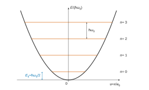
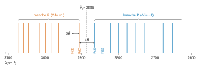
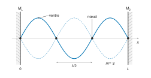
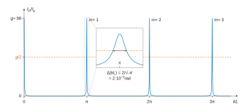
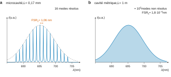

# Centrale-Supélec MP — Physique-chimie 1 2026 · Corrigé guidé

*Corrigé rédigé par IA, non officiel. Signalez toute erreur.*

## Présentation du sujet

**Format.** 4 heures, calculatrice autorisée, 46 questions (Q1 à Q46) réparties en trois parties « relativement indépendantes », sous le titre « Spectroscopie rovibrationnelle et laser ». Deux questions sont soulignées dans l'énoncé (prise d'initiative, barème valorisé) : **Q13** et **Q46**.

Un formulaire final rappelle l'identité $\overrightarrow{\mathrm{rot}}\,\overrightarrow{\mathrm{rot}}=\overrightarrow{\mathrm{grad}}\,\mathrm{div}-\Delta$ et la relation de passage du champ électrique. Il donne aussi $h$, $c$ et la conversion $1\ \mathrm{cm^{-1}}\leftrightarrow1{,}9863\times10^{-23}\ \mathrm J$.

Il fournit enfin les masses et abondances de $^1$H, $^{35}$Cl et $^{37}$Cl.

**Partie A — Spectroscopie rovibrationnelle (Q1–Q14).**

- *A.I (Q1–Q8)* : oscillateur harmonique classique (équation, énergies moyennes), puis quantique : énergies moyennes en fonction des écarts-types, énergie minimale imposée par Heisenberg, analyse dimensionnelle, équation de Schrödinger adimensionnée, équation d'Hermite et quantification $E_n=(n+\frac12)\hbar\omega_0$.
- *A.II (Q9–Q14)* : rotateur rigide ($E_J=BJ(J+1)$ donné), lecture d'un vrai spectre FTIR de HCl : branches P et R, attribution des raies, extinction des raies lointaines, mesure de $d_0$ et $\omega_0$ avec incertitudes, dédoublement isotopique.

**Partie B — Cavité d'un laser (Q15–Q29).**

- *B.I (Q15–Q19)* : équations de Maxwell, d'Alembert, relation de dispersion, conditions aux limites sur deux conducteurs parfaits, modes $\nu_m=mc/2L$.
- *B.II (Q20–Q29)* : un miroir devient partiellement réfléchissant ; on construit l'onde intracavité par superposition, on obtient une fonction d'Airy, puis l'intervalle spectral libre, la finesse et l'intérêt d'une grande finesse en interférométrie.

**Partie C — Milieu amplificateur (Q30–Q46).**

- *C.I (Q30–Q35)* : cinétique d'ordre 1 d'un système à trois niveaux, conservation de la matière, inversion de population en régime stationnaire.
- *C.II (Q36–Q40)* : bilan local d'énergie électromagnétique dans une tranche de milieu, gain linéique et lien avec l'inversion.
- *C.III (Q41–Q46)* : exploitation d'un spectre réel de laser à colorant en microcavité (couleur, intervalle spectral libre en longueur d'onde, longueur de cavité, finesse, principe du capteur, spectre d'une cavité métrique).

**Notions du programme mobilisées.** Oscillateur harmonique ; introduction à la physique quantique (inégalité de Heisenberg, équation de Schrödinger, états stationnaires) ; analyse dimensionnelle ; incertitudes-types et propagation ; équations de Maxwell, ondes planes, réflexion sur un conducteur parfait, ondes stationnaires ; interférences à ondes multiples, cohérence temporelle ; cinétique chimique d'ordre 1 ; bilans locaux d'énergie (vecteur de Poynting) ; couleur et absorption.

**Difficulté et longueur.** Sujet long mais très progressif. Les points délicats sont Q3 (justifier $\langle x\rangle=\langle p_x\rangle=0$), Q10–Q11 (axe de la figure 3 orienté vers les nombres d'onde décroissants), Q13 (démarche et incertitudes), Q22–Q24 (signes et facteurs 2 de l'aller-retour), Q37 (bilan local proprement posé) et Q46 (question ouverte à chiffrer).

**Questions à ne pas laisser passer.** Q1, Q2, Q5–Q9, Q15–Q17, Q19, Q20, Q30–Q33, Q39, Q41 : du cours ou presque.

**Gestion du temps.** Environ 5 minutes par question. Viser 1 h 30 pour la partie A, 1 h pour la partie B, 1 h 30 pour la partie C. Les parties étant indépendantes, on peut commencer par B ou C si la mécanique quantique inquiète ; la partie C se termine sur des questions de lecture de figure rapides et rentables.

---

## Partie A — Spectroscopie rovibrationnelle

### I — Vibration de HCl

On compare l'oscillateur classique, qui peut être au repos, à l'oscillateur quantique, qui ne le peut pas. Outils : mécanique du point, inégalité de Heisenberg, équation de Schrödinger à une dimension.

### Question 1

> [!INDICATION]
> Écrivez le principe fondamental de la dynamique avec la force qui dérive de $E_p=\frac12\mu\omega_0^2x^2$.

> [!INDICATION]
> « Solution générale » : deux constantes d'intégration.

#### Solution

La force $F_x=-\mathrm dE_p/\mathrm dx=-\mu\omega_0^2x$ et le PFD projeté sur $(Ox)$ (référentiel galiléen) donnent

$$\boxed{\ddot x+\omega_0^2x=0}$$

Les racines caractéristiques sont $\pm j\omega_0$, d'où la solution générale

$$\boxed{\begin{aligned}
x(t)&=A\cos(\omega_0t)+B\sin(\omega_0t)\\
&=X_m\cos(\omega_0t+\varphi)
\end{aligned}}$$

avec deux constantes réelles fixées par les conditions initiales.

> [!PIEGE]
> Donner seulement $x=X_m\cos\omega_0t$ n'est pas la solution générale : il manque la phase (ou la seconde constante).

### Question 2

> [!INDICATION]
> Calculez les moyennes temporelles de $E_c$ et $E_p$ sur une période pour la solution de Q1.

> [!INDICATION]
> Une valeur minimale doit être *atteinte* : cherchez un mouvement classique qui l'atteint.

#### Solution

Avec $x=X_m\cos(\omega_0t+\varphi)$ et $\langle\cos^2\rangle=\langle\sin^2\rangle=\frac12$ :

$$\begin{aligned}
\langle E_c\rangle&=\tfrac14\mu\omega_0^2X_m^2\\
\langle E_p\rangle&=\tfrac14\mu\omega_0^2X_m^2\\
\langle E_m\rangle&=\tfrac12\mu\omega_0^2X_m^2
\end{aligned}$$

Ces trois quantités sont positives et s'annulent pour $X_m=0$, c'est-à-dire pour la particule au repos en $x=0$, mouvement permis. **Les trois minima sont nuls et atteints.**

> [!METHODE]
> Pour un minimum, deux étapes : une minoration, puis un cas d'égalité réalisable.

### Question 3

> [!INDICATION]
> Partez de la définition de la variance : $\Delta x^2=\langle x^2\rangle-\langle x\rangle^2$. Que faut-il établir sur $\langle x\rangle$ et $\langle p_x\rangle$ ?

> [!INDICATION]
> Parité du potentiel pour $\langle x\rangle$ ; fonction d'onde stationnaire réelle et nulle à l'infini pour $\langle p_x\rangle$.

#### Solution

Dans un état stationnaire lié, $\lvert\Psi\rvert^2=\lvert\varphi(x)\rvert^2$, avec $\varphi\to0$ à l'infini.

*Position.* $E_p$ est paire : si $\varphi(x)$ est solution d'énergie $E$, $\varphi(-x)$ aussi.

Les états liés à une dimension étant non dégénérés, $\varphi(-x)=\pm\varphi(x)$. Donc $\lvert\varphi\rvert^2$ est paire :

$$\begin{aligned}
\langle x\rangle&=0\\
\Delta x^2&=\langle x^2\rangle
\end{aligned}$$

*Quantité de mouvement.* On peut choisir $\varphi$ réelle (équation à coefficients réels). Alors

$$\begin{aligned}
\langle p_x\rangle&=-j\hbar\int\varphi\varphi'\,\mathrm dx\\
&=-j\hbar[\varphi^2/2]_{-\infty}^{+\infty}\\
&=0
\end{aligned}$$

donc $\Delta p_x^2=\langle p_x^2\rangle$.

D'où $\langle E_p\rangle=\frac12\mu\omega_0^2\Delta x^2$ et $\langle E_c\rangle=\Delta p_x^2/(2\mu)$ :

$$\boxed{\begin{aligned}
K_1&=\tfrac12\mu\omega_0^2\\
K_2&=\frac1{2\mu}
\end{aligned}}$$

> [!PIEGE]
> $\langle E_c\rangle$ fait intervenir $\langle p_x^2\rangle$, pas $\langle p_x\rangle^2$. Sans la justification $\langle x\rangle=\langle p_x\rangle=0$, le remplacement de $\langle x^2\rangle$ par $\Delta x^2$ n'est pas fondé.

### Question 4

> [!INDICATION]
> Additionnez les deux énergies de Q3 et éliminez $\Delta p_x$ à l'aide de l'inégalité de Heisenberg.

> [!INDICATION]
> Il reste une fonction de $\Delta x^2$ de la forme $a/X+bX$ : minorez-la (dérivée ou inégalité arithmético-géométrique).

#### Solution

$\langle E_m\rangle=\dfrac{\Delta p_x^2}{2\mu}+\dfrac12\mu\omega_0^2\Delta x^2$ et $\Delta p_x\ge\hbar/(2\Delta x)$ donnent

$$\begin{aligned}
\langle E_m\rangle&\ge\frac{\hbar^2}{8\mu\Delta x^2}+\frac12\mu\omega_0^2\Delta x^2\\
&\ge2\sqrt{\frac{\hbar^2}{8\mu}\cdot\frac{\mu\omega_0^2}{2}}\\
&=\frac{\hbar\omega_0}{2}
\end{aligned}$$

avec égalité pour $\Delta x^2=\hbar/(2\mu\omega_0)$ :

$$\boxed{\langle E_m\rangle_{\min}=\frac{\hbar\omega_0}{2}}$$

Classiquement, le minimum est nul. Quantiquement, localiser parfaitement la particule au fond du puits ($\Delta x=0$) rendrait $\Delta p_x$ infini : le compromis laisse une **énergie de point zéro** $\hbar\omega_0/2$, qui est l'énergie du niveau fondamental (Q8).

> [!PIEGE]
> L'inégalité de Heisenberg donne une *minoration* de $\Delta p_x$, donc de $\langle E_c\rangle$. Il faut ensuite minimiser sur $\Delta x$, et non évaluer en une valeur arbitraire.

### Question 5

> [!INDICATION]
> Écrivez les dimensions de $\hbar$, $\omega_0$, $\mu$ en masse, longueur, temps, puis identifiez les exposants.

#### Solution

Les dimensions sont $[\hbar]=\mathrm{M\,L^2\,T^{-1}}$, $[\omega_0]=\mathrm T^{-1}$ et $[\mu]=\mathrm M$. L'égalité $[a_0]=\mathrm L$ impose :

$$\begin{aligned}
\alpha+\delta&=0\\
2\alpha&=1\\
\alpha+\beta&=0
\end{aligned}$$

$$\boxed{\begin{aligned}
\alpha&=\tfrac12\\
\beta&=-\tfrac12\\
\delta&=-\tfrac12
\end{aligned}}$$

$$\boxed{a_0=\sqrt{\frac{\hbar}{\mu\omega_0}}}$$

Avec $\mu\simeq1{,}66\times10^{-27}$ kg et $\omega_0\simeq10^{15}$ rad·s⁻¹ :

$$\boxed{a_0\approx8\times10^{-12}\ \mathrm m\sim10^{-11}\ \mathrm m}$$

soit quelques pour cent de la longueur de liaison : les oscillations sont petites, le modèle harmonique est cohérent.

> [!PIEGE]
> $\hbar$ contient une masse : $[\hbar]=\mathrm{J\cdot s}=\mathrm{kg\,m^2\,s^{-1}}$. Contrôle : $\hbar\omega$ est une énergie.

### Question 6

> [!INDICATION]
> Séparez les variables dans l'équation de Schrödinger dépendante du temps : la partie temporelle d'un état stationnaire est une exponentielle.

> [!INDICATION]
> Pour le changement de variable, $\mathrm d^2/\mathrm dx^2=a_0^{-2}\,\mathrm d^2/\mathrm du^2$, puis calculez les deux préfacteurs avec $a_0^2=\hbar/(\mu\omega_0)$.

#### Solution

$$\boxed{\chi(t)=\chi_0\,e^{-jEt/\hbar}}$$

La partie spatiale vérifie

$$-\frac{\hbar^2}{2\mu}\varphi_{xx}+\frac12\mu\omega_0^2x^2\varphi=E\varphi$$

Avec $x=a_0u$, les deux préfacteurs valent

$$\begin{aligned}
\frac{\hbar^2}{2\mu a_0^2}&=\frac{\hbar\omega_0}{2}\\
\frac12\mu\omega_0^2a_0^2&=\frac{\hbar\omega_0}{2}
\end{aligned}$$

En divisant par $\hbar\omega_0$ :

$$\boxed{\varphi''(u)+\left(2\varepsilon-u^2\right)\varphi(u)=0}$$

> [!PIEGE]
> Le signe de l'exponentielle temporelle se contrôle en reportant dans $j\hbar\,\partial_t\Psi=E\Psi$ : c'est $e^{-jEt/\hbar}$.

### Question 7

> [!INDICATION]
> Dérivez deux fois le produit $\mathcal H(u)e^{-u^2/2}$ et reportez dans l'équation de Q6.

#### Solution

$$\begin{aligned}
\varphi'&=(\mathcal H'-u\mathcal H)e^{-u^2/2}\\
\varphi''&=\left(\mathcal H''-2u\mathcal H'+(u^2-1)\mathcal H\right)e^{-u^2/2}
\end{aligned}$$

En reportant, puis en simplifiant par $e^{-u^2/2}\neq0$ (les termes en $u^2\mathcal H$ se compensent) :

$$\boxed{\mathcal H''-2u\mathcal H'+(2\varepsilon-1)\mathcal H=0}$$

### Question 8

> [!INDICATION]
> Quel est le degré de chacun des trois termes ? Identifiez le coefficient de $u^n$.

#### Solution

$\mathcal H''$ est de degré $n-2$. Le coefficient de $u^n$ doit être nul, avec $c_n\neq0$ :

$$-2nc_n+(2\varepsilon-1)c_n=0$$

$$\boxed{\varepsilon=n+\tfrac12}$$

d'où

$$\boxed{E_n=\left(n+\tfrac12\right)\hbar\omega_0,\ n\in\mathbb N}$$

Niveaux équidistants de $\hbar\omega_0$ ; le fondamental sature la borne de Q4.

> [!METHODE]
> Chercher une solution polynomiale d'une équation différentielle linéaire : le terme de plus haut degré donne une condition (ici la quantification), les autres une récurrence sur les coefficients.

### II — Rovibration de HCl

On ajoute la rotation et on confronte le modèle à un spectre réel. Outils : lecture de figure, modélisation linéaire, incertitudes-types.

### Question 9

> [!INDICATION]
> Développez et factorisez par $(J+1)$.

#### Solution

$$\begin{aligned}
\Delta E_J&=B\left[(J+1)(J+2)-J(J+1)\right]\\
&=\boxed{2B(J+1)}
\end{aligned}$$

Les niveaux de rotation ne sont pas équidistants, contrairement aux niveaux de vibration.

### Question 10

> [!INDICATION]
> Écrivez l'énergie d'une transition $(n=0,J'')\to(n=1,J')$ dans les deux cas $\Delta J=\pm1$ et comparez-la à $\hbar\omega_0$.

> [!INDICATION]
> Regardez le sens de l'axe de la figure 3 et cherchez l'endroit où l'espacement entre raies est anormal.

#### Solution

Avec $\tilde B=B/hc$ et $\tilde\nu_0=\omega_0/(2\pi c)$ :

- branche R ($J'=J''+1$) : $\tilde\nu=\tilde\nu_0+2\tilde B(J''+1)$, au-dessus du centre ;
- branche P ($J'=J''-1$) : $\tilde\nu=\tilde\nu_0-2\tilde BJ''$, en dessous.

Les raies sont espacées d'environ 20 cm⁻¹, sauf entre 2865 et 2906 cm⁻¹ (41 cm⁻¹, soit $4\tilde B$).

Ce trou est le centre de bande, $\tilde\nu_0\approx2886$ cm⁻¹, où $\Delta J=0$ est interdit. On en déduit :

$$\boxed{\begin{aligned}
&\text{R : }[2886\,;3100]\ \mathrm{cm^{-1}}\ (\text{raies de 2906 à 3073})\\
&\text{P : }[2600\,;2886]\ \mathrm{cm^{-1}}\ (\text{raies de 2626 à 2865})
\end{aligned}}$$

> [!PIEGE]
> L'axe de la figure 3 est gradué de 3100 à 2600 cm⁻¹ : la branche R, de plus haute énergie, est à *gauche*.

### Question 11

> [!INDICATION]
> Numérotez les raies à partir du trou central, de part et d'autre.

> [!INDICATION]
> La branche P n'a pas de raie P(0).

#### Solution

| $\tilde\nu$ (cm⁻¹) | $J''$ | $J'$ | branche |
|---|---|---|---|
| 2926 | 1 | 2 | R |
| 2906 | 0 | 1 | R |
| 2865 | 1 | 0 | P |
| 2844 | 2 | 1 | P |

Contrôle avec $\tilde\nu_0=2885{,}5$ et $\tilde B=10{,}25$ cm⁻¹ : 2906 ; 2926,5 ; 2865 ; 2844,5 cm⁻¹, conforme à l'incertitude de lecture.

> [!PIEGE]
> $J''$ est le niveau de *départ* (état fondamental), $J'$ le niveau d'*arrivée*. Oublier l'absence de P(0) décale toute la branche P d'une unité.

### Question 12

> [!INDICATION]
> Les règles de sélection autorisent des raies pour tout $J''$ : qu'est-ce qui pourrait néanmoins les rendre invisibles ?

> [!INDICATION]
> L'intensité d'une raie d'absorption dépend du nombre de molécules dans le niveau de départ. Comparez $BJ''(J''+1)$ à $k_BT$ à température ambiante, en cm⁻¹.

#### Solution

Les raies de la bande $0\to1$ s'éloignent du centre de $2\tilde B$ par unité de $J''$. Les autres transitions (rotation pure à quelques dizaines de cm⁻¹, bande $0\to2$ vers 5800 cm⁻¹) tombent loin de la fenêtre.

L'intensité d'une raie est proportionnelle à la population du niveau $J''$, pondérée par $\exp\left(-\tilde BJ''(J''+1)hc/k_BT\right)$. À 300 K, $k_BT/hc\approx208$ cm⁻¹.

Ce facteur vaut $4\times10^{-3}$ pour $J''=10$. Il tombe à $5\times10^{-4}$ pour $J''=12$.

Les raies qui tomberaient hors de $2886\pm250$ cm⁻¹ partent de niveaux quasi vides : **aucune transition permise issue d'un niveau peuplé n'existe hors de $[2600\,;3100]$ cm⁻¹.**

> [!PIEGE]
> « Les règles de sélection l'interdisent » est faux : $\Delta J=\pm1$ est possible quel que soit $J''$. C'est la population thermique qui éteint les raies.

### Question 13

> [!INDICATION]
> Question à initiative : choisissez les raies à exploiter et justifiez ce choix. Deux inconnues ($\tilde\nu_0$, $\tilde B$) : deux raies bien choisies suffisent.

> [!INDICATION]
> Les deux raies qui encadrent le trou central donnent directement une somme et une différence. Propagez les incertitudes-types (somme quadratique), puis passez à $d_0$ par $B=\hbar^2/(2\mu d_0^2)$ avec la *masse réduite*.

> [!INDICATION]
> $\hbar\omega_0$ est l'écart entre niveaux vibrationnels, donc l'énergie du centre de bande.

#### Solution

*Démarche.* R(0) et P(1) sont les raies de plus petit $J$, donc les moins sensibles à la différence des constantes rotationnelles entre les deux états :

$$\begin{aligned}
\tilde\nu_0&=\frac{2906+2865}{2}\\
&=2885{,}5\ \mathrm{cm^{-1}}\\
\tilde B&=\frac{2906-2865}{4}\\
&=10{,}25\ \mathrm{cm^{-1}}
\end{aligned}$$

$$\begin{aligned}
u(\tilde\nu_0)&=\frac{\sqrt2}{2}\times1\\
&=0{,}71\ \mathrm{cm^{-1}}\\
u(\tilde B)&=\frac{\sqrt2}{4}\times1\\
&=0{,}35\ \mathrm{cm^{-1}}
\end{aligned}$$

*Longueur de liaison.* $B=10{,}25\times1{,}9863\times10^{-23}=2{,}036\times10^{-22}$ J ; $\mu=\frac{35}{36}m_{\mathrm H}=1{,}614\times10^{-27}$ kg (H$^{35}$Cl, majoritaire) ;

$$\begin{aligned}
d_0&=\frac{\hbar}{\sqrt{2\mu B}}\\
&=1{,}30\times10^{-10}\ \mathrm m\\
\frac{u(d_0)}{d_0}&=\frac12\frac{u(\tilde B)}{\tilde B}\\
&=1{,}7\ \%
\end{aligned}$$

$$\boxed{d_0=(1{,}30\pm0{,}02)\times10^{-10}\ \mathrm m}$$

*Pulsation.*

$$\begin{aligned}
\omega_0&=2\pi c\tilde\nu_0\\
&=\frac{2885{,}5\times1{,}9863\times10^{-23}}{1{,}0546\times10^{-34}}\\
&=5{,}435\times10^{14}\ \mathrm{rad\cdot s^{-1}}
\end{aligned}$$

et $u(\omega_0)=\omega_0\,u(\tilde\nu_0)/\tilde\nu_0=1{,}3\times10^{11}$ rad·s⁻¹ :

$$\boxed{\begin{aligned}
\omega_0&=5{,}435\times10^{14}\ \mathrm{rad\cdot s^{-1}}\\
u(\omega_0)&=1{,}3\times10^{11}\ \mathrm{rad\cdot s^{-1}}
\end{aligned}}$$

*Regard critique.* Les espacements diminuent dans la branche R (20 → 14 cm⁻¹) et augmentent dans la branche P (21 → 26 cm⁻¹) : la constante rotationnelle de l'état excité est un peu plus faible. Les différences de combinaison ne font intervenir que l'état fondamental :

$$\tilde\nu_{\mathrm R(J-1)}-\tilde\nu_{\mathrm P(J+1)}=2\tilde B''(2J+1)$$

Elles donnent $\tilde B''\approx10{,}35$ cm⁻¹ et $d_0\approx1{,}29\times10^{-10}$ m, compatible avec le résultat retenu.

> [!METHODE]
> Pour une grandeur $G=X^\alpha$, l'incertitude relative est multipliée par $\lvert\alpha\rvert$ ; pour une demi-somme ou une demi-différence de deux mesures indépendantes, $u=\frac{\sqrt2}{2}u_{\text{mesure}}$.

> [!PIEGE]
> Une régression linéaire « un seul $B$ » sur toutes les raies est biaisée par la courbure du spectre et déplace le centre de plus de 10 cm⁻¹. Si l'on veut utiliser toutes les raies, il faut un modèle quadratique ou les différences de combinaison.

> [!JURY]
> Sur une question soulignée, on attend une démarche explicitée (choix des raies justifié), un calcul mené jusqu'au résultat numérique et des incertitudes cohérentes avec le nombre de chiffres significatifs.

### Question 14

> [!INDICATION]
> Une donnée de l'énoncé n'a pas encore servi : les abondances isotopiques.

> [!INDICATION]
> Même liaison, donc même raideur : comment $\omega_0$ dépend-elle de la masse réduite ?

#### Solution

Le chlore naturel est un mélange de $^{35}$Cl (76 %) et $^{37}$Cl (24 %). La raideur de la liaison est la même, mais les masses réduites diffèrent :

$$\begin{aligned}
\frac{\mu_{37}}{\mu_{35}}&=\frac{37\times36}{38\times35}\\
&=1{,}0015
\end{aligned}$$

Comme $\omega_0\propto\mu^{-1/2}$ :

$$\Delta\tilde\nu_0=\tilde\nu_0\left(\sqrt{\mu_{35}/\mu_{37}}-1\right)\approx-2{,}2\ \mathrm{cm^{-1}}$$

**Chaque raie est un doublet : la composante de $\mathrm H^{37}\mathrm{Cl}$, environ trois fois moins intense, est environ 2 cm⁻¹ en dessous de celle de $\mathrm H^{35}\mathrm{Cl}$.**

> [!METHODE]
> Dans un énoncé de concours, une donnée non encore utilisée est presque toujours un indice pour la question ouverte qui suit.

---

## Partie B — Cavité d'un laser

### I — Cavité sans pertes

On retrouve les modes d'une cavité entre deux conducteurs parfaits. Outils : équations de Maxwell, notation complexe, relations de passage.

### Question 15

> [!INDICATION]
> Annulez $\rho$ et $\vec\jmath$ dans les quatre équations locales.

#### Solution

$$\boxed{\begin{aligned}
\mathrm{div}\,\vec E&=0\\
\mathrm{div}\,\vec B&=0\\
\overrightarrow{\mathrm{rot}}\,\vec E&=-\frac{\partial\vec B}{\partial t}\\
\overrightarrow{\mathrm{rot}}\,\vec B&=\mu_0\varepsilon_0\frac{\partial\vec E}{\partial t}
\end{aligned}}$$

### Question 16

> [!INDICATION]
> Prenez le rotationnel de Maxwell-Faraday et utilisez l'identité du formulaire.

#### Solution

D'une part, avec Maxwell-Faraday puis Maxwell-Ampère :

$$\begin{aligned}
\overrightarrow{\mathrm{rot}}(\overrightarrow{\mathrm{rot}}\,\vec E)&=-\partial_t\overrightarrow{\mathrm{rot}}\,\vec B\\
&=-\mu_0\varepsilon_0\partial_t^2\vec E
\end{aligned}$$

D'autre part, avec le formulaire et Maxwell-Gauss dans le vide :

$$\begin{aligned}
\overrightarrow{\mathrm{rot}}(\overrightarrow{\mathrm{rot}}\,\vec E)&=\overrightarrow{\mathrm{grad}}(\mathrm{div}\,\vec E)-\Delta\vec E\\
&=-\Delta\vec E
\end{aligned}$$

D'où

$$\boxed{\Delta\vec E-\frac1{c^2}\frac{\partial^2\vec E}{\partial t^2}=\vec0}$$

$$\boxed{\begin{aligned}
c&=\frac{1}{\sqrt{\mu_0\varepsilon_0}}\\
&=2{,}998\times10^8\ \mathrm{m\cdot s^{-1}}
\end{aligned}}$$

> [!PIEGE]
> L'annulation de $\overrightarrow{\mathrm{grad}}(\mathrm{div}\,\vec E)$ repose sur l'absence de charges : il faut le dire.

### Question 17

> [!INDICATION]
> En notation complexe, que deviennent $\Delta$ et $\partial_t^2$ pour une onde plane progressive harmonique ?

#### Solution

$\Delta\to-k^2$, $\partial_t^2\to-\omega^2$, et le champ est non nul :

$$\boxed{\begin{aligned}
k^2&=\frac{\omega^2}{c^2}\\
\iff k&=\frac{\omega}{c}
\end{aligned}}$$

### Question 18

> [!INDICATION]
> Que vaut le champ dans un conducteur parfait ? Quelle composante du champ la relation de passage autorise-t-elle à être discontinue ?

> [!INDICATION]
> $\vec E$ est selon $\vec u_y$, tangent aux miroirs : écrivez que le champ total s'annule en $x=0$ et en $x=L$.

#### Solution

Le champ total est $\left(\underline E_{0+}e^{-jkx}+\underline E_{0-}e^{jkx}\right)e^{j\omega t}\vec u_y$. Dans le conducteur, $\vec E=\vec0$.

La relation de passage (milieu 1 = conducteur, $\vec n_{12}=\pm\vec u_x$) ne permet qu'un saut selon $\vec u_x$ : la composante selon $\vec u_y$ est nulle sur chaque miroir.

$$\boxed{\begin{aligned}
\underline E_{0+}+\underline E_{0-}&=0\\
\underline E_{0+}e^{-jkL}+\underline E_{0-}e^{jkL}&=0
\end{aligned}}$$

> [!JURY]
> Quand l'énoncé fournit une relation dans le formulaire, il faut l'utiliser explicitement, en précisant l'orientation de la normale.

### Question 19

> [!INDICATION]
> Éliminez $\underline E_{0-}$ et écrivez la condition pour que le champ ne soit pas identiquement nul.

#### Solution

On obtient $-2j\,\underline E_{0+}\sin kL=0$, et $\underline E_{0+}\neq0$ pour un champ non nul. Donc $kL=m\pi$, d'où, avec $k=2\pi\nu/c$,

$$\boxed{\begin{aligned}
\nu_m&=m\frac{c}{2L}\\
&=m\,\mathrm{FSR}_\nu,\quad m\in\mathbb N^*
\end{aligned}}$$

$m=0$ donne un champ nul ; $m<0$ redonne les mêmes ondes stationnaires. La cavité contient un nombre entier de demi-longueurs d'onde.

### II — Cavité avec pertes

Un miroir laisse fuir la lumière : on calcule l'onde intracavité par superposition d'allers-retours. Outils : coefficients de réflexion et transmission, module d'un complexe, trigonométrie.

### Question 20

> [!INDICATION]
> $R$ et $T$ sont des rapports d'intensités, c'est-à-dire de puissances surfaciques.

#### Solution

$R+T=1\iff I_r+I_t=I_i$ : **conservation de l'énergie au niveau du miroir, supposé sans absorption ni diffusion.**

> [!PIEGE]
> Il faut nommer l'hypothèse sous-jacente : un miroir réel absorbe un peu, et l'on a alors $R+T<1$.

### Question 21

> [!INDICATION]
> Quelles ondes *arrivent* sur $M_1$, et de quel côté ? Laquelle en *repart* vers la droite ?

#### Solution

Juste à droite de $M_1$, l'onde allant vers la droite est la superposition (linéarité des équations de Maxwell) de deux ondes :

- la partie **transmise** de l'onde de pompe arrivant par la gauche, $\tau\underline E_p$ ;
- la partie **réfléchie** sur la face interne de $M_1$ de l'onde intracavité revenant de $M_2$, $r\underline E_G$ (même $r$ dans les deux sens).

D'où $\underline E_D=\tau\underline E_p+r\underline E_G$.

### Question 22

> [!INDICATION]
> $M_2$ est toujours un conducteur parfait : réutilisez la condition de Q18 en $x=L$.

#### Solution

Avec le champ $\left(\underline E_De^{-jkx}+\underline E_Ge^{jkx}\right)e^{j\omega t}\vec u_y$, la condition $\underline E_De^{-jkL}+\underline E_Ge^{jkL}=0$ donne

$$\boxed{\underline E_G=-\underline E_D\,e^{-2jkL}}$$

déphasage d'aller-retour $2kL$ et réflexion de coefficient $-1$.

> [!PIEGE]
> Deux facteurs à ne pas perdre : $2kL$ (aller *et* retour) et le signe moins. Une erreur sur l'un ou l'autre déplace les résonances en $kL=(m+\frac12)\pi$, en contradiction avec Q19.

### Question 23

> [!INDICATION]
> Reportez Q22 dans la relation de Q21, puis remplacez $r$ et $\tau$ par leurs valeurs.

#### Solution

$\underline E_D\left(1+re^{-2jkL}\right)=\tau\underline E_p$, et avec $r=-\sqrt R$, $\tau=\sqrt{1-R}$ :

$$\boxed{\frac{\underline E_D}{\underline E_p}=\frac{\sqrt{1-R}}{1-\sqrt R\,e^{-2jkL}}}$$

### Question 24

> [!INDICATION]
> L'intensité est proportionnelle au module carré de l'amplitude, avec le même coefficient pour deux ondes dans le même milieu.

> [!INDICATION]
> Développez $\lvert1-\sqrt Re^{-2jkL}\rvert^2$, puis utilisez $1-\cos2\theta=2\sin^2\theta$.

#### Solution

$$\begin{aligned}
\left\lvert1-\sqrt Re^{-2jkL}\right\rvert^2&=1+R-2\sqrt R\cos2kL\\
&=(1-\sqrt R)^2+4\sqrt R\sin^2kL
\end{aligned}$$

$$\frac{I_D}{I_p}=\frac{g}{1+\dfrac{4\sqrt R}{(1-\sqrt R)^2}\sin^2kL}$$

$$\boxed{\begin{aligned}
g&=\frac{1-R}{(1-\sqrt R)^2}\\
&=\frac{1+\sqrt R}{1-\sqrt R}
\end{aligned}}$$

Contrôle : $R=0$ donne $g=1$ et $I_D=I_p$.

### Question 25

> [!INDICATION]
> Chiffrez le coefficient devant $\sin^2kL$ pour $R=0{,}960$.

> [!INDICATION]
> Comparez la valeur du rapport en $\sin kL=0$ et pour $\sin kL$ de l'ordre de 1.

#### Solution

$$\begin{aligned}
\sqrt R&=0{,}9798\\
g&\approx98\\
\mathcal M&=4\sqrt R/(1-\sqrt R)^2\\
&\approx9{,}6\times10^3
\end{aligned}$$

Le rapport vaut 98 pour $\sin kL=0$. Il tombe sous $g/2$ dès que $\lvert\sin kL\rvert>1/\sqrt{\mathcal M}\approx10^{-2}$. Il atteint au minimum $g/(1+\mathcal M)\approx10^{-2}$ : il est négligeable devant son maximum sauf au voisinage immédiat de

$$\boxed{k=\frac{m\pi}{L},\ m\in\mathbb N^*}$$

> [!METHODE]
> « Quasiment nul » se démontre par un ordre de grandeur chiffré, ici $\mathcal M\sim10^4$.

### Question 26

> [!INDICATION]
> Période en $kL$, position, hauteur et largeur des pics : tout est déjà calculé ou presque.

#### Solution

Courbe $\pi$-périodique en $kL$ : pics de hauteur $g\approx98$ en $kL=m\pi$.

Leur largeur à mi-hauteur vaut $2/\sqrt{\mathcal M}\approx2\times10^{-2}$ rad (0,65 % de la période).

Entre les pics, fond quasi nul de minimum $\approx10^{-2}$ en $kL=\pi/2+m\pi$.

> [!PIEGE]
> La période est $\pi$ (et non $2\pi$), car seul $\sin^2kL$ intervient. Des pics dessinés larges trahissent l'oubli de $\mathcal M\sim10^4$.

### Question 27

> [!INDICATION]
> Traduisez la condition de maximum en fréquence avec la relation de dispersion.

#### Solution

$k_m=m\pi/L$, d'où

$$\boxed{\begin{aligned}
\nu_m&=m\frac{c}{2L}\\
\mathrm{FSR}'_\nu&=\frac{c}{2L}\\
&=\mathrm{FSR}_\nu
\end{aligned}}$$

Mêmes fréquences de modes et même intervalle spectral libre que sans pertes. Mais les modes ne sont plus des fréquences isolées : ce sont des résonances de largeur finie $\Delta\nu_c$, toute fréquence pénétrant un peu dans la cavité.

### Question 28

> [!INDICATION]
> Écrivez la condition de mi-hauteur, puis linéarisez $\sin kL$ près d'un maximum.

> [!INDICATION]
> $kL$ est proportionnel à $\nu$ : la largeur en $kL$ se convertit directement en largeur en fréquence.

#### Solution

Mi-hauteur : $\mathcal M\sin^2kL=1$. Près de $kL=m\pi$, comme $1/\sqrt{\mathcal M}\ll1$, on trouve $\delta_{1/2}=\pm1/\sqrt{\mathcal M}$.

Donc $\Delta(kL)=2/\sqrt{\mathcal M}$. Comme $kL=\pi\nu/\mathrm{FSR}'_\nu$ :

$$\boxed{\begin{aligned}
\mathcal F&=\frac{\pi}{\Delta(kL)}\\
&=\frac{\pi\sqrt{\mathcal M}}{2}\\
&=\frac{\pi R^{1/4}}{1-\sqrt R}
\end{aligned}}$$

Application numérique :

$$\boxed{\mathcal F\approx154}$$

> [!METHODE]
> La finesse d'une cavité de type Fabry-Pérot ne dépend que des réflectivités ; elle compte, à un facteur près, le nombre d'allers-retours de la lumière avant sa sortie.

### Question 29

> [!INDICATION]
> Finesse, largeur spectrale, temps de cohérence : enchaînez.

#### Solution

Une grande finesse donne une raie fine, $\Delta\nu_c=\mathrm{FSR}_\nu/\mathcal F$. Elle donne donc une **grande longueur de cohérence** $\ell_c\approx c/\Delta\nu_c=2L\mathcal F$. Les interférences restent alors observables pour de grandes différences de marche, d'où des mesures interférométriques très sensibles (petits déplacements, métrologie).

> [!PIEGE]
> « La raie est plus fine » ne suffit pas : il faut aller jusqu'à la différence de marche accessible.

---

## Partie C — Milieu amplificateur d'un laser

### I — Évolution de populations

Le milieu est décrit comme un réseau de réactions d'ordre 1. Outils : cinétique chimique, régime stationnaire, étude de signe.

### Question 30

> [!INDICATION]
> Pour une réaction d'ordre 1, la vitesse est la constante de vitesse multipliée par la concentration de l'espèce qui disparaît.

#### Solution

$$\boxed{\begin{aligned}
v_{\mathrm{pomp}}&=\Gamma n_1\\
v_{\mathrm{nr}}&=k_{\mathrm{nr}}n_3\\
v_{\mathrm{abs}}&=\beta n_1\\
v_{\mathrm{stim}}&=\beta n_2\\
v_{\mathrm{spont}}&=An_2
\end{aligned}}$$

### Question 31

> [!INDICATION]
> Recensez les processus qui créent ou détruisent M (état fondamental), avec leur signe.

#### Solution

M est consommé par le pompage ($-\Gamma n_1$) et l'absorption ($-\beta n_1$). Il est produit par les émissions spontanée ($+An_2$) et stimulée ($+\beta n_2$) ; la désexcitation non radiative ne le concerne pas. D'où

$$\frac{\mathrm dn_1}{\mathrm dt}=-\Gamma n_1+An_2+\beta n_2-\beta n_1$$

### Question 32

> [!INDICATION]
> Même recensement pour M* et M**, en suivant les flèches de la figure 5.

#### Solution

$$\boxed{\begin{aligned}
\frac{\mathrm dn_2}{\mathrm dt}&=k_{\mathrm{nr}}n_3+\beta n_1-\beta n_2-An_2\\
\frac{\mathrm dn_3}{\mathrm dt}&=\Gamma n_1-k_{\mathrm{nr}}n_3
\end{aligned}}$$

> [!PIEGE]
> Le pompage relie M à M** sans passer par M* : $\Gamma$ n'apparaît pas dans $\mathrm dn_2/\mathrm dt$.

### Question 33

> [!INDICATION]
> Additionnez les trois équations.

#### Solution

La somme est nulle, donc **$n_1+n_2+n_3$ est constant** : les processus redistribuent l'espèce M entre ses niveaux sans en créer ni en détruire (conservation de la matière).

### Question 34

> [!INDICATION]
> En régime stationnaire, commencez par l'équation la plus simple, celle de $n_3$.

> [!INDICATION]
> Exprimez $n_1$ puis $n_2$ en fonction de $n_3$ ; l'une des trois équations est redondante.

#### Solution

$n_1=\dfrac{k_{\mathrm{nr}}}{\Gamma}n_3$ ; puis $k_{\mathrm{nr}}n_3+\beta n_1=(A+\beta)n_2$ donne $(\Gamma+\beta)n_1=(A+\beta)n_2$. Donc

$$\boxed{\begin{aligned}
\Delta n&=n_2-n_1\\
&=\frac{k_{\mathrm{nr}}(\Gamma-A)}{\Gamma(A+\beta)}\,n_3
\end{aligned}}$$

> [!METHODE]
> Une loi de conservation rend le système stationnaire de rang inférieur au nombre d'inconnues : ne cherchez pas d'équation supplémentaire.

### Question 35

> [!INDICATION]
> Étudiez le signe de chaque facteur de l'expression de Q34.

#### Solution

Tous les facteurs sont positifs sauf $\Gamma-A$ :

$$\boxed{\Delta n>0\iff\Gamma>A}$$

Le pompage doit alimenter le niveau excité (via M**, vidé très vite) plus vite que l'émission spontanée ne le vide.

### II — Bilan de puissance électromagnétique dans le milieu amplificateur

On passe des populations à l'onde : un bilan local fait apparaître un gain linéique. Outils : bilan d'énergie sur une tranche, vecteur de Poynting, équation différentielle du premier ordre.

### Question 36

> [!INDICATION]
> Pour chaque processus : un photon de l'onde laser (direction, fréquence, phase) est-il créé, détruit, ou rien de tout cela ?

#### Solution

- pompage : énergie extérieure, autre fréquence ; **pas de contribution directe** ;
- non radiatif : pas de photon ; **pas de contribution** ;
- absorption : un photon $\hbar\omega$ retiré à l'onde, **perte** ;
- émission stimulée : un photon cohérent ajouté, **gain** ;
- émission spontanée : photon isotrope et incohérent, hors du faisceau ; énergie **perdue pour l'onde laser**.

> [!PIEGE]
> L'émission spontanée produit bien des photons, mais pas dans le mode laser : elle ne compte pas comme un gain.

### Question 37

> [!INDICATION]
> Système : tranche $[x,x+\mathrm dx]$ de section $S$, durée $\mathrm dt$. Variation d'énergie = flux entrant net + termes d'échange avec la matière.

> [!INDICATION]
> Chaque événement échange $\hbar\omega$ ; remplacez ensuite $u_{\text{ém}}$ par $\Pi/c$, y compris dans $\beta=bu_{\text{ém}}$.

#### Solution

$$\frac{\partial u_{\text{ém}}}{\partial t}=-\frac{\partial\Pi}{\partial x}+\hbar\omega\beta(n_2-n_1)-\hbar\omega An_2$$

Avec $u_{\text{ém}}=\Pi/c$ et $\beta=b\Pi/c$ :

$$\boxed{\frac{\partial\Pi}{\partial x}+\frac1c\frac{\partial\Pi}{\partial t}=\gamma\Pi-p}$$

$$\boxed{\begin{aligned}
\gamma(\omega)&=\frac{b\hbar\omega(n_2-n_1)}{c}\\
p(\omega)&=\hbar\omega An_2
\end{aligned}}$$

$\gamma$ est en m⁻¹, $p$ en W·m⁻³.

> [!METHODE]
> Un bilan local se pose toujours ainsi : système défini, durée $\mathrm dt$, chaque terme avec son signe, puis division par $S\,\mathrm dx\,\mathrm dt$ et contrôle d'homogénéité.

> [!PIEGE]
> Le signe de $p$ est imposé par la forme de l'énoncé : l'émission spontanée y est traitée comme une perte pour le faisceau. C'est une convention de modélisation, sans effet sur la suite puisque $p$ est négligé dès Q38.

### Question 38

> [!INDICATION]
> Réécrivez $\gamma\Pi$ et $p$ en vitesses de processus.

#### Solution

$\gamma\Pi=\hbar\omega\beta\Delta n$ et $p=\hbar\omega An_2$ : la condition équivaut à $An_2\ll\beta\Delta n$. **L'émission spontanée, incohérente, est négligeable devant l'émission stimulée nette, cohérente** : la lumière produite est directive, monochromatique et cohérente, c'est-à-dire une lumière laser.

### Question 39

> [!INDICATION]
> En régime stationnaire, l'équation devient différentielle ordinaire en $x$, linéaire à coefficients constants.

#### Solution

$\dfrac{\mathrm d\Pi}{\mathrm dx}=\gamma\Pi-p$ et $\Pi(0)=\Pi_0$ donnent

$$\Pi(x)=\left(\Pi_0-\frac p\gamma\right)e^{\gamma x}+\frac p\gamma$$

soit, avec $p\ll\gamma\Pi$,

$$\boxed{\Pi(x)=\Pi_0e^{\gamma x}}$$

### Question 40

> [!INDICATION]
> Quelle est la dimension de $\gamma$ ? Que représente $\frac1\Pi\frac{\mathrm d\Pi}{\mathrm dx}$ ?

#### Solution

$\gamma$ est le **gain linéique** (m⁻¹) : l'intensité varie d'un facteur $e$ sur $1/\lvert\gamma\rvert$. Son signe est celui de $\Delta n$ :

- amplification si $\Delta n>0$ ;
- atténuation (Beer-Lambert) si $\Delta n<0$ ;
- transparence si $\Delta n=0$.

En régime stationnaire :

$$\boxed{\gamma>0\iff\Delta n>0\iff\Gamma>A}$$

> [!METHODE]
> Un milieu ordinaire ($\Delta n<0$) absorbe : c'est la loi de Beer-Lambert. L'effet laser commence par l'inversion de ce signe.

### III — Considérations expérimentales pour un laser à colorant compact

On applique les résultats de la partie B à un spectre réel. Outils : lecture de figure, différentiation, ordres de grandeur.

### Question 41

> [!INDICATION]
> Une solution colorée apparaît de la couleur complémentaire de celle qu'elle absorbe.

#### Solution

La solution absorbe entre 550 et 620 nm (vert-jaune-orangé) et apparaît de la couleur complémentaire, **bleue**. L'émission laser, entre 687 et 704 nm (figure 6), est **rouge profond**, à la limite du proche infrarouge.

> [!PIEGE]
> Un colorant « bleu » n'absorbe pas le bleu : il le transmet.

### Question 42

> [!INDICATION]
> Refaites Q19 dans un milieu d'indice $n$ : la célérité devient $c/n$.

> [!INDICATION]
> Exprimez la longueur d'onde (dans le vide) du mode $m$, puis l'écart entre deux modes voisins, sachant que $m\gg1$.

#### Solution

$k=n\omega/c$ et $kL=m\pi$ donnent

$$\begin{aligned}
\nu_m&=\frac{mc}{2nL}\\
\mathrm{FSR}_\nu&=\frac{c}{2nL}
\end{aligned}$$

Avec $\lambda_m=c/\nu_m=2nL/m$ :

$$\begin{aligned}
\mathrm{FSR}_\lambda&=\lambda_m-\lambda_{m+1}\\
&=\frac{2nL}{m(m+1)}\\
&\approx\frac{\lambda^2}{2nL}\qquad(m\approx650)
\end{aligned}$$

> [!METHODE]
> Conversion d'un petit écart : $\lvert\mathrm d\lambda\rvert=\dfrac{\lambda^2}{c}\lvert\mathrm d\nu\rvert$.

### Question 43

> [!INDICATION]
> Mesurez l'intervalle spectral libre sur le plus grand nombre possible d'intervalles, puis inversez la formule de Q42.

> [!INDICATION]
> Contrôle gratuit : les numéros de mode sont écrits sur la figure.

#### Solution

Les pics vont du mode 664 ($\approx687{,}7$ nm) au mode 649 ($\approx703{,}7$ nm). On en tire $\mathrm{FSR}_\lambda\approx16{,}0/15\approx1{,}06$ nm (insert : 1,02 à 1,08 nm).

$$\begin{aligned}
L&=\frac{\lambda^2}{2n\,\mathrm{FSR}_\lambda}\\
&=\frac{(695\times10^{-9})^2}{2\times1{,}3587\times1{,}06\times10^{-9}}
\end{aligned}$$

$$\boxed{L\approx1{,}7\times10^{-4}\ \mathrm m}$$

Contrôle : $L=m\lambda_m/(2n)=657\times695\ \mathrm{nm}/(2\times1{,}3587)=0{,}168$ mm.

> [!PIEGE]
> Oublier l'indice surestime $L$ de 36 %, ce que contredit la numérotation des modes.

### Question 44

> [!INDICATION]
> Différentiez $\nu=c/\lambda$ et remarquez que le même facteur intervient au numérateur et au dénominateur de la finesse.

#### Solution

$\lvert\Delta\nu\rvert=\dfrac{c}{\lambda^2}\lvert\Delta\lambda\rvert$ pour $\Delta\lambda\ll\lambda$, avec le même facteur pour $\mathrm{FSR}$ et $\Delta\nu_c$ pris à la même longueur d'onde :

$$\boxed{\mathcal F=\frac{\mathrm{FSR}_\lambda}{\Delta\lambda_c}}$$

Application numérique : $\mathcal F\approx1{,}06/0{,}1$, soit

$$\boxed{\mathcal F\sim10}$$

> [!PIEGE]
> L'énoncé demande un ordre de grandeur : $\Delta\lambda_c$ n'est connu qu'« environ », annoncer trois chiffres significatifs serait une fausse précision.

### Question 45

> [!INDICATION]
> Dans $\lambda_m=2nL/m$, quelles grandeurs sont fixées par construction ?

#### Solution

$m$ est entier et $L$ géométrique : le paramètre sensible est **l'indice $n$ de la solution**, qui dépend de la température et de la composition.

On le suit par le déplacement des pics, $\delta\lambda_m/\lambda_m=\delta n/n$.

> [!PIEGE]
> « La longueur d'onde » est l'observable mesurée ; le *paramètre* sensible demandé est l'indice.

### Question 46

> [!INDICATION]
> Question à initiative. Listez ce qui change ($L$) et ce qui ne change pas (miroirs, donc finesse ; colorant, donc bande de gain).

> [!INDICATION]
> Chiffrez le nouvel intervalle spectral libre pour $L\approx1$ m et comparez-le à la largeur de la bande de gain et à la résolution d'un spectromètre.

> [!INDICATION]
> Dessinez deux spectres côte à côte, à la même échelle en longueur d'onde.

#### Solution

*Hypothèses.* Finesse $\approx10$ inchangée, bande de gain inchangée (environ 687–704 nm), $L$ multiplié par environ $6\times10^3$.

*Chiffrage.* Avec $n=1{,}3587$ :

$$\begin{aligned}
\mathrm{FSR}_\lambda&=\frac{(695\times10^{-9})^2}{2\times1{,}3587\times1}\\
&=1{,}8\times10^{-4}\ \mathrm{nm}
\end{aligned}$$

$$\begin{aligned}
\mathrm{FSR}_\nu&=\frac{c}{2nL}\\
&=110\ \mathrm{MHz}
\end{aligned}$$

($2{,}4\times10^{-4}$ nm si la cavité est essentiellement dans l'air.) La bande de gain contient $N\approx15\text{–}20\ \mathrm{nm}/1{,}8\times10^{-4}\ \mathrm{nm}\sim10^5$ modes, chacun de largeur $\approx2\times10^{-5}$ nm.

*Allure.* Un spectromètre usuel ($10^{-2}$ à $10^{-1}$ nm) ne sépare pas des modes 50 à 500 fois plus serrés que sa résolution : le spectre observé est une **bande quasi continue** épousant la courbe de gain du colorant, au lieu du peigne de seize pics de la figure 6.

*Commentaire.* Plus la cavité est courte, plus les modes sont espacés : la microcavité sélectionne naturellement une quinzaine de modes séparés, ce qui en fait un capteur. Le laser à cavité métrique est fortement multimode (la compétition entre modes limite le nombre de modes oscillants sans rendre le spectre résoluble) ; pour le rendre monomode et accordable, on ajoute des éléments sélectifs (réseau, étalon, filtre biréfringent). En échange, il offre un grand volume de milieu amplificateur et davantage de puissance.

> [!JURY]
> Sur une question ouverte de fin de sujet, un raisonnement qualitatif ne suffit pas : on attend des hypothèses explicites, un chiffrage (ici l'intervalle spectral libre et le nombre de modes), un schéma légendé et un commentaire physique.

---

## Bilan

**Méthodes à retenir.**

- Minorer une énergie quantique avec l'inégalité de Heisenberg, puis minimiser ($a/X+bX\ge2\sqrt{ab}$).
- Adimensionner une équation de Schrödinger et quantifier par le monôme dominant d'une solution polynomiale.
- Lire un spectre rovibrationnel : trou central ($\Delta J=0$ interdit), branches P et R, attribution à partir du centre, extinction thermique.
- Extraire deux paramètres de deux mesures par somme et différence, propager les incertitudes-types (facteur $\frac{\sqrt2}{2}$ ; exposant pour une puissance).
- Construire l'onde intracavité d'un Fabry-Pérot par superposition, en suivant signes et déphasage d'aller-retour ; finesse $\mathcal F=\pi R^{1/4}/(1-\sqrt R)$.
- Poser un bilan local d'énergie électromagnétique avec terme source.
- Passer d'un écart en fréquence à un écart en longueur d'onde : $\lvert\Delta\lambda\rvert=\lambda^2\lvert\Delta\nu\rvert/c$.

**Prérequis à revoir.** Inégalité de Heisenberg et états stationnaires ; relations de passage et conducteur parfait ; ondes stationnaires dans une cavité ; cohérence temporelle ; cinétique d'ordre 1 et approximation des régimes stationnaires ; couleurs complémentaires.

**Questions classiques transposables.** Énergie de point zéro par Heisenberg (oscillateur, puits infini, atome d'hydrogène) ; modes d'une corde vibrante ou d'un tuyau sonore (même condition $kL=m\pi$) ; interféromètre de Fabry-Pérot en optique ; laser à trois ou quatre niveaux ; loi de Beer-Lambert en chimie analytique ; effet isotopique sur une fréquence de vibration (spectroscopie infrarouge de chimie organique, liaisons C–H et C–D).
