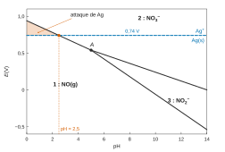
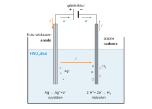
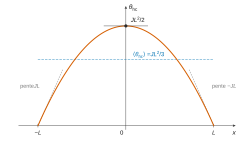
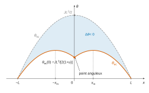
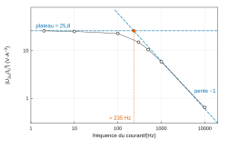

# Centrale-Supélec MP — Physique-chimie 2 2026 · Corrigé brut

*Corrigé rédigé par IA, non officiel. Signalez toute erreur.*

**Microscopie thermique à sonde locale.** 4 heures, calculatrice autorisée. Questions à prise d'initiative : Q28 et Q46.

---

## Partie A — Production de la pointe

### Question 1

Électrons de valence : N (colonne 15) en a 5, O (colonne 16) en a 6, H en a 1.

| Espèce | Électrons de valence | Doublets | Schéma de Lewis (O tous liés à N) |
|---|---|---|---|
| NO₃⁻ | $5+18+1=24$ | 12 | N central portant une charge formelle $+$, une liaison double N=O (O avec 2 doublets non liants), deux liaisons simples N–O (chaque O avec 3 doublets non liants et une charge $-$) ; trois formes mésomères équivalentes |
| HNO₃ | $1+5+18=24$ | 12 | H–O–N : N chargé $+$, lié à O–H (O avec 2 doublets), à un O par une double liaison (2 doublets) et à un O⁻ par une simple liaison (3 doublets) |
| NO₂⁻ | $5+12+1=18$ | 9 | O=N–O⁻ : N porte un doublet non liant ; O doublement lié avec 2 doublets, O simplement lié avec 3 doublets et la charge $-$ ; deux formes mésomères |
| HNO₂ | $1+5+12=18$ | 9 | H–O–N=O : N porte un doublet non liant, chaque O deux doublets non liants |
| NO | $5+6=11$ | 5 doublets + 1 électron | ·N=O : N porte un doublet non liant et un électron célibataire, O deux doublets non liants |

Dans les quatre premières espèces, tous les atomes de la deuxième période respectent la règle de l'octet. Le monoxyde d'azote possède un nombre **impair** d'électrons de valence : l'azote n'est entouré que de 7 électrons.

**NO est un radical : son électron célibataire explique sa forte réactivité.**

### Question 2

$$\boxed{\mathrm{HNO_3(aq)+H_2O(\ell)\longrightarrow NO_3^-(aq)+H_3O^+(aq)}}$$

de constante $K=10^{-\mathrm pK_a}=10^{1,4}\approx25$ : avec $\mathrm pK_a=-1{,}4<0$, l'acide nitrique est un acide fort, totalement dissocié. Sur le diagramme de prédominance, HNO₃ ne l'emporte que pour $\mathrm{pH}<\mathrm pK_a=-1{,}4$, en dehors de la fenêtre $0\le\mathrm{pH}\le14$ : **seul NO₃⁻ apparaît.**

### Question 3

HNO₂ ($\mathrm pK_a=3{,}3$) prédominerait en acido-basique pour pH < 3,3 : il faut donc examiner sa stabilité rédox.

**Couple NO₃⁻/HNO₂** (HNO₂ réducteur) : $\mathrm{NO_3^-+3H^++2e^-=HNO_2+H_2O}$, d'où

$$\begin{aligned}E&=0{,}94+0{,}03\log\frac{[\mathrm{NO_3^-}]h^3}{[\mathrm{HNO_2}]}\\&=0{,}94-0{,}09\,\mathrm{pH}\end{aligned}$$

HNO₂ n'est stable que sous cette droite.

**Couple HNO₂/NO** (HNO₂ oxydant) : $\mathrm{HNO_2+H^++e^-=NO(g)+H_2O}$, d'où

$$\begin{aligned}E&=1{,}00+0{,}06\log\frac{[\mathrm{HNO_2}]h}{P_{\rm NO}/P^\circ}\\&=1{,}00-0{,}06-0{,}06\,\mathrm{pH}\\&=0{,}94-0{,}06\,\mathrm{pH}\end{aligned}$$

HNO₂ n'est stable qu'au-dessus.

Pour tout pH > 0, $0{,}94-0{,}09\,\mathrm{pH}<0{,}94-0{,}06\,\mathrm{pH}$ : **le domaine de stabilité de HNO₂ est vide, HNO₂ se dismute** selon

$$\mathrm{3\,HNO_2\longrightarrow NO_3^-+2\,NO(g)+H^++H_2O}.$$

### Question 4

Nombres d'oxydation de N : +V dans NO₃⁻, +III dans NO₂⁻, +II dans NO. Le potentiel croît avec le nombre d'oxydation ; le domaine 3 n'existe que pour pH > pH_A, entre deux frontières, il correspond à l'espèce intermédiaire :

$$\boxed{\text{domaine 1 : NO(g)}\qquad\text{domaine 2 : NO}_3^-\qquad\text{domaine 3 : NO}_2^-}$$

(Le domaine 3 est situé à pH > 5 > 3,3 : c'est bien la base NO₂⁻ et non HNO₂.)

### Question 5

Frontière 2/3, couple NO₃⁻/NO₂⁻ : $\mathrm{NO_3^-+2H^++2e^-=NO_2^-+H_2O}$, $E=0{,}84+0{,}03\log\dfrac{[\mathrm{NO_3^-}]h^2}{[\mathrm{NO_2^-}]}$ ; à concentrations égales :

$$\boxed{E_{2/3}=0{,}84-0{,}06\,\mathrm{pH}\ \ (\mathrm V)}$$

Frontière 1/3, couple NO₂⁻/NO : $\mathrm{NO_2^-+2H^++e^-=NO(g)+H_2O}$. La relation de Nernst s'écrit

$$E=1{,}20+0{,}06\log\frac{[\mathrm{NO_2^-}]h^2}{P_{\rm NO}/P^\circ}$$

avec $[\mathrm{NO_2^-}]=c_0=0{,}1$ mol·L⁻¹ et $P_{\rm NO}=P^\circ$ :

$$\boxed{E_{1/3}=1{,}14-0{,}12\,\mathrm{pH}\ \ (\mathrm V)}$$

Contrôle : en pH = 14, ces droites valent 0,00 V et −0,54 V, comme sur la figure 2.

### Question 6

$$\begin{aligned}0{,}84-0{,}06\,\mathrm{pH}&=1{,}14-0{,}12\,\mathrm{pH}\\\iff\quad\mathrm{pH}&=5{,}0\end{aligned}$$

puis $E=0{,}54$ V :

$$\boxed{A\ (\mathrm{pH}_A=5{,}0\ ;\ E_A=0{,}54\ \mathrm V)}$$

Contrôle : la frontière NO₃⁻/NO ($\mathrm{NO_3^-+4H^++3e^-=NO+2H_2O}$) a pour équation

$$\begin{aligned}E_{1/2}&=0{,}96+0{,}02\log(0{,}1\,h^4)\\&=0{,}94-0{,}08\,\mathrm{pH}\end{aligned}$$

Elle passe aussi par $A$ (0,54 V en pH 5) et vaut 0,94 V en pH 0, comme sur la figure.

### Question 7

Pour pH < 5, $E_{1/3}>E_{2/3}$ : le domaine de NO₂⁻ est vide, l'ion nitrite est à la fois oxydé en NO₃⁻ et réduit en NO. En combinant $\mathrm{NO_2^-+H_2O\to NO_3^-+2H^++2e^-}$ et $2\times(\mathrm{NO_2^-+2H^++e^-\to NO+H_2O})$ :

$$\boxed{\mathrm{3\,NO_2^-(aq)+2\,H^+(aq)\longrightarrow NO_3^-(aq)+2\,NO(g)+H_2O(\ell)}}$$

C'est une **dismutation** (N(+III) donne N(+V) et N(+II)). Pour pH < 3,3, l'espèce effectivement présente serait HNO₂ et l'équation s'écrit comme en Q3.

### Question 8

Couple Ag⁺/Ag avec $[\mathrm{Ag^+}]=c_0$ : $E_{\rm Ag}=0{,}80+0{,}06\log 0{,}1=0{,}74$ V (frontière horizontale). L'acide nitreux n'existe pas en solution (Q3) ; le seul oxydant est NO₃⁻, apporté par l'acide nitrique. L'attaque est spontanée quand les domaines de Ag(s) et de NO₃⁻ sont disjoints, c'est-à-dire quand la frontière inférieure de NO₃⁻ est au-dessus de 0,74 V. Pour pH < 5 cette frontière est $E_{1/2}=0{,}94-0{,}08\,\mathrm{pH}$ :

$$0{,}94-0{,}08\,\mathrm{pH}>0{,}74\iff\boxed{\mathrm{pH}<2{,}5\ :\ \text{attaque par l'acide nitrique}}$$

(Pour pH > 5, $E_{2/3}=0{,}84-0{,}06\,\mathrm{pH}\le0{,}54$ V < 0,74 V : pas d'attaque.)

$$\boxed{\mathrm{3\,Ag(s)+NO_3^-(aq)+4\,H^+(aq)\longrightarrow3\,Ag^+(aq)+NO(g)+2\,H_2O(\ell)}}$$

$$\begin{aligned}\log K^\circ&=\frac{3\,(0{,}96-0{,}80)}{0{,}06}\\&=8\end{aligned}$$

$$\boxed{K^\circ=1\times10^{8}}$$

La réaction est quantitative.

### Question 9

Le fil de Wollaston, relié à la borne $+$, est l'anode ; le courant traverse l'électrolyte vers le platine, relié à la borne $-$, et les électrons circulent en sens inverse dans les fils.

- **Anode** (fil de Wollaston, oxydation) : $\mathrm{Ag(s)\longrightarrow Ag^+(aq)+e^-}$.
- **Cathode** (platine, réduction) : $\mathrm{2\,H^+(aq)+2\,e^-\longrightarrow H_2(g)}$ (en milieu nitrique, la réduction de NO₃⁻ en NO, ou le redépôt d'argent, sont aussi possibles).

**Intérêt.** L'électrolyse force l'oxydation de l'argent même là où l'attaque spontanée est lente ou impossible (pH > 2,5) : on peut travailler dans un bain dilué, moins agressif. La quantité d'argent dissoute est contrôlée par la charge, $n(\mathrm{Ag})=It/\mathcal F$ (loi de Faraday), donc la dénudation se règle finement par le courant et la durée. Le platine, bien plus noble, n'est pas oxydé sous tension modérée : l'attaque s'arrête d'elle-même quand le filament est à nu, ce qui se repère par la chute du courant.

---

## Partie B — Mesures thermiques en régime continu

### I — Principe de la mesure

### Question 10

Le filament est un cylindre de longueur $2L$ et de section $S$ :

$$\boxed{R_0=\frac{2\rho_0L}{S}=\frac{2\rho_0L}{\pi R^2}}$$

A.N. :

$$\begin{aligned}S&=\pi(2{,}5\times10^{-6})^2=1{,}96\times10^{-11}\ \mathrm{m^2}\\R_0&=\frac{1{,}9\times10^{-7}\times2{,}0\times10^{-4}}{1{,}96\times10^{-11}}\end{aligned}$$

**$R_0\approx1{,}9\ \Omega$**.

### Question 11

Les fils de Wollaston sont en série avec le filament et parcourus par le même courant. L'écart relatif entre la tension aux bornes de la pointe et celle aux bornes du filament vaut

$$\frac{R_{\rm W}}{R_{\rm W}+R_0}\approx\frac{1{,}5\times10^{-3}}{1{,}9}\approx8\times10^{-4}.$$

**La tension mesurée est celle du filament à mieux que 0,1 % près.**

### Question 12

D'après l'énoncé,

$$R_{\rm p}=\rho_0(1+a\langle\theta\rangle)\frac{2L}{S}=R_0(1+a\langle\theta\rangle).$$

Le courant $I_0$ est imposé et identique avant et après contact ; la contribution des fils de Wollaston ne dépend pas de la température du filament. Donc

$$\Delta U_{\rm DC}=R_0I_0a\big(\langle\theta_{\rm ec}\rangle-\langle\theta_{\rm hc}\rangle\big)$$

et, la moyenne étant linéaire, $\langle\theta_{\rm ec}\rangle-\langle\theta_{\rm hc}\rangle=\langle\Delta\theta\rangle$ :

$$\boxed{\Delta U_{\rm DC}=aR_0I_0\,\langle\Delta\theta\rangle}$$

### II — Échauffement hors contact

### Question 13

Système : la tranche de filament entre $x$ et $x+\mathrm dx$, solide indéformable de masse $\mu S\,\mathrm dx$. Le premier principe entre $t$ et $t+\mathrm dt$, avec des échanges latéraux négligés, donne

$$\begin{aligned}\mu cS\,\mathrm dx\,\frac{\partial T}{\partial t}&=S\,j_x(x,t)-S\,j_x(x+\mathrm dx,t)+p_{\rm J,lin}\,\mathrm dx\\&=-S\frac{\partial j_x}{\partial x}\mathrm dx+p_{\rm J,lin}\,\mathrm dx.\end{aligned}$$

Avec la loi de Fourier $j_x=-\lambda\,\partial T/\partial x$ ($\lambda$ uniforme) :

$$\boxed{\mu cS\frac{\partial T}{\partial t}=\lambda S\frac{\partial^2T}{\partial x^2}+p_{\rm J,lin}}$$

### Question 14

La tranche a pour résistance $\mathrm dR=\rho_0\,\mathrm dx/S$ et dissipe $\mathrm dP=\mathrm dR\,I_0^2$ :

$$\boxed{p_{\rm J,lin}=\frac{\rho_0I_0^2}{S}}$$

Contrôle : $2L\,p_{\rm J,lin}=R_0I_0^2$.

### Question 15

En régime permanent, avec $\theta''=T''$ :

$$\boxed{\frac{\mathrm d^2\theta_{\rm hc}}{\mathrm dx^2}=-\frac{\rho_0I_0^2}{\lambda S^2}=-J}$$

avec les conditions aux limites $\theta_{\rm hc}(\pm L)=0$.

### Question 16

Deux intégrations donnent $\theta_{\rm hc}=-\frac J2x^2+Ax+B$. Les conditions $\theta_{\rm hc}(L)=\theta_{\rm hc}(-L)=0$ donnent par différence $2AL=0$ et par somme $B=JL^2/2$ :

$$\boxed{\begin{aligned}A&=0\\B&=\frac{JL^2}{2}\\\theta_{\rm hc}(x)&=\frac J2\big(L^2-x^2\big)\end{aligned}}$$

### Question 17

Le profil est une parabole paire, concave, nulle en $x=\pm L$, maximale en $x=0$ où elle vaut $JL^2/2$ avec une tangente horizontale. Les pentes aux extrémités valent $\pm JL$ (positive en $-L$, négative en $+L$).

### Question 18

$$\begin{aligned}\langle\theta_{\rm hc}\rangle&=\frac1{2L}\int_{-L}^{L}\frac J2(L^2-x^2)\,\mathrm dx\\&=\frac J{4L}\cdot\frac{4L^3}3\end{aligned}$$

$$\boxed{\langle\theta_{\rm hc}\rangle=\frac{JL^2}3=\frac{\rho_0I_0^2L^2}{3\lambda S^2}}$$

A.N. ($I_0=50$ mA) :

$$J=\frac{1{,}9\times10^{-7}\times2{,}5\times10^{-3}}{38\times(1{,}96\times10^{-11})^2}=3{,}24\times10^{10}\ \mathrm{K\cdot m^{-2}},$$

d'où **$\langle\theta_{\rm hc}\rangle\approx1{,}1\times10^{2}$ K** (108 K ; maximum 162 K au centre).

### III — Mesure du flux transmis au contact

### Question 19

En régime permanent, sans source dans l'échantillon, le flux $\Phi$ traversant toute demi-sphère de rayon $r\ge b$ est le même. Par symétrie, $\vec j=j_r(r)\vec u_r$, donc $\Phi=2\pi r^2j_r(r)$ (demi-espace : aire $2\pi r^2$). La loi de Fourier $j_r=-\lambda_{\rm e}\,\mathrm dT/\mathrm dr$ donne

$$\begin{aligned}\frac{\mathrm dT}{\mathrm dr}&=-\frac{\Phi}{2\pi\lambda_{\rm e}r^2}\\\Longrightarrow\quad T(r)&=T_0+\frac{\Phi}{2\pi\lambda_{\rm e}r}\end{aligned}$$

compte tenu de $T(\infty)=T_0$. En $r=b$ : $T_1-T_0=\Phi/(2\pi\lambda_{\rm e}b)$, soit

$$\boxed{G_{\rm e}=\frac{\Phi}{T_1-T_0}=2\pi\lambda_{\rm e}b}$$

### Question 20

Le même flux traverse le contact puis l'échantillon (régime permanent, la demi-boule n'accumule rien). Avec $\theta_1=T_1-T_0$ :

$$\Phi=G_{\rm c}(\theta_{\rm ec}(0)-\theta_1)=G_{\rm e}\theta_1.$$

En éliminant $\theta_1$, on obtient $\Phi=G\,\theta_{\rm ec}(0)$, avec des résistances thermiques en série :

$$\boxed{\begin{aligned}\frac1G&=\frac1{G_{\rm c}}+\frac1{2\pi\lambda_{\rm e}b}\\G&=\frac{2\pi\lambda_{\rm e}b\,G_{\rm c}}{2\pi\lambda_{\rm e}b+G_{\rm c}}\end{aligned}}$$

### Question 21

$\Phi$ est compté de la pointe vers l'échantillon : **$\Phi>0$**.

L'énergie converge vers $x=0$ depuis les deux moitiés. À gauche, elle va dans le sens des $x$ croissants : **$j_x(0^-)>0$**. À droite, elle va dans le sens des $x$ décroissants : **$j_x(0^+)<0$**.

Par symétrie :

$$S\,j_x(0^-)=-S\,j_x(0^+)=\frac\Phi2.$$

### Question 22

La puissance quittant la moitié droite par sa face $0^+$ vaut $-S\,j_x(0^+)=\Phi/2$, et $j_x(0^+)=-\lambda\,\theta_{\rm ec}'(0^+)$ :

$$\lambda S\,\theta_{\rm ec}'(0^+)=\frac{G\,\theta_{\rm ec}(0)}2$$

soit

$$\boxed{\frac{\mathrm d\theta_{\rm ec}}{\mathrm dx}(0^+)=\frac{G\,\theta_{\rm ec}(0)}{2\lambda S}}$$

### Question 23

Sur $]0,L[$, $\theta_{\rm ec}''=-J$, donc

$$\theta_{\rm ec}(x)=-\frac J2x^2+Cx+D$$

avec $D=\theta_{\rm ec}(0)$. En posant $u=\dfrac{GL}{2\lambda S}$, la condition de Q22 donne

$$\begin{aligned}C&=\theta_{\rm ec}'(0^+)\\&=\frac{G}{2\lambda S}D\\&=\frac uL\,D.\end{aligned}$$

La condition $\theta_{\rm ec}(L)=0$ s'écrit $-\frac J2L^2+(1+u)D=0$, d'où

$$\begin{aligned}D&=\frac{JL^2}{2(1+u)}\\C&=\frac{JuL}{2(1+u)}\end{aligned}$$

$$\boxed{\begin{aligned}\theta_{\rm ec}(x)&=\frac J2\left(-x^2+\frac u{1+u}Lx+\frac{L^2}{1+u}\right)\\u&=\frac{GL}{2\lambda S}\end{aligned}}$$

Contrôle : pour $u\to0$ on retrouve $\theta_{\rm hc}$ ; $u$ est sans dimension.

### Question 24

Le profil est pair (symétrie du problème). Sur $[0,L]$, c'est un arc de parabole concave, nul en $L$, de valeur en $x=0$ :

$$\theta_{\rm ec}(0)=\frac{JL^2}{2(1+u)}<\frac{JL^2}2.$$

Il est maximal en $x_m=\dfrac{uL}{2(1+u)}\in\left]0,\frac L2\right[$, où il vaut

$$\theta_{\rm ec}(x_m)=\frac{JL^2}{8}\,\frac{(u+2)^2}{(1+u)^2}.$$

En $x=0$, les pentes sont opposées :

$$\theta_{\rm ec}'(0^\pm)=\pm\frac{JuL}{2(1+u)}.$$

C'est un **point anguleux**, minimum local, encadré par deux maxima symétriques en $\pm x_m$. La courbe reste sous la parabole hors contact, sauf aux extrémités où les deux s'annulent.

### Question 25

Pour $0<x<L$ :

$$\Delta\theta(x)=\frac J2\left(\frac u{1+u}Lx+\frac{L^2}{1+u}-L^2\right)$$

soit

$$\boxed{\Delta\theta(x)=-\frac{J}{2}\,\frac{u}{1+u}\,L\,(L-x)}$$

fonction affine, négative, nulle en $x=L$.

### Question 26

$\Delta\theta$ étant paire :

$$\begin{aligned}\langle\Delta\theta\rangle&=\frac1L\int_0^L\Delta\theta\,\mathrm dx\\&=-\frac J2\frac u{1+u}L\cdot\frac L2\end{aligned}$$

soit

$$\boxed{\langle\Delta\theta\rangle=-\frac{JL^2}4\,\frac u{1+u}}$$

puis, avec $\langle\theta_{\rm hc}\rangle=JL^2/3$ :

$$\boxed{\frac{|\langle\Delta\theta\rangle|}{\langle\theta_{\rm hc}\rangle}=\frac34\,\frac u{1+u}}$$

fonction croissante de $u$, de 0 à $3/4$.

### Question 27

On a

$$\begin{aligned}u&=\frac{GL}{2\lambda S}\\\frac1G&=\frac1{G_{\rm c}}+\frac1{2\pi\lambda_{\rm e}b}\end{aligned}$$

Quand $\lambda_{\rm e}$ est grand, la résistance d'épanouissement $1/G_{\rm e}$ devient négligeable devant la résistance de contact $1/G_{\rm c}$. Alors $G\to G_{\rm c}$ et $u\to u_\infty=G_{\rm c}L/(2\lambda S)$, et le rapport tend vers

$$\frac34\,\frac{u_\infty}{1+u_\infty},$$

**indépendant de $\lambda_{\rm e}$**.

Pour le tantale et le titane ($\lambda_{\rm e}$ de quelques dizaines de W·m⁻¹·K⁻¹), $G_{\rm e}=2\pi\lambda_{\rm e}b$ est de l'ordre de $10^{-3}$ W·K⁻¹. C'est plusieurs dizaines de fois $G_{\rm c}\sim10^{-5}$ W·K⁻¹ (Q28) : c'est le contact qui limite le transfert, et les deux métaux donnent le même signal relatif (environ 0,33). La technique ne discrimine donc plus les bons conducteurs.

### Question 28

**Démarche.** Deux inconnues, deux informations indépendantes de la figure 5. Le plateau aux grands $\lambda_{\rm e}$ ne dépend que de $G_{\rm c}$. Un point de la zone de montée, où $G_{\rm e}$ et $G_{\rm c}$ sont comparables, donne ensuite $b$.

On inverse $r=\frac34\frac u{1+u}$, puis on en tire $G$ :

$$\begin{aligned}u&=\frac{4r}{3-4r}\\G&=\frac{2\lambda S}{L}\,u\end{aligned}$$

avec

$$\frac{2\lambda S}L=\frac{2\times38\times1{,}96\times10^{-11}}{1{,}0\times10^{-4}}=1{,}49\times10^{-5}\ \mathrm{W\cdot K^{-1}}.$$

**Plateau.** $r_\infty\approx0{,}34$ (Ta, Ti) : $u_\infty=\dfrac{1{,}36}{1{,}64}=0{,}83$, d'où

$$\boxed{G_{\rm c}\approx1{,}2\times10^{-5}\ \mathrm{W\cdot K^{-1}}}$$

**Montée.** Point « Verre » : $\lambda_{\rm e}\approx1{,}2$ W·m⁻¹·K⁻¹ et $r\approx0{,}25$. Donc $u=0{,}50$ et $G=7{,}5\times10^{-6}$ W·K⁻¹. On en déduit

$$\begin{aligned}\frac1{G_{\rm e}}&=\frac1G-\frac1{G_{\rm c}}\\&=1{,}34\times10^5-0{,}81\times10^5\\&=5{,}3\times10^4\ \mathrm{K\cdot W^{-1}}\end{aligned}$$

soit $G_{\rm e}=1{,}9\times10^{-5}$ W·K⁻¹, et

$$b=\frac{G_{\rm e}}{2\pi\lambda_{\rm e}}\approx2{,}5\ \mu\mathrm m.$$

Les points « Feuille d'acétate » et « PVDF » donnent 3 à 4 µm ; un ajustement sur l'ensemble des points donne 3,2 µm. On retient

$$\boxed{b\approx3\ \mu\mathrm m}$$

du même ordre que le rayon du filament, ce qui est cohérent : la zone chauffée a la taille de l'objet qui la touche, et c'est la résolution spatiale de la technique.

---

## Partie C — Mesure des paramètres géométriques de la pointe en mode alternatif

### I — Réponse thermique en fonction de la fréquence

### Question 29

$$\begin{aligned}p_{\rm J,lin}(t)&=\frac{\rho_0i^2}S\\&=\frac{\rho_0I_0^2}S\cos^2\omega t\end{aligned}$$

soit

$$\boxed{p_{\rm J,lin}(t)=\frac{\rho_0I_0^2}{2S}+\frac{\rho_0I_0^2}{2S}\cos(2\omega t)}$$

un terme constant et un terme à la pulsation $2\omega$. L'équation de la diffusion devient

$$\boxed{\mu cS\frac{\partial T}{\partial t}=\lambda S\frac{\partial^2T}{\partial x^2}+\frac{\rho_0I_0^2}{2S}\big[1+\cos(2\omega t)\big]}$$

soit, pour $\theta=T-T_0$ : $\dfrac{\mu c}{\lambda}\dfrac{\partial\theta}{\partial t}=\dfrac{\partial^2\theta}{\partial x^2}+\dfrac J2\big[1+\cos(2\omega t)\big]$.

### Question 30

L'équation est linéaire à coefficients constants, avec des conditions aux limites homogènes $\theta(\pm L,t)=0$. Par superposition, la solution est la somme de la réponse au terme constant (indépendante du temps, $\theta_{\rm DC}(x)$) et de la réponse au terme à $2\omega$. Une fois le régime transitoire amorti, cette dernière est sinusoïdale de même pulsation, d'amplitude $\theta_{\rm AC}(x)$ et de phase $\phi(x)$. D'où

$$\theta=\theta_{\rm DC}(x)+\theta_{\rm AC}(x)\cos(2\omega t+\phi(x)).$$

$\theta_{\rm DC}$ vérifie $\theta_{\rm DC}''=-J/2$ et $\theta_{\rm DC}(\pm L)=0$. C'est le problème de la partie B avec $J/2$ au lieu de $J$, donc

$$\boxed{\theta_{\rm DC}(x)=\frac12\,\theta_{\rm hc}(x)}$$

($\theta_{\rm hc}$ calculé pour un courant continu d'intensité $I_0$).

### Question 31

Avec $\phi$ indépendant de $x$, on a

$$\langle\theta\rangle(t)=\langle\theta_{\rm DC}\rangle+\langle\theta_{\rm AC}\rangle\cos(2\omega t+\phi),$$

et $R_{\rm p}=R_0(1+a\langle\theta\rangle)$ :

$$\boxed{R_{\rm p}(t)=R_0\Big[1+a\langle\theta_{\rm DC}\rangle+a\langle\theta_{\rm AC}\rangle\cos(2\omega t+\phi)\Big]}$$

### Question 32

$u(t)=R_{\rm p}(t)\,I_0\cos\omega t$, et l'on linéarise le produit :

$$\cos(2\omega t+\phi)\cos\omega t=\frac12\cos(3\omega t+\phi)+\frac12\cos(\omega t+\phi).$$

D'où

$$u(t)=R_0I_0(1+a\langle\theta_{\rm DC}\rangle)\cos\omega t+\frac{aR_0I_0\langle\theta_{\rm AC}\rangle}2\cos(\omega t+\phi)+\frac{aR_0I_0\langle\theta_{\rm AC}\rangle}2\cos(3\omega t+\phi).$$

La tension comporte une harmonique à $3\omega$ :

$$\boxed{\begin{aligned}U_{3\omega}&=\frac{a\,R_0\,I_0\,\langle\theta_{\rm AC}\rangle}2\\\varphi_{3\omega}&=\phi\end{aligned}}$$

(le courant servant de référence des phases). Comme $\langle\theta_{\rm AC}\rangle\propto J\propto I_0^2$, $U_{3\omega}\propto I_0^3$.

### Question 33

On reporte $\theta=\theta_{\rm DC}(x)+\mathfrak{Re}\big(\underline\theta_{\rm AC}(x)e^{2j\omega t}\big)$ dans $\mu c\,\partial_t\theta=\lambda\,\partial_x^2\theta+\frac{\lambda J}2[1+\cos 2\omega t]$. Le terme constant est équilibré par $\theta_{\rm DC}$ ; pour les termes à $2\omega$, l'équation étant linéaire à coefficients réels, on identifie les amplitudes complexes :

$$2j\omega\mu c\,\underline\theta_{\rm AC}=\lambda\frac{\mathrm d^2\underline\theta_{\rm AC}}{\mathrm dx^2}+\frac{\lambda J}2$$

soit

$$\boxed{\begin{aligned}\frac{\mathrm d^2\underline\theta_{\rm AC}}{\mathrm dx^2}-\underline m^2\,\underline\theta_{\rm AC}&=-\frac J2\\\underline m^2&=2j\omega\frac{\mu c}\lambda\end{aligned}}$$

### Question 34

Solution particulière constante $J/(2\underline m^2)$, d'où la solution générale

$$\underline\theta_{\rm AC}=\frac J{2\underline m^2}+\alpha e^{\underline mx}+\beta e^{-\underline mx}.$$

Les fils de Wollaston imposent $\theta(\pm L,t)=0$ à tout instant, donc $\underline\theta_{\rm AC}(\pm L)=0$. La différence des deux conditions donne

$$(\alpha-\beta)(e^{\underline mL}-e^{-\underline mL})=0,$$

donc $\alpha=\beta$ ($\omega\neq0$). La somme donne

$$\alpha=-\frac J{2\underline m^2}\,\frac1{e^{\underline mL}+e^{-\underline mL}}.$$

On obtient :

$$\boxed{\underline\theta_{\rm AC}(x)=\frac J{2\underline m^2}\left(1-\frac{e^{\underline mx}+e^{-\underline mx}}{e^{\underline mL}+e^{-\underline mL}}\right)}$$

### Question 35

On calcule

$$\int_{-L}^{L}(e^{\underline mx}+e^{-\underline mx})\,\mathrm dx=\frac2{\underline m}(e^{\underline mL}-e^{-\underline mL}),$$

d'où

$$\boxed{\langle\underline\theta_{\rm AC}\rangle=\frac J{2\underline m^2}\left(1-\frac1{\underline mL}\,\frac{e^{\underline mL}-e^{-\underline mL}}{e^{\underline mL}+e^{-\underline mL}}\right)}$$

### Question 36

**Le développement limité fourni par l'énoncé est erroné** :

$$\begin{aligned}\frac{e^x-e^{-x}}{e^x+e^{-x}}&=\frac{x+\frac{x^3}6}{1+\frac{x^2}2}+o(x^3)\\&=\left(x+\frac{x^3}6\right)\left(1-\frac{x^2}2\right)+o(x^3)\\&=x-\frac{x^3}3+o(x^3).\end{aligned}$$

On utilise la forme correcte. À basse fréquence, $y=\underline mL\to0$ et $\dfrac1y\dfrac{e^y-e^{-y}}{e^y+e^{-y}}=1-\dfrac{y^2}3+o(y^2)$, donc

$$\langle\underline\theta_{\rm AC}\rangle\xrightarrow[\omega\to0]{}\frac J{2\underline m^2}\cdot\frac{\underline m^2L^2}3=\frac{JL^2}6$$

d'où

$$\boxed{U_{3\omega,\rm BF}=\frac{a\,R_0\,I_0\,J\,L^2}{12}}$$

Vérification indépendante : à très basse fréquence, l'échauffement suit quasi statiquement la puissance ; l'amplitude oscillante est alors la solution stationnaire pour la source $J/2$, $\frac J4(L^2-x^2)$, de moyenne $JL^2/6=\langle\theta_{\rm DC}\rangle$. (Le développement imprimé aurait donné $JL^2/12$, incompatible avec ce calcul.)

### Question 37

Avec $R_0=2\rho_0L/S$, $J=\rho_0I_0^2/(\lambda S^2)$ et $S=\pi R^2$ :

$$\begin{aligned}U_{3\omega,\rm BF}&=\frac{aI_0L^2}{12}\cdot\frac{2\rho_0L}S\cdot\frac{\rho_0I_0^2}{\lambda S^2}\\&=\frac{a\rho_0^2I_0^3L^3}{6\lambda\pi^3R^6}\end{aligned}$$

d'où

$$\boxed{R=\left(\frac{a\,\rho_0^2\,I_0^3\,L^3}{6\pi^3\lambda\,U_{3\omega,\rm BF}}\right)^{1/6}}$$

$R$ ne dépend pas de $I_0$ puisque $U_{3\omega,\rm BF}\propto I_0^3$.

### Question 38

À haute fréquence, $|\underline mL|\to\infty$ ; comme $\mathfrak{Re}(\underline m)>0$, le quotient d'exponentielles tend vers 1 et le terme en $1/(\underline mL)$ tend vers 0 :

$$\langle\underline\theta_{\rm AC}\rangle\simeq\frac J{2\underline m^2}=-j\,\frac{J\lambda}{4\mu c\,\omega}$$

d'où

$$\boxed{U_{3\omega,\rm HF}=\frac{a\,R_0\,I_0\,J\,\lambda}{8\,\mu\,c\,\omega}}$$

décroissance en $1/\omega$ (pente −1 en échelle log-log).

### Question 39

$\varphi_{3\omega}=\phi=\arg\langle\underline\theta_{\rm AC}\rangle$.

À basse fréquence, $\langle\underline\theta_{\rm AC}\rangle\to JL^2/6$, réel positif : **$\varphi_{3\omega,\rm BF}=0$**.

À haute fréquence, $\langle\underline\theta_{\rm AC}\rangle\simeq-jJ\lambda/(4\mu c\omega)$, imaginaire pur négatif : **$\varphi_{3\omega,\rm HF}=-\pi/2=-90°$** (le filament se comporte en pur accumulateur, l'échauffement est en quadrature retard sur la puissance).

### Question 40

En égalant les deux asymptotes :

$$\frac{aR_0I_0JL^2}{12}=\frac{aR_0I_0J\lambda}{8\mu c\,\omega_c}$$

soit

$$\boxed{\omega_c=\frac{3\lambda}{2L^2\mu c}}$$

$\omega_c$ est la pulsation **du courant** ; l'excitation thermique est alors à la pulsation $2\omega_c$, de fréquence

$$f_c=\frac{2\omega_c}{2\pi}=\frac{3\lambda}{2\pi L^2\mu c},$$

qui est l'expression de l'énoncé : $f_c$ repère la fréquence caractéristique de l'oscillation thermique. Comme la figure 6 est graduée en fréquence du courant, on y lit l'intersection des asymptotes en $f_c/2=\dfrac{3\lambda}{4\pi L^2\mu c}$. (Avec le développement erroné de Q36, on aurait obtenu $f_c$ comme fréquence du courant : c'est l'origine du facteur 2.)

### Question 41

Relevés sur la figure 6 :

| $f$ (Hz) | 2 | 10 | 100 | 300 | 500 | 1000 | 10 000 |
|---|---|---|---|---|---|---|---|
| $\lvert U_{3\omega}/I_0^3\rvert$ (V·A⁻³) | 25,8 | 25,0 | 22,7 | 14,9 | 10,4 | 5,8 | 0,64 |
| phase (°) | 0 | −5 | −26 | −55 | −66 | −77 | −94 |

- **Basses fréquences** : amplitude quasi constante (moins de 10 % de variation entre 2 et 100 Hz) et phase quasi nulle, conformément à Q36 et Q39.
- **Hautes fréquences** : de 1 à 10 kHz, l'amplitude est divisée par 9 environ pour une décade, soit la pente −1 prévue par Q38 ; la phase s'approche de −90°. Elle atteint −94° à 10 kHz alors que le modèle tend vers −90° par valeurs supérieures (−86° calculé) : ce petit retard excédentaire relève d'effets non modélisés (phase non uniforme, électronique de détection, extrémités imparfaitement thermostatées).
- **Normalisation** : l'ordonnée $U_{3\omega}/I_0^3$ n'a de sens que parce que $U_{3\omega}\propto I_0^3$ (Q32).
- **Ordres de grandeur** : l'intersection du plateau (≈ 25,8 V·A⁻³) et de l'asymptote $\approx6{,}0\times10^3/f$ se situe vers 235 Hz, et la phase franchit −45° vers 200 Hz ; la géométrie nominale ($L=100$ µm) prévoit $\dfrac{3\lambda}{4\pi L^2\mu c}=3{,}0\times10^2$ Hz. Le plateau nominal prévu par Q37 vaut $\dfrac{a\rho_0^2L^3}{6\lambda S^3}=35$ V·A⁻³.

**Les mesures sont compatibles avec le modèle**, les écarts de 20 à 30 % sur la fréquence de coupure et le plateau traduisant une pointe un peu plus longue et plus épaisse que les cotes nominales.

### Question 42

La fréquence de coupure ne dépend que de $L$ :

$$\frac{3\lambda}{4\pi L^2\mu c}=f_{\rm lue}\approx2{,}35\times10^2\ \mathrm{Hz},$$

avec $\mu c=2{,}99\times10^6$ J·m⁻³·K⁻¹. D'où

$$\begin{aligned}L&=\sqrt{\frac{3\lambda}{4\pi\mu c\,f_{\rm lue}}}\\&=\sqrt{\frac{114}{4\pi\times2{,}99\times10^6\times235}}\end{aligned}$$

$$\boxed{L\approx1{,}1\times10^{-4}\ \mathrm m}$$

Le plateau donne ensuite $R$ (Q37), avec $K=U_{3\omega,\rm BF}/I_0^3\approx25{,}8$ V·A⁻³ et $L=1{,}1\times10^{-4}$ m :

$$\begin{aligned}R&=\left(\frac{a\rho_0^2L^3}{6\pi^3\lambda K}\right)^{1/6}\\&=\left(\frac{1{,}66\times10^{-3}\times3{,}61\times10^{-14}\times1{,}33\times10^{-12}}{6\pi^3\times38\times25{,}8}\right)^{1/6}\end{aligned}$$

$$\boxed{R\approx2{,}8\ \mu\mathrm m}$$

soit environ 10 % de plus que les cotes nominales, ordre de grandeur attendu pour les incertitudes de fabrication. (Un ajustement du modèle complet sur tous les points donne $L\approx106$ µm et $R\approx2{,}7$ µm : la méthode des asymptotes est précise à 10 % près.)

### II — Traitement électronique du signal

### Question 43

Le voltmètre, d'impédance infinie, ne prélève aucun courant : $R_2$ et $R_{\rm p}$ sont en série sous la tension $e(t)$ :

$$\boxed{i(t)=\frac{e(t)}{R_2+R_{\rm p}}}$$

### Question 44

$I_0=E/(R_2+R_{\rm p})$. Pour $R_{\rm p}=R_0=1{,}9$ Ω puis $2R_0$ :

$$\begin{aligned}\left|\frac{\Delta I_0}{I_0}\right|&=1-\frac{R_2+R_0}{R_2+2R_0}\\&=\frac{R_0}{R_2+2R_0}\\&=\frac{1{,}9}{223{,}8}\end{aligned}$$

$$\boxed{\left|\frac{\Delta I_0}{I_0}\right|\approx0{,}85\ \%<1\ \%}$$

Comme $R_2\gg R_{\rm p}$, la branche se comporte en quasi-source de courant, $I_0\approx E/R_2$ ; les variations réelles de $R_{\rm p}$ (au plus quelques dizaines de pour cent) modifient encore moins le courant. **L'amplitude du courant est pratiquement indépendante de la température de la pointe**, ce qui justifie l'hypothèse $i=I_0\cos\omega t$ de la partie C.

### Question 45

Référence des potentiels au nœud inférieur, nœud supérieur au potentiel $e$. Branche de droite : $V_A=R_{\rm p}i$ et $e=(R_2+R_{\rm p})i$. Branche de gauche (diviseur) : $V_B=\dfrac{R_{\rm c}}{R_1+R_{\rm c}}e$. Avec $v=V_A-V_B$ (flèche de B vers A) :

$$\begin{aligned}v&=R_{\rm p}i-\frac{R_{\rm c}(R_2+R_{\rm p})}{R_1+R_{\rm c}}i\\&=\frac{R_{\rm p}R_1+R_{\rm p}R_{\rm c}-R_{\rm c}R_2-R_{\rm c}R_{\rm p}}{R_{\rm c}+R_1}\,i\end{aligned}$$

$$\boxed{v(t)=\frac{R_1R_{\rm p}-R_2R_{\rm c}}{R_{\rm c}+R_1}\,i(t)}$$

### Question 46

**Démarche** : annuler la partie constante du facteur $R_1R_{\rm p}-R_2R_{\rm c}$, c'est-à-dire équilibrer le pont à la température moyenne de fonctionnement.

Avec $R_{\rm p}(t)$ de Q31 et $i=I_0\cos\omega t$ (Q44), en posant $\mathcal R=R_1R_0(1+a\langle\theta_{\rm DC}\rangle)-R_2R_{\rm c}$ :

$$v(t)=\frac{I_0}{R_{\rm c}+R_1}\left[\mathcal R\cos\omega t+\frac{aR_1R_0\langle\theta_{\rm AC}\rangle}2\Big(\cos(\omega t+\phi)+\cos(3\omega t+\phi)\Big)\right].$$

L'harmonique 3 a pour amplitude

$$V_{3\omega}=\frac{aR_1R_0I_0\langle\theta_{\rm AC}\rangle}{2(R_{\rm c}+R_1)},$$

proportionnelle à $\langle\theta_{\rm AC}\rangle$. Le fondamental contient $\mathcal R$ et un terme de même amplitude que $V_{3\omega}$.

Si $\mathcal R\sim R_1R_0$, le rapport des amplitudes vaut environ $2/(a\langle\theta_{\rm AC}\rangle)\sim10^3$, comme l'indique l'énoncé. Il est de l'ordre de 1 si $|\mathcal R|\lesssim aR_1R_0\langle\theta_{\rm AC}\rangle/2$, donc pour

$$\boxed{R_{\rm c}=\frac{R_1R_0(1+a\langle\theta_{\rm DC}\rangle)}{R_2}\approx\frac{R_1R_0}{R_2}\approx9\ \Omega}$$

(8,8 Ω avec $R_0=1{,}94$ Ω ; 7,7 Ω avec la géométrie mesurée en Q42).

Le rapport de 1000 annoncé correspond à $R_0/(KI_0^2)\approx10^3$, soit $I_0\approx9$ mA. Alors $\langle\theta_{\rm DC}\rangle\approx1{,}6$ K et $a\langle\theta_{\rm DC}\rangle\approx3\times10^{-3}$ : cette correction est du même ordre que $a\langle\theta_{\rm AC}\rangle/2\approx1{,}5\times10^{-3}$.

L'équilibre doit donc être réglé à environ $10^{-3}$ près en valeur relative, à chaud, au courant de travail : c'est pourquoi $R_{\rm c}$ est une **résistance variable** (flèche de la figure 7), ajustée en annulant le fondamental. Le fondamental résiduel de battement, d'amplitude égale à $V_{3\omega}$, ne peut pas être supprimé, mais il est du même ordre que l'harmonique 3, comme demandé.
