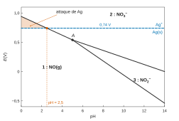
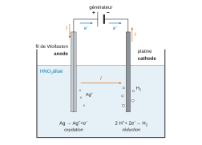
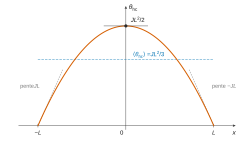
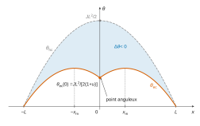
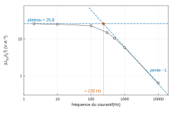

# Centrale-Supélec MP — Physique-chimie 2 2026 · Corrigé guidé

*Corrigé rédigé par IA, non officiel. Signalez toute erreur.*

## Présentation du sujet

**Format.** 4 heures, calculatrice autorisée, 46 questions (Q1 à Q46), 8 pages données comprises. Le thème est la **microscopie thermique à sonde locale** : une micro-pointe en platine rhodié, taillée dans un fil de Wollaston, sert à la fois de chauffage et de thermomètre. Deux questions sont soulignées (prise d'initiative, barème valorisé) : **Q28** et **Q46**.

**Partie A — Production de la pointe (Q1–Q9).** Chimie des solutions, indépendante du reste : schémas de Lewis des oxydes et oxoacides de l'azote, lecture et construction d'un diagramme potentiel-pH simplifié (NO₃⁻, NO₂⁻, NO), dismutations de HNO₂ et de NO₂⁻, attaque de la gaine d'argent par l'acide nitrique (domaine de pH, constante d'équilibre), puis électrolyse de dénudation.

**Partie B — Mesures thermiques en régime continu (Q10–Q28).**

- *B.I (Q10–Q12)* : résistance du filament, rôle négligeable des fils de Wollaston, proportionnalité entre la variation de tension et la variation d'échauffement moyen.
- *B.II (Q13–Q18)* : équation de la diffusion avec source Joule dans une ailette, profil parabolique hors contact, échauffement moyen.
- *B.III (Q19–Q28)* : contact ponctuel avec un échantillon : conductance d'épanouissement hémisphérique, conductances en série, discontinuité du flux en $x=0$, profil en contact, signal relatif $\frac34\frac{u}{1+u}$, saturation pour les bons conducteurs, puis exploitation de mesures réelles (figure 5).

**Partie C — Mesure de la géométrie en mode alternatif (Q29–Q46).**

- *C.I (Q29–Q42)* : méthode « $3\omega$ » : puissance Joule à $2\omega$, résistance oscillante, harmonique 3 de la tension, notation complexe, solution en cosinus hyperboliques, asymptotes basse et haute fréquence, fréquence caractéristique, exploitation de la figure 6 pour mesurer la demi-longueur et le rayon du filament.
- *C.II (Q43–Q46)* : pont de Wheatstone, quasi-source de courant, équilibrage pour faire émerger l'harmonique 3.

**Notions du programme mobilisées.** Schémas de Lewis ; diagrammes potentiel-pH, relation de Nernst, constante d'équilibre d'une réaction d'oxydoréduction ; électrolyse ; résistance d'un conducteur ; bilans d'énergie et loi de Fourier, conductances thermiques ; équation de la diffusion à une dimension ; régime sinusoïdal forcé et notation complexe ; équations différentielles linéaires à coefficients constants ; développements limités ; diagrammes de Bode ; lois de Kirchhoff, ponts diviseurs.

**Difficulté et longueur.** Sujet long mais très guidé, sans piège calculatoire majeur. Les points délicats sont Q3 et Q7 (raisonner sur des domaines vides), Q21–Q22 (signes et facteur $\frac12$ du flux partagé), Q28 et Q46 (questions ouvertes), Q36 (le développement limité fourni par l'énoncé est **faux** : $\tanh x=x-x^3/3+o(x^3)$) et Q40–Q42 (facteur 2 entre fréquence du courant et fréquence de l'excitation thermique).

**Questions à ne pas laisser passer.** Q2, Q4–Q6, Q10, Q11, Q13–Q18, Q19, Q20, Q25, Q26, Q29, Q31, Q32, Q43–Q45 : du cours ou presque.

**Gestion du temps.** Environ 5 minutes par question. Viser 45 minutes pour la partie A, 1 h 30 pour la partie B, 1 h 45 pour la partie C. La partie A étant indépendante, on peut la traiter en premier pour engranger des points sûrs ; dans la partie C, Q34 est donnée et Q35–Q40 s'enchaînent si l'on admet les résultats précédents.

---

## Partie A — Production de la pointe

On dénude le filament de platine en dissolvant la gaine d'argent dans l'acide nitrique. Il faut savoir quelles espèces azotées existent en solution, puis où l'argent est attaqué. Outils : Lewis, Nernst, lecture d'un diagramme E-pH.

### Question 1

> [!INDICATION]
> Comptez les électrons de valence de chaque édifice (colonne 15 : 5 électrons, colonne 16 : 6), sans oublier la charge des anions.

> [!INDICATION]
> Pour NO, regardez la parité du nombre total d'électrons de valence.

#### Solution

Électrons de valence : N en a 5, O en a 6, H en a 1.

| Espèce | Électrons de valence | Doublets | Schéma de Lewis (O tous liés à N) |
|---|---|---|---|
| NO₃⁻ | $5+18+1=24$ | 12 | N central chargé $+$, une liaison N=O (O avec 2 doublets non liants), deux liaisons N–O (O avec 3 doublets et une charge $-$) ; trois formes mésomères |
| HNO₃ | $24$ | 12 | H–O–N : N chargé $+$, lié à O–H (2 doublets), à un O par une double liaison (2 doublets), à un O⁻ (3 doublets) |
| NO₂⁻ | $5+12+1=18$ | 9 | O=N–O⁻ : N porte un doublet non liant ; deux formes mésomères |
| HNO₂ | $18$ | 9 | H–O–N=O : N porte un doublet non liant, chaque O deux doublets |
| NO | $11$ | 5 doublets + 1 électron | ·N=O : N porte un doublet et un électron célibataire, O deux doublets |

Les quatre premières espèces respectent l'octet. NO a un nombre **impair** d'électrons : l'azote n'en a que 7 autour de lui.

**NO est un radical : son électron célibataire explique sa forte réactivité.**

> [!PIEGE]
> Le proton acide de HNO₃ et de HNO₂ est porté par un oxygène, jamais par l'azote. Et l'énoncé interdit toute liaison O–O.

### Question 2

> [!INDICATION]
> C'est une réaction acido-basique avec l'eau ; que dit le signe du $\mathrm pK_a$ ?

> [!INDICATION]
> Comparez la frontière de prédominance $\mathrm{pH}=\mathrm pK_a$ à la fenêtre de pH du diagramme.

#### Solution

$$\boxed{\mathrm{HNO_3(aq)+H_2O(\ell)\longrightarrow NO_3^-(aq)+H_3O^+(aq)}}$$

$K=10^{-\mathrm pK_a}=10^{1,4}\approx25$ : avec $\mathrm pK_a=-1{,}4<0$, l'acide nitrique est fort, totalement dissocié. HNO₃ ne prédomine que pour $\mathrm{pH}<-1{,}4$, hors de la fenêtre $[0,14]$ : **seul NO₃⁻ apparaît.**

### Question 3

> [!INDICATION]
> Ici le $\mathrm pK_a$ (3,3) est dans la fenêtre : l'argument acido-basique ne suffit plus. Pensez à la stabilité rédox.

> [!INDICATION]
> HNO₂ est à la fois oxydant d'un couple et réducteur d'un autre. Écrivez les deux frontières où il intervient et comparez-les.

#### Solution

**NO₃⁻/HNO₂** : $\mathrm{NO_3^-+3H^++2e^-=HNO_2+H_2O}$, d'où

$$\begin{aligned}E&=0{,}94+0{,}03\log\frac{[\mathrm{NO_3^-}]h^3}{[\mathrm{HNO_2}]}\\&=0{,}94-0{,}09\,\mathrm{pH}\end{aligned}$$

HNO₂ n'est stable que sous cette droite.

**HNO₂/NO** : $\mathrm{HNO_2+H^++e^-=NO(g)+H_2O}$, d'où

$$\begin{aligned}E&=1{,}00+0{,}06\log\frac{[\mathrm{HNO_2}]h}{P_{\rm NO}/P^\circ}\\&=0{,}94-0{,}06\,\mathrm{pH}\end{aligned}$$

HNO₂ n'est stable qu'au-dessus.

Pour pH > 0, $0{,}94-0{,}09\,\mathrm{pH}<0{,}94-0{,}06\,\mathrm{pH}$ : **le domaine de HNO₂ est vide, il se dismute** :

$$\mathrm{3\,HNO_2\longrightarrow NO_3^-+2\,NO(g)+H^++H_2O}.$$

> [!METHODE]
> Une espèce intermédiaire est stable si la frontière où elle est réductrice passe au-dessus de celle où elle est oxydante. Comparer les seuls $E^\circ$ ne vaut qu'à pH = 0 : quand les pentes diffèrent, on compare les droites sur tout le domaine.

> [!PIEGE]
> Ne pas oublier la convention $c_0=0{,}1$ mol·L⁻¹ dans le second couple : elle abaisse l'ordonnée à l'origine de 0,06 V et fait coïncider les deux droites en pH = 0.

### Question 4

> [!INDICATION]
> Calculez le nombre d'oxydation de l'azote dans chacune des trois espèces restantes.

#### Solution

N vaut +V dans NO₃⁻, +III dans NO₂⁻, +II dans NO. Le domaine le plus haut est celui de l'espèce la plus oxydée, le plus bas celui de la plus réduite ; le domaine 3, coincé entre deux frontières issues de $A$ et limité aux pH élevés, est celui de l'espèce intermédiaire :

$$\boxed{\text{1 : NO(g)}\qquad\text{2 : NO}_3^-\qquad\text{3 : NO}_2^-}$$

Le domaine 3 est situé à pH > 5 > 3,3 : c'est bien la base NO₂⁻.

### Question 5

> [!INDICATION]
> Pour chaque frontière : demi-équation électronique équilibrée avec H⁺ et H₂O, puis relation de Nernst avec les conventions de tracé.

> [!INDICATION]
> La pente vaut $-0{,}06\,m/n$, avec $m$ protons et $n$ électrons.

#### Solution

Frontière 2/3, NO₃⁻/NO₂⁻ : $\mathrm{NO_3^-+2H^++2e^-=NO_2^-+H_2O}$ ; à concentrations égales,

$$\boxed{E_{2/3}=0{,}84-0{,}06\,\mathrm{pH}\ \ (\mathrm V)}$$

Frontière 1/3, NO₂⁻/NO : $\mathrm{NO_2^-+2H^++e^-=NO(g)+H_2O}$. La relation de Nernst s'écrit

$$E=1{,}20+0{,}06\log\frac{[\mathrm{NO_2^-}]h^2}{P_{\rm NO}/P^\circ}$$

avec $[\mathrm{NO_2^-}]=0{,}1$ mol·L⁻¹ et $P_{\rm NO}=P^\circ$ :

$$\boxed{E_{1/3}=1{,}14-0{,}12\,\mathrm{pH}\ \ (\mathrm V)}$$

Contrôle : 0,00 V et −0,54 V en pH 14, comme sur la figure 2.

> [!METHODE]
> La figure fournie est un contrôle gratuit : deux lectures en pH 14 valident ou invalident les deux équations.

### Question 6

> [!INDICATION]
> Le point $A$ est commun aux deux frontières précédentes.

#### Solution

$0{,}84-0{,}06\,\mathrm{pH}=1{,}14-0{,}12\,\mathrm{pH}$ donne $\mathrm{pH}=5{,}0$ et $E=0{,}54$ V :

$$\boxed{A\ (\mathrm{pH}_A=5{,}0\ ;\ E_A=0{,}54\ \mathrm V)}$$

Contrôle : la frontière 1/2, NO₃⁻/NO ($\mathrm{NO_3^-+4H^++3e^-=NO+2H_2O}$), vaut

$$\begin{aligned}E_{1/2}&=0{,}96+0{,}02\log(0{,}1\,h^4)\\&=0{,}94-0{,}08\,\mathrm{pH}\end{aligned}$$

Elle passe par $A$ et part de 0,94 V en pH 0, comme sur la figure.

### Question 7

> [!INDICATION]
> Pour pH < pH_A, comparez les deux frontières qui délimitent le domaine 3 : que devient ce domaine ?

> [!INDICATION]
> Combinez une oxydation et une réduction de la même espèce en équilibrant les électrons.

#### Solution

Pour pH < 5, $E_{1/3}>E_{2/3}$ : le domaine de NO₂⁻ est vide, l'ion est à la fois oxydé et réduit. Avec $\mathrm{NO_2^-+H_2O\to NO_3^-+2H^++2e^-}$ et $2\times(\mathrm{NO_2^-+2H^++e^-\to NO+H_2O})$ :

$$\boxed{\mathrm{3\,NO_2^-(aq)+2\,H^+(aq)\longrightarrow NO_3^-(aq)+2\,NO(g)+H_2O(\ell)}}$$

C'est une **dismutation**. Pour pH < 3,3, on l'écrirait avec HNO₂ (Q3).

> [!PIEGE]
> Dismutation (une espèce donne deux espèces de nombres d'oxydation encadrants) et médiamutation (l'inverse) ne doivent pas être confondues.

### Question 8

> [!INDICATION]
> Superposez la frontière Ag⁺/Ag, tracée avec la même convention de concentration.

> [!INDICATION]
> L'attaque est favorable quand les domaines de Ag(s) et de l'oxydant sont disjoints. Pour la constante, utilisez les potentiels standard, pas les frontières.

#### Solution

$E_{\rm Ag}=0{,}80+0{,}06\log0{,}1=0{,}74$ V, frontière horizontale. HNO₂ n'existant pas (Q3), le seul oxydant est NO₃⁻, apporté par l'acide nitrique. Pour pH < 5, sa frontière inférieure est $E_{1/2}=0{,}94-0{,}08\,\mathrm{pH}$ :

$$0{,}94-0{,}08\,\mathrm{pH}>0{,}74\iff\boxed{\mathrm{pH}<2{,}5\ :\ \text{attaque par l'acide nitrique}}$$

(Pour pH > 5, la frontière NO₃⁻/NO₂⁻ est sous 0,54 V : pas d'attaque.)

$$\boxed{\mathrm{3\,Ag(s)+NO_3^-(aq)+4\,H^+(aq)\longrightarrow3\,Ag^+(aq)+NO(g)+2\,H_2O(\ell)}}$$

$$\begin{aligned}\log K^\circ&=\frac{3(0{,}96-0{,}80)}{0{,}06}\\&=8\end{aligned}$$

$$\boxed{K^\circ=1\times10^{8}}$$

> [!PIEGE]
> La frontière à 0,74 V dépend de la convention de tracé et sert à délimiter le domaine de pH ; la constante d'équilibre se calcule avec $E^\circ=0{,}80$ V.

### Question 9

> [!INDICATION]
> On veut oxyder l'argent : quelle électrode est l'anode, et à quelle borne du générateur est-elle reliée dans un électrolyseur ?

> [!INDICATION]
> Pour l'intérêt, comparez avec l'attaque spontanée de Q8 : conditions de pH, contrôle de la quantité dissoute, arrêt de l'attaque.

#### Solution

Le fil de Wollaston, relié à la borne $+$, est l'anode ; le courant traverse la solution vers le platine, relié à la borne $-$, et les électrons circulent en sens inverse dans les fils.

- **Anode** (fil de Wollaston, oxydation) : $\mathrm{Ag(s)\to Ag^+(aq)+e^-}$.
- **Cathode** (platine, réduction) : $\mathrm{2H^+(aq)+2e^-\to H_2(g)}$ (la réduction de NO₃⁻ en NO ou le redépôt d'argent sont aussi envisageables).

**Intérêt.** L'électrolyse force l'oxydation de l'argent même là où l'attaque spontanée est lente ou impossible (pH > 2,5), donc dans un bain dilué, moins agressif. La quantité d'argent dissoute est fixée par la charge, $n(\mathrm{Ag})=It/\mathcal F$ : la dénudation se règle par le courant et la durée. Le platine, plus noble, n'est pas oxydé sous tension modérée : l'attaque s'arrête quand le filament est à nu, ce que signale la chute du courant.

> [!PIEGE]
> Dans un électrolyseur, l'anode est reliée à la borne $+$ ; dans une pile, l'anode est le pôle $-$. Dans les deux cas, anode = oxydation.

---

## Partie B — Mesures thermiques en régime continu

### I — Principe de la mesure

La pointe est un capteur résistif : sa résistance dépend de son échauffement moyen. On montre que la mesure électrique donne accès à $\langle\Delta\theta\rangle$.

### Question 10

> [!INDICATION]
> $R=\rho\ell/S$ ; attention, $L$ est une demi-longueur.

#### Solution

$$\boxed{R_0=\frac{2\rho_0L}{S}=\frac{2\rho_0L}{\pi R^2}}$$

A.N. : $S=1{,}96\times10^{-11}$ m², **$R_0\approx1{,}9\ \Omega$**.

### Question 11

> [!INDICATION]
> Fils et filament sont en série : comparez les résistances.

#### Solution

Le même courant traverse les fils de Wollaston et le filament ; l'écart relatif des tensions vaut

$$\frac{R_{\rm W}}{R_{\rm W}+R_0}\approx\frac{1{,}5\times10^{-3}}{1{,}9}\approx8\times10^{-4}.$$

**La tension mesurée est celle du filament à mieux que 0,1 % près.**

> [!JURY]
> Un verbe « justifier » appelle une comparaison chiffrée, pas une simple affirmation.

### Question 12

> [!INDICATION]
> Écrivez $R_{\rm p}=R_0(1+a\langle\theta\rangle)$ et la loi d'Ohm à courant imposé, avant et après contact.

> [!INDICATION]
> La moyenne est linéaire.

#### Solution

$R_{\rm p}=R_0(1+a\langle\theta\rangle)$ et $I_0$ est identique dans les deux situations ; la contribution des fils ne dépend pas de la température du filament. Donc $\Delta U_{\rm DC}=R_0I_0a(\langle\theta_{\rm ec}\rangle-\langle\theta_{\rm hc}\rangle)$ et, par linéarité de la moyenne :

$$\boxed{\Delta U_{\rm DC}=aR_0I_0\,\langle\Delta\theta\rangle}$$

### II — Échauffement hors contact

On établit l'équation de la chaleur avec source dans l'ailette et on la résout en régime permanent : parabole, puis moyenne.

### Question 13

> [!INDICATION]
> Bilan d'énergie sur la tranche $[x,x+\mathrm dx]$ entre $t$ et $t+\mathrm dt$ : variation d'énergie interne, flux conductifs aux deux faces, puissance Joule.

> [!INDICATION]
> Développez au premier ordre puis appliquez la loi de Fourier.

#### Solution

Pour la tranche (solide de masse $\mu S\,\mathrm dx$, échanges latéraux négligés), le premier principe donne

$$\begin{aligned}\mu cS\,\mathrm dx\,\frac{\partial T}{\partial t}&=S\,j_x(x,t)-S\,j_x(x+\mathrm dx,t)+p_{\rm J,lin}\,\mathrm dx\\&=-S\frac{\partial j_x}{\partial x}\,\mathrm dx+p_{\rm J,lin}\,\mathrm dx\end{aligned}$$

et, avec $j_x=-\lambda\,\partial T/\partial x$ :

$$\boxed{\mu cS\frac{\partial T}{\partial t}=\lambda S\frac{\partial^2T}{\partial x^2}+p_{\rm J,lin}}$$

> [!METHODE]
> Un bilan bien posé : système nommé, durée, termes d'entrée et de sortie orientés, et seulement ensuite la loi phénoménologique.

### Question 14

> [!INDICATION]
> Résistance de la tranche, puis loi de Joule.

#### Solution

$\mathrm dR=\rho_0\,\mathrm dx/S$, $\mathrm dP=\mathrm dR\,I_0^2$ :

$$\boxed{p_{\rm J,lin}=\frac{\rho_0I_0^2}{S}}$$

Contrôle : $2L\,p_{\rm J,lin}=R_0I_0^2$.

> [!PIEGE]
> $\rho_0I_0^2/S^2$ est la puissance volumique, pas linéique ; le contrôle par la puissance totale évite la confusion.

### Question 15

> [!INDICATION]
> Régime permanent, et $T_0$ constante.

#### Solution

$$\boxed{\frac{\mathrm d^2\theta_{\rm hc}}{\mathrm dx^2}=-\frac{\rho_0I_0^2}{\lambda S^2}=-J}$$

avec $\theta_{\rm hc}(\pm L)=0$.

### Question 16

> [!INDICATION]
> Deux intégrations, puis les deux conditions aux limites (somme et différence).

#### Solution

$\theta_{\rm hc}=-\frac J2x^2+Ax+B$ ; la différence des conditions donne $A=0$, la somme $B=JL^2/2$ :

$$\boxed{\begin{aligned}A&=0\\B&=\frac{JL^2}2\\\theta_{\rm hc}(x)&=\frac J2(L^2-x^2)\end{aligned}}$$

### Question 17

> [!INDICATION]
> Parabole : sommet, zéros, tangente au sommet, pentes aux bords.

#### Solution

Parabole paire, concave, nulle en $\pm L$, maximale en 0 où elle vaut $JL^2/2$ avec une tangente horizontale ; pentes $\pm JL$ aux extrémités.

### Question 18

> [!INDICATION]
> Moyenne $=\frac1{2L}\int_{-L}^{L}$ ; calculez $J$ avant l'application numérique.

#### Solution

$$\boxed{\langle\theta_{\rm hc}\rangle=\frac{JL^2}3=\frac{\rho_0I_0^2L^2}{3\lambda S^2}}$$

A.N. ($I_0=50$ mA) :

$$J=\frac{1{,}9\times10^{-7}\times2{,}5\times10^{-3}}{38\times(1{,}96\times10^{-11})^2}=3{,}24\times10^{10}\ \mathrm{K\cdot m^{-2}},$$

**$\langle\theta_{\rm hc}\rangle\approx1{,}1\times10^2$ K** (108 K ; 162 K au centre).

> [!METHODE]
> Commenter la vraisemblance : la pointe doit être nettement plus chaude que l'échantillon, mais loin de la fusion ; $a\langle\theta\rangle\approx0{,}18$ reste compatible avec un modèle linéaire de la résistivité.

### III — Mesure du flux transmis au contact

Le contact introduit une fuite thermique ponctuelle en $x=0$ : le profil devient anguleux et le signal relatif ne dépend que d'un paramètre sans dimension $u$. On exploite enfin des mesures réelles.

### Question 19

> [!INDICATION]
> En régime permanent sans source, le flux à travers une demi-sphère de rayon $r$ ne dépend pas de $r$.

> [!INDICATION]
> L'aire traversée est celle d'une demi-sphère ; intégrez la loi de Fourier de $b$ à l'infini.

#### Solution

$\Phi=2\pi r^2j_r(r)$ et $j_r=-\lambda_{\rm e}\,\mathrm dT/\mathrm dr$, d'où $T(r)=T_0+\dfrac{\Phi}{2\pi\lambda_{\rm e}r}$. En $r=b$ :

$$\boxed{G_{\rm e}=\frac{\Phi}{T_1-T_0}=2\pi\lambda_{\rm e}b}$$

> [!PIEGE]
> L'aire est $2\pi r^2$ et non $4\pi r^2$ : l'épanouissement se fait dans un demi-espace.

### Question 20

> [!INDICATION]
> Le même flux traverse le contact puis l'échantillon : analogie avec des résistances en série.

#### Solution

$\Phi=G_{\rm c}(\theta_{\rm ec}(0)-\theta_1)=G_{\rm e}\theta_1$ ; en éliminant $\theta_1$ :

$$\boxed{\begin{aligned}\Phi&=G\,\theta_{\rm ec}(0)\\\frac1G&=\frac1{G_{\rm c}}+\frac1{2\pi\lambda_{\rm e}b}\end{aligned}}$$

> [!PIEGE]
> En série, ce sont les résistances thermiques $1/G$ qui s'ajoutent. $G$ doit être inférieur à chacune des deux conductances.

### Question 21

> [!INDICATION]
> De chaque côté, dans quel sens l'énergie se dirige-t-elle pour rejoindre le contact ? Comparez au sens de $\vec u_x$.

#### Solution

**$\Phi>0$** (compté de la pointe vers l'échantillon). À gauche, l'énergie va vers $x$ croissant : **$j_x(0^-)>0$**. À droite, elle va vers $x$ décroissant : **$j_x(0^+)<0$**.

Par symétrie :

$$S\,j_x(0^-)=-S\,j_x(0^+)=\frac\Phi2.$$

### Question 22

> [!INDICATION]
> La moitié droite fournit la moitié du flux $\Phi$ par sa face $0^+$.

#### Solution

$-S\,j_x(0^+)=\Phi/2$ avec $j_x(0^+)=-\lambda\,\theta_{\rm ec}'(0^+)$ :

$$\boxed{\frac{\mathrm d\theta_{\rm ec}}{\mathrm dx}(0^+)=\frac{G\,\theta_{\rm ec}(0)}{2\lambda S}}$$

dérivée positive : $\theta_{\rm ec}$ croît en s'éloignant du contact.

> [!PIEGE]
> Oublier le facteur $\frac12$ fausse $u$ d'un facteur 2, et avec lui Q23 à Q28.

### Question 23

> [!INDICATION]
> Même solution générale qu'en Q16 sur $]0,L[$, mais avec la condition de Q22 en $0^+$ et $\theta_{\rm ec}(L)=0$.

> [!INDICATION]
> Exprimez la pente à l'origine comme $(u/L)$ fois la valeur à l'origine pour faire apparaître $u$.

#### Solution

$\theta_{\rm ec}=-\frac J2x^2+Cx+D$ avec $D=\theta_{\rm ec}(0)$. En posant $u=\dfrac{GL}{2\lambda S}$, la condition de Q22 donne

$$C=\frac G{2\lambda S}D=\frac uLD.$$

La condition en $L$ donne $(1+u)D=\frac J2L^2$ :

$$\boxed{\begin{aligned}\theta_{\rm ec}(x)&=\frac J2\left(-x^2+\frac u{1+u}Lx+\frac{L^2}{1+u}\right)\\u&=\frac{GL}{2\lambda S}\end{aligned}}$$

Contrôles : $u\to0$ redonne $\theta_{\rm hc}$ ; $u$ est sans dimension.

> [!METHODE]
> Vérifier un « en déduire que » par un cas limite (ici le contact rompu) coûte une ligne et sécurise toute la suite.

### Question 24

> [!INDICATION]
> Étudiez la parabole sur $[0,L]$ (valeur en 0, abscisse du maximum), puis utilisez la parité.

> [!INDICATION]
> Que se passe-t-il pour la dérivée en $x=0$ ?

#### Solution

Profil pair. Sur $[0,L]$, l'arc de parabole s'annule en $L$ et part de

$$\theta_{\rm ec}(0)=\frac{JL^2}{2(1+u)}.$$

Il est maximal en $x_m=\dfrac{uL}{2(1+u)}\in\left]0,\frac L2\right[$, où il vaut

$$\theta_{\rm ec}(x_m)=\frac{JL^2}8\,\frac{(u+2)^2}{(1+u)^2}.$$

Les pentes en $0^\pm$ sont opposées :

$$\theta_{\rm ec}'(0^\pm)=\pm\frac{JuL}{2(1+u)}.$$

**Point anguleux** en $x=0$ (minimum local) entre deux maxima en $\pm x_m$. La courbe reste sous la parabole hors contact.

> [!PIEGE]
> Un tracé lisse en 0, ou un maximum laissé au centre, manque l'essentiel : la singularité due au contact ponctuel.

### Question 25

> [!INDICATION]
> Les termes en $x^2$ disparaissent dans la différence.

#### Solution

$$\boxed{\Delta\theta(x)=-\frac J2\,\frac u{1+u}\,L\,(L-x)\qquad(0<x<L)}$$

affine, négative, nulle en $L$ : le contact refroidit tout le filament.

### Question 26

> [!INDICATION]
> Utilisez la parité de $\Delta\theta$, puis le résultat de Q18.

#### Solution

$$\boxed{\langle\Delta\theta\rangle=-\frac{JL^2}4\,\frac u{1+u}}$$

puis

$$\boxed{\frac{|\langle\Delta\theta\rangle|}{\langle\theta_{\rm hc}\rangle}=\frac34\,\frac u{1+u}}$$

Ce rapport croît de 0 à $3/4$ et ne dépend ni de $I_0$ ni des dimensions autrement qu'à travers $u$.

### Question 27

> [!INDICATION]
> Écrivez $u$ en fonction de $\lambda_{\rm e}$ via $G$. Quelle résistance thermique domine quand $\lambda_{\rm e}$ est grand ?

#### Solution

On a

$$\begin{aligned}u&=\frac{GL}{2\lambda S}\\\frac1G&=\frac1{G_{\rm c}}+\frac1{2\pi\lambda_{\rm e}b}\end{aligned}$$

Pour $\lambda_{\rm e}$ grand, $1/G_{\rm e}\ll1/G_{\rm c}$. Alors $G\to G_{\rm c}$ et $u\to u_\infty=\dfrac{G_{\rm c}L}{2\lambda S}$, et le rapport tend vers

$$\frac34\,\frac{u_\infty}{1+u_\infty},$$

**indépendant de $\lambda_{\rm e}$**.

Pour Ta et Ti, $G_{\rm e}\sim10^{-3}$ W·K⁻¹, des dizaines de fois $G_{\rm c}\sim10^{-5}$ W·K⁻¹ (Q28) : la résistance de contact limite seule le transfert, d'où le même signal relatif (environ 0,33). La technique ne discrimine plus les bons conducteurs.

> [!METHODE]
> En série, c'est le maillon le plus résistant qui impose le flux : un raisonnement de résistance dominante remplace un calcul.

### Question 28

> [!INDICATION]
> Deux inconnues : cherchez deux informations indépendantes sur la courbe (son comportement aux grands $\lambda_{\rm e}$, puis un point de la montée).

> [!INDICATION]
> Inversez la relation de Q26 pour obtenir $u$, donc $G$, à partir d'une ordonnée lue.

> [!INDICATION]
> Le plateau ne fait intervenir que $G_{\rm c}$ ; sur un point de montée, retranchez la résistance de contact pour isoler $G_{\rm e}$.

#### Solution

**Démarche.** Le plateau aux grands $\lambda_{\rm e}$ donne $G_{\rm c}$. Un point de la montée, où $G_{\rm e}$ et $G_{\rm c}$ sont comparables, donne $b$.

On inverse $r=\frac34\frac u{1+u}$ :

$$\begin{aligned}u&=\frac{4r}{3-4r}\\G&=\frac{2\lambda S}L\,u\end{aligned}$$

avec $\dfrac{2\lambda S}L=1{,}49\times10^{-5}$ W·K⁻¹.

**Plateau.** $r_\infty\approx0{,}34$ : $u_\infty=0{,}83$,

$$\boxed{G_{\rm c}\approx1{,}2\times10^{-5}\ \mathrm{W\cdot K^{-1}}}$$

**Montée.** « Verre » : $\lambda_{\rm e}\approx1{,}2$ W·m⁻¹·K⁻¹ et $r\approx0{,}25$. Donc $u=0{,}50$ et $G=7{,}5\times10^{-6}$ W·K⁻¹, puis

$$\begin{aligned}\frac1{G_{\rm e}}&=1{,}34\times10^5-0{,}81\times10^5\\&=5{,}3\times10^4\ \mathrm{K\cdot W^{-1}}\end{aligned}$$

soit $G_{\rm e}=1{,}9\times10^{-5}$ W·K⁻¹ et $b=G_{\rm e}/(2\pi\lambda_{\rm e})\approx2{,}5$ µm. Les points « acétate » et « PVDF » donnent 3 à 4 µm, un ajustement global 3,2 µm :

$$\boxed{b\approx3\ \mu\mathrm m}$$

du même ordre que le rayon du filament : c'est la taille de la zone chauffée et la résolution de la technique.

> [!PIEGE]
> Un point du plateau ne peut pas servir à déterminer $b$ : $b$ n'y influe presque plus et la moindre erreur de lecture donne n'importe quelle valeur.

> [!JURY]
> Dans une question à prise d'initiative, on annonce la démarche avant de calculer, on justifie le choix des points et on donne un résultat avec un nombre de chiffres adapté à la précision de lecture.

---

## Partie C — Mesure des paramètres géométriques de la pointe en mode alternatif

### I — Réponse thermique en fonction de la fréquence

Un courant à $\omega$ chauffe à $2\omega$. La résistance oscille donc à $2\omega$ et la tension contient une harmonique à $3\omega$.

Sa réponse en fréquence (plateau puis décroissance en $1/\omega$) livre $L$ puis $R$. Outils : linéarité, notation complexe, développements limités, diagrammes de Bode.

### Question 29

> [!INDICATION]
> Reprenez Q14 avec $i(t)$ et linéarisez $\cos^2$.

#### Solution

$$\boxed{p_{\rm J,lin}(t)=\frac{\rho_0I_0^2}{2S}+\frac{\rho_0I_0^2}{2S}\cos(2\omega t)}$$

$$\boxed{\mu cS\frac{\partial T}{\partial t}=\lambda S\frac{\partial^2T}{\partial x^2}+\frac{\rho_0I_0^2}{2S}\big[1+\cos(2\omega t)\big]}$$

soit $\dfrac{\mu c}\lambda\dfrac{\partial\theta}{\partial t}=\dfrac{\partial^2\theta}{\partial x^2}+\dfrac J2[1+\cos 2\omega t]$.

> [!PIEGE]
> La valeur moyenne de $\cos^2$ vaut $\frac12$ : le terme continu est la moitié de la puissance du régime continu de même amplitude.

### Question 30

> [!INDICATION]
> L'équation est linéaire : superposez les réponses aux deux termes de source.

> [!INDICATION]
> Le terme continu conduit au problème de la partie B avec une source divisée par deux.

#### Solution

Équation linéaire à coefficients constants, conditions aux limites homogènes : la solution est la somme de la réponse stationnaire au terme constant, $\theta_{\rm DC}(x)$, et, une fois le transitoire amorti, d'une réponse sinusoïdale de pulsation $2\omega$, $\theta_{\rm AC}(x)\cos(2\omega t+\phi(x))$. Comme $\theta_{\rm DC}''=-J/2$ avec $\theta_{\rm DC}(\pm L)=0$ :

$$\boxed{\theta_{\rm DC}(x)=\frac12\,\theta_{\rm hc}(x)}$$

> [!METHODE]
> Trois mots portent la justification : linéarité, superposition, régime établi.

### Question 31

> [!INDICATION]
> Moyennez $\theta(x,t)$ sur le filament en utilisant l'hypothèse sur $\phi$, puis appliquez $R_{\rm p}=R_0(1+a\langle\theta\rangle)$.

#### Solution

$$\boxed{R_{\rm p}(t)=R_0\Big[1+a\langle\theta_{\rm DC}\rangle+a\langle\theta_{\rm AC}\rangle\cos(2\omega t+\phi)\Big]}$$

### Question 32

> [!INDICATION]
> $u=R_{\rm p}(t)\,i(t)$ : linéarisez le produit $\cos(2\omega t+\phi)\cos\omega t$.

#### Solution

$$u(t)=R_0I_0(1+a\langle\theta_{\rm DC}\rangle)\cos\omega t+\frac{aR_0I_0\langle\theta_{\rm AC}\rangle}2\big[\cos(\omega t+\phi)+\cos(3\omega t+\phi)\big]$$

$$\boxed{\begin{aligned}U_{3\omega}&=\frac{aR_0I_0\langle\theta_{\rm AC}\rangle}2\\\varphi_{3\omega}&=\phi\end{aligned}}$$

(le courant étant la référence des phases). Comme $\langle\theta_{\rm AC}\rangle\propto J\propto I_0^2$, $U_{3\omega}\propto I_0^3$, ce qui explique l'ordonnée de la figure 6.

> [!PIEGE]
> Le facteur $\frac12$ de la linéarisation se retrouve dans la détermination de $R$ : l'oublier fausse le résultat de Q42.

### Question 33

> [!INDICATION]
> En notation complexe, une dérivée temporelle d'une grandeur à la pulsation $2\omega$ devient une multiplication par $2j\omega$.

#### Solution

En reportant $\theta=\theta_{\rm DC}+\mathfrak{Re}(\underline\theta_{\rm AC}e^{2j\omega t})$ et en identifiant les termes à $2\omega$ (équation linéaire à coefficients réels) :

$$2j\omega\mu c\,\underline\theta_{\rm AC}=\lambda\underline\theta_{\rm AC}''+\frac{\lambda J}2$$

soit

$$\boxed{\begin{aligned}\frac{\mathrm d^2\underline\theta_{\rm AC}}{\mathrm dx^2}-\underline m^2\underline\theta_{\rm AC}&=-\frac J2\\\underline m^2&=2j\omega\frac{\mu c}\lambda\end{aligned}}$$

> [!PIEGE]
> C'est $2j\omega$ et non $j\omega$ : la pulsation thermique est double de celle du courant.

### Question 34

> [!INDICATION]
> Solution particulière constante plus solution homogène en $e^{\pm\underline mx}$.

> [!INDICATION]
> Les extrémités restent à $T_0$ à chaque instant : quelles conditions pour l'amplitude complexe ?

#### Solution

$$\underline\theta_{\rm AC}=\frac J{2\underline m^2}+\alpha e^{\underline mx}+\beta e^{-\underline mx}$$

avec $\underline\theta_{\rm AC}(\pm L)=0$. La différence des conditions donne $\alpha=\beta$, la somme

$$\alpha=-\frac J{2\underline m^2}\,\frac1{e^{\underline mL}+e^{-\underline mL}}.$$

D'où :

$$\boxed{\underline\theta_{\rm AC}(x)=\frac J{2\underline m^2}\left(1-\frac{e^{\underline mx}+e^{-\underline mx}}{e^{\underline mL}+e^{-\underline mL}}\right)}$$

### Question 35

> [!INDICATION]
> Seule l'intégrale du cosinus hyperbolique demande un calcul.

#### Solution

$$\boxed{\langle\underline\theta_{\rm AC}\rangle=\frac J{2\underline m^2}\left(1-\frac1{\underline mL}\,\frac{e^{\underline mL}-e^{-\underline mL}}{e^{\underline mL}+e^{-\underline mL}}\right)}$$

### Question 36

> [!INDICATION]
> Basse fréquence : $|\underline mL|\ll1$. Les termes d'ordre 0 se compensent dans la parenthèse : il faut pousser le développement à l'ordre suivant.

> [!INDICATION]
> Vérifiez le développement limité fourni en le recalculant à partir de ceux de $e^x\pm e^{-x}$.

> [!INDICATION]
> Contrôle physique : à très basse fréquence, l'échauffement suit la puissance instantanée comme une suite de régimes permanents.

#### Solution

**Le développement limité de l'énoncé est faux** :

$$\begin{aligned}\frac{e^x-e^{-x}}{e^x+e^{-x}}&=\left(x+\frac{x^3}6\right)\left(1-\frac{x^2}2\right)+o(x^3)\\&=x-\frac{x^3}3+o(x^3).\end{aligned}$$

Avec $y=\underline mL\to0$ : $\dfrac1y\dfrac{e^y-e^{-y}}{e^y+e^{-y}}=1-\dfrac{y^2}3+o(y^2)$, d'où

$$\langle\underline\theta_{\rm AC}\rangle\to\frac J{2\underline m^2}\cdot\frac{\underline m^2L^2}3=\frac{JL^2}6,$$

réel positif :

$$\boxed{U_{3\omega,\rm BF}=\frac{aR_0I_0JL^2}{12}}$$

Contrôle quasi statique : pour la source $J/2$, le profil stationnaire est $\frac J4(L^2-x^2)$, de moyenne $JL^2/6$. Le développement imprimé aurait donné $JL^2/12$, incompatible avec ce contrôle.

> [!METHODE]
> Face à une donnée d'énoncé suspecte : la recalculer, le signaler clairement, puis continuer avec la valeur correcte en justifiant par un argument indépendant.

### Question 37

> [!INDICATION]
> Exprimez $R_0$, $J$ et $S$ en fonction du rayon du filament. Isolez-le ensuite.

#### Solution

$$\begin{aligned}U_{3\omega,\rm BF}&=\frac{a\rho_0^2I_0^3L^3}{6\lambda S^3}\\&=\frac{a\rho_0^2I_0^3L^3}{6\pi^3\lambda R^6}\end{aligned}$$

d'où

$$\boxed{R=\left(\frac{a\rho_0^2I_0^3L^3}{6\pi^3\lambda\,U_{3\omega,\rm BF}}\right)^{1/6}}$$

indépendant de $I_0$ puisque $U_{3\omega,\rm BF}\propto I_0^3$.

La puissance $1/6$ rend $R$ peu sensible aux erreurs sur $U_{3\omega}$. En revanche, $L$ intervient à la puissance $1/2$ : il faut le connaître (Q42).

### Question 38

> [!INDICATION]
> Haute fréquence : $|\underline mL|\gg1$ ; que devient le terme en $1/(\underline mL)$ ?

#### Solution

$\mathfrak{Re}(\underline m)>0$, donc le quotient d'exponentielles tend vers 1 et le terme correctif vers 0 :

$$\langle\underline\theta_{\rm AC}\rangle\simeq\frac J{2\underline m^2}=-j\frac{J\lambda}{4\mu c\,\omega}$$

d'où

$$\boxed{U_{3\omega,\rm HF}=\frac{aR_0I_0J\lambda}{8\mu c\,\omega}}$$

pente −1 en log-log. Physiquement, la longueur de diffusion $\sqrt{\lambda/(\omega\mu c)}$ devient petite devant $L$ : les extrémités n'influent plus.

### Question 39

> [!INDICATION]
> $\varphi_{3\omega}$ est l'argument de $\langle\underline\theta_{\rm AC}\rangle$ ; reprenez les deux limites.

#### Solution

**$\varphi_{3\omega,\rm BF}=0$** (limite réelle positive) ; **$\varphi_{3\omega,\rm HF}=-\pi/2$** (imaginaire pur négatif) : à haute fréquence, le filament intègre la puissance qu'il reçoit, l'échauffement est en quadrature retard.

### Question 40

> [!INDICATION]
> Égalez les deux asymptotes et résolvez en $\omega$.

> [!INDICATION]
> Attention : $\omega$ est la pulsation du courant ; comparez avec l'expression proposée et identifiez à quelle pulsation elle correspond.

#### Solution

$$\frac{aR_0I_0JL^2}{12}=\frac{aR_0I_0J\lambda}{8\mu c\,\omega_c}$$

soit

$$\boxed{\omega_c=\frac{3\lambda}{2L^2\mu c}}$$

C'est la pulsation du courant. L'excitation thermique est alors à $2\omega_c$, de fréquence

$$f_c=\frac{2\omega_c}{2\pi}=\frac{3\lambda}{2\pi L^2\mu c},$$

l'expression de l'énoncé. La figure 6 étant graduée en fréquence du courant, on y lit l'intersection en $f_c/2=\dfrac{3\lambda}{4\pi L^2\mu c}$. (Avec le développement erroné de Q36, on aurait trouvé $f_c$ comme fréquence du courant.)

> [!PIEGE]
> Pulsation ou fréquence, courant ou thermique : deux facteurs ($2\pi$ et 2) s'accumulent. Il faut écrire explicitement quelle fréquence on manipule.

### Question 41

> [!INDICATION]
> Confrontez chaque prédiction : plateau et phase nulle à basse fréquence, pente −1 et phase −90° à haute fréquence.

> [!INDICATION]
> Comparez aussi les ordres de grandeur (fréquence de coupure, niveau du plateau) à ceux que prévoit la géométrie nominale.

#### Solution

| $f$ (Hz) | 2 | 10 | 100 | 300 | 500 | 1000 | 10 000 |
|---|---|---|---|---|---|---|---|
| $\lvert U_{3\omega}/I_0^3\rvert$ (V·A⁻³) | 25,8 | 25,0 | 22,7 | 14,9 | 10,4 | 5,8 | 0,64 |
| phase (°) | 0 | −5 | −26 | −55 | −66 | −77 | −94 |

- Basses fréquences : plateau (moins de 10 % de variation de 2 à 100 Hz), phase quasi nulle.
- Hautes fréquences : division par 9 environ pour une décade entre 1 et 10 kHz (pente −1) ; phase proche de −90°. Le modèle tend vers −90° par valeurs supérieures (−86° calculé à 10 kHz) : les −94° mesurés révèlent un petit retard non modélisé (phase non uniforme, électronique, extrémités imparfaites).
- L'ordonnée normalisée par $I_0^3$ est cohérente avec $U_{3\omega}\propto I_0^3$.
- Intersection des asymptotes vers 235 Hz, phase à −45° vers 200 Hz ; la géométrie nominale prévoit $\dfrac{3\lambda}{4\pi L^2\mu c}=3{,}0\times10^2$ Hz et un plateau de $\dfrac{a\rho_0^2L^3}{6\lambda S^3}=35$ V·A⁻³.

**Mesures compatibles avec le modèle** ; les écarts de 20 à 30 % indiquent une pointe un peu plus longue et plus épaisse que le nominal.

> [!METHODE]
> « Vérifier la compatibilité » demande des confrontations chiffrées, une par prédiction, et l'examen honnête des écarts.

### Question 42

> [!INDICATION]
> Laquelle des deux grandeurs mesurables ne dépend que de $L$ ? Commencez par elle.

> [!INDICATION]
> Lisez la fréquence à l'intersection des asymptotes, en tenant compte de la conclusion de Q40 sur l'abscisse de la figure.

#### Solution

La fréquence de coupure ne dépend que de $L$ : avec $f_{\rm lue}\approx235$ Hz et $\mu c=2{,}99\times10^6$ J·m⁻³·K⁻¹,

$$L=\sqrt{\frac{3\lambda}{4\pi\mu c\,f_{\rm lue}}}$$

$$\boxed{L\approx1{,}1\times10^{-4}\ \mathrm m}$$

Le plateau $K=U_{3\omega,\rm BF}/I_0^3\approx25{,}8$ V·A⁻³ donne alors (Q37)

$$R=\left(\frac{a\rho_0^2L^3}{6\pi^3\lambda K}\right)^{1/6}$$

$$\boxed{R\approx2{,}8\ \mu\mathrm m}$$

environ 10 % au-dessus des cotes nominales. Un ajustement du modèle complet donne $L\approx106$ µm et $R\approx2{,}7$ µm : la méthode des asymptotes est précise à 10 % près.

> [!PIEGE]
> Utiliser l'expression de $f_c$ de l'énoncé directement sur l'abscisse de la figure donne $L\approx1{,}6\times10^{-4}$ m, loin du nominal : c'est le facteur 2 signalé en Q40. Un résultat éloigné des cotes nominales doit faire chercher un facteur égaré.

### II — Traitement électronique du signal

L'harmonique 3 est environ mille fois plus faible que le fondamental : on l'isole avec un pont de Wheatstone équilibré.

### Question 43

> [!INDICATION]
> Quel courant traverse un voltmètre idéal ?

#### Solution

Aucun courant dans le voltmètre : $R_2$ et $R_{\rm p}$ sont en série sous $e(t)$,

$$\boxed{i(t)=\frac{e(t)}{R_2+R_{\rm p}}}$$

### Question 44

> [!INDICATION]
> Formez la variation relative de $E/(R_2+R_{\rm p})$ quand la résistance de la pointe passe de $R_0$ à $2R_0$.

#### Solution

$$\begin{aligned}\left|\frac{\Delta I_0}{I_0}\right|&=\frac{R_0}{R_2+2R_0}\\&=\frac{1{,}9}{223{,}8}\end{aligned}$$

$$\boxed{\left|\frac{\Delta I_0}{I_0}\right|\approx0{,}85\ \%<1\ \%}$$

$R_2\gg R_{\rm p}$ : la branche est une quasi-source de courant. Les variations réelles de $R_{\rm p}$, bien plus faibles qu'un doublement, ne modifient pas l'amplitude du courant : **l'hypothèse $i=I_0\cos\omega t$ est justifiée.**

### Question 45

> [!INDICATION]
> Deux diviseurs de tension indépendants ; éliminez $e$ au profit de $i$.

#### Solution

Nœud inférieur à la masse. Branche de droite : $V_A=R_{\rm p}i$ et $e=(R_2+R_{\rm p})i$. Branche de gauche : $V_B=\dfrac{R_{\rm c}}{R_1+R_{\rm c}}e$. Enfin $v=V_A-V_B$ (flèche de B vers A) :

$$v=\frac{R_{\rm p}(R_1+R_{\rm c})-R_{\rm c}(R_2+R_{\rm p})}{R_{\rm c}+R_1}\,i$$

soit

$$\boxed{v(t)=\frac{R_1R_{\rm p}-R_2R_{\rm c}}{R_{\rm c}+R_1}\,i(t)}$$

### Question 46

> [!INDICATION]
> Injectez $R_{\rm p}(t)$ de Q31 dans Q45. Repérez ensuite l'origine de chaque composante de $v$ à $\omega$ et à $3\omega$.

> [!INDICATION]
> Le fondamental contient un terme proportionnel à la partie constante de $R_1R_{\rm p}-R_2R_{\rm c}$ : comment le rendre négligeable ?

> [!INDICATION]
> Pour estimer la précision de réglage nécessaire, déduisez du rapport « environ 1000 » l'ordre de grandeur de $a\langle\theta_{\rm AC}\rangle$ et de l'intensité de travail.

#### Solution

**Démarche** : équilibrer le pont à la température moyenne de fonctionnement.

Avec $\mathcal R=R_1R_0(1+a\langle\theta_{\rm DC}\rangle)-R_2R_{\rm c}$ :

$$v(t)=\frac{I_0}{R_{\rm c}+R_1}\left[\mathcal R\cos\omega t+\frac{aR_1R_0\langle\theta_{\rm AC}\rangle}2\big(\cos(\omega t+\phi)+\cos(3\omega t+\phi)\big)\right].$$

L'harmonique 3,

$$V_{3\omega}=\frac{aR_1R_0I_0\langle\theta_{\rm AC}\rangle}{2(R_{\rm c}+R_1)},$$

est proportionnelle à $\langle\theta_{\rm AC}\rangle$.

Si $\mathcal R\sim R_1R_0$, le fondamental est environ $2/(a\langle\theta_{\rm AC}\rangle)\sim10^3$ fois plus grand. Il devient du même ordre si $|\mathcal R|\lesssim aR_1R_0\langle\theta_{\rm AC}\rangle/2$, donc pour

$$\boxed{R_{\rm c}=\frac{R_1R_0(1+a\langle\theta_{\rm DC}\rangle)}{R_2}\approx\frac{R_1R_0}{R_2}\approx9\ \Omega}$$

(8,8 Ω avec $R_0$ nominale, 7,7 Ω avec la géométrie de Q42).

Le rapport 1000 correspond à $R_0/(KI_0^2)\approx10^3$, soit $I_0\approx9$ mA. Alors $a\langle\theta_{\rm DC}\rangle\approx3\times10^{-3}$, du même ordre que $a\langle\theta_{\rm AC}\rangle/2$ : le réglage doit être fait à $10^{-3}$ près, à chaud, au courant de travail. D'où la **résistance variable** de la figure 7, ajustée en annulant le fondamental. Le terme de battement résiduel, d'amplitude égale à $V_{3\omega}$, subsiste : le fondamental est alors du même ordre que l'harmonique 3, comme demandé.

> [!PIEGE]
> Croire que l'on peut annuler totalement le fondamental : le battement entre l'oscillation thermique à $2\omega$ et le courant à $\omega$ en laisse une part irréductible. Et prendre $I_0=50$ mA, valeur de la partie B, contredit le rapport 1000 de l'énoncé.

> [!JURY]
> Une question à prise d'initiative attend une démarche annoncée en une phrase, un critère explicite (ici l'ordre de grandeur du déséquilibre toléré) et une valeur numérique commentée.

---

## Bilan

**Méthodes à retenir.**

- Diagramme E-pH : demi-équation, Nernst avec la convention de tracé, pente $-0{,}06\,m/n$ ; une espèce dont le domaine est vide se dismute ; le domaine d'attaque d'un métal se lit par disjonction des domaines.
- Bilan thermique local sur une tranche : premier principe, loi de Fourier, source Joule linéique ; conditions aux limites par thermostats.
- Conductances thermiques : conservation du flux en régime permanent, résistances en série, conductance d'épanouissement d'une demi-sphère $2\pi\lambda b$.
- Condition de saut de flux en un point d'extraction : partage symétrique du flux et dérivée à gauche et à droite.
- Réponse d'un système linéaire à une source sinusoïdale : superposition, notation complexe, asymptotes basse et haute fréquence, pulsation de coupure à l'intersection.
- Pont de Wheatstone : diviseurs indépendants avec un voltmètre idéal, équilibre $R_1R_{\rm p}=R_2R_{\rm c}$, quasi-source de courant quand $R_2\gg R_{\rm p}$.

**Prérequis à revoir.** Nombres d'oxydation et schémas de Lewis ; relation entre $K^\circ$ et potentiels standard ; électrolyse (anode, cathode, loi de Faraday) ; équation de la diffusion ; développements limités usuels, dont $\tanh x=x-x^3/3+o(x^3)$ ; linéarisation des produits de cosinus.

**Questions classiques transposables.** Ailette thermique avec source ou pertes ; résistance thermique de constriction ; méthode $3\omega$ de mesure de conductivité thermique ; fil chaud anémométrique ; détection d'un petit signal par pont équilibré puis détection synchrone. Le réflexe général du sujet : un capteur qui est aussi son propre chauffage ne voit que la moyenne de son échauffement, et c'est par des rapports sans dimension, comme $u$, que l'on rend la mesure indépendante des paramètres mal connus.
