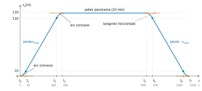
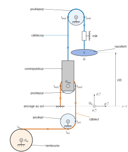
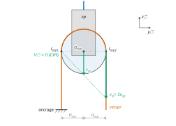
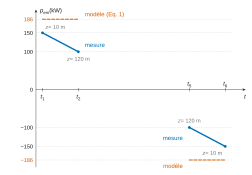

# Centrale-Supélec MP — Sciences industrielles 2026 · Corrigé

*Corrigé rédigé par IA, non officiel. Signalez toute erreur.*

Tour British Airways i360. Épreuve de 4 heures, calculatrice autorisée.

## Partie A — Étude du mouvement souhaité de la nacelle

### I — Modélisation du mouvement souhaité de la nacelle

**Q1.** La position $z_s$ est une primitive de la vitesse $v_s$. Celle-ci est continue, donc $z_s$ est de classe $C^1$.

- Sur $[t_0,t_1]$, $a_s=a_1>0$ et $z_s(t)=\tfrac12 a_1t^2$ : arc de parabole convexe, tangent à l'horizontale à l'origine.
- Sur $[t_1,t_2]$, $v_s=v_{nom}$ : segment de pente $v_{nom}$.
- Sur $[t_2,t_3]$, $a_s=-a_1$ : arc de parabole concave, tangent à l'horizontale en $t_3$.
- Sur $[t_3,t_4]$ : palier $z_s=130$ m pendant les 10 minutes de panorama.
- Sur $[t_4,t_5]$ : arc concave, tangent à l'horizontale en $t_4$.
- Sur $[t_5,t_6]$ : segment de pente $-v_{nom}$.
- Sur $[t_6,t_7]$ : arc convexe, tangent à l'horizontale en $t_7$.

Avec les valeurs de Q2, les points caractéristiques de l'allure sont les suivants.

| Instant | $t$ (s) | $z_s$ (m) |
|---|---|---|
| $t_0$ | 0 | 0 |
| $t_1$ | 40 | 10 |
| $t_2$ | 260 | 120 |
| $t_3$ | 300 | 130 |
| $t_4$ | 900 | 130 |
| $t_5$ | 940 | 120 |
| $t_6$ | 1160 | 10 |
| $t_7$ | 1200 | 0 |

$$\boxed{\begin{aligned}
z_s(t_3)&=130\ \text{m}\\
z_s(t_7)&=0\ \text{m}
\end{aligned}}$$

**Q2.** La distance parcourue est l'aire sous la courbe de vitesse, qui est un trapèze de hauteur $v_{nom}$, de grande base $t_3$ et de petite base $t_2-t_1$ :

$$\begin{aligned}
z_s(t_3)&=\frac{v_{nom}}{2}\big[t_3+(t_2-t_1)\big]\\
&=v_{nom}\Big[t_3-\frac{t_1}{2}-\frac{t_3-t_2}{2}\Big].
\end{aligned}$$

Avec $t_1=t_3-t_2=40$ s : $130=0{,}5\,(t_3-40)$, d'où

$$\boxed{t_3=300\ \text{s}=5\ \text{min}\leqslant6\ \text{min}}$$

On en déduit $t_2=260$ s, $z_s(t_1)=10$ m et $z_s(t_2)=120$ m.

Confort : $a_1=v_{nom}/t_1=0{,}5/40$, et la décélération vaut $v_{nom}/(t_3-t_2)$, soit la même valeur. Donc

$$\begin{aligned}
|a_s|_{max}&=a_1\\
&=1{,}25\times10^{-2}\ \text{m·s}^{-2}\\
&\leqslant a_{max}=1{,}5\times10^{-2}\ \text{m·s}^{-2}
\end{aligned}$$

$$\boxed{|a_s|_{max}\leqslant a_{max}}$$

**L'exigence de confort est respectée.** On vérifie aussi la sécurité : $v_{nom}=0{,}5\leqslant v_{max}=0{,}6$ m·s⁻¹.

## Partie B — Modélisation du mécanisme de transmission du mouvement

Le câble tracteur $ct$ va de l'ancrage au tambour en passant sur la poulie mobile $pcp$ puis sous la poulie de renvoi $pr$ ; le câble d'équilibrage $ceq$ va du contrepoids à la nacelle en passant sur la poulie fixe $peq$.

**Q3.** Le tambour tourne autour de l'axe fixe $(O_{ta},\vec x)$ et $\overrightarrow{O_{ta}I_{ta}}=R_{ta}\vec z$, donc

$$\begin{aligned}
\vec V_{I_{ta},ta/0}&=\vec V_{O_{ta},ta/0}+\omega_{ta}\vec x\wedge R_{ta}\vec z\\
&=-R_{ta}\,\omega_{ta}\,\vec y .
\end{aligned}$$

Le non-glissement $\vec V_{I_{ta},ct/ta}=\vec 0$ et $\omega_{ta}=k_{red}\,\omega_m$ donnent

$$\boxed{\vec V_{I_{ta},ct/0}=-R_{ta}\,k_{red}\,\omega_m(t)\,\vec y}$$

Pour $\omega_m>0$, le tambour enroule le câble et le brin horizontal se déplace vers le tambour.

**Q4.** Le câble tracteur est **inextensible et constamment tendu** : la composante de la vitesse de ses points selon la tangente orientée au câble est la même tout le long du câble. Il n'y a **pas de glissement sur la poulie de renvoi** $pr$, qui ne fait que réorienter le câble, et le **diamètre du câble est négligeable**, de sorte que les points de tangence sont sur le cercle de rayon $R_{pr}$.

Orientons le câble de l'ancrage vers le tambour. La tangente vaut $-\vec z$ en $I_{pcp2}$. Elle vaut $-\vec y$ en $I_{ta}$. L'égalité des composantes tangentielles donne

$$\boxed{\vec V_{I_{ta},ct/0}\cdot\vec y=\vec V_{I_{pcp2},ct/0}\cdot\vec z}$$

**Q5.** Le non-glissement du câble tracteur sur $pcp$ en $I_{pcp2}$ donne $\vec V_{I_{pcp2},pcp/0}=\vec V_{I_{pcp2},ct/0}$. Ce vecteur est vertical, puisque le brin l'est, et sa composante est donnée par Q4 :

$$\boxed{\vec V_{I_{pcp2},pcp/0}=-R_{ta}\,k_{red}\,\omega_m(t)\,\vec z}$$

**Q6.** Le point $O_{pcp}$ est sur l'axe de la liaison pivot $pcp/cp$, donc $\vec V_{O_{pcp},pcp/cp}=\vec 0$. Il en résulte $\vec V_{O_{pcp},pcp/0}=\vec V_{O_{pcp},cp/0}$. Le contrepoids est en translation verticale. Le câble $ceq$ lui est fixé et son brin inférieur, rectiligne, inextensible et tendu, se déplace avec lui : $\vec V_{O_{pcp},ceq/0}=\vec V_{O_{pcp},cp/0}$. Donc

$$\boxed{\vec V_{O_{pcp},pcp/0}=\vec V_{O_{pcp},ceq/0}=v_{cp}(t)\,\vec z}$$

**Q7.** On a $\vec V_{I_{pcp1},pcp/0}=\vec 0$, $\overrightarrow{I_{pcp1}O_{pcp}}=R_{pcp}\vec y$ et $\overrightarrow{I_{pcp1}I_{pcp2}}=2R_{pcp}\vec y$. En posant $\vec\Omega_{pcp/0}=\omega_{pcp}\vec x$ :

$$\begin{aligned}
\vec V_{O_{pcp},pcp/0}&=\omega_{pcp}\vec x\wedge R_{pcp}\vec y\\
&=R_{pcp}\,\omega_{pcp}\,\vec z\\
\vec V_{I_{pcp2},pcp/0}&=2R_{pcp}\,\omega_{pcp}\,\vec z .
\end{aligned}$$

D'où, avec Q6, $\vec V_{O_{pcp},ceq/0}=\tfrac12\,\vec V_{I_{pcp2},pcp/0}$, puis avec Q5 :

$$\boxed{\vec V_{O_{pcp},ceq/0}=-\tfrac12\,R_{ta}\,k_{red}\,\omega_m(t)\,\vec z}$$

**Q8.** *Démarche.* Le câble $ceq$ est inextensible et tendu, et il ne glisse pas sur la poulie $peq$, dont l'axe est fixe : la composante de la vitesse selon la tangente orientée est la même en tout point. Orienté du contrepoids vers la nacelle, le câble a pour tangente $+\vec z$ du côté du contrepoids, où il monte vers $I_{peq1}$. Il a pour tangente $-\vec z$ du côté de la nacelle, où il redescend depuis $I_{peq2}$. La nacelle est fixée à l'extrémité du câble, donc

$$\vec V_{O_{pcp},ceq/0}\cdot\vec z=\vec V_{G,N/0}\cdot(-\vec z),$$

d'où

$$\boxed{\vec V_{G,N/0}=-\vec V_{O_{pcp},ceq/0}}$$

c'est-à-dire $v_{cp}=-v$.

**Q9.** Par Q8 et Q7, $v(t)\,\vec z=\tfrac12R_{ta}k_{red}\,\omega_m(t)\,\vec z$, d'où $v(t)=k_{cin}\,\omega_m(t)$ avec

$$\boxed{k_{cin}=\frac{k_{red}\,R_{ta}}{2}}$$

Numériquement :

$$\begin{aligned}
k_{cin}&=\frac{1{,}5}{2\times153}\\
&=\frac1{204}\approx4{,}90\times10^{-3}\ \text{m·rad}^{-1},
\end{aligned}$$

ce qui est conforme à la valeur donnée en partie C.

**Q10.** On convertit la vitesse nominale, puis on applique Q9 :

$$\begin{aligned}
\omega_{m,nom}&=980\times\frac{2\pi}{60}\\
&=102{,}6\ \text{rad·s}^{-1}\\
v&=k_{cin}\,\omega_{m,nom}\\
&=\frac{102{,}6}{204}=0{,}503\ \text{m·s}^{-1}
\end{aligned}$$

$$\boxed{v=0{,}503\ \text{m·s}^{-1}\geqslant v_{nom}=0{,}5\ \text{m·s}^{-1}}$$

**L'actionneur permet d'atteindre la vitesse nominale**, avec une marge de 0,6 % seulement : $v_{nom}$ correspond à $\omega_m=102$ rad·s⁻¹, soit $974$ tr·min⁻¹. Le dimensionnement est au plus juste.

## Partie C — Modélisation de la dynamique de la nacelle

### II — Détermination d'une équation de mouvement de la nacelle

**Q11.** $N_p$ est en translation à la vitesse $v\vec z$. Le rotor avec le réducteur et le tambour sont en rotation autour d'axes fixes, $J_{mr}$ étant déjà rapporté à l'axe de l'actionneur.

$$\boxed{\begin{aligned}
E_{c,Np/0}&=\tfrac12M_{Np}v^2\\
E_{c,mr/0}&=\tfrac12J_{mr}\,\omega_m^2\\
E_{c,ta/0}&=\tfrac12J_{ta}\,\omega_{ta}^2
\end{aligned}}$$

**Q12.** Le contrepoids est en translation à la vitesse $v_{cp}\vec z$ et la poulie $peq$ tourne autour d'un axe fixe :

$$\boxed{\begin{aligned}
E_{c,cp/0}&=\tfrac12M_{cp}\,v_{cp}^2\\
E_{c,peq/0}&=\tfrac12J_{peq}\,\omega_{peq}^2
\end{aligned}}$$

Les poulies $pr$ et $pcp$ ainsi que les câbles $ct$ et $ceq$ ont un poids et une inertie négligés, donc une énergie cinétique nulle.

**Q13.** On somme les contributions et on utilise les relations cinématiques de la partie C :

$$\begin{aligned}
v&=k_{cin}\,\omega_m\\
v_{cp}&=-v\\
\omega_{ta}&=k_{red}\,\omega_m\\
\omega_{peq}&=v/R_{peq}
\end{aligned}$$

On obtient

$$\begin{aligned}
E_{c,\Sigma/0}&=\tfrac12\Big[J_{mr}+J_{ta}k_{red}^2+\Big(M_{Np}+M_{cp}+\frac{J_{peq}}{R_{peq}^2}\Big)k_{cin}^2\Big]\omega_m^2\\
&=\tfrac12J_{eq\Sigma}\,\omega_m^2,
\end{aligned}$$

$$\boxed{J_{eq\Sigma}=J_{mr}+J_{ta}\,k_{red}^2+\Big(M_{Np}+M_{cp}+\frac{J_{peq}}{R_{peq}^2}\Big)k_{cin}^2}$$

Contrôle : $11+1{,}03+4{,}37=16{,}40$ kg·m². La valeur annoncée de 16,8 kg·m² correspond à $R_{peq}\approx1{,}1$ m.

**Q14.** Seul $M_{Np}$ dépend de $n$. Pour $n=0$, la masse diminue de $m_p=16\,000$ kg :

$$\begin{aligned}
|\Delta J_{eq\Sigma}|&=m_p\,k_{cin}^2\\
&=\frac{16\,000}{204^2}\\
&=0{,}384\ \text{kg·m}^2
\end{aligned}$$

$$\boxed{\frac{|\Delta J_{eq\Sigma}|}{J_{eq\Sigma}}=\frac{0{,}384}{16{,}8}\approx2{,}3\ \%}$$

**Cette variation est négligeable** : l'inertie équivalente peut être prise constante, égale à $16{,}8$ kg·m², quel que soit $n$.

**Q15.** La pesanteur est un glisseur en $G$ (respectivement en $O_{pcp}$) de résultante $-Mg\vec z$ :

$$\boxed{\begin{aligned}
P_{pes\to Np/0}&=-M_{Np}\,g\,v(t)\\
P_{pes\to cp/0}&=-M_{cp}\,g\,v_{cp}(t)\\
&=+M_{cp}\,g\,v(t)
\end{aligned}}$$

**Q16.** Actions extérieures à $\Sigma$, autres que celles de Q15 :

- la pesanteur sur le rotor, le tambour et $peq$, dont les centres de gravité sont sur des axes fixes : puissance nulle ; la pesanteur sur $pr$, $pcp$ et les câbles : poids négligés, puissance nulle ;
- l'action du stator (fixe) sur le rotor, torseur couple $c_{em}\vec x$ : $\boxed{P_{stator\to mr/0}=c_{em}(t)\,\omega_m(t)}$ ;
- les liaisons pivots parfaites avec le sol ($ta/0$, $pr/0$, $peq/0$, rotor et carter du réducteur) et les guidages parfaits de la nacelle et du contrepoids par le mât : la puissance des inter-efforts est nulle et le sol est immobile, donc la puissance de l'action du bâti sur $\Sigma$ est nulle ;
- l'ancrage du câble tracteur au sol : son point d'application est fixe, donc sa puissance est nulle ;
- les actions aérodynamiques et le vent : négligés.

**Q17.** Les liaisons intérieures à $\Sigma$ (pivot $pcp/cp$, engrènements du réducteur, accouplement rotor-réducteur) sont **parfaites**. Les contacts câble-tambour et câble-poulies sont **sans glissement**, donc de puissance nulle. Les câbles sont **inextensibles** et les solides **indéformables**. Ainsi $\boxed{P_{int,\Sigma}=0}$.

**Q18.** $R_0$ est galiléen et $J_{eq\Sigma}$ est constant (Q14). Le théorème de l'énergie cinétique appliqué à $\Sigma$ donne

$$\begin{aligned}
J_{eq\Sigma}\,\omega_m\,\frac{\mathrm d\omega_m}{\mathrm dt}&=c_{em}\,\omega_m-(M_{Np}-M_{cp})\,g\,v\\
&=\big[c_{em}-(M_{Np}-M_{cp})\,g\,k_{cin}\big]\,\omega_m .
\end{aligned}$$

On simplifie par $\omega_m$ là où $\omega_m\neq0$, puis l'égalité s'étend par continuité aux instants isolés où $\omega_m$ s'annule :

$$\boxed{\begin{aligned}
J_{eq\Sigma}\,\frac{\mathrm d\omega_m}{\mathrm dt}&=c_{em}(t)-C_0\\
C_0&=(M_{Np}-M_{cp})\,g\,k_{cin}
\end{aligned}}$$

Numériquement :

$$\begin{aligned}
C_0&=\frac{38\,000\times9{,}81}{204}\\
&\approx1{,}83\times10^3\ \text{N·m}
\end{aligned}$$

### III — Validation de l'équation de mouvement

**Q19.** À vitesse constante, $\dot\omega_m=0$, donc $c_{em}=C_0$ et $\omega_m=v_{nom}/k_{cin}$ :

$$\boxed{\begin{aligned}
p_{em}&=\frac{C_0\,v_{nom}}{k_{cin}}\\
&=(M_{Np}-M_{cp})\,g\,v_{nom}\\
&\approx186\ \text{kW (constante)}
\end{aligned}}$$

À la descente, $\omega_m<0$ et le modèle prévoit $p_{em}\approx-186$ kW, constante.

**Q20.** La mesure (figure 6) décroît linéairement de 150 à 100 kW à la montée et passe de $-100$ à $-150$ kW à la descente. Le modèle prévoit $\pm186$ kW constants. L'écart porte sur le niveau (de 20 à 46 %) et surtout sur l'allure : **le modèle n'est pas validé**.

Comme $\omega_m$ est constante, c'est le couple qui varie. À la montée, $z$ passe de 10 à 120 m et le couple diminue. À la descente, $z$ passe de 120 à 10 m et $|c_{em}|$ augmente. Le couple résistant est donc une fonction décroissante de l'altitude.

Pente mesurée, puis ramenée à l'axe moteur :

$$\begin{aligned}
\frac{\Delta p_{em}}{\Delta z}&=\frac{(100-150)\times10^3}{110}\approx-455\ \text{W·m}^{-1}\\
\frac{455}{102}&\approx4{,}5\ \text{N·m par mètre}
\end{aligned}$$

C'est la valeur de $k_{crz}$.

**Hypothèse à remettre en cause : le poids des câbles tracteur et d'équilibrage est négligé.** Les longueurs de câble suspendues de part et d'autre des poulies varient avec $z$, ce qui crée un couple dépendant de l'altitude.

**Q21.** Les conditions de Heaviside sont vérifiées et $Z(p)=k_{cin}\Theta_m(p)=k_{cin}\Omega_m(p)/p$. La transformée de Laplace de Eq. 2 donne

$$J_0\,p\,\Omega_m=\Delta C_{em}-C_R+\frac{k_{crz}\,k_{cin}}{p}\,\Omega_m ,$$

d'où

$$\boxed{H_1(p)=\frac{p}{J_0\,p^2-k_{crz}\,k_{cin}}}$$

Les pôles valent

$$\begin{aligned}
p&=\pm\sqrt{\frac{k_{crz}\,k_{cin}}{J_0}}=\pm\sqrt{\frac{4{,}5}{204\times16{,}8}}\\
&=\pm3{,}6\times10^{-2}\ \text{rad·s}^{-1}.
\end{aligned}$$

**Le pôle réel strictement positif rend le système instable** : la réponse libre contient un terme en $e^{t/27{,}6\ \text{s}}$ qui diverge.

## Partie D — Synthèse d'une loi de commande de l'actionneur

### I — Stabilisation du comportement dynamique

**Q22.** On a $\Delta C_{em}=-K_1\Omega_m-\dfrac{K_2}{p}\big(\Omega_m-K_3\Omega_{mc}\big)$. On reporte dans Eq. 2 avec $C_R=0$ et on multiplie par $p$ :

$$\big(J_0p^2+K_1p+K_2-k_{crz}k_{cin}\big)\,\Omega_m=K_2K_3\,\Omega_{mc},$$

d'où

$$\boxed{H_{stab}(p)=\frac{K_2K_3}{J_0\,p^2+K_1\,p+K_2-k_{crz}\,k_{cin}}}$$

**Q23.** L'identification avec la forme canonique impose un gain statique unitaire et les deux relations

$$\begin{aligned}
\frac{J_0}{K_2-k_{crz}k_{cin}}&=\frac1{\omega_{0s}^2}\\
\frac{K_1}{K_2-k_{crz}k_{cin}}&=\frac{2\xi_s}{\omega_{0s}}
\end{aligned}$$

Elle donne

$$\boxed{\begin{aligned}
K_1&=2\,\xi_s\,\omega_{0s}\,J_0\\
K_2&=J_0\,\omega_{0s}^2+k_{crz}\,k_{cin}\\
K_3&=\frac{J_0\,\omega_{0s}^2}{J_0\,\omega_{0s}^2+k_{crz}\,k_{cin}}
\end{aligned}}$$

**Q24.** $\omega_{0s}=3$ rad·s⁻¹ fixe $K_2$ :

$$\begin{aligned}
K_2&=16{,}8\times9+\frac{4{,}5}{204}\\
&=151{,}2+0{,}022
\end{aligned}$$

Avec $\xi_s\geqslant1$, on obtient

$$\boxed{\begin{aligned}
K_2&\approx151{,}2\ \text{N·m·rad}^{-1}\\
K_1&=100{,}8\,\xi_s\geqslant100{,}8\ \text{N·m·s·rad}^{-1}
\end{aligned}}$$

On a aussi $K_3\approx0{,}99985$. La forme factorisée donnée ensuite se développe en

$$(1+1{,}24p)(1+0{,}09p)=1+1{,}33p+0{,}1116p^2 .$$

Elle correspond à $\omega_{0s}\approx2{,}99$ rad·s⁻¹ et $\xi_s\approx2$, soit $K_1\approx200$ N·m·s·rad⁻¹ : ce réglage est compatible avec la condition.

**Q25.** Pour $C_R(p)=C_{R0}/p$ :

$$\begin{aligned}
\Omega_m(p)&=-\frac{H_{stab}(p)\,C_{R0}(n)}{J_0\,\omega_{0s}^2}\\
\Theta_m(p)&=\frac{\Omega_m(p)}{p}.
\end{aligned}$$

$H_{stab}$ est stable, donc le théorème de la valeur finale s'applique :

$$\begin{aligned}
\omega_m(\infty)&=\lim_{p\to0}p\,\Omega_m(p)=0\\
\theta_m(\infty)&=\lim_{p\to0}\Omega_m(p)
\end{aligned}$$

d'où

$$\boxed{\begin{aligned}
\theta_m(\infty)&=-\frac{C_{R0}(n)}{J_0\,\omega_{0s}^2}\neq0\\
z(\infty)&=-\frac{k_{cin}\,C_{R0}(n)}{J_0\,\omega_{0s}^2}
\end{aligned}}$$

$C_{R0}$ dépend de $n$, donc **la masse des passagers décale la position angulaire du moteur en régime permanent, et donc l'altitude de la nacelle**. Ordre de grandeur, si $C_{R0}(200)=m_pgk_{cin}\approx769$ N·m : $|\Delta z|\approx25$ mm, bien au-delà des 5 mm exigés.

### II — Étude de la boucle de maîtrise des grandeurs cinématiques

**Q26.** Les pôles sont

$$\boxed{\begin{aligned}
p_1&=-\frac1{1{,}24}=-0{,}81\ \text{rad·s}^{-1}\\
p_2&=-\frac1{0{,}09}=-11{,}1\ \text{rad·s}^{-1}
\end{aligned}}$$

**Le pôle dominant est $p_1$** : c'est le plus proche de l'axe imaginaire, et sa constante de temps (1,24 s) est la plus grande, environ 14 fois celle de $p_2$. Son mode est le dernier à s'éteindre. Le zéro $-1/T_i$ du correcteur le compense si

$$\boxed{T_i=1{,}24\ \text{s}}$$

La FTBO corrigée devient alors $\mathrm{FTBO}(p)=\dfrac{K_i}{1{,}24\,p\,(1+0{,}09\,p)}$.

**Q27.** On a $\arg\mathrm{FTBO}(j\omega)=-90^\circ-\arctan(0{,}09\,\omega)>-180^\circ$ pour tout $\omega$ fini. **La marge de gain est infinie pour tout $K_i>0$**, donc le critère $MG\geqslant50$ dB est satisfait.

Marge de phase de 80° : la phase doit valoir $-100^\circ$ à la coupure, d'où

$$\omega_c=\frac{\tan10^\circ}{0{,}09}=1{,}96\ \text{rad·s}^{-1}.$$

Sur la figure 8 ($K_i=1$), le gain y vaut environ $-7{,}8$ dB. Il faut donc $20\log K_i=7{,}8$ dB :

$$\boxed{K_i\approx2{,}5\ (\text{calcul : }2{,}47)}$$

Augmenter $K_i$ repousse $\omega_c$ et diminue la marge de phase. La condition « au moins 80° » s'écrit $0<K_i\leqslant2{,}47$, et l'égalité est réalisée pour $K_i\approx2{,}47$.

**Q28.** Pour $C_R=C_{R0}/p$, on a $\Omega_m=\dfrac{a_0\,p\,C_{R0}}{D(p)}$ avec $D(p)=b_0+b_1p+b_2p^2+b_3p^3$. La boucle fermée est stable, donc $b_0\neq0$ et le théorème de la valeur finale s'applique :

$$\begin{aligned}
\omega_m(\infty)&=\lim_{p\to0}\frac{a_0\,p^2\,C_{R0}}{D(p)}=0\\
\theta_m(\infty)&=\lim_{p\to0}\frac{a_0\,p\,C_{R0}}{D(p)}=0 .
\end{aligned}$$

**Quel que soit $n$, la vitesse et la position (donc $z=k_{cin}\theta_m$) en régime permanent ne dépendent pas de la masse des passagers.** Le second zéro en $p=0$ provient de l'intégrateur du correcteur PI, placé en amont de la perturbation.

**Q29.** Avec $T_i=1{,}24$ s et $K_i=2{,}47$ :

$$\begin{aligned}
\mathrm{FTBF}(p)&=\frac1{1+\dfrac{1{,}24}{K_i}\,p+\dfrac{0{,}1116}{K_i}\,p^2}\\
\omega_0&=4{,}70\ \text{rad·s}^{-1}\\
\xi&=\frac{1{,}24}{2\sqrt{0{,}1116\,K_i}}=1{,}18 .
\end{aligned}$$

| Critère | Niveau | Résultat |
|---|---|---|
| Dépassements $D_k$ | 0 pour tout $k$ | $\xi=1{,}18\geqslant1$, pôles réels ($-2{,}6$ et $-8{,}5$ rad·s⁻¹), réponse indicielle sans dépassement : satisfait |
| Marge de phase | 80° | par construction (Q27) : satisfait |
| Marge de gain | $\geqslant50$ dB | infinie : satisfait |
| $\mu_v$ (échelon) | 0 | gain de 0 dB en basse fréquence sur la figure 9, FTBF(0) = 1 (FTBO de classe 1) : satisfait |
| Perturbation en échelon | insensible | Q28 : satisfait |

**Toutes les performances du Tableau 5 sont satisfaites.** L'absence de résonance sur la figure 9 ne prouve que $\xi\geqslant0{,}707$ : c'est le calcul de $\xi$ qui garantit l'absence de dépassement. La bande passante à $-3$ dB est d'environ 2,4 rad·s⁻¹.

### III — Vérification des performances liées à la sécurité et au confort

**Q30.** Figure 10 : l'accélération forme des paliers à $\pm1{,}25\times10^{-2}$ m·s⁻², qu'elle rejoint en quelques secondes sans dépassement, donc $|a|_{max}\approx0{,}0125\leqslant0{,}015$ m·s⁻².

Figure 11 : la vitesse suit $v_s$ avec un léger retard pendant les rampes, sans dépassement, donc $|v|_{max}\approx0{,}50\leqslant0{,}6$ m·s⁻¹.

Les courbes pour $n=0$ et $n=200$ sont superposées : la variation d'inertie est faible (Q14) et la perturbation est rejetée (Q28).

**Les exigences de sécurité et de confort sont satisfaites quel que soit $n$.** Les critères de position (5 mm) ne sont pas évaluables sur ces figures.

## Partie E — Vérification de l'exigence liée à la consommation d'énergie

**Q31.** Pour $n=200$, on lit $E_m(1200\ \text{s})\approx0$. Sur le cycle, la nacelle et le contrepoids reviennent à leur position initiale, au repos. Le modèle ne contient aucune dissipation mécanique (liaisons parfaites, roulement sans glissement des câbles, câbles inextensibles, pas d'aérodynamique). Il est donc conservatif : $E_m(t_7)=\Delta E_c+\Delta E_p=0$, et toute l'énergie mécanique fournie à la montée est restituée à la descente. **C'est irréaliste.** Pour un modèle plus réaliste, il faudrait remettre en cause au moins :

- **les liaisons parfaites** : frottements dans les paliers, les guidages et surtout le réducteur de rapport 1/153, dont le rendement est inférieur à 1 ;
- **l'absence d'actions aérodynamiques et de vent** : la traînée est toujours dissipative ;
- éventuellement le caractère idéal des câbles (raideur et hystérésis en flexion sur les poulies) et les pertes fer de l'actionneur.

**Q32.** Lectures sur la figure 12 pour $n=200$ :

| Instant | $E_m$ (J) | $E_J$ (J) |
|---|---|---|
| $t_3$ | $\approx4{,}6\times10^7$ | $\approx7{,}5\times10^5$ |
| $t_7$ | $\approx0$ | $\approx1{,}5\times10^6$ |

Le palier entre $t_3=300$ s et $t_4=900$ s correspond au panorama.

Montée (mode moteur) :

$$\begin{aligned}
E_{e,a}&=4{,}6\times10^7+0{,}075\times10^7\\
&=4{,}675\times10^7\ \text{J},
\end{aligned}$$

d'où

$$\boxed{\begin{aligned}
E_{pa,a}&=\frac{E_{e,a}}{\eta_{e\to m}}=\frac{4{,}675\times10^7}{0{,}93}\\
&\approx5{,}0\times10^7\ \text{J}
\end{aligned}}$$

Descente (mode générateur) :

$$\begin{aligned}
E_{e,d}&=-4{,}6\times10^7+0{,}075\times10^7\\
&=-4{,}525\times10^7\ \text{J},
\end{aligned}$$

d'où

$$\boxed{\begin{aligned}
E_{pa,d}&=\eta_{m\to e}\,E_{e,d}=0{,}6\times(-4{,}525\times10^7)\\
&\approx-2{,}7\times10^7\ \text{J}
\end{aligned}}$$

$$\frac{|E_{pa,d}|}{E_{pa,a}}=\frac{2{,}72}{5{,}03}\approx0{,}54>0{,}5$$

**L'exigence Id 3 est satisfaite, mais avec une faible marge.** Le modèle est de plus optimiste, puisqu'il néglige les pertes mécaniques.

**Q33.** Hypothèses :

- (H1) les énergies mécaniques des trajets sont celles de la pesanteur, $(M-M_{cp})\,g\,\Delta z$ ; le terme $k_{crz}z$ apporte une contribution négligeable sur 4 m ;
- (H2) les pertes Joule et les transitoires sont négligés sur le tronçon de 4 m ;
- (H3) les rendements du préactionneur sont constants (0,93 en mode moteur, 0,6 en mode générateur) ;
- (H4) la masse de la nacelle vide vaut $94\,000$ kg, et la descente chargée de 130 m est inchangée.

La seule différence entre les deux structures porte sur les 4 premiers mètres, montés chargés ($M_{Np}-M_{cp}=38\,000$ kg) dans la structure actuelle et à vide ($22\,000$ kg) dans la nouvelle. Les deux sont en mode moteur. L'économie par cycle vaut

$$\begin{aligned}
\Delta E_{pa}&=\frac{4\,g\,(38\,000-22\,000)}{0{,}93}\\
&=\frac{4\times9{,}81\times16\,000}{0{,}93}\\
&\approx6{,}8\times10^5\ \text{J}.
\end{aligned}$$

Le bilan net prélevé au réseau par cycle dans la structure actuelle vaut (Q32)

$$\begin{aligned}
E_{pa,a}+E_{pa,d}&\approx5{,}03\times10^7-2{,}72\times10^7\\
&=2{,}31\times10^7\ \text{J}.
\end{aligned}$$

D'où

$$\boxed{\text{gain}\approx\frac{6{,}8\times10^5}{2{,}31\times10^7}\approx3\ \%}$$

Rapportée à la seule énergie prélevée à la montée, l'économie est de 1,3 %. Le rapport récupération/consommation passe de 54 % à environ 55 % ($2{,}72/4{,}96$).

**Conclusion** : le gain est réel mais modeste, de l'ordre de 3 %, soit environ 3,8 kWh par jour pour 20 cycles. Il est du même ordre que les incertitudes du modèle. L'évolution se justifie si le quai surélevé apporte d'autres bénéfices (séparation des flux d'embarquement et de débarquement, temps de cycle) ; l'économie d'énergie seule ne suffit pas à la justifier.
