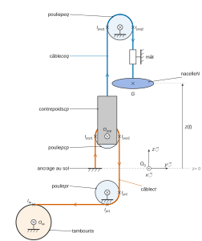
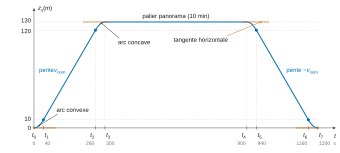
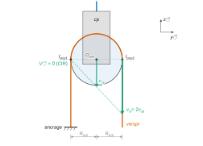
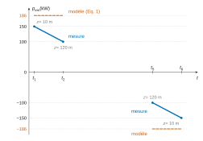

# Centrale-Supélec MP — Sciences industrielles 2026 · Corrigé guidé

*Corrigé rédigé par IA, non officiel. Signalez toute erreur.*

## Présentation du sujet

**Support.** La tour British Airways i360 de Brighton : une nacelle torique de 200 passagers monte à 130 m le long d'un mât de 160 m. Un seul actionneur, suivi d'un réducteur de rapport 1/153, enroule un câble tracteur sur un tambour. Ce câble n'agit pas directement sur la nacelle : il passe sous une poulie mobile portée par un contrepoids de 72 t, relié à la nacelle par un câble d'équilibrage qui passe sur une poulie fixe en tête de mât. Durée : 4 heures, calculatrice autorisée.

**Découpage.**

- **Partie A (Q1-Q2)** : profil trapézoïdal de vitesse, tracé de la position, durée de montée et vérification du confort. Questions courtes, à ne pas manquer.
- **Partie B (Q3-Q10)** : cinématique des câbles et des poulies (non-glissement, centre instantané de rotation d'une poulie mobile, conservation de la vitesse de défilement) jusqu'à la loi $v=k_{cin}\,\omega_m$, puis vérification de la vitesse nominale.
- **Partie C (Q11-Q21)** : énergies cinétiques, inertie équivalente, puissances, théorème de l'énergie cinétique, équation de mouvement. Le modèle est ensuite confronté à une mesure de puissance, qui l'invalide. Le modèle enrichi est instable.
- **Partie D (Q22-Q30)** : boucle de stabilisation (identification à un second ordre), effet d'une perturbation, correcteur PI par compensation du pôle dominant, marges, rejet de perturbation, lecture de simulations.
- **Partie E (Q31-Q33)** : bilans d'énergie avec un préactionneur dont le rendement dépend du sens de transfert, puis une question ouverte sur une modification du quai d'embarquement.

**Notions mobilisées.** Torseur cinématique et changement de point, roulement sans glissement, centre instantané de rotation, énergie cinétique et inertie équivalente, puissance des actions extérieures et intérieures, théorème de l'énergie cinétique, transformée de Laplace, pôles et stabilité, identification à un second ordre, théorème de la valeur finale, diagrammes de Bode, marges de stabilité, correcteur PI, bilans énergétiques avec rendements.

**Difficulté et gestion du temps.** Le sujet est long mais très guidé. L'énoncé redonne en tête de chaque partie les résultats dont elle a besoin (relations cinématiques, valeurs de $J_0$, $k_{cin}$, $k_{crz}$, forme factorisée de $H_{stab}$) : aucune partie n'est bloquée par la précédente. Les questions abordables à ne pas laisser passer sont Q1, Q2, Q3, Q5, Q9-Q15, Q19, Q21, Q26 et Q32. Les questions qui demandent du recul sont Q20 (invalidation par la mesure), Q25 et Q28 (valeur finale en vitesse et en position), Q31 et Q33. Une répartition raisonnable : 20 min pour A, 50 min pour B, 70 min pour C, 60 min pour D, 40 min pour E.

## Partie A — Étude du mouvement souhaité de la nacelle

On décrit le cycle voulu : montée en trois phases (accélération, vitesse constante, décélération), panorama de 10 minutes, descente symétrique. Les outils sont l'intégration d'un profil de vitesse et une aire de trapèze.

### Question 1

> [!INDICATION]
> La position est une primitive de la vitesse. Quelle est la forme de la primitive d'une fonction affine ? d'une constante ?

> [!INDICATION]
> La vitesse est continue : que peut-on dire des raccords entre les arcs ? Où les tangentes sont-elles horizontales ?

#### Solution

La position $z_s$ est une primitive de la vitesse $v_s$. Celle-ci est continue, donc $z_s$ est de classe $C^1$ : les raccords se font sans point anguleux.

- Sur $[t_0,t_1]$, $a_s=a_1>0$ et $z_s(t)=\tfrac12a_1t^2$ : arc de parabole convexe, de tangente horizontale à l'origine.
- Sur $[t_1,t_2]$, $v_s=v_{nom}$ : segment de pente $v_{nom}$.
- Sur $[t_2,t_3]$, $a_s=-a_1$ : arc concave, de tangente horizontale en $t_3$.
- Sur $[t_3,t_4]$ : palier à 130 m pendant 10 minutes.
- Descente symétrique :
  - arc concave sur $[t_4,t_5]$, de tangente horizontale en $t_4$ ;
  - segment de pente $-v_{nom}$ sur $[t_5,t_6]$ ;
  - arc convexe sur $[t_6,t_7]$, de tangente horizontale en $t_7$.

Points caractéristiques, avec les valeurs obtenues en Q2 :

| Instant | $t$ (s) | $z_s$ (m) |
|---|---|---|
| $t_0$ | 0 | 0 |
| $t_1$ | 40 | 10 |
| $t_2$ | 260 | 120 |
| $t_3$ | 300 | 130 |
| $t_4$ | 900 | 130 |
| $t_5$ | 940 | 120 |
| $t_6$ | 1160 | 10 |
| $t_7$ | 1200 | 0 |

$$\boxed{\begin{aligned}
z_s(t_3)&=130\ \text{m}\\
z_s(t_7)&=0\ \text{m}
\end{aligned}}$$

> [!PIEGE]
> Trois fautes visibles immédiatement sur un tracé : oublier le palier de 10 minutes, qui occupe la moitié du cycle ; se tromper de concavité (sur $[t_2,t_3]$, l'accélération est négative, donc la courbe est concave) ; dessiner un point anguleux en $t_1$ ou en $t_2$, ce qui supposerait une accélération infinie.

### Question 2

> [!INDICATION]
> La distance parcourue est l'aire sous la courbe de vitesse. Quelle figure géométrique la courbe de vitesse délimite-t-elle sur $[t_0,t_3]$ ?

> [!INDICATION]
> L'exigence de confort porte sur l'accélération : exprimez $a_1$ à partir de $v_{nom}$ et de la durée de la phase d'accélération.

#### Solution

Sur la phase de montée, la vitesse délimite un trapèze de hauteur $v_{nom}$, de grande base $t_3-t_0=t_3$ et de petite base $t_2-t_1$ :

$$\begin{aligned}
z_s(t_3)&=\frac{v_{nom}}{2}\big[t_3+(t_2-t_1)\big]\\
&=v_{nom}\Big[t_3-\frac{t_1}{2}-\frac{t_3-t_2}{2}\Big].
\end{aligned}$$

Avec $t_1=t_3-t_2=40$ s et $v_{nom}=0{,}5$ m·s⁻¹ : $130=0{,}5\,(t_3-40)$, donc

$$\boxed{t_3=300\ \text{s}=5\ \text{min}\leqslant6\ \text{min}}$$

On en déduit $t_2=260$ s, $z_s(t_1)=\tfrac12v_{nom}t_1=10$ m et $z_s(t_2)=120$ m.

Confort : l'accélération ne prend que les valeurs $0$ et $\pm a_1$, avec $a_1=v_{nom}/t_1=v_{nom}/(t_3-t_2)$ :

$$\boxed{|a_s|_{max}=1{,}25\times10^{-2}\ \text{m·s}^{-2}\leqslant a_{max}=1{,}5\times10^{-2}\ \text{m·s}^{-2}}$$

**L'exigence de confort est respectée**, avec une marge de 17 %. La sécurité l'est aussi : $v_{nom}=0{,}5\leqslant0{,}6$ m·s⁻¹.

> [!PIEGE]
> Prendre le trapèze pour un rectangle ($z_s=v_{nom}t_3$) donne $t_3=260$ s : on oublie les deux demi-triangles d'accélération et de décélération, qui représentent 20 m.

## Partie B — Modélisation du mécanisme de transmission du mouvement

On établit la loi $v=k_{cin}\,\omega_m$ en suivant le câble tracteur du tambour jusqu'à la poulie mobile, puis le câble d'équilibrage jusqu'à la nacelle. Il faut savoir écrire un non-glissement, un changement de point et exploiter un centre instantané de rotation.

Le trajet des câbles et les points de contact sont ceux de la figure 1 : $ct$ va de l'ancrage au tambour par le dessus de $pcp$ et le dessous de $pr$, $ceq$ va du contrepoids à la nacelle par le dessus de $peq$.

### Question 3

> [!INDICATION]
> Le non-glissement en $I_{ta}$ permet de remplacer le point du câble par le point coïncident du tambour.

> [!INDICATION]
> Le tambour tourne autour d'un axe fixe : appliquez la formule de changement de point depuis $O_{ta}$, en repérant la position de $I_{ta}$ sur la figure.

#### Solution

Le tambour est en pivot d'axe fixe $(O_{ta},\vec x)$, donc $\vec V_{O_{ta},ta/0}=\vec 0$. Le brin horizontal part du sommet du tambour : $\overrightarrow{O_{ta}I_{ta}}=R_{ta}\vec z$. Alors

$$\begin{aligned}
\vec V_{I_{ta},ta/0}&=\omega_{ta}\vec x\wedge R_{ta}\vec z\\
&=-R_{ta}\,\omega_{ta}\,\vec y .
\end{aligned}$$

Le non-glissement s'écrit $\vec V_{I_{ta},ct/ta}=\vec 0$, et le réducteur impose $\omega_{ta}=k_{red}\,\omega_m$ :

$$\boxed{\vec V_{I_{ta},ct/0}=-R_{ta}\,k_{red}\,\omega_m(t)\,\vec y}$$

Pour $\omega_m>0$, le tambour enroule le câble, dont le brin horizontal se déplace vers le tambour, dans le sens $-\vec y$.

> [!METHODE]
> Non-glissement en $I$ entre deux solides 1 et 2 : $\vec V_{I,1/2}=\vec 0$, donc $\vec V_{I,1/0}=\vec V_{I,2/0}$. On calcule ensuite la vitesse sur le solide dont le mouvement est le plus simple, ici le tambour.

### Question 4

> [!INDICATION]
> Pourquoi la « vitesse de défilement » d'un câble est-elle la même en tout point ? Quelles propriétés du câble et du contact avec la poulie de renvoi faut-il invoquer ?

> [!INDICATION]
> Les deux vecteurs n'ont pas la même direction : seules leurs composantes selon la tangente orientée au câble peuvent être égales. Orientez le câble pour obtenir les signes.

#### Solution

Trois hypothèses de l'énoncé interviennent :

- le câble est **inextensible et constamment tendu** : la composante de la vitesse de ses points selon la tangente orientée est la même tout le long du câble ;
- il n'y a **pas de glissement entre le câble et la poulie de renvoi** : la poulie ne fait que changer la direction du câble ;
- le **diamètre du câble est négligeable** devant celui des poulies : les points de tangence $I_{pr1}$ et $I_{pr2}$ sont sur le cercle de rayon $R_{pr}$.

Orientons le câble de l'ancrage vers le tambour. Sa tangente vaut $-\vec z$ en $I_{pcp2}$, où le câble descend vers $pr$. Elle vaut $-\vec y$ en $I_{ta}$, où il va vers le tambour, situé à gauche. L'égalité des composantes tangentielles s'écrit

$$\vec V_{I_{ta},ct/0}\cdot(-\vec y)=\vec V_{I_{pcp2},ct/0}\cdot(-\vec z),$$

soit

$$\boxed{\vec V_{I_{ta},ct/0}\cdot\vec y=\vec V_{I_{pcp2},ct/0}\cdot\vec z}$$

> [!PIEGE]
> « Le câble est inextensible » ne suffit pas : un câble mou peut se raccourcir géométriquement sans que ses points matériels avancent. Écrire l'égalité des vecteurs vitesse serait faux, puisqu'ils ne sont pas colinéaires.

### Question 5

> [!INDICATION]
> Même démarche qu'en Q3, au point $I_{pcp2}$, puis utilisez Q4.

#### Solution

Le non-glissement du câble tracteur sur $pcp$ en $I_{pcp2}$ donne $\vec V_{I_{pcp2},pcp/0}=\vec V_{I_{pcp2},ct/0}$. Ce vecteur est porté par $\vec z$, puisque le brin est vertical, et Q4 donne sa composante, $\vec V_{I_{ta},ct/0}\cdot\vec y=-R_{ta}k_{red}\,\omega_m$ :

$$\boxed{\vec V_{I_{pcp2},pcp/0}=-R_{ta}\,k_{red}\,\omega_m(t)\,\vec z}$$

On retrouve $v_{ct}=-R_{ta}k_{red}\,\omega_m=-\omega_m/102$, cohérent avec $v_{ct}=-2v$ et $v=\omega_m/204$, donnés en partie C.

> [!METHODE]
> Les relations données en tête de la partie C permettent de contrôler gratuitement les résultats de la partie B.

### Question 6

> [!INDICATION]
> Il faut deux maillons : l'un relie $pcp$ à $cp$, l'autre relie $cp$ à $ceq$.

> [!INDICATION]
> Que vaut la vitesse d'un point situé sur l'axe d'une liaison pivot, dans le mouvement relatif des deux solides ?

#### Solution

Le point $O_{pcp}$ est sur l'axe de la liaison pivot $pcp/cp$ : $\vec V_{O_{pcp},pcp/cp}=\vec 0$. Donc $\vec V_{O_{pcp},pcp/0}=\vec V_{O_{pcp},cp/0}$.

Le contrepoids est en translation verticale. Le câble $ceq$ est fixé au contrepoids et son brin inférieur, rectiligne, inextensible et tendu, se déplace avec lui : $\vec V_{O_{pcp},ceq/0}=\vec V_{O_{pcp},cp/0}$. Finalement

$$\boxed{\vec V_{O_{pcp},pcp/0}=\vec V_{O_{pcp},ceq/0}=v_{cp}(t)\,\vec z}$$

### Question 7

> [!INDICATION]
> L'énoncé donne $\vec V_{I_{pcp1},pcp/0}=\vec 0$. Quel rôle joue alors $I_{pcp1}$ pour le mouvement plan de $pcp$ ?

> [!INDICATION]
> Écrivez la vitesse de $O_{pcp}$, puis celle de $I_{pcp2}$, à partir du point de vitesse nulle. Éliminez ensuite $\omega_{pcp}$. Où se trouve le centre de la poulie par rapport aux deux points de tangence ?

#### Solution

Les deux brins sont verticaux, donc $I_{pcp1}$ et $I_{pcp2}$ sont diamétralement opposés sur l'horizontale :

$$\begin{aligned}
\overrightarrow{I_{pcp1}O_{pcp}}&=R_{pcp}\vec y\\
\overrightarrow{I_{pcp1}I_{pcp2}}&=2R_{pcp}\vec y
\end{aligned}$$

Avec $\vec\Omega_{pcp/0}=\omega_{pcp}\vec x$ et $\vec V_{I_{pcp1},pcp/0}=\vec 0$ :

$$\begin{aligned}
\vec V_{O_{pcp},pcp/0}&=R_{pcp}\,\omega_{pcp}\,\vec z\\
\vec V_{I_{pcp2},pcp/0}&=2R_{pcp}\,\omega_{pcp}\,\vec z .
\end{aligned}$$

D'où, avec Q6, $\vec V_{O_{pcp},ceq/0}=\tfrac12\,\vec V_{I_{pcp2},pcp/0}$, puis avec Q5 :

$$\boxed{\vec V_{O_{pcp},ceq/0}=-\tfrac12\,R_{ta}\,k_{red}\,\omega_m(t)\,\vec z}$$

> [!METHODE]
> Poulie mobile dont un brin est fixe : le point de tangence du brin fixe est le centre instantané de rotation. Le centre de la poulie va deux fois moins vite que le brin mobile (mouflage), et le rayon de la poulie disparaît du résultat.

> [!PIEGE]
> Écrire $\vec V_{O_{pcp}}=\vec V_{I_{pcp2}}$, c'est perdre le facteur 2. Si $R_{pcp}$ reste dans le résultat final, une des deux relations n'a pas été utilisée.

### Question 8

> [!INDICATION]
> Le raisonnement est celui de Q4, appliqué au câble d'équilibrage et à la poulie fixe $peq$.

> [!INDICATION]
> Orientez le câble du contrepoids vers la nacelle : que deviennent les tangentes orientées de part et d'autre de la poulie ?

#### Solution

*Démarche.* Le câble $ceq$ est inextensible, constamment tendu, et il ne glisse pas sur $peq$, dont l'axe est fixe. La composante de la vitesse selon la tangente orientée est donc la même en tout point du câble. Ses deux extrémités sont fixées respectivement au contrepoids et à la nacelle.

Orienté du contrepoids vers la nacelle, le câble a pour tangente $+\vec z$ du côté du contrepoids, où il monte vers $I_{peq1}$. Il a pour tangente $-\vec z$ du côté de la nacelle, où il redescend depuis $I_{peq2}$ :

$$\vec V_{O_{pcp},ceq/0}\cdot\vec z=\vec V_{G,N/0}\cdot(-\vec z),$$

d'où

$$\boxed{\vec V_{G,N/0}=-\vec V_{O_{pcp},ceq/0}}$$

Le contrepoids descend à la vitesse à laquelle la nacelle monte : $v_{cp}=-v$.

> [!PIEGE]
> Le signe « moins » est essentiel. Avec $v_{cp}=+v$, le contrepoids s'opposerait au mouvement au lieu de le faciliter, et $C_0$ ferait intervenir $M_{Np}+M_{cp}$.

### Question 9

> [!INDICATION]
> Il suffit d'enchaîner Q8 et Q7, puis de comparer à la valeur donnée en partie C.

#### Solution

Par Q8 et Q7 : $v(t)\,\vec z=\tfrac12R_{ta}k_{red}\,\omega_m(t)\,\vec z$. La loi est bien de la forme $v=k_{cin}\,\omega_m$ avec

$$\boxed{k_{cin}=\frac{k_{red}\,R_{ta}}{2}}$$

Numériquement :

$$\begin{aligned}
k_{cin}&=\frac{1{,}5}{2\times153}\\
&=\frac1{204}\approx4{,}90\times10^{-3}\ \text{m·rad}^{-1}.
\end{aligned}$$

C'est la valeur adoptée en partie C.

> [!PIEGE]
> Pour un treuil simple, on aurait $k_{cin}=k_{red}R_{ta}$. Ici, le mouflage divise encore par deux.

### Question 10

> [!INDICATION]
> Convertissez la vitesse de rotation en unités du système international, puis appliquez Q9.

#### Solution

$$\begin{aligned}
\omega_{m,nom}&=980\times\frac{2\pi}{60}\\
&=102{,}6\ \text{rad·s}^{-1}\\
k_{cin}\,\omega_{m,nom}&=\frac{102{,}6}{204}\\
&=0{,}503\ \text{m·s}^{-1}
\end{aligned}$$

$$\boxed{k_{cin}\,\omega_{m,nom}=0{,}503\ \text{m·s}^{-1}\geqslant v_{nom}=0{,}5\ \text{m·s}^{-1}}$$

**L'actionneur permet d'atteindre la vitesse nominale**, mais la marge n'est que de 0,6 % : $v_{nom}$ demande $\omega_m=102$ rad·s⁻¹, soit $974$ tr·min⁻¹. Le dimensionnement en vitesse est au plus juste.

> [!PIEGE]
> L'oubli du facteur $2\pi$ dans la conversion des tr·min⁻¹ en rad·s⁻¹ est l'erreur classique. Autre écueil : la vitesse nominale n'est pas la vitesse maximale du moteur, et ce calcul ne dit rien de la vitesse limite de 0,6 m·s⁻¹.

## Partie C — Modélisation de la dynamique de la nacelle

On isole l'ensemble $\Sigma$ de tous les solides mobiles et on applique le théorème de l'énergie cinétique, en ramenant tout à l'axe de l'actionneur. Le modèle est ensuite confronté à une mesure, puis enrichi.

### Question 11

> [!INDICATION]
> Identifiez la nature du mouvement de chaque sous-ensemble (translation ou rotation autour d'un axe fixe) avant d'écrire la formule.

#### Solution

$N_p$ est en translation rectiligne à la vitesse $v\vec z$. L'ensemble rotor et réducteur, d'inertie $J_{mr}$ déjà rapportée à l'axe de l'actionneur, tourne à $\omega_m$. Le tambour tourne autour de l'axe fixe $(O_{ta},\vec x)$.

$$\boxed{\begin{aligned}
E_{c,Np/0}&=\tfrac12M_{Np}\,v^2\\
E_{c,mr/0}&=\tfrac12J_{mr}\,\omega_m^2\\
E_{c,ta/0}&=\tfrac12J_{ta}\,\omega_{ta}^2
\end{aligned}}$$

### Question 12

> [!INDICATION]
> Faites l'inventaire complet des solides de $\Sigma$ et statuez sur chacun, y compris ceux dont l'énergie est nulle, en le justifiant à partir du Tableau 3.

#### Solution

- Le contrepoids, en translation à $v_{cp}\vec z$ : $\boxed{E_{c,cp/0}=\tfrac12M_{cp}\,v_{cp}^2}$.
- La poulie $peq$, en rotation autour d'un axe fixe : $\boxed{E_{c,peq/0}=\tfrac12J_{peq}\,\omega_{peq}^2}$.
- Les poulies $pr$ et $pcp$ et les câbles $ct$ et $ceq$ : poids et inertie négligés, donc énergie cinétique nulle.

> [!PIEGE]
> Oublier le contrepoids fausse l'inertie équivalente d'environ 10 %. Une énergie nulle qui n'est pas justifiée ressemble à un oubli.

### Question 13

> [!INDICATION]
> Sommez les cinq contributions, puis exprimez toutes les vitesses en fonction de $\omega_m$ à l'aide des relations cinématiques de la partie C.

> [!INDICATION]
> Les rapports de transmission interviennent au carré, et le signe de $v_{cp}$ disparaît.

#### Solution

Avec les relations cinématiques de la partie C :

$$\begin{aligned}
v&=k_{cin}\,\omega_m\\
v_{cp}&=-v\\
\omega_{ta}&=k_{red}\,\omega_m\\
\omega_{peq}&=v/R_{peq}=(k_{cin}/R_{peq})\,\omega_m
\end{aligned}$$

on obtient

$$E_{c,\Sigma/0}=\tfrac12\Big[J_{mr}+J_{ta}k_{red}^2+\Big(M_{Np}+M_{cp}+\frac{J_{peq}}{R_{peq}^2}\Big)k_{cin}^2\Big]\omega_m^2,$$

$$\boxed{J_{eq\Sigma}=J_{mr}+J_{ta}\,k_{red}^2+\Big(M_{Np}+M_{cp}+\frac{J_{peq}}{R_{peq}^2}\Big)k_{cin}^2}$$

Contrôle numérique, en kg·m² :

$$\begin{aligned}
J_{mr}&=11\\
J_{ta}\,k_{red}^2&=\frac{24\,120}{153^2}=1{,}03\\
(M_{Np}+M_{cp})\,k_{cin}^2&=\frac{182\,000}{204^2}=4{,}37
\end{aligned}$$

La somme vaut $16{,}40$ kg·m². La valeur annoncée de 16,8 kg·m² correspond à un terme de poulie de 0,40 kg·m², c'est-à-dire $R_{peq}\approx1{,}1$ m, valeur plausible.

> [!METHODE]
> Inertie équivalente ramenée à un arbre : chaque masse en translation compte pour $M\,(v/\omega_m)^2$, chaque solide en rotation pour $J\,(\omega/\omega_m)^2$. Le contrôle d'homogénéité est immédiat : $k_{cin}$ est en m·rad⁻¹.

### Question 14

> [!INDICATION]
> Quel terme de $J_{eq\Sigma}$ dépend du nombre de passagers ? Calculez directement sa variation.

#### Solution

Seul $M_{Np}$ dépend de $n$. Pour $n=0$, on retire $m_p=80\times200=16\,000$ kg :

$$\begin{aligned}
|\Delta J_{eq\Sigma}|&=m_p\,k_{cin}^2\\
&=\frac{16\,000}{204^2}\\
&=0{,}384\ \text{kg·m}^2
\end{aligned}$$

$$\boxed{\frac{|\Delta J_{eq\Sigma}|}{J_{eq\Sigma}}\approx2{,}3\ \%}$$

**La variation est négligeable** : on pourra prendre une inertie constante, ce que fait la partie D avec $J_0=16{,}8$ kg·m².

> [!PIEGE]
> Les passagers changent peu l'inertie, mais ils changent beaucoup les efforts : ne pas en conclure que leur masse est sans effet (voir Q25 et Q32).

### Question 15

> [!INDICATION]
> La puissance d'un glisseur appliqué au centre de gravité est le produit scalaire de sa résultante par la vitesse de ce point.

#### Solution

$$\boxed{\begin{aligned}
P_{pes\to Np/0}&=-M_{Np}\,g\,v(t)\\
P_{pes\to cp/0}&=-M_{cp}\,g\,v_{cp}(t)\\
&=+M_{cp}\,g\,v(t)
\end{aligned}}$$

À la montée, la pesanteur est résistante pour la nacelle et motrice pour le contrepoids, qui descend. La somme vaut $-(M_{Np}-M_{cp})\,g\,v$ : il ne reste que la différence des masses à soulever, ce qui est tout l'intérêt du contrepoids.

### Question 16

> [!INDICATION]
> Tracez la frontière de $\Sigma$ et recensez tout ce qui la traverse : actions à distance sur les solides restants, actions de contact avec le bâti et avec le stator.

> [!INDICATION]
> Pour une liaison parfaite avec un bâti immobile, combinez « puissance des inter-efforts nulle » et « puissance de $\Sigma$ sur le bâti nulle ».

#### Solution

Actions extérieures autres que celles de Q15 :

- **pesanteur** sur le rotor, le tambour et $peq$ : leurs centres de gravité sont sur des axes fixes, donc la puissance est nulle. Pesanteur sur $pr$, $pcp$ et les câbles : poids négligés, donc puissance nulle ;
- **stator sur rotor**, torseur couple $c_{em}\,\vec x$ : $\boxed{P_{stator\to mr/0}=c_{em}(t)\,\omega_m(t)}$ ;
- **liaisons avec le bâti** (pivots $ta/0$, $pr/0$, $peq/0$, paliers du rotor et carter du réducteur, guidages de la nacelle et du contrepoids dans le mât) : elles sont parfaites, donc la puissance des inter-efforts est nulle, et le bâti est immobile, donc la puissance de l'action du bâti sur $\Sigma$ est nulle ;
- **ancrage du câble tracteur au sol** : le point d'application est fixe, donc la puissance est nulle ;
- **actions aérodynamiques et vent** : négligés.

Au total : $P_{ext\to\Sigma/0}=c_{em}\,\omega_m-(M_{Np}-M_{cp})\,g\,v$.

> [!PIEGE]
> Le couple moteur est la seule puissance motrice : l'oublier rend l'équation de mouvement impossible. « La liaison est parfaite, donc sa puissance est nulle » est incomplet : c'est la puissance des inter-efforts qui est nulle, et l'immobilité du bâti permet de conclure.

### Question 17

> [!INDICATION]
> Classez les efforts intérieurs en familles : liaisons entre solides de $\Sigma$, contacts câble-poulie, déformation des constituants. Quelle hypothèse annule chaque famille ?

#### Solution

- Les **liaisons intérieures** à $\Sigma$ (pivot $pcp/cp$, engrènements du réducteur, accouplement rotor-réducteur) sont **parfaites**.
- Les **contacts câble-tambour et câble-poulies** sont **sans glissement** : la vitesse de glissement est nulle, donc la puissance est nulle.
- Les câbles sont **inextensibles** et les solides **indéformables** : aucune énergie n'est stockée ni dissipée par déformation.

$$\boxed{P_{int,\Sigma}=0}$$

> [!PIEGE]
> Les liaisons avec le sol ($ta/0$ par exemple) ne sont pas intérieures à $\Sigma$ : elles relèvent de Q16.

### Question 18

> [!INDICATION]
> Écrivez le théorème de l'énergie cinétique pour $\Sigma$ dans $R_0$, avec $E_c$ de Q13 et les puissances de Q15-Q17.

> [!INDICATION]
> Pour faire apparaître un couple, exprimez $v$ en fonction de $\omega_m$. Attention à la simplification par $\omega_m$.

#### Solution

$R_0$ est galiléen et $J_{eq\Sigma}$ est constant (Q14) :

$$\begin{aligned}
\frac{\mathrm dE_{c,\Sigma/0}}{\mathrm dt}&=J_{eq\Sigma}\,\omega_m\,\frac{\mathrm d\omega_m}{\mathrm dt}\\
&=P_{ext\to\Sigma/0}+P_{int,\Sigma}\\
&=\big[c_{em}-(M_{Np}-M_{cp})\,g\,k_{cin}\big]\,\omega_m .
\end{aligned}$$

On simplifie par $\omega_m$ sur les intervalles où $\omega_m\neq0$, puis l'égalité, qui porte sur des fonctions continues, s'étend par continuité aux instants isolés où $\omega_m$ s'annule :

$$\boxed{\begin{aligned}
J_{eq\Sigma}\,\frac{\mathrm d\omega_m}{\mathrm dt}&=c_{em}(t)-C_0\\
C_0&=(M_{Np}-M_{cp})\,g\,k_{cin}
\end{aligned}}$$

Numériquement, $C_0=\dfrac{38\,000\times9{,}81}{204}\approx1{,}83\times10^3$ N·m.

> [!JURY]
> Dans une question « montrer que », le correcteur attend chaque étape : référentiel galiléen, constance de l'inertie, puissances intérieures nulles, justification de la simplification par $\omega_m$.

### Question 19

> [!INDICATION]
> À vitesse constante, que vaut le premier membre de Eq. 1 ?

#### Solution

$\dot\omega_m=0$, donc $c_{em}=C_0$, et $\omega_m=v_{nom}/k_{cin}$ :

$$\boxed{\begin{aligned}
p_{em}&=\frac{C_0\,v_{nom}}{k_{cin}}\\
&=(M_{Np}-M_{cp})\,g\,v_{nom}\\
&\approx186\ \text{kW},\ \text{constante}
\end{aligned}}$$

C'est la puissance nécessaire pour élever la masse apparente de 38 t à 0,5 m·s⁻¹. À la descente, le modèle prévoit $p_{em}\approx-186$ kW : l'actionneur fonctionne en générateur.

> [!METHODE]
> Le calcul direct $(M_{Np}-M_{cp})\,g\,v_{nom}$ contrôle immédiatement $k_{cin}$ et $C_0$.

### Question 20

> [!INDICATION]
> Comparez deux choses : le niveau de puissance et l'allure (constante ou non) pendant les phases à vitesse constante.

> [!INDICATION]
> À $\omega_m$ constante, une variation de $p_{em}$ est une variation de couple. Quelle grandeur évolue pendant la phase ? Quelle ligne du Tableau 3 peut créer un effet qui en dépend ?

#### Solution

*Comparaison.*

| Phase à vitesse constante | Modèle | Mesure (figure 6) |
|---|---|---|
| montée, de $t_1$ à $t_2$ | $+186$ kW constants | décroît linéairement de 150 à 100 kW |
| descente, de $t_5$ à $t_6$ | $-186$ kW constants | va de $-100$ à $-150$ kW |

Le niveau diffère de 20 à 46 %, et surtout la puissance mesurée n'est pas constante. **Le modèle n'est pas validé.**

*Diagnostic.* La vitesse est constante, donc c'est le couple qui varie. À la montée, $z$ croît de 10 à 120 m et le couple diminue. À la descente, $z$ décroît et $|c_{em}|$ augmente. Le couple résistant décroît quand l'altitude augmente.

Pente mesurée, puis ramenée à l'axe moteur :

$$\begin{aligned}
\frac{\Delta p_{em}}{\Delta z}&=\frac{(100-150)\times10^3}{110}\approx-455\ \text{W·m}^{-1}\\
\frac{455}{102}&\approx4{,}5\ \text{N·m par mètre}
\end{aligned}$$

C'est exactement la valeur de $k_{crz}$ donnée plus loin. Le frottement n'expliquerait pas ce résultat : il donnerait un couple constant à vitesse constante, et dissymétrique entre montée et descente.

**Hypothèse à remettre en cause : le poids des câbles tracteur et d'équilibrage.** Les longueurs de câble suspendues de part et d'autre des poulies varient avec $z$, ce qui crée un couple fonction de l'altitude, le terme $k_{crz}\,z$ de Eq. 2.

> [!PIEGE]
> La question contient trois consignes : comparer, conclure sur la validité, désigner l'hypothèse. Dire « le modèle ne colle pas » n'en traite qu'une.

### Question 21

> [!INDICATION]
> Éliminez $Z(p)$ au profit de $\Omega_m(p)$. Utilisez pour cela $z=k_{cin}\theta_m$ et $\Theta_m=\Omega_m/p$.

> [!INDICATION]
> La stabilité se lit sur le signe de la partie réelle des pôles.

#### Solution

Les conditions de Heaviside étant vérifiées :

$$\begin{aligned}
J_0\,p\,\Omega_m&=\Delta C_{em}-C_R+k_{crz}\,\frac{k_{cin}}{p}\,\Omega_m\\
\big(J_0p^2-k_{crz}k_{cin}\big)\,\Omega_m&=p\,(\Delta C_{em}-C_R),
\end{aligned}$$

$$\boxed{H_1(p)=\frac{p}{J_0\,p^2-k_{crz}\,k_{cin}}}$$

Les pôles valent $\pm\sqrt{k_{crz}k_{cin}/J_0}=\pm3{,}6\times10^{-2}$ rad·s⁻¹. **Le pôle réel positif rend le système instable** : la réponse libre contient un terme en $e^{t/27{,}6\ \text{s}}$, qui diverge. Physiquement, si la nacelle monte, le couple résistant diminue, elle accélère et monte encore plus.

> [!PIEGE]
> Si l'on oublie $Z(p)=k_{cin}\Omega_m/p$, on obtient $H_1=1/(J_0p)$ et l'instabilité disparaît. Le $p$ du numérateur est un zéro, pas un pôle.

## Partie D — Synthèse d'une loi de commande de l'actionneur

Une première boucle (retour en vitesse avec action intégrale) stabilise le système et lui impose un comportement de second ordre. Une seconde boucle, avec un correcteur PI, assure le suivi de la consigne de vitesse et le rejet des perturbations.

### Question 22

> [!INDICATION]
> L'intégrale de 0 à $t$ devient une division par $p$. Injectez $\Delta C_{em}(p)$ dans Eq. 2 transformée (Q21), avec $C_R=0$.

#### Solution

$$\Delta C_{em}=-K_1\,\Omega_m-\frac{K_2}{p}\big(\Omega_m-K_3\,\Omega_{mc}\big).$$

On reporte dans $J_0p\,\Omega_m=\Delta C_{em}+\dfrac{k_{crz}k_{cin}}{p}\,\Omega_m$ et on multiplie par $p$ :

$$\big(J_0p^2+K_1p+K_2-k_{crz}k_{cin}\big)\,\Omega_m=K_2K_3\,\Omega_{mc},$$

d'où

$$\boxed{H_{stab}(p)=\frac{K_2K_3}{J_0\,p^2+K_1\,p+K_2-k_{crz}\,k_{cin}}}$$

Le coefficient constant du dénominateur, négatif sans commande, devient $K_2-k_{crz}k_{cin}$, qu'il suffit de rendre positif.

### Question 23

> [!INDICATION]
> Mettez $H_{stab}$ sous forme canonique en divisant par le terme constant du dénominateur, puis identifiez trois coefficients : gain statique, terme en $p$, terme en $p^2$.

#### Solution

L'identification porte sur trois coefficients, le premier traduisant un gain statique unitaire :

$$\begin{aligned}
K_2K_3&=K_2-k_{crz}k_{cin}\\
K_2-k_{crz}k_{cin}&=J_0\,\omega_{0s}^2\\
\frac{K_1}{K_2-k_{crz}k_{cin}}&=\frac{2\xi_s}{\omega_{0s}}
\end{aligned}$$

Elle donne

$$\boxed{\begin{aligned}
K_1&=2\,\xi_s\,\omega_{0s}\,J_0\\
K_2&=J_0\,\omega_{0s}^2+k_{crz}\,k_{cin}\\
K_3&=\frac{J_0\,\omega_{0s}^2}{J_0\,\omega_{0s}^2+k_{crz}\,k_{cin}}
\end{aligned}}$$

Le coefficient $K_3$ compense exactement le biais introduit par $k_{crz}k_{cin}$. Ainsi $\omega_m$ tend vers $\omega_{mc}$.

> [!PIEGE]
> Oublier la condition de gain statique laisse $K_3$ indéterminé. Oublier $J_0$ dans $K_1$ est détecté par l'homogénéité : $K_1$ est en N·m·s·rad⁻¹.

### Question 24

> [!INDICATION]
> Les deux critères n'ont pas le même statut : l'un est une égalité, l'autre une inégalité.

#### Solution

$\omega_{0s}=3$ rad·s⁻¹ **fixe** $K_2$ :

$$\begin{aligned}
K_2&=16{,}8\times9+\frac{4{,}5}{204}\\
&=151{,}2+0{,}022
\end{aligned}$$

$$\boxed{K_2\approx151{,}2\ \text{N·m·rad}^{-1}}$$

$\xi_s\geqslant1$ **minore** $K_1$ :

$$\boxed{K_1=100{,}8\,\xi_s\geqslant100{,}8\ \text{N·m·s·rad}^{-1}}$$

On a aussi $K_3\approx0{,}99985$. Le terme $k_{crz}k_{cin}$ est numériquement négligeable, mais c'est lui qui portait l'instabilité. Contrôle : la forme factorisée donnée ensuite se développe en $1+1{,}33p+0{,}1116p^2$. Elle correspond à $\omega_{0s}\approx2{,}99$ rad·s⁻¹ et $\xi_s\approx2$, donc à $K_1\approx200$ N·m·s·rad⁻¹, valeur conforme à la condition.

### Question 25

> [!INDICATION]
> Appliquez le théorème de la valeur finale à $\omega_m$, puis à $\theta_m$, dont la transformée est $\Omega_m/p$.

> [!INDICATION]
> Vérifiez d'abord que le théorème est applicable. Dites ensuite de quoi dépend $C_{R0}$.

#### Solution

Pour $C_R(p)=C_{R0}(n)/p$ :

$$\Omega_m(p)=G_s(p)\,C_R(p)=-\frac{H_{stab}(p)\,C_{R0}(n)}{J_0\,\omega_{0s}^2}.$$

$H_{stab}$ a ses pôles à partie réelle strictement négative, donc le théorème de la valeur finale s'applique à $\Omega_m$ et à $\Theta_m=\Omega_m/p$ :

$$\begin{aligned}
\omega_m(\infty)&=\lim_{p\to0}p\,\Omega_m(p)=0\\
\theta_m(\infty)&=\lim_{p\to0}\Omega_m(p)
\end{aligned}$$

d'où

$$\boxed{\begin{aligned}
\theta_m(\infty)&=-\frac{C_{R0}(n)}{J_0\,\omega_{0s}^2}\\
z(\infty)&=-\frac{k_{cin}\,C_{R0}(n)}{J_0\,\omega_{0s}^2}
\end{aligned}}$$

La vitesse n'est pas affectée en régime permanent, mais la position l'est : comme $C_{R0}$ dépend de $n$, **la masse des passagers décale la position du moteur, donc l'altitude de la nacelle**. Ordre de grandeur, en assimilant $C_{R0}(200)$ au poids des passagers ramené à l'axe moteur ($\approx769$ N·m) : $|\Delta z|\approx25$ mm, soit cinq fois la tolérance de 5 mm.

> [!PIEGE]
> S'arrêter à $\omega_m(\infty)=0$ conduit à conclure, à tort, que la perturbation n'a pas d'effet. L'intégration ajoute un pôle en 0 qui change le résultat pour la position.

### Question 26

> [!INDICATION]
> Lisez les pôles sur la forme factorisée. « Dominant » se rapporte au mode le plus lent.

> [!INDICATION]
> Le zéro du correcteur PI est en $-1/T_i$ : où faut-il le placer pour compenser ?

#### Solution

$$\boxed{\begin{aligned}
p_1&=-\frac1{1{,}24}=-0{,}81\ \text{rad·s}^{-1}\\
p_2&=-\frac1{0{,}09}=-11{,}1\ \text{rad·s}^{-1}
\end{aligned}}$$

**Le pôle dominant est $p_1$** : c'est le plus proche de l'axe imaginaire, et sa constante de temps, 1,24 s, est environ 14 fois plus grande que celle de $p_2$. Son mode est le dernier à s'éteindre et impose la dynamique. Compensation : $-1/T_i=p_1$, soit

$$\boxed{T_i=1{,}24\ \text{s}}$$

La FTBO devient alors $\mathrm{FTBO}(p)=\dfrac{K_i}{1{,}24\,p\,(1+0{,}09\,p)}$.

> [!PIEGE]
> « Dominant » ne veut pas dire « de plus grand module » : c'est le pôle de plus petit module, donc le plus lent.

### Question 27

> [!INDICATION]
> Écrivez la phase de la FTBO compensée : peut-elle atteindre $-180^\circ$ ?

> [!INDICATION]
> Pour la marge de phase, cherchez d'abord la pulsation où la phase vaut $-100^\circ$, puis lisez le gain à cette pulsation sur la figure 8.

#### Solution

$$\arg\mathrm{FTBO}(j\omega)=-90^\circ-\arctan(0{,}09\,\omega)>-180^\circ\ \text{pour tout }\omega\ \text{fini}.$$

Aucune pulsation ne donne une phase de $-180^\circ$ : **la marge de gain est infinie pour tout $K_i>0$**, et le critère de 50 dB est satisfait.

Marge de phase de 80° : la phase doit valoir $-100^\circ$ à la coupure, d'où

$$\omega_c=\frac{\tan10^\circ}{0{,}09}=1{,}96\ \text{rad·s}^{-1}.$$

Sur la figure 8 ($K_i=1$), on lit à cette pulsation un gain d'environ $-8$ dB ; le calcul donne $20\log\big[1/(1{,}24\times1{,}96\times1{,}015)\big]=-7{,}8$ dB. Il faut remonter la courbe de 7,8 dB :

$$\boxed{K_i=10^{7{,}8/20}\approx2{,}5\ (\text{calcul : }2{,}47)}$$

Augmenter $K_i$ repousse $\omega_c$ vers les hautes pulsations et réduit la marge de phase. La condition « marge au moins égale à 80° » s'écrit $0<K_i\leqslant2{,}47$.

> [!METHODE]
> $K_i$ ne modifie que la courbe de gain, par une translation verticale. On fixe donc la pulsation de coupure grâce à la phase, puis on lit le gain qu'il faut compenser.

### Question 28

> [!INDICATION]
> Même démarche qu'en Q25, mais combien de zéros en $p=0$ la fonction $G(p)$ possède-t-elle ?

#### Solution

Pour $C_R=C_{R0}/p$ : $\Omega_m=\dfrac{a_0\,p\,C_{R0}}{D(p)}$ avec $D(p)=b_0+b_1p+b_2p^2+b_3p^3$. La boucle fermée est stable, donc $b_0\neq0$ et le théorème de la valeur finale s'applique :

$$\begin{aligned}
\omega_m(\infty)&=\lim_{p\to0}\frac{a_0\,p^2\,C_{R0}}{D(p)}=0\\
\theta_m(\infty)&=\lim_{p\to0}\frac{a_0\,p\,C_{R0}}{D(p)}=0 .
\end{aligned}$$

**Quel que soit $n$, la masse des passagers n'influence ni la vitesse ni la position ($z=k_{cin}\theta_m$) en régime permanent.** Par rapport à Q25, le second zéro en 0 vient de l'intégrateur du correcteur PI, placé en amont de la perturbation.

> [!METHODE]
> Pour rejeter une perturbation en échelon, il faut un intégrateur en amont du point d'entrée de la perturbation. Pour annuler aussi l'erreur sur la position, il faut un zéro en 0 de plus dans la fonction de transfert vis-à-vis de la perturbation.

### Question 29

> [!INDICATION]
> Passez en revue les cinq lignes du Tableau 5. Pour les dépassements, la figure 9 ne suffit pas : calculez la FTBF.

> [!INDICATION]
> Avec la compensation, la FTBF est un second ordre : calculez son amortissement.

#### Solution

Avec $T_i=1{,}24$ s et $K_i=2{,}47$ :

$$\begin{aligned}
\mathrm{FTBF}(p)&=\frac{K_i}{0{,}1116\,p^2+1{,}24\,p+K_i}\\
\omega_0&=\sqrt{\frac{K_i}{0{,}1116}}=4{,}70\ \text{rad·s}^{-1}\\
\xi&=\frac{1{,}24}{2\sqrt{0{,}1116\,K_i}}=1{,}18 .
\end{aligned}$$

| Critère | Niveau | Résultat |
|---|---|---|
| Dépassements $D_k$ | 0 pour tout $k$ | $\xi=1{,}18\geqslant1$, pôles réels ($-2{,}6$ et $-8{,}5$ rad·s⁻¹), réponse indicielle monotone : satisfait |
| Marge de phase | 80° | réglage de Q27 : satisfait |
| Marge de gain | $\geqslant50$ dB | infinie : satisfait |
| $\mu_v$ (échelon) | 0 | gain de 0 dB en basse fréquence (figure 9), FTBO de classe 1 : satisfait |
| Perturbation en échelon | insensible | Q28 : satisfait |

**L'intégralité du cahier des charges du Tableau 5 est satisfaite.** La bande passante à $-3$ dB vaut environ 2,4 rad·s⁻¹, ce qui est très rapide devant les rampes de consigne, d'une durée de 40 s.

> [!PIEGE]
> L'absence de résonance sur la figure 9 prouve seulement $\xi\geqslant0{,}707$, ce qui n'exclut pas un léger dépassement. Il faut le calcul de $\xi$, ou la nature réelle des pôles.

### Question 30

> [!INDICATION]
> Relevez des valeurs numériques sur les figures 10 et 11 et comparez-les aux niveaux du Tableau 2 qui concernent la sécurité et le confort.

> [!INDICATION]
> Expliquez pourquoi les courbes pour $n=0$ et $n=200$ sont confondues, à partir de résultats déjà établis.

#### Solution

*Confort (figure 10).* L'accélération forme des paliers à $\pm1{,}25\times10^{-2}$ m·s⁻², atteints en quelques secondes sans dépassement : $|a|_{max}\approx0{,}0125\leqslant0{,}015$ m·s⁻².

*Sécurité (figure 11).* La vitesse suit le profil souhaité, avec un léger retard pendant les rampes et sans dépassement : $|v|_{max}\approx0{,}50\leqslant0{,}6$ m·s⁻¹.

Les tracés pour $n=0$ et $n=200$ sont superposés : la variation d'inertie est de 2,3 % (Q14) et la perturbation de couple est rejetée (Q28).

**Les exigences de sécurité et de confort sont satisfaites quel que soit le nombre de passagers.** Les critères de précision de position (5 mm) sont hors du champ de ces figures.

## Partie E — Vérification de l'exigence liée à la consommation d'énergie

On remonte la chaîne énergétique réseau, préactionneur, actionneur en tenant compte des pertes Joule et d'un rendement qui dépend du sens de transfert. On évalue ensuite une modification du quai d'embarquement.

### Question 31

> [!INDICATION]
> Sur un cycle complet, dans quel état la nacelle et le contrepoids reviennent-ils ? Que dit le théorème de l'énergie cinétique pour un système sans dissipation ?

> [!INDICATION]
> Cherchez parmi les hypothèses de l'énoncé celles qui suppriment toute dissipation mécanique.

#### Solution

On lit $E_m(1200\ \text{s})\approx0$ pour $n=200$. À la fin du cycle, la nacelle et le contrepoids sont revenus à leur position initiale, au repos. Le modèle ne contient aucune dissipation mécanique, donc $E_m(t_7)=\Delta E_c+\Delta E_p=0$ : **le modèle est conservatif**, et l'énergie fournie à la montée est intégralement restituée à la descente. C'est irréaliste. Il faudrait remettre en cause au moins :

- **les liaisons parfaites** : frottements dans les paliers, les guidages et surtout dans le réducteur de rapport 1/153, dont le rendement réel est inférieur à 1 ;
- **l'absence d'actions aérodynamiques et de vent** : la traînée sur la nacelle est dissipative à la montée comme à la descente ;
- éventuellement le comportement idéal des câbles (élasticité, hystérésis de flexion sur les poulies) et les pertes fer de l'actionneur.

> [!PIEGE]
> Les pertes Joule ne figurent pas dans $E_m$ : elles sont comptées à part dans $E_J$, et c'est pour cela que l'énoncé distingue $E_e=E_m+E_J$.

### Question 32

> [!INDICATION]
> $E_e=E_m+E_J$, avec $E_J$ toujours positive. Lisez les variations de $E_m$ et de $E_J$ sur la figure 12 pour chaque phase.

> [!INDICATION]
> Les deux rendements ne sont pas définis dans le même sens : dans un cas on divise par le rendement, dans l'autre on multiplie.

#### Solution

Lectures sur la figure 12 pour $n=200$. Les instants utiles sont $t_3=300$ s, $t_4=900$ s et $t_7=1200$ s :

| Instant | $E_m$ (J) | $E_J$ (J) |
|---|---|---|
| $t_3$ | $\approx4{,}6\times10^7$ | $\approx7{,}5\times10^5$ |
| $t_7$ | $\approx0$ | $\approx1{,}5\times10^6$ |

*Montée, mode moteur.*

$$\begin{aligned}
E_{e,a}&=4{,}6\times10^7+0{,}075\times10^7\\
&=4{,}675\times10^7\ \text{J}
\end{aligned}$$

Avec $\eta_{e\to m}=E_e/E_{pa}$ :

$$\boxed{E_{pa,a}=\frac{4{,}675\times10^7}{0{,}93}\approx5{,}0\times10^7\ \text{J}}$$

*Descente, mode générateur.*

$$\begin{aligned}
E_{e,d}&=-4{,}6\times10^7+0{,}075\times10^7\\
&=-4{,}525\times10^7\ \text{J}
\end{aligned}$$

Avec $\eta_{m\to e}=E_{pa}/E_e$ :

$$\boxed{E_{pa,d}=0{,}6\times(-4{,}525\times10^7)\approx-2{,}7\times10^7\ \text{J}}$$

$$\frac{|E_{pa,d}|}{E_{pa,a}}=\frac{2{,}72}{5{,}03}\approx0{,}54>0{,}5 .$$

**L'exigence Id 3 est satisfaite, avec une faible marge.** Le modèle est optimiste, puisqu'il néglige les pertes mécaniques de Q31. Le rapport est d'ailleurs plafonné par $\eta_{e\to m}\,\eta_{m\to e}\approx0{,}56$.

> [!PIEGE]
> Diviser par 0,6 à la descente donnerait une énergie récupérée supérieure à l'énergie consommée, résultat absurde qui doit alerter. Retrancher $E_J$ à la montée ou l'ajouter en valeur absolue à la descente sont les deux autres erreurs de signe classiques.

### Question 33

> [!INDICATION]
> Comparez les deux structures trajet par trajet : qu'est-ce qui change réellement ?

> [!INDICATION]
> Seuls les 4 premiers mètres diffèrent, montés chargés dans un cas et à vide dans l'autre. Dans quel mode fonctionne l'actionneur sur ce tronçon ?

> [!INDICATION]
> Annoncez vos hypothèses (énergie de pesanteur, pertes négligées sur le tronçon, rendements constants), puis choisissez la référence du pourcentage.

#### Solution

*Hypothèses.*

- (H1) Sur un trajet entre deux arrêts, l'énergie mécanique est celle de la pesanteur, $(M-M_{cp})\,g\,\Delta z$ ; le terme $k_{crz}z$ apporte une contribution négligeable sur 4 m.
- (H2) Les pertes Joule et les transitoires sont négligés sur ce tronçon.
- (H3) Les rendements du préactionneur sont constants : 0,93 en mode moteur, 0,6 en mode générateur.
- (H4) La nacelle vide a une masse de $110\,000-16\,000=94\,000$ kg, et la descente chargée de 130 m est inchangée.

*Calcul.* Structure actuelle : montée chargée de 130 m, descente chargée de 130 m. Structure proposée : montée chargée de 126 m, descente chargée de 130 m, remontée à vide de 4 m. La différence porte sur 4 m de montée, chargée ($M_{Np}-M_{cp}=38\,000$ kg) dans un cas et à vide ($22\,000$ kg) dans l'autre, toujours en mode moteur :

$$\begin{aligned}
\Delta E_{pa}&=\frac{4\,g\,(38\,000-22\,000)}{0{,}93}\\
&=\frac{4\times9{,}81\times16\,000}{0{,}93}\\
&\approx6{,}8\times10^5\ \text{J par cycle}.
\end{aligned}$$

Le bilan net prélevé au réseau dans la structure actuelle vaut, d'après Q32, $5{,}03\times10^7-2{,}72\times10^7\approx2{,}31\times10^7$ J par cycle. D'où

$$\boxed{\text{gain}\approx\frac{6{,}8\times10^5}{2{,}31\times10^7}\approx3\ \%}$$

Rapportée à la seule énergie prélevée à la montée, l'économie est de 1,3 %. Le rapport récupération/consommation passe de 54 % à environ 55 %.

*Conclusion.* L'économie est réelle mais modeste : environ 3 %, soit de l'ordre de 3,8 kWh par jour pour 20 cycles, ce qui est comparable aux incertitudes du modèle (rendements constants, pertes mécaniques négligées). Elle ne justifie pas à elle seule la construction d'un quai surélevé. **L'évolution est pertinente si elle apporte d'autres bénéfices**, comme la séparation des flux d'embarquement et de débarquement ou le gain de temps de cycle, l'économie d'énergie restant un bénéfice secondaire.

> [!PIEGE]
> Compter l'économie de 4 m de montée chargée sans retrancher le coût de la remontée à vide conduit à surestimer le gain d'un facteur supérieur à 2. Pour la remontée à vide, c'est le rendement en mode moteur (0,93) qui s'applique.

> [!JURY]
> Dans une question ouverte, les hypothèses annoncées et la cohérence de la démarche comptent autant que la valeur finale. La conclusion sur la pertinence doit être argumentée et chiffrée.

## Bilan

**Méthodes à retenir.**

- Cinématique des câbles : non-glissement (égalité des vitesses des points coïncidents), conservation de la composante tangentielle le long d'un câble inextensible et tendu, centre instantané de rotation d'une poulie mobile (mouflage, facteur 1/2).
- Inertie équivalente ramenée à l'arbre moteur : carré des rapports de transmission, contrôle numérique systématique avec les données fournies.
- Théorème de l'énergie cinétique : inventaire exhaustif des actions extérieures, justification de la nullité des puissances intérieures, simplification justifiée par $\omega_m$.
- Confronter un modèle à une mesure : comparer niveau et allure, puis remonter de la signature de l'écart (ici une dépendance en altitude) à l'hypothèse fautive.
- Stabilité par la position des pôles ; identification à un second ordre ; théorème de la valeur finale appliqué à la vitesse puis à la position.
- Correcteur PI par compensation du pôle dominant ; marge de gain infinie pour un intégrateur suivi d'un premier ordre ; réglage du gain à partir d'une marge de phase lue sur Bode.
- Bilans énergétiques : pertes Joule toujours positives, rendements définis dans le sens du transfert.

**Prérequis à revoir.** Formule de changement de point, roulement sans glissement, puissance d'une liaison parfaite, transformée de Laplace d'une intégrale, théorème de la valeur finale et ses conditions d'application, lecture des diagrammes de Bode, lien entre amortissement et dépassement.

**Questions classiques transposables.** Le treuil mouflé (Q3-Q9) se retrouve dans tous les sujets d'ascenseurs, de ponts roulants et de téléphériques. Inertie équivalente et théorème de l'énergie cinétique (Q11-Q18) forment le socle de toute modélisation dynamique d'une chaîne de transmission. Le rejet de perturbation par un intégrateur placé en amont (Q25 et Q28) et la compensation du pôle dominant par un PI (Q26-Q27) sont des classiques de l'automatique en S2I. Enfin, les bilans avec rendement dépendant du sens (Q32) reviennent dans toutes les études de récupération d'énergie.
