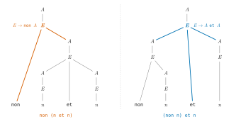
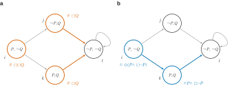
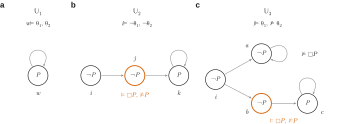
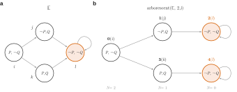

# Centrale-Supélec MPI — Informatique 2026 · Corrigé brut

*Corrigé rédigé par IA, non officiel. Signalez toute erreur.*

Épreuve de 4 heures, calculatrice autorisée. Langages : SQL (partie A), OCaml (partie B), C (partie C).

Notations :

- $\mathbb U\models_i\varphi$ pour la satisfaction au monde $i$ ;
- $|\varphi|$ pour la taille de l'arbre de $\varphi$ ;
- $\mathrm{md}(\varphi)$ pour la profondeur modale (nombre maximal de $\Box,\Diamond$ imbriqués), toujours majorée par le nombre total de symboles $\Box$ et $\Diamond$ de $\varphi$.

On rappelle qu'un univers est **sériel** : tout monde a au moins un successeur.

## Partie A — Base de données (SQL)

Tables : `commune(Nom, INSEE)` et `conseiller(INSEE, Département, Monde)`, où `Monde = 0` désigne le monde réel et `Monde` $\in\{1,\dots,20\}$ le monde idéal du conseiller correspondant.

### Q1

Proposer de créer le Gévaudan, c'est rattacher au moins une commune au Gévaudan dans son monde idéal. Ce département n'existant pas dans le monde réel, il suffit de sélectionner les lignes du Gévaudan hors monde 0.

```sql
SELECT DISTINCT Monde
FROM conseiller
WHERE Département = 'Gévaudan' AND Monde <> 0;
```

`DISTINCT` supprime les doublons (un conseiller qui rattache plusieurs communes au Gévaudan produit plusieurs lignes) ; `Monde <> 0` garantit qu'on ne renvoie que des numéros de conseillers.

### Q2

Le nom est dans `commune`, le rattachement dans `conseiller` : jointure sur `INSEE`.

```sql
SELECT c.Monde
FROM conseiller AS c JOIN commune AS m ON c.INSEE = m.INSEE
WHERE m.Nom = 'Mont-Saint-Michel'
  AND c.Département = 'Ille-et-Vilaine'
  AND c.Monde <> 0;
```

Comme une seule commune porte ce nom et qu'un conseiller ne rattache une commune qu'à un département, chaque conseiller apparaît au plus une fois. Les préfixes `c.` et `m.` sont nécessaires, la colonne `INSEE` existant dans les deux tables.

### Q3

« Peut faire partie » : il existe un monde idéal où la commune est en Sarthe.

```sql
SELECT DISTINCT INSEE
FROM conseiller
WHERE Département = 'Sarthe' AND Monde <> 0;
```

La condition `Monde <> 0` est ici indispensable : sans elle, une commune sarthoise dans le monde réel mais dans aucun monde idéal serait renvoyée à tort.

### Q4

On retire au résultat de Q3 les communes sarthoises du monde réel. Les deux conditions portent sur des lignes différentes, d'où un opérateur ensembliste.

```sql
SELECT INSEE FROM conseiller WHERE Département = 'Sarthe' AND Monde <> 0
EXCEPT
SELECT INSEE FROM conseiller WHERE Département = 'Sarthe' AND Monde = 0;
```

`EXCEPT` élimine les doublons.

### Q5

« Obligatoire » est un quantificateur universel sur les 20 mondes idéaux : le couple (`INSEE`, `Département`) doit apparaître dans 20 mondes idéaux distincts. On retire ensuite les couples réalisés dans le monde réel.

```sql
SELECT INSEE, Département
FROM conseiller
WHERE Monde <> 0
GROUP BY INSEE, Département
HAVING COUNT(DISTINCT Monde) = 20
EXCEPT
SELECT INSEE, Département
FROM conseiller
WHERE Monde = 0;
```

Le filtre `Monde <> 0` doit précéder le regroupement (sinon une ligne du monde réel compterait pour un monde idéal) ; `COUNT(DISTINCT Monde)` protège contre d'éventuelles lignes répétées. Le résultat a les deux colonnes demandées. Un couple dont le département n'existe pas dans le monde réel (cas du Gévaudan) est bien conservé par `EXCEPT`.

## Partie B — Analyse lexicale et syntaxique d'une formule déontique (OCaml)

### I — Analyse lexicale

### Q6

```ocaml
let appartient chaine c =
  let n = String.length chaine in
  let rec parcours i =
    i < n && (chaine.[i] = c || parcours (i + 1))
  in
  parcours 0
```

L'évaluation paresseuse de `&&` empêche l'accès `chaine.[n]`. Terminaison : $n-i$ décroît strictement. Complexité $O(n)$.

### Q7

```ocaml
let sous_chaine chaine debut longueur =
  assert (debut >= 0 && longueur >= 0
          && debut + longueur <= String.length chaine);
  String.init longueur (fun k -> chaine.[debut + k])
```

Si les indices sont invalides, l'assertion lève `Assert_failure`. Sinon, le caractère d'indice $k$ du résultat est `chaine.[debut + k]`, avec $0\le$ `debut` $+k\le$ `debut + longueur - 1` $<$ `String.length chaine`. Contrôle : les caractères d'indices 3, 4, 5, 6 de `"abracadabra"` sont `a`, `c`, `a`, `d`, d'où `"acad"` ; pour `sous_chaine "abc" 1 3`, $1+3=4>3$ et l'assertion échoue. Coût linéaire en `longueur`. (Variante n'utilisant que `s.[i]` et `^` : accumuler `String.make 1 chaine.[i]` dans une référence, en coût quadratique.)

### Q8

L'automate reconnaît $\mathcal E^*\bigl(\mathcal P\cup\mathcal A(\mathcal A\cup\{\_\})^*\bigr)$ : après les espacements (boucle sur l'état 0), une parenthèse mène à l'état 3, acceptant et sans transition sortante ; une lettre mène à l'état 1, et les états 1 et 2, tous deux acceptants, lisent lettres et `_` jusqu'au premier autre caractère, où l'automate se bloque. Le plus long préfixe reconnu s'obtient donc en avançant tant que le caractère est une lettre ou `_`.

```ocaml
let detecte_lexeme chaine debut =
  let n = String.length chaine in
  let i = ref debut in
  (* boucle sur l'état 0 : on saute les espacements *)
  while !i < n && appartient espaces chaine.[!i] do
    i := !i + 1
  done;
  let d = !i in
  if d >= n then raise Erreur_Lexicale
  else if chaine.[d] = '(' || chaine.[d] = ')' then (d, d + 1)  (* état 3 *)
  else if appartient alphabet chaine.[d] then begin              (* état 1 *)
    let j = ref (d + 1) in
    while !j < n && (appartient alphabet chaine.[!j] || chaine.[!j] = '_') do
      j := !j + 1                                                 (* états 1, 2 *)
    done;
    (d, !j)
  end
  else raise Erreur_Lexicale
```

Si, après `debut`, il n'y a que des espacements, ou si le premier caractère non espacé n'est ni une lettre ni une parenthèse (par exemple `_` ou un chiffre), aucun préfixe n'atteint un état acceptant : on lève `Erreur_Lexicale`. Contrôle : sur `"non doit manger_crepe"` à partir de 3, l'indice 3 est un espace, `d = 4`, on lit `d`, `o`, `i`, `t` et on s'arrête à l'espace d'indice 8 : `(4, 8)` ; à partir de 4, même résultat.

### Q9

```ocaml
let analyse_lexicale chaine =
  let n = String.length chaine in
  (* vrai si, à partir de i, il ne reste que des espacements *)
  let rec fini i = i >= n || (appartient espaces chaine.[i] && fini (i + 1)) in
  let rec parcours debut =
    if fini debut then []
    else
      let (d, f) = detecte_lexeme chaine debut in
      produit_lexeme chaine d f :: parcours f
  in
  parcours 0
```

Le test `fini` est nécessaire car `detecte_lexeme` lève une exception sur un suffixe d'espacements. Dans tous les autres cas d'erreur, `Erreur_Lexicale` est levée par `detecte_lexeme` et se propage. Terminaison : `f > d >= debut`, donc $n-$`debut` décroît strictement. Sur l'exemple, on obtient successivement `(0, 3)`, `(4, 8)`, `(9, 21)`, puis `fini 21`, d'où `[Lex_non; Lex_doit; Lex_var "manger_crepe"]`.

### II — Grammaire non contextuelle

On note les mots sur l'alphabet $\{n,\ \mathtt{et},\ \mathtt{non},\ \mathtt{doit},\ (,\ )\}$ : $m_1 = n\ \mathtt{doit}\ (\ n\ \mathtt{et}\ n\ )$ et $m_2 = n\ \mathtt{et}\ \mathtt{doit}\ (\ \mathtt{non}\ n\ \mathtt{et}\ n\ )$.

### Q10

*Préliminaire.* Tout mot engendré par $\mathcal G$ (depuis $A$ ou $E$) est bien parenthésé : chaque règle introduit les parenthèses par paires, donc par induction sur la dérivation, le mot contient autant de `(` que de `)`.

**$m_1$ et $\mathcal G$.** Une dérivation $A\Rightarrow^* m_1$ ne commence pas par $A\to(E)$, car $m_1$ ne commence pas par `(`. Elle commence donc par $A\to E$, puis :

- $E\to n$ est exclu, car $m_1\neq n$ ;
- $E\to\mathtt{non}\,A$ et $E\to\mathtt{doit}\,A$ sont exclus, car $m_1$ commence par $n$ ;
- $E\to A\ \mathtt{et}\ A$ imposerait $m_1=u\ \mathtt{et}\ v$ avec $A\Rightarrow^*u$. Comme $m_1$ ne contient qu'un `et`, on aurait $u = n\ \mathtt{doit}\ (\ n$, qui n'est pas bien parenthésé.

Donc **$m_1\notin L(\mathcal G)$**.

**$m_1$ et $\mathcal H$.** Depuis $E$ :

- la règle $E\to n$ ne produit que $n$ ;
- la règle $E\to(B)$ produit un mot commençant par `(` ;
- la règle $E\to C$ produit un mot commençant par `non` ou `doit`.

Comme $m_1$ commence par $n$ sans être réduit à $n$, **$m_1\notin L(\mathcal H)$**.

**$m_2$ et $\mathcal G$.** Dérivation :

$$
\begin{aligned}
A &\Rightarrow E\\
&\Rightarrow A\ \mathtt{et}\ A\\
&\Rightarrow E\ \mathtt{et}\ A\\
&\Rightarrow n\ \mathtt{et}\ A\\
&\Rightarrow n\ \mathtt{et}\ E\\
&\Rightarrow n\ \mathtt{et}\ \mathtt{doit}\ A\\
&\Rightarrow n\ \mathtt{et}\ \mathtt{doit}\ (\,E\,)\\
&\Rightarrow n\ \mathtt{et}\ \mathtt{doit}\ (\,A\ \mathtt{et}\ A\,)\\
&\Rightarrow n\ \mathtt{et}\ \mathtt{doit}\ (\,E\ \mathtt{et}\ A\,)\\
&\Rightarrow n\ \mathtt{et}\ \mathtt{doit}\ (\,\mathtt{non}\ A\ \mathtt{et}\ A\,)\\
&\Rightarrow^* n\ \mathtt{et}\ \mathtt{doit}\ (\ \mathtt{non}\ n\ \mathtt{et}\ n\ ).
\end{aligned}
$$

Donc **$m_2\in L(\mathcal G)$**.

**$m_2$ et $\mathcal H$.** Même argument que pour $m_1$ : $m_2$ commence par $n$ et n'est pas réduit à $n$.

Donc **$m_2\notin L(\mathcal H)$**.

### Q11

**Non.** D'après Q10, $m_2\in L(\mathcal G)\setminus L(\mathcal H)$.

(Exemples plus courts : $n\ \mathtt{et}\ n$, ou $(\,n\,)$, engendrés par $\mathcal G$. Dans $\mathcal H$, un `et` n'apparaît qu'entre parenthèses via $B$, et des parenthèses entourent toujours un `et`.)

On a en revanche $L(\mathcal H)\subseteq L(\mathcal G)$. Montrons par induction sur la dérivation dans $\mathcal H$ les deux propriétés suivantes :

- si $E\Rightarrow^*_{\mathcal H}w$ ou $C\Rightarrow^*_{\mathcal H}w$, alors $A\Rightarrow^*_{\mathcal G}w$ ;
- si $B\Rightarrow^*_{\mathcal H}w$, alors $E\Rightarrow^*_{\mathcal G}w$.

Cas par règle :

- $E\to n$ : $A\Rightarrow E\Rightarrow n$.
- $E\to(B)$ avec $B\Rightarrow^*_{\mathcal H}u$ : $E\Rightarrow^*_{\mathcal G}u$, donc $A\Rightarrow(E)\Rightarrow^*(u)$.
- $E\to C$ : hypothèse d'induction sur $C$.
- $B\to E\ \mathtt{et}\ E$ avec $E\Rightarrow^*_{\mathcal H}u_1,u_2$ : $E\Rightarrow_{\mathcal G}A\ \mathtt{et}\ A\Rightarrow^*u_1\ \mathtt{et}\ u_2$.
- $C\to\mathtt{non}\ E$ (resp. $\mathtt{doit}\ E$) avec $E\Rightarrow^*_{\mathcal H}u$ : $A\Rightarrow E\Rightarrow\mathtt{non}\ A\Rightarrow^*\mathtt{non}\ u$ (resp. `doit`).

**Conclusion : $L(\mathcal H)\subsetneq L(\mathcal G)$, les deux langages sont distincts.**

### Q12

**$\mathcal G$ est ambiguë.** Le mot $\mathtt{non}\ n\ \mathtt{et}\ n$ a deux arbres de dérivation depuis $A$ :

- $A\to E\to\mathtt{non}\ A$, puis $A\to E\to A\ \mathtt{et}\ A$ et chaque $A\to E\to n$ (lecture $\neg(x\wedge y)$) ;
- $A\to E\to A\ \mathtt{et}\ A$, le premier $A\to E\to\mathtt{non}\ A\to\dots\to\mathtt{non}\ n$, le second $A\to E\to n$ (lecture $(\neg x)\wedge y$).

Les deux arbres diffèrent dès la règle appliquée au $E$ sous la racine. (De même $n\ \mathtt{et}\ n\ \mathtt{et}\ n$.)



**$\mathcal H$ n'est pas ambiguë.** Le premier terminal d'un mot détermine la règle appliquée à $E$ :

- $n$ impose $E\to n$, et le mot est $n$ ;
- `(` impose $E\to(B)$ ;
- `non` (resp. `doit`) impose $E\to C\to\mathtt{non}\ E$ (resp. `doit`).

Il reste à voir que la découpe $B\to E\ \mathtt{et}\ E$ est unique. Le langage $L(\mathcal H)$ est sans préfixe : aucun de ses mots n'est préfixe strict d'un autre. Cela se voit par induction sur la longueur : un mot est $n$, ou commence par `(` et se termine à la parenthèse fermante associée, ou est $\mathtt{non}\,u$ / $\mathtt{doit}\,u$ avec $u\in L(\mathcal H)$.

Supposons $u_1\ \mathtt{et}\ u_2 = v_1\ \mathtt{et}\ v_2$ avec $u_1,v_1\in L(\mathcal H)$. L'un de $u_1,v_1$ est préfixe de l'autre, donc $u_1=v_1$, puis $u_2=v_2$. Par induction, chaque mot de $L(\mathcal H)$ a un unique arbre.

### III — Analyse syntaxique

### Q13

```ocaml
        let (f2, q2) = derive_E q in
        (Et (f1, f2), q2)
```

On analyse le second opérande sur le reste `q` qui suit `Lex_et`, et l'on renvoie le reste `q2` de ce second appel. La parenthèse fermante est consommée par `derive_E` dans sa branche `Lex_PO`.

### Q14

```ocaml
  | Lex_non :: q ->
    let (f, reste) = derive_E q in
    (Non f, reste)
  | Lex_doit :: q ->
    let (f, reste) = derive_E q in
    (Doit f, reste)
  | _ -> raise Erreur_Syntaxique
```

Sur l'exemple, `derive_E` passe la main à `derive_C`, qui filtre `Lex_non`, appelle `derive_E` sur `[Lex_var "manger_crepe"; Lex_et; …]`, obtient `(Var "manger_crepe", [Lex_et; Lex_doit; Lex_var "remercier_mamie"; Lex_PF])` et renvoie `(Non (Var "manger_crepe"), [Lex_et; Lex_doit; Lex_var "remercier_mamie"; Lex_PF])`, comme attendu. Terminaison : `derive_E` appelle `derive_C` et `derive_B` appelle `derive_E` sur la même liste, mais tout cycle d'appels consomme au moins un lexème (`derive_E` retire `Lex_PO` avant d'appeler `derive_B`, `derive_C` retire `Lex_non` ou `Lex_doit` avant d'appeler `derive_E`) ; la longueur de la liste décroît donc strictement le long de tout cycle.

### Q15

```ocaml
let analyse_syntaxique lexemes =
  match derive_E lexemes with
  | (f, []) -> f
  | _ -> raise Erreur_Syntaxique
```

`derive_E` analyse le plus long préfixe possible (la grammaire $\mathcal H$ étant sans préfixe, c'est l'unique préfixe dérivable) ; la liste est engendrée si et seulement si le reste est vide. Les échecs internes propagent `Erreur_Syntaxique`. Sur la phrase d'introduction, on obtient `Et (Var "Grand_mere_a_prepare_des_crepes", Doit (Var "je_mange_les_crepes"))`.

## Partie C — Univers de Kripke (en C)

### I — Formules déontiques

### Q16

```c
formule *cree_formule(int op, int variable, formule *fg, formule *fd) {
    formule *f = malloc(sizeof(formule));
    assert(f != NULL);
    f->op = op;
    f->variable = variable;
    f->gauche = fg;
    f->droite = fd;
    return f;
}
```

### Q17

```c
int compter_peut(formule *f) {
    if (f == NULL) { return 0; }
    int n = (f->op == PEUT) ? 1 : 0;
    return n + compter_peut(f->gauche) + compter_peut(f->droite);
}
```

Le test `f == NULL` traite les fils absents (variables, opérateurs unaires). Sur $X_1\vee\Diamond X_2$, seule la racine du sous-arbre droit est un `PEUT` : résultat 1.

### Q18

```c
void free_formule(formule *f) {
    if (f == NULL) { return; }
    free_formule(f->gauche);
    free_formule(f->droite);
    free(f);
}
```

Libération en post-ordre : les champs `gauche` et `droite` sont lus avant `free(f)`. Sur $X_1\vee\Diamond X_2$, quatre appels à `free`.

### Q19

```c
formule *retirer_implications(formule *f) {
    if (f == NULL) { return NULL; }
    formule *g = retirer_implications(f->gauche);
    formule *d = retirer_implications(f->droite);
    if (f->op == IMPLIQUE) {
        return cree_formule(OU, -1, cree_formule(NON, -1, g, NULL), d);
    }
    return cree_formule(f->op, f->variable, g, d);
}
```

Par induction sur `f` : aucune écriture n'est faite dans `f`, qui n'est donc pas modifiée ; chaque nœud du résultat vient d'un `malloc` neuf (y compris les feuilles), donc aucun emplacement n'est partagé avec `f` ni entre sous-formules du résultat ; un nœud `IMPLIQUE` de sous-formules $\varphi,\psi$ devient $\texttt{OU}(\texttt{NON}(\varphi'),\psi')$ où $\varphi',\psi'$ sont sans implication par hypothèse d'induction, conformément à $\varphi\to\psi\equiv\neg\varphi\vee\psi$.

### II — Modèles d'une formule déontique

### Q20

```c
bool satisfaction(monde *m, formule *f) {
    if (f->op == VARIABLE) {
        assert(0 <= f->variable && f->variable < m->taille);
        return m->valuation[f->variable];
    }
    if (f->op == NON) { return !satisfaction(m, f->gauche); }
    assert(f->op == ET);
    return satisfaction(m, f->gauche) && satisfaction(m, f->droite);
}
```

On ne peut pas utiliser `switch` : en C, des identificateurs déclarés `const int` ne sont pas des expressions constantes utilisables comme étiquettes `case`.

### Q21



Les successeurs de $i$ sont $j$ et $k$. Le seul successeur de $j$ est $l$, où $Q$ est fausse.

On a donc $\mathbb E\not\models_j\Box Q$ : un successeur de $i$ ne satisfait pas $\Box Q$, d'où

$$\boxed{\mathbb E\not\models_i\Box\Box Q}$$

### Q22

Le successeur $k$ de $i$ vérifie $P$. Son seul successeur $l$ vérifie $\neg P$, donc $\mathbb E\models_k\Box\neg P$.

Ainsi $\mathbb E\models_k P\wedge\Box\neg P$ et, comme $R_{\mathbb E}(i,k)$ :

$$\boxed{\mathbb E\models_i\Diamond(P\wedge\Box\neg P)}$$

### Q23



**$\theta_1$ satisfiable.** $\mathbb U_1$ : un monde $w$, arc $(w,w)$, $P$ vraie.

Le seul successeur de $w$ vérifie $P$, donc $\mathbb U_1\models_w\Box P$. La conclusion de $\theta_1$ est vraie, donc $\mathbb U_1\models_w\theta_1$.

**$\neg\theta_1$ satisfiable.** Univers $\mathbb U_2$ :

- mondes $i,j,k$ ;
- arcs $i\to j$, $j\to k$, $k\to k$ (univers sériel) ;
- $P$ fausse en $i$ et $j$, vraie en $k$.

Alors :

- Le seul successeur de $j$ est $k$, où $P$ est vraie, donc $\mathbb U_2\models_j\Box P$.
- $j$ étant le seul successeur de $i$, on a $\mathbb U_2\models_i\Box\Box P$.
- Mais $P$ est fausse en $j$, donc $\mathbb U_2\not\models_i\Box P$.

Prémisse vraie, conclusion fausse : $\mathbb U_2\models_i\neg\theta_1$.

**$\theta_1$ et $\neg\theta_1$ sont satisfiables.**

### Q24

**$\theta_2$ satisfiable.** Dans $\mathbb U_1$, le seul successeur $w$ de $w$ vérifie $P$, donc $\Box P\to P$.

D'où $\mathbb U_1\models_w\theta_2$.

**$\neg\theta_2$ satisfiable.** Dans $\mathbb U_2$, le successeur $j$ de $i$ vérifie $\Box P$ : son seul successeur vérifie $P$.

Il vérifie aussi $\neg P$, donc $\mathbb U_2\not\models_j\Box P\to P$.

Ainsi $\mathbb U_2\not\models_i\theta_2$, soit $\mathbb U_2\models_i\neg\theta_2$.

**$\theta_2$ et $\neg\theta_2$ sont satisfiables.**

### Q25

**$\theta_1$ est conséquence logique de $\theta_2$.** Soit $(\mathbb U,i)$ un modèle de $\theta_2$.

Supposons $\mathbb U\models_i\Box\Box P$ et soit $j$ un successeur de $i$.

- Par $\Box\Box P$ : $\mathbb U\models_j\Box P$.
- Par $\theta_2$ : $\mathbb U\models_j\Box P\to P$.
- Donc $\mathbb U\models_j P$.

Ceci vaut pour tout successeur $j$, d'où $\mathbb U\models_i\Box P$. Donc $\mathbb U\models_i\theta_1$.

**$\theta_2$ n'est pas conséquence logique de $\theta_1$.** Univers $\mathbb U_3$ :

- mondes $i,a,b,c$ ;
- arcs $i\to a$, $i\to b$, $a\to a$, $b\to c$, $c\to c$ (sériel) ;
- $P$ fausse en $i,a,b$, vraie en $c$.

Alors :

- Le seul successeur de $a$ est $a$, où $P$ est fausse : $\mathbb U_3\not\models_a\Box P$. Donc $\mathbb U_3\not\models_i\Box\Box P$, et $\mathbb U_3\models_i\theta_1$.
- Le seul successeur de $b$ est $c$, où $P$ est vraie : $\mathbb U_3\models_b\Box P$.
- Or $P$ est fausse en $b$, donc $\mathbb U_3\not\models_b\Box P\to P$.
- Par suite, $\mathbb U_3\not\models_i\theta_2$.

$(\mathbb U_3,i)$ est un modèle de $\theta_1$ qui n'est pas un modèle de $\theta_2$.

### III — Formules réduites

### Q26

Pour toutes formules $\varphi,\psi$ :

$$\boxed{\begin{aligned}
\neg(\varphi\wedge\psi)&\equiv\neg\varphi\vee\neg\psi\\
\neg(\varphi\vee\psi)&\equiv\neg\varphi\wedge\neg\psi
\end{aligned}}$$

Elles valent en chaque monde de chaque univers, les clauses de $\wedge,\vee,\neg$ étant celles du calcul propositionnel au monde considéré.

### Q27

*Lemmes.*

*(1)* $\neg\Box\varphi\equiv\Diamond\neg\varphi$ et $\neg\Diamond\varphi\equiv\Box\neg\varphi$ : « il est faux que tout successeur satisfait $\varphi$ » équivaut à « un successeur satisfait $\neg\varphi$ », et symétriquement.

*(2)* $\neg\neg\varphi\equiv\varphi$ et $\varphi\to\psi\equiv\neg\varphi\vee\psi$ (définition de la satisfaction).

*(3)* L'équivalence est compatible avec les connecteurs. Si $\varphi\equiv\varphi'$ et $\psi\equiv\psi'$, alors :

$$
\begin{aligned}
\neg\varphi&\equiv\neg\varphi'\\
\varphi\wedge\psi&\equiv\varphi'\wedge\psi'\\
\varphi\vee\psi&\equiv\varphi'\vee\psi'\\
\Box\varphi&\equiv\Box\varphi'\\
\Diamond\varphi&\equiv\Diamond\varphi'
\end{aligned}
$$

En effet, la valeur en $i$ de la formule composée ne dépend que des valeurs des composantes en $i$ ou en ses successeurs.

*Construction.* On définit simultanément, par induction structurelle, deux formules $\mathrm r(\varphi)$ et $\mathrm n(\varphi)$ :

| $\varphi$ | $\mathrm r(\varphi)$ | $\mathrm n(\varphi)$ |
|---|---|---|
| $P$ | $P$ | $\neg P$ |
| $\neg\psi$ | $\mathrm n(\psi)$ | $\mathrm r(\psi)$ |
| $\psi\wedge\chi$ | $\mathrm r(\psi)\wedge\mathrm r(\chi)$ | $\mathrm n(\psi)\vee\mathrm n(\chi)$ |
| $\psi\vee\chi$ | $\mathrm r(\psi)\vee\mathrm r(\chi)$ | $\mathrm n(\psi)\wedge\mathrm n(\chi)$ |
| $\psi\to\chi$ | $\mathrm n(\psi)\vee\mathrm r(\chi)$ | $\mathrm r(\psi)\wedge\mathrm n(\chi)$ |
| $\Box\psi$ | $\Box\,\mathrm r(\psi)$ | $\Diamond\,\mathrm n(\psi)$ |
| $\Diamond\psi$ | $\Diamond\,\mathrm r(\psi)$ | $\Box\,\mathrm n(\psi)$ |

*Ces formules sont réduites* : par induction, les cas de base $P$, $\neg P$ relèvent de (i), et les autres lignes n'utilisent que $\wedge,\vee$ (clause (ii)) et $\Box,\Diamond$ (clause (iii)) appliqués à des formules réduites.

*Équivalence* : montrons par induction simultanée $\mathrm r(\varphi)\equiv\varphi$ et $\mathrm n(\varphi)\equiv\neg\varphi$.

*Cas $P$* : immédiat.

*Cas $\neg\psi$* :

$$
\begin{aligned}
\mathrm r(\neg\psi)&=\mathrm n(\psi)\\
&\equiv\neg\psi\\[4pt]
\mathrm n(\neg\psi)&=\mathrm r(\psi)\\
&\equiv\psi\\
&\equiv\neg\neg\psi
\end{aligned}
$$

*Cas $\psi\wedge\chi$* : $\mathrm r\equiv\psi\wedge\chi$ par (3) ; par (3) puis De Morgan,

$$
\begin{aligned}
\mathrm n&\equiv\neg\psi\vee\neg\chi\\
&\equiv\neg(\psi\wedge\chi)
\end{aligned}
$$

Le cas $\vee$ est symétrique.

*Cas $\psi\to\chi$* : par (3), (2), De Morgan et double négation,

$$
\begin{aligned}
\mathrm r&\equiv\neg\psi\vee\chi\\
&\equiv\psi\to\chi\\[4pt]
\mathrm n&\equiv\psi\wedge\neg\chi\\
&\equiv\neg(\neg\psi\vee\chi)
\end{aligned}
$$

*Cas $\Box\psi$* : $\mathrm r\equiv\Box\psi$ par (3) ; par (3) puis (1),

$$
\begin{aligned}
\mathrm n&=\Diamond\,\mathrm n(\psi)\\
&\equiv\Diamond\neg\psi\\
&\equiv\neg\Box\psi
\end{aligned}
$$

Le cas $\Diamond$ est symétrique.

**Toute formule déontique $\varphi$ est logiquement équivalente à la formule réduite $\mathrm r(\varphi)$.**

De plus, $|\mathrm r(\varphi)|+|\mathrm n(\varphi)|\le 4|\varphi|$ par une récurrence immédiate : la mise sous forme réduite est de taille linéaire (utile en Q39).

### Q28

```c
bool est_reduite(formule *f) {
    if (f->op == VARIABLE) { return true; }
    if (f->op == NON) { return f->gauche->op == VARIABLE; }
    if (f->op == ET || f->op == OU) {
        return est_reduite(f->gauche) && est_reduite(f->droite);
    }
    if (f->op == DOIT || f->op == PEUT) { return est_reduite(f->gauche); }
    return false;   /* IMPLIQUE */
}
```

Une négation n'est réduite que si son fils est une variable ; une implication ne l'est jamais.

### Q29

```c
bool satisfaction2(univers *u, int i, formule *f) {
    if (f->op == VARIABLE) {
        assert(0 <= f->variable && f->variable < u->mondes[i].taille);
        return u->mondes[i].valuation[f->variable];
    }
    if (f->op == NON) {          /* f réduite : le fils est une variable */
        return !satisfaction2(u, i, f->gauche);
    }
    if (f->op == ET) {
        return satisfaction2(u, i, f->gauche) && satisfaction2(u, i, f->droite);
    }
    if (f->op == OU) {
        return satisfaction2(u, i, f->gauche) || satisfaction2(u, i, f->droite);
    }
    if (f->op == DOIT) {         /* tout successeur j de i satisfait f->gauche */
        for (int j = 0; j < u->nb_mondes; j = j + 1) {
            if (u->matrice[i][j] && !satisfaction2(u, j, f->gauche)) { return false; }
        }
        return true;
    }
    assert(f->op == PEUT);       /* un successeur j de i satisfait f->gauche */
    for (int j = 0; j < u->nb_mondes; j = j + 1) {
        if (u->matrice[i][j] && satisfaction2(u, j, f->gauche)) { return true; }
    }
    return false;
}
```

La récursion porte sur des sous-formules strictes : elle termine même si le graphe a des cycles. Sur $\mathbb E$, elle renvoie faux pour Q21 et vrai pour Q22.

### IV — Décidabilité de la satisfiabilité d'une formule déontique

### Q30

En notant $T(i,N)$ le nombre de mondes de `arborescent(U, N, i)` :

$$\boxed{\begin{aligned}
T(i,0)&=1\\
T(i,N)&=1+\sum_{j\,:\,R_{\mathbb U}(i,j)}T(j,N-1)\qquad(N\ge1)
\end{aligned}}$$

```c
int taille(univers *u, int i, int N) {
    if (N == 0) { return 1; }
    int s = 1;                                   /* la racine */
    for (int j = 0; j < u->nb_mondes; j = j + 1) {
        if (u->matrice[i][j]) { s = s + taille(u, j, N - 1); }
    }
    return s;
}
```

Sur $\mathbb E$ depuis $i$ :

$$
\begin{aligned}
T(i,0)&=1\\
T(i,1)&=3\\
T(i,2)&=5
\end{aligned}
$$

### Q31

On alloue l'univers à la taille donnée par Q30, matrice initialisée à `false`, puis on le remplit par un parcours préfixe qui attribue les indices dans l'ordre de création : la racine reçoit l'indice 0.

```c
/* Crée à l'indice *suivant une copie du monde i de u, développe ses
   fils si N > 0 et renvoie l'indice de la copie. */
int remplir(univers *u, int i, int N, univers *a, int *suivant) {
    int r = *suivant;
    *suivant = r + 1;
    int t = u->mondes[i].taille;
    a->mondes[r].taille = t;
    a->mondes[r].valuation = malloc(t * sizeof(bool));
    assert(a->mondes[r].valuation != NULL);
    for (int v = 0; v < t; v = v + 1) {
        a->mondes[r].valuation[v] = u->mondes[i].valuation[v];
    }
    if (N == 0) {
        a->matrice[r][r] = true;                 /* boucle de la feuille */
        return r;
    }
    for (int j = 0; j < u->nb_mondes; j = j + 1) {
        if (u->matrice[i][j]) {
            int rj = remplir(u, j, N - 1, a, suivant);
            a->matrice[r][rj] = true;            /* arc (r, r_j) */
        }
    }
    return r;
}

univers *arborescent(univers *u, int i, int N) {
    int n = taille(u, i, N);
    univers *a = malloc(sizeof(univers));
    assert(a != NULL);
    a->nb_mondes = n;
    a->mondes = malloc(n * sizeof(monde));
    a->matrice = malloc(n * sizeof(bool *));
    assert(a->mondes != NULL && a->matrice != NULL);
    for (int r = 0; r < n; r = r + 1) {
        a->matrice[r] = malloc(n * sizeof(bool));
        assert(a->matrice[r] != NULL);
        for (int c = 0; c < n; c = c + 1) { a->matrice[r][c] = false; }
    }
    int suivant = 0;
    remplir(u, i, N, a, &suivant);               /* racine d'indice 0 */
    return a;
}
```

Chaque appel de `remplir` consomme exactement un indice et il y a $T(i,N)=n$ appels : les indices $0,\dots,n-1$ sont utilisés chacun une fois. Les valuations sont copiées, pas partagées avec $\mathbb U$. Tout monde du résultat a un successeur (boucle pour une feuille ; pour un nœud interne, au moins un fils, car $\mathbb U$ est sériel).



### Q32

On note $A_n(j)=$ `arborescent(U, n, j)` et $r$ sa racine.

*Lemme de localité.* La satisfaction en un monde $x$ ne dépend que du sous-univers formé des mondes accessibles depuis $x$ (avec leurs arcs et valuations).

Précisément, supposons ces sous-univers isomorphes pour $x$ dans $\mathbb V$ et $y$ dans $\mathbb W$, par un isomorphisme envoyant $x$ sur $y$.

Alors, pour toute formule $\psi$ (induction immédiate sur $\psi$) :

$$\mathbb V\models_x\psi\iff\mathbb W\models_y\psi.$$

Or, dans $A_n(j)$ avec $n\ge1$, les successeurs de $r$ sont exactement les racines $r_k$ des copies de $A_{n-1}(k)$.

Ici, $k$ parcourt les successeurs de $j$ dans $\mathbb U$.

Les mondes accessibles depuis $r_k$ forment exactement cette copie (c'est un arbre). Donc

$$A_n(j)\models_{r_k}\psi\iff A_{n-1}(k)\models_{r_k}\psi.\qquad(\ast)$$

*Proposition.* Pour toute formule réduite $\varphi$, tout $n\ge\mathrm{md}(\varphi)$ et tout monde $j$ de $\mathbb U$ :

$$\mathbb U\models_j\varphi\Rightarrow A_n(j)\models_r\varphi.$$

Induction structurelle sur $\varphi$ :

- $\varphi=P$ ou $\neg P$ : $r$ est une copie de $j$, de même valuation.
- $\varphi=\psi\wedge\chi$ ou $\psi\vee\chi$ : $n\ge\mathrm{md}(\psi),\mathrm{md}(\chi)$ ; hypothèse d'induction au même $n$ et au même $j$.
- $\varphi=\Box\psi$ : on a $n\ge1+\mathrm{md}(\psi)$. Tout successeur de $r$ est un $r_k$ avec $R_{\mathbb U}(j,k)$.
  - De $\mathbb U\models_j\Box\psi$ on tire $\mathbb U\models_k\psi$.
  - L'hypothèse d'induction, avec $n-1\ge\mathrm{md}(\psi)$, donne $A_{n-1}(k)\models_{r_k}\psi$.
  - Puis $(\ast)$ donne $A_n(j)\models_{r_k}\psi$.

  Donc $A_n(j)\models_r\Box\psi$.
- $\varphi=\Diamond\psi$ : un successeur $k$ de $j$ vérifie $\mathbb U\models_k\psi$.

  Comme ci-dessus, $A_n(j)\models_{r_k}\psi$, et $r_k$ est un successeur de $r$.

Le cas de la négation ne pose pas de problème car, dans une formule réduite, elle ne porte que sur des variables.

Avec $j=i$ et $n=N\ge\mathrm{md}(\varphi)$ :

$$\boxed{\mathbb U\models_i\varphi\ \Longrightarrow\ \mathbb A\models_r\varphi}$$

### Q33

Deux univers arborescents sont dits identiques s'ils sont isomorphes, valuations et racines comprises. D'après le lemme de localité, ils satisfont les mêmes formules en leur racine.

Notons $A'_n(j)$ le résultat de l'algorithme modifié. Sous sa racine, les sous-arbres conservés forment une partie $\mathcal C$ des $A'_{n-1}(k)$, pour $k$ successeur de $j$. Tout sous-arbre supprimé est identique à un élément de $\mathcal C$.

On reprend la preuve de Q32 avec $A'$ à la place de $A$ ; seuls deux cas changent.

- $\Box\psi$ : tout successeur de la racine de $A'_n(j)$ est la racine d'un $A'_{n-1}(k)$ avec $R_{\mathbb U}(j,k)$. L'argument de Q32 s'applique tel quel (il y a seulement moins de successeurs à examiner).
- $\Diamond\psi$ : un successeur $k$ de $j$ vérifie $\mathbb U\models_k\psi$. Par hypothèse d'induction, $A'_{n-1}(k)$ satisfait $\psi$ en sa racine.
  - S'il a été conservé, sa racine est un successeur témoin.
  - Sinon, il est identique à un $T\in\mathcal C$, qui satisfait $\psi$ en sa racine ; celle-ci est un successeur de la racine de $A'_n(j)$.

**La proposition de Q32 reste vraie pour l'algorithme sans doublons.**

### Q34

Soit $\varphi$ une formule déontique.

1. On calcule $\varphi'=\mathrm r(\varphi)$ (Q27), réduite et équivalente : $\varphi$ est satisfiable si et seulement si $\varphi'$ l'est.

   Soit $N$ le nombre de $\Box,\Diamond$ de $\varphi'$. Soit $V$ l'ensemble (fini, de cardinal $m$) des variables de $\varphi'$.
2. La satisfaction de $\varphi'$ en un monde ne dépend que des valeurs des variables de $V$ (induction immédiate) : on peut restreindre toutes les valuations à $V$ sans rien changer.
3. Si $\varphi'$ est satisfiable, par $(\mathbb U,i)$ avec valuations restreintes à $V$, alors par Q32 et Q33 l'univers arborescent sans doublons $A'_N(i)$ en est un modèle en sa racine.

   Or l'ensemble $\mathcal T_n$ des univers arborescents de profondeur $n$, à valuations sur $V$, sans sous-arbres frères identiques, considérés à isomorphisme près, est fini. En effet, un tel arbre est déterminé par la valuation de sa racine et par l'ensemble non vide (sérialité) de ses sous-arbres, éléments de $\mathcal T_{n-1}$. D'où
   $$
   \begin{aligned}
   |\mathcal T_0|&=2^m\\
   |\mathcal T_{n+1}|&=2^m\,(2^{|\mathcal T_n|}-1)
   \end{aligned}
   $$
   et ces ensembles s'énumèrent explicitement.
4. Algorithme : énumérer $\mathcal T_N$ et tester chaque arbre en sa racine par `satisfaction2` (Q29), qui termine. Répondre oui si l'un des tests réussit.

Correction : un test réussi exhibe un univers (fini, non vide, sériel) modèle de $\varphi'$, donc de $\varphi$ ; réciproquement, si $\varphi$ est satisfiable, l'étape 3 fournit un arbre de $\mathcal T_N$ qui passe le test. L'algorithme termine toujours.

$$\boxed{\text{DSAT est décidable.}}$$

### V — NP-complétude

### Q35

Si DSAT est NP-complet, il est dans NP par définition.

Réciproquement, supposons DSAT $\in$ NP et montrons qu'il est NP-difficile en réduisant SAT. Une formule propositionnelle (sans $\Box$ ni $\Diamond$) est une formule déontique ; la réduction est l'identité, calculable en temps linéaire.

- Si une valuation $v$ satisfait $\varphi$, l'univers à un monde $w$ de valuation $v$, avec l'arc $(w,w)$, est un univers (non vide, sériel).

  On a $\mathbb U\models_w\varphi$, car sans modalité la satisfaction en $w$ ne dépend que de la valuation de $w$ (induction immédiate).
- Si $\mathbb U\models_x\varphi$, la valuation de $x$ satisfait $\varphi$, pour la même raison.

Donc SAT $\le_p$ DSAT ; SAT étant NP-complet (théorème de Cook-Levin), DSAT est NP-difficile, donc NP-complet.

$$\boxed{\text{DSAT est NP-complet}\iff\text{DSAT}\in\text{NP}}$$

### Q36

$\varphi=P\wedge\Box\neg P$ convient.

- Satisfiable : mondes $i,j$, arcs $i\to j$, $j\to j$, $P$ vraie en $i$, fausse en $j$.

  Alors $\mathbb U\models_i P$, et le seul successeur de $i$ vérifie $\neg P$, donc $\mathbb U\models_i\varphi$.
- Dans un univers total, l'arc $(i,i)$ existe pour tout $i$ ; si $\mathbb U\models_i\Box\neg P$, alors $\mathbb U\models_i\neg P$, ce qui contredit $P$. Donc $\varphi$ n'est vraie en aucun monde d'aucun univers total.

### Q37

Dans un univers total, tout monde est successeur de tout monde, donc

$$
\begin{aligned}
\mathbb U\models_j\Box\psi&\iff\forall k,\ \mathbb U\models_k\psi\\
\mathbb U\models_j\Diamond\psi&\iff\exists k,\ \mathbb U\models_k\psi
\end{aligned}
$$

valeurs indépendantes de $j$. On parcourt les sous-formules de $\varphi$ en post-ordre (au plus $|\varphi|$) et l'on calcule pour chacune le tableau de ses $N$ valeurs de vérité :

- $P$ ou $\neg P$ : lecture des valuations, $O(N)$ ;
- $\psi\wedge\chi$, $\psi\vee\chi$ : combinaison case par case des deux tableaux déjà calculés, $O(N)$ ;
- $\Box\psi$ (resp. $\Diamond\psi$) : conjonction (resp. disjonction) des $N$ cases du tableau de $\psi$, puis tableau constant, $O(N)$.

La réponse est la case $i$ du tableau de $\varphi$. Coût total :

$$\boxed{O(N\,|\varphi|)}$$

### Q38

*Construction.* Pour chaque sous-formule $\Diamond\psi$ de $\varphi$ telle qu'il existe un monde $k$ avec $\mathbb U\models_k\psi$, on choisit un tel monde $k_\psi$.

Soit $S_{\mathbb T}=\{i\}\cup\{k_\psi\}$, et $\mathbb T$ le sous-graphe de $\mathbb U$ induit par $S_{\mathbb T}$ (mêmes valuations, tous les arcs de $\mathbb U$ entre ces mondes).

*$\mathbb T$ est un témoignage contenant $i$* :

- c'est un sous-graphe de $\mathbb U$ ;
- il est total, car $\mathbb U$ l'est et l'on garde tous les arcs, boucles comprises ;
- chaque $\Diamond\psi$ ayant un témoin dans $\mathbb U$ en a un dans $\mathbb T$.

C'est un univers (non vide, sériel par totalité).

*Taille* : $|S_{\mathbb T}|\le1+|\varphi|$, polynomiale (linéaire).

*$\mathbb T\models_i\varphi$* : montrons par induction que pour toute sous-formule $\chi$ de $\varphi$ et tout $x\in S_{\mathbb T}$ :

$$\mathbb U\models_x\chi\Rightarrow\mathbb T\models_x\chi.$$

- $P$, $\neg P$ : mêmes valuations.
- $\wedge$, $\vee$ : hypothèse d'induction.
- $\Box\chi_1$ : tout successeur $y$ de $x$ dans $\mathbb T$ est un monde de $\mathbb U$.

  Donc $\mathbb U\models_y\chi_1$ (totalité de $\mathbb U$), puis $\mathbb T\models_y\chi_1$.
- $\Diamond\chi_1$ : un monde $k$ vérifie $\mathbb U\models_k\chi_1$. Donc $k_{\chi_1}\in S_{\mathbb T}$ existe et $\mathbb U\models_{k_{\chi_1}}\chi_1$.

  D'où $\mathbb T\models_{k_{\chi_1}}\chi_1$ ; $\mathbb T$ étant total, $k_{\chi_1}$ est successeur de $x$.

Avec $\chi=\varphi$, $x=i$ : **$\mathbb T\models_i\varphi$, avec $\mathbb T$ témoignage de taille au plus $|\varphi|+1$.**

### Q39

**TOTAL-DSAT $\in$ NP.** Soit $\varphi$ de taille $n$ et $\varphi'=\mathrm r(\varphi)$, calculable en $O(n)$ et de taille $O(n)$ (Q27).

- Certificat : un univers total $\mathbb T$ d'au plus $|\varphi'|+1$ mondes, valuations restreintes aux variables de $\varphi$, et un monde $i$. Taille $O(n^2)$.
- Vérification :
  - calculer $\varphi'$ ;
  - vérifier que la matrice de $\mathbb T$ est pleine, en $O(n^2)$ ;
  - tester $\mathbb T\models_i\varphi'$ par Q37 en $O(|\mathbb T|\,|\varphi'|)=O(n^2)$.
- Si $\varphi\in$ TOTAL-DSAT, par $(\mathbb B,x)$ total, alors $\mathbb B\models_x\varphi'$. Q38 fournit un témoignage total de taille $\le|\varphi'|+1$ satisfaisant $\varphi'$ en $x$ (valuations restreintes sans perte) : un certificat accepté existe.
- Réciproquement, un certificat accepté est un univers total modèle de $\varphi'\equiv\varphi$.

**TOTAL-DSAT est NP-difficile.** Réduction identité depuis SAT, comme en Q35 : l'univers à un monde avec boucle est total, et une formule sans modalité est vraie en un monde si et seulement si la valuation de ce monde la satisfait.

$$\boxed{\text{TOTAL-DSAT est NP-complet.}}$$

## Partie D — Déduction naturelle pour la logique déontique

### Q40

$$
\dfrac{
  \dfrac{
    \dfrac{
      \dfrac{\dfrac{}{A\vdash A}\,\text{Ax}}{A,B\vdash A}\,\text{Aff}
      \qquad
      \dfrac{}{A,B\vdash B}\,\text{Ax}
    }{A,B\vdash A\wedge B}\,\text{I}\wedge
  }{A\vdash B\to(A\wedge B)}\,\text{I}\!\to
}{\vdash A\to\bigl(B\to(A\wedge B)\bigr)}\,\text{I}\!\to
$$

### Q41

Soit $\Gamma=\{\Box A\wedge\Box\neg A\}$.

$$
\dfrac{
  \dfrac{
    \dfrac{\dfrac{}{\Gamma\vdash\Box A\wedge\Box\neg A}\,\text{Ax}}{\Gamma\vdash\Box\neg A}\,\text{E}_2\wedge
    \qquad
    \dfrac{\dfrac{\dfrac{}{\Gamma\vdash\Box A\wedge\Box\neg A}\,\text{Ax}}{\Gamma\vdash\Box A}\,\text{E}_1\wedge}{\Gamma\vdash\neg\Box\neg A}\,\text{D3}
  }{\Gamma\vdash\bot}\,\text{E}\neg
}{\vdash\neg(\Box A\wedge\Box\neg A)}\,\text{I}\neg
$$

La règle E$\neg$ est appliquée à la formule $\Box\neg A$ et à sa négation.

### Q42

**Sens direct : $\vdash\Box(A\wedge B)\to(\Box A\wedge\Box B)$.** Théorème propositionnel, puis D1 et D2 :

$$
\tau_1=\dfrac{
  \dfrac{
    \dfrac{\dfrac{\dfrac{}{A\wedge B\vdash A\wedge B}\,\text{Ax}}{A\wedge B\vdash A}\,\text{E}_1\wedge}{\vdash(A\wedge B)\to A}\,\text{I}\!\to
  }{\vdash\Box\bigl((A\wedge B)\to A\bigr)}\,\text{D1}
}{\vdash\Box(A\wedge B)\to\Box A}\,\text{D2}
$$

et de même $\tau_2$ conclut $\vdash\Box(A\wedge B)\to\Box B$ (avec E$_2\wedge$). Avec $\Gamma=\{\Box(A\wedge B)\}$ :

$$
\rho_1=\dfrac{
  \dfrac{\tau_1}{\Gamma\vdash\Box(A\wedge B)\to\Box A}\,\text{Aff}
  \qquad
  \dfrac{}{\Gamma\vdash\Box(A\wedge B)}\,\text{Ax}
}{\Gamma\vdash\Box A}\,\text{E}\!\to
$$

et de même $\rho_2$ conclut $\Gamma\vdash\Box B$. Enfin :

$$
\dfrac{\dfrac{\rho_1\qquad\rho_2}{\Gamma\vdash\Box A\wedge\Box B}\,\text{I}\wedge}{\vdash\Box(A\wedge B)\to(\Box A\wedge\Box B)}\,\text{I}\!\to
$$

**Sens réciproque : $\vdash(\Box A\wedge\Box B)\to\Box(A\wedge B)$.** Soit $\pi_{40}$ la preuve de Q40 et $\Delta=\{\Box A\wedge\Box B\}$.

$$
\tau_3=\dfrac{\dfrac{\pi_{40}}{\vdash\Box\bigl(A\to(B\to(A\wedge B))\bigr)}\,\text{D1}}{\vdash\Box A\to\Box\bigl(B\to(A\wedge B)\bigr)}\,\text{D2}
$$

$$
\alpha=\dfrac{\dfrac{}{\Delta\vdash\Box A\wedge\Box B}\,\text{Ax}}{\Delta\vdash\Box A}\,\text{E}_1\wedge
$$

$$
\beta=\dfrac{\dfrac{}{\Delta\vdash\Box A\wedge\Box B}\,\text{Ax}}{\Delta\vdash\Box B}\,\text{E}_2\wedge
$$

$$
\gamma=\dfrac{\dfrac{\tau_3}{\Delta\vdash\Box A\to\Box\bigl(B\to(A\wedge B)\bigr)}\,\text{Aff}\qquad\alpha}{\Delta\vdash\Box\bigl(B\to(A\wedge B)\bigr)}\,\text{E}\!\to
$$

$$
\delta=\dfrac{\gamma}{\Delta\vdash\Box B\to\Box(A\wedge B)}\,\text{D2}
$$

$$
\dfrac{\dfrac{\delta\qquad\beta}{\Delta\vdash\Box(A\wedge B)}\,\text{E}\!\to}{\vdash(\Box A\wedge\Box B)\to\Box(A\wedge B)}\,\text{I}\!\to
$$

D1 n'est appliquée qu'à des séquents sans contexte ($\tau_1,\tau_2,\tau_3$) ; D2 est employée avec le contexte $\Delta$ dans $\delta$, ce que sa forme permet.

**Les deux séquents sont prouvables : $\Box(A\wedge B)\leftrightarrow(\Box A\wedge\Box B)$ est établie dans $\mathcal D$.**
