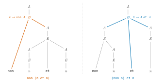
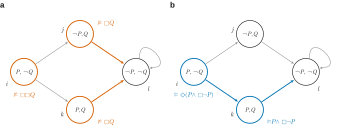
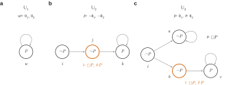
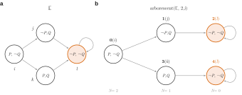

# Centrale-Supélec MPI — Informatique 2026 · Corrigé guidé

*Corrigé rédigé par IA, non officiel. Signalez toute erreur.*

## Présentation du sujet

**Thème.** La logique *déontique*, logique du « devoir être » : une propriété est *obligatoire* si elle est vraie dans tous les mondes idéaux, *autorisée* si elle est vraie dans au moins l'un d'eux, indépendamment de ce qui se passe dans le monde réel. Ces deux quantificateurs sur les mondes, « pour tout » et « il existe », sont le fil rouge des quatre parties : ils deviennent un `GROUP BY … HAVING` en SQL, les opérateurs $\Box$ et $\Diamond$ d'une grammaire puis d'une sémantique de Kripke, et enfin trois règles d'inférence.

**Format.** 4 heures, calculatrice autorisée (inutile), 42 questions, aucune donnée numérique. Trois langages : SQL (partie A), OCaml (partie B), C (partie C), plus de la logique pure (parties C.II à C.V et D).

**Découpage.**

| Partie | Questions | Contenu |
|---|---|---|
| A — SQL | Q1–Q5 | sélection, jointure, différence ensembliste, quantification universelle par comptage |
| B.I — Analyse lexicale | Q6–Q9 | parcours de chaîne, sous-chaîne, automate des lexèmes, plus long préfixe |
| B.II — Grammaires | Q10–Q12 | appartenance d'un mot, comparaison de langages, ambiguïté |
| B.III — Analyse syntaxique | Q13–Q15 | descente récursive avec fonctions mutuellement récursives |
| C.I — Formules en C | Q16–Q19 | allocation, parcours d'arbre, libération, copie profonde |
| C.II — Modèles | Q20–Q25 | évaluation propositionnelle, sémantique de Kripke, contre-modèles, conséquence logique |
| C.III — Formules réduites | Q26–Q29 | forme normale négative, test, évaluation dans un univers |
| C.IV — Décidabilité | Q30–Q34 | dépliage en arbre, préservation de la satisfaction, espace de recherche fini |
| C.V — NP-complétude | Q35–Q39 | réduction depuis SAT, univers totaux, certificat polynomial |
| D — Déduction naturelle | Q40–Q42 | arbres de preuve, règles modales D1, D2, D3 |

**Notions du programme mobilisées.** SQL (jointure, `EXCEPT`, agrégation et `HAVING`) ; OCaml (chaînes, références, exceptions, filtrage, fonctions mutuellement récursives) ; C (structures, pointeurs, `malloc`/`free`, `assert`, tableaux bidimensionnels) ; automates finis ; grammaires non contextuelles, arbres de dérivation, ambiguïté ; induction structurelle ; logique propositionnelle (lois de De Morgan, équivalence) ; décidabilité ; classes P et NP, réductions polynomiales, théorème de Cook-Levin ; déduction naturelle.

**Difficulté.** Sujet long mais très progressif. Les parties A, B, C.I et D sont des points rapides pour qui connaît son cours. La logique modale des parties C.II à C.V n'est pas au programme en tant que telle, mais l'énoncé définit tout ; la difficulté est dans la rigueur des inductions (Q27, Q32, Q38) et dans l'assemblage des résultats (Q34, Q39).

**À ne pas laisser passer.** Q1 à Q4, Q6, Q7, Q13 à Q18, Q20 à Q22, Q26, Q28, Q30, Q35, Q36, Q40, Q41 se traitent en quelques minutes chacune. La partie D est indépendante de tout le reste et souvent oubliée en fin d'épreuve : il vaut mieux la traiter tôt.

**Gestion du temps.** Environ 25 minutes pour A, 50 minutes pour B, 1 h 15 pour C.I à C.III, 1 h pour C.IV et C.V, 20 minutes pour D, et une relecture des codes (exhaustivité des filtrages, `NULL`, initialisation des tableaux).

## Partie A — Base de données (SQL)

On interroge une table `conseiller(INSEE, Département, Monde)` où le monde 0 est le monde réel et les mondes 1 à 20 sont les mondes idéaux. Toute la partie consiste à traduire « possible », « obligatoire » et « pas dans le monde réel » en SQL, en distinguant soigneusement le monde 0 des autres.

### Question 1

> [!INDICATION]
> Que signifie, dans la table, « proposer de créer le Gévaudan » pour le conseiller numéro $i$ ? Combien de lignes un même conseiller peut-il produire ?

> [!INDICATION]
> Le monde réel n'est pas un conseiller : pensez à l'exclure, même si l'énoncé rend ici la précaution redondante.

#### Solution

Proposer de créer le Gévaudan, c'est rattacher au moins une commune au Gévaudan dans son monde idéal ; ce département n'existe pas dans le monde réel.

```sql
SELECT DISTINCT Monde
FROM conseiller
WHERE Département = 'Gévaudan' AND Monde <> 0;
```

`DISTINCT` répond à l'exigence « sans doublon » : un conseiller qui rattache trois communes au Gévaudan produirait sinon trois lignes. La condition `Monde <> 0` garantit qu'on ne renvoie que des numéros de conseillers et rend la requête juste pour tout département.

### Question 2

> [!INDICATION]
> Le nom de la commune et son rattachement ne sont pas dans la même table.

> [!INDICATION]
> Une jointure sur la clef `INSEE`, puis trois conditions de sélection. Attention à la colonne présente dans les deux tables.

#### Solution

```sql
SELECT c.Monde
FROM conseiller AS c JOIN commune AS m ON c.INSEE = m.INSEE
WHERE m.Nom = 'Mont-Saint-Michel'
  AND c.Département = 'Ille-et-Vilaine'
  AND c.Monde <> 0;
```

L'unicité du nom garantit que la jointure ne concerne qu'une commune ; un conseiller ne rattachant cette commune qu'à un département, chaque numéro apparaît une fois (un `DISTINCT` ne coûterait rien).

> [!PIEGE]
> Écrire `INSEE` sans préfixe dans la condition de jointure ou dans le `SELECT` : la colonne existe dans les deux tables, la requête est ambiguë et refusée.

### Question 3

> [!INDICATION]
> « Peut » est un quantificateur existentiel sur les mondes idéaux : une seule ligne suffit.

#### Solution

```sql
SELECT DISTINCT INSEE
FROM conseiller
WHERE Département = 'Sarthe' AND Monde <> 0;
```

La condition `Monde <> 0` est cette fois indispensable : une commune sarthoise dans le monde réel mais dans aucun monde idéal n'est pas autorisée à être en Sarthe et ne doit pas apparaître.

### Question 4

> [!INDICATION]
> « Vrai dans un monde idéal » et « faux dans le monde réel » portent sur deux lignes différentes de la table.

> [!INDICATION]
> Un opérateur ensembliste au programme réalise exactement « le résultat de Q3 privé de… ».

#### Solution

```sql
SELECT INSEE FROM conseiller WHERE Département = 'Sarthe' AND Monde <> 0
EXCEPT
SELECT INSEE FROM conseiller WHERE Département = 'Sarthe' AND Monde = 0;
```

`EXCEPT` calcule la différence ensembliste et élimine les doublons.

> [!PIEGE]
> `WHERE Département = 'Sarthe' AND Monde <> 0 AND NOT (Département = 'Sarthe' AND Monde = 0)` ne retire rien : chaque condition est évaluée sur une seule ligne. Dès qu'une propriété met en jeu deux lignes, il faut deux requêtes combinées (ou une sous-requête).

### Question 5

> [!INDICATION]
> Un « pour tout » sur un ensemble fini et connu de mondes se traduit en SQL par un comptage.

> [!INDICATION]
> Regroupez par couple (commune, département) en ne gardant que les mondes idéaux, filtrez les groupes, puis retirez ce qui est vrai dans le monde réel.

#### Solution

Le couple (`INSEE`, `Département`) est obligatoire s'il apparaît dans les 20 mondes idéaux :

```sql
SELECT INSEE, Département
FROM conseiller
WHERE Monde <> 0
GROUP BY INSEE, Département
HAVING COUNT(DISTINCT Monde) = 20
EXCEPT
SELECT INSEE, Département
FROM conseiller
WHERE Monde = 0;
```

- Le `WHERE Monde <> 0` filtre les lignes **avant** le regroupement : sinon un couple présent dans 19 mondes idéaux et dans le monde réel atteindrait 20.
- `HAVING` filtre les groupes, après agrégation ; un `WHERE COUNT(...)` serait refusé.
- `COUNT(DISTINCT Monde)` protège contre d'éventuelles lignes répétées ; si l'on admet que (`INSEE`, `Monde`) identifie une ligne, `COUNT(*)` convient.
- `EXCEPT` conserve un couple dont le département n'existe pas dans le monde réel (le Gévaudan), ce qui est voulu.

> [!METHODE]
> En SQL, « pour tout $x$ de $X$ » se traduit par `GROUP BY … HAVING COUNT(DISTINCT x) = |X|` quand $|X|$ est connu, ou par une double négation (« il n'existe pas de $x$ tel que non… ») avec `NOT EXISTS` ou `EXCEPT`.

## Partie B — Analyse lexicale et syntaxique (OCaml)

On transforme une chaîne en liste de lexèmes grâce à un automate, puis la liste en arbre de syntaxe abstraite par descente récursive, après avoir comparé deux grammaires candidates.

### Question 6

> [!INDICATION]
> Un parcours d'indice, avec un arrêt dès que le caractère est trouvé.

> [!INDICATION]
> L'évaluation paresseuse de `&&` et `||` permet d'écrire la fonction en une seule expression booléenne, sans lire hors de la chaîne.

#### Solution

```ocaml
let appartient chaine c =
  let n = String.length chaine in
  let rec parcours i =
    i < n && (chaine.[i] = c || parcours (i + 1))
  in
  parcours 0
```

Le test `i < n` est évalué d'abord : `chaine.[n]` n'est jamais lu. Terminaison : $n-i$ décroît strictement. Complexité $O(n)$ dans le pire cas. Une boucle `while` avec une référence booléenne est tout aussi correcte.

### Question 7

> [!INDICATION]
> Commencez par écrire la condition exacte de validité sur `debut` et la longueur.

> [!INDICATION]
> Une chaîne OCaml est immuable : on la construit d'un coup (par une fonction qui donne le $k$-ième caractère) ou par concaténations.

#### Solution

```ocaml
let sous_chaine chaine debut longueur =
  assert (debut >= 0 && longueur >= 0
          && debut + longueur <= String.length chaine);
  String.init longueur (fun k -> chaine.[debut + k])
```

Si l'appel est invalide, l'assertion lève `Assert_failure`. Sinon, tous les indices `debut + k`, $0\le k<$ `longueur`, sont valides. Contrôle : les indices 3 à 6 de `"abracadabra"` portent `a`, `c`, `a`, `d`, d'où `"acad"` ; pour `sous_chaine "abc" 1 3`, $1+3=4>3$ et l'exception est levée. Coût linéaire.

Si l'on veut n'utiliser que les éléments de `String` exigibles (`String.length`, `s.[i]` et `^`), on accumule dans une référence `r := !r ^ String.make 1 chaine.[i]` pour `i` de `debut` à `debut + longueur - 1` ; c'est correct mais de coût quadratique.

> [!PIEGE]
> Le troisième argument est une **longueur**, pas un indice de fin. La condition est `debut + longueur <= String.length chaine` (inégalité large) : la sous-chaîne qui va jusqu'au dernier caractère est valide.

### Question 8

> [!INDICATION]
> Lisez l'automate comme un programme : une boucle pour l'état 0, puis une décision sur le premier caractère non espacé.

> [!INDICATION]
> Repérez quels états sont acceptants et quand l'automate se bloque. Le « plus long préfixe reconnu » demande-t-il un retour arrière ici ?

> [!INDICATION]
> Listez les cas où aucun préfixe n'atteint un état acceptant : c'est là qu'il faut lever l'exception.

#### Solution

L'automate reconnaît $\mathcal E^*\bigl(\mathcal P\cup\mathcal A(\mathcal A\cup\{\_\})^*\bigr)$. Après les espacements, une parenthèse mène à l'état 3, acceptant et sans transition sortante : le lexème a un caractère. Une lettre mène à l'état 1 ; les états 1 et 2 sont acceptants et lisent tous deux lettres et `_` (l'état 1 passe en 2 sur `_`), l'automate se bloque sur tout autre caractère. Comme tous les états atteints après le premier caractère sont acceptants, le plus long préfixe reconnu s'obtient en avançant tant qu'on lit une lettre ou `_`, sans retour arrière.

```ocaml
let detecte_lexeme chaine debut =
  let n = String.length chaine in
  let i = ref debut in
  while !i < n && appartient espaces chaine.[!i] do   (* état 0 *)
    i := !i + 1
  done;
  let d = !i in
  if d >= n then raise Erreur_Lexicale
  else if chaine.[d] = '(' || chaine.[d] = ')' then (d, d + 1)   (* état 3 *)
  else if appartient alphabet chaine.[d] then begin               (* état 1 *)
    let j = ref (d + 1) in
    while !j < n && (appartient alphabet chaine.[!j] || chaine.[!j] = '_') do
      j := !j + 1                                                  (* états 1, 2 *)
    done;
    (d, !j)
  end
  else raise Erreur_Lexicale
```

L'exception est levée si la fin de chaîne est atteinte dans l'état 0 (non acceptant) ou si le premier caractère non espacé n'est ni une lettre ni une parenthèse (par exemple `_`, ce qui traduit l'interdiction de commencer une variable par ce caractère). Contrôle : depuis l'indice 3 de `"non doit manger_crepe"`, on saute l'espace, `d = 4`, on lit `doit` et l'on s'arrête à l'espace d'indice 8 : `(4, 8)` ; depuis 4, même résultat.

> [!PIEGE]
> `fin_lexeme` est **exclu** : c'est l'indice du premier caractère non consommé. Renvoyer l'indice du dernier caractère du lexème décale toute l'analyse de Q9.

### Question 9

> [!INDICATION]
> On enchaîne `detecte_lexeme` et `produit_lexeme`, en repartant de l'indice de fin.

> [!INDICATION]
> Que fait `detecte_lexeme` sur une fin de chaîne constituée uniquement d'espacements ? La condition d'arrêt doit le prévoir.

#### Solution

```ocaml
let analyse_lexicale chaine =
  let n = String.length chaine in
  let rec fini i = i >= n || (appartient espaces chaine.[i] && fini (i + 1)) in
  let rec parcours debut =
    if fini debut then []
    else
      let (d, f) = detecte_lexeme chaine debut in
      produit_lexeme chaine d f :: parcours f
  in
  parcours 0
```

Les erreurs lexicales sont levées par `detecte_lexeme` et se propagent sans rattrapage. Terminaison : `f > d >= debut`. Sur l'exemple, les découpes successives sont `(0, 3)`, `(4, 8)`, `(9, 21)`, d'où `[Lex_non; Lex_doit; Lex_var "manger_crepe"]`. La fonction n'est pas récursive terminale ; la profondeur de pile est le nombre de lexèmes, ce qui est acceptable. Une version terminale utiliserait un accumulateur et `List.rev`, pas `@`.

### Question 10

> [!INDICATION]
> Pour montrer qu'un mot **n'est pas** engendré, examinez la première règle appliquée au symbole initial : le premier terminal du mot élimine la plupart des choix.

> [!INDICATION]
> Pour éliminer $E\to A\ \mathtt{et}\ A$ dans $\mathcal G$, cherchez un invariant vérifié par tous les mots engendrés, portant sur les parenthèses.

> [!INDICATION]
> Pour montrer qu'un mot **est** engendré, une dérivation complète suffit.

#### Solution

On écrit $m_1 = n\ \mathtt{doit}\ (\ n\ \mathtt{et}\ n\ )$ et $m_2 = n\ \mathtt{et}\ \mathtt{doit}\ (\ \mathtt{non}\ n\ \mathtt{et}\ n\ )$. Tout mot engendré par $\mathcal G$ est bien parenthésé (les règles créent les parenthèses par paires).

**$m_1\notin L(\mathcal G)$.** $A\to(E)$ est exclu, car $m_1$ ne commence pas par `(` ; donc $A\to E$. Puis :

- $E\to n$ est exclu, car $m_1\ne n$ ;
- $E\to\mathtt{non}\,A$ et $E\to\mathtt{doit}\,A$ aussi, car $m_1$ commence par $n$ ;
- reste $E\to A\ \mathtt{et}\ A$ : l'unique `et` de $m_1$ impose que le premier $A$ engendre $n\ \mathtt{doit}\ (\ n$, mot mal parenthésé : impossible.

**$m_1\notin L(\mathcal H)$.** Depuis $E$ :

- $E\to n$ donne $n$ ;
- $E\to(B)$ donne un mot commençant par `(` ;
- $E\to C$ donne un mot commençant par `non` ou `doit`.

Or $m_1$ commence par $n$ et n'est pas réduit à $n$.

**$m_2\in L(\mathcal G)$.**

$$
\begin{aligned}
A &\Rightarrow E\\
&\Rightarrow A\ \mathtt{et}\ A\\
&\Rightarrow E\ \mathtt{et}\ A\\
&\Rightarrow n\ \mathtt{et}\ A\\
&\Rightarrow n\ \mathtt{et}\ E\\
&\Rightarrow n\ \mathtt{et}\ \mathtt{doit}\ A\\
&\Rightarrow n\ \mathtt{et}\ \mathtt{doit}\ (\,E\,)\\
&\Rightarrow n\ \mathtt{et}\ \mathtt{doit}\ (\,A\ \mathtt{et}\ A\,)\\
&\Rightarrow n\ \mathtt{et}\ \mathtt{doit}\ (\,E\ \mathtt{et}\ A\,)\\
&\Rightarrow n\ \mathtt{et}\ \mathtt{doit}\ (\,\mathtt{non}\ A\ \mathtt{et}\ A\,)\\
&\Rightarrow^* m_2 .
\end{aligned}
$$

**$m_2\notin L(\mathcal H)$**, par le même argument que pour $m_1$.

> [!PIEGE]
> Une réponse négative non justifiée (« ce n'est pas une formule bien formée ») ne vaut rien : il faut montrer qu'**aucune** dérivation n'aboutit.

### Question 11

> [!INDICATION]
> La question précédente fournit peut-être déjà la réponse.

> [!INDICATION]
> Pour compléter le tableau, demandez-vous si l'un des deux langages est inclus dans l'autre, et prouvez-le par induction sur les dérivations.

#### Solution

**Non** : $m_2\in L(\mathcal G)$ et $m_2\notin L(\mathcal H)$ (Q10). Des exemples plus courts sont $n\ \mathtt{et}\ n$ et $(\,n\,)$.

En revanche $L(\mathcal H)\subseteq L(\mathcal G)$. Par induction sur la dérivation dans $\mathcal H$, on montre :

- si $E$ ou $C$ engendre $w$ dans $\mathcal H$, alors $A$ l'engendre dans $\mathcal G$ ;
- si $B$ engendre $w$ dans $\mathcal H$, alors $E$ engendre $w$ dans $\mathcal G$.

Cas par règle :

- $E\to n$ : $A\Rightarrow E\Rightarrow n$.
- $E\to(B)$ avec $B\Rightarrow^*_{\mathcal H}u$ : $A\Rightarrow(E)\Rightarrow^*(u)$.
- $E\to C$ : hypothèse sur $C$.
- $B\to E\ \mathtt{et}\ E$ : $E\Rightarrow A\ \mathtt{et}\ A\Rightarrow^*u_1\ \mathtt{et}\ u_2$.
- $C\to\mathtt{non}\ E$ ou $\mathtt{doit}\ E$ : $A\Rightarrow E\Rightarrow\mathtt{non}\ A\Rightarrow^*\mathtt{non}\ u$, de même pour `doit`.

Donc $L(\mathcal H)\subsetneq L(\mathcal G)$ : $\mathcal H$ est la version « entièrement parenthésée » de $\mathcal G$.

> [!METHODE]
> Pour montrer que deux grammaires n'engendrent pas le même langage, un mot suffit, à condition de justifier **les deux** appartenances (il est dans l'un, il n'est pas dans l'autre).

### Question 12

> [!INDICATION]
> Pour $\mathcal G$, cherchez un mot court qui se lit de deux façons, comme une formule logique mal parenthésée.

> [!INDICATION]
> Pour $\mathcal H$, observez que chaque règle de $E$ commence par un terminal différent. Que reste-t-il à justifier dans la règle de $B$ ?

#### Solution

**$\mathcal G$ est ambiguë.** Le mot $\mathtt{non}\ n\ \mathtt{et}\ n$ admet deux arbres :

- $A\to E\to\mathtt{non}\ A$, et ce $A$ se dérive en $E\to A\ \mathtt{et}\ A$ puis $n\ \mathtt{et}\ n$ : lecture $\neg(x\wedge y)$ ;
- $A\to E\to A\ \mathtt{et}\ A$, le premier $A$ donnant $\mathtt{non}\ n$ et le second $n$ : lecture $(\neg x)\wedge y$.

Les deux arbres diffèrent par la règle appliquée au $E$ sous la racine.



**$\mathcal H$ n'est pas ambiguë.** Le premier terminal fixe la règle de $E$ :

- $n$ donne $E\to n$ ;
- `(` donne $E\to(B)$ ;
- `non` ou `doit` donnent $E\to C$, puis la règle correspondante de $C$.

Pour $B\to E\ \mathtt{et}\ E$, la découpe est unique car $L(\mathcal H)$ est sans préfixe.

En effet, un mot de $L(\mathcal H)$ est $n$, ou un mot qui commence par `(` et s'arrête à la parenthèse fermante associée, ou $\mathtt{non}\,u$, $\mathtt{doit}\,u$ avec $u\in L(\mathcal H)$.

Si $u_1\ \mathtt{et}\ u_2=v_1\ \mathtt{et}\ v_2$, l'un de $u_1,v_1$ est préfixe de l'autre, donc ils sont égaux. Par induction, l'arbre est unique.

> [!PIEGE]
> L'ambiguïté porte sur les **arbres** de dérivation, pas sur les dérivations : deux ordres de réécriture différents pour le même arbre ne prouvent rien. Donner les deux lectures logiques du mot est la façon la plus sûre de montrer que les arbres diffèrent.

### Question 13

> [!INDICATION]
> On est dans la règle $B\to E\ \mathtt{et}\ E$ : le premier $E$ et le `et` ont été reconnus. Que reste-t-il à analyser, et quel reste faut-il renvoyer ?

#### Solution

```ocaml
        let (f2, q2) = derive_E q in
        (Et (f1, f2), q2)
```

On analyse le second opérande sur le reste `q` qui suit `Lex_et` et l'on renvoie le reste `q2` du second appel. Renvoyer `q` serait faux : le reste contiendrait encore les lexèmes du second opérande, et `derive_E` (branche `Lex_PO`) échouerait à trouver la parenthèse fermante qu'elle attend. La parenthèse fermante n'est pas consommée ici mais par `derive_E`.

### Question 14

> [!INDICATION]
> La règle $C\to\mathtt{non}\ E\mid\mathtt{doit}\ E$ se lit sur la tête de la liste.

> [!INDICATION]
> N'oubliez pas le cas où aucune des deux règles ne s'applique.

#### Solution

```ocaml
  | Lex_non :: q ->
    let (f, reste) = derive_E q in
    (Non f, reste)
  | Lex_doit :: q ->
    let (f, reste) = derive_E q in
    (Doit f, reste)
  | _ -> raise Erreur_Syntaxique
```

Sur l'exemple de l'énoncé, `derive_E` délègue à `derive_C`, qui filtre `Lex_non`, obtient `(Var "manger_crepe", [Lex_et; Lex_doit; Lex_var "remercier_mamie"; Lex_PF])` et renvoie `(Non (Var "manger_crepe"), [Lex_et; Lex_doit; Lex_var "remercier_mamie"; Lex_PF])`. Terminaison : tout cycle d'appels consomme un lexème (`Lex_PO` avant `derive_B`, `Lex_non` ou `Lex_doit` avant le `derive_E` de `derive_C`). Le cas de la liste vide aboutit à `Erreur_Syntaxique`.

Le point-virgule qui termine la ligne 4 du squelette (`(Var x, q);`) est superflu mais sans effet : OCaml accepte un `;` final dans une séquence, et le squelette compile tel quel.

> [!METHODE]
> Dans une descente récursive, chaque fonction renvoie (arbre, reste) et chaque règle de la grammaire devient un cas de filtrage. Le **reste** circule d'un appel au suivant : c'est le seul état de l'analyseur.

### Question 15

> [!INDICATION]
> `derive_E` peut réussir sur un préfixe strict de la liste. Comment le détecter ?

#### Solution

```ocaml
let analyse_syntaxique lexemes =
  match derive_E lexemes with
  | (f, []) -> f
  | _ -> raise Erreur_Syntaxique
```

La liste est engendrée par $\mathcal H$ si et seulement si `derive_E` réussit avec un reste vide ; les échecs internes propagent `Erreur_Syntaxique`. Sans le test du reste, la liste issue de `"x )"` serait acceptée. Sur la phrase d'introduction, le résultat est `Et (Var "Grand_mere_a_prepare_des_crepes", Doit (Var "je_mange_les_crepes"))`.

## Partie C — Univers de Kripke (en C)

Les formules sont représentées par des arbres binaires en C, interprétées dans des graphes de mondes (sémantique de Kripke), mises sous forme réduite (négations devant les variables seulement), puis l'on montre que la satisfiabilité est décidable et qu'une variante restreinte est NP-complète.

### Question 16

> [!INDICATION]
> Allocation sur le tas de la **structure** (pas d'un pointeur), contrôle de l'allocation, puis affectation des quatre champs.

#### Solution

```c
formule *cree_formule(int op, int variable, formule *fg, formule *fd) {
    formule *f = malloc(sizeof(formule));
    assert(f != NULL);
    f->op = op;
    f->variable = variable;
    f->gauche = fg;
    f->droite = fd;
    return f;
}
```

C'est un constructeur brut : c'est à l'appelant de passer `NULL` et $-1$ aux bons endroits.

> [!PIEGE]
> `malloc(sizeof(formule *))` alloue la taille d'un pointeur, pas celle de la structure : les écritures suivantes débordent.

### Question 17

> [!INDICATION]
> Parcours récursif de l'arbre ; un test de nullité en tête évite de distinguer variables, opérateurs unaires et binaires.

#### Solution

```c
int compter_peut(formule *f) {
    if (f == NULL) { return 0; }
    int n = (f->op == PEUT) ? 1 : 0;
    return n + compter_peut(f->gauche) + compter_peut(f->droite);
}
```

Sur $X_1\vee\Diamond X_2$ : la racine `OU` et les deux variables comptent 0, le nœud `PEUT` compte 1 : résultat 1. On ne s'arrête pas à un `PEUT` : $\Diamond\Diamond X_1$ en contient deux.

### Question 18

> [!INDICATION]
> Dans quel ordre libérer un nœud et ses fils pour ne jamais lire une zone déjà libérée ?

#### Solution

```c
void free_formule(formule *f) {
    if (f == NULL) { return; }
    free_formule(f->gauche);
    free_formule(f->droite);
    free(f);
}
```

Post-ordre : les champs `gauche` et `droite` sont lus avant `free(f)`. Sur $X_1\vee\Diamond X_2$, les quatre structures sont libérées (les deux variables, le `PEUT`, puis le `OU`).

> [!PIEGE]
> Un `free(f)` placé en premier fait lire `f->gauche` dans une zone libérée : comportement indéfini, même si le programme semble fonctionner.

### Question 19

> [!INDICATION]
> Les trois contraintes réunies imposent une copie profonde : chaque nœud du résultat doit être alloué.

> [!INDICATION]
> Traitez récursivement les deux fils, puis assemblez selon l'opérateur ; seul le cas de l'implication change de forme.

#### Solution

```c
formule *retirer_implications(formule *f) {
    if (f == NULL) { return NULL; }
    formule *g = retirer_implications(f->gauche);
    formule *d = retirer_implications(f->droite);
    if (f->op == IMPLIQUE) {
        return cree_formule(OU, -1, cree_formule(NON, -1, g, NULL), d);
    }
    return cree_formule(f->op, f->variable, g, d);
}
```

Par induction sur `f` : rien n'est écrit dans `f` ; chaque nœud renvoyé vient d'un `malloc` neuf, feuilles comprises, donc aucun partage de mémoire ; un nœud $\varphi\to\psi$ devient $\neg\varphi'\vee\psi'$ avec $\varphi',\psi'$ sans implication par hypothèse d'induction. Le nœud `NON` créé respecte la convention des unaires (`droite = NULL`, `variable = -1`).

> [!PIEGE]
> `cree_formule(OU, -1, cree_formule(NON, -1, f->gauche, NULL), f->droite)` partage les sous-arbres avec `f` : une libération de `f` suivie de celle du résultat produirait une double libération.

### Question 20

> [!INDICATION]
> Trois formes seulement : variable, négation, conjonction. La valeur d'une variable se lit dans le tableau du monde.

#### Solution

```c
bool satisfaction(monde *m, formule *f) {
    if (f->op == VARIABLE) {
        assert(0 <= f->variable && f->variable < m->taille);
        return m->valuation[f->variable];
    }
    if (f->op == NON) { return !satisfaction(m, f->gauche); }
    assert(f->op == ET);
    return satisfaction(m, f->gauche) && satisfaction(m, f->droite);
}
```

L'assertion sur l'indice protège d'une lecture hors du tableau (un monde ne représente qu'un nombre fini de variables). On ne peut pas écrire de `switch` : en C, des identificateurs `const int` ne sont pas des expressions constantes admises comme étiquettes `case`.

### Question 21

> [!INDICATION]
> $\Box\Box Q$ demande que **tout** successeur de $i$ satisfasse $\Box Q$ : un seul successeur fautif suffit à conclure négativement.

#### Solution



Le seul successeur de $j$ est $l$, où $Q$ est fausse : $\mathbb E\not\models_j\Box Q$.

Comme $j$ est un successeur de $i$ :

$$\boxed{\mathbb E\not\models_i\Box\Box Q}$$

> [!PIEGE]
> $\Box\Box Q$ ne dit pas « $Q$ est vraie à distance 1 ou 2 » mais « $Q$ est vraie dans tout monde accessible en **exactement** deux étapes ». Ici ces mondes se réduisent à $l$.

### Question 22

> [!INDICATION]
> Un $\Diamond$ demande un témoin : examinez les successeurs de $i$ un par un.

#### Solution

Le successeur $k$ de $i$ vérifie $P$. Son seul successeur $l$ vérifie $\neg P$, donc $\mathbb E\models_k\Box\neg P$.

Ainsi $\mathbb E\models_k P\wedge\Box\neg P$ et :

$$\boxed{\mathbb E\models_i\Diamond(P\wedge\Box\neg P)}$$

(Le successeur $j$ ne convient pas, $P$ y étant fausse ; un seul témoin suffit.)

### Question 23

> [!INDICATION]
> Pour satisfaire une implication, il suffit d'en rendre la conclusion vraie.

> [!INDICATION]
> Pour $\neg\theta_1$, il faut $\Box\Box P$ vraie et $\Box P$ fausse : où $P$ doit-elle être fausse, où doit-elle être vraie ? N'oubliez pas que tout monde doit avoir un successeur.

#### Solution



**$\theta_1$ satisfiable.** $\mathbb U_1$ : un monde $w$, arc $(w,w)$, $P$ vraie.

Le seul successeur de $w$ vérifie $P$, donc $\mathbb U_1\models_w\Box P$, et l'implication $\theta_1$ est vraie en $w$.

**$\neg\theta_1$ satisfiable.** Univers $\mathbb U_2$ :

- mondes $i,j,k$ ;
- arcs $i\to j$, $j\to k$, $k\to k$ ;
- $P$ fausse en $i$ et $j$, vraie en $k$.

Alors :

- l'unique successeur de $j$ est $k$, donc $\mathbb U_2\models_j\Box P$ ;
- l'unique successeur de $i$ est $j$, donc $\mathbb U_2\models_i\Box\Box P$ ;
- mais $P$ est fausse en $j$ : $\mathbb U_2\not\models_i\Box P$.

Donc $\mathbb U_2\models_i\neg\theta_1$.

> [!PIEGE]
> Un contre-modèle où un monde n'a pas de successeur (par exemple $i\to j$ avec $j$ « terminal ») est hors définition : l'énoncé impose que tout monde ait au moins un successeur.

### Question 24

> [!INDICATION]
> Traduisez d'abord $\neg\theta_2$ en poussant la négation à l'intérieur de la modalité : vous saurez exactement quel monde construire.

> [!INDICATION]
> Les univers de la question précédente peuvent resservir.

#### Solution

$$
\begin{aligned}
\neg\theta_2&\equiv\Diamond\neg(\Box P\to P)\\
&\equiv\Diamond(\Box P\wedge\neg P)
\end{aligned}
$$

Il faut donc un successeur où $P$ est fausse mais obligatoire.

**$\theta_2$ satisfiable** : dans $\mathbb U_1$, le seul successeur $w$ de $w$ vérifie $P$, donc $\Box P\to P$.

D'où $\mathbb U_1\models_w\theta_2$.

**$\neg\theta_2$ satisfiable** : dans $\mathbb U_2$, le successeur $j$ de $i$ vérifie $\Box P$, car son unique successeur vérifie $P$.

Il vérifie aussi $\neg P$.

Donc $\mathbb U_2\not\models_j\Box P\to P$, et $\mathbb U_2\models_i\neg\theta_2$.

### Question 25

> [!INDICATION]
> Pour le premier sens, prenez un modèle de $\theta_2$ et supposez la prémisse de $\theta_1$ ; regardez un successeur quelconque.

> [!INDICATION]
> Pour le second, il faut un univers où $\theta_1$ est vraie **et** $\theta_2$ fausse. Le plus économique est de rendre fausse la prémisse de $\theta_1$ par une branche, tout en installant ailleurs ce qui met $\theta_2$ en défaut.

#### Solution

**$\theta_2$ entraîne $\theta_1$.** Soit $(\mathbb U,i)$ avec $\mathbb U\models_i\Box(\Box P\to P)$.

Supposons $\mathbb U\models_i\Box\Box P$ et soit $j$ un successeur de $i$. Alors :

- $\mathbb U\models_j\Box P$ ;
- $\mathbb U\models_j\Box P\to P$ ;
- donc $\mathbb U\models_j P$.

Ainsi $\mathbb U\models_i\Box P$, et $\mathbb U\models_i\theta_1$.

**$\theta_1$ n'entraîne pas $\theta_2$.** Univers $\mathbb U_3$ :

- mondes $i,a,b,c$ ;
- arcs $i\to a$, $i\to b$, $a\to a$, $b\to c$, $c\to c$ ;
- $P$ fausse en $i,a,b$, vraie en $c$.

Alors :

- $\mathbb U_3\not\models_a\Box P$ (boucle sur $a$, $P$ fausse), donc $\mathbb U_3\not\models_i\Box\Box P$. La prémisse de $\theta_1$ est fausse : $\mathbb U_3\models_i\theta_1$.
- $\mathbb U_3\models_b\Box P$ (unique successeur $c$) et $\mathbb U_3\not\models_b P$. Donc $\mathbb U_3\not\models_i\theta_2$.

> [!PIEGE]
> L'univers $\mathbb U_2$ ne répond pas à la seconde moitié : il satisfait $\neg\theta_1$ **et** $\neg\theta_2$, ce n'est donc pas un modèle de $\theta_1$.

> [!METHODE]
> « $\varphi$ est conséquence logique de $\psi$ » se démontre en prenant un modèle quelconque de $\psi$ ; « n'est pas conséquence » se réfute par **un** modèle de $\psi$ qui n'est pas modèle de $\varphi$, vérifié explicitement monde par monde.

### Question 26

> [!INDICATION]
> Question de cours : deux lois, à énoncer toutes les deux.

#### Solution

$$\boxed{\begin{aligned}
\neg(\varphi\wedge\psi)&\equiv\neg\varphi\vee\neg\psi\\
\neg(\varphi\vee\psi)&\equiv\neg\varphi\wedge\neg\psi
\end{aligned}}$$

Elles valent en tout monde de tout univers, car les clauses de $\wedge,\vee,\neg$ sont celles du calcul propositionnel au monde considéré ; on peut donc les utiliser à l'intérieur des modalités.

### Question 27

> [!INDICATION]
> Établissez d'abord les « lois de De Morgan modales » reliant $\neg\Box$ et $\neg\Diamond$ à $\Diamond\neg$ et $\Box\neg$, directement à partir de la sémantique.

> [!INDICATION]
> Une induction qui ne construit qu'une forme réduite de $\varphi$ bloque sur le cas $\varphi=\neg\psi$. Renforcez l'énoncé.

> [!INDICATION]
> Construisez simultanément une forme réduite de $\varphi$ et une forme réduite de $\neg\varphi$.

#### Solution

*Lemmes.*

*(1)* $\neg\Box\varphi\equiv\Diamond\neg\varphi$ et $\neg\Diamond\varphi\equiv\Box\neg\varphi$ : « il est faux que tout successeur satisfait $\varphi$ » équivaut à « un successeur satisfait $\neg\varphi$ », et symétriquement.

*(2)* $\neg\neg\varphi\equiv\varphi$ et $\varphi\to\psi\equiv\neg\varphi\vee\psi$.

*(3)* L'équivalence est compatible avec tous les connecteurs : la valeur d'une formule composée en $i$ ne dépend que des valeurs de ses composantes en $i$ ou en ses successeurs.

*Construction simultanée de $\mathrm r(\varphi)$ et $\mathrm n(\varphi)$* :

| $\varphi$ | $\mathrm r(\varphi)$ | $\mathrm n(\varphi)$ |
|---|---|---|
| $P$ | $P$ | $\neg P$ |
| $\neg\psi$ | $\mathrm n(\psi)$ | $\mathrm r(\psi)$ |
| $\psi\wedge\chi$ | $\mathrm r(\psi)\wedge\mathrm r(\chi)$ | $\mathrm n(\psi)\vee\mathrm n(\chi)$ |
| $\psi\vee\chi$ | $\mathrm r(\psi)\vee\mathrm r(\chi)$ | $\mathrm n(\psi)\wedge\mathrm n(\chi)$ |
| $\psi\to\chi$ | $\mathrm n(\psi)\vee\mathrm r(\chi)$ | $\mathrm r(\psi)\wedge\mathrm n(\chi)$ |
| $\Box\psi$ | $\Box\,\mathrm r(\psi)$ | $\Diamond\,\mathrm n(\psi)$ |
| $\Diamond\psi$ | $\Diamond\,\mathrm r(\psi)$ | $\Box\,\mathrm n(\psi)$ |

*Réduction* : par induction, les feuilles $P$ et $\neg P$ sont réduites, et les autres lignes n'emploient que $\wedge,\vee,\Box,\Diamond$ sur des formules réduites.

*Équivalence* : par induction simultanée, $\mathrm r(\varphi)\equiv\varphi$ et $\mathrm n(\varphi)\equiv\neg\varphi$.

*Cas $\neg\psi$* :

$$
\begin{aligned}
\mathrm r&=\mathrm n(\psi)\\
&\equiv\neg\psi\\[4pt]
\mathrm n&=\mathrm r(\psi)\\
&\equiv\psi\\
&\equiv\neg\neg\psi
\end{aligned}
$$

*Cas $\psi\wedge\chi$* : $\mathrm r\equiv\psi\wedge\chi$ par (3) ; par De Morgan,

$$
\begin{aligned}
\mathrm n&\equiv\neg\psi\vee\neg\chi\\
&\equiv\neg(\psi\wedge\chi)
\end{aligned}
$$

Le cas $\vee$ est symétrique.

*Cas $\psi\to\chi$* :

$$
\begin{aligned}
\mathrm r&\equiv\neg\psi\vee\chi\\
&\equiv\psi\to\chi\\[4pt]
\mathrm n&\equiv\psi\wedge\neg\chi\\
&\equiv\neg(\neg\psi\vee\chi)
\end{aligned}
$$

*Cas $\Box\psi$* : $\mathrm r\equiv\Box\psi$ ; par (3) puis (1),

$$
\begin{aligned}
\mathrm n&\equiv\Diamond\neg\psi\\
&\equiv\neg\Box\psi
\end{aligned}
$$

Le cas $\Diamond$ est symétrique.

Toute formule déontique est donc équivalente à la formule réduite $\mathrm r(\varphi)$.

De plus, $|\mathrm r(\varphi)|+|\mathrm n(\varphi)|\le4|\varphi|$ (récurrence immédiate) : la transformation est linéaire, ce qui servira en Q39.

> [!METHODE]
> Renforcer l'hypothèse d'induction (ici : traiter $\varphi$ et $\neg\varphi$ ensemble) est le réflexe standard quand le cas inductif demande une information que l'hypothèse ne fournit pas.

### Question 28

> [!INDICATION]
> Traduisez la définition inductive cas par cas. Un seul cas demande d'examiner le fils au lieu de rappeler la fonction.

#### Solution

```c
bool est_reduite(formule *f) {
    if (f->op == VARIABLE) { return true; }
    if (f->op == NON) { return f->gauche->op == VARIABLE; }
    if (f->op == ET || f->op == OU) {
        return est_reduite(f->gauche) && est_reduite(f->droite);
    }
    if (f->op == DOIT || f->op == PEUT) { return est_reduite(f->gauche); }
    return false;   /* IMPLIQUE */
}
```

> [!PIEGE]
> `return est_reduite(f->gauche);` dans le cas `NON` accepterait $\neg\Box P$ ou $\neg(P\wedge Q)$, qui ne sont pas réduites. Et sans le `return false` final, la fonction n'a pas de valeur de retour sur une implication.

### Question 29

> [!INDICATION]
> Étendez `satisfaction` : $\Box$ est un « et » sur les successeurs, $\Diamond$ un « ou ». Les successeurs se lisent sur la ligne $i$ de la matrice.

#### Solution

```c
bool satisfaction2(univers *u, int i, formule *f) {
    if (f->op == VARIABLE) {
        assert(0 <= f->variable && f->variable < u->mondes[i].taille);
        return u->mondes[i].valuation[f->variable];
    }
    if (f->op == NON) {
        return !satisfaction2(u, i, f->gauche);   /* fils : une variable */
    }
    if (f->op == ET) {
        return satisfaction2(u, i, f->gauche) && satisfaction2(u, i, f->droite);
    }
    if (f->op == OU) {
        return satisfaction2(u, i, f->gauche) || satisfaction2(u, i, f->droite);
    }
    if (f->op == DOIT) {
        for (int j = 0; j < u->nb_mondes; j = j + 1) {
            if (u->matrice[i][j] && !satisfaction2(u, j, f->gauche)) { return false; }
        }
        return true;
    }
    assert(f->op == PEUT);
    for (int j = 0; j < u->nb_mondes; j = j + 1) {
        if (u->matrice[i][j] && satisfaction2(u, j, f->gauche)) { return true; }
    }
    return false;
}
```

La récursion porte sur des sous-formules strictes : elle termine même si le graphe a des cycles. Sans mémoïsation, le coût peut être exponentiel en la profondeur modale (de l'ordre de $|\varphi|\,N^{\mathrm{md}(\varphi)}$). Sur $\mathbb E$, la fonction confirme Q21 et Q22.

### Question 30

> [!INDICATION]
> Écrivez la relation de récurrence que suit le nombre de mondes, en suivant l'algorithme à la lettre.

> [!INDICATION]
> Un monde de $\mathbb U$ accessible par plusieurs chemins est dupliqué autant de fois.

#### Solution

$$\boxed{\begin{aligned}
T(i,0)&=1\\
T(i,N)&=1+\sum_{j\,:\,R_{\mathbb U}(i,j)}T(j,N-1)
\end{aligned}}$$

```c
int taille(univers *u, int i, int N) {
    if (N == 0) { return 1; }
    int s = 1;
    for (int j = 0; j < u->nb_mondes; j = j + 1) {
        if (u->matrice[i][j]) { s = s + taille(u, j, N - 1); }
    }
    return s;
}
```

Sur $\mathbb E$ depuis $i$ : 1, 3, 5 pour $N=0,1,2$.

Si tout monde a $d$ successeurs, $T(i,N)=1+d+\dots+d^N$ : croissance exponentielle en $N$.

### Question 31

> [!INDICATION]
> Allouez l'univers d'un coup grâce à Q30, puis remplissez-le par un parcours récursif.

> [!INDICATION]
> Il faut un compteur « prochain indice libre » partagé par tous les appels : passez-le par pointeur à une fonction auxiliaire. La racine doit être créée avant ses descendants.

#### Solution

```c
int remplir(univers *u, int i, int N, univers *a, int *suivant) {
    int r = *suivant;
    *suivant = r + 1;
    int t = u->mondes[i].taille;
    a->mondes[r].taille = t;
    a->mondes[r].valuation = malloc(t * sizeof(bool));
    assert(a->mondes[r].valuation != NULL);
    for (int v = 0; v < t; v = v + 1) {
        a->mondes[r].valuation[v] = u->mondes[i].valuation[v];
    }
    if (N == 0) {
        a->matrice[r][r] = true;
        return r;
    }
    for (int j = 0; j < u->nb_mondes; j = j + 1) {
        if (u->matrice[i][j]) {
            int rj = remplir(u, j, N - 1, a, suivant);
            a->matrice[r][rj] = true;
        }
    }
    return r;
}

univers *arborescent(univers *u, int i, int N) {
    int n = taille(u, i, N);
    univers *a = malloc(sizeof(univers));
    assert(a != NULL);
    a->nb_mondes = n;
    a->mondes = malloc(n * sizeof(monde));
    a->matrice = malloc(n * sizeof(bool *));
    assert(a->mondes != NULL && a->matrice != NULL);
    for (int r = 0; r < n; r = r + 1) {
        a->matrice[r] = malloc(n * sizeof(bool));
        assert(a->matrice[r] != NULL);
        for (int c = 0; c < n; c = c + 1) { a->matrice[r][c] = false; }
    }
    int suivant = 0;
    remplir(u, i, N, a, &suivant);
    return a;
}
```

La racine reçoit l'indice 0 ; chacun des $T(i,N)=n$ appels consomme un indice, donc tous les indices sont utilisés une fois. Sur $\mathbb E$ avec $N=2$, on obtient cinq mondes :



> [!PIEGE]
> Trois oublis classiques : ne pas initialiser la matrice (`malloc` ne met pas à zéro), partager les tableaux de valuations avec $\mathbb U$, utiliser un compteur local à chaque appel (plusieurs mondes reçoivent alors le même indice).

### Question 32

> [!INDICATION]
> L'énoncé fixe $N$ et $i$, mais une induction sur la formule fait descendre à la fois la formule et la profondeur : généralisez à tout monde $j$ et toute profondeur $n$ assez grande.

> [!INDICATION]
> Introduisez la profondeur modale $\mathrm{md}(\varphi)$, majorée par le nombre de modalités, et justifiez que la satisfaction en un monde ne dépend que des mondes accessibles depuis lui.

> [!INDICATION]
> Pourquoi l'hypothèse « réduite » permet-elle de ne démontrer qu'une implication et non une équivalence ?

#### Solution

On note $A_n(j)$ l'univers `arborescent(U, n, j)`, de racine $r$.

*Lemme de localité.* La satisfaction en un monde $x$ ne dépend que du sous-univers des mondes accessibles depuis $x$. Deux mondes dont les parties accessibles sont isomorphes (valuations comprises, $x$ envoyé sur $y$) satisfont les mêmes formules (induction immédiate).

Dans $A_n(j)$, avec $n\ge1$, les successeurs de $r$ sont les racines $r_k$ des copies de $A_{n-1}(k)$.

Ici, $k$ parcourt les successeurs de $j$.

La partie accessible depuis $r_k$ est exactement cette copie. Donc :

$$A_n(j)\models_{r_k}\psi\iff A_{n-1}(k)\models_{r_k}\psi.\qquad(\ast)$$

*Proposition.* Pour toute formule réduite $\varphi$, tout $n\ge\mathrm{md}(\varphi)$ et tout monde $j$ :

$$\mathbb U\models_j\varphi\Rightarrow A_n(j)\models_r\varphi.$$

Induction structurelle :

- $P$, $\neg P$ : $r$ est une copie de $j$.
- $\wedge$, $\vee$ : hypothèse d'induction au même $n$, au même $j$.
- $\Box\psi$ ($n\ge1$) : tout successeur de $r$ est un $r_k$ avec $R_{\mathbb U}(j,k)$.
  - On a $\mathbb U\models_k\psi$.
  - Puis $A_{n-1}(k)\models_{r_k}\psi$ (hypothèse, $n-1\ge\mathrm{md}(\psi)$).
  - On conclut par $(\ast)$.
- $\Diamond\psi$ : un successeur $k$ de $j$ vérifie $\psi$.

  Par le même raisonnement, $r_k$ est un successeur de $r$ qui vérifie $\psi$.

Avec $j=i$ et $n=N$ :

$$\mathbb U\models_i\varphi\Rightarrow\mathbb A\models_r\varphi.$$

> [!METHODE]
> Dans une formule réduite, aucune négation ne précède une modalité : tous les connecteurs sont **monotones**, et une induction à sens unique suffit. Sans cette hypothèse, le cas $\neg\Box\psi$ demanderait la réciproque, donc une équivalence complète (qui est vraie, mais plus longue à établir).

### Question 33

> [!INDICATION]
> Précisez d'abord ce que signifie « deux univers identiques », puis ce que deux tels univers ont en commun du point de vue de la satisfaction.

> [!INDICATION]
> Reprenez la preuve de Q32 : quel cas profite de la suppression de successeurs, lequel risque d'en souffrir ?

#### Solution

Deux univers arborescents sont identiques s'ils sont isomorphes, valuations et racines comprises ; par le lemme de localité, ils satisfont les mêmes formules en leur racine.

Sous la racine de $A'_n(j)$ (algorithme modifié), les sous-arbres conservés forment une partie $\mathcal C$ des $A'_{n-1}(k)$. Tout sous-arbre supprimé est identique à un élément de $\mathcal C$. On reprend Q32 :

- $\Box\psi$ : les successeurs de la racine sont des racines de $A'_{n-1}(k)$, avec $R_{\mathbb U}(j,k)$. L'argument est inchangé, avec moins de successeurs à examiner.
- $\Diamond\psi$ : un successeur $k$ de $j$ vérifie $\psi$, donc $A'_{n-1}(k)$ vérifie $\psi$ en sa racine.
  - S'il est conservé, c'est fini.
  - Sinon, il est identique à un $T\in\mathcal C$, qui vérifie $\psi$ en sa racine ; celle-ci est un successeur de la racine de $A'_n(j)$.

La proposition reste donc vraie.

> [!PIEGE]
> Sans définir « identiques » et sans dire que deux univers identiques satisfont les mêmes formules, l'argument du cas $\Diamond$ n'est qu'une intuition.

### Question 34

> [!INDICATION]
> Il faut un algorithme qui termine toujours. Ramenez-vous à un ensemble **fini** d'univers candidats, en enchaînant les résultats précédents.

> [!INDICATION]
> Deux sources d'infini sont à éliminer : les variables (une valuation porte sur un ensemble infini) et la largeur des arbres.

> [!INDICATION]
> Comptez les univers arborescents de profondeur $n$ sans sous-arbres frères identiques, à valuations restreintes : une récurrence sur $n$ montre qu'il y en a un nombre fini.

#### Solution

1. $\varphi'=\mathrm r(\varphi)$ (Q27) est réduite, équivalente à $\varphi$, calculable. Soit $N$ son nombre de modalités et $V$ ses $m$ variables.
2. La satisfaction de $\varphi'$ ne dépend que des valeurs des variables de $V$ : on restreint les valuations à $V$.
3. Si $(\mathbb U,i)$ est un modèle de $\varphi'$, alors $A'_N(i)$, arbre sans doublons, en est un en sa racine (Q32 et Q33).

   L'ensemble $\mathcal T_n$ de ces arbres (à isomorphisme près, valuations sur $V$) est fini. Un arbre de $\mathcal T_{n+1}$ est en effet déterminé par la valuation de sa racine et par un ensemble **non vide** (sérialité) d'éléments de $\mathcal T_n$, donc :
   $$
   \begin{aligned}
   |\mathcal T_0|&=2^m\\
   |\mathcal T_{n+1}|&=2^m(2^{|\mathcal T_n|}-1)
   \end{aligned}
   $$
   Ces arbres s'énumèrent.
4. Algorithme : énumérer $\mathcal T_N$ et tester chaque arbre par `satisfaction2` (Q29) ; répondre oui si un test réussit.

Un test réussi exhibe un modèle ; réciproquement, si $\varphi$ est satisfiable, l'étape 3 fournit un arbre qui passe le test. L'algorithme termine : **DSAT est décidable**. Le nombre de candidats est une tour d'exponentielles, mais la section ne demande que la terminaison.

> [!METHODE]
> Schéma général d'une preuve de décidabilité par « petit modèle » : (i) normaliser la formule ; (ii) montrer que tout modèle se transforme en un modèle d'une forme contrainte ; (iii) montrer que les modèles de cette forme sont en nombre fini et énumérables ; (iv) tester chacun.

### Question 35

> [!INDICATION]
> Un sens est purement définitionnel. Pour l'autre, que manque-t-il à un problème de NP pour être NP-complet ?

> [!INDICATION]
> Quel problème NP-complet connu se plonge directement dans DSAT ? Vérifiez les deux sens de l'équivalence entre les deux notions de satisfiabilité.

#### Solution

Si DSAT est NP-complet, il est dans NP par définition. Réciproquement, supposons DSAT $\in$ NP ; il suffit de montrer qu'il est NP-difficile. Réduction identité depuis SAT (une formule propositionnelle est une formule déontique sans modalité), calculable en temps linéaire :

- si une valuation $v$ satisfait $\varphi$, considérons l'univers à un monde $w$ de valuation $v$, avec l'arc $(w,w)$ (non vide, sériel).

  Il vérifie $\mathbb U\models_w\varphi$, car sans modalité la satisfaction en $w$ ne dépend que de la valuation de $w$ ;
- si $\mathbb U\models_x\varphi$, la valuation de $x$ satisfait $\varphi$, pour la même raison.

SAT étant NP-complet (Cook-Levin) et $\text{SAT}\le_p\text{DSAT}$, DSAT est NP-difficile, donc NP-complet.

> [!PIEGE]
> Le sens de la réduction : c'est le problème **connu** (SAT) qui se réduit au problème **étudié** (DSAT), pas l'inverse.

### Question 36

> [!INDICATION]
> Dans un univers total, chaque monde est son propre successeur. Quelle formule de la forme « c'est le cas, mais il devrait en être autrement » devient alors contradictoire ?

#### Solution

$\varphi=P\wedge\Box\neg P$.

- Satisfiable : mondes $i,j$, arcs $i\to j$, $j\to j$, $P$ vraie en $i$ et fausse en $j$.

  $P$ est vraie en $i$ et le seul successeur de $i$ vérifie $\neg P$.
- Dans un univers total, $(i,i)$ est un arc ; $\mathbb U\models_i\Box\neg P$ entraînerait $\mathbb U\models_i\neg P$, contradiction avec $P$.

Les univers totaux ne savent pas représenter la « faute », pourtant au cœur de la logique déontique.

### Question 37

> [!INDICATION]
> Dans un univers total, la valeur de $\Box\psi$ ou $\Diamond\psi$ en un monde dépend-elle de ce monde ?

> [!INDICATION]
> Calculez, de bas en haut, le tableau des $N$ valeurs de chaque sous-formule, en $O(N)$ par sous-formule.

#### Solution

Par totalité, indépendamment de $j$ :

$$
\begin{aligned}
\mathbb U\models_j\Box\psi&\iff\forall k,\ \mathbb U\models_k\psi\\
\mathbb U\models_j\Diamond\psi&\iff\exists k,\ \mathbb U\models_k\psi
\end{aligned}
$$

On parcourt les sous-formules en post-ordre (au plus $|\varphi|$) et l'on calcule pour chacune son tableau de $N$ booléens :

- $P$, $\neg P$ : lecture des valuations, $O(N)$ ;
- $\psi\wedge\chi$, $\psi\vee\chi$ : combinaison case par case, $O(N)$ ;
- $\Box\psi$, $\Diamond\psi$ : conjonction ou disjonction des $N$ cases, puis tableau constant, $O(N)$.

La réponse est la case $i$ du tableau de $\varphi$, en $O(N\,|\varphi|)$.

> [!METHODE]
> Quand une même sous-valeur serait recalculée de nombreuses fois par une récursion, on la range dans un tableau rempli par taille croissante des sous-problèmes.

### Question 38

> [!INDICATION]
> Que faut-il garder de $\mathbb U$ pour que chaque $\Diamond\psi$ vrai le reste ? Un monde par sous-formule suffit-il ?

> [!INDICATION]
> Prenez le sous-graphe **induit** : quelles propriétés de $\mathbb U$ hérite-t-il ? Puis prouvez la préservation de la satisfaction par une induction à sens unique.

#### Solution

Pour chaque sous-formule $\Diamond\psi$ de $\varphi$ telle qu'un monde de $\mathbb U$ satisfasse $\psi$, on choisit un tel monde $k_\psi$.

Soit $\mathbb T$ le sous-graphe induit par $\{i\}\cup\{k_\psi\}$.

- $\mathbb T$ est un témoignage : sous-graphe, total (tous les arcs de $\mathbb U$ sont gardés, boucles comprises), et chaque $\Diamond\psi$ ayant un témoin dans $\mathbb U$ en a un dans $\mathbb T$. Il contient $i$ et c'est un univers (sériel par totalité).
- Taille : au plus $1+|\varphi|$ mondes.
- Pour toute sous-formule $\chi$ et tout $x$ de $\mathbb T$, on montre par induction $\mathbb U\models_x\chi\Rightarrow\mathbb T\models_x\chi$ :
  - littéraux : mêmes valuations ;
  - $\wedge,\vee$ : hypothèse d'induction ;
  - $\Box\chi_1$ : tout successeur $y$ de $x$ dans $\mathbb T$ est un monde de $\mathbb U$.

    Par totalité de $\mathbb U$, la formule $\chi_1$ y est vraie, donc aussi dans $\mathbb T$ par induction ;
  - $\Diamond\chi_1$ : le témoin $k_{\chi_1}$ est dans $\mathbb T$ et y satisfait $\chi_1$ ; c'est un successeur de $x$ par totalité de $\mathbb T$.

Avec $\chi=\varphi$, $x=i$ : $\mathbb T\models_i\varphi$.

> [!PIEGE]
> Ne pas oublier d'ajouter $i$ lui-même : rien dans la définition d'un témoignage ne l'impose, mais la question demande un témoignage **contenant** $i$.

### Question 39

> [!INDICATION]
> Deux moitiés : appartenance à NP et NP-difficulté. Pour la première, quel certificat de taille polynomiale les questions précédentes fournissent-elles, et comment le vérifier vite ?

> [!INDICATION]
> L'entrée est une formule quelconque, pas forcément réduite. La mise sous forme réduite fait-elle exploser la taille ?

#### Solution

**TOTAL-DSAT $\in$ NP.** Pour $\varphi$ de taille $n$, $\varphi'=\mathrm r(\varphi)$ se calcule en $O(n)$ et a une taille $O(n)$.

- Certificat : un univers total $\mathbb T$ d'au plus $|\varphi'|+1$ mondes, à valuations restreintes aux variables de $\varphi$, et un monde $i$ ; taille $O(n^2)$.
- Vérification : calculer $\varphi'$, vérifier que la matrice de $\mathbb T$ est pleine, tester $\mathbb T\models_i\varphi'$ par Q37 ; temps $O(n^2)$.
- Si $\varphi$ est satisfiable dans un univers total $\mathbb B$ en $x$, alors $\varphi'$ aussi, et Q38 fournit un témoignage total de petite taille satisfaisant $\varphi'$ en $x$ : un certificat accepté existe.
- Réciproquement, un certificat accepté est un modèle total de $\varphi'\equiv\varphi$.

**NP-difficulté.** Réduction identité depuis SAT comme en Q35 : l'univers à un monde avec boucle est total.

**TOTAL-DSAT est NP-complet.**

> [!PIEGE]
> Proposer comme certificat « un univers total qui satisfait $\varphi$ » sans borne de taille ne suffit pas : c'est précisément le rôle de Q38 de garantir un certificat polynomial.

## Partie D — Déduction naturelle pour la logique déontique

On construit des arbres de preuve avec les règles de la figure 1, puis avec trois règles modales : D1 (un théorème est obligatoire), D2 (distribution de $\Box$ sur l'implication) et D3 (ce qui est obligatoire est permis).

### Question 40

> [!INDICATION]
> Le but est une implication : quelle règle, lue de bas en haut, fait passer l'hypothèse à gauche du $\vdash$ ?

> [!INDICATION]
> Après deux applications, il reste une conjonction à introduire à partir de deux axiomes. Attention à la forme exacte de Ax.

#### Solution

$$
\dfrac{
  \dfrac{
    \dfrac{
      \dfrac{\dfrac{}{A\vdash A}\,\text{Ax}}{A,B\vdash A}\,\text{Aff}
      \qquad
      \dfrac{}{A,B\vdash B}\,\text{Ax}
    }{A,B\vdash A\wedge B}\,\text{I}\wedge
  }{A\vdash B\to(A\wedge B)}\,\text{I}\!\to
}{\vdash A\to\bigl(B\to(A\wedge B)\bigr)}\,\text{I}\!\to
$$

La règle Ax s'écrit $\Gamma,A\vdash A$ ; on obtient $A,B\vdash A$ par Ax puis Aff, ce qui vaut quelle que soit la façon de lire les contextes (si on les voit comme des ensembles, Ax suffit directement).

> [!JURY]
> Chaque trait d'inférence doit porter le nom de la règle employée, et les contextes doivent être écrits en entier à chaque ligne : c'est ce qui distingue un arbre de preuve d'un empilement de séquents.

### Question 41

> [!INDICATION]
> Pour prouver une négation, supposez la formule et dérivez l'absurde.

> [!INDICATION]
> Des deux conjoints, l'un donne directement une formule ; la règle D3, appliquée à l'autre, donne sa négation.

#### Solution

Avec $\Gamma=\{\Box A\wedge\Box\neg A\}$ :

$$
\dfrac{
  \dfrac{
    \dfrac{\dfrac{}{\Gamma\vdash\Box A\wedge\Box\neg A}\,\text{Ax}}{\Gamma\vdash\Box\neg A}\,\text{E}_2\wedge
    \qquad
    \dfrac{\dfrac{\dfrac{}{\Gamma\vdash\Box A\wedge\Box\neg A}\,\text{Ax}}{\Gamma\vdash\Box A}\,\text{E}_1\wedge}{\Gamma\vdash\neg\Box\neg A}\,\text{D3}
  }{\Gamma\vdash\bot}\,\text{E}\neg
}{\vdash\neg(\Box A\wedge\Box\neg A)}\,\text{I}\neg
$$

E$\neg$ est appliquée à $\Box\neg A$ et à sa négation $\neg\Box\neg A$. La règle D3 est la contrepartie syntaxique de la sérialité : dans un univers où un monde n'aurait pas de successeur, $\Box A$ et $\Box\neg A$ y seraient vraies simultanément par vacuité.

### Question 42

> [!INDICATION]
> D1 ne s'applique qu'à un séquent **sans contexte** : il faut donc d'abord prouver des théorèmes propositionnels, puis les « modaliser ».

> [!INDICATION]
> Schéma commun aux deux sens : théorème $\vdash\varphi\to\psi$, puis D1, puis D2, puis Aff pour entrer dans le contexte, puis E$\to$.

> [!INDICATION]
> Pour le sens réciproque, le théorème de Q40 est le bon point de départ ; D2, contrairement à D1, garde son contexte et peut servir deux fois.

#### Solution

**Sens direct.**

$$
\tau_1=\dfrac{
  \dfrac{
    \dfrac{\dfrac{\dfrac{}{A\wedge B\vdash A\wedge B}\,\text{Ax}}{A\wedge B\vdash A}\,\text{E}_1\wedge}{\vdash(A\wedge B)\to A}\,\text{I}\!\to
  }{\vdash\Box\bigl((A\wedge B)\to A\bigr)}\,\text{D1}
}{\vdash\Box(A\wedge B)\to\Box A}\,\text{D2}
$$

et de même $\tau_2$ conclut $\vdash\Box(A\wedge B)\to\Box B$ (avec E$_2\wedge$). Avec $\Gamma=\{\Box(A\wedge B)\}$ :

$$
\rho_1=\dfrac{
  \dfrac{\tau_1}{\Gamma\vdash\Box(A\wedge B)\to\Box A}\,\text{Aff}
  \qquad
  \dfrac{}{\Gamma\vdash\Box(A\wedge B)}\,\text{Ax}
}{\Gamma\vdash\Box A}\,\text{E}\!\to
$$

$\rho_2$ conclut de même $\Gamma\vdash\Box B$, puis :

$$
\dfrac{\dfrac{\rho_1\qquad\rho_2}{\Gamma\vdash\Box A\wedge\Box B}\,\text{I}\wedge}{\vdash\Box(A\wedge B)\to(\Box A\wedge\Box B)}\,\text{I}\!\to
$$

**Sens réciproque.** Avec $\pi_{40}$ la preuve de Q40 et $\Delta=\{\Box A\wedge\Box B\}$ :

$$
\tau_3=\dfrac{\dfrac{\pi_{40}}{\vdash\Box\bigl(A\to(B\to(A\wedge B))\bigr)}\,\text{D1}}{\vdash\Box A\to\Box\bigl(B\to(A\wedge B)\bigr)}\,\text{D2}
$$

$$
\alpha=\dfrac{\dfrac{}{\Delta\vdash\Box A\wedge\Box B}\,\text{Ax}}{\Delta\vdash\Box A}\,\text{E}_1\wedge
$$

$$
\beta=\dfrac{\dfrac{}{\Delta\vdash\Box A\wedge\Box B}\,\text{Ax}}{\Delta\vdash\Box B}\,\text{E}_2\wedge
$$

$$
\gamma=\dfrac{\dfrac{\tau_3}{\Delta\vdash\Box A\to\Box\bigl(B\to(A\wedge B)\bigr)}\,\text{Aff}\qquad\alpha}{\Delta\vdash\Box\bigl(B\to(A\wedge B)\bigr)}\,\text{E}\!\to
$$

$$
\delta=\dfrac{\gamma}{\Delta\vdash\Box B\to\Box(A\wedge B)}\,\text{D2}
$$

$$
\dfrac{\dfrac{\delta\qquad\beta}{\Delta\vdash\Box(A\wedge B)}\,\text{E}\!\to}{\vdash(\Box A\wedge\Box B)\to\Box(A\wedge B)}\,\text{I}\!\to
$$

Les deux séquents sont prouvables : l'équivalence $\Box(A\wedge B)\leftrightarrow(\Box A\wedge\Box B)$ est établie dans $\mathcal D$.

> [!PIEGE]
> Appliquer D1 dans le contexte $\Delta$ (« de $\Delta\vdash A$ on tire $\Delta\vdash\Box A$ ») est interdit : ce serait conclure que tout ce qui est vrai est obligatoire. D1 ne porte que sur les théorèmes, qu'on fait ensuite entrer dans le contexte par Aff.

## Bilan

**Méthodes à retenir.**

- **SQL** : un « pour tout » sur un ensemble fini se traduit par un comptage `GROUP BY … HAVING COUNT(DISTINCT …) = n` ; une propriété qui oppose deux lignes demande `EXCEPT` ou une sous-requête, jamais deux conditions contradictoires dans un même `WHERE`.
- **Analyse lexicale** : un automate déterministe se code directement en boucles ; le plus long lexème se trouve sans retour arrière quand tous les états atteints après le premier caractère sont acceptants.
- **Grammaires** : la non-appartenance d'un mot se prouve par examen de la première règle et par un invariant (bon parenthésage) ; l'ambiguïté se prouve par deux **arbres** distincts ; la non-ambiguïté d'une grammaire LL(1) découle de ce que le premier terminal détermine la règle.
- **Descente récursive** : une fonction par non-terminal, qui renvoie (arbre, reste) ; l'analyse complète exige un reste vide.
- **C** : allocation de la structure, `assert` après `malloc`, libération en post-ordre, copie profonde dès qu'aucun partage n'est permis, initialisation explicite des tableaux.
- **Logique modale** : $\Box$ est un « pour tout successeur », $\Diamond$ un « il existe un successeur » ; on pousse les négations à l'intérieur par $\neg\Box\equiv\Diamond\neg$ ; les contre-modèles doivent respecter la sérialité et être vérifiés monde par monde.
- **Inductions** : renforcer l'énoncé (Q27 avec $\varphi$ et $\neg\varphi$, Q32 avec tout $n\ge\mathrm{md}$ et tout monde) ; profiter de la monotonie des formules réduites pour n'établir qu'une implication.
- **Complexité** : NP-complétude = appartenance à NP (certificat polynomial + vérification polynomiale) + réduction depuis un problème NP-complet connu, ici SAT par l'identité.
- **Déduction naturelle** : construire l'arbre de bas en haut ; D1 seulement sans contexte, puis Aff.

**Prérequis à revoir.** Annexes OCaml et C du programme (chaînes immuables, `assert`, `malloc`/`free`) ; grammaires non contextuelles et ambiguïté ; induction structurelle ; lois de De Morgan ; théorème de Cook-Levin et réductions ; règles de la déduction naturelle.

**Questions transposables.** Q5 (quantification universelle en SQL), Q8–Q9 (lexeur à partir d'un automate), Q12 (ambiguïté d'une grammaire d'expressions), Q13–Q15 (descente récursive), Q18–Q19 (libération et copie profonde d'un arbre en C), Q27 (forme normale négative), Q35 et Q39 (NP-complétude par réduction depuis SAT et certificat de petite taille), Q40 (arbre de preuve élémentaire).
