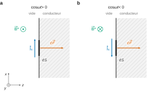
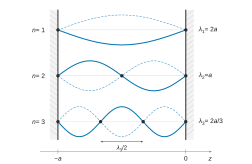
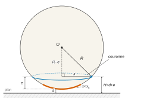
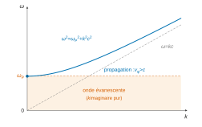
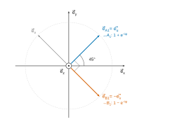
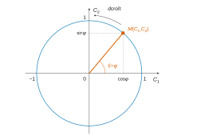

# Centrale-Supélec MPI — Physique-chimie 1 2026 · Corrigé brut

*Corrigé rédigé par IA, non officiel. Signalez toute erreur.*

**Modélisation et mesure de l'effet Casimir.** 4 heures, calculatrice autorisée. 43 questions (Q1 à Q43) ; questions à prise d'initiative : Q9, Q27, Q38, Q42.

---

## Partie A — Étude d'une cavité en électromagnétisme classique

### I — Pression de radiation sur un conducteur parfait

**Q1.** Milieu 1 : le vide ($z<0$) ; milieu 2 : le conducteur ($z>0$) ; $\vec n_{12}=\vec e_z$. La relation de passage, avec $\sigma=0$ en surface, donne

$$\vec E_2-\vec E_1=\vec 0$$

Comme $\vec E_2=\vec 0$ dans le conducteur parfait, le champ total est nul en $z=0^-$ à tout instant.

Or $\vec E_i(0,t)=E_0\cos(\omega t)\,\vec e_x\neq\vec 0$ : le champ dans $z<0$ ne peut pas se réduire à l'onde incidente. Il existe donc une onde réfléchie, telle que pour tout $t$

$$\vec E_r(0,t)=-E_0\cos(\omega t)\,\vec e_x$$

Cette égalité, vraie à chaque instant, impose une dépendance temporelle sinusoïdale de pulsation $\omega$ (**même pulsation**) et une direction $\vec e_x$ (**même polarisation** rectiligne).

L'onde réfléchie s'éloigne du conducteur ($\vec k_r=-\frac{\omega}{c}\vec e_z$) ; elle s'écrit $A\cos(\omega(t+z/c)+\phi)\,\vec e_x$, et l'identification en $z=0$ donne :

$$\boxed{\vec E_r(M,t)=-E_0\cos\!\left(\omega\left(t+\frac zc\right)\right)\vec e_x\qquad(z<0)}$$

**Q2.** Avec $\cos p-\cos q=-2\sin\frac{p+q}{2}\sin\frac{p-q}{2}$, $p=\omega t-\omega z/c$, $q=\omega t+\omega z/c$ :

$$\vec E=E_0\left[\cos\!\left(\omega t-\frac{\omega z}{c}\right)-\cos\!\left(\omega t+\frac{\omega z}{c}\right)\right]\vec e_x=2E_0\sin\!\left(\frac{\omega z}{c}\right)\sin(\omega t)\,\vec e_x$$

$$\boxed{E_{0t}=2E_0}$$

On vérifie $\vec E(0,t)=\vec 0$.

**Q3.** La relation $\vec B=\vec k\wedge\vec E/\omega$ s'applique à chaque onde plane progressive séparément :

$$\vec B_i=\frac{E_0}{c}\cos\!\left(\omega\left(t-\frac zc\right)\right)\vec e_y$$

$$\begin{aligned}
\vec B_r&=-\frac1c\vec e_z\wedge\left(-E_0\cos\!\left(\omega\left(t+\frac zc\right)\right)\vec e_x\right)\\
&=\frac{E_0}{c}\cos\!\left(\omega\left(t+\frac zc\right)\right)\vec e_y
\end{aligned}$$

d'où, avec $\cos p+\cos q=2\cos\frac{p+q}2\cos\frac{p-q}2$ :

$$\boxed{\vec B(M,t)=\frac{2E_0}{c}\cos\!\left(\frac{\omega z}{c}\right)\cos(\omega t)\,\vec e_y\qquad(z<0)}$$

Vérification par Maxwell-Faraday : $\partial_t\vec B=-\overrightarrow{\mathrm{rot}}\,\vec E=-\partial_zE_x\,\vec e_y=-\frac{2E_0\omega}{c}\cos\frac{\omega z}{c}\sin(\omega t)\,\vec e_y$, cohérent.

**Q4.** Avec $1/(\mu_0c^2)=\varepsilon_0$ :

$$\boxed{u_{em}=\frac{\varepsilon_0E^2}{2}+\frac{B^2}{2\mu_0}=2\varepsilon_0E_0^2\left[\sin^2\!\left(\frac{\omega z}{c}\right)\sin^2(\omega t)+\cos^2\!\left(\frac{\omega z}{c}\right)\cos^2(\omega t)\right]}$$

Avec $\langle\sin^2\omega t\rangle=\langle\cos^2\omega t\rangle=\frac12$ :

$$\boxed{\langle u_{em}\rangle=\varepsilon_0E_0^2}$$

uniforme dans tout le demi-espace : les nœuds de $\vec E$ coïncident avec les ventres de $\vec B$.

**Q5.** Relation de passage avec $\vec n_{12}=\vec e_z$, $\vec B_2=\vec 0$, $\vec B_1=\vec B(0^-,t)=\frac{2E_0}{c}\cos(\omega t)\,\vec e_y$ :

$$-\frac{2E_0}{c}\cos(\omega t)\,\vec e_y=\mu_0\,\vec j_s\wedge\vec e_z$$

Le courant, tangentiel, est porté par $\vec e_x$ (direction du champ électrique incident) : $\vec j_s=j_s\vec e_x$, et $\vec e_x\wedge\vec e_z=-\vec e_y$, donc $\mu_0j_s=\frac{2E_0}{c}\cos\omega t$. Avec $1/(\mu_0c)=\varepsilon_0c$ :

$$\boxed{\vec j_s(t)=2\varepsilon_0cE_0\cos(\omega t)\,\vec e_x}$$

**Q6.** On a $\vec j_s\wedge\vec e_z=-j_s\vec e_y$, donc

$$\begin{aligned}
\vec B_{dS}(0^-)&=\frac{\mu_0j_s}{2}\vec e_y=\frac{E_0}{c}\cos(\omega t)\,\vec e_y\\
\vec B_{dS}(0^+)&=-\frac{E_0}{c}\cos(\omega t)\,\vec e_y
\end{aligned}$$

Le champ total est la somme de $\vec B^*$ (onde incidente et reste de la nappe) et de $\vec B_{dS}$ :

$$\begin{aligned}
\vec B^*(0^-)&=\vec B(0^-)-\vec B_{dS}(0^-)=\frac{E_0}{c}\cos(\omega t)\,\vec e_y\\
\vec B^*(0^+)&=\vec 0-\vec B_{dS}(0^+)=\frac{E_0}{c}\cos(\omega t)\,\vec e_y
\end{aligned}$$

$$\boxed{\vec B^*(z\to0^\pm,t)=\frac{E_0}{c}\cos(\omega t)\,\vec e_y}$$

Ce champ est continu à la traversée de $dS$ (il n'est pas créé par $dS$) ; c'est la moyenne $\frac12\big(\vec B(0^-)+\vec B(0^+)\big)$.

**Q7.** Force de Laplace sur l'élément de courant surfacique $\vec j_s\,dS$ plongé dans $\vec B^*$ :

$$d\vec F=\vec j_s\,dS\wedge\vec B^*=2\varepsilon_0cE_0\cos(\omega t)\,\frac{E_0}{c}\cos(\omega t)\,(\vec e_x\wedge\vec e_y)\,dS$$

$$\boxed{d\vec F=2\varepsilon_0E_0^2\cos^2(\omega t)\,dS\,\vec e_z}$$

$$\boxed{\langle d\vec F\rangle=\varepsilon_0E_0^2\,dS\,\vec e_z}$$



**Q8.** La force moyenne est normale au plan, dirigée du vide vers le conducteur, proportionnelle à $dS$ et identique en tout point $P$ : c'est une force pressante, de pression $P_{\mathrm{rad}}=\|\langle d\vec F\rangle\|/dS=\varepsilon_0E_0^2$. Avec Q4 :

$$\boxed{P_{\mathrm{rad}}=\langle u_{em}\rangle}$$

**Q9.** *Démarche.* (a) Choc d'un photon : élastique sur un plan parfaitement réfléchissant (de masse infinie), l'énergie $\hbar\omega$ et donc la norme de la quantité de mouvement se conservent ; le photon repart selon $-\vec e_z$. La conservation de la quantité de mouvement de $\{$photon, plan$\}$ donne la quantité de mouvement cédée au plan par un photon :

$$\delta\vec p=\frac{\hbar\omega}{c}\vec e_z-\left(-\frac{\hbar\omega}{c}\vec e_z\right)=\frac{2\hbar\omega}{c}\vec e_z$$

(b) Comptage : pendant $dt$, les photons qui frappent $dS$ sont dans le cylindre de base $dS$ et de hauteur $c\,dt$, soit $n_\gamma c\,dt\,dS$ photons.

(c) Bilan : quantité de mouvement cédée par unité de temps et de surface

$$\boxed{\frac{n_\gamma c\,dt\,dS\,\delta\vec p}{dt\,dS}=2n_\gamma\hbar\omega\,\vec e_z}$$

C'est la force surfacique subie par le plan : $P_{\mathrm{rad}}=2n_\gamma\hbar\omega$. Les photons incidents portent la densité d'énergie $u_{\mathrm{inc}}=n_\gamma\hbar\omega$ ; les photons réfléchis, de même densité, portent $u_{\mathrm{réf}}=n_\gamma\hbar\omega$. Ainsi

$$\boxed{P_{\mathrm{rad}}=u_{\mathrm{inc}}+u_{\mathrm{réf}}=2n_\gamma\hbar\omega}$$

*Commentaire* : on retrouve exactement le résultat ondulatoire de Q8 ($\langle u_{em}\rangle$ compte les deux ondes, l'onde incidente seule portant $\varepsilon_0E_0^2/2$). Le facteur 2 vient de la réflexion ; un absorbeur parfait ne subirait que $u_{\mathrm{inc}}$.

### II — Champ électromagnétique dans une cavité plane délimitée par deux plans conducteurs

**Q10.** Le raisonnement de Q1 s'applique à chaque plan : le champ électrique, tangentiel, s'annule en $z=0$ et en $z=-a$.

Dans la cavité, le champ est la superposition d'ondes se propageant selon $\pm\vec e_z$ ; la condition en $z=0$ impose la forme stationnaire de Q2 :

$$\vec E=E_{0t}\sin(\omega z/c)\sin(\omega t)\,\vec e_x$$

En $z=-a$, pour tout $t$ et avec $E_{0t}\neq0$ :

$$\sin(\omega a/c)=0$$

soit $\omega a/c=n\pi$.

$$\boxed{\omega_n=\frac{n\pi c}{a},\qquad n\in\mathbb N^*}$$

$n=0$ donne un champ identiquement nul et $n<0$ redonne les mêmes modes au signe près : les pulsations sont discrètes, indexées par $n>0$, avec $k_{z,n}=n\pi/a$ (la cavité contient $n$ demi-longueurs d'onde).



**Q11.** $\lambda_n=2\pi c/\omega_n=2a/n$, maximale pour $n=1$ :

$$\boxed{\lambda_{\max}=2a=200\ \mathrm{nm}}$$

C'est de l'**ultraviolet** (UV lointain, à la limite de l'UV du vide), en dessous de la borne du visible ($\approx400$ nm).

---

## Partie B — Une approche quantique simplifiée du champ dans la cavité

### I — Énergie minimale d'un oscillateur harmonique quantique

**Q12.** En reportant $\psi=\varphi(x)e^{-iEt/\hbar}$ dans l'équation de Schrödinger avec $V=\frac12m\omega_0^2x^2$, puis en simplifiant par l'exponentielle (jamais nulle) :

$$\boxed{-\frac{\hbar^2}{2m}\varphi''(x)+\frac12m\omega_0^2x^2\varphi(x)=E\,\varphi(x)}$$

Comme $|\psi|^2=\varphi^2$ ($\varphi$ réelle), la normalisation s'écrit

$$\boxed{\int_{-\infty}^{+\infty}\varphi(x)^2\,dx=1}$$

**Q13.** L'équation s'écrit $\varphi''+q\varphi=0$, avec $q$ paire :

$$q(x)=\frac{2m}{\hbar^2}\left(E-\frac12m\omega_0^2x^2\right)$$

La fonction $\chi(x)=\varphi(-x)$ vérifie la même équation. Le wronskien $W=\varphi\chi'-\varphi'\chi$ a pour dérivée $\varphi\chi''-\varphi''\chi=0$ : il est constant.

Pour un état lié, $\varphi$ et $\varphi'$ tendent vers 0 à l'infini (décroissance usuelle d'un état lié dans ce puits), donc $W=0$.

Ainsi $\chi$ et $\varphi$ sont proportionnelles, $\varphi(-x)=\lambda\varphi(x)$, et en appliquant deux fois, $\lambda^2=1$.

**$\varphi$ est paire ou impaire**, donc $\varphi^2$ est paire et $x\varphi^2$ impaire et intégrable :

$$\boxed{\langle x\rangle=\int_{-\infty}^{+\infty}x\,\varphi(x)^2\,dx=0}$$

**Q14.** Le facteur de phase disparaît : $\psi^*\partial_x\psi=\varphi\varphi'=\frac12(\varphi^2)'$. Donc

$$\langle p_x\rangle=-i\hbar\left[\frac{\varphi^2}{2}\right]_{-\infty}^{+\infty}=0$$

car $\varphi\to0$ en $\pm\infty$ (état normalisable). Autre argument : $\langle p_x\rangle$ est réel alors que le calcul donne $-i\hbar$ fois un réel ; il est donc nul.

$$\boxed{\langle p_x\rangle=0}$$

**Q15.** Dans l'état stationnaire d'énergie $E$, la moyenne de l'énergie totale vaut $E$ : $E=\frac12m\omega_0^2\langle x^2\rangle+\frac{\langle p_x^2\rangle}{2m}$. Or $\Delta x^2=\langle x^2\rangle-\langle x\rangle^2=\langle x^2\rangle$ (Q13) et $\Delta p_x^2=\langle p_x^2\rangle$ (Q14) :

$$\boxed{E=\frac12m\omega_0^2\,\Delta x^2+\frac{\Delta p_x^2}{2m}}$$

**Q16.** L'inégalité de Heisenberg impose $\Delta x>0$ et $\Delta p_x\geqslant\hbar/(2\Delta x)>0$ ; on élève au carré deux quantités positives :

$$E\geqslant f_H(\Delta x)$$

$$\boxed{f_H(X)=\frac12m\omega_0^2X^2+\frac{\hbar^2}{8mX^2}\quad(X>0)}$$

$f_H'(X)=m\omega_0^2X-\frac{\hbar^2}{4mX^3}$ est négative puis positive, et s'annule en $X_m^2=\frac{\hbar}{2m\omega_0}$ : minimum global

$$f_H(X_m)=\frac{\hbar\omega_0}{4}+\frac{\hbar\omega_0}{4}$$

$$\boxed{\min f_H=\frac{\hbar\omega_0}{2}}$$

### II — Une première approche quantique de l'effet Casimir

**Q17.** Chaque mode contribue par $\frac{\hbar\omega_n}{2}=\frac{\hbar\pi c}{2a}n$ :

$$\begin{aligned}
E&=\sum_{n=1}^{+\infty}\frac{\hbar k_{z,n}c}{2}\\
&=\frac{\hbar\pi c}{2a}\sum_{n=1}^{+\infty}n\\
&=\boxed{+\infty}
\end{aligned}$$

La série diverge grossièrement : l'énergie d'un volume fini de vide serait infinie, ce qui n'a pas de sens physique et interdit tout calcul de force par dérivation. Le modèle du conducteur parfait cesse d'ailleurs d'être valable aux très hautes pulsations. (Tronquée à $n_0$, la somme redonne bien $E(a)=\frac{\hbar\pi c}{4a}n_0(n_0+1)$.)

**Q18.** Les modes de la grande cavité sont espacés de $\delta k_z=\pi/\tilde a$, donc $\rho_{k_z}=\tilde a/\pi$ :

$$E_\infty=\int_0^{n_0\pi/a}\frac{\hbar k_zc}{2}\,\frac{\tilde a}{\pi}\,dk_z=\frac{\hbar c\tilde a}{4\pi}\,\frac{n_0^2\pi^2}{a^2}$$

$$\boxed{E_\infty=\frac{\pi\hbar c\,\tilde a\,n_0^2}{4a^2}}$$

**Q19.**

$$E_{\mathrm{Cas}}=\frac{\pi\hbar c}{4a}n_0(n_0+1)-\frac{\pi\hbar c\,\tilde a\,n_0^2}{4a^2}=\frac{\pi\hbar c\,n_0^2}{4a}\left[1+\frac1{n_0}-\frac{\tilde a}{a}\right]$$

Avec $n_0\gg1$ puis $\tilde a/a\gg1$ :

$$\boxed{E_{\mathrm{Cas}}\simeq-\frac{\pi\hbar c\,\tilde a\,n_0^2}{4a^2}}$$

négative, en $1/a^2$ dans ce modèle unidimensionnel.

**Q20.** À $\tilde a$ et $n_0$ fixés, $E_{\mathrm{Cas}}=-K/a^2$ avec $K>0$, et

$$\frac{dE_{\mathrm{Cas}}}{da}=\frac{2K}{a^3}>0$$

$E_{\mathrm{Cas}}$ croît donc avec $a$. Minimiser $E_{\mathrm{Cas}}$ revient à diminuer $a$ : les plans se rapprochent, **l'effet Casimir est attractif**. (C'est le sens de variation, et non le signe de l'énergie, qui conclut.)

### III — Étude de la dépendance de l'énergie de Casimir avec la dimension longitudinale de la cavité

**Q21.** La ligne 13 multiplie déjà par $a$ et par `dk` ; la ligne 19 assemble $g=a\int-\frac u2-\sum$.

```python
        s1 = s1 + np.sqrt(u**2 + k_droite**2)          # ligne 12
        s2 = s2 + np.sqrt(u**2 + (j * np.pi / a)**2)   # ligne 17
    return s1 - u / 2 - s2                             # ligne 19
```

Le script ainsi complété donne $f(10^{-7})\approx2{,}9\times10^{30}$ SI et $a^3f(a)$ constant. Cette loi en $a^{-3}$ est imposée par l'homogénéité du calcul (le pas `dk`, les abscisses `u` et les termes de la série sont tous en $1/a$) ; la valeur absolue, elle, n'est pas fiable, comme l'annonce l'énoncé.

**Q22.** Sur la figure 2 (log-log), les points sont alignés de $f(10^{-7}\ \mathrm m)\approx9\times10^{19}$ à $f(10^{-5}\ \mathrm m)\approx9\times10^{13}$ : six décades pour deux, pente $-3$. Donc $f(a)=C/a^3$ avec $C>0$, et

$$\boxed{\begin{aligned}
E_{\mathrm{Cas}}(a)&=-\frac{B}{a^{\xi}}\\
\xi&=3\\
B&=\frac{\hbar cL^2C}{2\pi}>0
\end{aligned}}$$

**Q23.** La paroi mobile a pour cote $z_p=-a$. La force sur elle est

$$\begin{aligned}
F_z&=-\frac{dE_{\mathrm{Cas}}}{dz_p}\\
&=+\frac{dE_{\mathrm{Cas}}}{da}\\
&=\frac{3B}{a^4}
\end{aligned}$$

$$\boxed{\vec F=\frac{3B}{a^4}\,\vec e_z}$$

$$\boxed{\|\vec F\|=\frac{3B}{a^4}}$$

Elle est dirigée vers l'autre plan : la force est **attractive**, en accord avec Q20. Elle décroît très vite (en $a^{-4}$) : diviser $a$ par 10 multiplie la force par $10^4$.

**Q24.** $[\hbar]=\mathrm{M\,L^2\,T^{-1}}$, $[c]=\mathrm{L\,T^{-1}}$, $[a]=\mathrm L$, et une force surfacique a la dimension $\mathrm{M\,L^{-1}\,T^{-2}}$ :

$$\begin{aligned}
&\text{(M)}\quad\delta=1\\
&\text{(T)}\quad-\beta-\delta=-2\\
&\text{(L)}\quad\alpha+\beta+2\delta=-1
\end{aligned}$$

$$\boxed{\begin{aligned}
\delta&=1\\
\beta&=1\\
\alpha&=-4
\end{aligned}}$$

La force sur un plan de surface $L^2$ vaut $\kappa\hbar cL^2/a^4$ ; par identification avec $3B/a^4$, pour $\kappa=\frac{\pi^2}{240}$ :

$$\begin{aligned}
B&=\frac{\kappa\hbar cL^2}{3}\\
&=\boxed{\frac{\pi^2\hbar cL^2}{720}}
\end{aligned}$$

**Q25.** La force étant attractive, la pression extérieure l'emporte :

$$\begin{aligned}
\Delta P_{\mathrm{Cas}}&=P_{\mathrm{ext}}-P_{\mathrm{int}}\\
&=\frac{\pi^2\hbar c}{240\,a^4}
\end{aligned}$$

avec

$$\frac{\pi^2\hbar c}{240}=1{,}29\times10^{-27}\ \mathrm{J\cdot m}$$

- $a=100$ nm : $\boxed{\Delta P_{\mathrm{Cas}}\approx13\ \mathrm{Pa}}$ et, sur $L^2=10^{-4}$ m², $\boxed{F\approx1{,}3\times10^{-3}\ \mathrm N}$ ;
- $a=1$ mm : $\boxed{\Delta P_{\mathrm{Cas}}\approx1{,}3\times10^{-15}\ \mathrm{Pa}}$ et $\boxed{F\approx1{,}3\times10^{-19}\ \mathrm N}$.

*Commentaire* : à 100 nm, la force (poids d'environ 130 mg) est mesurable ; à 1 mm elle est indétectable. La loi en $a^{-4}$ confine l'effet au domaine submicronique. Elle rend aussi l'expérience plan-plan très exigeante : $\delta F/F=4\,\delta a/a$, donc 1 % sur la force demande un parallélisme meilleur que $0{,}25$ nm sur 1 cm.

---

## Partie C — Mesures expérimentales et corrections des écarts à la force théorique de Casimir

### I — Une mesure dans une configuration sphère-plan

**Q26.** En plan-plan, il faut maintenir deux plaques de 1 cm² parallèles à mieux que le nanomètre, à 100 nm de distance (Q25) : c'est pratiquement hors de portée. Une sphère n'a pas d'orientation : la géométrie est entièrement fixée par la seule distance de plus courte approche $d$, mesurable par interférométrie, et il n'y a plus aucun réglage de parallélisme. La zone en interaction étant petite (Q27), la qualité de surface n'est requise que localement, et le montage s'adapte directement au micro-levier d'un microscope à force atomique.

**Q27.** *Géométrie.* Dans le triangle rectangle formé par le centre $O$, le centre de la couronne et un point de la couronne : $R^2=x^2+(R-e)^2$, soit $x^2=2Re-e^2$, et pour $e\ll R$

$$\boxed{e\simeq\frac{x^2}{2R}}$$



*Estimation.* La force surfacique locale varie en $H^{-4}=(d+e)^{-4}$ (Q23–Q24) ; rapportée à sa valeur au point le plus proche :

$$\frac{P(x)}{P(0)}=\left(1+\frac{x^2}{2Rd}\right)^{-4}$$

Critère choisi : elle est divisée par 16 dès que $e=d$, c'est-à-dire pour

$$\begin{aligned}
x_c&=\sqrt{2Rd}\\
&=\sqrt{2\times10^{-4}\times10^{-7}}\\
&\approx\boxed{4{,}5\ \mu\mathrm m\ll R=100\ \mu\mathrm m}
\end{aligned}$$

(on vérifie $e\sim d=10^{-3}R\ll R$). Plus quantitativement, avec $2\pi x\,dx=2\pi R\,de$ et $e_X=X^2/(2R)$ :

$$F(x<X)=2\pi R\kappa\hbar c\int_0^{e_X}\frac{de}{(d+e)^4}$$

d'où

$$\frac{F(x<X)}{F}=1-\left(1+\frac{X^2}{2Rd}\right)^{-3}$$

qui vaut 87,5 % pour $X=x_c$ et 99 % pour $X\approx2x_c\approx9$ µm. La force provient donc d'une calotte de quelques micromètres autour du point de plus courte approche.

Au passage, l'intégrale complète redonne la formule de $F_{sp}$ pour $\eta_E=1$ :

$$\begin{aligned}
F&=\frac{2\pi R\kappa\hbar c}{3d^3}\\
&=\frac{\pi^3\hbar cR}{360\,d^3}
\end{aligned}$$

**Q28.**

$$\frac{\pi^3\hbar cR}{360\,d^3}=\frac{31{,}0\times3{,}14\times10^{-26}\times10^{-4}}{360\times10^{-21}}=2{,}70\times10^{-10}\ \mathrm N$$

La figure 6 donne $\eta_E\approx0{,}54$ à $d=0{,}1$ µm :

$$\boxed{F_{sp}\approx1{,}5\times10^{-10}\ \mathrm N\approx0{,}15\ \mathrm{nN}}$$

La figure 4 donne, à $d=100$ nm, une force mesurée d'environ $-0{,}14$ nN (signe négatif : attraction). L'accord est très bon, à la précision de lecture des figures près ; sans la correction $\eta_E$, on surestimerait la force d'un facteur 2.

### II — Prise en compte de la température non nulle

**Q29.** Loi de Wien à $T\approx300$ K :

$$\boxed{\lambda_T\approx\frac{2898\ \mu\mathrm m\cdot\mathrm K}{300\ \mathrm K}\approx10\ \mu\mathrm m}$$

(infrarouge thermique). Or Q11 donne $\lambda_{\max}=2a=200$ nm, environ 50 fois plus petit : aucun mode de la cavité ne peut accueillir ces photons. De façon équivalente, $\hbar\omega_1=hc/2a\approx6$ eV contre $k_BT\approx26$ meV. **La contribution des photons thermiques à l'intérieur de la cavité est négligeable.**

**Q30.** Avec $x=\hbar\omega/(k_BT)$ et l'intégrale fournie :

$$u(T)=\int_0^{+\infty}\frac{\hbar\omega^3}{\pi^2c^3}\frac{d\omega}{e^{\hbar\omega/k_BT}-1}=\frac{(k_BT)^4}{\pi^2\hbar^3c^3}\int_0^{+\infty}\frac{x^3\,dx}{e^x-1}$$

$$\boxed{u(T)=\frac{\pi^2(k_BT)^4}{15\,\hbar^3c^3}\approx6\times10^{-6}\ \mathrm{J\cdot m^{-3}}\ \text{à }300\ \mathrm K}$$

D'après Q8, la pression de radiation thermique sur la face externe vaut en ordre de grandeur $P_{\mathrm{th}}\sim u(T)\sim10^{-5}$ Pa. Comme la face interne ne reçoit pas de photons thermiques (Q29), cette pression n'est pas compensée : elle pousse chaque miroir vers l'autre et s'ajoute à l'attraction de Casimir. Mais

$$\frac{P_{\mathrm{th}}}{\Delta P_{\mathrm{Cas}}(100\ \mathrm{nm})}\approx\frac{6\times10^{-6}}{13}\approx5\times10^{-7}$$

**À $a=100$ nm, l'effet de la température est négligeable.** Comme $\Delta P_{\mathrm{Cas}}\propto a^{-4}$, les deux pressions deviennent comparables vers $a\approx\left(\frac{\pi^2\hbar c}{240\,u}\right)^{1/4}\approx4$ µm : la correction thermique compte pour les grandes séparations.

### III — Prise en compte du caractère imparfait des plans réflecteurs

**Q31.** $m^*\,d\vec v/dt$ : terme d'inertie, avec une masse effective qui traduit de façon phénoménologique l'interaction de l'électron avec le réseau ; $-e\vec E$ : force électrique ; $-e\,\vec v\wedge\vec B$ : force magnétique. Sont négligés le poids et le frottement associé à la relaxation (collisions), ce qui donne un plasma sans pertes.

Pour une opph, $\|\vec B\|=\|\vec E\|k/\omega=\|\vec E\|/v_\varphi$, donc $\|\vec v\wedge\vec B\|/\|\vec E\|\leqslant v/v_\varphi$ :

$$\boxed{\text{le terme magnétique est négligeable si }v\ll v_\varphi}$$

c'est-à-dire si les électrons sont non relativistes ($v\ll c$), dès lors que $v_\varphi\geqslant c$ (à établir en Q36).

**Q32.** Un ion de masse $M$ et de charge $+e$ acquiert une vitesse $eE/(M\omega)$, à comparer à $eE/(m^*\omega)$ pour un électron.

À densités égales, le rapport des courants vaut $m^*/M\sim10^{-30}/10^{-25}\sim10^{-5}$ (quelques $10^{-6}$ pour l'or) : **les ions, trop inertes, ne contribuent pratiquement pas au courant**.

Pour les électrons, en notation $e^{i\omega t}$ :

$$\begin{aligned}
i\omega m^*\underline{\vec v}&=-e\underline{\vec E}\\
\underline{\vec j}&=-n_ee\underline{\vec v}=\frac{n_ee^2}{i\omega m^*}\underline{\vec E}
\end{aligned}$$

$$\boxed{\underline\sigma=\frac{n_ee^2}{i\,m^*\omega}=-i\,\frac{n_ee^2}{m^*\omega}}$$

Imaginaire pure : courant en quadrature avec le champ, pas de dissipation en moyenne.

**Q33.** Maxwell-Ampère : $\overrightarrow{\mathrm{rot}}\,\underline{\vec B}=\mu_0\underline\sigma\,\underline{\vec E}+\mu_0\varepsilon_0\,i\omega\,\underline{\vec E}$. On prend le rotationnel, avec $\overrightarrow{\mathrm{rot}}\,\overrightarrow{\mathrm{rot}}\,\vec B=\overrightarrow{\mathrm{grad}}\,\mathrm{div}\,\vec B-\Delta\vec B=-\Delta\vec B$ ($\mathrm{div}\,\vec B=0$), le milieu étant homogène, et Maxwell-Faraday $\overrightarrow{\mathrm{rot}}\,\underline{\vec E}=-i\omega\underline{\vec B}$ :

$$-\Delta\underline{\vec B}=-i\omega\mu_0\underline\sigma\,\underline{\vec B}+\frac{\omega^2}{c^2}\underline{\vec B}$$

avec

$$i\omega\mu_0\underline\sigma=\frac{\mu_0n_ee^2}{m^*}$$

$$\boxed{\Delta\underline{\vec B}+\left(\frac{\omega^2}{c^2}-\frac{\mu_0n_ee^2}{m^*}\right)\underline{\vec B}=\vec 0}$$

**Q34.** Pour $\underline{\vec B}=\underline{\vec B_0}\,e^{i(\omega t-kz)}$, $\Delta\underline{\vec B}=-k^2\underline{\vec B}$, et avec $\mu_0=1/(\varepsilon_0c^2)$ :

$$\boxed{k^2=\frac{\omega^2}{c^2}-\frac{\mu_0n_ee^2}{m^*}=\frac{1}{c^2}\left(\omega^2-\frac{n_ee^2}{\varepsilon_0m^*}\right)}$$

**Q35.** On pose

$$\boxed{\omega_P=\sqrt{\frac{n_ee^2}{\varepsilon_0m^*}}}$$

d'où

$$k^2=\frac{\omega^2-\omega_P^2}{c^2}$$

Si $\omega>\omega_P$, $k$ est réel : l'onde se propage sans atténuation. Si $\omega<\omega_P$, $k=\pm i\sqrt{\omega_P^2-\omega^2}/c$ : l'onde est évanescente (on garde la solution bornée), il n'y a pas de propagation et l'onde est réfléchie. $\omega_P$ est donc une **pulsation de coupure**.



**Q36.** Pour $\omega>\omega_P$ :

$$\boxed{v_\varphi=\frac{\omega}{k}=\frac{c}{\sqrt{1-\omega_P^2/\omega^2}}>c}$$

Puisque $v_\varphi>c$, la condition $v\ll v_\varphi$ de Q31 est remplie dès que $v\ll c$.

Or $v=eE/(m^*\omega)$ : avec $\omega\sim10^{16}$ rad·s⁻¹ et même $E\sim10^5$ V·m⁻¹, $v\lesssim10^3$ m·s⁻¹ $\ll c$. L'hypothèse de Q31 est validée.

**Q37.** $\omega_P=2\pi c/\lambda_P=2{,}39\times10^{16}$ rad·s⁻¹ et

$$\begin{aligned}
m^*&=\frac{n_ee^2}{\varepsilon_0\omega_P^2}\\
&=\frac{n_ee^2\lambda_P^2}{4\pi^2\varepsilon_0c^2}\\
&=\frac{1{,}96\times10^{29}\times(1{,}60\times10^{-19})^2}{8{,}85\times10^{-12}\times(2{,}39\times10^{16})^2}
\end{aligned}$$

$$\boxed{m^*\approx9{,}9\times10^{-31}\ \mathrm{kg}\approx1{,}09\,m_e}$$

**Q38.** *Démarche.* Sur la figure 8 (log-log), on lit l'asymptote $a\ll\lambda_P$ (tirets) :

- $\eta_F\approx1{,}2\times10^{-2}$ pour $a/\lambda_P=10^{-2}$ ;
- $\eta_F\approx1$ pour $a/\lambda_P\approx0{,}8$.

Cela fait environ deux décades pour deux décades, soit une pente 1. Donc $\eta_F\propto a$ pour $a\ll\lambda_P$.

Comme $F_{\mathrm{mes}}=\eta_FF_{\mathrm{th}}$ avec $F_{\mathrm{th}}\propto a^{-4}$ (Q23–Q24) :

$$\boxed{\|F_{\mathrm{mes}}\|\propto a^{\alpha'}}$$

$$\boxed{\alpha'=-3}$$

La force réelle est plus faible que la force idéale et diverge moins vite aux courtes distances ; pour $a\gg\lambda_P$, $\eta_F\to1$ et l'on retrouve $a^{-4}$.

**Q39.** *Cas 1, $a=0{,}1$ µm.* $a/\lambda_P=1{,}27$ (Al) et $0{,}73$ (Au).

$\eta_F$ croissant avec $a/\lambda_P$ (figure 8), l'aluminium, de plus courte longueur d'onde plasma, s'écarte moins du conducteur parfait : figure 7, $\eta_F^{\mathrm{Al}}\approx0{,}55$ contre $\eta_F^{\mathrm{Au}}\approx0{,}48$. Le choix du métal compte, à l'avantage de l'aluminium (signal environ 15 % plus grand).

*Cas 2, $a=10$ µm.* $a/\lambda_P\approx130$ (Al) et $73$ (Au) : $\eta_F\approx0{,}98$ pour les trois métaux. Le choix est indifférent.

*Pour $a\sim100$ nm*, les figures favorisent l'aluminium, mais l'or est préféré en pratique : il est chimiquement inerte, alors que l'aluminium se couvre à l'air d'une couche d'alumine isolante de quelques nanomètres. Cette couche rend la position de la surface réfléchissante incertaine (or $\delta F/F\approx4\,\delta a/a$ : 2 nm d'incertitude à 100 nm donnent environ 8 %, bien plus que les 2 % visés) et empêche de bien égaliser les potentiels des surfaces (force électrostatique parasite). On sacrifie un peu de signal pour gagner en exactitude.

### IV — Mesure de déflexion par interférométrie en quadrature de phase

**Q40.** Les deux rayons, parallèles, reviennent sur eux-mêmes. Celui qui se réfléchit sur l'extrémité déplacée de $d$ parcourt $d$ de plus à l'aller et $d$ de plus au retour : différence de marche $2d$, d'où

$$\boxed{\varphi=\frac{2\pi}{\lambda_0}\,2d=\frac{4\pi d}{\lambda_0}}$$

C'est un retard, cohérent avec le facteur $e^{-i\varphi}$ de la composante $\vec e_y$ en convention $e^{+i\omega t}$.

**Q41.** Le faisceau qui atteint $\mathrm{BD_1}$ se propage selon $\vec e_z$, d'amplitude $\underline{E'_0}(\vec e_x+e^{-i\varphi}\vec e_y)$. Sur la base des bissectrices

$$\begin{aligned}
\vec e_{A_1}&=\frac{\vec e_x+\vec e_y}{\sqrt2}\\
\vec e_{B_1}&=\frac{\vec e_x-\vec e_y}{\sqrt2}
\end{aligned}$$

on obtient

$$\underline{E'_0}(\vec e_x+e^{-i\varphi}\vec e_y)=\frac{\underline{E'_0}}{\sqrt2}\left[(1+e^{-i\varphi})\vec e_{A_1}+(1-e^{-i\varphi})\vec e_{B_1}\right]$$

Ce sont les amplitudes annoncées, avec $\underline{E''_0}=\underline{E'_0}/\sqrt2$.

$\mathrm{BD_1}$ doit donc avoir sa face d'entrée normale à $\vec e_z$ ($\vec e_w=\vec e_z$) et ses directions propres $\vec e_u$, $\vec e_v$ selon ces bissectrices.

C'est **un cristal tourné de $45^\circ$ autour de l'axe de propagation** par rapport aux axes $x$ et $y$. Par exemple :

- $\vec e_u=\vec e_{A_1}$ (rayon non dévié, vers $A_1$) ;
- $\vec e_v=-\vec e_{B_1}=\frac{\vec e_y-\vec e_x}{\sqrt2}$ (rayon décalé, vers $B_1$), de sorte que $(\vec e_u,\vec e_v,\vec e_z)$ est direct ;
- l'axe optique $\vec e_{\mathrm{ao}}$ dans le plan $(\vec e_v,\vec e_z)$, oblique.

Le signe global de $\vec e_{B_1}$ est sans effet sur l'intensité.



**Q42.** *Voie 1.* $|1\pm e^{-i\varphi}|^2=(1\pm e^{-i\varphi})(1\pm e^{i\varphi})=2\pm2\cos\varphi$, d'où

$$C_1=\frac{(2+2\cos\varphi)-(2-2\cos\varphi)}{4}=\cos\varphi$$

*Voie 2.* Après réflexion sur $\mathrm{CS_s}$, le faisceau se propage horizontalement ; la composante issue de $\vec e_y$, qui porte $e^{-i\varphi}$, reste selon $\vec e_y$, l'autre devient selon $\vec e_z$.

La lame avance de $\pi/2$ la composante selon $y$, c'est-à-dire la multiplie par $e^{+i\pi/2}$ en convention $e^{+i\omega t}$ : elle porte désormais $e^{-i(\varphi-\pi/2)}$.

Sans lame, $\mathrm{BD_2}$ donnerait $C_2=\cos\varphi$ ; avec la lame, $\varphi$ est remplacé par $\varphi-\pi/2$ :

$$C_2=\cos\!\left(\varphi-\frac\pi2\right)=\sin\varphi$$

*Conclusion.*

$$\boxed{\underline C=\cos\varphi+i\sin\varphi=e^{i\varphi}}$$

Le point $(C_1,C_2)$ décrit le cercle unité et

$$\boxed{\varphi=\theta=\arg\underline C}$$

angle polaire du point $(C_1,C_2)$ mesuré depuis l'axe $C_1$.



La quadrature lève l'ambiguïté de signe de $\cos\varphi$, garde une sensibilité uniforme pour tout $\varphi$ et rend la mesure insensible aux fluctuations d'intensité du laser (rapports d'intensités).

**Q43.** $\theta=\varphi=4\pi d/\lambda_0$, donc

$$\delta d=\frac{\lambda_0\,\delta\theta}{4\pi}=\frac{633\times10^{-9}\times10^{-5}}{4\pi}$$

$$\boxed{\delta d\approx5\times10^{-13}\ \mathrm m=0{,}5\ \mathrm{pm}}$$

C'est une petite fraction de la taille d'un atome. La raideur $k$ du levier n'étant pas donnée, on raisonne en ordre de grandeur : $\delta F=k\,\delta d$ vaut de $5\times10^{-15}$ N ($k\sim10^{-2}$ N·m⁻¹) à quelques $10^{-12}$ N ($k\sim$ quelques N·m⁻¹), à comparer aux forces de Casimir de 0,1 à 0,5 nN de la figure 4. **Le dispositif résout des forces bien inférieures à celles à mesurer** : la lecture optique n'est pas le facteur limitant (ce sont plutôt le bruit thermique du levier et les dérives), et il permet de suivre la force de Casimir jusqu'à plusieurs centaines de nanomètres.
