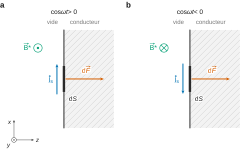
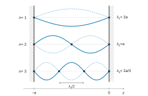
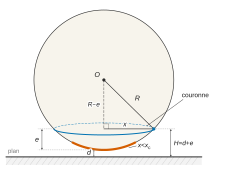
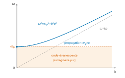
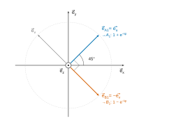
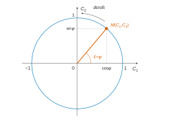

# Centrale-Supélec MPI — Physique-chimie 1 2026 · Corrigé guidé

*Corrigé rédigé par IA, non officiel. Signalez toute erreur.*

## Présentation du sujet

**Format.** 4 heures, calculatrice autorisée, 43 questions (Q1 à Q43) réparties en trois parties « relativement indépendantes », sous le titre « Modélisation et mesure de l'effet Casimir ». Quatre questions sont soulignées dans l'énoncé (prise d'initiative, barème valorisé) : **Q9, Q27, Q38 et Q42**. Le formulaire final rappelle les relations de passage pour $\vec E$ et $\vec B$, l'équation de Schrödinger, la loi de Planck, la loi de Wien, la formule du double rotationnel, l'intégrale $\int_0^\infty x^3/(e^x-1)\,dx=\pi^4/15$ et les constantes usuelles à trois chiffres significatifs.

**Le fil du sujet.** Deux miroirs neutres placés dans le vide s'attirent : c'est l'effet Casimir, conséquence de l'énergie de point zéro du champ électromagnétique. Le sujet le reconstruit pas à pas avec les outils de MPI, puis le confronte à des expériences réelles.

**Partie A — Cavité en électromagnétisme classique (Q1–Q11).**

- *A.I (Q1–Q9)* : réflexion d'une onde plane sur un conducteur parfait, onde stationnaire, énergie moyenne, courant surfacique, force sur un élément de surface et pression de radiation $P_{\mathrm{rad}}=\langle u_{em}\rangle$, retrouvée par un bilan de quantité de mouvement des photons.
- *A.II (Q10–Q11)* : modes d'une cavité plan-plan, $\omega_n=n\pi c/a$.

**Partie B — Approche quantique simplifiée (Q12–Q25).**

- *B.I (Q12–Q16)* : oscillateur harmonique quantique ; l'inégalité de Heisenberg impose $E\geqslant\hbar\omega_0/2$.
- *B.II (Q17–Q20)* : énergie de point zéro de la cavité, divergence, troncature, énergie de Casimir dans un modèle unidimensionnel, caractère attractif.
- *B.III (Q21–Q25)* : complétion d'un script Python, lecture d'une loi de puissance en log-log, force de Casimir, analyse dimensionnelle, applications numériques.

**Partie C — Mesures et corrections (Q26–Q43).**

- *C.I (Q26–Q28)* : configuration sphère-plan, approximation de proximité, comparaison à une mesure réelle.
- *C.II (Q29–Q30)* : effet de la température (Wien, Planck).
- *C.III (Q31–Q39)* : modèle du plasma, conductivité complexe, relation de dispersion, pulsation plasma, masse effective, correction de conductivité finie.
- *C.IV (Q40–Q43)* : interférométrie en quadrature de phase pour mesurer la déflexion d'un micro-levier.

**Notions du programme mobilisées.** Ondes électromagnétiques dans le vide, réflexion sur un conducteur parfait, ondes stationnaires, relations de passage, énergie électromagnétique, force de Laplace ; photon (énergie, quantité de mouvement) ; équation de Schrödinger, états stationnaires, inégalité de Heisenberg ; ondes dans un plasma ; polarisation de la lumière, interférences ; analyse dimensionnelle ; lecture de graphes log-log ; Python (méthode des rectangles).

**Difficulté et longueur.** Sujet long, très guidé dans les parties A et B, plus ouvert dans la partie C. Les points délicats sont les signes (Q5–Q7, Q23), la densité de modes non fournie (Q18), les deux approximations de Q19, la question géométrique Q27 et le rôle de la lame quart d'onde (Q42).

**Questions à ne pas laisser passer.** Q1–Q4, Q10–Q12, Q15–Q17, Q24–Q25, Q29, Q32–Q37, Q40, Q43 : du cours ou des calculs directs.

**Gestion du temps.** Environ 5 minutes par question : 1 h pour la partie A, 1 h 15 pour la partie B, 1 h 45 pour la partie C. Tout résultat donné par l'énoncé peut être admis ; les résultats de Q2, Q8, $E(a)$, Q22 et la formule de $F_{sp}$ sont autant de points de reprise.

---

## Partie A — Étude d'une cavité en électromagnétisme classique

### I — Pression de radiation sur un conducteur parfait

On construit l'onde stationnaire devant un miroir parfait, puis on calcule la force qu'elle exerce sur lui de deux façons : par la force de Laplace sur les courants surfaciques et par un bilan de photons. Outils : relations de passage, ondes planes, force de Laplace, photon.

### Question 1

> [!INDICATION]
> Que vaut le champ électrique dans le conducteur ? Que dit la relation de passage avec $\sigma=0$ ?

> [!INDICATION]
> L'onde incidente seule vérifie-t-elle la condition obtenue en $z=0$ ? L'égalité doit être vraie à chaque instant : qu'impose-t-elle sur la pulsation et la direction du champ réfléchi ?

#### Solution

Milieu 1 : le vide ($z<0$) ; milieu 2 : le conducteur ; $\vec n_{12}=\vec e_z$. La relation de passage avec $\sigma=0$ donne $\vec E_2=\vec E_1$, et $\vec E_2=\vec 0$ dans le conducteur parfait : le champ total est nul en $z=0^-$ à tout instant.

Or $\vec E_i(0,t)=E_0\cos(\omega t)\,\vec e_x\neq\vec 0$. Il faut donc une onde réfléchie telle que $\vec E_r(0,t)=-E_0\cos(\omega t)\,\vec e_x$ pour tout $t$ : même dépendance sinusoïdale (**même pulsation**), même direction $\vec e_x$ (**même polarisation**). Elle se propage selon $-\vec e_z$ :

$$\boxed{\vec E_r(M,t)=-E_0\cos\!\left(\omega\left(t+\frac zc\right)\right)\vec e_x\qquad(z<0)}$$

> [!PIEGE]
> L'argument de l'onde réfléchie est $\omega(t+z/c)$ et non $\omega(t-z/c)$ : sinon l'onde repartirait vers le conducteur.

### Question 2

> [!INDICATION]
> Sommez les deux champs et transformez une différence de cosinus en produit.

#### Solution

Avec $\cos p-\cos q=-2\sin\frac{p+q}{2}\sin\frac{p-q}{2}$, pour $p=\omega t-\omega z/c$ et $q=\omega t+\omega z/c$ :

$$\vec E=E_0\left[\cos\!\left(\omega t-\frac{\omega z}{c}\right)-\cos\!\left(\omega t+\frac{\omega z}{c}\right)\right]\vec e_x=2E_0\sin\!\left(\frac{\omega z}{c}\right)\sin(\omega t)\,\vec e_x$$

$$\boxed{E_{0t}=2E_0}$$

Contrôle : $\vec E(0,t)=\vec 0$, nœud de champ électrique sur le miroir.

### Question 3

> [!INDICATION]
> La relation de structure d'une onde plane progressive ne s'applique pas à une onde stationnaire. Comment s'y prendre ?

> [!INDICATION]
> Calculez le champ magnétique de chacune des deux ondes progressives, puis sommez. Contrôlez avec Maxwell-Faraday.

#### Solution

Pour chaque onde progressive, $\vec B=\vec k\wedge\vec E/\omega$ :

$$\vec B_i=\frac{E_0}{c}\cos\!\left(\omega\left(t-\frac zc\right)\right)\vec e_y$$

$$\begin{aligned}
\vec B_r&=\left(-\frac1c\vec e_z\right)\wedge\left(-E_0\cos\!\left(\omega\left(t+\frac zc\right)\right)\vec e_x\right)\\
&=\frac{E_0}{c}\cos\!\left(\omega\left(t+\frac zc\right)\right)\vec e_y
\end{aligned}$$

$$\boxed{\vec B(M,t)=\frac{2E_0}{c}\cos\!\left(\frac{\omega z}{c}\right)\cos(\omega t)\,\vec e_y}$$

Contrôle : $\partial_t\vec B=-\overrightarrow{\mathrm{rot}}\,\vec E=-\partial_zE_x\,\vec e_y=-\frac{2E_0\omega}{c}\cos\frac{\omega z}{c}\sin\omega t\,\vec e_y$, cohérent. $\vec B$ a un ventre là où $\vec E$ a un nœud, et les deux sont en quadrature temporelle.

> [!METHODE]
> Pour une onde stationnaire, on construit toujours les champs onde par onde. La relation $\vec B=\vec k\wedge\vec E/\omega$ n'a de sens que pour une onde plane progressive.

### Question 4

> [!INDICATION]
> Écrivez $u_{em}=\frac{\varepsilon_0E^2}{2}+\frac{B^2}{2\mu_0}$ et utilisez $\varepsilon_0\mu_0c^2=1$.

> [!INDICATION]
> La partie spatiale sort de la moyenne temporelle.

#### Solution

$$\boxed{u_{em}=2\varepsilon_0E_0^2\left[\sin^2\!\left(\frac{\omega z}{c}\right)\sin^2(\omega t)+\cos^2\!\left(\frac{\omega z}{c}\right)\cos^2(\omega t)\right]}$$

Avec $\langle\sin^2\omega t\rangle=\langle\cos^2\omega t\rangle=\frac12$ :

$$\boxed{\langle u_{em}\rangle=\varepsilon_0E_0^2}$$

La moyenne est **uniforme** : les nœuds électriques coïncident avec les ventres magnétiques. C'est ce qui rendra la relation de Q8 sans ambiguïté.

### Question 5

> [!INDICATION]
> Écrivez la relation de passage pour $\vec B$ entre $z=0^-$ et $z=0^+$, en respectant le sens de $\vec n_{12}$.

> [!INDICATION]
> Cherchez $\vec j_s$ selon la direction du champ électrique incident, puis identifiez.

#### Solution

Avec $\vec n_{12}=\vec e_z$, $\vec B_2=\vec 0$ et $\vec B_1=\frac{2E_0}{c}\cos(\omega t)\,\vec e_y$ :

$$-\frac{2E_0}{c}\cos(\omega t)\,\vec e_y=\mu_0\,\vec j_s\wedge\vec e_z$$

Pour $\vec j_s=j_s\vec e_x$, $\vec e_x\wedge\vec e_z=-\vec e_y$, donc $\mu_0j_s=\frac{2E_0}{c}\cos\omega t$ et, avec $1/(\mu_0c)=\varepsilon_0c$ :

$$\boxed{\vec j_s(t)=2\varepsilon_0cE_0\cos(\omega t)\,\vec e_x}$$

> [!PIEGE]
> Deux sources d'erreur de signe : le sens de $\vec n_{12}$ (du milieu 1 vers le milieu 2) et le produit $\vec e_x\wedge\vec e_z=-\vec e_y$. Une erreur ici retourne la force de Q7.

### Question 6

> [!INDICATION]
> Le champ total en $z=0^\pm$ est la somme de $\vec B^*$ et du champ $\vec B_{dS}$ de l'élément lui-même.

> [!INDICATION]
> Calculez $\vec B^*=\vec B-\vec B_{dS}$ des deux côtés ; le résultat doit être le même.

#### Solution

$\vec j_s\wedge\vec e_z=-j_s\vec e_y$, donc

$$\begin{aligned}
\vec B_{dS}(0^-)&=\frac{\mu_0j_s}{2}\vec e_y=\frac{E_0}{c}\cos(\omega t)\,\vec e_y\\
\vec B_{dS}(0^+)&=-\frac{E_0}{c}\cos(\omega t)\,\vec e_y
\end{aligned}$$

D'où

$$\begin{aligned}
\vec B^*(0^-)&=\frac{2E_0}{c}\cos\omega t\,\vec e_y-\frac{E_0}{c}\cos\omega t\,\vec e_y\\
\vec B^*(0^+)&=\vec 0+\frac{E_0}{c}\cos\omega t\,\vec e_y
\end{aligned}$$

$$\boxed{\vec B^*(z\to0^\pm,t)=\frac{E_0}{c}\cos(\omega t)\,\vec e_y}$$

Le champ « extérieur » à $dS$ est continu, comme il se doit puisqu'il n'est pas créé par $dS$ ; c'est la moyenne des champs totaux de part et d'autre.

> [!METHODE]
> La force sur une nappe de courant s'obtient avec le champ créé par tout le reste, égal à la demi-somme des champs de part et d'autre de la nappe. Le même raisonnement donne la pression électrostatique $\sigma^2/(2\varepsilon_0)$ sur un conducteur chargé.

### Question 7

> [!INDICATION]
> Force de Laplace sur un élément de courant surfacique : $d\vec F=\vec j_s\,dS\wedge\vec B^*$.

> [!INDICATION]
> Faites le produit avant de moyenner.

#### Solution

$$d\vec F=2\varepsilon_0cE_0\cos(\omega t)\,\frac{E_0}{c}\cos(\omega t)\,(\vec e_x\wedge\vec e_y)\,dS$$

$$\boxed{d\vec F=2\varepsilon_0E_0^2\cos^2(\omega t)\,dS\,\vec e_z}$$

$$\boxed{\langle d\vec F\rangle=\varepsilon_0E_0^2\,dS\,\vec e_z}$$



> [!PIEGE]
> Utiliser le champ total $\vec B(0^-)$ au lieu de $\vec B^*$ double la force. Et moyenner $\vec j_s$ et $\vec B^*$ séparément donne zéro : la moyenne d'un produit n'est pas le produit des moyennes.

### Question 8

> [!INDICATION]
> Qu'est-ce qui caractérise une force pressante ? Comparez avec Q4.

#### Solution

La force moyenne est normale au plan, dirigée du vide vers le conducteur (l'onde pousse le miroir), proportionnelle à $dS$ et indépendante du point $P$ : c'est une force pressante, de pression $P_{\mathrm{rad}}=\varepsilon_0E_0^2$. D'après Q4 :

$$\boxed{P_{\mathrm{rad}}=\langle u_{em}\rangle}$$

### Question 9

> [!INDICATION]
> Trois étapes : quantité de mouvement transférée par un photon, nombre de photons qui frappent $dS$ pendant $dt$, puis bilan.

> [!INDICATION]
> Le choc est élastique sur un plan parfaitement réfléchissant : que devient la quantité de mouvement du photon ? Les photons qui frappent $dS$ pendant $dt$ sont contenus dans un cylindre.

> [!INDICATION]
> Pour la densité d'énergie, n'oubliez pas les photons réfléchis.

#### Solution

*Choc.* L'énergie $\hbar\omega$ du photon est conservée, donc la norme de sa quantité de mouvement aussi ; il repart selon $-\vec e_z$. La conservation de la quantité de mouvement de $\{$photon, plan$\}$ donne la quantité cédée au plan :

$$\delta\vec p=\frac{\hbar\omega}{c}\vec e_z-\left(-\frac{\hbar\omega}{c}\vec e_z\right)=\frac{2\hbar\omega}{c}\vec e_z$$

*Comptage.* Pendant $dt$, les photons qui frappent $dS$ occupent le cylindre de base $dS$ et de hauteur $c\,dt$ : il y en a $n_\gamma c\,dt\,dS$.

*Bilan.* Quantité de mouvement cédée par unité de temps et de surface :

$$\boxed{n_\gamma c\times\frac{2\hbar\omega}{c}\,\vec e_z=2n_\gamma\hbar\omega\,\vec e_z}$$

C'est la force surfacique sur le plan, donc $P_{\mathrm{rad}}=2n_\gamma\hbar\omega$. Les photons incidents portent $u_{\mathrm{inc}}=n_\gamma\hbar\omega$, les réfléchis (même densité) $u_{\mathrm{réf}}=n_\gamma\hbar\omega$ :

$$\boxed{P_{\mathrm{rad}}=u_{\mathrm{inc}}+u_{\mathrm{réf}}}$$

*Commentaire.* Les descriptions ondulatoire (Q8) et corpusculaire donnent la même pression : $\langle u_{em}\rangle=\varepsilon_0E_0^2$ compte bien les deux ondes (l'onde incidente seule porte $\varepsilon_0E_0^2/2$). Le facteur 2 est la signature de la réflexion ; sur un absorbeur parfait, on aurait $P=u_{\mathrm{inc}}$.

> [!JURY]
> Sur une question à prise d'initiative, la démarche doit être lisible : on annonce les étapes, on justifie le facteur 2 et le cylindre de comptage, et l'on conclut par une phrase de comparaison explicite avec Q8.

### II — Champ électromagnétique dans une cavité plane délimitée par deux plans conducteurs

On ajoute un second miroir : la condition d'annulation du champ sur les deux plans quantifie les pulsations. C'est le mécanisme qui fonde toute la suite.

### Question 10

> [!INDICATION]
> Le champ électrique tangentiel doit s'annuler sur chaque plan. Partez de la forme stationnaire de Q2, qui satisfait déjà la condition en $z=0$.

> [!INDICATION]
> Écrivez la condition en $z=-a$ pour tout $t$, sans oublier d'exclure la solution nulle.

#### Solution

Le champ dans la cavité est une superposition d'ondes se propageant selon $\pm\vec e_z$ ; la condition en $z=0$ impose

$$\vec E=E_{0t}\sin(\omega z/c)\sin(\omega t)\,\vec e_x$$

En $z=-a$, pour tout $t$ et $E_{0t}\neq0$ :

$$\sin(\omega a/c)=0$$

$$\boxed{\omega_n=\frac{n\pi c}{a},\qquad n\in\mathbb N^*}$$

$n=0$ donne un champ nul, $n<0$ redonne les mêmes modes. Chaque $n$ correspond à un mode, de pulsation spatiale $k_{z,n}=n\pi/a$ : la cavité contient $n$ demi-longueurs d'onde.



### Question 11

> [!INDICATION]
> Exprimez $\lambda_n$ et cherchez le plus petit $n$ permis. Situez le résultat par rapport au visible.

#### Solution

$\lambda_n=2\pi c/\omega_n=2a/n$, maximale pour $n=1$ :

$$\boxed{\lambda_{\max}=2a=200\ \mathrm{nm}}$$

C'est de l'**ultraviolet** (UV lointain), sous la borne du visible ($\approx400$ nm). Ce résultat resservira en Q29.

> [!PIEGE]
> Pour $n=1$, la cavité contient une demi-longueur d'onde : $\lambda_{\max}=2a$, et non $a$.

---

## Partie B — Une approche quantique simplifiée du champ dans la cavité

### I — Énergie minimale d'un oscillateur harmonique quantique

On montre qu'un oscillateur quantique ne peut pas avoir une énergie nulle : l'inégalité de Heisenberg impose $E\geqslant\hbar\omega_0/2$. Outils : équation de Schrödinger, parité, intégration, étude de fonction.

### Question 12

> [!INDICATION]
> Injectez la forme $\psi=\varphi(x)e^{-iEt/\hbar}$ dans l'équation de Schrödinger du formulaire.

#### Solution

$i\hbar\partial_t\psi=E\psi$ et $\partial_x^2\psi=\varphi''e^{-iEt/\hbar}$ ; en simplifiant par l'exponentielle, jamais nulle :

$$\boxed{-\frac{\hbar^2}{2m}\varphi''(x)+\frac12m\omega_0^2x^2\varphi(x)=E\,\varphi(x)}$$

Comme $|\psi|^2=\varphi^2$ ($\varphi$ réelle, facteur de phase de module 1), la normalisation est indépendante du temps :

$$\boxed{\int_{-\infty}^{+\infty}\varphi(x)^2\,dx=1}$$

> [!PIEGE]
> On normalise $\varphi^2$, pas $\varphi$.

### Question 13

> [!INDICATION]
> Le potentiel est pair : que dire de $x\mapsto\varphi(-x)$ ?

> [!INDICATION]
> Pour établir que $\varphi$ est paire ou impaire, comparez $\varphi$ et $\varphi(-x)$, deux solutions de la même équation linéaire, à l'aide de leur wronskien.

#### Solution

L'équation s'écrit $\varphi''+q\varphi=0$, avec $q$ paire :

$$q(x)=\frac{2m}{\hbar^2}\left(E-\frac12m\omega_0^2x^2\right)$$

La fonction $\chi(x)=\varphi(-x)$ vérifie la même équation. Le wronskien $W=\varphi\chi'-\varphi'\chi$ a une dérivée nulle, il est constant.

Pour cet état lié, $\varphi$ et $\varphi'$ tendent vers 0 à l'infini, donc $W=0$. Il vient $\varphi(-x)=\lambda\varphi(x)$, et en appliquant deux fois, $\lambda^2=1$.

Ainsi $\varphi$ est paire ou impaire, $\varphi^2$ est paire, et $x\varphi^2$ est impaire et intégrable :

$$\boxed{\langle x\rangle=\int_{-\infty}^{+\infty}x\,\varphi(x)^2\,dx=0}$$

> [!METHODE]
> Une symétrie de l'équation se transmet aux solutions dès qu'elles sont déterminées à un facteur près. Le wronskien est l'outil du programme pour montrer que deux solutions d'une équation linéaire du second ordre sont proportionnelles.

### Question 14

> [!INDICATION]
> Que devient le produit $\psi^*\partial_x\psi$ pour un état stationnaire avec $\varphi$ réelle ? Reconnaissez une dérivée.

#### Solution

$\psi^*\partial_x\psi=\varphi\varphi'=\frac12(\varphi^2)'$, donc

$$\langle p_x\rangle=-i\hbar\left[\frac{\varphi^2}{2}\right]_{-\infty}^{+\infty}=0$$

puisque $\varphi\to0$ à l'infini. Autre argument : $\langle p_x\rangle$ est réel, alors que le calcul donne $-i\hbar$ fois un réel ; il est donc nul.

$$\boxed{\langle p_x\rangle=0}$$

### Question 15

> [!INDICATION]
> Dans un état stationnaire, la valeur moyenne de l'énergie totale vaut $E$. Reliez $\langle x^2\rangle$ à $\Delta x$ grâce à Q13, et de même pour $p_x$.

#### Solution

$E=\frac12m\omega_0^2\langle x^2\rangle+\frac{\langle p_x^2\rangle}{2m}$, avec $\Delta x^2=\langle x^2\rangle-\langle x\rangle^2=\langle x^2\rangle$ et $\Delta p_x^2=\langle p_x^2\rangle$ :

$$\boxed{E=\frac12m\omega_0^2\,\Delta x^2+\frac{\Delta p_x^2}{2m}}$$

### Question 16

> [!INDICATION]
> Minorez $\Delta p_x$ par l'inégalité de Heisenberg, puis reportez dans Q15.

> [!INDICATION]
> Étudiez la fonction obtenue sur $]0,+\infty[$ par le signe de sa dérivée.

#### Solution

L'inégalité impose $\Delta x>0$ et $\Delta p_x\geqslant\hbar/(2\Delta x)>0$ ; en élevant au carré deux quantités positives :

$$E\geqslant f_H(\Delta x)$$

$$\boxed{f_H(X)=\frac12m\omega_0^2X^2+\frac{\hbar^2}{8mX^2}}$$

$f_H'(X)=m\omega_0^2X-\frac{\hbar^2}{4mX^3}$ est négative puis positive, nulle en $X_m^2=\frac{\hbar}{2m\omega_0}$ :

$$f_H(X_m)=\frac{\hbar\omega_0}{4}+\frac{\hbar\omega_0}{4}$$

$$\boxed{\min f_H=\frac{\hbar\omega_0}{2}}$$

> [!METHODE]
> La compétition entre un terme qui pénalise la délocalisation ($\propto\Delta x^2$) et un terme qui pénalise la localisation ($\propto1/\Delta x^2$) donne l'ordre de grandeur de l'énergie fondamentale. Le même raisonnement estime la taille de l'atome d'hydrogène.

> [!PIEGE]
> Annuler la dérivée ne suffit pas : il faut justifier que l'extremum est un minimum global (signe de $f_H'$, ou limites infinies en $0^+$ et en $+\infty$).

### II — Une première approche quantique de l'effet Casimir

On attribue $\hbar\omega/2$ à chaque mode de la cavité. La somme diverge ; on la tronque, et seule la différence entre la cavité et un « continuum » reste significative.

### Question 17

> [!INDICATION]
> Sommez l'énergie de point zéro sur tous les modes de Q10. De quelle série s'agit-il ?

#### Solution

$$\begin{aligned}
E&=\sum_{n=1}^{+\infty}\frac{\hbar k_{z,n}c}{2}\\
&=\frac{\hbar\pi c}{2a}\sum_{n=1}^{+\infty}n\\
&=\boxed{+\infty}
\end{aligned}$$

La série diverge grossièrement (terme général qui ne tend pas vers 0). Une énergie infinie pour un volume fini de vide n'a pas de sens physique et interdit tout calcul de force par dérivation ; le modèle du conducteur parfait n'est d'ailleurs plus valable aux très hautes pulsations. Contrôle : tronquée à $n_0$, la somme redonne $E(a)=\frac{\hbar\pi c}{4a}n_0(n_0+1)$.

### Question 18

> [!INDICATION]
> La densité de modes n'est pas donnée : quel est l'écart entre deux pulsations spatiales consécutives de la grande cavité ?

> [!INDICATION]
> Le nombre de modes dans $dk_z$ est $dk_z$ divisé par cet écart.

#### Solution

Les modes $k_{z,n}=n\pi/\tilde a$ sont espacés de $\pi/\tilde a$, donc $\rho_{k_z}=\tilde a/\pi$ :

$$E_\infty=\int_0^{n_0\pi/a}\frac{\hbar k_zc}{2}\,\frac{\tilde a}{\pi}\,dk_z=\frac{\hbar c\tilde a}{4\pi}\,\frac{n_0^2\pi^2}{a^2}$$

$$\boxed{E_\infty=\frac{\pi\hbar c\,\tilde a\,n_0^2}{4a^2}}$$

> [!PIEGE]
> La densité de modes est celle de la grande cavité ($\tilde a/\pi$), pas $a/\pi$. L'énoncé demande d'ailleurs un résultat fonction de $\tilde a$.

### Question 19

> [!INDICATION]
> Factorisez par $\frac{\pi\hbar cn_0^2}{4a}$, puis utilisez les deux hypothèses l'une après l'autre.

#### Solution

$$E_{\mathrm{Cas}}=\frac{\pi\hbar c\,n_0^2}{4a}\left[1+\frac1{n_0}-\frac{\tilde a}{a}\right]$$

Avec $n_0\gg1$, $1+1/n_0\simeq1$ ; avec $a\ll\tilde a$, ce 1 est négligeable devant $\tilde a/a$ :

$$\boxed{E_{\mathrm{Cas}}\simeq-\frac{\pi\hbar c\,\tilde a\,n_0^2}{4a^2}}$$

L'énergie de Casimir est négative et varie en $1/a^2$ dans ce modèle unidimensionnel, qui ne retient que les modes longitudinaux ; la partie III corrigera l'exposant.

### Question 20

> [!INDICATION]
> Le signe de l'énergie ne suffit pas : regardez son sens de variation avec $a$, à $\tilde a$ et $n_0$ fixés.

#### Solution

$E_{\mathrm{Cas}}=-K/a^2$ avec $K>0$, et $\frac{dE_{\mathrm{Cas}}}{da}=\frac{2K}{a^3}>0$ : $E_{\mathrm{Cas}}$ croît avec $a$. Pour la minimiser, la cavité diminue $a$ : les plans se rapprochent. **L'effet Casimir est attractif.**

> [!PIEGE]
> « Attractif car l'énergie est négative » n'est pas un argument : une constante additive changerait le signe sans changer la force. Seul le sens de variation compte.

### III — Étude de la dépendance de l'énergie de Casimir avec la dimension longitudinale de la cavité

Le modèle tridimensionnel est traité numériquement ; on en lit la loi de puissance, on en déduit la force, puis une analyse dimensionnelle fixe la constante.

### Question 21

> [!INDICATION]
> Repérez ce que fait déjà la ligne 13 (facteurs `a` et `dk`) et ce que calcule chaque boucle.

> [!INDICATION]
> La ligne 19 doit assembler les trois termes de $g(u,a)$, dont un ne figure dans aucune boucle.

#### Solution

```python
        s1 = s1 + np.sqrt(u**2 + k_droite**2)          # ligne 12
        s2 = s2 + np.sqrt(u**2 + (j * np.pi / a)**2)   # ligne 17
    return s1 - u / 2 - s2                             # ligne 19
```

La boucle `for i` accumule l'intégrande aux bornes droites $k=(i+1)\,dk$ ; la ligne 13 multiplie par $dk$ et par $a$.

La boucle `for j` somme les $n_0$ premiers termes de la série. Le script complété et exécuté donne $a^3f(a)$ constant : la loi en $a^{-3}$ découle de l'homogénéité du calcul (pas, abscisses et termes de la série en $1/a$), alors que la valeur absolue n'est pas fiable, comme l'annonce l'énoncé.

> [!PIEGE]
> Ne pas remettre `dk` ou `a` en ligne 12 (ils seraient comptés deux fois), et ne pas oublier le terme `- u / 2`.

### Question 22

> [!INDICATION]
> En log-log, une loi de puissance est une droite. Relevez deux points éloignés et calculez $\Delta\log_{10}f/\Delta\log_{10}a$.

#### Solution

Les points de la figure 2 vont de $f(10^{-7}\ \mathrm m)\approx9\times10^{19}$ à $f(10^{-5}\ \mathrm m)\approx9\times10^{13}$ : six décades pour deux, pente $-3$. Donc $f=C/a^3$ avec $C>0$ et

$$\boxed{\begin{aligned}
E_{\mathrm{Cas}}(a)&=-\frac{B}{a^{\xi}}\\
\xi&=3\\
B&=\frac{\hbar cL^2C}{2\pi}>0
\end{aligned}}$$

### Question 23

> [!INDICATION]
> La force est l'opposée de la dérivée de l'énergie par rapport à la position de la paroi. Attention : la paroi est en $z=-a$.

#### Solution

Avec $z_p=-a$ :

$$\begin{aligned}
F_z&=-\frac{dE_{\mathrm{Cas}}}{dz_p}\\
&=+\frac{dE_{\mathrm{Cas}}}{da}\\
&=\frac{3B}{a^4}
\end{aligned}$$

$$\boxed{\vec F=\frac{3B}{a^4}\,\vec e_z}$$

$$\boxed{\|\vec F\|=\frac{3B}{a^4}}$$

La force pousse la paroi vers l'autre plan : elle est **attractive**, comme en Q20. Sa décroissance en $a^{-4}$ est très rapide (un facteur $10^4$ par décade).

> [!METHODE]
> Pour contrôler un signe de force dérivée d'une énergie, on vérifie qu'elle pousse le système vers les énergies plus basses.

### Question 24

> [!INDICATION]
> Une force par unité de surface est une pression. Écrivez la dimension de $\hbar$ en M, L, T.

> [!INDICATION]
> Résolvez le système en commençant par l'équation sur M, puis identifiez la force totale à celle de Q23.

#### Solution

$[\hbar]=\mathrm{M\,L^2\,T^{-1}}$, $[c]=\mathrm{L\,T^{-1}}$, et $[P]=\mathrm{M\,L^{-1}\,T^{-2}}$ :

$$\begin{aligned}
&\text{(M)}\quad\delta=1\\
&\text{(T)}\quad-\beta-\delta=-2\\
&\text{(L)}\quad\alpha+\beta+2\delta=-1
\end{aligned}$$

$$\boxed{\begin{aligned}
\delta&=1\\
\beta&=1\\
\alpha&=-4
\end{aligned}}$$

La force sur $L^2$ vaut $\kappa\hbar cL^2/a^4=3B/a^4$, d'où, avec $\kappa=\pi^2/240$ :

$$\begin{aligned}
B&=\frac{\kappa\hbar cL^2}{3}\\
&=\boxed{\frac{\pi^2\hbar cL^2}{720}}
\end{aligned}$$

On retrouve la dépendance en $a^{-4}$ de Q23 par un chemin indépendant.

### Question 25

> [!INDICATION]
> $\Delta P_{\mathrm{Cas}}=\kappa\hbar c/a^4$. Calculez une fois le préfacteur, puis faites varier $a$.

> [!INDICATION]
> Pour commenter, comparez à une grandeur familière et pensez à la difficulté de garder deux plans parallèles.

#### Solution

La force étant attractive, la pression extérieure l'emporte :

$$\Delta P_{\mathrm{Cas}}=\frac{\pi^2\hbar c}{240\,a^4}$$

avec

$$\begin{aligned}
\frac{\pi^2\hbar c}{240}&=\frac{9{,}87\times3{,}14\times10^{-26}}{240}\\
&=1{,}29\times10^{-27}\ \mathrm{J\cdot m}
\end{aligned}$$

- $a=100$ nm ($a^4=10^{-28}$ m⁴) : $\boxed{\Delta P_{\mathrm{Cas}}\approx13\ \mathrm{Pa}}$ et $\boxed{F\approx1{,}3\times10^{-3}\ \mathrm N}$ sur 1 cm² ;
- $a=1$ mm : facteur $10^{16}$, $\boxed{\Delta P_{\mathrm{Cas}}\approx1{,}3\times10^{-15}\ \mathrm{Pa}}$ et $\boxed{F\approx1{,}3\times10^{-19}\ \mathrm N}$.

*Commentaire.* À 100 nm, la force (le poids d'environ 130 mg) est mesurable ; à 1 mm, elle est indétectable. Mais garder deux plaques de 1 cm² parallèles à 100 nm est très difficile : $\delta F/F=4\,\delta a/a$, donc une exactitude de 1 % exige un parallélisme meilleur que $0{,}25$ nm sur 1 cm.

> [!PIEGE]
> L'erreur la plus fréquente est une puissance de 10 perdue dans $a^4$. Écrivez $a^4$ à part avant de diviser.

---

## Partie C — Mesures expérimentales et corrections des écarts à la force théorique de Casimir

### I — Une mesure dans une configuration sphère-plan

La géométrie sphère-plan contourne la difficulté du parallélisme ; l'approximation de proximité permet de réutiliser la loi plan-plan couronne par couronne.

### Question 26

> [!INDICATION]
> Quelle contrainte de réglage la loi en $a^{-4}$ impose-t-elle en plan-plan ? Cette contrainte existe-t-elle pour une sphère ?

#### Solution

En plan-plan, la distance doit être la même partout à mieux que le nanomètre sur des plaques centimétriques (Q25) : c'est pratiquement hors de portée. Une sphère n'a pas d'orientation : la géométrie est fixée par la seule distance de plus courte approche $d$, mesurée par interférométrie, sans aucun réglage de parallélisme. La zone en interaction est petite (Q27), donc la qualité de surface n'est requise que localement, et la sphère se monte directement sur le micro-levier d'un microscope à force atomique.

> [!METHODE]
> Une réponse qualitative en physique expérimentale gagne beaucoup à être chiffrée : ici, le parallélisme exigé en plan-plan.

### Question 27

> [!INDICATION]
> Reliez $e$, $x$ et $R$ par le théorème de Pythagore, puis simplifiez pour $e\ll R$.

> [!INDICATION]
> La contribution locale varie en $(d+e)^{-4}$. Choisissez un critère explicite (par exemple, $e$ devient égal à $d$) et calculez le rayon correspondant.

> [!INDICATION]
> Pour aller plus loin, intégrez sur les couronnes avec $x\,dx=R\,de$ et calculez la fraction de la force due aux couronnes de rayon inférieur à $X$.

#### Solution

*Géométrie.* Dans le triangle rectangle formé par le centre $O$, le centre de la couronne et un point de celle-ci : $R^2=x^2+(R-e)^2$, soit $x^2=2Re-e^2$, et pour $e\ll R$

$$\boxed{e\simeq\frac{x^2}{2R}}$$



*Estimation.* D'après Q23–Q24, la force surfacique locale vaut $\kappa\hbar c/(d+e)^4$, donc

$$\frac{P(x)}{P(0)}=\left(1+\frac{x^2}{2Rd}\right)^{-4}$$

Elle est divisée par 16 dès que $e=d$, c'est-à-dire pour

$$\begin{aligned}
x_c&=\sqrt{2Rd}\\
&=\sqrt{2\times10^{-4}\times10^{-7}}\\
&\approx\boxed{4{,}5\ \mu\mathrm m\ll R=100\ \mu\mathrm m}
\end{aligned}$$

On vérifie $e\sim d=10^{-3}R\ll R$. En intégrant, avec $dS=2\pi x\,dx=2\pi R\,de$ :

$$\frac{F(x<X)}{F}=1-\left(1+\frac{X^2}{2Rd}\right)^{-3}$$

soit 87,5 % pour $X=x_c$ et 99 % pour $X\approx9$ µm. La force provient donc d'une calotte de quelques micromètres de rayon autour du point le plus proche.

L'intégrale complète redonne la formule de $F_{sp}$ pour $\eta_E=1$ :

$$\begin{aligned}
F&=\frac{2\pi R\kappa\hbar c}{3d^3}\\
&=\frac{\pi^3\hbar cR}{360\,d^3}
\end{aligned}$$

> [!METHODE]
> Approximation de proximité : on découpe une géométrie courbe en éléments quasi plans et l'on somme la loi plan-plan. Le changement de variable $x\,dx=R\,de$ rend l'intégrale immédiate.

### Question 28

> [!INDICATION]
> Calculez d'abord le préfacteur pour $\eta_E=1$, puis lisez $\eta_E$ sur la figure 6 au bord gauche.

#### Solution

$$\frac{\pi^3\hbar cR}{360\,d^3}=\frac{31{,}0\times3{,}14\times10^{-26}\times10^{-4}}{360\times10^{-21}}=2{,}70\times10^{-10}\ \mathrm N$$

Avec $\eta_E\approx0{,}54$ à $d=0{,}1$ µm (figure 6) :

$$\boxed{F_{sp}\approx1{,}5\times10^{-10}\ \mathrm N\approx0{,}15\ \mathrm{nN}}$$

La figure 4 donne environ $-0{,}14$ nN à 100 nm (le signe traduit l'attraction) : l'accord est très bon, à la précision de lecture des graphes près.

> [!PIEGE]
> Sans le facteur $\eta_E$, on trouve 0,27 nN et l'on conclurait à tort à un désaccord d'un facteur 2.

### II — Prise en compte de la température non nulle

On vérifie que les photons thermiques ne gênent pas la mesure à 100 nm.

### Question 29

> [!INDICATION]
> Loi de Wien à température ambiante, puis comparaison avec la plus grande longueur d'onde admise dans la cavité.

#### Solution

$$\boxed{\lambda_T\approx\frac{2898\ \mu\mathrm m\cdot\mathrm K}{300\ \mathrm K}\approx10\ \mu\mathrm m}$$

(infrarouge thermique). Q11 donne $\lambda_{\max}=200$ nm, environ 50 fois plus petit : aucun mode de la cavité ne peut accueillir ces photons ($\hbar\omega_1\approx6$ eV contre $k_BT\approx26$ meV). **Les photons thermiques ne contribuent pas à l'intérieur de la cavité.**

### Question 30

> [!INDICATION]
> Faites le changement de variable $x=\hbar\omega/(k_BT)$ pour faire apparaître l'intégrale fournie.

> [!INDICATION]
> La face interne reçoit-elle des photons thermiques ? Que devient la pression sur la face externe ? Comparez à Q25.

#### Solution

$$u(T)=\frac{\hbar}{\pi^2c^3}\left(\frac{k_BT}{\hbar}\right)^4\int_0^{+\infty}\frac{x^3\,dx}{e^x-1}$$

d'où

$$\boxed{u(T)=\frac{\pi^2(k_BT)^4}{15\,\hbar^3c^3}}$$

À 300 K : $k_BT=4{,}14\times10^{-21}$ J et $u\approx6{,}2\times10^{-6}$ J·m⁻³. D'après Q8, la pression sur la face externe est de l'ordre de $P_{\mathrm{th}}\sim u\sim10^{-5}$ Pa.

La face interne ne recevant pas de photons thermiques (Q29), cette pression n'est pas compensée : elle pousse chaque miroir vers l'autre et s'ajoute à l'attraction de Casimir. Cependant

$$\frac{P_{\mathrm{th}}}{\Delta P_{\mathrm{Cas}}(100\ \mathrm{nm})}\approx\frac{6\times10^{-6}}{13}\approx5\times10^{-7}$$

**La température est sans effet mesurable à 100 nm.** Comme $\Delta P_{\mathrm{Cas}}\propto a^{-4}$, les deux pressions deviennent comparables vers $a\approx4$ µm : la correction thermique compte aux grandes séparations.

> [!PIEGE]
> Ne pas croire la pression thermique « compensée » par symétrie : c'est précisément l'absence de photons thermiques entre les miroirs qui la rend non compensée.

### III — Prise en compte du caractère imparfait des plans réflecteurs

Un métal réel n'est pas un conducteur parfait : on le modélise par un plasma d'électrons, dont la pulsation plasma fixe l'échelle des corrections.

### Question 31

> [!INDICATION]
> Nommez chaque terme, et repérez les forces absentes de l'équation.

> [!INDICATION]
> Pour une onde plane progressive dans le milieu, reliez $\|\vec B\|$ à $\|\vec E\|$ par la vitesse de phase.

#### Solution

$m^*\,d\vec v/dt$ : inertie, avec une masse effective qui rend compte de l'interaction de l'électron avec le réseau ; $-e\vec E$ : force électrique ; $-e\,\vec v\wedge\vec B$ : force magnétique. Sont négligés le poids et le frottement dû à la relaxation (plasma sans pertes).

Pour une opph, $\|\vec B\|=\|\vec E\|/v_\varphi$, donc $\|\vec v\wedge\vec B\|/\|\vec E\|\leqslant v/v_\varphi$ :

$$\boxed{\text{terme magnétique négligeable si }v\ll v_\varphi}$$

c'est-à-dire pour des électrons non relativistes si $v_\varphi\geqslant c$ (établi en Q36).

> [!PIEGE]
> $B=E/c$ n'est vrai que dans le vide ; dans le plasma, c'est $v_\varphi$ qui intervient.

### Question 32

> [!INDICATION]
> Comparez les vitesses acquises par un ion et un électron dans le même champ.

> [!INDICATION]
> En notation complexe, $d/dt$ devient $i\omega$ ; identifiez $\underline{\vec j}=\underline\sigma\,\underline{\vec E}$.

#### Solution

À charge égale en valeur absolue, la vitesse est inversement proportionnelle à la masse ; à densités égales, le rapport des courants vaut $m^*/M\sim10^{-5}$ ou moins : **les ions ne contribuent pratiquement pas**. Pour les électrons : $i\omega m^*\underline{\vec v}=-e\underline{\vec E}$ et $\underline{\vec j}=-n_ee\underline{\vec v}$, d'où

$$\boxed{\underline\sigma=\frac{n_ee^2}{i\,m^*\omega}=-i\,\frac{n_ee^2}{m^*\omega}}$$

La conductivité est imaginaire pure : le courant est en quadrature avec le champ et le plasma ne dissipe pas en moyenne.

### Question 33

> [!INDICATION]
> Prenez le rotationnel de Maxwell-Ampère et utilisez la formule du formulaire avec $\mathrm{div}\,\vec B=0$.

> [!INDICATION]
> Remplacez ensuite $\overrightarrow{\mathrm{rot}}\,\underline{\vec E}$ par Maxwell-Faraday en notation complexe.

#### Solution

$\overrightarrow{\mathrm{rot}}\,\underline{\vec B}=\mu_0(\underline\sigma+i\omega\varepsilon_0)\underline{\vec E}$. En prenant le rotationnel (milieu homogène), avec $\overrightarrow{\mathrm{rot}}\,\overrightarrow{\mathrm{rot}}\,\underline{\vec B}=-\Delta\underline{\vec B}$ et $\overrightarrow{\mathrm{rot}}\,\underline{\vec E}=-i\omega\underline{\vec B}$ :

$$-\Delta\underline{\vec B}=-i\omega\mu_0\underline\sigma\,\underline{\vec B}+\frac{\omega^2}{c^2}\underline{\vec B}$$

avec

$$i\omega\mu_0\underline\sigma=\frac{\mu_0n_ee^2}{m^*}$$

$$\boxed{\Delta\underline{\vec B}+\left(\frac{\omega^2}{c^2}-\frac{\mu_0n_ee^2}{m^*}\right)\underline{\vec B}=\vec 0}$$

### Question 34

> [!INDICATION]
> Pour une onde en $e^{i(\omega t-kz)}$, à quoi se réduit le laplacien ?

#### Solution

$\Delta\underline{\vec B}=-k^2\underline{\vec B}$, d'où, avec $\mu_0=1/(\varepsilon_0c^2)$ :

$$\boxed{k^2=\frac{1}{c^2}\left(\omega^2-\frac{n_ee^2}{\varepsilon_0m^*}\right)}$$

### Question 35

> [!INDICATION]
> Discutez le signe de $k^2$ selon $\omega$.

#### Solution

$$\boxed{\omega_P=\sqrt{\frac{n_ee^2}{\varepsilon_0m^*}}}$$

d'où

$$k^2=\frac{\omega^2-\omega_P^2}{c^2}$$

Pour $\omega>\omega_P$, $k$ est réel : propagation. Pour $\omega<\omega_P$, $k$ est imaginaire pur : onde évanescente, pas de propagation, l'onde est réfléchie. $\omega_P$ est une **pulsation de coupure**.



> [!METHODE]
> Un métal réfléchit les ondes de pulsation inférieure à $\omega_P$ : c'est ce qui justifie le modèle du miroir parfait tant que $\omega\ll\omega_P$, et ce qui le met en défaut quand les modes utiles approchent $\omega_P$, c'est-à-dire quand $a$ approche $\lambda_P$.

### Question 36

> [!INDICATION]
> $v_\varphi=\omega/k$ ; comparez à $c$, puis revenez à la condition de Q31.

#### Solution

$$\boxed{v_\varphi=\frac{c}{\sqrt{1-\omega_P^2/\omega^2}}>c}$$

La condition $v\ll v_\varphi$ est donc remplie dès que $v\ll c$.

Or $v=eE/(m^*\omega)$ : avec $\omega\sim10^{16}$ rad·s⁻¹ et $E$ jusqu'à $10^5$ V·m⁻¹, $v\lesssim10^3$ m·s⁻¹. L'hypothèse de Q31 est validée.

(La vitesse de phase supérieure à $c$ ne transporte ni énergie ni information ; ici $v_gv_\varphi=c^2$.)

### Question 37

> [!INDICATION]
> Passez de $\lambda_P$ à $\omega_P$, puis inversez l'expression de Q35.

#### Solution

$\omega_P=2\pi c/\lambda_P=2{,}39\times10^{16}$ rad·s⁻¹, puis

$$m^*=\frac{n_ee^2}{\varepsilon_0\omega_P^2}=\frac{1{,}96\times10^{29}\times2{,}56\times10^{-38}}{8{,}85\times10^{-12}\times5{,}71\times10^{32}}$$

$$\boxed{m^*\approx9{,}9\times10^{-31}\ \mathrm{kg}\approx1{,}09\,m_e}$$

Valeur proche de $m_e$ : le modèle d'électrons quasi libres est raisonnable pour l'aluminium.

### Question 38

> [!INDICATION]
> Sur la figure 8, quelle est la pente de la droite en tirets (régime $a\ll\lambda_P$) ?

> [!INDICATION]
> Combinez la loi obtenue pour $\eta_F$ avec la dépendance de $F_{\mathrm{th}}$ établie en Q23–Q24.

#### Solution

L'asymptote va de $\eta_F\approx1{,}2\times10^{-2}$ pour $a/\lambda_P=10^{-2}$ à $\eta_F\approx1$ pour $a/\lambda_P\approx0{,}8$ : deux décades pour deux, pente 1.

Donc $\eta_F\propto a$ pour $a\ll\lambda_P$, et avec $F_{\mathrm{th}}\propto a^{-4}$ :

$$\boxed{\|F_{\mathrm{mes}}\|=\eta_F\,\|F_{\mathrm{th}}\|\propto a^{\alpha'}}$$

$$\boxed{\alpha'=-3}$$

La force réelle est plus faible que la force idéale et diverge moins vite ; pour $a\gg\lambda_P$, $\eta_F\to1$ et l'on retrouve $a^{-4}$.

> [!PIEGE]
> L'énoncé impose un exposant entier : il vise le régime asymptotique (droite en tirets), pas une pente moyenne sur la figure 7, qui ne serait pas entière.

### Question 39

> [!INDICATION]
> Calculez $a/\lambda_P$ pour chaque métal dans les deux cas et lisez $\eta_F$.

> [!INDICATION]
> Pour justifier l'or, pensez à ce qui se forme à la surface de l'aluminium à l'air et aux conséquences sur la distance et les potentiels.

#### Solution

*Cas 1, $a=0{,}1$ µm.* $a/\lambda_P=1{,}27$ (Al) et $0{,}73$ (Au).

$\eta_F$ croît avec $a/\lambda_P$, et la figure 7 donne $\eta_F^{\mathrm{Al}}\approx0{,}55$ contre $\eta_F^{\mathrm{Au}}\approx0{,}48$. Le choix compte, à l'avantage de l'aluminium (environ 15 % de signal en plus).

*Cas 2, $a=10$ µm.* $a/\lambda_P\gg1$ pour les deux métaux, $\eta_F\approx0{,}98$ : choix indifférent.

*Pour $a\sim100$ nm*, les figures favorisent l'aluminium, mais l'or est choisi en pratique : chimiquement inerte, il ne s'oxyde pas, alors que l'aluminium se couvre d'une couche d'alumine isolante de quelques nanomètres. Cette couche rend incertaine la position de la surface réfléchissante (avec $\delta F/F\approx4\,\delta a/a$, 2 nm à 100 nm donnent environ 8 %, bien plus que les 2 % de précision visés) et gêne l'égalisation des potentiels (force électrostatique parasite). On perd un peu de signal mais on gagne en exactitude.

### IV — Mesure de déflexion par interférométrie en quadrature de phase

Deux polarisations jouent le rôle des deux bras d'un interféromètre. Un déplaceur à $45^\circ$ les fait interférer, et une seconde voie déphasée de $\pi/2$ donne accès à $\cos\varphi$ et à $\sin\varphi$.

### Question 40

> [!INDICATION]
> Comparez les chemins des deux rayons à l'aller et au retour.

#### Solution

Le rayon réfléchi sur l'extrémité parcourt $d$ de plus à l'aller et $d$ de plus au retour : différence de marche $2d$.

$$\boxed{\varphi=\frac{2\pi}{\lambda_0}\,2d=\frac{4\pi d}{\lambda_0}}$$

C'est un retard, cohérent avec le facteur $e^{-i\varphi}$ en convention $e^{+i\omega t}$.

> [!PIEGE]
> L'oubli du facteur 2 de l'aller-retour se répercute directement sur la résolution de Q43.

### Question 41

> [!INDICATION]
> Sur quelle base faut-il décomposer $\vec e_x+e^{-i\varphi}\vec e_y$ pour faire apparaître $1\pm e^{-i\varphi}$ ?

> [!INDICATION]
> Un déplaceur sépare les composantes selon $\vec e_u$ et $\vec e_v$ : comment orienter ces directions par rapport à $x$ et $y$ ? Faites un schéma dans le plan transverse.

#### Solution

Le faisceau qui atteint $\mathrm{BD_1}$ se propage selon $\vec e_z$. Avec

$$\begin{aligned}
\vec e_{A_1}&=\frac{\vec e_x+\vec e_y}{\sqrt2}\\
\vec e_{B_1}&=\frac{\vec e_x-\vec e_y}{\sqrt2}
\end{aligned}$$

on a

$$\underline{E'_0}(\vec e_x+e^{-i\varphi}\vec e_y)=\frac{\underline{E'_0}}{\sqrt2}\left[(1+e^{-i\varphi})\vec e_{A_1}+(1-e^{-i\varphi})\vec e_{B_1}\right]$$

Ce sont les amplitudes annoncées, avec $\underline{E''_0}=\underline{E'_0}/\sqrt2$.

$\mathrm{BD_1}$ a donc sa face d'entrée normale à $\vec e_z$ et ses directions propres selon les bissectrices de $x$ et $y$ : **il est tourné de $45^\circ$ autour de l'axe de propagation**. Par exemple :

- $\vec e_u=\vec e_{A_1}$ (rayon non dévié, vers $A_1$) ;
- $\vec e_v=-\vec e_{B_1}$ (rayon décalé, vers $B_1$), $(\vec e_u,\vec e_v,\vec e_z)$ direct ;
- axe optique dans le plan $(\vec e_v,\vec e_z)$.

Le signe de $\vec e_{B_1}$ n'affecte pas l'intensité.



> [!METHODE]
> Projeter deux polarisations orthogonales sur des axes à $45^\circ$ les fait interférer : chaque voie reçoit leur somme ou leur différence. Sans cette rotation, on mesurerait deux intensités indépendantes et l'information de phase serait perdue.

### Question 42

> [!INDICATION]
> Calculez $C_1$ à partir des amplitudes données, en développant $|1\pm e^{-i\varphi}|^2$.

> [!INDICATION]
> Après le cube, la composante qui porte $e^{-i\varphi}$ est-elle selon $y$ ou selon $z$ ? Que lui fait la lame, en convention $e^{+i\omega t}$ ?

> [!INDICATION]
> Placez le point $(C_1,C_2)$ dans le plan : sur quelle courbe se trouve-t-il ?

#### Solution

*Voie 1.* $|1\pm e^{-i\varphi}|^2=2\pm2\cos\varphi$, d'où $C_1=\cos\varphi$.

*Voie 2.* Après réflexion sur $\mathrm{CS_s}$, la composante issue de $\vec e_y$, qui porte $e^{-i\varphi}$, reste selon $\vec e_y$ (elle est perpendiculaire au plan de réflexion), l'autre passe selon $\vec e_z$.

La lame avance la composante selon $y$ de $\pi/2$, c'est-à-dire la multiplie par $e^{i\pi/2}$ : elle porte $e^{-i(\varphi-\pi/2)}$. Tout se passe comme si $\varphi$ était remplacé par $\varphi-\pi/2$ :

$$C_2=\cos\!\left(\varphi-\frac\pi2\right)=\sin\varphi$$

*Conclusion.*

$$\boxed{\underline C=e^{i\varphi}}$$

$$\boxed{\varphi=\theta=\arg\underline C}$$

Le point $(C_1,C_2)$ décrit le cercle unité et $\theta$ est son angle polaire mesuré depuis l'axe $C_1$.



Avec une seule voie, on aurait $\cos\varphi$ : ambiguïté de signe et sensibilité nulle près de $\varphi=0$. La quadrature lève l'ambiguïté, donne une sensibilité uniforme, et la mesure, faite sur des rapports d'intensités, est insensible aux fluctuations de puissance du laser.

> [!JURY]
> Sur une question à prise d'initiative, il faut expliquer pourquoi la lame revient à décaler $\varphi$ de $\pi/2$ et préciser la convention utilisée ; avec d'autres conventions, on trouve $\theta=-\varphi$, ce qui est acceptable si c'est dit.

### Question 43

> [!INDICATION]
> Différenciez la relation entre $\theta$ et $d$.

> [!INDICATION]
> Pour conclure, convertissez en force avec une raideur de levier plausible (elle n'est pas donnée) et comparez aux forces de la figure 4.

#### Solution

$\theta=4\pi d/\lambda_0$, donc

$$\delta d=\frac{\lambda_0\,\delta\theta}{4\pi}=\frac{633\times10^{-9}\times10^{-5}}{4\pi}$$

$$\boxed{\delta d\approx5\times10^{-13}\ \mathrm m=0{,}5\ \mathrm{pm}}$$

C'est une petite fraction de la taille d'un atome. La raideur $k$ du levier n'étant pas donnée, on raisonne en ordre de grandeur : $\delta F=k\,\delta d$ va de $5\times10^{-15}$ N ($k\sim10^{-2}$ N·m⁻¹) à quelques $10^{-12}$ N ($k\sim$ quelques N·m⁻¹), très en dessous des 0,1 à 0,5 nN de la figure 4. **La détection optique n'est pas le facteur limitant** : ce sont plutôt le bruit thermique du levier et les dérives. Le dispositif convient largement à la mesure des forces de Casimir sur toute la plage explorée.

> [!METHODE]
> Pour conclure sur une résolution, on la convertit dans la grandeur d'intérêt (ici une force) et on la compare au signal attendu, en signalant les hypothèses non fournies par l'énoncé.

---

## Bilan

**Méthodes à retenir.**

- Onde devant un conducteur parfait : condition $\vec E_{\mathrm{tan}}=\vec 0$, onde réfléchie déphasée de $\pi$, onde stationnaire, champs construits onde par onde.
- Force sur une nappe de courant : champ créé par le reste de la nappe, égal à la demi-somme des champs de part et d'autre.
- Pression de radiation : $P=\langle u_{em}\rangle$ pour un miroir parfait en incidence normale, retrouvée par un bilan de photons (facteur 2 de la réflexion).
- Quantification par les conditions aux limites : $\omega_n=n\pi c/a$, densité de modes $\rho_k=L/\pi$.
- Énergie minimale par Heisenberg : minimiser $\frac12m\omega_0^2\Delta x^2+\hbar^2/(8m\Delta x^2)$.
- Divergence et différence : une somme infinie peut avoir une différence finie et physique.
- Lecture log-log : pente $=\Delta\log y/\Delta\log x$.
- Analyse dimensionnelle avec $[\hbar]=\mathrm{M\,L^2\,T^{-1}}$ : $P_{\mathrm{Cas}}\propto\hbar c/a^4$.
- Approximation de proximité et changement de variable $x\,dx=R\,de$.
- Modèle du plasma : $\underline\sigma$ imaginaire pure, $k^2=(\omega^2-\omega_P^2)/c^2$, coupure, $v_\varphi>c$.
- Interférométrie de polarisation : projection à $45^\circ$, lame quart d'onde, contraste complexe $e^{i\varphi}$.

**Prérequis à revoir.** Relations de passage et orientation de la normale ; force de Laplace ; photon ; états stationnaires ; ondes dans un plasma ; polarisation et lames à retard ; lois de Planck et de Wien.

**Questions classiques transposables.** Pression de radiation (Q4–Q9), modes d'une cavité (Q10–Q11), énergie du fondamental par Heisenberg (Q13–Q16), plasma (Q31–Q37) : ces blocs reviennent très souvent, dans des contextes variés (voile solaire, laser, ionosphère, métaux). Les questions de lecture de figures (Q22, Q28, Q38, Q39) récompensent les relevés chiffrés et les comparaisons explicites.
