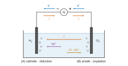
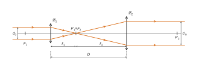
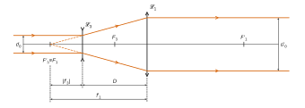
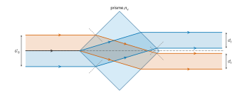
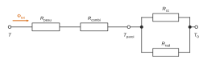

# Centrale-Supélec MPI — Physique-chimie 2 2026 · Corrigé brut

*Corrigé rédigé par IA, non officiel. Signalez toute erreur.*

Épreuve de 4 heures, calculatrice autorisée. Quatre parties indépendantes sur le thème des JO 2024. Les questions Q5 et Q28 (soulignées dans le sujet) demandent de l'initiative.

## Partie A — Étude du 100 m nage libre

### I — Première étape : plonger vite et loin

**Q1.** On étudie le système {nageur}, assimilé au point $M$, dans le référentiel du bassin supposé galiléen. L'origine $O$ est prise au niveau de l'eau, à la verticale du point de départ, avec $\vec u_x$ horizontal dans le sens du mouvement et $\vec u_z$ vertical ascendant. Seul le poids agit (frottements de l'air négligés), donc $\vec a = -g\,\vec u_z$.

Les conditions initiales sont :

$$\begin{aligned}
x(0) &= 0, \\
z(0) &= H_0, \\
\vec v(0) &= v_0\cos\alpha\,\vec u_x + v_0\sin\alpha\,\vec u_z .
\end{aligned}$$

Deux intégrations successives donnent :

$$\begin{aligned}
x(t) &= v_0\cos\alpha\; t, \\
z(t) &= -\tfrac12 g t^2 + v_0\sin\alpha\; t + H_0 .
\end{aligned}$$

L'entrée dans l'eau correspond à $z(t_1)=0$, soit $\tfrac12 g t_1^2 - v_0\sin\alpha\,t_1 - H_0 = 0$. Le produit des racines vaut $-2H_0/g<0$ : une seule racine est positive.

$$\boxed{t_1 = \frac{v_0\sin\alpha + \sqrt{v_0^2\sin^2\alpha + 2gH_0}}{g}}$$

La distance horizontale parcourue vaut $L_1 = v_0\cos\alpha\, t_1$, d'où :

$$\boxed{L_1 = \frac{v_0\cos\alpha}{g}\left(v_0\sin\alpha + \sqrt{v_0^2\sin^2\alpha + 2gH_0}\right)}$$

Contrôle : pour $H_0 = 0$, on retrouve la portée classique $v_0^2\sin 2\alpha/g$.

**Q2.** Le nageur étant plus rapide en l'air que dans l'eau, le plongeon idéal maximise $L_1$. Le maximum de la courbe de gauche de la figure 3 donne :

$$\boxed{L_1 \simeq 3{,}6\ \mathrm{m}\quad\text{pour}\quad \alpha \simeq 0{,}61\ \mathrm{rad} \simeq 35^\circ}$$

La courbe de droite donne, à la même abscisse, $\boxed{t_1 \simeq 0{,}88\ \mathrm{s}}$.

Vérification par Q1, avec $\sin\alpha = 0{,}573$ et $\cos\alpha = 0{,}820$ :

$$\begin{aligned}
t_1 &= \frac{2{,}87 + \sqrt{2{,}87^2 + 2\times 9{,}81\times 1{,}3}}{9{,}81} \\
&= \frac{2{,}87+5{,}81}{9{,}81} \\
&= 0{,}88\ \mathrm{s}, \\
L_1 &= 5{,}0\times 0{,}820\times 0{,}88 \\
&= 3{,}6\ \mathrm{m}.
\end{aligned}$$

L'optimum est inférieur à $45^\circ$ parce que le départ se fait au-dessus de l'eau.

**Q3.** Pendant le vol, seul le poids, force conservative, travaille. L'énergie mécanique se conserve entre $M$ ($z = H_0$) et $E$ ($z = 0$) :

$$\tfrac12 m v_E^2 = \tfrac12 m v_0^2 + m g H_0$$

On en déduit :

$$\boxed{v_E = \sqrt{v_0^2 + 2 g H_0}}$$

Cette expression ne contient pas $\alpha$ : l'angle de départ n'agit que sur la direction de $\vec v_E$, pas sur sa norme. Application numérique :

$$v_E = \sqrt{25{,}0 + 25{,}5}$$

$$\boxed{v_E \simeq 7{,}1\ \mathrm{m\cdot s^{-1}}}$$

C'est plus du double de la vitesse de nage en crawl.

**Q4.** En $E$, $v_x = v_0\cos\alpha$ et $v_z = v_0\sin\alpha - g t_1 < 0$. Comme $\beta$ est un angle absolu, $\tan\beta = (g t_1 - v_0\sin\alpha)/(v_0\cos\alpha)$. Avec $t_1 = L_1/(v_0\cos\alpha)$ :

$$\boxed{\beta = \arctan\left(\frac{g L_1}{v_0^2\cos^2\alpha} - \tan\alpha\right)}$$

Pour $L_1 = 3{,}62$ m et $\alpha = 0{,}61$ rad :

$$\begin{aligned}
\tan\beta &= \frac{9{,}81\times 3{,}62}{25{,}0\times 0{,}672} - 0{,}70 \\
&= 1{,}42
\end{aligned}$$

$$\boxed{\beta \simeq 55^\circ}$$

Contrôle : $\cos\beta = v_x/v_E = 4{,}10/7{,}11$ donne $\beta = 54{,}8^\circ$. On vérifie aussi que $\alpha + \beta \simeq 90^\circ$ : à portée maximale, les vitesses initiale et finale sont orthogonales.

Compromis :
- si $\beta \to \pi/2$ (entrée verticale), la vitesse horizontale, seule utile pour avancer, est perdue ; le nageur plonge en profondeur et doit remonter ;
- si $\beta \to 0$ (entrée rasante), le corps frappe la surface à plat : grande surface d'impact, freinage brutal (« plat ») et risque de blessure.

### II — Deuxième étape : nager à fond le 100 m nage libre

**Q5.** *Modèle.* Quand la vitesse moyenne est constante, la force propulsive moyenne $\overline F$ compense la traînée moyenne. L'énergie mécanique fournie sur une distance $L$ vaut alors $W = \overline F\,L$.

*Lecture de la figure 5.* Entre les traits pointillés ($t \approx 1{,}0$ s et $t \approx 14{,}0$ s), on compte 16 appuis pour les 18,9 m du dispositif. On en déduit :
- une vitesse $v \approx 18{,}9/13{,}0 \approx 1{,}45\ \mathrm{m\cdot s^{-1}}$ ;
- une période d'appui $T \approx 13{,}0/16 \approx 0{,}81$ s.

Chaque appui est une impulsion à peu près triangulaire, de crête $F_{\max} \approx 190$ N et de base $\approx 0{,}65$ à $0{,}7$ s. D'où :

$$\overline F \approx \frac{F_{\max}\times 0{,}68/2}{T} \approx \frac{190\times 0{,}34}{0{,}81} \approx 80\ \mathrm{N}.$$

*Travail sur 100 m.* À la vitesse du dispositif, $W \approx 80\times 100 \approx 8\times 10^{3}$ J. En sprint réel ($v \approx 2$ m/s), la traînée variant comme $v^2$ donne $\overline F \approx 80\times(2/1{,}45)^2 \approx 1{,}5\times 10^2$ N, d'où :

$$\boxed{W \sim 1\times 10^{4}\ \mathrm{J}\quad(\text{énergie mécanique sur }100\ \mathrm{m})}$$

*Recoupement par la figure 6.* Sur la phase aquatique d'un bras (0,75 s), la force moyenne vaut environ 55 N (25 N en ES-DC, 120 N en DC-IN, 45 N en UP) et la vitesse moyenne de la main environ $2{,}6\ \mathrm{m\cdot s^{-1}}$, soit $P \approx 1{,}4\times 10^{2}$ W. Les deux bras alternent et un bras est presque toujours dans l'eau, d'où $P \approx 10^2$ W en moyenne. Sur les 50 s environ d'un 100 m, cela redonne $W \approx 7\times 10^3$ J. Les deux estimations concordent : $W \sim 10^4$ J.

*Comparaison.* La barre apporte $E_\text{barre} = 205\times 10^3\times 4{,}18 = 8{,}6\times 10^5$ J. Le travail mécanique en représente $W/E_\text{barre} \approx 1$ à $2\ \%$. Le rendement global de la nage (muscle et propulsion) est faible, de l'ordre de $\eta \approx 5$ à $10\ \%$. L'énergie métabolique dépensée vaut donc :

$$\boxed{E_\text{dépensée} \approx \frac{W}{\eta} \sim 10^{5}\ \mathrm{J} \approx 25\ \text{à}\ 50\ \mathrm{kcal}}$$

**Un 100 m en sprint consomme de l'ordre de 10 à 20 % de l'apport d'une barre chocolatée** (1 à 2 % si l'on ne compte que le travail mécanique).

### III — Traitement de l'eau du centre aquatique olympique

#### III.1 — Étude de l'étape 1

**Q6.** On forme $\mathrm{H_2}$ et $\mathrm{HO^-}$ en (A), $\mathrm{Cl_2}$ en (B). Les couples en jeu sont :

- couple $\mathrm{H_2O/H_{2(g)}}$, de potentiel standard $E_1^\circ = -0{,}83$ V :

$$2\,\mathrm{H_2O} + 2e^- = \mathrm{H_{2(g)}} + 2\,\mathrm{HO^-}$$

- couple $\mathrm{Cl_{2(g)}/Cl^-}$, de potentiel standard $E_3^\circ = 1{,}36$ V :

$$\mathrm{Cl_{2(g)}} + 2e^- = 2\,\mathrm{Cl^-}$$

La réduction de l'eau en (A) et l'oxydation des chlorures en (B) donnent l'équation bilan :

$$\boxed{2\,\mathrm{H_2O_{(l)}} + 2\,\mathrm{Cl^-_{(aq)}} = \mathrm{H_{2(g)}} + \mathrm{Cl_{2(g)}} + 2\,\mathrm{HO^-_{(aq)}}}$$

$E_1^\circ$ et $E_2^\circ$ décrivent le même couple de l'eau : $E_2^\circ - 0{,}06\times 14 = -0{,}84\ \mathrm{V} \simeq E_1^\circ$.

**Q7.** L'espèce **oxydée** est l'ion chlorure $\mathrm{Cl^-}$ : le nombre d'oxydation du chlore passe de $-\mathrm{I}$ à $0$, à l'électrode (B). L'espèce **réduite** est l'eau $\mathrm{H_2O}$ : celui de l'hydrogène passe de $+\mathrm{I}$ à $0$, à l'électrode (A).

**Q8.** Figure 8 complétée :
- (A) est le siège d'une **réduction** : c'est la cathode, reliée à la borne $-$ de G ;
- (B) est le siège d'une **oxydation** : c'est l'anode, reliée à la borne $+$ ;
- **les électrons** circulent dans les fils de (B) vers G, puis de G vers (A) ;
- **le courant $i$** sort de la borne $+$ de G, entre dans la solution par (B), traverse la solution de (B) vers (A) (porté par $\mathrm{Na^+}$ vers (A), $\mathrm{Cl^-}$ et $\mathrm{HO^-}$ vers (B)) et revient à G par (A).



**Q9.** Dans le sens écrit, l'oxydant qui réagit est $\mathrm{H_2O}$ ($E_1^\circ = -0{,}83$ V) et le réducteur est $\mathrm{Cl^-}$ ($E_3^\circ = 1{,}36$ V). On fait donc réagir l'oxydant le plus faible avec le réducteur le plus faible : la réaction spontanée est la réaction inverse. Quantitativement, $\log K^\circ = 2(E_1^\circ - E_3^\circ)/0{,}06 = -73$. **L'étape 1 est thermodynamiquement très défavorisée** ($K^\circ \approx 10^{-73}$). C'est le générateur qui la force, d'où le nom d'électrolyse.

#### III.2 — Étude de l'étape 2

**Q10.** L'étape 2 est la dismutation de $\mathrm{Cl_2}$. On utilise les demi-équations :

$$\begin{aligned}
(1)\quad & \tfrac12\mathrm{Cl_{2(g)}} + e^- = \mathrm{Cl^-} && (E_3^\circ = 1{,}36\ \mathrm{V}) \\
(2)\quad & \mathrm{ClO^-} + \mathrm{H_2O} + e^- = \tfrac12\mathrm{Cl_{2(g)}} + 2\,\mathrm{HO^-} && (E_4^\circ = 0{,}42\ \mathrm{V})
\end{aligned}$$

$(1)-(2)$ redonne l'équation de l'étape 2, avec $n = 1$ :

$$\boxed{K^\circ = \frac{\dfrac{[\mathrm{Cl^-}]}{c^\circ}\,\dfrac{[\mathrm{ClO^-}]}{c^\circ}}{\dfrac{P_{\mathrm{Cl_2}}}{P^\circ}\left(\dfrac{[\mathrm{HO^-}]}{c^\circ}\right)^2}}$$

À l'équilibre, les potentiels des deux couples sont égaux, d'où :

$$\begin{aligned}
\log K^\circ &= \frac{E_3^\circ - E_4^\circ}{0{,}06} \\
&= 15{,}7
\end{aligned}$$

$$\boxed{K^\circ \approx 5\times 10^{15}}$$

La réaction est quantitative.

**Q11.** Pendant $t = 3600$ s à $I = 20$ A :

$$\begin{aligned}
n(e^-) &= \frac{I t}{F} \\
&= \frac{7{,}2\times 10^4}{96\,485}
\end{aligned}$$

$$\boxed{n(e^-) \simeq 0{,}75\ \mathrm{mol}}$$

L'étape 1 échange 2 électrons par $\mathrm{Cl_2}$, donc $n(\mathrm{Cl_2}) = 0{,}37$ mol. Elle produit aussi $n(\mathrm{HO^-}) = 0{,}75$ mol, en proportions exactement stœchiométriques pour l'étape 2, qui forme un $\mathrm{ClO^-}$ par $\mathrm{Cl_2}$ :

$$\boxed{n(\mathrm{ClO^-}) \simeq 0{,}37\ \mathrm{mol\ par\ heure}}$$

**Q12.** L'étape 1 consomme $n(\mathrm{Cl^-}) = 2\,n(\mathrm{Cl_2}) = n(e^-) = 0{,}75$ mol par heure, avec $M(\mathrm{NaCl}) = 58{,}5\ \mathrm{g\cdot mol^{-1}}$ :

$$\boxed{m(\mathrm{NaCl}) \simeq 44\ \mathrm{g}\ \text{par heure}}$$

Le bassin contient $V = 1250\times 3 = 3{,}75\times 10^3\ \mathrm{m^3} = 3{,}75\times 10^6$ L, soit $m_\text{dispo} = 5\times 3{,}75\times 10^6\ \mathrm{g} \approx 1{,}9\times 10^7$ g (19 t). **Le stock suffit pour environ $4\times 10^5$ heures de traitement, même sans régénération.**

#### III.3 — Ajustement du pH

**Q13.** Pour le couple $\mathrm{HClO/ClO^-}$ :

$$\frac{[\mathrm{ClO^-}]}{[\mathrm{HClO}]} = 10^{\,\mathrm{pH} - \mathrm{p}K_a}$$

À pH = 8,0, ce rapport vaut $10^{0{,}5} \approx 3{,}2$ : $\mathrm{ClO^-}$ prédomine. L'acide sulfurique, acide fort, apporte des ions $\mathrm{H_3O^+}$ qui réagissent totalement sur la base $\mathrm{ClO^-}$ :

$$\mathrm{H_3O^+} + \mathrm{ClO^-} \to \mathrm{HClO} + \mathrm{H_2O},\qquad K^\circ = 10^{7{,}5}.$$

Le rapport $[\mathrm{ClO^-}]/[\mathrm{HClO}]$ diminue, donc le pH diminue aussi. Ramener le pH entre 7,2 et 7,6 revient à ramener ce rapport entre 0,50 et 1,3. **L'ajout d'acide fort convertit $\mathrm{ClO^-}$ en $\mathrm{HClO}$ et abaisse le pH**, ce qui favorise en outre $\mathrm{HClO}$, la forme la plus désinfectante.

## Partie B — Vélocimétrie laser à franges

### I — Expansion du faisceau

**Q14.** Pour qu'un faisceau parallèle ressorte parallèle, le système doit être afocal : $F'_1 \equiv F_2$, et les lentilles sont distantes de $D = f'_1 + f'_2$. Les rayons incidents parallèles à l'axe convergent en $F'_1$, s'y croisent, puis ressortent de $\mathcal L_2$ parallèles à l'axe, plus écartés et inversés.



On a $\tau > 1$ si et seulement si $f'_2 > f'_1$.

**Q15.** Un rayon incident à la hauteur $h = d_0/2$ passe par $F'_1$, puis parcourt $f'_2$ jusqu'à $\mathcal L_2$. Par triangles semblables, sa hauteur y vaut $|h'| = h\,f'_2/f'_1$. D'où :

$$\boxed{\tau = \frac{f'_2}{f'_1}}$$

**Q16.** La lentille divergente $\mathcal L_3$ ($f'_3 < 0$) a son foyer image $F'_3$ **avant** elle, à $|f'_3|$. L'afocalité impose $F'_3 \equiv F_1$, d'où :

$$\begin{aligned}
D &= f'_1 + f'_3 \\
&= f'_1 - |f'_3|.
\end{aligned}$$

Après $\mathcal L_3$, les rayons divergent comme s'ils venaient de $F'_3$, puis ressortent de $\mathcal L_1$ parallèles à l'axe, plus écartés et du même côté de l'axe : aucun point de convergence réel n'apparaît dans le système.



**Q17.** Après $\mathcal L_3$, le rayon de hauteur $h$ semble issu de $F'_3 \equiv F_1$. Il atteint $\mathcal L_1$, située à $f'_1$ de ce point, à la hauteur $h\,f'_1/|f'_3|$ :

$$\boxed{\tau' = \frac{f'_1}{|f'_3|} = -\frac{f'_1}{f'_3}}$$

**Q18.** Pour le montage képlérien, $f'_2 = \tau f'_1$. Pour le montage galiléen, $f'_3 = -f'_1/\tau'$. D'où :

$$\boxed{D_\text{kep} = f'_1(1+\tau)}$$

$$\boxed{D_\text{gal} = f'_1\left(1 - \frac{1}{\tau'}\right)}$$

À $f'_1$ et taux $\tau = \tau' > 1$ égaux, $D_\text{gal} < f'_1 < D_\text{kep}$. Par exemple, pour $\tau = 3$ : $0{,}67 f'_1$ contre $4 f'_1$. **L'expanseur galiléen est le plus compact.**

### II — Division du faisceau

**Q19.** Le cube est vu en coupe comme un carré de côté $c$, dont une diagonale porte l'axe. Les rayons incidents arrivent donc sur les faces de gauche sous $i = 45^\circ$. La loi de Snell-Descartes donne :

$$\begin{aligned}
\sin r &= \frac{\sin 45^\circ}{1{,}5} \\
&= 0{,}471, \\
r &= 28{,}1^\circ.
\end{aligned}$$

- **Rayon supérieur.** Il est réfracté par la face supérieure gauche et dévié de $16{,}9^\circ$ vers le bas. Il atteint la face inférieure droite, **parallèle** à la face d'entrée, sous l'incidence $r$, et ressort sous $45^\circ$ : il émerge parallèle à l'axe, translaté vers le bas de $c\,\sin(i-r)/\cos r \approx 0{,}33\,c$, donc **sous l'axe**.
- **Rayon inférieur.** Par symétrie, il est dévié vers le haut et ressort parallèle à l'axe, **au-dessus de l'axe**.
- **Rayon axial.** Il frappe l'arête gauche et est partagé entre les deux faces de gauche. Sa partie réfractée par la face supérieure ressort à $0{,}33\,c$ sous l'axe, celle réfractée par la face inférieure à $0{,}33\,c$ au-dessus.



Le faisceau est donc divisé par l'arête en deux demi-faisceaux. Chacun traverse une lame à faces parallèles : il ressort parallèle à l'axe, et les deux demi-faisceaux se sont croisés dans le prisme. Ce tracé suppose $d'_0 < 0{,}66\,c$. Un rayon entrant plus haut atteindrait la face supérieure droite sous $61{,}9^\circ > \arcsin(1/1{,}5) = 41{,}8^\circ$ et y subirait une réflexion totale.

**Q20.** L'arête coupe le faisceau en deux moitiés égales. Une lame à faces parallèles translate un faisceau sans changer sa largeur (les facteurs $\cos r/\cos i$ des deux dioptres se compensent). D'où :

$$\boxed{d_f = \frac{d'_0}{2}}$$

**Q21.** Dans chaque demi-faisceau, l'onde reste plane : par le théorème de Malus, les plans orthogonaux à l'axe sont des surfaces d'onde. Le dispositif est symétrique par rapport à l'axe, donc deux rayons symétriques ont le même chemin optique. Un plan orthogonal à l'axe en sortie est ainsi une surface d'onde commune aux deux faisceaux :

$$\boxed{\delta = 0}$$

Les deux faisceaux sont plans, de même intensité (division en deux moitiés égales), issus de la même source et en phase. **Ils remplissent les conditions de cohérence et d'égalité d'intensité requises, quelle que soit la longueur de cohérence du laser.**

### III — Interférences des deux faisceaux

**Q22.** D'après la figure 12, avec $k = 2\pi/\lambda_0$ :

$$\begin{aligned}
\vec k_1 &= k(\cos\alpha\,\vec u_x - \sin\alpha\,\vec u_y), \\
\vec k_2 &= k(\cos\alpha\,\vec u_x + \sin\alpha\,\vec u_y), \\
\vec k_2 - \vec k_1 &= 2k\sin\alpha\,\vec u_y .
\end{aligned}$$

Comme $I \propto |\underline s_1 + \underline s_2|^2$ et que chaque onde seule donne $I_0$ :

$$\boxed{I(x,y,z) = 2I_0\left[1 + \cos\left(\frac{4\pi\sin\alpha}{\lambda_0}\,y\right)\right]}$$

$I$ ne dépend que de $y$. Dans la zone de recouvrement, on observe des franges rectilignes, parallèles à $(Ox)$ : ce sont des plans $y = $ cte.

Elles sont équidistantes, de contraste maximal ($I$ varie de $0$ à $4I_0$), avec une frange brillante en $y = 0$.

**Q23.** L'interfrange est la distance entre deux franges brillantes consécutives, mesurée perpendiculairement aux franges (ici selon $y$) :

$$\boxed{i = \frac{\lambda_0}{2\sin\alpha}}$$

$$\begin{aligned}
i &= \frac{514\times 10^{-9}}{2\times 0{,}1045} \\
&= 2{,}46\ \mathrm{\mu m}.
\end{aligned}$$

**Q24.** Une particule se déplaçant selon $y$ à la vitesse $V$ franchit un interfrange par période de clignotement, donc $f = V/i$ :

$$\boxed{V = \frac{\lambda_0 f}{2\sin\alpha}}$$

$$\begin{aligned}
V &= \frac{514\times 10^{-9}\times 1{,}200\times 10^6}{0{,}2091} \\
&= 2{,}95\ \mathrm{m\cdot s^{-1}}.
\end{aligned}$$

Pour l'incertitude, la formule produit/quotient s'applique. L'incertitude relative sur $\sin\alpha$ vaut :

$$\begin{aligned}
\frac{u(\sin\alpha)}{\sin\alpha} &= \frac{u(\alpha)}{\tan\alpha} \\
&= \frac{1{,}745\times 10^{-3}}{0{,}1051} \\
&= 1{,}66\ \%.
\end{aligned}$$

On compose avec $u(\lambda_0)/\lambda_0 = 1{,}95\ \%$ et $u(f)/f = 4{,}17\ \%$ :

$$\begin{aligned}
\frac{u(V)}{V} &= \sqrt{(1{,}95\ \%)^2 + (4{,}17\ \%)^2 + (1{,}66\ \%)^2} \\
&= 4{,}9\ \%.
\end{aligned}$$

$$\boxed{V = (2{,}95 \pm 0{,}14)\ \mathrm{m\cdot s^{-1}}}$$

**Q25.** Le faisceau 1 occupe la bande $|x\sin\alpha + y\cos\alpha| \le d_f/2$, le faisceau 2 la bande $|x\sin\alpha - y\cos\alpha| \le d_f/2$. La zone commune est un losange. Sur $(Oy)$, la condition s'écrit $|y| \le d_f/(2\cos\alpha)$, d'où :

$$\boxed{\Delta = \frac{d_f}{\cos\alpha}}$$

**Q26.** Pour qu'une particule clignote au moins deux fois, ce qui est nécessaire pour définir une fréquence, elle doit traverser au moins un interfrange dans la zone : $\Delta \ge i$. D'où :

$$\frac{d_f}{\cos\alpha} \ge \frac{\lambda_0}{2\sin\alpha}$$

$$\boxed{d_{f,\min} = \frac{\lambda_0}{2\tan\alpha} \approx 2{,}4\ \mathrm{\mu m}}$$

Le laser fournit $d_f = 0{,}65$ mm, soit environ 270 fois plus. La zone contient $N = \Delta/i = 2 d_f\tan\alpha/\lambda_0 \approx 2{,}7\times 10^2$ franges. Si l'on interprète 0,65 mm comme le diamètre en sortie du laser, avant expansion et division, $d_f \ge 0{,}33$ mm et $N \gtrsim 130$. **Le laser argon convient largement** : chaque particule produit une centaine d'éclats, ce qui permet une mesure précise de la fréquence.

## Partie C — Le plongeon de haut vol

**Q27.** On étudie le plongeur entièrement immergé, de volume $V = m/\rho_h$, dans le référentiel du bassin supposé galiléen, avec un axe vertical **descendant** et $v > 0$. Il subit son poids $mg$, la poussée d'Archimède $-\rho\,\dfrac{m}{\rho_h}\,g$ et la traînée $-kv^2$. La deuxième loi de Newton donne :

$$\boxed{\frac{\mathrm dv}{\mathrm dt} = g\left(1 - \frac{\rho}{\rho_h}\right) - \frac{k}{m}\,v^2}$$

**Q28.** On pose $\varphi(v) = B - A v^2$, avec :

$$\begin{aligned}
A &= \frac{k}{m} > 0, \\
B &= g\left(1-\frac{\rho}{\rho_h}\right) > 0 \quad (\text{car } \rho_h > \rho).
\end{aligned}$$

La fonction $\varphi$ décroît strictement sur $\mathbb R_+$ et s'annule en une unique valeur :

$$\boxed{v_\text{lim} = \sqrt{\frac{m g}{k}\left(1 - \frac{\rho}{\rho_h}\right)} = \sqrt{\frac{2 m g(\rho_h - \rho)}{\rho_h\,\rho\, C_x S}}}$$

La constante $v_\text{lim}$ est solution. Par unicité (Cauchy-Lipschitz), une solution partie de $v_0 > v_\text{lim}$ reste au-dessus de $v_\text{lim}$.

Elle est alors décroissante, puisque $\varphi < 0$, et minorée, donc elle converge vers une limite $\ell$ qui doit vérifier $\varphi(\ell) = 0$ : $\ell = v_\text{lim}$.

*Estimations.*
- **$C_x$** : le plongeur gainé, bras tendus, s'apparente à un cylindre allongé ($L/D \approx 5$). Le tableau 2 donne $C_x = 0{,}35$ aux grandes vitesses, ce qui convient pendant la phase de freinage. Aux faibles vitesses, les valeurs voisines (0,47 à 0,74) changeraient $v_\text{lim}$ d’environ 30 % au plus.
- **$S$** : la figure 14 n'a pas d'échelle. Une section de corps humain vaut entre 0,1 m² (entrée parfaitement verticale) et 0,3 m² (corps légèrement incliné, bras et jambes compris). On retient $S \approx 0{,}3$ m², valeur cohérente avec la figure 15.

On obtient $k = \tfrac12\times 1000\times 0{,}35\times 0{,}30 \approx 53\ \mathrm{kg\cdot m^{-1}}$ et $m g(1-\rho/\rho_h) = 75\times 9{,}81\times 0{,}0706 = 52$ N, d'où :

$$\boxed{v_\text{lim} \approx 1{,}0\ \mathrm{m\cdot s^{-1}}}$$

Avec $S = 0{,}1$ m², on trouverait 1,7 m/s. La valeur est faible parce que la poussée d'Archimède compense 93 % du poids. Elle concorde avec l'asymptote de la figure 15 pour $C_x = 0{,}35$.

**Q29.** Par identification avec Q27 :

$$\boxed{A = \frac{k}{m}}$$

$$\boxed{B = g\left(1 - \frac{\rho}{\rho_h}\right)}$$

On pose $u = e^{-2t/\tau + k_2}$, de sorte que $v = k_1\dfrac{1+u}{1-u}$ et $\dot u = -\dfrac{2u}{\tau}$. Alors :

$$\begin{aligned}
\frac{\mathrm dv}{\mathrm dt} &= -\frac{4k_1 u}{\tau(1-u)^2}, \\
-A v^2 + B &= \frac{-A k_1^2 (1+u)^2 + B(1-u)^2}{(1-u)^2}.
\end{aligned}$$

L'identification pour tout $t$ impose $A k_1^2 = B$. Le second membre vaut alors $-4Bu/(1-u)^2$, et il faut $k_1/\tau = B$.

Enfin, $v(0) = v_0$ donne $e^{k_2} = (v_0 - k_1)/(v_0 + k_1)$ :

$$\boxed{\begin{aligned}
k_1 &= \sqrt{\frac{B}{A}} = v_\text{lim} \\
\tau &= \frac{1}{\sqrt{AB}} \\
k_2 &= \ln\left(\frac{v_0 - \sqrt{B/A}}{v_0 + \sqrt{B/A}}\right) < 0
\end{aligned}}$$

Numériquement, on prend $A \approx 0{,}70\ \mathrm{m^{-1}}$, $B = 0{,}69\ \mathrm{m\cdot s^{-2}}$ et $v_0 = 13{,}9\ \mathrm{m\cdot s^{-1}}$. On obtient $k_1 \approx 1{,}0\ \mathrm{m\cdot s^{-1}}$, $\tau \approx 1{,}4$ s et $k_2 \approx -0{,}14$.

**Q30.** *Principe de la méthode d'Euler.* On discrétise $[t_0, t_f]$ avec le pas $h$ et l'on remplace la dérivée par un taux d'accroissement. Le développement à l'ordre 1 donne la récurrence :

$$v(t_{i+1}) \simeq v(t_i) + h\,F(v(t_i))$$

Elle permet de construire la solution de proche en proche à partir de $v(t_0) = v_0$. L'erreur globale est en $O(h)$, et le pas doit rester petit devant $\tau$ (ici $h = 10^{-2}$ s pour $\tau \approx 1{,}4$ s).

```python
    return -A*v**2 + B                                    # ligne 6
        valeurs_v.append(valeurs_v[i] + h*F(valeurs_v[i]))  # ligne 14
```

Exécuté avec $A = 0{,}70$, $B = 0{,}69$ et $v_0 = 13{,}9$, ce programme donne $v(10\ \mathrm s) = 0{,}99\ \mathrm{m\cdot s^{-1}}$, en accord avec la solution analytique.

**Q31.** Le temps de réaction vaut 1 s. Pour un corps humain à grande vitesse, le coefficient réaliste est $C_x = 0{,}35$ (cylindre, $L/D \approx 5$) ou $0{,}47$. À $t = 1$ s, la figure 15 donne :
- pour $C_x = 0{,}35$ : $z_G \approx -3{,}5$ m et $v \approx 1{,}5\ \mathrm{m\cdot s^{-1}}$ ;
- pour $C_x = 0{,}47$ : $z_G \approx -3$ m.

Les mains, tendues 1 m sous le centre de masse, sont alors à environ $-4{,}5$ m. **Un bassin de 5 m laisse donc au plongeur le temps de réagir** (ouvrir les bras, se cambrer, remonter) avant de toucher le fond. À cet instant, sa vitesse est déjà faible. À l'inverse, une position parfaitement profilée ($C_x = 0{,}04$) donnerait $z_G \approx -10$ m dès la première seconde : le plongeur doit rompre l'alignement dès l'entrée. Dans un bassin de 3 m, les mains toucheraient le fond ($z_G = -2$ m) au bout de 0,3 s seulement, à environ 3,6 m/s.

## Partie D — Comment éviter l'hypothermie en natation marathon ou triathlon ?

**Q32.** On considère une couche plane d'épaisseur $e_e$, de section $S$, en régime stationnaire et sans source. Le bilan sur une tranche $[x, x+\mathrm dx]$ montre que le flux $\Phi = j\,S$ est uniforme. La loi de Fourier $j = -\lambda_e\,\mathrm dT/\mathrm dx$ s'intègre alors en $T_1 - T_2 = \Phi\,e_e/(\lambda_e S)$ :

$$\boxed{R_e = \frac{e_e}{\lambda_e S}}$$

Les trois couches sont traversées par le même flux : elles sont en série.

$$\boxed{R_\text{peau} = \frac{1}{S}\left(\frac{e_e}{\lambda_e} + \frac{e_d}{\lambda_d} + \frac{e_g}{\lambda_g}\right)}$$

On calcule $S = 0{,}007184\times 75^{0{,}425}\times 175^{0{,}725} = 1{,}90\ \mathrm{m^2}$. Les trois termes de la parenthèse valent, en $\mathrm{m^2\cdot K\cdot W^{-1}}$ :

$$\begin{aligned}
\frac{e_e}{\lambda_e} &= 3{,}3\times 10^{-4}, \\
\frac{e_d}{\lambda_d} &= 4{,}4\times 10^{-3}, \\
\frac{e_g}{\lambda_g} &= 5{,}26\times 10^{-2}.
\end{aligned}$$

Leur somme vaut $5{,}74\times 10^{-2}$, d'où :

$$\boxed{R_\text{peau} \approx 3{,}0\times 10^{-2}\ \mathrm{K\cdot W^{-1}}}$$

La graisse en fournit 92 %.

**Q33.** Le flux conducto-convectif vaut $\Phi_{cc} = h S\,(T_\text{paroi} - T_0)$, d'où :

$$\boxed{R_{cc} = \frac{1}{hS} = \frac{1}{455{,}0\times 1{,}90} \approx 1{,}2\times 10^{-3}\ \mathrm{K\cdot W^{-1}}}$$

**Q34.** On factorise $T_\text{paroi}^4 - T_0^4 = (T_\text{paroi}^2 + T_0^2)(T_\text{paroi} + T_0)\,\Delta T$. Pour $\Delta T \ll T_0$, cela donne $\simeq 4T_0^3\,\Delta T$, d'où $\Phi_\text{rad} \simeq 4\varepsilon\sigma S T_0^3\,\Delta T$, proportionnel à $\Delta T$. Avec $T_0 = 289$ K :

$$\boxed{R_\text{rad} = \frac{1}{4\varepsilon\sigma S T_0^3}}$$

$$R_\text{rad} = \frac{1}{4\times 0{,}9\times 5{,}7\times 10^{-8}\times 1{,}90\times 289^3}$$

$$\boxed{R_\text{rad} \approx 0{,}11\ \mathrm{K\cdot W^{-1}}}$$

**Q35.** La chaleur traverse successivement la peau et la combinaison (même flux, donc en série). Depuis la paroi externe, à $T_\text{paroi}$, elle rejoint l'eau par deux voies soumises au même écart $T_\text{paroi} - T_0$ : convection et rayonnement, en parallèle.



$$\boxed{R_\text{tot} = R_\text{peau} + R_\text{combi} + \frac{R_{cc}\,R_\text{rad}}{R_{cc} + R_\text{rad}}}$$

$$\boxed{\Phi_\text{tot} = \frac{T - T_0}{R_\text{tot}}}$$

**Q36.** On compare les deux branches parallèles : $R_\text{rad}/R_{cc} \approx 0{,}106/1{,}15\times 10^{-3} \approx 92$. L'association parallèle vaut alors :

$$\frac{R_{cc}}{1 + R_{cc}/R_\text{rad}} = 0{,}989\,R_{cc}$$

**Le rayonnement est négligeable devant la convection dans l'eau**, car $h = 455\ \mathrm{W\cdot m^{-2}\cdot K^{-1}}$ est très supérieur au coefficient radiatif équivalent $4\varepsilon\sigma T_0^3 \approx 5\ \mathrm{W\cdot m^{-2}\cdot K^{-1}}$.

La résistance de la combinaison vaut :

$$\begin{aligned}
R_\text{combi} &= \frac{e}{\lambda_\text{Ar} S} \\
&= \frac{4{,}0\times 10^{-3}}{0{,}04887\times 1{,}90} \\
&= 4{,}3\times 10^{-2}\ \mathrm{K\cdot W^{-1}}.
\end{aligned}$$

D'où :

$$\begin{aligned}
R_\text{tot} &\simeq R_\text{peau} + R_\text{combi} + R_{cc} \\
&= 3{,}02\times 10^{-2} + 4{,}30\times 10^{-2} + 0{,}12\times 10^{-2}
\end{aligned}$$

$$\boxed{R_\text{tot} \approx 7{,}4\times 10^{-2}\ \mathrm{K\cdot W^{-1}}}$$

La combinaison représente 58 % de la résistance totale, et $R_{cc}$ est elle-même presque négligeable (1,6 %).

**Q37.** On applique le premier principe au nageur, de capacité $mc$ et de température uniforme, le régime étant lentement variable :

$$mc\,\frac{\mathrm dT}{\mathrm dt} = \mathcal P_h - \frac{T - T_0}{R_\text{tot}}$$

En divisant par $mc$, on obtient la forme demandée :

$$\frac{\mathrm dT}{\mathrm dt} + \frac{T}{\tau} = \xi$$

$$\boxed{\begin{aligned}
\tau &= m c R_\text{tot} \\
\xi &= \frac{\mathcal P_h}{mc} + \frac{T_0}{m c R_\text{tot}}
\end{aligned}}$$

Numériquement, $\tau = 75\times 3{,}5\times 10^3\times 7{,}43\times 10^{-2} \approx 1{,}95\times 10^4$ s, soit 5,4 h.

**Q38.** La solution est la somme d'une solution particulière constante $\xi\tau$ et de la solution homogène $K e^{-t/\tau}$. Le nageur entre dans l'eau à $T(0) = T_c$ :

$$\boxed{T(t) = \xi\tau + (T_c - \xi\tau)\,e^{-t/\tau}}$$

**Q39.** En régime permanent, $\mathrm dT/\mathrm dt = 0$ :

$$\boxed{T_\infty = \xi\tau = T_0 + R_\text{tot}\,\mathcal P_h}$$

$$T_\infty = 16{,}0 + 7{,}43\times 10^{-2}\times 250$$

$$\boxed{T_\infty \approx 34{,}6\ ^\circ\mathrm C}$$

Le régime permanent est atteint à 1 % près au bout d'environ $5\tau$ : $\boxed{t \approx 5\tau \approx 1\times 10^5\ \mathrm s \approx 27\ \mathrm h}$. On note que $T_\infty < 35\ ^\circ$C.

**Q40.** De $T(t) = T_\infty + (T_c - T_\infty)\,e^{-t/\tau}$, on tire :

$$\boxed{t_\text{max} = \tau\ln\frac{T_c - T_\infty}{35 - T_\infty}}\qquad(\text{défini si } T_\infty < 35\ ^\circ\mathrm C).$$

- **Avec combinaison** : $R_\text{tot} = R_\text{peau} + R_\text{combi} + R_{cc} = 7{,}43\times 10^{-2}\ \mathrm{K\cdot W^{-1}}$, $\tau = 1{,}95\times 10^4$ s et $T_\infty = 34{,}58\ ^\circ$C. D'où $t_\text{max} = 1{,}95\times 10^4\,\ln(2{,}42/0{,}42) \approx 3{,}4\times 10^4$ s : $\boxed{t_\text{max} \approx 9{,}5\ \mathrm h}$.
- **Sans combinaison** : $R'_\text{tot} = R_\text{peau} + R_{cc} = 3{,}13\times 10^{-2}\ \mathrm{K\cdot W^{-1}}$, $\tau' = 8{,}2\times 10^3$ s et $T'_\infty = 23{,}8\ ^\circ$C. D'où $t'_\text{max} = 8{,}2\times 10^3\,\ln(13{,}2/11{,}2) \approx 1{,}35\times 10^3$ s : $\boxed{t'_\text{max} \approx 23\ \mathrm{min}}$.

Le marathon dure un peu plus de deux heures. Sans combinaison, le nageur serait en hypothermie avant la fin de la première demi-heure. Avec combinaison, il finit l'épreuve vers 36 °C, loin du seuil. **La combinaison est indispensable dans une eau à 16 °C**, ce qui justifie son caractère obligatoire.
