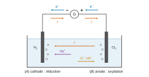
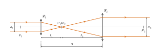
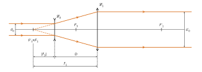
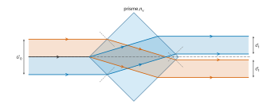
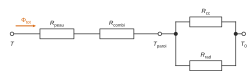

# Centrale-Supélec MPI — Physique-chimie 2 2026 · Corrigé guidé

*Corrigé rédigé par IA, non officiel. Signalez toute erreur.*

## Présentation du sujet

**Thème.** « JO 2024 : comment ils nous ont fait vibrer… ». Le sujet suit des athlètes dans l'eau et fait passer en revue une large part du programme de MP2I/MPI en quatre parties **indépendantes**. Durée : 4 heures, calculatrice autorisée, 40 questions.

| Partie | Contenu | Notions du programme |
|---|---|---|
| A.I (Q1–Q4) | Départ plongé : trajectoire parabolique, portée, angle d'entrée | Chute libre, théorème de l'énergie mécanique, lecture de courbes |
| A.II (Q5) | Énergie dépensée sur un 100 m crawl, à partir de mesures de force | Travail, puissance, estimation (question ouverte) |
| A.III (Q6–Q13) | Électrolyse de l'eau salée, dismutation du dichlore, réglage du pH | Oxydoréduction, $K^\circ$ et potentiels standard, Faraday, couples acide-base |
| B.I (Q14–Q18) | Expanseurs de faisceau képlérien et galiléen | Lentilles minces, systèmes afocaux |
| B.II (Q19–Q21) | Division d'un faisceau par un prisme cubique | Lois de Snell-Descartes, lame à faces parallèles, chemin optique |
| B.III (Q22–Q26) | Vélocimétrie laser à franges | Interférences de deux ondes planes, interfrange, incertitudes composées |
| C (Q27–Q31) | Freinage d'un plongeur de haut vol dans l'eau | Newton, Archimède, traînée quadratique, vitesse limite, méthode d'Euler en Python |
| D (Q32–Q40) | Hypothermie du nageur, avec ou sans combinaison | Diffusion thermique, résistances thermiques, loi de Newton, rayonnement linéarisé, premier ordre |

**Questions à prise d'initiative.** Q5 et Q28 (numéros soulignés). Le barème y valorise la démarche explicitée : modèle, lectures graphiques annoncées, estimations assumées, ordre de grandeur final.

**Difficulté et longueur.** Le sujet est long mais très guidé en dehors de Q5 et Q28. Les calculs sont courts, et la rapidité comme la propreté des applications numériques font la différence. Plusieurs questions demandent de **reproduire une figure** (Q8, Q14, Q16, Q19) ou de **proposer un schéma** (Q35) : un schéma propre et légendé est la réponse attendue.

**Questions abordables à ne pas laisser passer.** Q1, Q3, Q6, Q7, Q11, Q12, Q13, Q15, Q17, Q22, Q23, Q27, Q29 (identification de $A$ et $B$), Q30, Q32, Q33, Q37, Q38.

**Gestion du temps.** Comptez environ 1 h pour la partie A, 1 h pour la partie B, 45 min pour la partie C et 1 h pour la partie D, plus 15 min de relecture. Ne vous enlisez pas dans Q5 : une estimation honnête en dix minutes vaut mieux qu'une demi-heure de calculs.

## Partie A — Étude du 100 m nage libre

La sous-partie I traite la phase aérienne du départ par la mécanique du point. La sous-partie II est une estimation énergétique à partir de documents. La sous-partie III change complètement de domaine : c'est de la chimie des solutions (électrolyse, dismutation, pH).

### Question 1

> [!INDICATION]
> Système, référentiel, bilan des forces : quelle est la seule force qui agit pendant le vol ?

> [!INDICATION]
> Intégrez deux fois la deuxième loi de Newton, puis cherchez l'instant où l'altitude s'annule. L'équation obtenue est du second degré : laquelle des deux racines garder ?

#### Solution

On étudie le système {nageur}, réduit au point $M$, dans le référentiel du bassin supposé galiléen. L'origine $O$ est au niveau de l'eau, à la verticale de $M$, avec $\vec u_x$ horizontal vers l'avant et $\vec u_z$ vers le haut. Seul le poids agit, donc $\vec a = -g\,\vec u_z$.

Les conditions initiales sont :

$$\begin{aligned}
x(0) &= 0, \\
z(0) &= H_0, \\
\dot x(0) &= v_0\cos\alpha, \\
\dot z(0) &= v_0\sin\alpha.
\end{aligned}$$

Deux intégrations donnent :

$$\begin{aligned}
x(t) &= v_0\cos\alpha\;t, \\
z(t) &= -\tfrac12 g t^2 + v_0\sin\alpha\;t + H_0 .
\end{aligned}$$

L'entrée dans l'eau a lieu quand $z(t_1) = 0$. Le produit des racines vaut $-2H_0/g < 0$ : une racine est négative, l'autre positive, et seule la positive a un sens physique.

$$\boxed{t_1 = \frac{v_0\sin\alpha + \sqrt{v_0^2\sin^2\alpha + 2gH_0}}{g}}$$

Avec $L_1 = v_0\cos\alpha\,t_1$ :

$$\boxed{L_1 = \frac{v_0\cos\alpha}{g}\left(v_0\sin\alpha + \sqrt{v_0^2\sin^2\alpha + 2gH_0}\right)}$$

Pour $H_0 = 0$, on retrouve $L_1 = v_0^2\sin 2\alpha/g$.

> [!METHODE]
> Un cas limite connu (ici $H_0 = 0$) est le contrôle le plus rapide d'une expression de portée.

### Question 2

> [!INDICATION]
> Le nageur va plus vite en l'air que dans l'eau : quelle grandeur faut-il donc optimiser ?

> [!INDICATION]
> Lisez l'abscisse du maximum sur la courbe de gauche, convertissez-la en degrés, puis lisez la durée à la même abscisse sur la courbe de droite.

#### Solution

Le meilleur plongeon est celui qui **maximise $L_1$**. La figure 3 donne un maximum $\boxed{L_1 \simeq 3{,}6\ \mathrm m}$ pour $\boxed{\alpha \simeq 0{,}61\ \mathrm{rad} \simeq 35^\circ}$. La durée correspondante vaut $\boxed{t_1 \simeq 0{,}88\ \mathrm s}$.

Vérification avec Q1, où $\sin\alpha = 0{,}573$ et $\cos\alpha = 0{,}820$ :

$$\begin{aligned}
t_1 &= \frac{2{,}87 + \sqrt{8{,}2 + 25{,}5}}{9{,}81} \\
&= 0{,}88\ \mathrm s, \\
L_1 &= 5{,}0\times 0{,}820\times 0{,}88 \\
&= 3{,}6\ \mathrm m .
\end{aligned}$$

> [!PIEGE]
> L'axe de la figure est en radians et la question demande des degrés. Ne plaquez pas non plus l'optimum de $45^\circ$ : il ne vaut que pour un tir depuis le sol. Partir de plus haut décale l'optimum vers les petits angles.

### Question 3

> [!INDICATION]
> La question porte sur une norme de vitesse : pensez à un raisonnement énergétique plutôt qu'aux composantes.

#### Solution

Pendant le vol, seul le poids, conservatif, travaille. L'énergie mécanique se conserve entre $M$ et $E$ :

$$\tfrac12 m v_E^2 = \tfrac12 m v_0^2 + m g H_0$$

On en déduit :

$$\boxed{v_E = \sqrt{v_0^2 + 2gH_0}}$$

L'angle $\alpha$ n'apparaît pas : il ne change que la direction de la vitesse d'entrée. Numériquement, $v_E = \sqrt{50{,}5}$, d'où $\boxed{v_E \simeq 7{,}1\ \mathrm{m\cdot s^{-1}}}$, plus du double de la vitesse de nage.

> [!METHODE]
> Pour une norme de vitesse entre deux altitudes, en l'absence de frottements, le théorème de l'énergie mécanique est presque toujours le chemin le plus court.

### Question 4

> [!INDICATION]
> L'angle d'entrée est celui du vecteur vitesse en $E$ avec l'horizontale : exprimez sa tangente à partir des composantes.

> [!INDICATION]
> On attend une expression en $L_1$ : éliminez $t_1$ grâce à la relation horizontale de Q1. Attention au signe de $v_z$.

#### Solution

En $E$, $v_x = v_0\cos\alpha$ et $v_z = v_0\sin\alpha - g t_1 < 0$. Comme $\beta$ est absolu, $\tan\beta = (g t_1 - v_0\sin\alpha)/(v_0\cos\alpha)$. Avec $t_1 = L_1/(v_0\cos\alpha)$ :

$$\boxed{\beta = \arctan\left(\frac{g L_1}{v_0^2\cos^2\alpha} - \tan\alpha\right)}$$

Pour $L_1 = 3{,}62$ m et $\alpha = 0{,}61$ rad, $\tan\beta = 2{,}11 - 0{,}70 = 1{,}42$, d'où $\boxed{\beta \simeq 55^\circ}$. Contrôle : $\cos\beta = v_x/v_E = 4{,}10/7{,}11$. On observe aussi que $\alpha + \beta \simeq 90^\circ$, propriété des trajectoires de portée maximale.

Compromis :
- si $\beta \to \pi/2$, l'entrée est verticale : le nageur perd sa vitesse horizontale, s'enfonce et doit remonter ;
- si $\beta \to 0$, l'entrée est rasante : le corps frappe la surface à plat, avec une grande surface d'impact, un freinage brutal et un risque de blessure.

> [!PIEGE]
> Écrire $\tan\beta = v_z/v_x$ donne un angle négatif : la légende de la figure 2 précise que $\beta$ est absolu.

### Question 5

> [!INDICATION]
> Question ouverte : commencez par choisir un modèle énergétique simple. À vitesse moyenne constante, que vaut la force propulsive moyenne, et quel travail fournit-elle sur 100 m ?

> [!INDICATION]
> Sur la figure 5, comptez les appuis entre les deux traits pointillés et utilisez la distance de 18,9 m : vous obtenez une vitesse et une période. Assimilez chaque appui à un triangle pour obtenir une force moyenne.

> [!INDICATION]
> Distinguez le travail mécanique de l'énergie réellement dépensée par l'organisme : il faut introduire, en le justifiant, un rendement.

#### Solution

*Modèle.* À vitesse moyenne constante, la force propulsive moyenne $\overline F$ compense la traînée, et l'énergie mécanique fournie sur $L$ vaut $W = \overline F L$.

*Figure 5.* Entre $t \approx 1{,}0$ s et $t \approx 14{,}0$ s, on compte 16 appuis sur 18,9 m. On en tire :
- la vitesse $v \approx 1{,}45\ \mathrm{m\cdot s^{-1}}$ ;
- la période $T \approx 0{,}81$ s ;
- des impulsions triangulaires de crête 190 N et de base 0,65 à 0,7 s.

D'où $\overline F \approx (190\times 0{,}34)/0{,}81 \approx 80$ N.

*Travail.* À la vitesse du dispositif, $W \approx 80\times 100 = 8\times 10^3$ J. En sprint réel (environ 2 m/s), la traînée en $v^2$ donne $\overline F \approx 150$ N, d'où $\boxed{W \sim 10^4\ \mathrm J}$.

*Recoupement par la figure 6.* La force moyenne sur la main vaut environ 55 N, et sa vitesse environ $2{,}6\ \mathrm{m\cdot s^{-1}}$, d'où $P \approx 140$ W par bras dans l'eau. Les bras alternent, ce qui donne une puissance moyenne de l'ordre de 100 W, soit environ $7\times 10^3$ J en 50 s : c'est cohérent.

*Comparaison.* La barre apporte $205\times 10^3\times 4{,}18 = 8{,}6\times 10^5$ J. Le travail mécanique en représente 1 à 2 %. Avec un rendement global de la nage de 5 à 10 %, on obtient :

$$\boxed{E_\text{dépensée} \sim 10^5\ \mathrm J\ (25\ \text{à}\ 50\ \mathrm{kcal})}$$

soit **environ 10 à 20 % d'une barre chocolatée**.

> [!METHODE]
> Pour une estimation : annoncez le modèle, puis chaque lecture graphique avec sa valeur, recoupez par une seconde voie, et ne gardez qu'un chiffre significatif.

> [!PIEGE]
> La vitesse de la main (figure 6) n'est pas la vitesse d'avancée du nageur. Comptez aussi les appuis avec soin : une erreur de comptage décale la période sans changer l'ordre de grandeur, mais elle se voit.

> [!JURY]
> Sur une question à prise d'initiative, une démarche claire, avec des hypothèses explicites et un résultat assumé en ordre de grandeur, est valorisée même si la valeur finale diffère de celle du correcteur. Un nombre non justifié ne rapporte rien.

### Question 6

> [!INDICATION]
> Identifiez chaque couple d'après les produits observés aux électrodes. Les ions hydroxyde formés en (A) indiquent dans quel milieu écrire la demi-équation de l'eau.

#### Solution

Le premier couple est $\mathrm{H_2O/H_2}$, en milieu basique ($E_1^\circ = -0{,}83$ V) :

$$2\,\mathrm{H_2O} + 2e^- = \mathrm{H_2} + 2\,\mathrm{HO^-}$$

Le second est $\mathrm{Cl_2/Cl^-}$ ($E_3^\circ = 1{,}36$ V) :

$$\mathrm{Cl_2} + 2e^- = 2\,\mathrm{Cl^-}$$

L'équation bilan est :

$$\boxed{2\,\mathrm{H_2O} + 2\,\mathrm{Cl^-} = \mathrm{H_2} + \mathrm{Cl_2} + 2\,\mathrm{HO^-}}$$

Vérification : $E_2^\circ - 0{,}06\times 14 = -0{,}84\ \mathrm V \simeq E_1^\circ$. Les deux potentiels de l'eau donnés par l'énoncé décrivent bien le même couple.

### Question 7

> [!INDICATION]
> Suivez les nombres d'oxydation. L'espèce oxydée est celle qui perd des électrons.

#### Solution

L'espèce **oxydée** est $\mathrm{Cl^-}$ : le chlore passe de $-\mathrm I$ à $0$, à l'électrode (B). L'espèce **réduite** est $\mathrm{H_2O}$ : l'hydrogène passe de $+\mathrm I$ à $0$, à l'électrode (A).

> [!PIEGE]
> Ne confondez pas « espèce oxydée » (le réducteur, qui subit l'oxydation) et « oxydant ».

### Question 8

> [!INDICATION]
> Où a lieu l'oxydation ? Cette électrode est l'anode. Dans un électrolyseur, à quelle borne du générateur l'anode est-elle reliée ?

#### Solution

(A) est la cathode, siège de la **réduction**, reliée à la borne $-$. (B) est l'anode, siège de l'**oxydation**, reliée à la borne $+$. Les électrons vont de (B) vers G, puis de G vers (A) par les fils. Le courant $i$ sort de la borne $+$, entre dans la solution par (B), la traverse de (B) vers (A) (les cations migrent vers (A), les anions vers (B)) et revient par (A).



> [!PIEGE]
> Le réflexe « anode = borne $-$ » vaut pour une pile, pas pour un électrolyseur. La règle universelle est : anode = oxydation.

### Question 9

> [!INDICATION]
> Repérez, dans le sens écrit, quel oxydant et quel réducteur réagissent, puis comparez les potentiels de leurs couples.

#### Solution

L'oxydant $\mathrm{H_2O}$ ($E^\circ = -0{,}83$ V) réagit sur le réducteur $\mathrm{Cl^-}$ ($E^\circ = 1{,}36$ V) : on fait réagir l'oxydant le plus faible sur le réducteur le plus faible. La réaction naturelle est l'inverse. On a d'ailleurs $\log K^\circ = 2(-0{,}83 - 1{,}36)/0{,}06 = -73$. **La réaction est thermodynamiquement défavorisée**, et c'est le générateur qui l'impose.

### Question 10

> [!INDICATION]
> Le dichlore y est à la fois oxydé et réduit : quels sont les deux couples du chlore qui interviennent ?

> [!INDICATION]
> Écrivez les deux demi-équations de façon que leur différence redonne exactement l'équation de l'énoncé, puis comptez les électrons échangés pour cette écriture.

#### Solution

Les demi-équations sont $\tfrac12\mathrm{Cl_2} + e^- = \mathrm{Cl^-}$ ($E_3^\circ$) et $\mathrm{ClO^-} + \mathrm{H_2O} + e^- = \tfrac12\mathrm{Cl_2} + 2\,\mathrm{HO^-}$ ($E_4^\circ$). Leur différence donne l'étape 2 avec $n = 1$ :

$$\boxed{K^\circ = \frac{[\mathrm{Cl^-}]\,[\mathrm{ClO^-}]}{[\mathrm{HO^-}]^2}\cdot\frac{P^\circ}{P_{\mathrm{Cl_2}}}}$$

$$\begin{aligned}
\log K^\circ &= \frac{1{,}36 - 0{,}42}{0{,}06} \\
&= 15{,}7
\end{aligned}$$

$$\boxed{K^\circ \approx 5\times 10^{15}}$$

> [!PIEGE]
> Avec $n = 2$, on obtient la constante de l'équation doublée, c'est-à-dire $K^\circ$ au carré. Le dichlore est gazeux (activité $P/P^\circ$), et l'eau, solvant, n'apparaît pas dans $K^\circ$.

### Question 11

> [!INDICATION]
> La charge électrique qui a traversé la cellule se convertit en quantité d'électrons grâce à la constante de Faraday.

> [!INDICATION]
> Suivez ensuite la stœchiométrie : électrons, puis dichlore à l'étape 1, puis hypochlorite à l'étape 2.

#### Solution

$n(e^-) = It/F = 20\times 3600/96\,485$, d'où $\boxed{n(e^-) \simeq 0{,}75\ \mathrm{mol}}$. L'étape 1 donne $n(\mathrm{Cl_2}) = n(e^-)/2 = 0{,}37$ mol et $n(\mathrm{HO^-}) = 0{,}75$ mol, en proportions stœchiométriques pour l'étape 2. D'où $\boxed{n(\mathrm{ClO^-}) \simeq 0{,}37\ \mathrm{mol}}$ par heure.

### Question 12

> [!INDICATION]
> Combien d'ions chlorure faut-il pour une molécule de dichlore ? Comparez ensuite au stock : volume du bassin multiplié par la concentration massique.

#### Solution

$n(\mathrm{Cl^-}) = 2\,n(\mathrm{Cl_2}) = 0{,}75$ mol, d'où $m(\mathrm{NaCl}) = 0{,}75\times 58{,}5$, soit $\boxed{m \simeq 44\ \mathrm g}$ par heure. Le bassin contient $3{,}75\times 10^6\ \mathrm L\times 5\ \mathrm{g\cdot L^{-1}} \approx 1{,}9\times 10^7$ g de sel, c'est-à-dire **environ $4\times 10^5$ heures de traitement** : le stock est très largement suffisant.

> [!PIEGE]
> $1\ \mathrm{m^3} = 10^3\ \mathrm L$. Une conclusion « suffisante » doit être chiffrée par un rapport.

### Question 13

> [!INDICATION]
> Reliez le rapport $[\mathrm{ClO^-}]/[\mathrm{HClO}]$ au pH et au $\mathrm pK_a$, puis calculez-le à pH = 8,0.

> [!INDICATION]
> Avec quelle espèce du milieu réagissent les ions oxonium apportés par l'acide fort ? Comment le rapport évolue-t-il ?

#### Solution

$[\mathrm{ClO^-}]/[\mathrm{HClO}] = 10^{\mathrm{pH} - \mathrm pK_a} = 10^{0{,}5} \approx 3{,}2$ : la base prédomine. Les ions $\mathrm{H_3O^+}$ de l'acide sulfurique réagissent quantitativement selon $\mathrm{H_3O^+} + \mathrm{ClO^-} \to \mathrm{HClO} + \mathrm{H_2O}$ ($K^\circ = 10^{7{,}5}$). Le rapport diminue, donc le pH aussi. Revenir entre 7,2 et 7,6 revient à ramener ce rapport entre 0,50 et 1,3. **L'acide convertit $\mathrm{ClO^-}$ en $\mathrm{HClO}$ et abaisse le pH.**

## Partie B — Vélocimétrie laser à franges

On construit pas à pas une vélocimétrie laser. La sous-partie I élargit le faisceau (systèmes afocaux), la sous-partie II le divise en deux (réfraction dans un prisme cubique), la sous-partie III fait interférer les deux faisceaux et en déduit la vitesse de l'eau. C'est de l'optique géométrique, puis ondulatoire, avec un calcul d'incertitude.

### Question 14

> [!INDICATION]
> Un faisceau parallèle doit ressortir parallèle : le système est afocal. Quelle condition cela impose-t-il sur les foyers des deux lentilles ?

> [!INDICATION]
> Tracez un rayon incident parallèle à l'axe : il passe par le foyer image de $\mathcal L_1$. Que devient-il ensuite dans $\mathcal L_2$ ?

#### Solution

L'afocalité impose $F'_1 \equiv F_2$ : les lentilles sont distantes de $D = f'_1 + f'_2$. Les rayons parallèles convergent en $F'_1$, s'y croisent, divergent, puis ressortent de $\mathcal L_2$ parallèles à l'axe, plus écartés et inversés.



La condition $\tau > 1$ impose $f'_2 > f'_1$.

### Question 15

> [!INDICATION]
> Suivez le rayon de hauteur $d_0/2$ jusqu'à $\mathcal L_2$ et utilisez les triangles semblables de part et d'autre de $F'_1$.

#### Solution

La pente du rayon entre les lentilles vaut $h/f'_1$. Il atteint $\mathcal L_2$, à la distance $f'_2$ de $F'_1$, à la hauteur $|h'| = h f'_2/f'_1$. D'où :

$$\boxed{\tau = \frac{f'_2}{f'_1}}$$

### Question 16

> [!INDICATION]
> Pour une lentille divergente, le foyer image est du côté de la lumière incidente. Il doit coïncider avec le foyer objet de $\mathcal L_1$.

#### Solution

Ici $f'_3 < 0$. L'afocalité impose $F'_3 \equiv F_1$, situé **à gauche** de $\mathcal L_3$, à la distance $|f'_3|$.

On en déduit $D = f'_1 - |f'_3|$. Après $\mathcal L_3$, les rayons divergent comme s'ils venaient de $F'_3$ (prolongements en pointillés), puis ressortent de $\mathcal L_1$ parallèles à l'axe, plus écartés et non inversés.



Aucun point de focalisation réel n'existe dans ce système.

> [!PIEGE]
> Placer $F'_3$ à droite de la lentille divergente rend le tracé incohérent : le faisceau ne ressort pas parallèle.

### Question 17

> [!INDICATION]
> Le rayon émergent de $\mathcal L_3$ semble provenir de $F'_3$ : appliquez à nouveau les triangles semblables, en prenant les distances en valeur absolue.

#### Solution

Le rayon de hauteur $h$ semble issu de $F'_3 \equiv F_1$. Il atteint $\mathcal L_1$, à la distance $f'_1$ de ce point, à la hauteur $h f'_1/|f'_3|$. D'où :

$$\boxed{\tau' = \frac{f'_1}{|f'_3|} = -\frac{f'_1}{f'_3}}$$

### Question 18

> [!INDICATION]
> Dans les deux cas, $D$ est la somme algébrique des distances focales images. Exprimez $f'_2$ ou $f'_3$ à l'aide du taux d'expansion.

#### Solution

Pour le montage képlérien, $f'_2 = \tau f'_1$, d'où :

$$\boxed{D_\text{kep} = f'_1(1+\tau)}$$

Pour le montage galiléen, $f'_3 = -f'_1/\tau'$, d'où :

$$\boxed{D_\text{gal} = f'_1(1 - 1/\tau')}$$

À paramètres égaux, $D_\text{gal} < f'_1 < D_\text{kep}$ : par exemple, pour $\tau = 3$, $0{,}67 f'_1$ contre $4 f'_1$. **Le galiléen est le plus compact**, et il évite en plus le point de focalisation interne.

> [!METHODE]
> Système afocal formé de deux lentilles minces : $D = f'_a + f'_b$, en valeurs algébriques. Le rapport des diamètres des faisceaux vaut $|f'_b/f'_a|$.

### Question 19

> [!INDICATION]
> Quel est l'angle d'incidence sur les faces de gauche ? Appliquez la loi de Snell-Descartes.

> [!INDICATION]
> Dans un carré, les faces opposées sont parallèles. Quelle face le rayon réfracté par la face supérieure gauche atteint-il, et comment en ressort-il ?

> [!INDICATION]
> Le rayon axial frappe l'arête : chacune de ses deux moitiés suit la règle de la face qui la réfracte. Vérifiez aussi qu'aucun rayon n'atteint une face perpendiculaire à sa face d'entrée.

#### Solution

On a $i = 45^\circ$, donc $\sin r = \sin 45^\circ/1{,}5$ et $r = 28{,}1^\circ$ : le rayon est dévié de $16{,}9^\circ$.
- Le **rayon supérieur** part vers le bas. Il rencontre la face inférieure droite, parallèle à sa face d'entrée, sous l'incidence $r$, et ressort sous $45^\circ$, parallèle à l'axe, translaté de $c\sin(i-r)/\cos r \approx 0{,}33\,c$ : il émerge **sous l'axe**.
- Le **rayon inférieur**, par symétrie, ressort parallèle à l'axe **au-dessus**.
- Le **rayon axial** est partagé par l'arête. Ses deux moitiés ressortent à $\pm 0{,}33\,c$ de l'axe.



Chaque demi-faisceau traverse donc une lame à faces parallèles, et les deux demi-faisceaux se croisent dans le prisme : le faisceau est divisé en deux faisceaux parallèles distincts. Ce tracé suppose $d'_0 < 0{,}66\,c$. Au-delà, un rayon atteindrait une face de droite sous $61{,}9^\circ$, au-delà de l'angle limite de $41{,}8^\circ$, et y subirait une réflexion totale.

### Question 20

> [!INDICATION]
> Que fait une lame à faces parallèles à la largeur d'un faisceau parallèle ?

#### Solution

L'arête partage le faisceau en deux moitiés. Une lame à faces parallèles se contente de translater chaque moitié : les facteurs de largeur $\cos r/\cos i$ des deux dioptres se compensent. D'où :

$$\boxed{d_f = \frac{d'_0}{2}}$$

### Question 21

> [!INDICATION]
> Utilisez la symétrie du dispositif par rapport à l'axe, puis le théorème de Malus à l'intérieur de chaque faisceau.

#### Solution

À l'intérieur de chaque faisceau, l'onde reste plane : par le théorème de Malus, les plans orthogonaux à l'axe sont des surfaces d'onde. Deux rayons symétriques ont le même chemin optique. Un plan orthogonal à l'axe en sortie est donc une surface d'onde commune aux deux faisceaux : $\boxed{\delta = 0}$. Les deux faisceaux sont plans, de même intensité et en phase, issus de la même source. **Ils sont cohérents entre eux quelle que soit la longueur de cohérence du laser**, exactement comme le demande la vélocimétrie.

> [!PIEGE]
> Ne confondez pas ce $\delta$, nul en sortie du prisme, avec la différence de marche au point $M$ du champ d'interférence : c'est cette dernière qui crée les franges.

### Question 22

> [!INDICATION]
> Écrivez $\vec k_1$ et $\vec k_2$ en composantes d'après la figure 12, puis sommez les deux amplitudes complexes.

> [!INDICATION]
> L'intensité ne fait intervenir que $(\vec k_2 - \vec k_1)\cdot\overrightarrow{OM}$ : dans quelle direction pointe ce vecteur différence ?

#### Solution

On a $\vec k_{1,2} = k(\cos\alpha\,\vec u_x \mp \sin\alpha\,\vec u_y)$, avec $k = 2\pi/\lambda_0$, donc $\vec k_2 - \vec k_1 = 2k\sin\alpha\,\vec u_y$. Comme $I \propto |\underline s_1 + \underline s_2|^2$ et que chaque onde seule donne $I_0$ :

$$\boxed{I = 2I_0\left[1 + \cos\left(\frac{4\pi\sin\alpha}{\lambda_0}\,y\right)\right]}$$

On observe des franges rectilignes, parallèles à $(Ox)$ (plans $y = $ cte), équidistantes et de contraste maximal, avec une frange brillante en $y = 0$. Elles n'existent que dans la zone de recouvrement.

> [!PIEGE]
> $I_0$ est l'intensité de **chaque** onde : le maximum vaut $4I_0$, la moyenne $2I_0$.

### Question 23

> [!INDICATION]
> Donnez d'abord la définition, puis écrivez que la phase augmente de $2\pi$ d'une frange brillante à la suivante.

#### Solution

L'interfrange est la distance entre deux franges brillantes consécutives, mesurée perpendiculairement aux franges (selon $y$) :

$$\boxed{i = \frac{\lambda_0}{2\sin\alpha}} \approx 2{,}46\ \mathrm{\mu m}.$$

### Question 24

> [!INDICATION]
> Pendant une période de clignotement, quelle distance la particule parcourt-elle selon $y$ ?

> [!INDICATION]
> Pour l'incertitude, appliquez la formule produit/quotient fournie. L'incertitude-type de $\sin\alpha$ se déduit de celle de $\alpha$ par dérivation, avec $\alpha$ en radians.

#### Solution

La particule franchit un interfrange par période, donc $f = V/i$ :

$$\boxed{V = \frac{\lambda_0 f}{2\sin\alpha}} = 2{,}95\ \mathrm{m\cdot s^{-1}}.$$

Incertitudes relatives : $u(\lambda_0)/\lambda_0 = 1{,}95\ \%$, $u(f)/f = 4{,}17\ \%$ et $u(\sin\alpha)/\sin\alpha = u(\alpha)/\tan\alpha = 1{,}66\ \%$. Composées, elles donnent $u(V)/V = 4{,}9\ \%$ :

$$\boxed{V = (2{,}95 \pm 0{,}14)\ \mathrm{m\cdot s^{-1}}}$$

C'est l'ordre de grandeur des vitesses de nage, et la fréquence est la source d'incertitude dominante.

> [!PIEGE]
> L'incertitude $u(\alpha)$ doit être convertie en radians ($0{,}10^\circ = 1{,}75\times 10^{-3}$ rad) avant d'être divisée par $\tan\alpha$.

### Question 25

> [!INDICATION]
> La zone d'interférence est l'intersection de deux bandes de largeur $d_f$, inclinées de $\pm\alpha$. Quelle longueur une bande inclinée découpe-t-elle sur l'axe $(Oy)$ ?

#### Solution

La bande $|x\sin\alpha \pm y\cos\alpha| \le d_f/2$ coupe l'axe $(Oy)$ en $|y| \le d_f/(2\cos\alpha)$. D'où :

$$\boxed{\Delta = \frac{d_f}{\cos\alpha}}$$

> [!PIEGE]
> $d_f/\sin\alpha$ est l'autre diagonale du losange (selon $x$). Le cas limite $\alpha \to 0$ permet de trancher : $\Delta$ doit tendre vers $d_f$.

### Question 26

> [!INDICATION]
> Pour mesurer une fréquence, une particule doit clignoter au moins deux fois : combien d'interfranges doit-elle traverser dans la zone ?

> [!INDICATION]
> Comparez la valeur trouvée au diamètre de faisceau du tableau 1 et comptez les franges contenues dans la zone.

#### Solution

La condition $\Delta \ge i$ donne $\boxed{d_{f,\min} = \dfrac{\lambda_0}{2\tan\alpha} \approx 2{,}4\ \mathrm{\mu m}}$. Le laser fournit 0,65 mm, environ 270 fois plus, soit $N = 2 d_f\tan\alpha/\lambda_0 \approx 270$ franges dans la zone. Même en divisant par deux pour tenir compte de la division du faisceau, il en reste plus de cent. **Le laser argon convient largement** : de nombreux éclats par particule permettent une mesure précise de $f$.

## Partie C — Le plongeon de haut vol

On étudie le freinage du plongeur dans l'eau : deuxième loi de Newton avec poussée d'Archimède et traînée quadratique, vitesse limite, résolution analytique (équation de Riccati fournie), puis numérique (méthode d'Euler en Python), et enfin exploitation des courbes pour justifier la profondeur du bassin.

### Question 27

> [!INDICATION]
> Faites le bilan des forces sur le plongeur entièrement immergé. Quel est son volume, connaissant sa masse et sa masse volumique ?

> [!INDICATION]
> Orientez l'axe vers le bas pour travailler directement sur la norme $v > 0$.

#### Solution

Le volume du plongeur est $V = m/\rho_h$. Sur l'axe descendant, il subit son poids $mg$, la poussée d'Archimède $-\rho m g/\rho_h$ et la traînée $-kv^2$. La deuxième loi de Newton donne :

$$\boxed{\frac{\mathrm dv}{\mathrm dt} = g\left(1 - \frac{\rho}{\rho_h}\right) - \frac{k}{m}v^2}$$

> [!PIEGE]
> Le volume immergé vaut $m/\rho_h$, pas $m/\rho$. Avec $\vec f = -kv\vec v$, la projection donne $-kv^2$, et non $-kv$.

### Question 28

> [!INDICATION]
> Étudiez le signe du second membre en fonction de $v$ : où s'annule-t-il, et dans quel sens évolue $v$ de part et d'autre ?

> [!INDICATION]
> Pour l'application numérique, il faut estimer vous-même $C_x$ (choix d'un modèle géométrique dans le tableau 2) et la surface frontale $S$. Annoncez ces choix.

> [!INDICATION]
> Confrontez votre résultat aux asymptotes de la figure 15 : c'est le meilleur moyen de valider l'estimation de $S$.

#### Solution

On pose $\varphi(v) = B - Av^2$, avec $A = k/m$ et $B = g(1 - \rho/\rho_h) > 0$. Cette fonction strictement décroissante s'annule en une valeur unique :

$$\boxed{v_\text{lim} = \sqrt{\frac{mg}{k}\left(1 - \frac{\rho}{\rho_h}\right)} = \sqrt{\frac{2mg(\rho_h - \rho)}{\rho_h\,\rho\,C_x S}}}$$

Par unicité de Cauchy-Lipschitz, une solution partie de $v_0 > v_\text{lim}$ ne croise jamais la solution constante $v_\text{lim}$. Elle est donc décroissante et minorée, et converge vers une limite $\ell$ telle que $\varphi(\ell) = 0$, c'est-à-dire $\ell = v_\text{lim}$.

*Estimations.*
- On modélise le plongeur par un cylindre de $L/D \approx 5$ à grande vitesse, d'où $C_x = 0{,}35$.
- Sans échelle sur la figure 14, $S$ est comprise entre 0,1 et 0,3 m². On retient $S \approx 0{,}3$ m², valeur cohérente avec la figure 15.

On obtient $k \approx 53\ \mathrm{kg\cdot m^{-1}}$ et une force motrice nette $mg(1 - \rho/\rho_h) = 52$ N, d'où :

$$\boxed{v_\text{lim} \approx 1{,}0\ \mathrm{m\cdot s^{-1}}}$$

Avec $S = 0{,}1$ m², on trouverait 1,7 m/s. La valeur est faible parce que la poussée d'Archimède compense 93 % du poids.

> [!METHODE]
> Pour une estimation, encadrez le paramètre inconnu entre deux valeurs plausibles, puis retenez celle que confirme un document de l'énoncé, ici l'asymptote de la figure 15.

> [!JURY]
> Sur une question soulignée, les choix de $C_x$ et de $S$ doivent être annoncés et justifiés. L'existence de la vitesse limite demande un vrai argument (étude de signe, monotonie, convergence) : affirmer « en régime permanent, l'accélération est nulle » ne démontre rien.

### Question 29

> [!INDICATION]
> L'identification de $A$ et $B$ est immédiate. Pour le reste, posez $u = \exp(-2t/\tau + k_2)$ et dérivez $v = k_1(1+u)/(1-u)$.

> [!INDICATION]
> Pour que l'égalité soit vraie à tout instant, comparez les coefficients. Un contrôle simple : que vaut $v$ quand $t \to \infty$ ?

#### Solution

On a $\boxed{A = k/m}$ et $\boxed{B = g(1 - \rho/\rho_h)}$.

Avec $\dot u = -2u/\tau$, on calcule les deux membres :

$$\begin{aligned}
\dot v &= -\frac{4k_1 u}{\tau(1-u)^2}, \\
-Av^2 + B &= \frac{-Ak_1^2(1+u)^2 + B(1-u)^2}{(1-u)^2}.
\end{aligned}$$

L'identification impose $Ak_1^2 = B$ (le second membre vaut alors $-4Bu/(1-u)^2$), puis $k_1/\tau = B$. La condition $v(0) = v_0$ fixe $k_2$ :

$$\boxed{\begin{aligned}
k_1 &= \sqrt{B/A} = v_\text{lim} \\
\tau &= \frac{1}{\sqrt{AB}} \\
k_2 &= \ln\frac{v_0 - k_1}{v_0 + k_1} < 0
\end{aligned}}$$

Numériquement, $k_1 \approx 1{,}0\ \mathrm{m\cdot s^{-1}}$, $\tau \approx 1{,}4$ s et $k_2 \approx -0{,}14$ (avec $v_0 = 13{,}9\ \mathrm{m\cdot s^{-1}}$, soit 50 km/h).

> [!PIEGE]
> $k_2$ doit être négatif. Sinon, le dénominateur $1 - u$ s'annulerait en un temps fini et la vitesse divergerait.

### Question 30

> [!INDICATION]
> La méthode d'Euler remplace la dérivée par un taux d'accroissement sur un pas $h$ : écrivez la relation de récurrence correspondante.

> [!INDICATION]
> `F1` renvoie le second membre de l'équation de Q27 écrit avec `A` et `B`. Dans `Euler`, utilisez le paramètre `F`, pas `F1`.

#### Solution

*Principe.* On discrétise le temps avec le pas $h = (t_f - t_0)/(N-1)$ et l'on approche $v(t_{i+1}) \simeq v(t_i) + h\,F(v(t_i))$, en partant de $v_0$. C'est un développement de Taylor à l'ordre 1. L'erreur globale est en $O(h)$, d'où la nécessité de $h \ll \tau$ (ici $10^{-2}$ s contre 1,4 s).

```python
    return -A*v**2 + B                                    # ligne 6
        valeurs_v.append(valeurs_v[i] + h*F(valeurs_v[i]))  # ligne 14
```

Exécuté avec $A = 0{,}70$, $B = 0{,}69$ et $v_0 = 13{,}9$, ce programme donne $v(10\ \mathrm s) \approx 0{,}99\ \mathrm{m\cdot s^{-1}}$, comme la solution analytique.

> [!PIEGE]
> Un signe inversé ($+Av^2$) fait diverger la solution. L'appel `F1(...)` dans `Euler` fonctionnerait ici, mais il trahit la généricité de la fonction.

### Question 31

> [!INDICATION]
> Quelle courbe de la figure 15 correspond à un corps humain qui entre dans l'eau ? Lisez l'altitude du centre de masse au bout du temps de réaction.

> [!INDICATION]
> N'oubliez pas le mètre entre le centre de masse et les mains.

#### Solution

Pour un corps humain, le coefficient réaliste est $C_x = 0{,}35$ (cylindre) ou $0{,}47$.

Au bout de 1 s, la figure 15 donne $z_G \approx -3{,}5$ m (ou $-3$ m pour $C_x = 0{,}47$) et $v \approx 1{,}5\ \mathrm{m\cdot s^{-1}}$. Les mains sont alors vers $-4{,}5$ m.

**Une profondeur de 5 m laisse au plongeur le temps de réagir** (ouvrir les bras, se redresser) avant de toucher le fond, et il descend alors lentement. Un corps parfaitement profilé ($C_x = 0{,}04$) serait déjà à environ $-10$ m : le plongeur doit rompre l'alignement dès l'entrée. Dans un bassin de 3 m, les mains toucheraient le fond au bout de 0,3 s environ.

> [!METHODE]
> Pour justifier un dimensionnement, comparez une distance parcourue pendant un temps caractéristique (ici le temps de réaction) à la dimension proposée, et donnez la marge.

## Partie D — Comment éviter l'hypothermie en natation marathon ou triathlon ?

On modélise d'abord, en régime stationnaire, les échanges thermiques entre le corps et l'eau par un réseau de résistances thermiques (diffusion, conducto-convection, rayonnement linéarisé). On résout ensuite une équation du premier ordre pour la température du nageur, avec et sans combinaison.

### Question 32

> [!INDICATION]
> En régime stationnaire, sans source et à section constante, que dire du flux à travers une couche plane ? Intégrez ensuite la loi de Fourier.

> [!INDICATION]
> Les trois couches sont traversées par le même flux : comment s'associent leurs résistances ?

#### Solution

Le bilan sur une tranche $[x, x + \mathrm dx]$ montre que $\Phi$ est uniforme. La loi de Fourier $j = -\lambda_e\,\mathrm dT/\mathrm dx$ s'intègre en $T_1 - T_2 = \Phi\,e_e/(\lambda_e S)$, d'où $\boxed{R_e = e_e/(\lambda_e S)}$. Les couches sont en série :

$$\boxed{R_\text{peau} = \frac{1}{S}\left(\frac{e_e}{\lambda_e} + \frac{e_d}{\lambda_d} + \frac{e_g}{\lambda_g}\right)}$$

La formule fournie (avec $m$ en kg et $H$ en cm) donne $S = 1{,}90\ \mathrm{m^2}$. La parenthèse vaut $5{,}74\times 10^{-2}\ \mathrm{m^2\cdot K\cdot W^{-1}}$. On trouve $\boxed{R_\text{peau} \approx 3{,}0\times 10^{-2}\ \mathrm{K\cdot W^{-1}}}$, dont 92 % dus à la graisse.

> [!PIEGE]
> Les épaisseurs sont en millimètres. La formule de surface exige $H$ en centimètres.

### Question 33

> [!INDICATION]
> Écrivez le flux conducto-convectif total à travers la surface $S$ et formez le rapport écart de température sur flux.

#### Solution

$\Phi_{cc} = hS(T_\text{paroi} - T_0)$, d'où $\boxed{R_{cc} = 1/(hS) \approx 1{,}2\times 10^{-3}\ \mathrm{K\cdot W^{-1}}}$.

### Question 34

> [!INDICATION]
> Factorisez $T_\text{paroi}^4 - T_0^4$ pour faire apparaître $\Delta T$, puis remplacez $T_\text{paroi}$ par $T_0$ dans les autres facteurs.

#### Solution

$T_\text{paroi}^4 - T_0^4 = (T_\text{paroi}^2 + T_0^2)(T_\text{paroi} + T_0)\,\Delta T \simeq 4T_0^3\,\Delta T$ pour $\Delta T \ll T_0$. Le flux $\Phi_\text{rad} \simeq 4\varepsilon\sigma S T_0^3\,\Delta T$ est donc proportionnel à $\Delta T$, d'où :

Avec $T_0 = 289$ K :

$$\boxed{R_\text{rad} = \frac{1}{4\varepsilon\sigma S T_0^3} \approx 0{,}11\ \mathrm{K\cdot W^{-1}}}$$

> [!PIEGE]
> La température doit être en kelvins : avec 16 au lieu de 289, l'erreur atteint un facteur 6000.

### Question 35

> [!INDICATION]
> Suivez le trajet de la chaleur. Quels éléments sont traversés par le même flux, et lesquels sont soumis au même écart de température ?

#### Solution

La peau et la combinaison sont en série. Les deux voies d'évacuation depuis la paroi (convection et rayonnement) partagent les mêmes nœuds $T_\text{paroi}$ et $T_0$ : elles sont en parallèle.



$$\boxed{R_\text{tot} = R_\text{peau} + R_\text{combi} + \frac{R_{cc}R_\text{rad}}{R_{cc} + R_\text{rad}}}$$

$$\boxed{\Phi_\text{tot} = \frac{T - T_0}{R_\text{tot}}}$$

### Question 36

> [!INDICATION]
> Comparez numériquement les deux résistances en parallèle. N'oubliez pas de calculer $R_\text{combi}$ avec la conductivité de l'argon (tableau 4).

#### Solution

On trouve $R_\text{rad}/R_{cc} \approx 92$, et l'association parallèle vaut $0{,}989\,R_{cc}$ : **le rayonnement est négligeable**, car $h = 455\ \mathrm{W\cdot m^{-2}\cdot K^{-1}}$ est très supérieur à l'équivalent radiatif $4\varepsilon\sigma T_0^3 \approx 5\ \mathrm{W\cdot m^{-2}\cdot K^{-1}}$. Avec $R_\text{combi} = e/(\lambda_\text{Ar} S) = 4{,}3\times 10^{-2}\ \mathrm{K\cdot W^{-1}}$ :

$$\boxed{R_\text{tot} \simeq R_\text{peau} + R_\text{combi} + R_{cc} \approx 7{,}4\times 10^{-2}\ \mathrm{K\cdot W^{-1}}}$$

La combinaison représente 58 % de cette résistance.

> [!METHODE]
> En parallèle, c'est la plus petite résistance qui impose sa loi ; en série, c'est la plus grande. Chiffrez toujours le rapport avant de simplifier.

### Question 37

> [!INDICATION]
> Faites un bilan d'énergie sur le nageur entre $t$ et $t + \mathrm dt$ : ce qu'il produit moins ce qu'il perd.

#### Solution

$mc\,\dfrac{\mathrm dT}{\mathrm dt} = \mathcal P_h - \dfrac{T - T_0}{R_\text{tot}}$, d'où :

$$\boxed{\tau = mcR_\text{tot} \approx 1{,}95\times 10^4\ \mathrm s}$$

$$\boxed{\xi = \frac{\mathcal P_h}{mc} + \frac{T_0}{mcR_\text{tot}}}$$

### Question 38

> [!INDICATION]
> Solution générale : solution particulière constante plus solution homogène. La condition initiale est la température du corps à l'entrée dans l'eau.

#### Solution

Avec $T(0) = T_c$ :

$$\boxed{T(t) = \xi\tau + (T_c - \xi\tau)\,e^{-t/\tau}}$$

### Question 39

> [!INDICATION]
> En régime permanent, la dérivée est nulle. Quelle durée faut-il pour qu'une exponentielle soit pratiquement éteinte ?

#### Solution

$\boxed{T_\infty = T_0 + R_\text{tot}\mathcal P_h \approx 34{,}6\ ^\circ\mathrm C}$. À 1 % près, il est atteint après $5\tau \approx 10^5$ s, soit **environ 27 h**. On remarque que $T_\infty$ est légèrement inférieure à 35 °C.

### Question 40

> [!INDICATION]
> Inversez la loi $T(t)$ pour trouver l'instant où $T = 35$ °C. Quelles résistances retenir avec, puis sans combinaison, une fois le rayonnement négligé ?

> [!INDICATION]
> Le cas « avec combinaison » est numériquement sensible, car $T_\infty$ est proche de 35 °C : gardez trois chiffres jusqu'au bout.

#### Solution

On a $t_\text{max} = \tau\ln\dfrac{T_c - T_\infty}{35 - T_\infty}$.
- **Avec combinaison**, $R_\text{tot} = 7{,}43\times 10^{-2}\ \mathrm{K\cdot W^{-1}}$ et $T_\infty = 34{,}58$ °C. Alors $t_\text{max} = 1{,}95\times 10^4\ln(2{,}42/0{,}42)$, soit $\boxed{t_\text{max} \approx 9{,}5\ \mathrm h}$.
- **Sans combinaison**, $R'_\text{tot} = 3{,}13\times 10^{-2}\ \mathrm{K\cdot W^{-1}}$, $\tau' = 8{,}2\times 10^3$ s et $T'_\infty = 23{,}8$ °C. Alors $t'_\text{max} = 8{,}2\times 10^3\ln(13{,}2/11{,}2)$, soit $\boxed{t'_\text{max} \approx 23\ \mathrm{min}}$.

Le marathon dure un peu plus de deux heures. Sans combinaison, l'hypothermie arrive dans la première demi-heure. Avec combinaison, le nageur termine vers 36 °C. **La combinaison est indispensable à 16 °C.**

> [!PIEGE]
> Si $T_\infty$ était supérieure à 35 °C, l'hypothermie ne surviendrait jamais : vérifiez ce point avant de prendre le logarithme.

> [!JURY]
> Une conclusion doit comparer explicitement les durées calculées à la durée réelle de l'épreuve. C'est ce qui « justifie » au sens demandé par l'énoncé.

## Bilan

**Méthodes à retenir.**
- Mécanique du point : chute libre (portée, durée de vol), conservation de l'énergie pour une norme de vitesse, vitesse limite par étude de signe.
- Oxydoréduction : identifier les couples à partir des produits, $\log K^\circ = n\Delta E^\circ/0{,}06$ avec le bon $n$, anode = oxydation, loi de Faraday $n(e^-) = It/F$.
- Acide-base : $\mathrm{pH} = \mathrm pK_a + \log([\text{base}]/[\text{acide}])$ pour raisonner sur un ajout d'acide.
- Optique : condition d'afocalité, rapport des diamètres de faisceau $|f'_b/f'_a|$, lame à faces parallèles, théorème de Malus.
- Interférences de deux ondes planes : $I = 2I_0[1 + \cos((\vec k_2 - \vec k_1)\cdot\overrightarrow{OM})]$, interfrange $\lambda/(2\sin\alpha)$, incertitudes composées.
- Numérique : schéma d'Euler explicite.
- Thermique : résistances en série et en parallèle, linéarisation du rayonnement, premier ordre $\tau = mcR$.

**Prérequis à revoir.** Conversions d'unités (rad et degrés, mm, °C et K, kcal et J), équations du second degré et choix de racine, activités dans une constante d'équilibre, dérivation de fonctions composées (Q29).

**Questions classiques transposables.** Portée maximale depuis une hauteur ; électrolyse et loi de Faraday ; dismutation et calcul de $K^\circ$ ; expanseur de faisceau ; interféromètre à deux ondes planes (vélocimétrie laser Doppler) ; équation de Riccati $\dot v = B - Av^2$ ; refroidissement de Newton avec source interne ; réseau de résistances thermiques.
