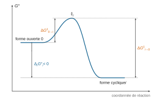
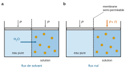
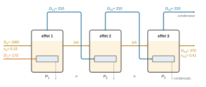
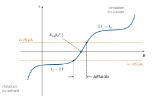

# Centrale-Supélec PC — Chimie 2026 · Corrigé guidé

*Corrigé rédigé par IA, non officiel. Signalez toute erreur.*

## Présentation du sujet

**Thème.** « Impact écologique de la production de sucre à partir de betterave ». Le sujet suit le saccharose de sa structure moléculaire jusqu'à l'usine, puis s'intéresse à la protection des cultures. Épreuve de **4 heures**, **calculatrice autorisée**, 48 questions en **trois parties indépendantes**. Les questions soulignées (Q15, Q16, Q32) demandent de l'initiative et sont valorisées au barème : il faut y expliciter sa démarche.

**Découpage.**

- **Partie A — Étude structurale du saccharose (Q1 à Q16).** A-I : groupes fonctionnels, stéréodescripteurs CIP et nomenclature, mécanisme d'hémiacétalisation, lecture d'un spectre IR, puis un bloc thermodynamique et cinétique sur la compétition pyranose/furanose (théorie d'Eyring, fractions molaires à l'équilibre, exploitation de mesures en $\ln$ contre $1/T$) et une question ouverte sur la sélectivité d'une condensation. A-II : hydrolyse du saccharose suivie par polarimétrie (loi de Biot, ordre 1, ordre par rapport à $\mathrm{H^+}$).
- **Partie B — Procédé industriel (Q17 à Q35).** Diffusion et osmose (potentiel chimique, loi de Van 't Hoff), équilibre hétérogène $\mathrm{CaCO_3/CaO/CO_2}$ (variance, rupture d'équilibre, petit script Python avec `bisect`), cinétique de décomposition lue sur courbes, pH d'un lait de chaux, bilans de matière et d'énergie sur évaporateurs simple et triple effet, titrage Karl-Fischer coulométrique (courbes intensité-potentiel, incertitudes, écart normalisé).
- **Partie C — Lutte contre les nuisibles (Q36 à Q48).** Synthèse de la (+)-népétalactone (réduction par $\mathrm{NaBH_4}$, oxydation allylique, nombre d'oxydation, énolate et addition de Michael intramoléculaire, excès énantiomérique, rendement global), puis trimérisation de l'isoprène (règle isoprénique, diagramme d'OM par fragments métal-allyle, cycle catalytique au nickel).

**Notions du programme mobilisées.** Stéréochimie et nomenclature (PCSI) ; mécanismes d'addition nucléophile sur C=O, catalyse acide, énolates et additions de Michael (PC) ; spectroscopie IR ; cinétique (ordres, dégénérescence, méthode intégrale, théorie du complexe activé) ; thermodynamique chimique (potentiel chimique, $\Delta_rG^\circ$, Van 't Hoff, variance) ; solubilité et pH ; oxydoréduction ($K^\circ$ à partir des $E^\circ$) et courbes i-E ; bilans en système ouvert ; incertitudes-types et écart normalisé ; orbitales moléculaires par fragments ; cycles catalytiques organométalliques.

**Difficulté et longueur.** Le sujet est long mais varié, et beaucoup de questions sont des applications directes. Les points délicats : la chaîne de démonstrations Q5 à Q7 (signes), les exploitations numériques Q8, Q15 et Q16 (régressions), Q32 (hypothèse à poser soi-même), Q45-Q46 (symétrie des orbitales) et Q48 (question ouverte).

**À ne pas laisser passer.** Q1, Q12, Q22, Q23, Q28, Q29 à Q31, Q33, Q35, Q36, Q42 et Q43 rapportent vite. Les parties étant indépendantes, on peut commencer par la partie B, très calculatoire et sans piège conceptuel majeur.

**Gestion du temps.** À titre indicatif : environ 1 h 30 pour la partie A, 1 h 20 pour la partie B et 1 h 10 pour la partie C. Ne pas s'enliser dans les régressions : un tableau de valeurs propre, une pente et une conclusion suffisent.

---

## Partie A — Étude structurale du saccharose

La partie va de la molécule (fonctions, stéréochimie, cyclisation) à sa thermodynamique (équilibre pyranose/furanose), puis à la cinétique de l'hydrolyse. Outils : règles CIP, mécanismes en catalyse acide, Eyring, Van 't Hoff, méthode intégrale.

### Question 1

> [!INDICATION]
> Passer la chaîne carbonée de chaque hexose en revue, carbone par carbone, et nommer chaque groupe oxygéné.

> [!INDICATION]
> Pour les alcools, préciser la classe : compter les carbones liés au carbone qui porte le OH.

#### Solution

Les deux hexoses ont pour formule $\mathrm{C_6H_{12}O_6}$.

- **D-glucose** : un **aldéhyde** en C1 ; des hydroxyles en C2, C3, C4 et C5 (quatre **alcools secondaires**) et en C6 (un **alcool primaire**). C'est un aldose.
- **D-fructose** : une **cétone** en C2 ; des **alcools primaires** en C1 et C6, des **alcools secondaires** en C3, C4 et C5. C'est un cétose.

> [!PIEGE]
> Dans la forme ouverte, il n'y a ni hémiacétal ni acide carboxylique : le groupe $-\mathrm{CHO}$ et les $-\mathrm{OH}$ sont portés par des carbones différents. L'hémiacétal n'apparaît qu'après cyclisation (Q3).

### Question 2

> [!INDICATION]
> Classer les quatre substituants de C2 selon les règles CIP. Pour C1, ne pas oublier la duplication de la double liaison C=O.

> [!INDICATION]
> Regarder où se trouve l'hydrogène sur la figure : en avant (trait gras) ou en arrière (hachures) ? Cela décide si l'on garde ou si l'on inverse le sens de rotation lu.

#### Solution

Priorités sur C2 : $\mathrm{OH}$ (a) > C1, qui porte $(\mathrm O,\mathrm O,\mathrm H)$ (b) > C3, qui porte $(\mathrm O,\mathrm C,\mathrm H)$ (c) > H (d).

Sur la figure 1, C1 (bas gauche) et C3 (bas droite) sont dans le plan, OH est hachuré (haut droite) et H en gras (haut gauche, vers l'observateur). La séquence $a\to b\to c$ se lit dans le sens trigonométrique, soit un sens apparent *S*. H étant en avant, on inverse :

$$\boxed{\text{C2 : } R}$$

On trouve de même 3*S*, 4*R*, 5*R* :

$$\boxed{(2R,3S,4R,5R)\text{-}2,3,4,5,6\text{-pentahydroxyhexanal}}$$

> [!METHODE]
> Pour lire un descripteur sur une représentation de Cram, faire tourner a → b → c en projection, puis inverser le résultat si le substituant d est vers l'avant. Quand on peut, contrôler avec un exemple connu : le D-glucose est bien (2*R*,3*S*,4*R*,5*R*).

> [!PIEGE]
> La lettre D n'est pas un descripteur CIP. Elle ne remplace pas la liste des configurations dans le nom officiel.

### Question 3

> [!INDICATION]
> Quel groupe électrophile et quel groupe nucléophile la molécule possède-t-elle ? La cyclisation est une réaction intramoléculaire entre les deux.

> [!INDICATION]
> En milieu acide, on commence par activer l'électrophile. Choisir l'hydroxyle dont l'attaque ferme un cycle à six atomes.

> [!INDICATION]
> Le mécanisme comporte trois actes, et le dernier régénère le catalyseur.

#### Solution

C'est une **hémiacétalisation intramoléculaire** entre le carbonyle C1 et l'hydroxyle de C5. Le cycle formé compte six atomes : O, C1, C2, C3, C4, C5.

1. **Protonation du carbonyle** : un doublet de l'oxygène de C=O capte $\mathrm{H^+}$ (de $\mathrm{H_3O^+}$), ce qui donne $\mathrm{R{-}CH{=}OH^+}$, dont le carbone est très électrophile.
2. **Addition nucléophile** : un doublet non liant de O5 attaque C1, et le doublet $\pi$ de C=O⁺ revient sur l'oxygène. On obtient un oxonium cyclique : O5 porte H et la charge +, C1 porte OH.
3. **Déprotonation** : $\mathrm{H_2O}$ capte le proton de l'oxygène cyclique. On obtient le glucopyranose (hémiacétal) et $\mathrm{H_3O^+}$ est régénéré.

Tous les actes sont renversables.

> [!METHODE]
> En catalyse acide, l'activation électrophile se fait par protonation du carbonyle, jamais par déprotonation de l'alcool : il n'y a pas d'alcoolate en milieu acide. Chaque flèche part d'un doublet et arrive sur un atome.

### Question 4

> [!INDICATION]
> Quelle liaison possède la forme ouverte et pas la forme cyclique ? Où absorbe-t-elle en IR ?

> [!INDICATION]
> Le tableau de données est coquillé : chercher, parmi les nombres d'onde proposés, celui qui correspond réellement à l'élongation de la double liaison carbone-oxygène.

#### Solution

On lit sur la figure 3 :

- une bande large vers 3600-3100 cm⁻¹ (élongation O–H, associée par liaisons hydrogène) ;
- des bandes vers 2900-2970 cm⁻¹ (élongation C–H) ;
- **aucune absorption entre 2500 et 1500 cm⁻¹**, en particulier vers 1710-1750 cm⁻¹ ;
- de nombreuses bandes en dessous de 1500 cm⁻¹ (élongations C–O simples, empreinte digitale).

Dans le tableau, la ligne « C–O 1710-1750 » correspond en fait à C=O, et « C–C 1580-1620 » à C=C. La forme ouverte porte un aldéhyde, dont la bande C=O est très intense. Son absence signifie que la forme ouverte est sous le seuil de détection.

**Le D-glucose est quasi exclusivement sous forme cyclique en solution aqueuse.**

> [!PIEGE]
> La bande O–H ne permet pas de conclure : elle existe dans les deux formes (et dans le solvant). Raisonner sur une absence impose de nommer la bande attendue et sa position.

### Question 5

> [!INDICATION]
> Écrire la relation d'Eyring pour $k_{0i}$ et pour $k_{i0}$, puis en faire le rapport.

> [!INDICATION]
> Les deux actes opposés passent par le même complexe activé. Exprimer les deux enthalpies libres d'activation à partir de $G^\circ(\ddagger_i)$, $G^\circ(0)$ et $G^\circ(i)$.

#### Solution

Les enthalpies libres d'activation s'écrivent :

$$\begin{aligned}
\Delta G^\ddagger_{0\to i}&=G^\circ(\ddagger_i)-G^\circ(0)\\
\Delta G^\ddagger_{i\to0}&=G^\circ(\ddagger_i)-G^\circ(i)
\end{aligned}$$

Le facteur $k_BT/(hC^\circ)$ est le même pour les deux actes unimoléculaires, donc :

$$\begin{aligned}
\frac{k_{i0}}{k_{0i}}&=\exp\left(-\frac{\Delta G^\ddagger_{i\to0}-\Delta G^\ddagger_{0\to i}}{RT}\right)\\
&=\exp\left(\frac{G^\circ(i)-G^\circ(0)}{RT}\right)\\
&=\exp\left(\frac{\Delta_rG^\circ_i}{RT}\right)
\end{aligned}$$

$$\boxed{k_{i0}=k_{0i}\,e^{\frac{\Delta_rG^\circ_i}{RT}}}$$



L'hypothèse sur les énergies assure que $\ddagger_i$ est l'unique maximum entre la forme ouverte et la forme $i$. Elle donne aussi $\Delta_rG^\circ_i<0$, donc $k_{i0}<k_{0i}$.

> [!PIEGE]
> La réaction de cyclisation va de 0 vers $i$ : $\Delta_rG^\circ_i=G^\circ(i)-G^\circ(0)$, et non l'inverse. Contrôle : la forme cyclique étant plus stable, l'ouverture doit être plus lente que la fermeture.

### Question 6

> [!INDICATION]
> Inverser le résultat de Q5, puis décomposer $\Delta_rG^\circ_i$ en sa partie enthalpique et sa partie entropique.

#### Solution

On suppose $\Delta_rH^\circ_i$ et $\Delta_rS^\circ_i$ indépendantes de $T$ :

$$\begin{aligned}
\frac{k_{0i}}{k_{i0}}&=e^{-\frac{\Delta_rH^\circ_i-T\Delta_rS^\circ_i}{RT}}\\
&=e^{\frac{\Delta_rS^\circ_i}{R}}\cdot e^{-\frac{\Delta_rH^\circ_i}{RT}}
\end{aligned}$$

$$\boxed{\eta_i=e^{\Delta_rS^\circ_i/R}\ \text{(entropique, indépendant de }T)}$$

$$\boxed{B_i(T)=e^{-\Delta_rH^\circ_i/(RT)}\ \text{(enthalpique)}}$$

### Question 7

> [!INDICATION]
> À l'équilibre, que peut-on dire des vitesses de deux actes élémentaires opposés ?

> [!INDICATION]
> Exprimer $c_i/c_0$, puis normaliser. Quelle approximation permet de ne garder que les deux formes cycliques au dénominateur ?

#### Solution

Hypothèses : équilibres atteints ; actes élémentaires (loi de Van 't Hoff applicable aux vitesses) ; solution idéale diluée ; $\Delta_rH^\circ_i$ et $\Delta_rS^\circ_i$ indépendantes de $T$ ; forme ouverte négligeable devant les formes cycliques (Q4), donc $x_1+x_2\simeq1$.

À l'équilibre, $k_{0i}c_0=k_{i0}c_i$, donc :

$$\begin{aligned}
\frac{c_i}{c_0}&=\frac{k_{0i}}{k_{i0}}\\
&=\eta_i\,e^{-\Delta_rH^\circ_i/(RT)}
\end{aligned}$$

Puis :

$$\begin{aligned}
x_i&\simeq\frac{c_i}{c_1+c_2}\\
&=\frac{c_i/c_0}{\sum_m c_m/c_0}
\end{aligned}$$

$$\boxed{x_i=\frac{\eta_i\,e^{-\frac{\Delta_rH^\circ_i}{RT}}}{\sum_{m=1}^2\eta_m\,e^{-\frac{\Delta_rH^\circ_m}{RT}}}}$$

> [!JURY]
> Quand l'énoncé demande d'expliciter les hypothèses, le correcteur les cherche une à une. Ici, l'hypothèse qui conditionne la forme du dénominateur (forme ouverte négligeable) doit apparaître clairement, idéalement reliée à la question 4.

### Question 8

> [!INDICATION]
> Former le rapport $x_2/x_1$ : le dénominateur commun disparaît.

> [!INDICATION]
> Prendre le logarithme : on obtient une fonction affine d'une variable bien choisie. Faire une régression sur les six points.

#### Solution

$$\ln\frac{x_2}{x_1}=\frac{\Delta_rS^\circ_{1\to2}}{R}-\frac{\Delta_rH^\circ_{1\to2}}{R}\cdot\frac1T$$

| $10^3/T$ (K⁻¹) | 3,534 | 3,356 | 3,195 | 3,096 | 2,793 | 2,755 |
|---|---|---|---|---|---|---|
| $\ln(x_2/x_1)$ | −1,735 | −1,386 | −1,099 | −0,944 | −0,532 | −0,364 |

La régression donne une pente de $-1{,}668\times10^3$ K, une ordonnée de $4{,}195$ et $R^2=0{,}993$.

$$\boxed{\Delta_rH^\circ_{1\to2}=+13{,}9\ \mathrm{kJ\cdot mol^{-1}}}$$

$$\boxed{\Delta_rS^\circ_{1\to2}=+34{,}9\ \mathrm{J\cdot K^{-1}\cdot mol^{-1}}}$$

Le furanose est enthalpiquement défavorisé mais entropiquement favorisé : sa proportion croît avec $T$.

> [!METHODE]
> Quand une grandeur dépend de $T$ par un facteur de Boltzmann, on trace son logarithme en fonction de $1/T$ : la pente donne une enthalpie, l'ordonnée à l'origine une entropie. Toujours exploiter tous les points (régression) plutôt que deux seulement.

> [!PIEGE]
> Contrôle de signe : $x_2/x_1$ augmente avec $T$, donc $\Delta_rH^\circ_{1\to2}>0$. Et ce qu'on mesure est une **différence** ($\Delta_rH^\circ_2-\Delta_rH^\circ_1$), pas $\Delta_rH^\circ_2$.

### Question 9

> [!INDICATION]
> Proportions égales : que vaut alors $\ln(x_2/x_1)$, et donc $\Delta_rG^\circ_{1\to2}$ ?

#### Solution

$$\begin{aligned}
T_i&=\frac{\Delta_rH^\circ_{1\to2}}{\Delta_rS^\circ_{1\to2}}\\
&=\frac{13{,}86\times10^3}{34{,}86}
\end{aligned}$$

$$\boxed{T_i\approx3{,}97\times10^2\ \mathrm K}$$

Cette valeur est extrapolée hors du domaine de mesure (283-363 K) : elle n'est fiable que si $\Delta_rH^\circ$ et $\Delta_rS^\circ$ restent constantes.

### Question 10

> [!INDICATION]
> Comparer 298 K à $T_i$, et dire clairement quelle hypothèse permet de passer du ribose au glucose.

#### Solution

À 298 K, $\Delta_rG^\circ_{1\to2}=+3{,}5$ kJ·mol⁻¹ $>0$, donc $x_2/x_1=0{,}25$ et le pyranose domine. Comme $298\ \mathrm K<T_i$, c'est le terme enthalpique qui l'emporte. On suppose que la compétition entre cycle à 6 et cycle à 5 se transpose au glucose avec les mêmes signes. Alors :

**À 298 K, le D-glucose se cyclise préférentiellement en glucopyranose (cycle à six chaînons).**

### Question 11

> [!INDICATION]
> Repérer sur la figure 5 la liaison qui unit les deux oses : entre quels carbones, et de quelle fonction s'agit-il ?

> [!INDICATION]
> Compter les hydroxyles disponibles sur chaque ose. Le chimiste n'a aucun moyen de choisir parmi eux sans enzyme ni protection.

#### Solution

La liaison osidique du saccharose relie les deux carbones anomériques (C1 du glucose, C2 du fructose) : c'est un acétal. Une condensation directe, en milieu acide, met en jeu de nombreux hydroxyles équivalents en réactivité. Le glucopyranose en a quatre en plus de l'anomérique (C2, C3, C4, C6), le fructofuranose trois (C1, C3, C4, C6). On forme donc :

- des **régioisomères** (liaison du C1 du glucose vers C1, C3, C4 ou C6 du fructose, ou du C2 du fructose vers un OH quelconque du glucose) ;
- des **homodisaccharides** (glucose-glucose, fructose-fructose) ;
- des **oligomères**, puisque les disaccharides formés gardent des OH libres et, sauf le saccharose, un hémiacétal réactif ;
- des produits de **taille de cycle** différente (pyranose ou furanose).

L'acétalisation est en outre **renversable** en milieu acide.

**Le rendement en saccharose est faible. Il faudrait des étapes de protection et de déprotection, coûteuses et polluantes ; c'est pourquoi on extrait le sucre de la plante.**

> [!JURY]
> Sur une question de discussion, une réponse argumentée par un dénombrement précis (quels OH, quels produits) vaut bien davantage qu'une formule générale du type « il se forme beaucoup de sous-produits ». L'énoncé exclut ici la stéréochimie : inutile de discuter les anomères.

### Question 12

> [!INDICATION]
> Loi de Biot : vérifier l'unité du pouvoir rotatoire spécifique pour choisir la bonne concentration (massique, en g·mL⁻¹) et la bonne unité de longueur.

> [!INDICATION]
> À l'infini, faire un bilan de matière : chaque mole de saccharose donne une mole de chaque hexose. La masse totale de sucres change-t-elle ?

#### Solution

Le pouvoir rotatoire $\alpha$ est l'angle de rotation du plan de polarisation d'une lumière polarisée rectilignement par la solution (positif si la rotation se fait vers la droite pour l'observateur). Loi de Biot : $\alpha=\sum_i[\alpha]_i\,\ell\,c_i$.

$$\alpha_0=66\times0{,}615\times0{,}300$$

$$\boxed{\alpha_0=+12{,}2^\circ}$$

$n_0=30/342=8{,}77\times10^{-2}$ mol donnent 15,8 g de glucose et 15,8 g de fructose dans 100 mL :

$$\alpha_\infty=0{,}615\times0{,}158\times(52-92)$$

$$\boxed{\alpha_\infty=-3{,}9^\circ}$$

Le signe s'inverse, d'où le nom de sucre inverti.

> [!PIEGE]
> Une concentration en g·L⁻¹ donnerait un angle mille fois trop grand. Et la masse de sucres passe de 30 g à 31,6 g, car l'hydrolyse incorpore une molécule d'eau : il ne faut pas reprendre 30 g pour le mélange final.

### Question 13

> [!INDICATION]
> Passer en revue chaque choix du protocole (acide, quantité d'eau, température, deux solutions, polarimétrie) et lui associer un argument cinétique ou expérimental.

#### Solution

- **HCl** : $\mathrm{H^+}$ catalyse l'hydrolyse, lente sans catalyseur. Comme HCl est un acide fort, $[\mathrm{H^+}]$ est connue et constante (catalyseur non consommé).
- **Eau en très large excès** (environ 5,5 mol pour 0,088 mol de sucre) : l'ordre est dégénéré par rapport à l'eau.
- **298 K imposée** : $k$ dépend de $T$, et les $[\alpha]$ sont tabulés à 298 K et 589,3 nm.
- **Deux solutions ne différant que par $[\mathrm{H^+}]$** : on accède ainsi à l'ordre par rapport à $\mathrm{H^+}$.
- **Polarimétrie** : réactif et produits ont des $[\alpha]$ très différents ($+66$, $+52$, $-92$), et $\alpha$ est additif et varie beaucoup. La mesure est continue, sans prélèvement ni trempe.
- **Solution concentrée en sucre** : les angles sont mesurables avec précision.

> [!METHODE]
> Justifier un protocole de cinétique, c'est relier chaque choix à ce qu'il permet de mesurer : dégénérescence de l'ordre, catalyseur à concentration constante, thermostat, grandeur physique proportionnelle à l'avancement.

### Question 14

> [!INDICATION]
> Faire un tableau d'avancement en quantités de matière, puis convertir en concentrations massiques avec les masses molaires et le volume.

#### Solution

$n(S)=n_0-n_s$ et $n(G)=n(F)=n_s$, avec $c_i=n_iM_i/V$ :

$$\boxed{\alpha(t)=\frac{\ell}{V}\Big[[\alpha]_S(n_0-n_s)M_S+([\alpha]_GM_G+[\alpha]_FM_F)\,n_s\Big]}$$

$$\boxed{\alpha(0)=\frac{\ell}{V}[\alpha]_Sn_0M_S}$$

$$\boxed{\alpha(\infty)=\frac{\ell}{V}n_0\big([\alpha]_GM_G+[\alpha]_FM_F\big)}$$

### Question 15 (question soulignée)

> [!INDICATION]
> Montrer d'abord, à partir de Q14, qu'une certaine combinaison des angles mesurés est proportionnelle à la quantité de saccharose restante.

> [!INDICATION]
> Pour un ordre 1, $[S]$ décroît exponentiellement. Quelle fonction de $\alpha$ doit alors être affine en $t$ ?

> [!INDICATION]
> Faire le tableau de valeurs, la régression, et commenter la qualité de l'alignement. Utiliser la valeur de $\alpha_\infty$ calculée en Q12, pas la dernière mesure.

#### Solution

$$\alpha(t)-\alpha_\infty=\frac{\ell}{V}(n_0-n_s)\underbrace{\big([\alpha]_SM_S-[\alpha]_GM_G-[\alpha]_FM_F\big)}_{=2{,}98\times10^4>0}\ \propto\ [S]$$

Ordre 1 (dégénérescence pour l'eau, $[\mathrm{H^+}]$ constante) : $[S]=[S]_0e^{-k_{\text{obs}}t}$, donc :

$$\ln(\alpha-\alpha_\infty)=\ln(\alpha_0-\alpha_\infty)-k_{\text{obs}}t$$

| $t$ (min) | 15 | 30 | 45 | 82 | 115 | 177 | 222 | 330 |
|---|---|---|---|---|---|---|---|---|
| $\ln(\alpha-\alpha_\infty)$, $\alpha_\infty=-3{,}88^\circ$ | 2,631 | 2,516 | 2,340 | 1,999 | 1,772 | 1,357 | 1,059 | 0,325 |

La régression donne une pente de $-7{,}27\times10^{-3}$ min⁻¹ avec $R^2=0{,}995$, et les points ne montrent pas de courbure systématique :

$$\boxed{\text{ordre 1 par rapport au saccharose, }k^A_{\text{obs}}=7{,}27\times10^{-3}\ \mathrm{min^{-1}}}$$

L'ordonnée à l'origine donne $\alpha_0\approx10{,}6^\circ$, contre 12,2° calculés. L'écart vient probablement du volume réel de la solution, supérieur à 100 mL ; il ne touche pas la pente.

> [!PIEGE]
> Tracer $\ln\alpha$ est impossible dès que $\alpha$ devient négatif. Et prendre $\alpha_\infty=-2{,}5^\circ$ (dernière mesure, réaction non terminée) courbe artificiellement la droite.

> [!JURY]
> Sur une question à initiative, le correcteur valorise la démarche explicitée : pourquoi cette grandeur est tracée, quel test elle constitue, quelle conclusion chiffrée on en tire.

### Question 16 (question soulignée)

> [!INDICATION]
> Écrire la loi de vitesse avec un ordre $p$ en $\mathrm{H^+}$. Que contient la constante apparente de chaque expérience ?

> [!INDICATION]
> Traiter la solution B comme la A, puis comparer les deux constantes apparentes à l'aide d'un logarithme.

#### Solution

$v=k[S][\mathrm{H^+}]^p$, donc $k_{\text{obs}}=k[\mathrm{H^+}]^p$.

Pour la solution B, $\ln(\alpha-\alpha_\infty)$ vaut 2,700 ; 2,631 ; 2,556 ; 2,387 ; 2,184 ; 1,929 ; 1,683 ; 1,357, d'où $k^B_{\text{obs}}=4{,}42\times10^{-3}$ min⁻¹ ($R^2=0{,}990$).

$$\begin{aligned}
p&=\frac{\ln(7{,}27/4{,}42)}{\ln(0{,}92/0{,}53)}\\
&=\frac{0{,}498}{0{,}551}\\
&=0{,}90
\end{aligned}$$

$$\boxed{p=1}$$

On arrondit à l'entier, l'écart étant compatible avec la précision des angles (0,5°). Alors $k_A=7{,}9\times10^{-3}$ et $k_B=8{,}3\times10^{-3}$ L·mol⁻¹·min⁻¹ :

$$\boxed{k\approx8{,}1\times10^{-3}\ \mathrm{L\cdot mol^{-1}\cdot min^{-1}}=1{,}4\times10^{-4}\ \mathrm{L\cdot mol^{-1}\cdot s^{-1}}}$$

> [!PIEGE]
> L'unité de $k$ n'est plus celle de $k_{\text{obs}}$. Et l'ordre par rapport à l'eau n'est pas nul : il est inconnu, masqué par la dégénérescence.

---

## Partie B — Étude du procédé industriel du raffinage du sucre de betterave

La partie suit le jus de betterave à travers l'usine : extraction (potentiel chimique, osmose), purification (équilibre hétérogène, cinétique, pH), concentration (bilans en système ouvert), contrôle qualité (titrage coulométrique et incertitudes).

### Question 17

> [!INDICATION]
> Critère d'évolution spontanée à $T$ et $P$ fixées : écrire $\mathrm dG$ pour le transfert d'une quantité $\mathrm dn$ de saccharose de l'intérieur vers l'extérieur.

> [!INDICATION]
> Exprimer les potentiels chimiques du soluté dans les deux milieux et comparer.

#### Solution

$$\mathrm dG=(\mu_{\text{ext}}-\mu_{\text{int}})\,\mathrm dn=RT\ln\frac{c_{\text{ext}}}{c_{\text{int}}}\,\mathrm dn$$

On a utilisé $\mu=\mu^\circ+RT\ln(c/c^\circ)$, la solution étant supposée idéale et diluée. Comme $c_{\text{ext}}<c_{\text{int}}$, $\mathrm dG<0$ pour $\mathrm dn>0$ : le transfert vers l'extérieur est spontané, jusqu'à égalité des potentiels chimiques.

**Le saccharose diffuse du milieu de plus haut potentiel chimique (la cellule, concentrée) vers celui de plus bas potentiel (le jus).**

### Question 18

> [!INDICATION]
> L'osmose concerne-t-elle le soluté ou le solvant ? Préciser la nature de la membrane.

> [!INDICATION]
> La pression osmotique se définit par une condition d'équilibre : la surpression qui annule un flux.

#### Solution

L'**osmose** est le transfert spontané de **solvant** à travers une membrane semi-perméable (perméable au solvant seul), de la solution la plus diluée vers la plus concentrée. Dans ce sens, le potentiel chimique du solvant diminue.

La **pression osmotique** $\Pi$ est la surpression à appliquer à la solution pour stopper le flux de solvant venant du solvant pur, c'est-à-dire pour égaler les potentiels chimiques de l'eau de part et d'autre.



> [!PIEGE]
> $\Pi$ n'est pas « la pression exercée par le soluté ». L'analogie de forme avec les gaz parfaits est trompeuse : $\Pi$ découle d'une égalité de potentiels chimiques du solvant.

### Question 19

> [!INDICATION]
> Écrire le potentiel chimique de l'eau pure à $P$ et celui de l'eau de la solution à $P+\Pi$, en tenant compte de l'effet de la pression sur une phase condensée.

> [!INDICATION]
> Égaler, puis linéariser le logarithme pour une solution diluée, et relier $n_{\mathrm{H_2O}}V^*$ au volume de la solution.

#### Solution

Hypothèses : membrane strictement semi-perméable, isotherme ; solution idéale ; eau incompressible ; solution diluée ; volume de la solution assimilé à celui de l'eau.

Avec $(\partial\mu/\partial P)_T=V^*$ :

$$\mu^\circ+V^*(P-P^\circ)=\mu^\circ+V^*(P+\Pi-P^\circ)+RT\ln x(\mathrm{H_2O})$$

D'où :

$$\Pi=-\frac{RT}{V^*}\ln x(\mathrm{H_2O})$$

En solution diluée, $\ln x(\mathrm{H_2O})\simeq-x_S\simeq-n_S/n_{\mathrm{H_2O}}$, et $n_{\mathrm{H_2O}}V^*\simeq V$, donc :

$$\boxed{\Pi=CRT}$$

> [!METHODE]
> Toutes les propriétés colligatives (osmose, ébulliométrie, cryométrie) se démontrent de la même façon : égalité des potentiels chimiques du solvant dans les deux phases, puis développement limité de $\ln(1-x_S)$.

### Question 20

> [!INDICATION]
> Convertir « 16 % en masse » en concentration molaire, en mol·m⁻³, avec la masse volumique de l'eau. Quelle température règne dans le diffuseur ?

> [!INDICATION]
> Pour la discussion, reprendre les hypothèses de Q19 une à une et estimer l'effet de chacune. L'une d'elles n'a pas été écrite explicitement : le saccharose est-il le seul soluté ?

#### Solution

$$\begin{aligned}
C&=\frac{0{,}16\times1{,}00\times10^6\ \mathrm g}{342\ \mathrm{g\cdot mol^{-1}}}\\
&=4{,}68\times10^2\ \mathrm{mol\cdot m^{-3}}
\end{aligned}$$

$$\begin{aligned}
\Pi&=CRT\\
&=4{,}68\times10^2\times8{,}31\times343
\end{aligned}$$

$$\boxed{\Pi\approx1{,}33\times10^6\ \mathrm{Pa}\approx13\ \mathrm{bar}}$$

C'est le bon ordre de grandeur, mais 2,5 fois moins que les 34 bar mesurés.

- **Dilution** : $x_S\approx1{,}0\times10^{-2}$, et linéariser le logarithme ne coûte que 0,5 % : approximation valable.
- **Volume** : 1 L de solution ne contient que 0,84 L d'eau. Garder $n_{\mathrm{H_2O}}V^*$ au lieu de $V$ donnerait 15,9 bar (+19 %). La masse volumique réelle (environ 1,06) joue dans le même sens. Effets réels mais secondaires.
- **Idéalité** : en solution concentrée, l'hydratation du saccharose abaisse l'activité de l'eau, ce qui augmente $\Pi$.
- **Autres solutés** : la pression osmotique est colligative. Les sels (dissociés en plusieurs ions), les acides organiques et les acides aminés du jus y contribuent. **C'est la cause principale de l'écart.**

> [!PIEGE]
> Une concentration laissée en mol·L⁻¹ donne 13 mbar, une valeur absurde. Faire un contrôle d'ordre de grandeur.

### Question 21

> [!INDICATION]
> Dans quel sens l'eau traverse-t-elle la paroi : du jus vers la cellule ou l'inverse ?

> [!INDICATION]
> Suivre cette eau dans le procédé : où faudra-t-il l'éliminer, et à quel prix ?

#### Solution

Le jus est moins concentré que le suc cellulaire : l'eau **entre** dans les cossettes, en sens opposé au sucre. Les cossettes gonflent et retiennent de l'eau (d'où le pressage des pulpes), les cellules peuvent éclater et libérer des impuretés, et le transfert du sucre est contrarié : il faut davantage d'eau d'extraction.

**Le jus est dilué, et toute cette eau devra être évaporée à l'étape de concentration (environ 2,3 MJ par kilogramme), poste énergétique majeur du procédé.** Le diffuseur à contre-courant limite ce phénomène.

### Question 22

> [!INDICATION]
> Écrire l'équation avec les états physiques, qui commandent l'expression de la constante d'équilibre.

#### Solution

$$\boxed{\mathrm{CaCO_3(s)}=\mathrm{CaO(s)}+\mathrm{CO_2(g)}}$$

### Question 23

> [!INDICATION]
> Loi de Hess pour $\Delta_rH^\circ$ et $\Delta_rS^\circ$, puis approximation d'Ellingham pour obtenir $\Delta_rG^\circ(1000\ \mathrm K)$.

> [!INDICATION]
> Que vaut l'activité d'un solide pur ? En déduire l'expression de $K^\circ$ en fonction de la seule pression de $\mathrm{CO_2}$.

#### Solution

Approximations : solides purs non miscibles (activité 1), gaz parfait, $\Delta_rH^\circ$ et $\Delta_rS^\circ$ constantes.

$$\begin{aligned}
\Delta_rH^\circ&=+178{,}8\ \mathrm{kJ\cdot mol^{-1}}\\
\Delta_rS^\circ&=+158{,}9\ \mathrm{J\cdot K^{-1}\cdot mol^{-1}}\\
\Delta_rG^\circ(1000)&=+19{,}9\ \mathrm{kJ\cdot mol^{-1}}
\end{aligned}$$

$$\begin{aligned}
K^\circ&=e^{-19\,900/(8{,}31\times1000)}\\
&=9{,}1\times10^{-2}\\
&=P(\mathrm{CO_2})_{\text{éq}}/P^\circ
\end{aligned}$$

$$\boxed{P(\mathrm{CO_2})_{\text{éq}}=9{,}1\times10^{-2}\ \mathrm{bar}}$$

> [!PIEGE]
> Convertir $\Delta_rH^\circ$ en J·mol⁻¹ avant de la combiner à $T\Delta_rS^\circ$. Contrôle : la décomposition d'un carbonate est endothermique et crée un gaz, donc $\Delta_rH^\circ>0$ et $\Delta_rS^\circ>0$.

### Question 24

> [!INDICATION]
> Signe de $\Delta_rH^\circ$ et loi de Van 't Hoff.

> [!INDICATION]
> Le système est monovariant : la décomposition est totale si la pression de $\mathrm{CO_2}$ reste inférieure à $P_{\text{éq}}(T)$. Calculer la température à partir de laquelle $P_{\text{éq}}$ dépasse 1 bar.

#### Solution

La réaction est endothermique, donc $K^\circ$ croît avec $T$ (Van 't Hoff) : chauffer favorise la décomposition.

Le système est monovariant. Si la pression de $\mathrm{CO_2}$ imposée reste inférieure à $P_{\text{éq}}(T)$, l'équilibre est rompu et la décomposition est **totale**. Sous 1 bar de $\mathrm{CO_2}$ :

$$T>\frac{\Delta_rH^\circ}{\Delta_rS^\circ}=1{,}13\times10^3\ \mathrm K\ (\approx850\ ^\circ\mathrm C)$$

On se place un peu au-dessus de cette température, et l'on peut descendre plus bas si le $\mathrm{CO_2}$ est évacué. Au-delà, on paie de l'énergie inutile et l'on risque de fritter la chaux.

> [!METHODE]
> Pour un équilibre hétérogène monovariant (un gaz, des solides purs), abaisser la pression du gaz ne déplace pas l'équilibre : il est rompu, et la réaction devient totale.

### Question 25

> [!INDICATION]
> Calculer la variance quand les trois constituants coexistent. Que fixe alors la température ?

> [!INDICATION]
> Que se passe-t-il quand tout le carbonate a disparu ? Vérifier la pente de la partie droite avec $n=1$ mol et $V=150$ L.

#### Solution

**Partie basse température (exponentielle).** $\mathrm{CaCO_3}$, $\mathrm{CaO}$ et $\mathrm{CO_2}$ coexistent à l'équilibre. La variance vaut :

$$v=(3-1)+2-3=1$$

Donc $P=P^\circ K^\circ(T)$ ne dépend que de $T$ et croît comme $\exp(-\Delta_rH^\circ/RT)$.

**Partie haute température (droite).** $\mathrm{CaCO_3}$ est épuisé (rupture d'équilibre). Il reste CaO et 1 mol de $\mathrm{CO_2}$ :

$$\begin{aligned}
P&=\frac{nRT}{V}\\
&=5{,}54\times10^{-4}\,T\ \text{(en bar)}
\end{aligned}$$

On vérifie 0,66 bar à 1200 K.

La cassure correspond à la disparition du dernier grain de carbonate, quand $P^\circ K^\circ(T)=nRT/V$.

### Question 26

> [!INDICATION]
> `f` doit renvoyer la pression d'équilibre, `g` la pression d'une mole de gaz parfait dans 150 L, toutes deux dans la même unité.

> [!INDICATION]
> `bisect` cherche un zéro : quelle fonction de `f` et `g` s'annule au point de raccordement ?

#### Solution

```python
import scipy.optimize as op
from math import exp

# Définition de la fonction donnant la pression pour T < Tchgt
def f(T):
    return exp(-(178.8e3 - T*158.9)/(8.31*T))   # bar

# Définition de la fonction donnant la pression lorsque T > Tchgt
def g(T):
    return 1*8.31*T/150e-3/1e5                  # bar

# Détermination de Tchgt
def h(T):
    return f(T) - g(T)

print(op.bisect(h, 800, 1200))
```

$h$ change de signe entre 800 et 1200 K. Le script affiche **$T_{\text{chgt}}\approx1097$ K** ($P\approx0{,}61$ bar), conforme à la figure 7.

> [!PIEGE]
> Mélanger des bars et des pascals (ou écrire $V=150$ en unités SI) fausse complètement la racine. La dichotomie exige aussi que $h$ change de signe sur l'intervalle donné.

### Question 27

> [!INDICATION]
> Choisir un critère de lecture commun, par exemple la durée nécessaire pour atteindre une conversion totale, et le relever pour chaque courbe.

> [!INDICATION]
> Le ralentissement observé quand $P(\mathrm{CO_2})$ augmente est-il thermodynamique ? Comparer les pressions imposées à $P_{\text{éq}}$ à 890 °C.

#### Solution

| Figure 8 (16,71 kPa) | 820 °C | 850 °C | 860 °C | 890 °C | 900 °C |
|---|---|---|---|---|---|
| durée de conversion totale | > 450 s | ≈ 370 s | ≈ 140 s | ≈ 100 s | ≈ 75 s |

| Figure 9 (890 °C) | 16,71 kPa | 27,35 kPa | 36,47 kPa | 46,59 kPa |
|---|---|---|---|---|
| durée de conversion totale | ≈ 100 s | ≈ 190 s | ≈ 550 s | > 600 s |

La vitesse augmente nettement avec $T$, avec un gain qui s'atténue au-delà de 890 °C, et diminue fortement quand $P(\mathrm{CO_2})$ augmente. À 1163 K, $P_{\text{éq}}=e^{6000/(8{,}31\times1163)}\approx1{,}9$ bar, bien au-dessus des pressions étudiées : la décomposition reste thermodynamiquement totale. Le frein est **cinétique** (évacuation du $\mathrm{CO_2}$ à travers la couche de chaux).

$$\boxed{T\approx890\text{-}900\ ^\circ\mathrm C,\ \ P(\mathrm{CO_2})\ \text{la plus faible possible (balayage, évacuation)}}$$

> [!JURY]
> « Exploiter des résultats » signifie relever des valeurs sur les axes et les comparer, pas seulement décrire l'allure des courbes. Une proposition de conditions optimales doit être justifiée des deux côtés : pourquoi pas moins, pourquoi pas plus.

### Question 28

> [!INDICATION]
> Calculer la concentration de $\mathrm{Ca(OH)_2}$ formée et la comparer à la solubilité.

> [!INDICATION]
> Si la solution est saturée, le pH est fixé par la solubilité. Attention au facteur 2 pour $\mathrm{HO^-}$.

#### Solution

On obtient $2{,}5/56{,}1=4{,}46\times10^{-2}$ mol·L⁻¹ de $\mathrm{Ca(OH)_2}$, soit 3,30 g·L⁻¹, plus que la solubilité de 1,25 g·L⁻¹ : la solution est **saturée**.

$$\begin{aligned}
s&=1{,}69\times10^{-2}\ \mathrm{mol\cdot L^{-1}}\\
[\mathrm{HO^-}]&=2s\\
&=3{,}37\times10^{-2}\ \mathrm{mol\cdot L^{-1}}\\
\mathrm{pOH}&=1{,}47
\end{aligned}$$

Avec $\mathrm pK_e=14$ :

$$\boxed{\mathrm{pH}=12{,}5}$$

Les conditions conviennent, et le pH est tamponné par le solide en excès.

> [!PIEGE]
> Supposer tout le $\mathrm{Ca(OH)_2}$ dissous donnerait pH 12,95, en ignorant la saturation, qui est le cœur de la question. Remarque honnête : à 45 °C, $\mathrm pK_e\approx13{,}4$ et le pH vrai serait plus bas (environ 11,9). Aucune donnée n'étant fournie, on raisonne avec 14.

### Question 29

> [!INDICATION]
> Régime permanent : deux bilans, l'un sur la masse totale, l'autre sur le saccharose (non volatil).

#### Solution

$$D_V=D_A-D_S$$

$$\boxed{D_V=7{,}80\times10^2\ \mathrm{kg\cdot h^{-1}}}$$

Bilan en saccharose : $x_S=D_Ax_A/D_S=0{,}68$, ce qui correspond au sirop annoncé et valide les données.

### Question 30

> [!INDICATION]
> Premier principe pour un système ouvert en régime permanent. Que signifie « isotherme » pour les termes d'échauffement ?

#### Solution

L'évaporateur est isotherme, sans travail utile et sans variation d'énergie cinétique ou potentielle : seule la vaporisation consomme de l'énergie.

$$\begin{aligned}
\Phi&=D_V\Delta H_{\text{vap}}\\
&=780\times2257\\
&=1{,}76\times10^6\ \mathrm{kJ\cdot h^{-1}}
\end{aligned}$$

$$\boxed{\Phi\approx489\ \mathrm{kW}}$$

### Question 31

> [!INDICATION]
> La vapeur de chauffe doit fournir exactement $\Phi$ (pas de pertes). Quelle énergie cède chaque kilogramme ?

#### Solution

$$D_C=\frac{1{,}76\times10^6}{2740}$$

$$\boxed{D_C\approx6{,}4\times10^2\ \mathrm{kg\cdot h^{-1}}}$$

Cela fait 1,2 kg d'eau évaporée par kilogramme de vapeur vive.

> [!PIEGE]
> Ne pas confondre 2740 kJ (énergie cédée par la vapeur de chauffe) et 2257 kJ·kg⁻¹ (énergie reçue par l'eau du jus qui se vaporise).

### Question 32 (question soulignée)

> [!INDICATION]
> Le premier effet se traite comme Q31, avec $D_{V1}$ à la place de $D_V$.

> [!INDICATION]
> Il faut poser soi-même le lien entre deux effets successifs : la vapeur produite par l'un chauffe le suivant. Combien d'eau un kilogramme de cette vapeur, en se condensant, peut-il évaporer ?

> [!INDICATION]
> Faire ensuite le bilan de matière global sur l'atelier, puis comparer la composition obtenue à l'objectif de 68 %.

#### Solution

$$D'_C=\frac{210\times2257}{2740}$$

$$\boxed{D'_C\approx1{,}73\times10^2\ \mathrm{kg\cdot h^{-1}}}$$

Hypothèses : chaque kilogramme de vapeur issue d'un effet se condense dans l'effet suivant (à pression plus basse) en cédant $\Delta H_{\text{vap}}$, et vaporise donc un kilogramme d'eau. On néglige les pertes et les chaleurs sensibles. D'où $D_{V2}=D_{V3}=210$ kg·h⁻¹ et 630 kg·h⁻¹ au total.



$$\begin{aligned}
D_{S3}&=1000-630\\
&=370\ \mathrm{kg\cdot h^{-1}}
\end{aligned}$$

$$\boxed{x_{S3}=\frac{150}{370}\approx41\ \%}$$

*Commentaire* : la vapeur vive nécessaire est divisée par 3 (3,6 kg d'eau évaporée par kilogramme de vapeur, contre 1,2). Mais 41 % reste loin de 68 % : il faudrait évaporer 779 kg·h⁻¹, soit environ 3,7 effets de 210 kg·h⁻¹. On ajoute donc des effets (de trois à six) ou l'on augmente $D_{V1}$. Les températures plus basses des derniers effets ménagent aussi le saccharose.

> [!METHODE]
> Pour un multiple effet, poser explicitement l'hypothèse « 1 kg de vapeur condensée évapore environ 1 kg d'eau », puis enchaîner les bilans de matière. Le résultat se commente toujours en économie de vapeur et en atteinte de l'objectif de concentration.

### Question 33

> [!INDICATION]
> Écrire les deux demi-équations en milieu acide, puis les combiner pour échanger le même nombre d'électrons.

> [!INDICATION]
> Relier $\log K^\circ$ à la différence des potentiels standard, sans oublier le nombre d'électrons échangés.

#### Solution

$$\boxed{\mathrm{I_2}+\mathrm{SO_2}+2\,\mathrm{H_2O}\longrightarrow2\,\mathrm I^-+\mathrm{SO_4^{2-}}+4\,\mathrm H^+}$$

$$\begin{aligned}
\log K^\circ&=\frac{2\times(0{,}53-0{,}17)}{0{,}059}\\
&=12{,}2
\end{aligned}$$

$$\boxed{K^\circ\approx1{,}6\times10^{12}}$$

La réaction est quantitative, donc utilisable pour un titrage.

### Question 34

> [!INDICATION]
> Avant l'équivalence, $\mathrm{I_2}$ est consommé dès sa formation. Après, quelles espèces du couple $\mathrm{I_2/I^-}$ sont présentes simultanément ?

> [!INDICATION]
> Un couple rapide dont les deux formes sont présentes donne une courbe qui coupe l'axe des potentiels sans palier à courant nul. Placer $\pm20\ \mu$A sur ce tracé.

#### Solution

Après l'équivalence, $\mathrm{I_2}$ (en léger excès) et $\mathrm I^-$ coexistent.

Le couple étant rapide, la courbe présente une vague d'oxydation de $\mathrm I^-$ (palier élevé, $\mathrm I^-$ abondant) et une vague de réduction de $\mathrm{I_2}$ (palier plus faible). Les deux se raccordent au potentiel d'équilibre $E_{\text{éq}}(\mathrm{I_2/I^-})$, sans plage de courant nul. Les murs du solvant restent aux extrémités.



Les potentiels de l'anode (+20 µA) et de la cathode (−20 µA) encadrent étroitement $E_{\text{éq}}$. **$\Delta E$ s'effondre (quelques dizaines de mV au plus) : cette chute brutale signale l'équivalence.** Avant l'équivalence, faute de $\mathrm{I_2}$, la cathode devait aller jusqu'au mur de réduction du solvant, et $\Delta E$ était grand.

> [!METHODE]
> En titrage à courant imposé entre deux électrodes identiques, $\Delta E$ est faible quand un couple rapide est présent sous ses deux formes, et grand sinon. On repère l'équivalence par le passage de l'une à l'autre situation.

### Question 35

> [!INDICATION]
> Relier la charge à la quantité de diiode produite à l'anode, puis le diiode à l'eau par l'équation de Karl-Fischer réellement mise en jeu (pas celle de Q33).

> [!INDICATION]
> Pour un produit ou un quotient, les incertitudes-types relatives se composent quadratiquement. Écart normalisé : comparer à 2.

#### Solution

$n(\mathrm{H_2O})=n(\mathrm{I_2})=\dfrac{Q}{2F}=1{,}127\times10^{-6}$ mol, d'où $m=2{,}03\times10^{-5}$ g (avec $M=18{,}0$ g·mol⁻¹), puis :

$$\boxed{w=0{,}0203\ \%}$$

$$\begin{aligned}
\frac{u(w)}{w}&=\sqrt{(9{,}2\times10^{-3})^2+(1{,}0\times10^{-2})^2}\\
&=1{,}36\times10^{-2}\\
u(w)&=2{,}8\times10^{-4}\ \%
\end{aligned}$$

$$E_N=\frac{0{,}0203-0{,}0200}{\sqrt{(2{,}8\times10^{-4})^2+(1{,}0\times10^{-3})^2}}$$

$$\boxed{E_N\approx0{,}28<2}$$

**La mesure est compatible avec l'humidité attendue.**

> [!PIEGE]
> Oublier le 2 de $Q/(2F)$ double le résultat et conduit à rejeter à tort l'échantillon. Prendre la stœchiométrie de Q33 (deux $\mathrm{H_2O}$ pour un $\mathrm{I_2}$) au lieu de celle du réactif de Karl-Fischer (une pour une) fausse aussi le résultat d'un facteur 2.

---

## Partie C — Les procédés éco-responsables de lutte contre les nuisibles

Deux volets. La synthèse de la (+)-népétalactone en trois étapes à partir du (*S*)-citronellol : oxydation allylique, oxydation sélective par l'IBX, puis cyclisation organocatalysée (énolate et addition de Michael). Puis la trimérisation de l'isoprène en farnésène : règle isoprénique, interaction métal-allyle par la méthode des fragments, cycle catalytique au nickel.

### Question 36

> [!INDICATION]
> Le signe (+) renvoie à une mesure physique, pas à une règle de nomenclature.

#### Solution

(+) signifie **dextrogyre** : le composé fait tourner le plan de polarisation de la lumière polarisée rectilignement vers la droite pour un observateur qui reçoit la lumière, autrement dit $[\alpha]>0$. C'est une grandeur expérimentale, qui dépend de $\lambda$, de $T$ et du solvant, et qui n'a pas de lien systématique avec *R*/*S*.

> [!PIEGE]
> (+) ne veut dire ni *R* ni D. Seule une mesure, ou une comparaison avec un étalon (ici la CPG chirale de Q42), permet d'attribuer un énantiomère.

### Question 37

> [!INDICATION]
> Il faut réduire un aldéhyde en alcool primaire sans toucher à la double liaison C=C. Quel réducteur du programme a cette chimiosélectivité ?

> [!INDICATION]
> Modéliser le réducteur comme un donneur d'ion hydrure. Le mécanisme compte deux actes, et le produit final doit être neutre.

#### Solution

*Conditions* : $\mathrm{NaBH_4}$ dans l'éthanol (ou le méthanol), de 0 °C à la température ambiante, puis hydrolyse. $\mathrm{NaBH_4}$ réduit les aldéhydes et les cétones mais pas les alcènes isolés. Le carbone stéréogène n'est pas concerné et reste *S*.

*Mécanisme* :

1. **Addition nucléophile de l'hydrure** : le doublet de la liaison B–H attaque le carbone du carbonyle, et le doublet $\pi$ C=O passe sur l'oxygène. On obtient l'alcoolate $\mathrm{R{-}CH_2O^-}$.
2. **Protonation** : l'alcoolate capte un proton du solvant protique (ou de l'eau d'hydrolyse), ce qui donne le (*S*)-citronellol $\mathrm{R{-}CH_2OH}$.

> [!PIEGE]
> $\mathrm{H_2}$ sur Pd ferait l'inverse de ce qu'on veut : il hydrogénerait la C=C. La flèche de l'hydrure va vers le **carbone** du carbonyle, jamais vers l'oxygène.

### Question 38

> [!INDICATION]
> Comparer atome par atome le réactif et les produits **1** et **2** : quel carbone a changé, et comment ?

> [!INDICATION]
> Situer ce carbone par rapport à la double liaison C=C, puis suivre son nombre d'oxydation.

#### Solution

Seul un méthyle porté par la double liaison C=C, donc **allylique**, est modifié : il devient $\mathrm{-CH_2OH}$ dans **2** et $\mathrm{-CHO}$ dans **1**. L'alcool primaire, la C=C et le centre stéréogène sont conservés. Le carbone passe du nombre d'oxydation −III à −I puis à +I.

**C'est une oxydation allylique (oxydation de Riley) : $\mathrm{SeO_2}$ catalytique, recyclé par le *t*-BuOOH stœchiométrique. Elle est régiosélective (un seul des deux méthyles est oxydé) et chimiosélective (l'alcool primaire est intact).**

> [!METHODE]
> Pour identifier une transformation, comparer les structures atome par atome, puis nommer le type (oxydation, réduction, substitution, addition…) en précisant le site concerné.

### Question 39

> [!INDICATION]
> Décompter le nombre d'oxydation de l'iode liaison par liaison sur la structure du lexique. La liaison I–C est très peu polarisée : préciser la convention choisie.

> [!INDICATION]
> Pour le produit avec NaClO : jusqu'où un oxydant non sélectif oxyde-t-il un alcool primaire ? Et que devient l'aldéhyde déjà présent dans **1** ?

#### Solution

L'iode est lié à O (double liaison, +2), à OH (+1), à l'oxygène du cycle (+1) et à un carbone aromatique (+1, l'aryle étant traité comme ligand anionique, convention usuelle des λ⁵-iodanes) :

$$\boxed{n.o.(\mathrm I)=+\mathrm V}$$

(Un décompte strict avec les électronégativités de Pauling, $\chi_\mathrm I$ à peine supérieure à $\chi_\mathrm C$, donne +III.) Dans les deux conventions, l'iode est très au-dessus de ses états stables (−I, 0) : l'IBX est un **oxydant**. Il est réduit à deux électrons en IBA, insoluble dans l'acétonitrile, d'où la filtration.

Avec NaClO, l'alcool primaire est oxydé jusqu'à l'acide carboxylique, et l'aldéhyde l'est aussi. On obtient le diacide :

$$\mathrm{HOOC{-}CH_2{-}CH(CH_3){-}CH_2{-}CH_2{-}CH{=}C(CH_3){-}COOH}$$

soit l'acide (*E*)-2,6-diméthyloct-2-ènedioïque.

> [!PIEGE]
> Un oxydant non sélectif n'épargne pas la fonction la plus facile à oxyder : laisser l'aldéhyde intact serait incohérent. Et « représenter » demande un dessin, ou à défaut une formule semi-développée complète.

### Question 40

> [!INDICATION]
> La DIPEA est une base encombrée, non nucléophile. Quels sont les hydrogènes les plus acides de **3** ?

> [!INDICATION]
> Parmi les anions possibles, ne garder que celui qui peut ensuite attaquer le carbone β de l'énal en formant un cycle de taille raisonnable. Compter les atomes.

#### Solution

Numérotation : $\mathrm{OHC^1{-}C^2H_2{-}C^3H(CH_3){-}C^4H_2{-}C^5H_2{-}C^6H{=}C^7(CH_3){-}C^8HO}$.

La DIPEA arrache un proton en **α de l'aldéhyde saturé (C2)** et forme l'**énolate**

$$\mathrm{^-O{-}C^1H{=}C^2H{-}R}\ \longleftrightarrow\ \mathrm{O{=}C^1H{-}C^2H^-{-}R}$$

où la charge est délocalisée sur O et C2, nucléophile en C2.

- L'acidité de ces hydrogènes ($\mathrm pK_a\approx17$) vient de la stabilisation de l'anion par mésomérie.
- L'énal n'a pas d'hydrogène en α (C7 n'en porte pas, l'hydrogène de C8 est aldéhydique). Une déprotonation en γ donnerait un diénolate incapable de s'additionner sur son propre système conjugué.
- L'attaque de C2 sur C6, carbone β de l'énal, ferme un **cycle à cinq** (C2 à C6), celui de la népétalactone.

La DIPEA ($\mathrm pK_a\approx11$) ne forme l'énolate qu'en faible quantité. L'étape suivante le consomme, ce qui explique qu'une quantité catalytique suffise.

> [!METHODE]
> Devant une molécule à plusieurs sites acides, choisir l'anion d'après la suite annoncée : ici, la taille du cycle formé par l'addition de Michael intramoléculaire désigne le seul site pertinent.

### Question 41

> [!INDICATION]
> Repérer l'accepteur de Michael et son carbone électrophile : utiliser une forme mésomère de l'énal.

> [!INDICATION]
> Trois flèches simultanées, de l'énolate jusqu'à l'oxygène de l'énal. Dessiner l'intermédiaire obtenu et vérifier qu'il est anionique.

#### Solution

L'énal $\mathrm{C^6H{=}C^7(CH_3){-}C^8H{=}O}$ est électrophile en C6 (carbone β), comme le montre la forme mésomère $\mathrm{^+C^6H{-}C^7{=}C^8H{-}O^-}$.

1. Le doublet $\pi$ de l'énolate (C1=C2, avec repli du doublet de O⁻ vers C1=O) attaque C6 : la liaison C2–C6 se forme et ferme le cyclopentane.
2. Le doublet $\pi$ C6=C7 passe sur C7–C8.
3. Le doublet $\pi$ C8=O passe sur l'oxygène.

**Second intermédiaire** : un cyclopentane (C2-C3-C4-C5-C6) qui porte sur C2 le groupe $\mathrm{-CHO}$, sur C3 le méthyle, et sur C6 l'énolate $\mathrm{-C(CH_3){=}CH{-}O^-}$, ces trois carbones étant voisins. L'oxygène de l'énolate fermera ensuite la lactone sur C1, activé par le NHC et l'oxydant A.

> [!PIEGE]
> Une attaque sur le carbonyle C8 (addition 1,2) formerait un cycle à sept et un alcoolate, incompatibles avec le produit final. Compter les atomes du cycle est le contrôle décisif.

### Question 42

> [!INDICATION]
> Le racémique sert d'étalonnage : on y connaît la concentration de chaque énantiomère.

> [!INDICATION]
> Appliquer les coefficients trouvés aux aires de la figure 20. Un facteur commun inconnu disparaît dans le calcul de $ee$.

#### Solution

$C_1=C_2=0{,}500$ mmol·L⁻¹ dans le racémique, donc :

$$\boxed{k_1=100{,}4\ \%\cdot\mathrm{L\cdot mmol^{-1}}}$$

$$\boxed{k_2=99{,}6\ \%\cdot\mathrm{L\cdot mmol^{-1}}}$$

Sur la figure 20, le pic à 21,98 min a le temps de rétention du (+), d'où $C_1\propto98{,}50/100{,}4=0{,}981$ et $C_2\propto1{,}50/99{,}6=0{,}0151$ :

$$ee=\frac{0{,}981-0{,}0151}{0{,}981+0{,}0151}$$

$$\boxed{ee\approx97{,}0\ \%\ \text{en (+)-népétalactone}}$$

> [!PIEGE]
> Dans un racémique, chaque énantiomère est à la moitié de $C_{\text{tot}}$. Oublier ce facteur fausse les $k_i$ (mais pas $ee$).

### Question 43

> [!INDICATION]
> Identifier les étapes postérieures au (*S*)-citronellol et combiner leurs rendements.

#### Solution

$$\rho=0{,}70\times0{,}58\times0{,}84$$

$$\boxed{\rho\approx34\ \%}$$

La réduction du citronellal (Q37) précède le point de départ imposé et ne compte pas.

### Question 44

> [!INDICATION]
> Une unité isoprène est un squelette à cinq carbones : quatre en chaîne plus une ramification sur le deuxième. Repérer les ramifications du farnésène.

> [!INDICATION]
> Couper la chaîne principale de façon à attribuer une ramification à chaque morceau de quatre carbones.

#### Solution

$\mathrm{C_{15}H_{24}}$ : 15 carbones, donc 3 unités $\mathrm C_5$. On numérote la chaîne principale de C1 (vinyle) à C12. Les ramifications sont sur C3 (=CH₂), C7 et C11 (CH₃). On coupe entre C4 et C5 et entre C8 et C9 :

```text
  unité 1              unité 2                 unité 3
  CH2=CH-C(=CH2)-CH2 | CH2-CH=C(CH3)-CH2 |  CH2-CH=C(CH3)-CH3
```

Chaque morceau a le squelette du 2-méthylbutane, celui de l'isoprène $\mathrm{CH_2{=}C(CH_3){-}CH{=}CH_2}$. L'enchaînement est **tête-à-queue**. Seul le squelette est conservé, les doubles liaisons s'étant déplacées.

> [!PIEGE]
> On ne cherche pas trois diènes intacts : l'oligomérisation forme des liaisons σ et déplace les doubles liaisons. On raisonne sur la charpente carbonée.

### Question 45

> [!INDICATION]
> Deux orbitales de fragment n'interagissent que si leur recouvrement est non nul. Chercher l'élément de symétrie commun aux deux fragments et classer les quatre orbitales par rapport à lui.

> [!INDICATION]
> Pour l'occupation, compter les électrons : combien en apporte l'anion allyle dans son système $\pi$, combien le métal (voir le diagramme) ? Remplir par énergie croissante.

#### Solution

Les carbones terminaux de l'allyle sont de part et d'autre du plan $(xOz)$ (selon $\pm y$), et le carbone central est décalé selon $x$. Classement par rapport au plan $\sigma=(xOz)$ :

| Orbitale | Symétrie par $\sigma$ |
|---|---|
| HO $\psi_2$ (nulle au centre, extrémités de signes opposés) | antisymétrique |
| BV $\psi_3$ (extrémités de même signe, centre opposé) | symétrique |
| $d_{yz}$ | antisymétrique |
| $d_{xz}$ | symétrique |

$$\boxed{\psi_2\ (\mathrm{HO})\leftrightarrow d_{yz},\qquad \psi_3\ (\mathrm{BV})\leftrightarrow d_{xz}}$$

Ces deux interactions sont celles du diagramme. Elles donnent, par énergie croissante : liante $d_{yz}/\psi_2$ (surtout ligand), liante $d_{xz}/\psi_3$ (surtout métal), antiliante $d_{yz}/\psi_2$ (surtout métal), antiliante $d_{xz}/\psi_3$ (surtout ligand).

*Occupation* : l'anion allyle a 4 électrons $\pi$ ($\psi_1^2\psi_2^2$, HO pleine, BV vide). Le métal a 2 électrons en $d_{xz}$, et $d_{yz}$ est vide.

Les 4 électrons remplissent les **deux OM liantes** et les antiliantes restent vides : l'interaction est stabilisante. On y lit une **donation** ($\psi_2\to d_{yz}$) et une **rétrodonation** ($d_{xz}\to\psi_3$).

> [!METHODE]
> Méthode des fragments : (1) repérer les éléments de symétrie communs ; (2) classer les orbitales de chaque fragment ; (3) n'apparier que des orbitales de même symétrie et d'énergies proches ; (4) compter les électrons et remplir.

> [!PIEGE]
> Le ligand est traité comme l'**anion** $\mathrm{C_3H_5^-}$ (l'énoncé le précise) : sa HO est $\psi_2$, doublement occupée. Avec le radical, on ne placerait que trois électrons.

### Question 46

> [!INDICATION]
> Suivre la densité électronique des carbones terminaux du ligand : que devient le doublet qui faisait de l'allyle libre un carbanion ?

> [!INDICATION]
> Regarder la BV du complexe : où est-elle développée, et est-elle plus haute ou plus basse que la BV du ligand libre ?

#### Solution

- **Donation** : le doublet de $\psi_2$, porté par les carbones terminaux et responsable de la nucléophilie de l'anion libre, est partagé avec le métal dans une OM plus basse. Le ligand **perd son caractère nucléophile et basique**.
- **BV du complexe** : c'est l'antiliante $d_{yz}/\psi_2$, plus basse que la BV de l'allyle libre et développée en partie sur les carbones terminaux. Ceux-ci deviennent **électrophiles**.
- **Rétrodonation** : elle peuple un peu $\psi_3$, antiliante C–C, et active le ligand.

$$\boxed{\text{La coordination transforme l'allyle, carbanion nucléophile, en ligand électrophile sur ses carbones terminaux.}}$$

Le ligand est stabilisé tout en restant réactif pour les insertions du cycle catalytique.

### Question 47

> [!INDICATION]
> Pour chaque flèche du cycle, comparer le complexe avant et après : un ligand s'ajoute-t-il, une liaison métal-carbone ou métal-hydrogène se forme-t-elle ou se rompt-elle ?

> [!INDICATION]
> Bilan : additionner les étapes et simplifier ce qui apparaît des deux côtés.

#### Solution

| Étape | Nom |
|---|---|
| 1 | coordination η² de l'éthylène sur [Ni]–H |
| 2 | insertion migratoire 1,2 dans Ni–H, qui donne [Ni]–CH₂CH₃ |
| 3 | coordination d'une seconde molécule d'éthylène |
| 4 | insertion migratoire 1,2 dans Ni–C, qui donne [Ni]–C₄H₉ |
| 5 | β-élimination d'hydrure : libération du but-1-ène et régénération de [Ni]–H |

$$\boxed{2\ \mathrm{CH_2{=}CH_2}\xrightarrow{[\mathrm{Ni}]{-}\mathrm H}\mathrm{CH_2{=}CH{-}CH_2{-}CH_3}}$$

> [!PIEGE]
> L'étape 1 n'est pas une addition oxydante (le nombre d'oxydation du nickel ne change pas), et l'étape 5 n'est pas une élimination réductrice (aucun couplage de deux ligands entre eux).

### Question 48

> [!INDICATION]
> L'éthylène est symétrique, l'isoprène non. À quelle étape la dissymétrie du monomère crée-t-elle plusieurs produits possibles ?

> [!INDICATION]
> L'insertion d'un diène conduit à un ligand déjà étudié dans les deux questions précédentes. Penser aussi à ce qui décide entre dimère et trimère, et entre α- et β-farnésène.

#### Solution

À chaque **insertion migratoire**, l'isoprène peut se lier par l'une ou l'autre de ses extrémités, en 1,2, 2,1, 1,4 ou 4,1. L'insertion d'un diène donne un intermédiaire **η³-allyle**, le ligand des Q45-Q46. Sa réactivité, contrôlée par les ligands $\mathrm{OR}$ et $\mathrm{PPh(NEt_2)_2}$, décide de la position de la liaison C–C suivante (enchaînement tête-à-queue) et de la géométrie *trans*.

$$\boxed{\text{L'étape clé est l'insertion migratoire de l'isoprène via l'intermédiaire } \eta^3\text{-allyle.}}$$

La **β-élimination** intervient aussi : sa compétition avec une troisième insertion fixe la proportion de dimères et de trimère, et le choix de l'hydrogène éliminé fixe le motif $\mathrm{CH_2{=}CH{-}C({=}CH_2){-}}$ du β-farnésène (plutôt que l'α).

> [!METHODE]
> Pour transposer un cycle catalytique d'un monomère symétrique à un monomère dissymétrique, chercher les étapes où la dissymétrie ouvre plusieurs chemins : insertions (régiosélectivité) et éliminations (position de l'insaturation).

---

## Bilan

**Méthodes à retenir.**

- Lire un descripteur CIP sur une représentation de Cram (duplication des liaisons multiples, inversion si le groupe d est en avant).
- Écrire un mécanisme en catalyse acide en trois actes : activation, addition, régénération du catalyseur.
- Théorie d'Eyring : deux actes opposés passent par le même complexe activé, donc le rapport $k_{0i}/k_{i0}$ est la constante d'équilibre.
- Exploiter des mesures en traçant $\ln(\text{rapport})$ en fonction de $1/T$ (pente enthalpique, ordonnée entropique), et une cinétique par $\ln(\alpha-\alpha_\infty)$ en fonction de $t$.
- Polarimétrie : loi de Biot en concentrations massiques ; $\alpha-\alpha_\infty$ est proportionnel à la concentration du réactif.
- Propriétés colligatives : égalité des potentiels chimiques du solvant, puis $\ln(1-x)\simeq-x$.
- Équilibre hétérogène : variance, rupture d'équilibre, raccordement à la loi des gaz parfaits.
- Bilans de matière et d'énergie en régime permanent ; logique du multiple effet.
- Courbes i-E et détection d'équivalence à courant imposé ; composition des incertitudes relatives ; écart normalisé.
- Énolates et addition de Michael : choisir le site acide d'après la taille du cycle formé.
- Orbitales par fragments : symétrie, appariement, remplissage, lecture en donation et rétrodonation.

**Prérequis à revoir si l'on a bloqué.** Règles CIP ; relation d'Eyring ; loi de Van 't Hoff et approximation d'Ellingham ; potentiel chimique d'un solvant sous pression ; variance ; premier principe en système ouvert ; formule de Nernst et $K^\circ$ ; vocabulaire des cycles catalytiques (coordination, insertion, β-élimination, addition oxydante, élimination réductrice).

**Questions classiques transposables.** Hémiacétalisation des oses (Q3) ; preuve de la forme cyclique par IR (Q4) ; inversion du saccharose suivie par polarimétrie (Q12 à Q16) ; démonstration de $\Pi=CRT$ (Q19) ; décomposition du calcaire et rupture d'équilibre (Q22 à Q26) ; pH d'une solution saturée d'hydroxyde (Q28) ; évaporateur simple et multiple effet (Q29 à Q32) ; Karl-Fischer coulométrique (Q33 à Q35) ; réduction par $\mathrm{NaBH_4}$ (Q37) ; excès énantiomérique par CPG chirale (Q42) ; règle isoprénique (Q44) ; dimérisation de l'éthylène (Q47).
