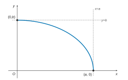
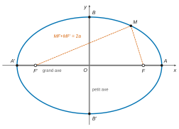
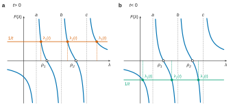
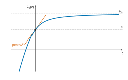

# Centrale-Supélec PC — Mathématiques 1 2026 · Corrigé brut

*Corrigé rédigé par IA, non officiel. Signalez toute erreur.*

**Découverte de la planète Neptune** — 4 heures, calculatrice autorisée. Quatre parties indépendantes, 34 questions.

Convention : le polynôme caractéristique est $P_A=\det(XI_3-A)$, unitaire (c'est celle du programme, et l'énoncé l'utilise puisqu'il annonce en Q21 que $P_A$ est le polynôme unitaire $R$).

---

## Partie A — Étude du mouvement d'une planète seulement soumise à l'attraction du soleil

On rappelle les données : $0<c<a$ et $b=\sqrt{a^2-c^2}>0$.
Les foyers sont $F=(c,0)$ et $F'=(-c,0)$, donc $FF'=2c$.
Enfin $\mathcal{E}=\{M\in P : MF+MF'=2a\}$.

### I — Équation réduite de $\mathcal{E}$

**Q1.** L'inégalité triangulaire appliquée aux points $M,F,F'$ donne $FF'\leqslant MF+MF'$. Plus généralement, chaque distance est majorée par la somme des deux autres. Ainsi
$$\begin{aligned}
MF&\leqslant MF'+F'F,\\
MF'&\leqslant MF+FF'.
\end{aligned}$$
On en tire $MF-MF'\leqslant FF'$ et $MF'-MF\leqslant FF'$.
Comme $|MF-MF'|$ est l'un des deux nombres $MF-MF'$ ou $MF'-MF$,
$$\boxed{FF'\geqslant |MF-MF'|.}$$

**Q2.** Par Q1 et $c<a$, on a $|MF-MF'|\leqslant FF'=2c<2a$.
D'une part $MF-MF'\leqslant 2c<2a$, soit $MF-MF'-2a<0$.
D'autre part $MF-MF'\geqslant -2c>-2a$, soit $MF-MF'+2a>0$. En particulier
$$\boxed{\begin{aligned}
MF-MF'-2a&\neq 0,\\
MF-MF'+2a&\neq 0.
\end{aligned}}$$

**Q3.** Notons $\Pi$ le produit des quatre facteurs. On a $MF'+MF+2a\geqslant 2a>0$, et les deux derniers facteurs sont non nuls par Q2.
Le produit de ces trois facteurs est donc non nul. Ainsi $\Pi=0$ si et seulement si $MF'+MF-2a=0$, c'est-à-dire si et seulement si $M\in\mathcal{E}$ :
$$\boxed{M\in\mathcal{E}\iff (MF'+MF-2a)(MF'+MF+2a)(MF-MF'-2a)(MF-MF'+2a)=0.}$$

**Q4.** On groupe les facteurs conjugués :
$$\Pi=\big[(MF+MF')^2-4a^2\big]\big[(MF-MF')^2-4a^2\big].$$
Posons $s=(MF)^2+(MF')^2-4a^2$ et $p=2\,MF\cdot MF'$. Alors
$$\begin{aligned}
(MF+MF')^2-4a^2&=s+p,\\
(MF-MF')^2-4a^2&=s-p,
\end{aligned}$$
donc $\Pi=s^2-p^2$. Par Q3 :
$$\boxed{M\in\mathcal{E}\iff \big((MF')^2+(MF)^2-4a^2\big)^2=4(MF')^2(MF)^2.}$$

**Q5.** On a $(MF)^2=(x-c)^2+y^2$ et $(MF')^2=(x+c)^2+y^2$.
Posons $r=x^2+y^2+c^2$ ; alors $(MF)^2=r-2cx$ et $(MF')^2=r+2cx$, donc
$$\begin{aligned}
(MF)^2+(MF')^2&=2r,\\
(MF)^2(MF')^2&=r^2-4c^2x^2.
\end{aligned}$$
L'équivalence de Q4 devient
$$\begin{aligned}
M\in\mathcal{E}&\iff(2r-4a^2)^2=4(r^2-4c^2x^2)\\
&\iff r^2-4a^2r+4a^4=r^2-4c^2x^2\\
&\iff a^4-a^2(x^2+y^2+c^2)+c^2x^2=0\\
&\iff (a^2-c^2)x^2+a^2y^2=a^2(a^2-c^2)\\
&\iff b^2x^2+a^2y^2=a^2b^2.
\end{aligned}$$
Comme $a^2b^2>0$ (car $c<a$ donne $b>0$), on divise :
$$\boxed{M\in\mathcal{E}\iff \frac{x^2}{a^2}+\frac{y^2}{b^2}=1.}$$

### II — Étude d'une fonction

On écrit $f(x)=\dfrac{b}{a}\sqrt{a^2-x^2}$ pour $x\in[0,a]$.

**Q6.** La fonction $f$ est continue sur $[0,a]$. Comme $a^2-x^2>0$ sur $[0,a[$, elle est dérivable sur $[0,a[$, avec
$$f'(x)=-\frac{b\,x}{a\sqrt{a^2-x^2}}.$$
Donc $f'(0)=0$ et $f'<0$ sur $]0,a[$.
Ainsi $f$ est strictement décroissante sur son intervalle de définition, de $f(0)=b$ à $f(a)=0$.

| $x$ | $0$ | | $a$ |
|---|---|---|---|
| $f'(x)$ | $0$ | $-$ | (non définie) |
| $f$ | $b$ | décroissante | $0$ |

*Tangente en $(0,b)$* : $f'(0)=0$, d'où la tangente horizontale $\boxed{y=b}$.

*Tangente en $(a,0)$* : pour $x\in[0,a[$, on a
$$\begin{aligned}
\frac{f(x)-f(a)}{x-a}&=\frac{\frac ba\sqrt{(a-x)(a+x)}}{x-a}\\
&=-\frac ba\sqrt{\frac{a+x}{a-x}}\\
&\xrightarrow[x\to a^-]{}-\infty.
\end{aligned}$$
La fonction $f$ n'est donc pas dérivable en $a$. La courbe $\mathcal{C}_f$ admet en $(a,0)$ une demi-tangente verticale, d'équation $\boxed{x=a}$.

**Q7.** Sur $[0,a[$, on calcule
$$\begin{aligned}
f''(x)&=-\frac{b}{a}\Big[\frac{1}{\sqrt{a^2-x^2}}+\frac{x^2}{(a^2-x^2)^{3/2}}\Big]\\
&=-\frac{ab}{(a^2-x^2)^{3/2}}<0,
\end{aligned}$$
donc $f$ est concave.

L'arc part horizontalement de $(0,b)$ et arrive verticalement en $(a,0)$.

D'après Q5, pour $x\in[0,a]$, le point $(x,f(x))$ vérifie
$$\frac{x^2}{a^2}+\frac{f(x)^2}{b^2}=1,$$
avec $f(x)\geqslant 0$. Donc $\mathcal{C}_f$ est exactement le quart de $\mathcal{E}$ contenu dans $\{x\geqslant 0,\ y\geqslant 0\}$.

**Q8.** L'équation de Q5 est invariante par $(x,y)\mapsto(-x,y)$ et par $(x,y)\mapsto(x,-y)$. Ainsi $\mathcal{E}$ est symétrique par rapport aux deux axes.

De plus, soit $(x,y)\in\mathcal{E}$ avec $x\geqslant0$ et $y\geqslant0$. Alors $x\in[0,a]$ et $y=f(x)$.
Donc $\mathcal{E}$ est la réunion de $\mathcal{C}_f$ et de ses images par les symétries par rapport aux deux axes et à l'origine.

Les tangentes sont verticales en $A(a,0)$ et $A'(-a,0)$. Elles sont horizontales en $B(0,b)$ et $B'(0,-b)$.
Comme $b<a$, $\mathcal{E}$ est allongée horizontalement. Puisque $0<c<a$, les foyers $F(c,0)$ et $F'(-c,0)$ sont strictement entre le centre et les sommets.

### III — Paramètres de l'ellipse

**Q9.** De $0<c<a$ et $a>0$, on tire $0<\frac ca<1$ :
$$\boxed{e\in\,]0,1[.}$$
Puis $\boxed{c=ae}$. Comme $a>0$ et $1-e^2>0$,
$$\boxed{\begin{aligned}
b&=\sqrt{a^2-a^2e^2}\\
&=a\sqrt{1-e^2}.
\end{aligned}}$$

**Q10.** On raisonne à $a$ fixé (le grand axe est fixé).

*Si $e$ est proche de $0$.* Le demi-petit axe $b=a\sqrt{1-e^2}$ est proche de $a$, et $c=ae$ est presque nul.
L'ellipse est presque le cercle de centre $O$ et de rayon $a$, et ses foyers sont proches du centre.

*Si $e$ est proche de $1$.* Alors $b$ est presque nul et $c$ est proche de $a$.
L'ellipse est très aplatie le long de son grand axe $[A'A]$, presque confondue avec ce segment, et ses foyers sont proches des sommets $A$ et $A'$.

---

## Partie B — Étude du mouvement des planètes massives du système solaire sans négliger les interactions

**Q11.** Écrivons $B=(\beta_{ij})$, à coefficients constants. La relation $G_t=BL_t$ s'écrit $h_i'(t)=\sum_{j}\beta_{ij}l_j(t)$ pour $i\in\llbracket1,3\rrbracket$.
Les $l_j$ étant dérivables et les $\beta_{ij}$ constants, on dérive :
$$h_i''(t)=\sum_j\beta_{ij}l_j'(t),$$
c'est-à-dire $F_t=BK_t$. Avec $K_t=-BH_t$, on obtient pour tout $t\in\mathbb{R}_+$ :
$$\boxed{\begin{aligned}
F_t&=B(-BH_t)\\
&=A\,H_t,\\
\text{avec}\quad A&=-B^2.
\end{aligned}}$$

**Q12.** La matrice $A\in\mathcal{M}_3(\mathbb{R})$ possède trois valeurs propres réelles deux à deux distinctes $\lambda_1<\lambda_2<\lambda_3$. Une matrice de $\mathcal{M}_3(\mathbb{R})$ ayant trois valeurs propres réelles distinctes est diagonalisable dans $\mathcal{M}_3(\mathbb{R})$.

En effet, soit $X_i$ un vecteur propre associé à $\lambda_i$. La famille $(X_1,X_2,X_3)$ est libre (vecteurs propres associés à des valeurs propres distinctes), donc c'est une base de $\mathbb{R}^3$.
La matrice $Q$ de colonnes $X_1,X_2,X_3$ est inversible et vérifie $AQ=Q\,\mathrm{diag}(\lambda_1,\lambda_2,\lambda_3)$, d'où
$$\boxed{A=Q\begin{pmatrix}\lambda_1&0&0\\0&\lambda_2&0\\0&0&\lambda_3\end{pmatrix}Q^{-1},\qquad Q\in\mathrm{GL}_3(\mathbb{R}).}$$

**Q13.** Notons $\Delta=\mathrm{diag}(\lambda_1,\lambda_2,\lambda_3)$. Chaque $y_i$ est combinaison linéaire à coefficients constants des $h_j$, donc deux fois dérivable, et
$$\begin{aligned}
Y_t''&=Q^{-1}H_t''\\
&=Q^{-1}F_t\\
&=Q^{-1}AH_t\\
&=Q^{-1}Q\Delta Q^{-1}H_t\\
&=\Delta Y_t.
\end{aligned}$$
Ligne par ligne, pour tout $i\in\llbracket1,3\rrbracket$ :
$$\boxed{y_i''-\lambda_i\,y_i=0.}$$
C'est une équation différentielle linéaire homogène d'ordre 2 à coefficients constants. Avec $\omega_i=\sqrt{-\lambda_i}>0$, elle s'écrit $y_i''+\omega_i^2y_i=0$.

**Q14.** L'équation caractéristique $r^2-\lambda_i=0$ a pour racines $\pm i\omega_i$, car $\lambda_i<0$. Les solutions réelles sont donc les fonctions
$$\boxed{y_i(t)=\alpha_i\cos\big(\sqrt{-\lambda_i}\,t\big)+\beta_i\sin\big(\sqrt{-\lambda_i}\,t\big),}$$
où $(\alpha_i,\beta_i)\in\mathbb{R}^2$.
On peut aussi écrire $y_i(t)=C_i\cos(\omega_it-\varphi_i)$, avec $C_i\geqslant 0$ et $\varphi_i\in\mathbb{R}$. C'est une oscillation de pulsation $\sqrt{-\lambda_i}$.

**Q15.** *Inversibilité de $B$.* La matrice $A$ est semblable à $\Delta$, donc $\det A=\lambda_1\lambda_2\lambda_3\neq0$. Or
$$\begin{aligned}
\det A&=\det(-B^2)\\
&=(-1)^3\det(B)^2\\
&=-\det(B)^2.
\end{aligned}$$
Donc $\det B\neq0$ :
$$\boxed{B\in\mathrm{GL}_3(\mathbb{R}).}$$
*Expression des $h_i$.* De $Y_t=Q^{-1}H_t$ :
$$\boxed{\begin{aligned}
H_t&=Q\,Y_t,\\
\text{soit}\quad h_i(t)&=\sum_{j=1}^3 q_{ij}\,y_j(t),
\end{aligned}}$$
où $Q=(q_{ij})$.

*Expression des $l_i$.* Comme $B$ est inversible, $G_t=BL_t$ donne $L_t=B^{-1}G_t$.
Or $G_t=H_t'$, et $H_t'=QY_t'$ car $Q$ est constante. Donc
$$\boxed{\begin{aligned}
L_t&=B^{-1}Q\,Y_t',\\
\text{soit}\quad l_i(t)&=\sum_{j=1}^3 r_{ij}\,y_j'(t),
\end{aligned}}$$
où $B^{-1}Q=(r_{ij})$, avec
$$y_j'(t)=\omega_j\big(-\alpha_j\sin(\omega_jt)+\beta_j\cos(\omega_jt)\big).$$

---

## Partie C — Méthode de Le Verrier pour déterminer les valeurs propres

### I — Résolution des équations

**Q16.** Pour $A=(a_{ij})$, $B=(b_{ij})$ dans $\mathcal{M}_3(\mathbb{R})$ :
$$\begin{aligned}
\mathrm{Tr}(AB)&=\sum_{i=1}^3(AB)_{ii}\\
&=\sum_{i=1}^3\sum_{j=1}^3a_{ij}b_{ji}\\
&=\sum_{j=1}^3\sum_{i=1}^3b_{ji}a_{ij}\\
&=\sum_{j=1}^3(BA)_{jj}\\
&=\mathrm{Tr}(BA).
\end{aligned}$$
Soit $N=P^{-1}MP$ avec $P\in\mathrm{GL}_3(\mathbb{R})$. Alors
$$\begin{aligned}
\mathrm{Tr}(N)&=\mathrm{Tr}\big(P^{-1}(MP)\big)\\
&=\mathrm{Tr}\big((MP)P^{-1}\big)\\
&=\mathrm{Tr}(M).
\end{aligned}$$
**Deux matrices semblables ont donc même trace.**

**Q17.** Notons $\Delta=\mathrm{diag}(\lambda_1,\lambda_2,\lambda_3)$. Par récurrence, $A^k=Q\Delta^kQ^{-1}$ pour $k\in\mathbb{N}^*$. En effet, si c'est vrai au rang $k$, alors
$$\begin{aligned}
A^{k+1}&=Q\Delta^kQ^{-1}Q\Delta Q^{-1}\\
&=Q\Delta^{k+1}Q^{-1}.
\end{aligned}$$
Donc $A^k$ est semblable à $\Delta^k=\mathrm{diag}(\lambda_1^k,\lambda_2^k,\lambda_3^k)$ et, par Q16,
$$\boxed{\begin{aligned}
\mathrm{Tr}(A)&=S_1,\\
\mathrm{Tr}(A^2)&=S_2,\\
\mathrm{Tr}(A^3)&=S_3.
\end{aligned}}$$

**Q18.** On a $XI_3-A=Q(XI_3-\Delta)Q^{-1}$, donc
$$\begin{aligned}
P_A&=\det(Q)\det(XI_3-\Delta)\det(Q^{-1})\\
&=\det(XI_3-\Delta).
\end{aligned}$$
Ainsi
$$\boxed{P_A=(X-\lambda_1)(X-\lambda_2)(X-\lambda_3).}$$
En développant :
$$P_A=X^3-(\lambda_1+\lambda_2+\lambda_3)X^2+(\lambda_1\lambda_2+\lambda_1\lambda_3+\lambda_2\lambda_3)X-\lambda_1\lambda_2\lambda_3.$$
Par identification ($\alpha_3=1$) :
$$\boxed{\begin{aligned}
\alpha_0&=-\lambda_1\lambda_2\lambda_3,\\
\alpha_1&=\lambda_1\lambda_2+\lambda_1\lambda_3+\lambda_2\lambda_3,\\
\alpha_2&=-(\lambda_1+\lambda_2+\lambda_3).
\end{aligned}}$$

**Q19.** D'abord $\alpha_2=-S_1$. Ensuite
$$\begin{aligned}
S_1^2&=\lambda_1^2+\lambda_2^2+\lambda_3^2+2(\lambda_1\lambda_2+\lambda_1\lambda_3+\lambda_2\lambda_3)\\
&=S_2+2\alpha_1.
\end{aligned}$$
Donc
$$\boxed{\begin{aligned}
\alpha_2&=-S_1,\\
\alpha_1&=\frac{S_1^2-S_2}{2},
\end{aligned}}$$
et, avec la valeur admise de $\alpha_0$ et Q17,
$$P_A=X^3-\mathrm{Tr}(A)X^2+\frac{\mathrm{Tr}(A)^2-\mathrm{Tr}(A^2)}{2}X+\frac{3\,\mathrm{Tr}(A)\mathrm{Tr}(A^2)-\mathrm{Tr}(A)^3-2\,\mathrm{Tr}(A^3)}{6}.$$

### II — Étude d'un cas particulier

On pose $N=2A$, de sorte que $A^k=N^k/2^k$ :
$$N=\begin{pmatrix}-4&11&13\\0&1&7\\0&7&1\end{pmatrix}.$$

**Q20.** $P_A$ est un polynôme de degré 3, scindé sur $\mathbb{C}$ (théorème de d'Alembert-Gauss).
Toute matrice dont le polynôme caractéristique est scindé est trigonalisable. Il existe donc $T\in\mathcal{M}_3(\mathbb{C})$ triangulaire supérieure et $Q\in\mathrm{GL}_3(\mathbb{C})$ telles que
$$\boxed{A=QTQ^{-1}.}$$

Notons $\mu_1,\mu_2,\mu_3$ les coefficients diagonaux de $T$. Le calcul de Q16 vaut sur $\mathbb{C}$.

Un produit de matrices triangulaires supérieures est triangulaire supérieure, de diagonale le produit des diagonales. Donc $A^k=QT^kQ^{-1}$ donne
$$\mathrm{Tr}(A^k)=\mu_1^k+\mu_2^k+\mu_3^k.$$
De même, le déterminant d'une matrice triangulaire étant le produit de ses coefficients diagonaux,
$$\begin{aligned}
P_A&=\det(XI_3-T)\\
&=(X-\mu_1)(X-\mu_2)(X-\mu_3).
\end{aligned}$$
Les calculs de Q17 à Q19 se transposent mot pour mot : **oui, les relations de Q19 restent valables**, avec $S_k=\mathrm{Tr}(A^k)$, somme des puissances $k$-ièmes des valeurs propres complexes comptées avec multiplicité.

**Q21.** Calcul direct :
$$\begin{aligned}
N^2&=\begin{pmatrix}16&58&38\\0&50&14\\0&14&50\end{pmatrix},\\
N^3&=\begin{pmatrix}-64&500&652\\0&148&364\\0&364&148\end{pmatrix}.
\end{aligned}$$
Donc $\mathrm{Tr}(N)=-2$, $\mathrm{Tr}(N^2)=116$ et $\mathrm{Tr}(N^3)=232$.
Comme $\mathrm{Tr}(A^k)=\mathrm{Tr}(N^k)/2^k$, on divise respectivement par 2, 4 et 8 :
$$\boxed{\begin{aligned}
\mathrm{Tr}(A)&=-1,\\
\mathrm{Tr}(A^2)&=29,\\
\mathrm{Tr}(A^3)&=29.
\end{aligned}}$$
Par Q19 et Q20, avec $S_1=-1$, $S_2=29$ et $S_3=29$ :
$$\begin{aligned}
\alpha_2&=1,\\
\alpha_1&=\frac{1-29}{2}\\
&=-14,\\
\alpha_0&=\frac{3(-1)(29)-(-1)-2\cdot29}{6}\\
&=\frac{-144}{6}\\
&=-24,
\end{aligned}$$
et $\alpha_3=1$, d'où
$$\boxed{\begin{aligned}
P_A&=X^3+X^2-14X-24\\
&=R.
\end{aligned}}$$

**Q22.** Les valeurs propres de $A$ sont les racines de $R$. On a
$$\begin{aligned}
R(-2)&=-8+4+28-24\\
&=0,
\end{aligned}$$
donc $R=(X+2)(X^2-X-12)$. Le trinôme a pour discriminant $49$ et pour racines $4$ et $-3$.
Donc $R=(X+2)(X+3)(X-4)$ et
$$\boxed{\mathrm{Sp}(A)=\{-3,\,-2,\,4\}.}$$

**Q23.** On a $AX=\lambda X\iff NX=2\lambda X$.

*Pour $\lambda=-2$.* Le système $(N+4I_3)X=0$ s'écrit
$$\begin{aligned}
11y+13z&=0,\\
5y+7z&=0,\\
7y+5z&=0.
\end{aligned}$$
Le système en $(y,z)$ formé des deux dernières équations a pour déterminant $25-49\neq0$. Donc $y=z=0$ et $x$ est libre : $X_1=(1,0,0)^\top$.

*Pour $\lambda=-3$.* Le système $(N+6I_3)X=0$ s'écrit
$$\begin{aligned}
2x+11y+13z&=0,\\
7y+7z&=0.
\end{aligned}$$
Donc $y=-z$ et $x=-z$ : $X_2=(1,1,-1)^\top$.

*Pour $\lambda=4$.* Le système $(N-8I_3)X=0$ s'écrit
$$\begin{aligned}
-12x+11y+13z&=0,\\
-7y+7z&=0.
\end{aligned}$$
Donc $y=z$ et $x=2z$ : $X_3=(2,1,1)^\top$.

Vérifications :
$$\begin{aligned}
NX_1&=-4X_1,\\
NX_2&=(-6,-6,6)^\top\\
&=-6X_2,\\
NX_3&=(16,8,8)^\top\\
&=8X_3.
\end{aligned}$$
Ces vecteurs propres sont associés à des valeurs propres distinctes : ils forment une base, et la matrice qu'ils forment a pour déterminant $2\neq0$. Ainsi
$$\boxed{\begin{aligned}
Q&=\begin{pmatrix}1&1&2\\0&1&1\\0&-1&1\end{pmatrix}\in\mathrm{GL}_3(\mathbb{R}),\\
Q^{-1}AQ&=\begin{pmatrix}-2&0&0\\0&-3&0\\0&0&4\end{pmatrix}.
\end{aligned}}$$

---

## Partie D — Perturbation sur une matrice d'ordre 3

Rappel : $a<b<c$ ; $u,v,w$ sont non nuls, donc $u^2,v^2,w^2>0$.
On a $U=(u,v,w)^\top$, $T=UU^\top$ et $D=\mathrm{diag}(a,b,c)$. Enfin $t\neq0$ et $D(t)=D+tT$.
On note, sur $\mathbb{R}\setminus\{a,b,c\}$,
$$F(\lambda)=\frac{u^2}{\lambda-a}+\frac{v^2}{\lambda-b}+\frac{w^2}{\lambda-c}.$$

### I — Solutions et spectre

**Q24.** La matrice $\lambda I_3-D=\mathrm{diag}(\lambda-a,\lambda-b,\lambda-c)$ a ses coefficients diagonaux non nuls, puisque $\lambda\notin\{a,b,c\}$. Donc $\boxed{\lambda I_3-D\in\mathrm{GL}_3(\mathbb{R})}$, d'inverse
$$(\lambda I_3-D)^{-1}=\mathrm{diag}\Big(\frac1{\lambda-a},\frac1{\lambda-b},\frac1{\lambda-c}\Big).$$

Soit $X\neq0$ avec $D(t)X=\lambda X$. Alors $DX+tU(U^\top X)=\lambda X$, donc
$$\begin{aligned}
(\lambda I_3-D)X&=tU(U^\top X),\\
X&=t(\lambda I_3-D)^{-1}U(U^\top X).
\end{aligned}$$
En multipliant à gauche par $U^\top$ :
$$\boxed{U^\top X=t\,U^\top(\lambda I_3-D)^{-1}UU^\top X.}$$

**Q25.** Posons $s=U^\top X\in\mathbb{R}$. Si $s=0$, la relation $X=t(\lambda I_3-D)^{-1}U\,s$ donne $X=0$, ce qui est exclu.
Donc $s\neq0$. En simplifiant Q24 par $s$, on obtient $t\,U^\top(\lambda I_3-D)^{-1}U=1$.
Comme $t\neq0$,
$$\boxed{U^\top(\lambda I_3-D)^{-1}U=\frac1t.}$$

**Q26.** Par Q24,
$$(\lambda I_3-D)^{-1}U=\Big(\frac{u}{\lambda-a},\frac{v}{\lambda-b},\frac{w}{\lambda-c}\Big)^\top,$$
donc $U^\top(\lambda I_3-D)^{-1}U=F(\lambda)$. Par Q25,
$$\boxed{F(\lambda)=\frac1t.}$$
**Ainsi $\lambda$ est solution de $(E_t)$.**

**Q27.** $F$ est dérivable sur $\mathbb{R}\setminus\{a,b,c\}=I_1\cup I_2\cup I_3\cup I_4$, avec
$$\begin{aligned}
I_1&=\,]-\infty,a[,\\
I_2&=\,]a,b[,\\
I_3&=\,]b,c[,\\
I_4&=\,]c,+\infty[.
\end{aligned}$$
Sur chacun d'eux,
$$F'(\lambda)=-\frac{u^2}{(\lambda-a)^2}-\frac{v^2}{(\lambda-b)^2}-\frac{w^2}{(\lambda-c)^2}<0.$$
$F$ est donc strictement décroissante sur chacun des quatre intervalles.

*Limites.* Chaque terme tend vers $0$ en $\pm\infty$. Au voisinage de $a$, les deux autres termes ont une limite finie, et
$$\lim_{\lambda\to a^{\mp}}\frac{u^2}{\lambda-a}=\mp\infty.$$
Il en va de même en $b$ et en $c$.
Sur $I_1$, les trois termes sont négatifs, donc $F<0$. Sur $I_4$, ils sont positifs, donc $F>0$.

| $\lambda$ | $-\infty$ | | $a$ | | $b$ | | $c$ | | $+\infty$ |
|---|---|---|---|---|---|---|---|---|---|
| $F'(\lambda)$ | | $-$ | ‖ | $-$ | ‖ | $-$ | ‖ | $-$ | |
| $F$ | 0⁻ | décroît vers −∞ | ‖ | de +∞ à −∞ | ‖ | de +∞ à −∞ | ‖ | décroît de +∞ | 0⁺ |

Par le théorème de la bijection (continuité et stricte monotonie sur un intervalle), $F$ réalise des bijections
$$\begin{aligned}
I_1&\to\,]-\infty,0[,\\
I_2&\to\mathbb{R},\\
I_3&\to\mathbb{R},\\
I_4&\to\,]0,+\infty[.
\end{aligned}$$
Ainsi $F$ ne s'annule ni sur $I_1$ ni sur $I_4$.
Elle s'annule exactement une fois sur $I_2$ et une fois sur $I_3$ :
$$\boxed{\begin{aligned}
&F \text{ s'annule exactement en } \rho_1\in\,]a,b[ \text{ et } \rho_2\in\,]b,c[,\\
&a<\rho_1<b<\rho_2<c.
\end{aligned}}$$

**Q28.** L'équation $(E_t)$ s'écrit $F(\lambda)=\frac1t$. On utilise les bijections de Q27 et la décroissance de $F$, avec $F(\rho_i)=0$.

*Cas $t>0$*, donc $\frac1t>0$. Il n'y a aucune solution dans $I_1$.
Il y a une unique solution dans $I_2$, et $F(\lambda)=\frac1t>0=F(\rho_1)$ impose $\lambda<\rho_1$.
De même, il y a une unique solution dans $I_3$, inférieure à $\rho_2$, et une unique solution dans $I_4$. D'où
$$\boxed{t>0:\quad a<\lambda_1(t)<\rho_1<b<\lambda_2(t)<\rho_2<c<\lambda_3(t).}$$

*Cas $t<0$*, donc $\frac1t<0$. Il y a une unique solution dans $I_1$.
Il y a une unique solution dans $I_2$, supérieure à $\rho_1$.
Il y en a une unique dans $I_3$, supérieure à $\rho_2$, et aucune dans $I_4$. D'où
$$\boxed{t<0:\quad \lambda_1(t)<a<\rho_1<\lambda_2(t)<b<\rho_2<\lambda_3(t)<c.}$$
Dans les deux cas, $(E_t)$ a exactement trois solutions réelles, distinctes car situées dans des intervalles disjoints.

**Q29.** Notons $\mathcal{S}$ l'ensemble des solutions de $(E_t)$.

*$a,b,c$ ne sont pas valeurs propres de $D(t)$.* Supposons $D(t)X=aX$.
Alors $(aI_3-D)X=tU(U^\top X)$, avec $aI_3-D=\mathrm{diag}(0,a-b,a-c)$.
La première ligne de $aI_3-D$ est nulle, donc $tu\,(U^\top X)=0$. Comme $t$ et $u$ sont non nuls, $U^\top X=0$.
Alors $\mathrm{diag}(0,a-b,a-c)X=0$ donne $x_2=x_3=0$.
Puis $U^\top X=ux_1=0$ donne $x_1=0$, donc $X=0$.
Le même raisonnement vaut pour $b$, avec $v\neq0$. Il vaut aussi pour $c$, avec $w\neq0$.

*$\mathrm{Sp}(D(t))\subset\mathcal{S}$* : une valeur propre de $D(t)$ est donc dans $\mathbb{R}\setminus\{a,b,c\}$, et Q24–Q26 s'appliquent.

*$\mathcal{S}\subset\mathrm{Sp}(D(t))$* : soit $\lambda\in\mathcal{S}$, donc $\lambda\notin\{a,b,c\}$.
Posons $X=(\lambda I_3-D)^{-1}U$ ; ce vecteur est non nul, car sa première composante $\frac{u}{\lambda-a}$ est non nulle.
Alors $DX=\lambda X-U$ et $U^\top X=F(\lambda)=\frac1t$, donc
$$\begin{aligned}
D(t)X&=DX+tU(U^\top X)\\
&=\lambda X-U+U\\
&=\lambda X.
\end{aligned}$$
Ainsi $\lambda$ est valeur propre de $D(t)$. Par double inclusion,
$$\boxed{\begin{aligned}
\mathcal{S}&=\mathrm{Sp}\big(D(t)\big)\\
&=\{\lambda_1(t),\lambda_2(t),\lambda_3(t)\}.
\end{aligned}}$$

### II — Les limites

**Q30.** Pour chaque $i$, la restriction de $F$ à l'intervalle $I_i$ est continue et strictement décroissante (Q27).
Par le théorème de la bijection, elle réalise une bijection de $I_i$ sur $F(I_i)$, dont la réciproque $g_i$ est continue et strictement décroissante :
$$\begin{aligned}
g_1&:\,]-\infty,0[\,\to\,]-\infty,a[,\\
g_2&:\mathbb{R}\to\,]a,b[,\\
g_3&:\mathbb{R}\to\,]b,c[,\\
g_4&:\,]0,+\infty[\,\to\,]c,+\infty[.
\end{aligned}$$
Comme $\rho_1\in\,]a,b[$ et $F(\rho_1)=0$ : $\boxed{g_2(0)=\rho_1}$.

La fonction $g_2$ est décroissante et minorée par $a$. Elle admet donc en $+\infty$ une limite $\ell\in[a,b[$.
Supposons $\ell>a$ ; alors $\ell\in I_2$. Par continuité de $F$ en $\ell$, on aurait
$$y=F\big(g_2(y)\big)\xrightarrow[y\to+\infty]{}F(\ell),$$
limite finie : c'est absurde. Donc $\ell=a$.

De même, $g_2$ est majorée par $b$. Elle admet en $-\infty$ une limite $\ell'\in\,]a,b]$, et $\ell'<b$ conduirait à la même contradiction. Ainsi
$$\boxed{\begin{aligned}
\lim_{+\infty}g_2&=a,\\
\lim_{-\infty}g_2&=b.
\end{aligned}}$$

**Q31.** Soit $\lambda\in I_i$. D'après Q27 et Q28, il est solution de $(E_t)$ si et seulement si $\frac1t\in F(I_i)$ et $\lambda=g_i\big(\frac1t\big)$. Donc
$$\boxed{\begin{aligned}
\text{pour } t>0:\quad\lambda_1(t)&=g_2\Big(\frac1t\Big),\\
\lambda_2(t)&=g_3\Big(\frac1t\Big),\\
\lambda_3(t)&=g_4\Big(\frac1t\Big);
\end{aligned}}$$
$$\boxed{\begin{aligned}
\text{pour } t<0:\quad\lambda_1(t)&=g_1\Big(\frac1t\Big),\\
\lambda_2(t)&=g_2\Big(\frac1t\Big),\\
\lambda_3(t)&=g_3\Big(\frac1t\Big).
\end{aligned}}$$
Les domaines sont respectés. Pour $t>0$, $\frac1t\in\,]0,+\infty[$, domaine de $g_4$.
Pour $t<0$, $\frac1t\in\,]-\infty,0[$, domaine de $g_1$.

**Q32.** Par Q31,
$$\begin{aligned}
\lambda_1&=g_2\circ\Big(t\mapsto\frac1t\Big)\quad\text{sur }]0,+\infty[,\\
\lambda_1&=g_1\circ\Big(t\mapsto\frac1t\Big)\quad\text{sur }]-\infty,0[.
\end{aligned}$$
Par composition, $\lambda_1$ est continue sur $\mathbb{R}^*$.

En $0^+$ : $\frac1t\to+\infty$ et, par Q30, $\lambda_1(t)\to a$.

En $0^-$ : $\frac1t\to-\infty$. La fonction $g_1$ est décroissante et majorée par $a$.
Elle admet donc en $-\infty$ une limite finie $\ell\leqslant a$. Si l'on avait $\ell<a$, la continuité de $F$ en $\ell$ donnerait
$$y=F\big(g_1(y)\big)\xrightarrow[y\to-\infty]{}F(\ell),$$
limite finie : c'est absurde. Donc $g_1(y)\to a$ quand $y\to-\infty$, et $\lambda_1(t)\to a$.

Les deux limites coïncident : en posant $\boxed{\lambda_1(0)=a}$, $\lambda_1$ se prolonge en une fonction continue sur $\mathbb{R}$. (Le même argument donne $\lambda_2(0)=b$ et $\lambda_3(0)=c$.)

**Q33.** *Sur $\mathbb{R}^*$.* La fonction $F$ est dérivable sur chaque $I_i$ et $F'$ ne s'y annule pas. Donc chaque $g_i$ est dérivable (dérivée d'une bijection réciproque).
Par composition avec $t\mapsto\frac1t$, la fonction $\lambda_1$ est dérivable sur $\mathbb{R}^*$.

*En $0$.* Pour $t\neq0$, on a $\varepsilon(t)=\lambda_1(t)-a\neq0$ (Q28), et $\varepsilon(t)\to0$ (Q32).
La relation $F(\lambda_1(t))=\frac1t$, multipliée par $t$, donne
$$\frac{t\,u^2}{\varepsilon(t)}+t\left(\frac{v^2}{\lambda_1(t)-b}+\frac{w^2}{\lambda_1(t)-c}\right)=1.$$
Comme $\lambda_1(t)\to a$, avec $a\neq b$ et $a\neq c$, la parenthèse tend vers
$$\frac{v^2}{a-b}+\frac{w^2}{a-c},$$
qui est fini ; le second terme tend donc vers $0$. Ainsi $\frac{tu^2}{\varepsilon(t)}\to1$ et, comme $u^2\neq0$,
$$\begin{aligned}
\frac{\lambda_1(t)-\lambda_1(0)}{t}&=\frac{\varepsilon(t)}{t}\\
&\xrightarrow[t\to0]{}u^2.
\end{aligned}$$
$\lambda_1$ est donc dérivable en $0$, donc sur $\mathbb{R}$, et
$$\boxed{\lambda_1'(0)=u^2.}$$
En reprenant ce raisonnement :
$$\boxed{\begin{aligned}
\lambda_2'(0)&=v^2,\\
\lambda_3'(0)&=w^2.
\end{aligned}}$$

**Q34.** Pour $t>0$, $\lambda_1(t)=g_2(\frac1t)$. Quand $t\to+\infty$, on a $\frac1t\to0$.
Comme $g_2$ est continue en $0$, $\lambda_1(t)\to g_2(0)=\rho_1$.

Pour $t<0$, $\lambda_1(t)=g_1(\frac1t)$. Quand $t\to-\infty$, on a $\frac1t\to0^-$.
La fonction $g_1$ est décroissante sur $]-\infty,0[$. Si elle était minorée au voisinage de $0^-$, elle aurait une limite finie $m<a$ en $0^-$.
La continuité de $F$ en $m$ donnerait alors
$$y=F\big(g_1(y)\big)\xrightarrow[y\to0^-]{}F(m),$$
avec $F(m)<0$ : c'est absurde. Donc $g_1(y)\to-\infty$ quand $y\to0^-$, et
$$\boxed{\begin{aligned}
\lim_{t\to+\infty}\lambda_1(t)&=\rho_1,\\
\lim_{t\to-\infty}\lambda_1(t)&=-\infty.
\end{aligned}}$$

*Commentaires.*

**Continuité du spectre.** On a $\lambda_1(0)=a$, $\lambda_2(0)=b$ et $\lambda_3(0)=c$. Une petite perturbation $tT$ de $D$ ne déplace que peu ses valeurs propres.

**Sensibilité au premier ordre.** L'écart est proportionnel à $t$, avec un coefficient explicite :
$$\begin{aligned}
\lambda_1(t)&=a+u^2t+o(t),\\
\lambda_2(t)&=b+v^2t+o(t),\\
\lambda_3(t)&=c+w^2t+o(t).
\end{aligned}$$
Contrôle : la somme des dérivées en $0$, soit $u^2+v^2+w^2$, est bien la dérivée de
$$\mathrm{Tr}\,D(t)=a+b+c+t(u^2+v^2+w^2).$$

**Sens et entrelacement.** Pour $t>0$, chaque valeur propre est au-dessus de la valeur propre correspondante de $D$ :
$$a<\lambda_1(t)<b<\lambda_2(t)<c<\lambda_3(t).$$
Elle est au-dessous pour $t<0$. Les valeurs propres de $D(t)$ et de $D$ s'entrelacent.

**Comportement pour une grande perturbation.** Pour $t\to+\infty$, $\lambda_1(t)\to\rho_1$ et $\lambda_2(t)=g_3(\frac1t)\to\rho_2$ restent bornées. Seule $\lambda_3$ tend vers $+\infty$.
Pour $t\to-\infty$, $\lambda_2\to\rho_1$ et $\lambda_3\to\rho_2$. Seule $\lambda_1$ tend vers $-\infty$.
Une perturbation de rang 1 n'envoie à l'infini qu'une seule valeur propre.
