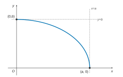
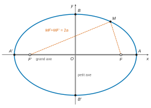
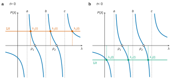
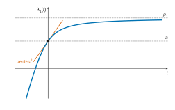

# Centrale-Supélec PC — Mathématiques 1 2026 · Corrigé guidé

*Corrigé rédigé par IA, non officiel. Signalez toute erreur.*

## Présentation du sujet

**Thème.** Le sujet, intitulé *Découverte de la planète Neptune*, suit le calcul d'Urbain Le Verrier en quatre parties **indépendantes** (4 heures, calculatrice autorisée, 34 questions). Un même objet revient trois fois : le spectre d'une matrice $3\times3$, qu'on fait apparaître (partie B), qu'on calcule autrement (partie C), puis dont on mesure la sensibilité (partie D).

**Découpage.**
- **Partie A (Q1–Q10), l'ellipse.** À partir de la seule définition bifocale $MF+MF'=2a$, une chaîne guidée (inégalité triangulaire, produit nul, identités remarquables) mène à l'équation réduite $\frac{x^2}{a^2}+\frac{y^2}{b^2}=1$. Suivent une étude de fonction, deux tracés et l'excentricité. Géométrie et analyse de première année.
- **Partie B (Q11–Q15), système différentiel.** Dériver une relation matricielle, diagonaliser $A=-B^2$ pour découpler $H''=AH$ en trois équations $y_i''=\lambda_iy_i$, résoudre, revenir aux inconnues. Cours de réduction et équations différentielles linéaires d'ordre 2.
- **Partie C (Q16–Q23), méthode de Le Verrier.** $\mathrm{Tr}(AB)=\mathrm{Tr}(BA)$, traces des puissances, coefficients du polynôme caractéristique exprimés par les sommes de Newton $S_1,S_2,S_3$, puis un exemple numérique complet (traces, spectre, matrice de passage).
- **Partie D (Q24–Q34), perturbation de rang 1.** Spectre de $D(t)=D+tUU^\top$ caractérisé par l'équation scalaire $F(\lambda)=\frac1t$. Étude de $F$, théorème de la bijection, réciproques, prolongement par continuité, dérivabilité en $0$ et comportement asymptotique.

**Notions mobilisées.** Inégalité triangulaire ; dérivation, tangentes et demi-tangentes, convexité ; diagonalisation (valeurs propres distinctes), trigonalisation sur $\mathbb{C}$ ; trace, polynôme caractéristique ; équations différentielles $y''+\omega^2y=0$ ; théorème de la bijection, dérivée d'une réciproque ; limites et taux d'accroissement.

**Difficulté et longueur.** Sujet long mais très guidé et d'une difficulté modérée : la plupart des questions sont des applications directes du cours. Les vrais points de discrimination sont la rigueur (justifier qu'un facteur est non nul, écarter le cas $U^\top X=0$, traiter les deux côtés d'une limite) et quelques questions plus fines : Q20, Q29, Q32, Q33.

**À ne pas laisser passer.** Q1–Q3, Q6, Q9, Q11–Q14, Q16–Q18, Q21–Q23, Q24–Q27 : ce sont des points quasi assurés pour qui connaît son cours.

**Gestion du temps.** Environ 50 minutes pour A, 35 pour B, 55 pour C, 1 h 20 pour D, et 20 minutes de relecture. Les parties étant indépendantes, on peut commencer par C (calculs vérifiables) ou par B (court), puis revenir à A et D. Dans D, ne rien bâcler avant d'avoir un tableau de variations de $F$ propre (Q27) : toute la suite le relit.

Convention utilisée partout : $P_A=\det(XI_3-A)$, polynôme unitaire. C'est celle du programme, et l'énoncé la confirme en annonçant en Q21 que $P_A$ est le polynôme unitaire $R$.

## Partie A — Étude du mouvement d'une planète seulement soumise à l'attraction du soleil

On démontre que l'ensemble bifocal $\mathcal{E}$ est l'ellipse d'équation réduite $\frac{x^2}{a^2}+\frac{y^2}{b^2}=1$, puis on étudie sa forme.
Rappel : $0<c<a$ et $b=\sqrt{a^2-c^2}>0$. Les foyers sont $F=(c,0)$ et $F'=(-c,0)$, donc $FF'=2c$.

### I — Équation réduite de $\mathcal{E}$

### Question 1

> [!INDICATION]
> L'inégalité triangulaire majore un côté du triangle $MFF'$ par la somme des deux autres. Elle s'applique trois fois, selon le côté choisi.

> [!INDICATION]
> Isolez $MF$, puis $MF'$. Obtenez ainsi une majoration de $MF-MF'$ et de $MF'-MF$.

#### Solution

L'inégalité triangulaire dans le triangle (éventuellement aplati) $MFF'$ s'écrit $FF'\leqslant MF+MF'$. Elle donne de même
$$\begin{aligned}
MF&\leqslant MF'+F'F,\\
MF'&\leqslant MF+FF'.
\end{aligned}$$
Ces deux dernières inégalités donnent $MF-MF'\leqslant FF'$ et $MF'-MF\leqslant FF'$.
Comme $|MF-MF'|$ est égal à $MF-MF'$ ou à $MF'-MF$,
$$\boxed{FF'\geqslant |MF-MF'|.}$$

> [!PIEGE]
> La question demande d'abord de *rappeler* l'inégalité triangulaire : il faut l'écrire. Et la valeur absolue impose de majorer les **deux** différences.

### Question 2

> [!INDICATION]
> Calculez $FF'$ à l'aide des coordonnées et comparez à $2a$.

#### Solution

On a $FF'=2c<2a$, donc, par Q1, $-2c\leqslant MF-MF'\leqslant 2c$. D'où
$$\begin{aligned}
MF-MF'-2a&\leqslant 2c-2a<0,\\
MF-MF'+2a&\geqslant 2a-2c>0,
\end{aligned}$$
et donc
$$\boxed{\begin{aligned}
MF-MF'-2a&\neq0,\\
MF-MF'+2a&\neq0.
\end{aligned}}$$

> [!METHODE]
> L'inégalité est **stricte** grâce à $c<a$ : c'est ici, et seulement ici, que l'hypothèse sert dans la chaîne Q1–Q4. Dites-le.

### Question 3

> [!INDICATION]
> Un produit de réels est nul si et seulement si l'un de ses facteurs l'est. Combien de facteurs peuvent réellement s'annuler ?

> [!INDICATION]
> Deux facteurs sont traités par Q2. Le facteur $MF'+MF+2a$ demande un argument à part.

#### Solution

On a $MF'+MF+2a\geqslant2a>0$, et les deux derniers facteurs sont non nuls par Q2. Le produit de ces trois facteurs est donc non nul.
Le produit total s'annule donc si et seulement si $MF'+MF-2a=0$, c'est-à-dire si et seulement si $M\in\mathcal{E}$ :
$$\boxed{M\in\mathcal{E}\iff(MF'+MF-2a)(MF'+MF+2a)(MF-MF'-2a)(MF-MF'+2a)=0.}$$

> [!PIEGE]
> Oublier le facteur $MF'+MF+2a$, le seul dont la non-nullité ne vient pas de Q2.

### Question 4

> [!INDICATION]
> Ne développez pas brutalement : regroupez les facteurs deux par deux pour faire apparaître $(\alpha-\beta)(\alpha+\beta)$.

> [!INDICATION]
> Après un premier regroupement, posez $s=(MF)^2+(MF')^2-4a^2$ et cherchez à écrire chaque crochet comme $s\pm p$.

#### Solution

En groupant le premier facteur avec le deuxième, et le troisième avec le quatrième :
$$\Pi=\big[(MF+MF')^2-4a^2\big]\big[(MF-MF')^2-4a^2\big].$$
Posons $s=(MF)^2+(MF')^2-4a^2$ et $p=2\,MF\cdot MF'$.
Les crochets valent $s+p$ et $s-p$, donc $\Pi=s^2-p^2$. Par Q3 :
$$\boxed{M\in\mathcal{E}\iff\big((MF')^2+(MF)^2-4a^2\big)^2=4(MF')^2(MF)^2.}$$

> [!METHODE]
> Repérer les facteurs **conjugués** avant de développer. Le résultat ne fait plus intervenir que des carrés de distances, donc des polynômes en $x,y$ : c'est ce qui rend Q5 calculatoire.

### Question 5

> [!INDICATION]
> Exprimez $(MF)^2$ et $(MF')^2$ en fonction de $x,y,c$ ; leur somme et leur produit sont simples.

> [!INDICATION]
> Posez $r=x^2+y^2+c^2$ : alors $(MF)^2=r-2cx$ et $(MF')^2=r+2cx$. Le terme $r^2$ disparaît.

#### Solution

On a $(MF)^2=r-2cx$ et $(MF')^2=r+2cx$ avec $r=x^2+y^2+c^2$.
Leur somme vaut donc $2r$ et leur produit $r^2-4c^2x^2$. L'équivalence de Q4 s'écrit
$$\begin{aligned}
M\in\mathcal{E}&\iff(2r-4a^2)^2=4(r^2-4c^2x^2)\\
&\iff-4a^2r+4a^4=-4c^2x^2\\
&\iff a^4-a^2(x^2+y^2+c^2)+c^2x^2=0\\
&\iff(a^2-c^2)x^2+a^2y^2=a^2(a^2-c^2)\\
&\iff b^2x^2+a^2y^2=a^2b^2.
\end{aligned}$$
Comme $a^2b^2>0$ :
$$\boxed{M\in\mathcal{E}\iff\frac{x^2}{a^2}+\frac{y^2}{b^2}=1.}$$

> [!METHODE]
> Contrôle final immédiat : $A(a,0)$ et $B(0,b)$ vérifient l'équation. Ils sont bien sur $\mathcal{E}$, car $AF+AF'=(a-c)+(a+c)=2a$ et $BF=BF'=\sqrt{b^2+c^2}=a$.

### II — Étude d'une fonction

### Question 6

> [!INDICATION]
> $f$ est la composée de la racine carrée et d'une fonction qui s'annule en $a$. Où $f$ est-elle dérivable ?

> [!INDICATION]
> En $a$, étudiez la limite du taux d'accroissement $\frac{f(x)-f(a)}{x-a}$ : que traduit une limite infinie ?

#### Solution

On a $f(x)=\frac ba\sqrt{a^2-x^2}$. La fonction $f$ est continue sur $[0,a]$ et dérivable sur $[0,a[$, avec
$$f'(x)=-\frac{bx}{a\sqrt{a^2-x^2}}.$$
Ainsi $f'(0)=0$ et $f'<0$ sur $]0,a[$. La fonction $f$ décroît donc strictement de $f(0)=b$ à $f(a)=0$.

| $x$ | $0$ | | $a$ |
|---|---|---|---|
| $f'(x)$ | $0$ | $-$ | (non définie) |
| $f$ | $b$ | décroissante | $0$ |

En $(0,b)$, la tangente est horizontale : $\boxed{y=b}$. En $a$,
$$\begin{aligned}
\frac{f(x)-f(a)}{x-a}&=-\frac ba\sqrt{\frac{a+x}{a-x}}\\
&\xrightarrow[x\to a^-]{}-\infty.
\end{aligned}$$
Donc $f$ n'est pas dérivable en $a$. La courbe $\mathcal{C}_f$ admet une demi-tangente verticale : $\boxed{x=a}$.

> [!PIEGE]
> Une tangente verticale n'a pas d'équation $y=mx+p$ : la réponse attendue est $x=a$. Et la formule de $f'$ ne vaut pas en $a$ (division par $0$) : il faut passer par le taux d'accroissement.

### Question 7

> [!INDICATION]
> Le tableau de Q6 donne l'essentiel. Pour l'allure exacte, étudiez le signe de $f''$.

#### Solution

Sur $[0,a[$,
$$f''(x)=-\frac{ab}{(a^2-x^2)^{3/2}}<0,$$
donc $f$ est concave. De plus, par Q5, $(x,f(x))\in\mathcal{E}$ pour $x\in[0,a]$.
Donc $\mathcal{C}_f$ est le quart de $\mathcal{E}$ situé dans le premier quadrant $\{x\geqslant0,\ y\geqslant0\}$.

Tracé attendu : les deux tangentes tracées, points et axes nommés.

> [!PIEGE]
> Faire arriver la courbe en $(a,0)$ avec une pente finie, comme un morceau de parabole : le tracé contredit alors Q6.

### Question 8

> [!INDICATION]
> Quelles symétries laissent invariante l'équation $\frac{x^2}{a^2}+\frac{y^2}{b^2}=1$ ?

#### Solution

L'équation est invariante par $(x,y)\mapsto(-x,y)$ et par $(x,y)\mapsto(x,-y)$. Donc $\mathcal{E}$ est symétrique par rapport aux deux axes et à l'origine.
Un point de $\mathcal{E}$ dans le premier quadrant vérifie $x\in[0,a]$ et $y=f(x)$. Donc $\mathcal{E}$ est la réunion de $\mathcal{C}_f$ et de ses trois images par ces symétries.

Les tangentes sont verticales en $A(a,0)$ et $A'(-a,0)$. Elles sont horizontales en $B(0,b)$ et $B'(0,-b)$.
Comme $b<a$, l'ellipse $\mathcal{E}$ est allongée horizontalement. Ses foyers $F(c,0)$ et $F'(-c,0)$ sont strictement entre le centre et les sommets.

> [!PIEGE]
> Placer les foyers sur le petit axe, ou à l'extérieur de l'ellipse. Ici $0<c<a$.

### III — Paramètres de l'ellipse

### Question 9

> [!INDICATION]
> Divisez l'encadrement $0<c<a$ par $a$, puis réécrivez $b$.

#### Solution

Les inégalités $0<c<a$ et $a>0$ donnent $\boxed{e\in\,]0,1[}$. Puis $\boxed{c=ae}$.
En utilisant $a>0$ pour sortir $a$ de la racine :
$$\boxed{\begin{aligned}
b&=\sqrt{a^2-a^2e^2}\\
&=a\sqrt{1-e^2}.
\end{aligned}}$$

### Question 10

> [!INDICATION]
> Raisonnez à $a$ fixé et suivez $b$ et $c$ grâce aux formules de Q9.

#### Solution

À $a$ fixé, $b=a\sqrt{1-e^2}$ et $c=ae$.
- **Si $e$ est proche de zéro**, alors $b\approx a$ et $c\approx0$. L'ellipse est presque le cercle de centre $O$ et de rayon $a$ ; les foyers sont presque au centre.
- **Si $e$ est proche de 1**, alors $b\approx0$ et $c\approx a$. L'ellipse est très aplatie le long du grand axe $[A'A]$, et les foyers sont proches des sommets.

> [!METHODE]
> L'excentricité mesure la **forme**, pas la taille : deux ellipses de même $e$ sont semblables. D'où l'intérêt de fixer $a$ pour comparer. Pour les planètes, $e$ est petit (orbites presque circulaires).

## Partie B — Étude du mouvement des planètes massives du système solaire sans négliger les interactions

On transforme les relations de Lagrange-Laplace en un système $H''=AH$, qu'on découple en diagonalisant $A$. Outils : dérivation de vecteurs, critère de diagonalisabilité, équations $y''+\omega^2y=0$.

### Question 11

> [!INDICATION]
> $G_t$ est la dérivée de $H_t$. De même, $K_t$ est celle de $L_t$. Laquelle des deux relations faut-il dériver ?

> [!INDICATION]
> Dérivez $G_t=BL_t$ ligne par ligne, en utilisant que $B$ est constante, puis injectez l'autre relation.

#### Solution

Avec $B=(\beta_{ij})$ constante, on a $h_i'(t)=\sum_j\beta_{ij}l_j(t)$. Les $l_j$ étant dérivables, on dérive :
$$h_i''(t)=\sum_j\beta_{ij}l_j'(t),$$
soit $F_t=BK_t$. Avec $K_t=-BH_t$ :
$$\boxed{\begin{aligned}
F_t&=-B^2H_t\\
&=AH_t,\\
\text{avec}\quad A&=-B^2.
\end{aligned}}$$

> [!JURY]
> Une dérivation de produit matriciel $(BL_t)'=BL_t'$ doit être justifiée par la constance de $B$ : l'énoncé insiste sur ce point, il faut s'en servir explicitement.

### Question 12

> [!INDICATION]
> Combien de valeurs propres distinctes $A$ possède-t-elle, et dans quel corps ? Quel critère du cours s'applique ?

#### Solution

La matrice $A\in\mathcal{M}_3(\mathbb{R})$ a trois valeurs propres réelles deux à deux distinctes ($\lambda_1<\lambda_2<\lambda_3$) : elle est diagonalisable dans $\mathcal{M}_3(\mathbb{R})$.
Concrètement, des vecteurs propres associés $X_1,X_2,X_3$ forment une famille libre, donc une base de $\mathbb{R}^3$.
La matrice $Q$ de colonnes $X_1,X_2,X_3$ est inversible. Elle vérifie $AQ=Q\Delta$, avec $\Delta=\mathrm{diag}(\lambda_1,\lambda_2,\lambda_3)$ :
$$\boxed{A=Q\,\Delta\,Q^{-1},\quad Q\in\mathrm{GL}_3(\mathbb{R}).}$$

> [!PIEGE]
> Invoquer le théorème spectral : rien ne dit que $A=-B^2$ soit symétrique.

### Question 13

> [!INDICATION]
> Dérivez deux fois $Y_t=Q^{-1}H_t$ et utilisez successivement Q11 et Q12.

#### Solution

La matrice $Q^{-1}$ étant constante, $Y$ est deux fois dérivable, et
$$\begin{aligned}
Y_t''&=Q^{-1}H_t''\\
&=Q^{-1}AH_t\\
&=Q^{-1}Q\Delta Q^{-1}H_t\\
&=\Delta Y_t.
\end{aligned}$$
Ligne par ligne, pour $i\in\{1,2,3\}$ :
$$\boxed{y_i''-\lambda_iy_i=0,}$$
soit, avec $\omega_i=\sqrt{-\lambda_i}>0$, $y_i''+\omega_i^2y_i=0$.

> [!METHODE]
> Diagonaliser pour **découpler** : dans la base propre, le système $H''=AH$ devient trois équations scalaires indépendantes. La même idée sert pour $X'=AX$.

### Question 14

> [!INDICATION]
> Écrivez l'équation caractéristique ; le signe de $\lambda_i$ décide de la nature des solutions.

#### Solution

L'équation $r^2=\lambda_i<0$ a pour racines $\pm i\omega_i$. Donc
$$\boxed{y_i(t)=\alpha_i\cos\big(\sqrt{-\lambda_i}\,t\big)+\beta_i\sin\big(\sqrt{-\lambda_i}\,t\big),\quad(\alpha_i,\beta_i)\in\mathbb{R}^2,}$$
ou encore $y_i(t)=C_i\cos(\omega_it-\varphi_i)$ : une oscillation de pulsation $\sqrt{-\lambda_i}$.

> [!METHODE]
> L'hypothèse $\lambda_i<0$ donne des solutions bornées (oscillations) ; avec $\lambda_i>0$ on aurait des exponentielles $e^{\pm\sqrt{\lambda_i}t}$. Le mouvement de chaque planète, $h_k=\sum_jq_{kj}y_j$, superpose trois oscillations de périodes en général incommensurables.

### Question 15

> [!INDICATION]
> Pour l'inversibilité : $A$ est inversible (pourquoi ?). Reliez $\det A$ à $\det B$. Ou bien comparez $\ker B$ et $\ker A$.

> [!INDICATION]
> Pour les $l_i$, renversez la relation qui donne $L_t$ sans intégration.

#### Solution

La matrice $A$ est semblable à $\Delta$, donc $\det A=\lambda_1\lambda_2\lambda_3\neq0$. Or
$$\begin{aligned}
\det A&=\det(-B^2)\\
&=(-1)^3(\det B)^2.
\end{aligned}$$
Donc $\det B\neq0$ :
$$\boxed{B\in\mathrm{GL}_3(\mathbb{R}).}$$
Autre voie : si $BX=0$, alors $AX=-B(BX)=0$, donc $X=0$.

De $Y_t=Q^{-1}H_t$ :
$$\boxed{\begin{aligned}
H_t&=QY_t,\\
h_i&=\sum_{j=1}^3q_{ij}\,y_j.
\end{aligned}}$$
De $G_t=BL_t$, on tire
$$\begin{aligned}
L_t&=B^{-1}G_t\\
&=B^{-1}H_t'\\
&=B^{-1}QY_t',
\end{aligned}$$
d'où
$$\boxed{\begin{aligned}
L_t&=B^{-1}Q\,Y_t',\\
l_i&=\sum_{j=1}^3r_{ij}\,y_j',
\end{aligned}}$$
où $B^{-1}Q=(r_{ij})$.

> [!PIEGE]
> Partir de $K_t=-BH_t$, soit $L_t'=-BQY_t$, impose d'intégrer. Cela fait apparaître une constante qu'il faudrait ensuite identifier. La relation $G_t=BL_t$ donne $L_t$ directement.
>
> Les deux voies concordent. Comme $y_j''=\lambda_jy_j$, une primitive de $Y$ est $\Delta^{-1}Y'$.
> Et $-BQ\Delta^{-1}=-BA^{-1}Q=B^{-1}Q$, puisque $A^{-1}=-B^{-2}$.

## Partie C — Méthode de Le Verrier pour déterminer les valeurs propres

On montre que les coefficients du polynôme caractéristique d'une matrice carrée d'ordre 3 s'obtiennent à partir des seules traces de $A$, $A^2$, $A^3$, puis on applique la méthode à un exemple.

### I — Résolution des équations

### Question 16

> [!INDICATION]
> Écrivez le coefficient diagonal $(i,i)$ d'un produit, puis sommez.

> [!INDICATION]
> Pour deux matrices semblables, groupez $P^{-1}MP$ en un produit de deux facteurs bien choisis.

#### Solution

Une somme finie ne dépend pas de l'ordre de sommation, donc
$$\begin{aligned}
\mathrm{Tr}(AB)&=\sum_i\sum_ja_{ij}b_{ji}\\
&=\sum_j\sum_ib_{ji}a_{ij}\\
&=\mathrm{Tr}(BA).
\end{aligned}$$
Si $N=P^{-1}MP$, alors
$$\begin{aligned}
\mathrm{Tr}(N)&=\mathrm{Tr}\big(P^{-1}(MP)\big)\\
&=\mathrm{Tr}\big((MP)P^{-1}\big)\\
&=\mathrm{Tr}(M).
\end{aligned}$$
**Deux matrices semblables ont donc même trace.**

> [!PIEGE]
> $\mathrm{Tr}(ABC)=\mathrm{Tr}(BCA)$ (permutation circulaire), mais en général $\mathrm{Tr}(ABC)\neq\mathrm{Tr}(ACB)$.

### Question 17

> [!INDICATION]
> Exprimez $A^k$ à l'aide de $\Delta^k$ : les $Q^{-1}Q$ se simplifient.

#### Solution

Par récurrence immédiate, $A^k=Q\Delta^kQ^{-1}$, avec $\Delta^k=\mathrm{diag}(\lambda_1^k,\lambda_2^k,\lambda_3^k)$. Par Q16 :
$$\boxed{\begin{aligned}
\mathrm{Tr}(A)&=S_1,\\
\mathrm{Tr}(A^2)&=S_2,\\
\mathrm{Tr}(A^3)&=S_3.
\end{aligned}}$$

> [!PIEGE]
> En général, $\mathrm{Tr}(A^2)\neq\mathrm{Tr}(A)^2$. C'est justement l'écart entre $S_1^2$ et $S_2$ qui donne $\alpha_1$.

### Question 18

> [!INDICATION]
> Le polynôme caractéristique est invariant par similitude. Celui d'une matrice diagonale se lit directement.

#### Solution

On a $XI_3-A=Q(XI_3-\Delta)Q^{-1}$, d'où $P_A=\det(XI_3-\Delta)$ :
$$\boxed{P_A=(X-\lambda_1)(X-\lambda_2)(X-\lambda_3),}$$
et, en développant et en identifiant ($\alpha_3=1$),
$$\boxed{\begin{aligned}
\alpha_2&=-(\lambda_1+\lambda_2+\lambda_3),\\
\alpha_1&=\lambda_1\lambda_2+\lambda_1\lambda_3+\lambda_2\lambda_3,\\
\alpha_0&=-\lambda_1\lambda_2\lambda_3.
\end{aligned}}$$

> [!PIEGE]
> Avec la convention $\det(A-XI_3)$, tous les coefficients changent de signe et Q21 donnerait $-R$. Annoncez la convention $\det(XI_3-A)$, qui est aussi la seule compatible avec la valeur admise de $\alpha_0$.

### Question 19

> [!INDICATION]
> Développez $S_1^2=(\lambda_1+\lambda_2+\lambda_3)^2$.

#### Solution

On a $\alpha_2=-S_1$, et
$$\begin{aligned}
S_1^2&=S_2+2(\lambda_1\lambda_2+\lambda_1\lambda_3+\lambda_2\lambda_3)\\
&=S_2+2\alpha_1.
\end{aligned}$$
Donc
$$\boxed{\begin{aligned}
\alpha_2&=-S_1,\\
\alpha_1&=\frac{S_1^2-S_2}{2}.
\end{aligned}}$$
Avec Q17 et la valeur admise de $\alpha_0$, le polynôme $P_A$ ne dépend que des traces des trois premières puissances de $A$.

> [!METHODE]
> Test de contrôle en trente secondes : prendre $A=I_3$, pour laquelle $S_1=S_2=S_3=3$. On trouve $\alpha_2=-3$, $\alpha_1=3$ et $\alpha_0=-1$. C'est bien $(X-1)^3$.

### II — Étude d'un cas particulier

On pose $N=2A$, ce qui évite les fractions : $A^k=N^k/2^k$, avec
$$N=\begin{pmatrix}-4&11&13\\0&1&7\\0&7&1\end{pmatrix}.$$

### Question 20

> [!INDICATION]
> Sur $\mathbb{C}$, que peut-on dire de tout polynôme non constant ? Quel critère de trigonalisation s'applique alors ?

> [!INDICATION]
> Pour le second volet, repérez ce que Q17 et Q18 utilisaient vraiment de la forme diagonale, et vérifiez que cela reste vrai pour une matrice triangulaire.

#### Solution

Le polynôme $P_A$ est scindé sur $\mathbb{C}$ (théorème de d'Alembert-Gauss), donc $A$ est trigonalisable sur ce corps :
$$\boxed{A=QTQ^{-1},}$$
avec $T$ triangulaire supérieure et $Q\in\mathrm{GL}_3(\mathbb{C})$.

Soient $\mu_1,\mu_2,\mu_3$ les coefficients diagonaux de $T$. Les puissances $T^k$ sont triangulaires supérieures, de diagonale $(\mu_i^k)$.
Comme Q16 vaut sur $\mathbb{C}$, on en déduit
$$\mathrm{Tr}(A^k)=\sum_i\mu_i^k.$$
De plus,
$$\begin{aligned}
P_A&=\det(XI_3-T)\\
&=\prod_i(X-\mu_i).
\end{aligned}$$
Les calculs de Q17–Q19 se répètent à l'identique : **oui, les relations de Q19 restent valables**, avec $S_k=\mathrm{Tr}(A^k)$ et les valeurs propres complexes comptées avec multiplicité.

> [!METHODE]
> Pour la trace des puissances et le polynôme caractéristique, une forme triangulaire suffit : seule la diagonale compte. Les $S_k$, traces de matrices réelles, restent réels.

### Question 21

> [!INDICATION]
> Calculez $N^2$ puis $N^3=N^2N$ ; la structure triangulaire par blocs simplifie les calculs.

> [!INDICATION]
> Appliquez ensuite Q19, légitimée par Q20.

#### Solution

$$\begin{aligned}
N^2&=\begin{pmatrix}16&58&38\\0&50&14\\0&14&50\end{pmatrix},\\
N^3&=\begin{pmatrix}-64&500&652\\0&148&364\\0&364&148\end{pmatrix}.
\end{aligned}$$
On a donc $\mathrm{Tr}(N)=-2$, $\mathrm{Tr}(N^2)=116$ et $\mathrm{Tr}(N^3)=232$. En divisant respectivement par 2, 4 et 8 :
$$\boxed{\begin{aligned}
\mathrm{Tr}(A)&=-1,\\
\mathrm{Tr}(A^2)&=29,\\
\mathrm{Tr}(A^3)&=29.
\end{aligned}}$$
Alors
$$\begin{aligned}
\alpha_2&=1,\\
\alpha_1&=\frac{1-29}{2}\\
&=-14,\\
\alpha_0&=\frac{-87+1-58}{6}\\
&=-24.
\end{aligned}$$
Donc
$$\boxed{\begin{aligned}
P_A&=X^3+X^2-14X-24\\
&=R.
\end{aligned}}$$

> [!METHODE]
> Recoupement : $N$ est triangulaire par blocs, de la forme $\begin{pmatrix}-4&*\\0&S\end{pmatrix}$. Le bloc $S=\begin{pmatrix}1&7\\7&1\end{pmatrix}$ a pour valeurs propres $8$ et $-6$.
> Donc $\mathrm{Tr}(N^k)=(-4)^k+8^k+(-6)^k$, ce qui redonne bien −2, 116 et 232 pour k = 1, 2, 3.

### Question 22

> [!INDICATION]
> Cherchez une racine entière parmi les diviseurs de $24$.

#### Solution

On a $R(-2)=0$, d'où la factorisation
$$\begin{aligned}
R&=(X+2)(X^2-X-12)\\
&=(X+2)(X+3)(X-4).
\end{aligned}$$
Donc
$$\boxed{\mathrm{Sp}(A)=\{-3,-2,4\}.}$$
Trois valeurs propres distinctes : $A$ est diagonalisable dans $\mathcal{M}_3(\mathbb{R})$.

### Question 23

> [!INDICATION]
> Résolvez $(N-2\lambda I_3)X=0$ pour chacune des trois valeurs propres.

> [!INDICATION]
> Pour $\lambda=-2$, la première colonne de $N+4I_3$ est nulle.

#### Solution

*Pour $\lambda=-2$.* Le système
$$\begin{aligned}
11y+13z&=0,\\
5y+7z&=0,\\
7y+5z&=0
\end{aligned}$$
impose $y=z=0$, car $25-49\neq0$ : $X_1=(1,0,0)^\top$.

*Pour $\lambda=-3$.* Les équations sont
$$\begin{aligned}
2x+11y+13z&=0,\\
y+z&=0.
\end{aligned}$$
Elles donnent $y=-z$, puis $x=-z$ : $X_2=(1,1,-1)^\top$.

*Pour $\lambda=4$.* Les équations sont
$$\begin{aligned}
-12x+11y+13z&=0,\\
y&=z.
\end{aligned}$$
Elles donnent $x=2z$ : $X_3=(2,1,1)^\top$.

Vérification : $NX_1=-4X_1$, $NX_2=-6X_2$, $NX_3=8X_3$. Donc
$$\boxed{\begin{aligned}
Q&=\begin{pmatrix}1&1&2\\0&1&1\\0&-1&1\end{pmatrix},\\
Q^{-1}AQ&=\mathrm{diag}(-2,-3,4),\\
\det Q&=2.
\end{aligned}}$$

> [!PIEGE]
> L'ordre des valeurs propres sur la diagonale est celui des colonnes de $Q$. Et c'est $Q^{-1}AQ$ qui est diagonale : les vecteurs propres sont **en colonnes**.

## Partie D — Perturbation sur une matrice d'ordre 3

On caractérise le spectre de $D(t)=D+tUU^\top$ par l'équation scalaire $F(\lambda)=\frac1t$, puis on suit ses valeurs propres comme fonctions de $t$.
Outils : calcul matriciel, théorème de la bijection, limites, taux d'accroissement. Notation :
$$F(\lambda)=\frac{u^2}{\lambda-a}+\frac{v^2}{\lambda-b}+\frac{w^2}{\lambda-c},$$
et $u^2,v^2,w^2>0$.

### I — Solutions et spectre

### Question 24

> [!INDICATION]
> $\lambda I_3-D$ est diagonale : son inversibilité se lit sur la diagonale.

> [!INDICATION]
> Partez de $D(t)X=\lambda X$ et isolez le terme $tU(U^\top X)$. Multipliez ensuite à gauche par $(\lambda I_3-D)^{-1}$, puis par $U^\top$.

#### Solution

La matrice $\lambda I_3-D=\mathrm{diag}(\lambda-a,\lambda-b,\lambda-c)$ a ses coefficients diagonaux non nuls :
$$\boxed{\lambda I_3-D\in\mathrm{GL}_3(\mathbb{R}).}$$
Soit $X\neq0$ tel que $D(t)X=\lambda X$. Alors
$$\begin{aligned}
(\lambda I_3-D)X&=tU(U^\top X),\\
X&=t(\lambda I_3-D)^{-1}U(U^\top X),
\end{aligned}$$
puis
$$\boxed{U^\top X=t\,U^\top(\lambda I_3-D)^{-1}UU^\top X.}$$

> [!PIEGE]
> Le produit $U^\top X$ est un scalaire (matrice $1\times1$). En revanche, $UU^\top=T$ est une matrice $3\times3$ de rang 1. Les confondre rend la partie incompréhensible.

### Question 25

> [!INDICATION]
> La relation de Q24 est de la forme $s=\kappa s$ avec $s$ scalaire. Que faut-il exclure pour simplifier ?

> [!INDICATION]
> Si $s=U^\top X$ était nul, que deviendrait l'expression de $X$ obtenue en Q24 ?

#### Solution

Soit $s=U^\top X$. Si $s=0$, alors $X=t(\lambda I_3-D)^{-1}U\,s=0$, ce qui est exclu pour un vecteur propre.
Donc $s\neq0$, et l'on simplifie : $t\,U^\top(\lambda I_3-D)^{-1}U=1$. Comme $t\neq0$,
$$\boxed{U^\top(\lambda I_3-D)^{-1}U=\frac1t.}$$

> [!JURY]
> Toute simplification par une quantité doit être précédée de la preuve que cette quantité est non nulle : c'est l'unique difficulté de la question.

### Question 26

> [!INDICATION]
> Explicitez le produit avec l'inverse diagonal de Q24.

#### Solution

On a
$$(\lambda I_3-D)^{-1}U=\Big(\frac u{\lambda-a},\frac v{\lambda-b},\frac w{\lambda-c}\Big)^\top,$$
donc $U^\top(\lambda I_3-D)^{-1}U=F(\lambda)$.
Q25 donne alors $\boxed{F(\lambda)=\frac1t}$ : $\lambda$ est solution de $(E_t)$.

### Question 27

> [!INDICATION]
> $F$ est définie sur une réunion de quatre intervalles. Calculez $F'$ et son signe.

> [!INDICATION]
> En chaque point singulier, un seul terme explose ; les deux autres restent bornés. Concluez sur chaque intervalle avec le théorème de la bijection.

#### Solution

On note
$$\begin{aligned}
I_1&=\,]-\infty,a[,\\
I_2&=\,]a,b[,\\
I_3&=\,]b,c[,\\
I_4&=\,]c,+\infty[.
\end{aligned}$$
Sur chacun de ces intervalles,
$$F'(\lambda)=-\frac{u^2}{(\lambda-a)^2}-\frac{v^2}{(\lambda-b)^2}-\frac{w^2}{(\lambda-c)^2}<0,$$
donc $F$ est strictement décroissante sur **chacun** des quatre intervalles. Limites :
$$\begin{aligned}
\lim_{-\infty}F&=0^-,\\
\lim_{a^-}F&=-\infty,\\
\lim_{a^+}F&=+\infty,\\
\lim_{b^-}F&=-\infty,\\
\lim_{b^+}F&=+\infty,\\
\lim_{c^-}F&=-\infty,\\
\lim_{c^+}F&=+\infty,\\
\lim_{+\infty}F&=0^+.
\end{aligned}$$
De plus, $F$ est négative sur $I_1$ et positive sur $I_4$.

| $\lambda$ | $-\infty$ | | $a$ | | $b$ | | $c$ | | $+\infty$ |
|---|---|---|---|---|---|---|---|---|---|
| $F'(\lambda)$ | | $-$ | ‖ | $-$ | ‖ | $-$ | ‖ | $-$ | |
| $F$ | 0⁻ | décroît vers −∞ | ‖ | de +∞ à −∞ | ‖ | de +∞ à −∞ | ‖ | décroît de +∞ | 0⁺ |

$F$ réalise donc des bijections
$$\begin{aligned}
I_1&\to\,]-\infty,0[,\\
I_2&\to\mathbb{R},\\
I_3&\to\mathbb{R},\\
I_4&\to\,]0,+\infty[,
\end{aligned}$$
et
$$\boxed{F\text{ s'annule exactement en }\rho_1\in\,]a,b[\text{ et }\rho_2\in\,]b,c[.}$$

> [!PIEGE]
> Écrire « $F$ est décroissante sur $\mathbb{R}\setminus\{a,b,c\}$ » : cet ensemble n'est pas un intervalle et le théorème de la bijection ne s'y applique pas.

> [!METHODE]
> L'hypothèse $u,v,w\neq0$ est essentielle. Si par exemple $v=0$, alors $b$ n'est plus une singularité de $F$, qui n'a plus qu'un zéro.
> De plus, $b$ devient valeur propre de $D(t)$, de vecteur propre $e_2$. Le lien entre $(E_t)$ et le spectre se rompt.

### Question 28

> [!INDICATION]
> Coupez le graphe de $F$ par la droite horizontale d'ordonnée $\frac1t$. Le signe de $\frac1t$ décide des branches concernées.

> [!INDICATION]
> Pour placer une solution par rapport à $\rho_i$, comparez $\frac1t$ à $0=F(\rho_i)$ et utilisez la décroissance.

#### Solution

*Cas $t>0$.* Il n'y a pas de solution sur $I_1$.
Il y en a une sur $I_2$, inférieure à $\rho_1$ car $F(\lambda)=\frac1t>0=F(\rho_1)$.
Il y en a une sur $I_3$, inférieure à $\rho_2$, et une sur $I_4$ :
$$\boxed{a<\lambda_1(t)<\rho_1<b<\lambda_2(t)<\rho_2<c<\lambda_3(t).}$$
*Cas $t<0$.* Il y a une solution sur $I_1$.
Il y en a une sur $I_2$, supérieure à $\rho_1$.
Il y en a une sur $I_3$, supérieure à $\rho_2$, et aucune sur $I_4$ :
$$\boxed{\lambda_1(t)<a<\rho_1<\lambda_2(t)<b<\rho_2<\lambda_3(t)<c.}$$
Dans les deux cas : exactement trois solutions, distinctes.

> [!PIEGE]
> $\lambda_1(t)$ est la plus petite solution. Elle n'est pas sur la même branche selon le signe de $t$. Pour $t>0$, elle est dans $I_2$. Pour $t<0$, elle est dans $I_1$.

### Question 29

> [!INDICATION]
> Une inclusion vient de Q24–Q26, mais sous l'hypothèse $\lambda\notin\{a,b,c\}$. Montrez d'abord que $a,b,c$ ne sont pas valeurs propres de $D(t)$.

> [!INDICATION]
> Pour l'autre inclusion, la formule de $X$ dans Q24 suggère un candidat vecteur propre fabriqué à partir de $U$.

#### Solution

Notons $\mathcal{S}$ l'ensemble des solutions de $(E_t)$.

*$a\notin\mathrm{Sp}(D(t))$.* Supposons $D(t)X=aX$. Alors
$$\mathrm{diag}(0,a-b,a-c)\,X=tU(U^\top X).$$
La première ligne donne $tu(U^\top X)=0$, donc $U^\top X=0$.
Alors $x_2=x_3=0$, puis $U^\top X=ux_1=0$ donne $x_1=0$. Même argument pour $b$ et $c$.

*$\mathrm{Sp}(D(t))\subset\mathcal{S}$* : par ce qui précède et Q24–Q26.

*$\mathcal{S}\subset\mathrm{Sp}(D(t))$.* Soit $\lambda$ une solution. Le vecteur $X=(\lambda I_3-D)^{-1}U$ est non nul, car sa première composante $\frac u{\lambda-a}$ ne l'est pas.
On a $DX=\lambda X-U$ et $U^\top X=F(\lambda)=\frac1t$, donc
$$\begin{aligned}
D(t)X&=\lambda X-U+tU\cdot\frac1t\\
&=\lambda X.
\end{aligned}$$
Ainsi
$$\boxed{\begin{aligned}
\mathcal{S}&=\mathrm{Sp}\big(D(t)\big)\\
&=\{\lambda_1(t),\lambda_2(t),\lambda_3(t)\}.
\end{aligned}}$$

> [!METHODE]
> Pour montrer l'égalité d'un ensemble de solutions et d'un spectre : double inclusion, et pour le sens « solution $\Rightarrow$ valeur propre », **exhiber** un vecteur propre. Le théorème spectral ($D(t)$ symétrique réelle) ne dispense d'aucune des deux étapes.

### II — Les limites

### Question 30

> [!INDICATION]
> Existence des $g_i$ : théorème de la bijection, déjà utilisé en Q27.

> [!INDICATION]
> Pour les limites de $g_2$, utilisez la monotonie (limite monotone), puis un raisonnement par l'absurde avec la continuité de $F$.

#### Solution

Chaque restriction $F_{|I_i}$ est continue et strictement décroissante sur un intervalle, donc bijective sur $F(I_i)$, de réciproque $g_i$ continue strictement décroissante :
$$\begin{aligned}
g_1&:\,]-\infty,0[\,\to I_1,\\
g_2&:\mathbb{R}\to I_2,\\
g_3&:\mathbb{R}\to I_3,\\
g_4&:\,]0,+\infty[\,\to I_4.
\end{aligned}$$
Comme $F(\rho_1)=0$ avec $\rho_1\in I_2$, on a $\boxed{g_2(0)=\rho_1}$.

La fonction $g_2$ est décroissante et minorée par $a$. Elle admet donc en $+\infty$ une limite $\ell\in[a,b[$.
Si $\ell>a$, on aurait
$$y=F\big(g_2(y)\big)\xrightarrow[y\to+\infty]{}F(\ell),$$
limite finie : c'est absurde. De même en $-\infty$. Donc
$$\boxed{\begin{aligned}
\lim_{+\infty}g_2&=a,\\
\lim_{-\infty}g_2&=b.
\end{aligned}}$$

> [!PIEGE]
> La fonction $g_2$ est décroissante. Sa limite en $+\infty$ est donc la borne **inférieure** $a$, pas $b$.
> Et $g_2$ est définie sur $\mathbb{R}$, à valeurs dans $]a,b[$, et non l'inverse.

### Question 31

> [!INDICATION]
> Appariez les branches de Q28 et les réciproques de Q30, en n'oubliant pas que l'argument est $\frac1t$.

#### Solution

$$\boxed{\begin{aligned}
\text{pour } t>0:\quad\lambda_1(t)&=g_2\Big(\frac1t\Big),\\
\lambda_2(t)&=g_3\Big(\frac1t\Big),\\
\lambda_3(t)&=g_4\Big(\frac1t\Big);
\end{aligned}}$$
$$\boxed{\begin{aligned}
\text{pour } t<0:\quad\lambda_1(t)&=g_1\Big(\frac1t\Big),\\
\lambda_2(t)&=g_2\Big(\frac1t\Big),\\
\lambda_3(t)&=g_3\Big(\frac1t\Big).
\end{aligned}}$$
Les domaines sont respectés : $\frac1t>0$ dans l'expression par $g_4$. De même, $\frac1t<0$ dans l'expression par $g_1$.

### Question 32

> [!INDICATION]
> Continuité sur $\mathbb{R}^*$ par composition ; il reste à comparer les limites en $0^+$ et $0^-$.

> [!INDICATION]
> En $0^-$, c'est la limite de $g_1$ en $-\infty$ qu'il faut : même argument qu'en Q30.

#### Solution

Par Q31,
$$\begin{aligned}
\lambda_1(t)&=g_2\Big(\frac1t\Big)\quad\text{pour } t>0,\\
\lambda_1(t)&=g_1\Big(\frac1t\Big)\quad\text{pour } t<0.
\end{aligned}$$
Par composition, $\lambda_1$ est continue sur $\mathbb{R}^*$.

En $0^+$ : $\frac1t\to+\infty$, donc $\lambda_1(t)\to a$ par Q30.

En $0^-$ : $\frac1t\to-\infty$. La fonction $g_1$ est décroissante et majorée par $a$.
Elle admet donc en $-\infty$ une limite finie $\ell\leqslant a$. Si $\ell<a$, on aurait $y=F(g_1(y))\to F(\ell)$, fini : c'est absurde.
Donc $\lambda_1(t)\to a$. En posant $\boxed{\lambda_1(0)=a}$, $\lambda_1$ est continue sur $\mathbb{R}$.

> [!PIEGE]
> Les deux côtés passent par des réciproques **différentes** ($g_2$ et $g_1$) : traiter un seul côté ne suffit pas.

### Question 33

> [!INDICATION]
> Sur $\mathbb{R}^*$ : dérivée d'une bijection réciproque ($F'$ ne s'annule pas). En $0$ : revenez au taux d'accroissement.

> [!INDICATION]
> Posez $\varepsilon(t)=\lambda_1(t)-a$ et écrivez $F(\lambda_1(t))=\frac1t$. Multipliez par $t$ : quels termes tendent vers $0$ ?

#### Solution

Les fonctions $g_1$ et $g_2$ sont dérivables, car $F'$ ne s'annule pas. Donc $\lambda_1$ est dérivable sur $\mathbb{R}^*$ par composition.

*En $0$.* On a $\varepsilon(t)\neq0$ pour $t\neq0$ (Q28). De plus, $\varepsilon(t)\to0$ (Q32).
En multipliant $F(\lambda_1(t))=\frac1t$ par $t$ :
$$\frac{tu^2}{\varepsilon(t)}+t\Big(\frac{v^2}{\lambda_1(t)-b}+\frac{w^2}{\lambda_1(t)-c}\Big)=1.$$
La parenthèse tend vers la limite finie $\frac{v^2}{a-b}+\frac{w^2}{a-c}$. Donc $\frac{tu^2}{\varepsilon(t)}\to1$, et
$$\begin{aligned}
\frac{\lambda_1(t)-\lambda_1(0)}{t}&=\frac{\varepsilon(t)}t\\
&\xrightarrow[t\to0]{}u^2.
\end{aligned}$$
Ainsi $\lambda_1$ est dérivable sur $\mathbb{R}$, et
$$\boxed{\begin{aligned}
\lambda_1'(0)&=u^2,\\
\lambda_2'(0)&=v^2,\\
\lambda_3'(0)&=w^2.
\end{aligned}}$$

> [!METHODE]
> Contrôle par la trace : $\lambda_1+\lambda_2+\lambda_3=\mathrm{Tr}\,D(t)=a+b+c+t(u^2+v^2+w^2)$, dont la dérivée vaut bien $u^2+v^2+w^2$. Résultat cohérent avec la diagonale $(a+tu^2,b+tv^2,c+tw^2)$ de $D(t)$.

### Question 34

> [!INDICATION]
> En $\pm\infty$, on a $\frac1t\to0$. Utilisez Q31, et le comportement de $g_2$ en zéro et de $g_1$ à gauche de zéro.

> [!INDICATION]
> Pour $g_1$ en $0^-$, raisonnez comme en Q30. Une limite finie contredirait $F(g_1(y))=y\to0$, puisque $F<0$ sur $I_1$. Pour le commentaire, rassemblez Q28, Q32 et Q33.

#### Solution

Pour $t>0$, $\lambda_1(t)=g_2(\frac1t)$. Quand $t\to+\infty$, la continuité de $g_2$ donne $\lambda_1(t)\to g_2(0)=\rho_1$.

Pour $t<0$, $\lambda_1(t)=g_1(\frac1t)$. Quand $t\to-\infty$, on a $\frac1t\to0^-$.
La fonction $g_1$ est décroissante. Si elle était minorée près de $0^-$, elle aurait une limite finie $m<a$.
On aurait alors $y=F(g_1(y))\to F(m)<0$, alors que $y\to0$ : c'est absurde. Donc $g_1(y)\to-\infty$, et
$$\boxed{\begin{aligned}
\lim_{t\to+\infty}\lambda_1(t)&=\rho_1,\\
\lim_{t\to-\infty}\lambda_1(t)&=-\infty.
\end{aligned}}$$

Commentaires sur les spectres de $D$ et de $D(t)$.

**Continuité.** Chaque $\lambda_i(t)$ tend vers la valeur propre correspondante de $D$ quand $t\to0$. Une petite erreur sur la matrice ne déplace que peu le spectre.

**Sensibilité au premier ordre.**
$$\begin{aligned}
\lambda_1(t)&=a+u^2t+o(t),\\
\lambda_2(t)&=b+v^2t+o(t),\\
\lambda_3(t)&=c+w^2t+o(t).
\end{aligned}$$

**Entrelacement.** Pour $t>0$ :
$$a<\lambda_1(t)<b<\lambda_2(t)<c<\lambda_3(t).$$
Pour $t<0$ :
$$\lambda_1(t)<a<\lambda_2(t)<b<\lambda_3(t)<c.$$

**Grande perturbation.** Quand $t\to+\infty$, $\lambda_1\to\rho_1$ et $\lambda_2\to\rho_2$ restent bornées. Seule $\lambda_3$ tend alors vers $+\infty$.
Quand $t\to-\infty$, $\lambda_2\to\rho_1$ et $\lambda_3\to\rho_2$. Seule $\lambda_1$ tend alors vers $-\infty$.
Une perturbation de rang 1 n'envoie à l'infini qu'une seule valeur propre.

> [!PIEGE]
> Croire par symétrie que $\lambda_1\to\rho_1$ aussi en $-\infty$ : les deux limites sont de natures différentes (finie d'un côté, infinie de l'autre).

> [!METHODE]
> Un commentaire demandé se nourrit des résultats établis : citez les questions (continuité Q32, dérivée Q33, encadrements Q28) plutôt que des généralités.

## Bilan

**Méthodes à retenir.**
- Majorer une différence de distances par l'inégalité triangulaire appliquée deux fois ; regrouper des facteurs conjugués pour éliminer les racines carrées.
- Tangente verticale : limite infinie du taux d'accroissement, équation $x=x_0$.
- Diagonaliser pour découpler un système différentiel linéaire à coefficients constants ; résoudre $y''+\omega^2y=0$.
- $\mathrm{Tr}(AB)=\mathrm{Tr}(BA)$, invariance de la trace et du polynôme caractéristique par similitude ; lien entre coefficients du polynôme caractéristique et sommes de Newton (relations coefficients-racines).
- Trigonaliser sur $\mathbb{C}$ pour étendre un résultat démontré dans le cas diagonalisable.
- Étudier une équation $F(\lambda)=k$ branche par branche avec le théorème de la bijection ; limites des réciproques par monotonie et contradiction.
- Dériver en un point délicat par le taux d'accroissement, en exploitant une relation implicite.

**Prérequis à revoir.** Critère de diagonalisabilité (valeurs propres distinctes), trigonalisation, convention $\det(XI_n-A)$, théorème de la bijection et dérivée d'une réciproque, limite monotone.

**Questions transposables.** L'équation réduite de l'ellipse (Q1–Q5) ; la méthode de Le Verrier et le polynôme caractéristique par les traces (Q16–Q21), qui se généralise aux identités de Newton ; la perturbation de rang 1 $D+tUU^\top$ et l'entrelacement des valeurs propres (Q24–Q34), classique aussi bien en algèbre linéaire qu'en analyse numérique.
