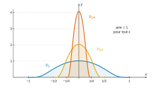
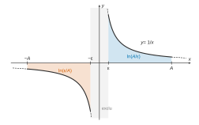
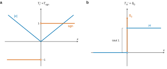
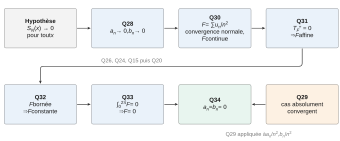

# Centrale-Supélec PC — Mathématiques 2 2026 · Corrigé brut

*Corrigé rédigé par IA, non officiel. Signalez toute erreur.*

Épreuve de 4 heures, calculatrice autorisée.

Notations : pour $\varphi\in\mathcal D(\mathbb R)$, on note $A>0$ un réel tel que la fonction soit nulle hors de $[-A,A]$. Toutes les dérivées $\varphi^{(i)}$ sont alors continues et nulles hors de ce segment (son complémentaire est ouvert), donc bornées : les $\|\varphi^{(i)}\|_\infty$ sont finis.

## Partie A – Construction d'une fonction test

### Q1

Sur l'intervalle ouvert $]0,+\infty[$, la fonction $x\mapsto-1/x$ est de classe $\mathcal C^\infty$. La fonction $\exp$ l'est sur $\mathbb R$.

Par composition, $\varphi=\exp\circ(-1/x)$ est $\mathcal C^\infty$ sur $]0,+\infty[$.

Sur l'intervalle ouvert $]-\infty,0[$, $\varphi$ est nulle, donc $\mathcal C^\infty$.

La régularité est une propriété locale, et $\mathbb R^*$ est la réunion de ces deux ouverts. Donc **$\varphi$ est de classe $\mathcal C^\infty$ sur $\mathbb R^*$.**

### Q2

Montrons par récurrence sur $n$ la propriété $\mathcal H_n$ suivante. Il existe $P_n\in\mathbb R[X]$ tel que $\varphi^{(n)}(x)=P_n(1/x)\,\mathrm e^{-1/x}$ pour tout $x>0$.

- $\mathcal H_0$ : $P_0=1$.
- Si $\mathcal H_n$ est vraie, pour $x>0$ :
$$\begin{aligned}
\varphi^{(n+1)}(x)&=-\frac1{x^2}P_n'\!\left(\frac1x\right)\mathrm e^{-1/x}+P_n\!\left(\frac1x\right)\frac1{x^2}\mathrm e^{-1/x}\\
&=\frac1{x^2}\Big(P_n-P_n'\Big)\!\left(\frac1x\right)\mathrm e^{-1/x}.
\end{aligned}$$
Le polynôme $P_{n+1}=X^2(P_n-P_n')$ convient.

$$\boxed{\begin{aligned}P_0&=1\\ P_{n+1}&=X^2\,(P_n-P_n')\end{aligned}}$$
(par exemple $P_1=X^2$ et $P_2=X^4-2X^3$).

### Q3

*Lemme.* Pour tout $Q\in\mathbb R[X]$, $Q(1/x)\mathrm e^{-1/x}\to0$ quand $x\to0^+$. En effet, avec $u=1/x\to+\infty$, on a $Q(u)\mathrm e^{-u}\to0$ par croissances comparées.

Montrons par récurrence que $\varphi$ est $n$ fois dérivable sur $\mathbb R$. On établit en outre que $\varphi^{(n)}(x)=P_n(1/x)\mathrm e^{-1/x}$ si $x>0$.

Enfin, $\varphi^{(n)}(x)=0$ si $x\leqslant0$.

C'est vrai pour $n=0$. Supposons-le au rang $n$. Sur $\mathbb R^*$, $\varphi^{(n)}$ est dérivable (Q1, Q2). En $0$ :
$$\frac{\varphi^{(n)}(x)-\varphi^{(n)}(0)}{x}=\begin{cases}\dfrac1xP_n\!\left(\dfrac1x\right)\mathrm e^{-1/x}&x>0\\[1mm] 0&x<0\end{cases}\xrightarrow[x\to0]{}0$$
par le lemme appliqué à $XP_n$. Donc $\varphi^{(n)}$ est dérivable en $0$ avec $\varphi^{(n+1)}(0)=0$. Le rang suivant est établi.

Ainsi $\varphi$ est indéfiniment dérivable sur $\mathbb R$. Chaque $\varphi^{(n)}$, étant dérivable, est continue : **$\varphi\in\mathcal C^\infty(\mathbb R)$**. De plus $\varphi^{(n)}(0)=0$ pour tout $n$.

### Q4

On pose
$$\boxed{\psi_{a,b}(x)=\varphi(x-a)\,\varphi(b-x)}$$
C'est un produit de composées de $\varphi\in\mathcal C^\infty(\mathbb R)$ par des fonctions affines, donc $\psi_{a,b}\in\mathcal C^\infty(\mathbb R)$.

Si $a<x<b$, alors $x-a>0$ et $b-x>0$. Les deux facteurs sont des exponentielles strictement positives, donc $\psi_{a,b}(x)>0$.

Si $x\leqslant a$, alors $\varphi(x-a)=0$. Si $x\geqslant b$, alors $\varphi(b-x)=0$.

Donc $\psi_{a,b}$ est nulle hors de $]a,b[$. En particulier $\psi_{a,b}\in\mathcal D(\mathbb R)$.

### Q5

$\psi_{-1,1}$ est continue, positive, nulle hors de $[-1,1]$, donc intégrable sur $\mathbb R$, et
$$I=\int_{-\infty}^{+\infty}\psi_{-1,1}=\int_{-1}^1\psi_{-1,1}.$$
Une fonction continue positive d'intégrale nulle sur un segment est nulle ; or $\psi_{-1,1}(0)=\mathrm e^{-2}>0$. Donc $I>0$, et
$$\rho_\varepsilon(x)=\dfrac{1}{\varepsilon I}\psi_{-1,1}(x/\varepsilon)$$
est bien définie.

$\rho_\varepsilon$ est $\mathcal C^\infty$ (composée et produit par une constante) et positive. Si $|x|>\varepsilon$, alors $|x/\varepsilon|>1$, donc $\rho_\varepsilon(x)=0$.

Avec $A=\varepsilon$ : **$\rho_\varepsilon\in\mathcal D(\mathbb R)$**, nulle hors de $[-\varepsilon,\varepsilon]$.

### Q6

Par le changement de variable affine $x=\varepsilon u$ :
$$\begin{aligned}
\int_{-\infty}^{+\infty}\rho_\varepsilon(x)\,\mathrm dx&=\frac1{\varepsilon I}\int_{-\varepsilon}^{\varepsilon}\psi_{-1,1}\!\left(\frac x\varepsilon\right)\mathrm dx\\
&=\frac1{\varepsilon I}\int_{-1}^1\psi_{-1,1}(u)\,\varepsilon\,\mathrm du\\
&=1.
\end{aligned}$$
$$\boxed{\int_{-\infty}^{+\infty}\rho_\varepsilon(x)\,\mathrm dx=1}$$

### Q7

**(a)** La fonction $\rho_\varepsilon g$ est continue et nulle hors de $[-\varepsilon,\varepsilon]$. Par Q6 et la positivité de $\rho_\varepsilon$ :
$$\begin{aligned}
\left|\int_{-\infty}^{+\infty}\rho_\varepsilon g-g(0)\right|&=\left|\int_{-\varepsilon}^{\varepsilon}\rho_\varepsilon(x)\big(g(x)-g(0)\big)\mathrm dx\right|\\
&\leqslant\omega(\varepsilon)\int_{-\varepsilon}^{\varepsilon}\rho_\varepsilon\\
&=\omega(\varepsilon),
\end{aligned}$$
où $\omega(\varepsilon)=\sup_{|x|\leqslant\varepsilon}|g(x)-g(0)|$ (fini : fonction continue sur un segment).

Soit $\eta>0$. La fonction $g$ est continue en $0$. Il existe donc $\alpha>0$ tel que $|x|\leqslant\alpha\Rightarrow|g(x)-g(0)|\leqslant\eta$.

Donc $\omega(\varepsilon)\leqslant\eta$ pour $0<\varepsilon\leqslant\alpha$. Ainsi
$$\boxed{\lim_{\varepsilon\to0^+}\int_{-\infty}^{+\infty}\rho_\varepsilon(x)g(x)\,\mathrm dx=g(0)}$$

**(b)** Par le changement de variable $t=x-a$ :
$$\int\rho_\varepsilon(x-a)g(x)\,\mathrm dx=\int\rho_\varepsilon(t)\,g(a+t)\,\mathrm dt.$$
La fonction $h:t\mapsto g(a+t)$ est continue. Le (a) appliqué à $h$ donne une limite $h(0)=g(a)$ :
$$\boxed{\lim_{\varepsilon\to0^+}\int_{-\infty}^{+\infty}\rho_\varepsilon(x-a)g(x)\,\mathrm dx=g(a)}$$

## Partie B – Distribution sur $\mathbb R$

### Q8

$\mathcal D'(\mathbb R)$ est une partie de l'espace vectoriel $\mathcal F(\mathcal D(\mathbb R),\mathbb R)$ des applications de $\mathcal D(\mathbb R)$ dans les réels. Elle contient l'application nulle (linéaire, avec $C_K=1$ et $N_K=0$).

Soient $T,S\in\mathcal D'(\mathbb R)$ et $\lambda\in\mathbb R$. L'application $T+\lambda S$ est linéaire.

Pour un segment $K$, soient $(C_K,N_K)$ et $(C_K',N_K')$ les constantes respectives des deux distributions.

On pose $N=\max(N_K,N_K')$ et $C=C_K+|\lambda|C_K'>0$. Pour toute $\varphi\in\mathcal D(K)$ :
$$\begin{aligned}
|(T+\lambda S)(\varphi)|&\leqslant C_K\max_{i\leqslant N_K}\|\varphi^{(i)}\|_\infty+|\lambda|C_K'\max_{i\leqslant N_K'}\|\varphi^{(i)}\|_\infty\\
&\leqslant C\max_{i\leqslant N}\|\varphi^{(i)}\|_\infty.
\end{aligned}$$
Donc $T+\lambda S\in\mathcal D'(\mathbb R)$ : **$\mathcal D'(\mathbb R)$ est un sous-espace vectoriel de $\mathcal F(\mathcal D(\mathbb R),\mathbb R)$, donc un espace vectoriel.**

### Q9

$\delta_a$ est linéaire : $(f+\lambda g)(a)=f(a)+\lambda g(a)$.

Pour tout segment $K$ et toute $\varphi\in\mathcal D(K)$, on a $|\delta_a(\varphi)|=|\varphi(a)|\leqslant\|\varphi\|_\infty$. Les constantes $C_K=1$ et $N_K=0$ conviennent : **$\delta_a\in\mathcal D'(\mathbb R)$.**

### Q10

Soit $\varphi\in\mathcal D(\mathbb R)$ nulle hors de $[-A,A]$. Le produit $f\varphi$ est continu par morceaux et nul hors de $[-A,A]$, donc intégrable sur $\mathbb R$.

De plus $T_f(\varphi)=\int_{-A}^Af\varphi$. Ainsi $T_f$ est bien définie, et linéaire par linéarité de l'intégrale.

Pour un segment $K$ et $\varphi\in\mathcal D(K)$ :
$$\begin{aligned}
|T_f(\varphi)|=\left|\int_Kf\varphi\right|&\leqslant\left(\int_K|f|\right)\|\varphi\|_\infty\\
&\leqslant C_K\|\varphi\|_\infty,
\end{aligned}$$
avec $C_K=1+\int_K|f|>0$ et $N_K=0$. **$T_f\in\mathcal D'(\mathbb R)$.**

### Q11

Soit $a\in\mathbb R$ et $\varepsilon>0$. La fonction $\theta_\varepsilon:x\mapsto\rho_\varepsilon(x-a)$ est $\mathcal C^\infty$ et nulle pour $|x|>|a|+\varepsilon$. Donc $\theta_\varepsilon\in\mathcal D(\mathbb R)$.

L'égalité $T_{f_1}(\theta_\varepsilon)=T_{f_2}(\theta_\varepsilon)$ s'écrit
$$\int_{-\infty}^{+\infty}\rho_\varepsilon(x-a)f_1(x)\,\mathrm dx=\int_{-\infty}^{+\infty}\rho_\varepsilon(x-a)f_2(x)\,\mathrm dx.$$
Les fonctions $f_1$ et $f_2$ sont continues. Quand $\varepsilon\to0^+$, Q7 (b) donne l'égalité $f_1(a)=f_2(a)$. Ceci pour tout $a$ : **$f_1=f_2$.**

### Q12

**(a)** Soit $x\neq0$. La fonction $t\mapsto\varphi(tx)/x$ est une primitive de $t\mapsto\varphi'(tx)$ sur $[0,1]$, donc
$$\int_0^1\varphi'(tx)\,\mathrm dt=\dfrac{\varphi(x)-\varphi(0)}{x}=\psi(x).$$
Si $x=0$, $\int_0^1\varphi'(0)\,\mathrm dt=\varphi'(0)=\psi(0)$.
$$\boxed{\forall x\in\mathbb R,\ \psi(x)=\int_0^1\varphi'(tx)\,\mathrm dt}$$

**(b)** Soit $F(x,t)=\varphi'(tx)$ sur $\mathbb R\times[0,1]$ et $k\in\mathbb N^*$. Pour tout $t$, $x\mapsto F(x,t)$ est $\mathcal C^k$ avec
$$\dfrac{\partial^jF}{\partial x^j}(x,t)=t^j\varphi^{(j+1)}(tx).$$
Ces fonctions sont continues en $t$ sur le segment $[0,1]$, donc intégrables. De plus,
$$\left|\frac{\partial^kF}{\partial x^k}(x,t)\right|\leqslant\|\varphi^{(k+1)}\|_\infty,$$
constante intégrable sur $[0,1]$.

Par le théorème de dérivation des intégrales à paramètre (classe $\mathcal C^k$), $\psi$ est $\mathcal C^k$ sur la droite réelle, avec
$$\psi^{(k)}(x)=\int_0^1t^k\varphi^{(k+1)}(tx)\,\mathrm dt.$$
Ceci pour tout $k$ : **$\psi\in\mathcal C^\infty(\mathbb R)$.**

### Q13

**(a)** Soit $\varphi\in\mathcal D(\mathbb R)$ nulle hors de $[-A,A]$, et $0<\varepsilon<A$. Les intégrales
$$\int_{-\infty}^{-\varepsilon}\frac{\varphi(x)}x\mathrm dx=\int_{-A}^{-\varepsilon}\frac{\varphi(x)}x\mathrm dx$$
et
$$\int_\varepsilon^{+\infty}\frac{\varphi(x)}x\mathrm dx=\int_\varepsilon^A\frac{\varphi(x)}x\mathrm dx$$
existent (fonctions continues sur des segments).

Pour $x\neq0$, $\dfrac{\varphi(x)}x=\dfrac{\varphi(0)}x+\psi(x)$, et
$$\begin{aligned}
\int_{-A}^{-\varepsilon}\frac{\mathrm dx}x+\int_\varepsilon^A\frac{\mathrm dx}x&=\ln\frac\varepsilon A+\ln\frac A\varepsilon\\
&=0.
\end{aligned}$$
Donc
$$\begin{aligned}
J(\varepsilon)&=\int_{-A}^{-\varepsilon}\psi+\int_\varepsilon^A\psi\\
&=\int_{-A}^A\psi-\int_{-\varepsilon}^\varepsilon\psi.
\end{aligned}$$
$\psi$ est continue (Q12), donc bornée par $M$ sur $[-A,A]$. Ainsi $\left|\int_{-\varepsilon}^\varepsilon\psi\right|\leqslant2\varepsilon M\to0$. La limite existe :
$$\boxed{\begin{aligned}V(\varphi)&=\int_{-A}^A\psi(x)\,\mathrm dx\\&=\int_{-A}^{A}\frac{\varphi(x)-\varphi(0)}{x}\,\mathrm dx\end{aligned}}$$
(pour tout $A$ tel que $\varphi$ soit nulle hors de $[-A,A]$).

**(b)** *Linéarité.* Pour $\varepsilon>0$, l'application $J_\varepsilon:\varphi\mapsto\int_{-\infty}^{-\varepsilon}\frac\varphi x+\int_\varepsilon^{+\infty}\frac\varphi x$ est linéaire. Les limites existant, $V=\lim J_\varepsilon$ est linéaire.

*Estimation.* Soit $K=[\alpha,\beta]$ et $a=\max(1,|\alpha|,|\beta|)$, de sorte que $K\subset[-a,a]$. Pour $\varphi\in\mathcal D(K)$, (a) donne $V(\varphi)=\int_{-a}^a\psi$. Par Q12 (a),
$$|\psi(x)|\leqslant\int_0^1|\varphi'(tx)|\,\mathrm dt\leqslant\|\varphi'\|_\infty.$$
D'où
$$\begin{aligned}
|V(\varphi)|&\leqslant2a\|\varphi'\|_\infty\\
&\leqslant2a\max_{i\in[\![0,1]\!]}\|\varphi^{(i)}\|_\infty.
\end{aligned}$$
Les constantes $C_K=2a>0$ et $N_K=1$ conviennent : **$V\in\mathcal D'(\mathbb R)$.**

## Partie C – Dérivation d'une distribution

### Q14

Soit $K$ un segment et $\varphi\in\mathcal D(K)$. La fonction est nulle sur l'ouvert $\mathbb R\setminus K$, donc sa dérivée aussi : $\varphi'\in\mathcal D(K)$.

En particulier $\varphi'\in\mathcal D(\mathbb R)$ pour toute $\varphi\in\mathcal D(\mathbb R)$.

Donc $T'$ est bien définie, et elle est linéaire comme composée de $\varphi\mapsto\varphi'$ et de $-T$. Avec les constantes $(C_K,N_K)$ de $T$ :
$$\begin{aligned}
|T'(\varphi)|=|T(\varphi')|&\leqslant C_K\max_{0\leqslant i\leqslant N_K}\|\varphi^{(i+1)}\|_\infty\\
&\leqslant C_K\max_{0\leqslant i\leqslant N_K+1}\|\varphi^{(i)}\|_\infty.
\end{aligned}$$
Le couple $(C_K,N_K+1)$ convient : **$T'\in\mathcal D'(\mathbb R)$.**

### Q15

Soit $\varphi\in\mathcal D(\mathbb R)$ nulle hors de $[-A,A]$. Les fonctions $f$ et $\varphi$ sont $\mathcal C^1$ sur ce segment.

Par intégration par parties et $\varphi(\pm A)=0$ :
$$\begin{aligned}
T_f'(\varphi)&=-\int_{-A}^Af\varphi'\\
&=-\big[f\varphi\big]_{-A}^A+\int_{-A}^Af'\varphi\\
&=\int_{-\infty}^{+\infty}f'\varphi\\
&=T_{f'}(\varphi).
\end{aligned}$$
$$\boxed{T_f'=T_{f'}}$$

### Q16

**(a)** Le taux d'accroissement $\dfrac{|x|-0}{x}$ vaut $1$ pour $x>0$.

Il vaut $-1$ pour $x<0$ : il n'a pas de limite en $0$.

**$f$ n'est pas dérivable en $0$, donc pas sur $\mathbb R$.**

**(b)** Soit $\varphi\in\mathcal D(\mathbb R)$ nulle hors de $[-A,A]$. On intègre par parties sur $[-A,0]$ et $[0,A]$.

Les crochets sont nuls en $0$ grâce au facteur $x$. Ils sont nuls en $\pm A$ car $\varphi(\pm A)=0$ :
$$\int_0^Ax\varphi'(x)\,\mathrm dx=-\int_0^A\varphi,$$
$$\int_{-A}^0(-x)\varphi'(x)\,\mathrm dx=\int_{-A}^0\varphi.$$
Donc
$$\begin{aligned}
T_f'(\varphi)&=-\int_{-A}^A|x|\varphi'(x)\,\mathrm dx\\
&=\int_0^A\varphi-\int_{-A}^0\varphi.
\end{aligned}$$
On note $\operatorname{sgn}$ la fonction signe :
$$\operatorname{sgn}(x)=\begin{cases}1&x>0\\-1&x<0\\0&x=0\end{cases}$$
Elle est continue par morceaux, et :
$$\boxed{\begin{aligned}T_f'&=T_{\operatorname{sgn}}\\ T_f'(\varphi)&=\int_{-\infty}^{+\infty}\operatorname{sgn}(x)\varphi(x)\,\mathrm dx\end{aligned}}$$
(la valeur en $0$ est indifférente).

### Q17

$H$ est constante sur $]-\infty,0[$ et sur $[0,+\infty[$. Elle a des limites finies à gauche et à droite en $0$. Sur tout segment, elle a donc au plus une discontinuité, avec limites finies : elle est continue par morceaux.

Pour $\varphi\in\mathcal D(\mathbb R)$ nulle hors de $[-A,A]$ :
$$\begin{aligned}
T_H'(\varphi)&=-\int_0^A\varphi'(x)\,\mathrm dx\\
&=-\big(\varphi(A)-\varphi(0)\big)\\
&=\varphi(0)\\
&=\delta_0(\varphi).
\end{aligned}$$
$$\boxed{T_H'=\delta_0}$$

### Q18

**(a)** $T'=0$ signifie $T'(\varphi)=-T(\varphi')=0$ pour toute $\varphi\in\mathcal D(\mathbb R)$. D'où **$T(\varphi')=0$.**

**(b)** Soit $\varphi$ nulle hors de $[-A,A]$ et d'intégrale nulle. On pose $\psi(x)=\int_{-\infty}^x\varphi(t)\,\mathrm dt$ (intégrale d'une fonction continue à support borné).

$\psi$ est la primitive de $\varphi$ nulle en $-A$. Donc $\psi'=\varphi$ et $\psi\in\mathcal C^\infty(\mathbb R)$.

Pour $x\leqslant-A$, $\psi(x)=0$. Pour $x\geqslant A$, $\psi(x)=\int_{-\infty}^{+\infty}\varphi=0$.

Donc $\psi\in\mathcal D(\mathbb R)$ et, par (a), **$T(\varphi)=T(\psi')=0$.**

**(c)** $\varphi_0=\rho_1$ convient : $\rho_1\in\mathcal D(\mathbb R)$ (Q5) et $\int\rho_1=1$ (Q6).

**(d)** Soit $\alpha=\int\varphi$ et $\chi=\varphi-\alpha\varphi_0\in\mathcal D(\mathbb R)$, d'intégrale $\alpha-\alpha=0$. Par (b), $T(\chi)=0$, et par linéarité :
$$\boxed{\begin{aligned}T(\varphi)&=\alpha\,T(\varphi_0)\\&=T(\varphi_0)\int_{-\infty}^{+\infty}\varphi(t)\,\mathrm dt\end{aligned}}$$

**(e)** Soit $h$ la fonction constante égale à $c=T(\varphi_0)$, continue. Pour toute $\varphi$, $T_h(\varphi)=c\int\varphi=T(\varphi)$ par (d). **$T=T_h$ avec $h$ constante.**

### Q19

Soit $f$ continue telle que $T_f'=0$. Q18 (e) donne une constante $h$ telle que $T_f=T_h$.

Les fonctions $f$ et $h$ étant continues, Q11 donne $f=h$.

Réciproquement, si $f$ est constante, Q15 donne $T_f'=T_{f'}=T_0=0$. **Les solutions sont les fonctions constantes.**

### Q20

Soit $f$ continue telle que $T_f''=(T_f')'=0$. Comme $T_f'\in\mathcal D'(\mathbb R)$ (Q14), Q18 (e) fournit $c\in\mathbb R$ tel que $T_f'=T_c$.

Soit $g:x\mapsto cx$, de classe $\mathcal C^1$ : $T_g'=T_{g'}=T_c$ (Q15). Les applications $u\mapsto T_u$ et $T\mapsto T'$ étant linéaires,
$$\begin{aligned}
(T_{f-g})'&=T_f'-T_g'\\
&=0.
\end{aligned}$$
$f-g$ est continue, donc constante égale à un réel $d$ par Q19 : $f(x)=cx+d$.

Réciproquement, si $f$ est affine, deux applications de Q15 donnent $T_f''=(T_{f'})'=T_{f''}=T_0=0$.

$$\boxed{\{f\in\mathcal C^0(\mathbb R,\mathbb R):T_f''=0\}=\{x\mapsto cx+d,\ (c,d)\in\mathbb R^2\}}$$

### Q21

$g$ est continue sur l'intervalle $\mathbb R$. Par le théorème fondamental de l'analyse, $G:x\mapsto\int_0^xg(t)\,\mathrm dt$ est de classe $\mathcal C^1$ sur $\mathbb R$. Et **$G'=g$**.

### Q22

$G$ étant $\mathcal C^1$, Q15 donne $T_G'=T_{G'}=T_g$. Par linéarité de la dérivation et l'hypothèse $T_f'=T_g$ :
$$\begin{aligned}
(T_f-T_G)'&=T_g-T_g\\
&=0.
\end{aligned}$$
$$\boxed{(T_f-T_G)'=0}$$

### Q23

$T_f-T_G=T_{f-G}$, et $f-G$ est continue. Par Q22 et Q19, $f-G$ est une constante $c$. Donc $f=G+c$ :
$$\boxed{f\in\mathcal C^1(\mathbb R)\ \text{et}\ f'=g}$$

## Partie D – Suite de distributions

### Q24

Soit $\varphi\in\mathcal D(\mathbb R)$. On a $\varphi'\in\mathcal D(\mathbb R)$ (Q14), donc $T_n(\varphi')\to T(\varphi')$ et
$$T_n'(\varphi)=-T_n(\varphi')\longrightarrow-T(\varphi')=T'(\varphi).$$
**$\lim T_n'\overset{\mathcal D}{=}T'$.**

### Q25

On prend $f_n(x)=\cos(nx)$, continue.

- En $x=\pi$, $f_n(\pi)=(-1)^n$ n'a pas de limite. Donc $(f_n)$ ne converge pas simplement sur $\mathbb R$.
- Soit $\varphi\in\mathcal D(\mathbb R)$ nulle hors de $[-A,A]$ et $n\geqslant1$. Par intégration par parties ($\varphi(\pm A)=0$) :
$$\begin{aligned}
T_{f_n}(\varphi)&=\int_{-A}^A\cos(nx)\varphi(x)\,\mathrm dx\\
&=\left[\frac{\sin(nx)}n\varphi(x)\right]_{-A}^A-\frac1n\int_{-A}^A\sin(nx)\varphi'(x)\,\mathrm dx,
\end{aligned}$$
donc $|T_{f_n}(\varphi)|\leqslant\dfrac{2A\|\varphi'\|_\infty}{n}\to0$.

**La suite $(x\mapsto\cos(nx))_n$ convient** : elle ne converge pas simplement et $\lim T_{f_n}\overset{\mathcal D}{=}0$.

### Q26

Soit $\varphi\in\mathcal D(\mathbb R)$ nulle hors de $[-A,A]$. Soit $n$ assez grand pour que $f_n-f$ soit bornée :
$$\begin{aligned}
|T_{f_n}(\varphi)-T_f(\varphi)|&\leqslant\int_{-A}^A|f_n-f|\,|\varphi|\\
&\leqslant2A\|\varphi\|_\infty\|f_n-f\|_\infty\xrightarrow[n\to+\infty]{}0.
\end{aligned}$$
**$\lim T_{f_n}\overset{\mathcal D}{=}T_f$.**

### Q27

Soit $\varphi\in\mathcal D(\mathbb R)$ nulle hors de $[-A,A]$. On applique l'inégalité de Cauchy-Schwarz sur le segment $[-A,A]$, puis la positivité de $(f_n-f)^2$ :
$$\begin{aligned}
|T_{f_n}(\varphi)-T_f(\varphi)|&\leqslant\left(\int_{-A}^A(f_n-f)^2\right)^{1/2}\left(\int_{-A}^A\varphi^2\right)^{1/2}\\
&\leqslant\|f_n-f\|_2\left(\int_{-A}^A\varphi^2\right)^{1/2}\xrightarrow[n\to+\infty]{}0.
\end{aligned}$$
**$\lim T_{f_n}\overset{\mathcal D}{=}T_f$.**

## Partie E – Une application, le théorème d'unicité de Cantor

On note $u_n(x)=a_n\cos(nx)+b_n\sin(nx)$ et $S_N=\sum_{n=1}^Nu_n$. Par hypothèse, $S_N(x)\to0$ pour tout $x\in\mathbb R$.

### Q28

**(a)** En $x=0$, $u_n(0)=a_n$. La série $\sum a_n$ converge, donc son terme général tend vers $0$ : **$a_n\to0$.**

**(b)** Pour tout $x$, $u_n(x)\to0$ (terme général d'une série convergente) et $|a_n\cos(nx)|\leqslant|a_n|\to0$. Par différence, **$b_n\sin(nx)\to0$ pour tout $x\in\mathbb R$**, en particulier sur $[0,2\pi]$.

**(c)** Supposons que $(b_n)$ ne tend pas vers $0$. Il existe alors $\varepsilon>0$ tel que $|b_n|\geqslant\varepsilon$ pour une infinité d'indices.

Il y a alors une infinité d'indices avec $b_n\geqslant\varepsilon$, ou une infinité avec $b_n\leqslant-\varepsilon$.

Dans le second cas, on remplace $(a_n,b_n)$ par $(-a_n,-b_n)$. Cela conserve l'hypothèse (série convergente de somme nulle en tout point) et ne change pas la convergence de $(b_n)$ vers $0$.

L'ensemble $E=\{n\in\mathbb N^*:b_n\geqslant\varepsilon\}$ est donc infini. On définit par récurrence
$$\begin{aligned}\varphi(0)&=\min E\\ \varphi(n+1)&=\min\{m\in E:m>\varphi(n)\}\end{aligned}$$
ce minimum existant car $E$ est infini. Alors **$\varphi:\mathbb N\to\mathbb N^*$ est strictement croissante et $b_{\varphi(n)}\geqslant\varepsilon$ pour tout $n$.**

**(d)** Soit $x\in[0,2\pi]$. La suite $\big(b_{\varphi(n)}\sin(\varphi(n)x)\big)_n$ est extraite de $\big(b_m\sin(mx)\big)_m$, qui tend vers $0$ par (b). Comme $b_{\varphi(n)}^2\geqslant\varepsilon^2$,
$$\begin{aligned}
0\leqslant\sin^2(\varphi(n)x)&\leqslant\frac{\big(b_{\varphi(n)}\sin(\varphi(n)x)\big)^2}{\varepsilon^2}\\
&\longrightarrow0.
\end{aligned}$$
Les fonctions continues $g_n:x\mapsto\sin^2(\varphi(n)x)$ convergent donc simplement vers $0$ sur $[0,2\pi]$. Elles vérifient $|g_n|\leqslant1$, fonction intégrable sur le segment. Par le théorème de convergence dominée :
$$\boxed{\lim_{n\to+\infty}\int_0^{2\pi}\sin^2(\varphi(n)x)\,\mathrm dx=0}$$

**(e)** Pour $k\in\mathbb N^*$,
$$\begin{aligned}
\int_0^{2\pi}\sin^2(kx)\,\mathrm dx&=\int_0^{2\pi}\frac{1-\cos(2kx)}2\,\mathrm dx\\
&=\pi.
\end{aligned}$$
La suite du (d) est donc constante égale à $\pi\neq0$ : contradiction. **Donc $b_n\to0$**, et avec (a), $a_n\to0$ et $b_n\to0$.

### Q29

Pour tout $x$, $|u_n(x)|\leqslant|a_n|+|b_n|$, terme général d'une série convergente. Donc $\sum u_n$ converge normalement, donc uniformément, sur $\mathbb R$, et sa somme est nulle.

Soit $k\in\mathbb N^*$. La série $\sum u_n\cos(k\,\cdot)$ converge uniformément sur $[0,2\pi]$, car $|\cos|\leqslant1$. Ses termes sont continus. On peut donc l'intégrer terme à terme sur ce segment. Par linéarisation, pour $n,k\in\mathbb N^*$ (avec $n+k\neq0$) :
$$\int_0^{2\pi}\cos(nx)\cos(kx)\,\mathrm dx=\pi\,\delta_{n,k},$$
$$\int_0^{2\pi}\sin(nx)\cos(kx)\,\mathrm dx=0,$$
$$\int_0^{2\pi}\sin(nx)\sin(kx)\,\mathrm dx=\pi\,\delta_{n,k}.$$
Donc
$$\begin{aligned}
0&=\int_0^{2\pi}\Big(\sum_{n=1}^{+\infty}u_n(x)\Big)\cos(kx)\,\mathrm dx\\
&=\sum_{n=1}^{+\infty}\int_0^{2\pi}u_n(x)\cos(kx)\,\mathrm dx\\
&=\pi a_k,
\end{aligned}$$
et de même avec $\sin(kx)$ : $0=\pi b_k$.
$$\boxed{\forall n\in\mathbb N^*,\ a_n=0\ \text{et}\ b_n=0}$$

### Q30

Par Q28, $(a_n)$ et $(b_n)$ convergent, donc sont bornées. Il existe ainsi $M>0$ tel que $|a_n|+|b_n|\leqslant M$ pour tout $n$. Alors, pour tout $x\in\mathbb R$,
$$\begin{aligned}
|f_n(x)|&\leqslant\frac{|a_n|+|b_n|}{n^2}\\
&\leqslant\frac M{n^2},
\end{aligned}$$
terme général d'une série de Riemann convergente : **$\sum f_n$ converge normalement sur $\mathbb R$.** En particulier la convergence est uniforme et $F$ est continue sur $\mathbb R$.

### Q31

Soit $F_N=\sum_{n=1}^Nf_n$, de classe $\mathcal C^\infty$, avec $F_N''=-\sum_{n=1}^N u_n=-S_N$. Deux applications de Q15 (à $F_N$ puis à $F_N'$) donnent $T_{F_N}''=T_{F_N''}=-T_{S_N}$.

$(F_N)$ converge uniformément vers $F$ sur $\mathbb R$ (Q30). Donc $\lim T_{F_N}\overset{\mathcal D}{=}T_F$ (Q26).

Puis $\lim T_{F_N}''\overset{\mathcal D}{=}T_F''$ (Q24 appliquée deux fois). Pour toute $\varphi\in\mathcal D(\mathbb R)$ nulle hors de $[-A,A]$ :
$$T_F''(\varphi)=-\lim_{N\to+\infty}\int_{-A}^AS_N(x)\varphi(x)\,\mathrm dx.$$
Par hypothèse, $S_N\varphi\to0$ simplement sur $[-A,A]$. En passant à la limite sous l'intégrale, on obtient $T_F''(\varphi)=0$, donc $T_F''=0$. $F$ étant continue (Q30), Q20 donne :
$$\boxed{F\text{ est affine : }F(x)=cx+d}$$

*Réserve.* Le passage à la limite sous l'intégrale est le point que le sujet admet implicitement : la convergence simple de $(S_N)$ ne suffit pas. Le théorème de convergence dominée exige une majoration $|S_N|\leqslant g$ sur $[-A,A]$. Il faut $g$ intégrable et indépendante de $N$, ce que l'énoncé ne fournit pas. Cette majoration existe sous l'hypothèse de Q29 ($|S_N|\leqslant\sum(|a_n|+|b_n|)$). Dans le cas général, une preuve complète passe par les lemmes de Riemann et de Schwarz sur les dérivées secondes symétriques, hors programme.

### Q32

Pour tout $x$, $|F(x)|\leqslant\sum_{n\geqslant1}M/n^2=M\pi^2/6$ : **$F$ est bornée.**

Supposons $F(x)=cx+d$ avec $c\neq0$. Alors $|F(x)|\to+\infty$ quand $x\to+\infty$, ce qui est absurde.

Donc $c=0$ : **$F$ est constante, égale à $d$.**

### Q33

$\sum f_n$ converge uniformément sur le segment $[0,2\pi]$ et ses termes sont continus : on peut intégrer terme à terme. Pour $n\geqslant1$, on a $\int_0^{2\pi}\cos(nx)\,\mathrm dx=0$ et $\int_0^{2\pi}\sin(nx)\,\mathrm dx=0$, donc
$$\begin{aligned}
2\pi d&=\int_0^{2\pi}F(x)\,\mathrm dx\\
&=\sum_{n=1}^{+\infty}\int_0^{2\pi}f_n(x)\,\mathrm dx\\
&=0.
\end{aligned}$$
Donc $d=0$ : **$F=0$.**

### Q34

Posons $\alpha_n=a_n/n^2$ et $\beta_n=b_n/n^2$. La série $\sum(\alpha_n\cos(nx)+\beta_n\sin(nx))=\sum f_n(x)$ converge pour tout $x$, de somme $F(x)=0$ (Q30, Q33).

De plus, $|\alpha_n|\leqslant M/n^2$ et $|\beta_n|\leqslant M/n^2$. Donc $\sum|\alpha_n|$ et $\sum|\beta_n|$ convergent.

Q29 s'applique à $(\alpha_n)$ et $(\beta_n)$ : $\alpha_n=\beta_n=0$, donc
$$\boxed{\forall n\in\mathbb N^*,\ a_n=0\ \text{et}\ b_n=0}$$

**Conclusion (théorème d'unicité de Cantor).** Une série trigonométrique $\sum_{n\geqslant1}(a_n\cos(nx)+b_n\sin(nx))$ qui converge vers $0$ en tout point de $\mathbb R$ a tous ses coefficients nuls. Par différence, deux séries trigonométriques convergeant en tout point vers la même somme ont les mêmes coefficients : un développement trigonométrique partout convergent est unique.
