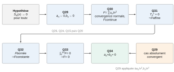
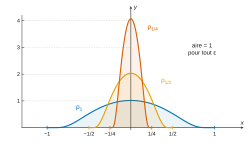
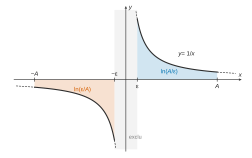
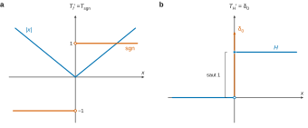

# Centrale-Supélec PC — Mathématiques 2 2026 · Corrigé guidé

*Corrigé rédigé par IA, non officiel. Signalez toute erreur.*

## Présentation du sujet

**Thème.** Une introduction aux **distributions** sur $\mathbb R$, à la manière de Laurent Schwartz, construite pas à pas jusqu'à une application historique : le **théorème d'unicité de Cantor** (1870) sur les séries trigonométriques. Épreuve de **4 heures**, **calculatrice autorisée** (inutile ici), **34 questions** (Q1 à Q34, plusieurs avec sous-questions), sans aucune donnée numérique.

**Découpage.**

- **Partie A — Fonction test (Q1 à Q7).** On construit à partir de $x\mapsto\mathrm e^{-1/x}$ une fonction $\mathcal C^\infty$ nulle en dehors d'un segment. On en tire une famille $\rho_\varepsilon$ d'intégrale $1$ concentrée sur $[-\varepsilon,\varepsilon]$, qui « approche » la masse de Dirac (Q7).
- **Partie B — Distributions (Q8 à Q13).** Définition, structure d'espace vectoriel, trois exemples. La masse de Dirac $\delta_a$, puis la distribution $T_f$ associée à une fonction (et l'injectivité de $f\mapsto T_f$ sur les fonctions continues). Enfin la valeur principale $V$ de $1/x$.
- **Partie C — Dérivation (Q14 à Q23).** Toute distribution est dérivable ; la dérivation prolonge la dérivation usuelle ($T_f'=T_{f'}$) ; dérivées de $|x|$ et de l'échelon de Heaviside ; une distribution de dérivée nulle est une constante ; résultats de régularité (Q20, Q23).
- **Partie D — Convergence (Q24 à Q27).** La dérivation passe à la limite ; les convergences uniforme et en norme $2$ entraînent la convergence au sens des distributions, la convergence simple ne la donne pas.
- **Partie E — Théorème de Cantor (Q28 à Q34).** Lemme de Cantor-Lebesgue (coefficients tendant vers $0$), cas absolument convergent par orthogonalité, puis cas général : on régularise la série en divisant par $n^2$, on dérive deux fois au sens des distributions et on conclut avec les parties C et D.

**Notions du programme mobilisées.** Croissances comparées et taux d'accroissement ; fonctions $\mathcal C^\infty$ ; intégrales sur un segment et intégrales généralisées, changement de variable, intégration par parties ; intégrales à paramètre (dérivation sous le signe intégral) ; théorème de convergence dominée ; suites et séries de fonctions (convergence normale, uniforme, intégration terme à terme sur un segment) ; espaces vectoriels et formes linéaires ; manipulation de quantificateurs et suites extraites ; linéarisation trigonométrique.

**Difficulté et longueur.** Le sujet est long mais très guidé, et fortement chaîné : Q7 (b) sert Q11, qui sert Q19, puis Q20, réutilisée en Q31. Peu de calculs, beaucoup de rédaction : la plupart des questions se jouent sur la précision des justifications (support borné, positivité, constantes $C_K>0$, ordre $N_K$). Les points délicats sont Q3 (dérivabilité en $0$), Q12 (b) et Q13 (valeur principale), Q18 (b) et Q28 (c)-(d). Q31 contient une interversion que le sujet admet implicitement (voir la solution).

**À ne pas laisser passer.** Q1, Q4, Q6, Q9, Q10, Q14, Q15, Q16, Q17, Q18 (a), (c), (d), (e), Q21, Q22, Q24, Q26, Q27, Q28 (a), (b), (e), Q30, Q32, Q33 : chacune se règle en quelques lignes avec le bon réflexe.

**Gestion du temps.** À titre indicatif : 45 min pour la partie A, 50 min pour B, 1 h pour C, 25 min pour D et 1 h pour E. Les résultats intermédiaires sont tous donnés par l'énoncé : en cas de blocage, admettre la question et continuer, en citant proprement ce qu'on utilise.

**Conventions.** Pour $\varphi\in\mathcal D(\mathbb R)$, on note $A>0$ un réel tel que la fonction soit nulle hors de $[-A,A]$. Trois faits servent partout :

- toute intégrale $\int_{\mathbb R}(\dots)\varphi$ est en réalité une intégrale sur $[-A,A]$ ;
- les dérivées $\varphi^{(i)}$ sont continues et nulles hors de ce segment, donc bornées ;
- les crochets $[\,\cdot\,\varphi]_{-A}^{A}$ des intégrations par parties sont nuls.

---

## Partie A — Construction d'une fonction test

La partie fabrique l'outil de base de toute la théorie : une fonction indéfiniment dérivable, non nulle, mais nulle hors d'un segment. Outils : croissances comparées, récurrence, taux d'accroissement, changement de variable.

### Question 1

> [!INDICATION]
> Découper $\mathbb R^*$ en deux intervalles ouverts sur lesquels $\varphi$ a une expression simple.

#### Solution

Sur l'intervalle ouvert $]0,+\infty[$, la fonction $x\mapsto-1/x$ est $\mathcal C^\infty$.

La fonction $\exp$ est $\mathcal C^\infty$ sur $\mathbb R$.

Par composition, $\varphi$ est $\mathcal C^\infty$ sur $]0,+\infty[$.

Sur l'intervalle ouvert $]-\infty,0[$, $\varphi$ est nulle, donc $\mathcal C^\infty$.

Le caractère $\mathcal C^\infty$ en un point ne dépend que des valeurs au voisinage de ce point. Donc **$\varphi$ est $\mathcal C^\infty$ sur $\mathbb R^*$.**

> [!PIEGE]
> Rien n'est dit en $0$ : c'est tout l'objet de Q3. Le raisonnement « $\mathcal C^\infty$ à gauche et à droite, donc partout » est faux en général (penser à $|x|$) ; il ne vaut ici que parce que $0$ est retiré du domaine.

### Question 2

> [!INDICATION]
> Récurrence sur $n$ : dériver un produit de la forme $P(1/x)\,\mathrm e^{-1/x}$.

> [!INDICATION]
> La dérivée de $x\mapsto P(1/x)$ fait apparaître le facteur $-1/x^2$. Celle de $\mathrm e^{-1/x}$ fait apparaître le facteur $1/x^2$ : factoriser.

#### Solution

Récurrence sur $n$. Pour $n=0$, $P_0=1$ convient.

Si $\varphi^{(n)}(x)=P_n(1/x)\mathrm e^{-1/x}$ sur $\mathbb R_+^*$, alors pour $x>0$ :
$$\begin{aligned}
\varphi^{(n+1)}(x)&=-\frac1{x^2}P_n'\!\left(\frac1x\right)\mathrm e^{-1/x}+P_n\!\left(\frac1x\right)\frac1{x^2}\mathrm e^{-1/x}\\
&=\frac1{x^2}\big(P_n-P_n'\big)\!\left(\frac1x\right)\mathrm e^{-1/x}.
\end{aligned}$$
Le polynôme $P_{n+1}=X^2(P_n-P_n')$ convient :
$$\boxed{\begin{aligned}P_0&=1\\ P_{n+1}&=X^2\,(P_n-P_n')\end{aligned}}$$
Contrôle : $P_1=X^2$ donne $\varphi'(x)=\mathrm e^{-1/x}/x^2$, et $P_2=X^4-2X^3$.

> [!METHODE]
> Pour établir l'existence d'un objet de forme imposée à tout ordre, une récurrence qui **construit explicitement** l'objet suivant (ici $P_{n+1}$ à partir de $P_n$) est à la fois la preuve la plus courte et la plus convaincante.

### Question 3

> [!INDICATION]
> Il ne reste que le point $0$. Montrer par récurrence que $\varphi$ est $n$ fois dérivable sur $\mathbb R$. Montrer en même temps que $\varphi^{(n)}(0)=0$.

> [!INDICATION]
> En $0$, revenir au taux d'accroissement de $\varphi^{(n)}$ et utiliser Q2 ; la limite à droite est une croissance comparée après le changement de variable $u=1/x$.

#### Solution

*Lemme.* Pour tout $Q\in\mathbb R[X]$, $Q(1/x)\mathrm e^{-1/x}\to0$ quand $x\to0^+$.

En effet, avec $u=1/x\to+\infty$, on a $u^k\mathrm e^{-u}\to0$ pour tout entier naturel $k$ (croissances comparées). On conclut par combinaison linéaire.

Montrons par récurrence que $\varphi$ est $n$ fois dérivable sur $\mathbb R$. On établit en outre que $\varphi^{(n)}(x)=P_n(1/x)\mathrm e^{-1/x}$ pour $x>0$.

Enfin, $\varphi^{(n)}(x)=0$ pour $x\leqslant0$.

Le rang $0$ est la définition. Supposons la propriété vraie au rang $n$. Alors $\varphi^{(n)}$ est dérivable sur $\mathbb R^*$ (Q1, Q2), et en $0$ :
$$\frac{\varphi^{(n)}(x)-\varphi^{(n)}(0)}{x}=\begin{cases}(XP_n)(1/x)\,\mathrm e^{-1/x}&x>0\\ 0&x<0\end{cases}\xrightarrow[x\to0]{}0$$
par le lemme. Donc $\varphi^{(n)}$ est dérivable en $0$ et $\varphi^{(n+1)}(0)=0$, ce qui donne le rang suivant.

$\varphi$ est donc indéfiniment dérivable sur $\mathbb R$. Chaque $\varphi^{(n)}$, dérivable, est continue : **$\varphi\in\mathcal C^\infty(\mathbb R)$**, avec toutes ses dérivées nulles en $0$.

> [!PIEGE]
> Deux oublis fréquents. Le facteur $1/x$ du taux d'accroissement : on applique le lemme à $XP_n$, pas à $P_n$ (le lemme vaut pour tout polynôme, mais il faut l'écrire). Et la distinction entre « indéfiniment dérivable » et « de classe $\mathcal C^\infty$ » : elles coïncident ici parce qu'une fonction dérivable est continue, et il faut le dire.

> [!METHODE]
> Le taux d'accroissement est l'outil le plus sûr pour la dérivabilité en un point de recollement. Un théorème de prolongement de la dérivée, s'il est connu, donne le même résultat, mais il faut alors en vérifier soigneusement les hypothèses (continuité de $\varphi^{(n)}$ en $0$, existence de la limite de $\varphi^{(n+1)}$).

### Question 4

> [!INDICATION]
> $\varphi$ « démarre » en $0$. Une translation la fait démarrer en $a$, une symétrie la fait « s'arrêter » en $b$.

> [!INDICATION]
> Chercher $\psi_{a,b}$ comme un produit de deux composées de $\varphi$ par des fonctions affines.

#### Solution

On pose
$$\boxed{\psi_{a,b}(x)=\varphi(x-a)\,\varphi(b-x)}$$
C'est un produit de composées de $\varphi$, $\mathcal C^\infty$ par Q3, avec des fonctions affines. Donc $\psi_{a,b}\in\mathcal C^\infty(\mathbb R)$.

Si $a<x<b$, les deux facteurs valent $\mathrm e^{-1/(x-a)}>0$ et $\mathrm e^{-1/(b-x)}>0$.

Si $x\leqslant a$, alors $\varphi(x-a)=0$. Si $x\geqslant b$, alors $\varphi(b-x)=0$.

Donc $\psi_{a,b}$ est strictement positive sur $]a,b[$, nulle ailleurs. En particulier $\psi_{a,b}\in\mathcal D(\mathbb R)$.

Dans le cas $(a,b)=(-1,1)$, on obtient $\psi_{-1,1}(x)=\mathrm e^{-2/(1-x^2)}$ si $|x|<1$.

> [!PIEGE]
> Recoller « à la main » trois morceaux ($0$, une bosse, $0$) oblige à refaire Q3 en deux points. Le produit hérite gratuitement de la régularité de $\varphi$. Penser aussi à traiter explicitement les deux cas $x\leqslant a$ et $x\geqslant b$, bornes comprises.

### Question 5

> [!INDICATION]
> « Bien définie » : le dénominateur doit exister **et** être non nul.

> [!INDICATION]
> Une fonction continue, positive, d'intégrale nulle sur un segment est identiquement nulle.

#### Solution

$\psi_{-1,1}$ est continue, positive, nulle hors de $[-1,1]$, donc intégrable sur $\mathbb R$, et
$$I=\int_{\mathbb R}\psi_{-1,1}=\int_{-1}^1\psi_{-1,1}.$$
Si l'on avait $I=0$, $\psi_{-1,1}$ serait nulle sur $[-1,1]$. Cela contredit $\psi_{-1,1}(0)=\mathrm e^{-2}>0$. Donc $I>0$ et
$$\rho_\varepsilon(x)=\frac1{\varepsilon I}\,\psi_{-1,1}\!\left(\frac x\varepsilon\right)$$
est bien définie. Elle est $\mathcal C^\infty$ (composée, produit par une constante), positive, et nulle pour $|x|>\varepsilon$ puisqu'alors $|x/\varepsilon|>1$. **$\rho_\varepsilon\in\mathcal D(\mathbb R)$**, nulle hors de $[-\varepsilon,\varepsilon]$.

> [!JURY]
> Toute division doit être précédée de la vérification que le dénominateur est non nul : c'est précisément ce que « justifier que $\rho_\varepsilon$ est bien définie » demande. Noter au passage la positivité de $\rho_\varepsilon$, qui servira en Q7.

### Question 6

> [!INDICATION]
> Changement de variable affine adapté à la définition de $\rho_\varepsilon$.

#### Solution

On pose $x=\varepsilon u$, donc $\mathrm dx=\varepsilon\,\mathrm du$. Les bornes $\pm\varepsilon$ deviennent $\pm1$ :
$$\begin{aligned}
\int_{-\infty}^{+\infty}\rho_\varepsilon(x)\,\mathrm dx&=\frac1{\varepsilon I}\int_{-\varepsilon}^{\varepsilon}\psi_{-1,1}\!\left(\frac x\varepsilon\right)\mathrm dx\\
&=\frac1{\varepsilon I}\int_{-1}^1\psi_{-1,1}(u)\,\varepsilon\,\mathrm du\\
&=1.
\end{aligned}$$
$$\boxed{\int_{-\infty}^{+\infty}\rho_\varepsilon(x)\,\mathrm dx=1}$$

Quand $\varepsilon\to0^+$, les bosses $\rho_\varepsilon$ se resserrent et s'élèvent à aire constante (figure 2).

### Question 7

> [!INDICATION]
> (a) Écrire $g(0)=\int\rho_\varepsilon(x)g(0)\,\mathrm dx$ grâce à Q6, et étudier la différence.

> [!INDICATION]
> (a) Exploiter à la fois $\rho_\varepsilon\geqslant0$ et le fait que la fonction est nulle hors de $[-\varepsilon,\varepsilon]$. Seule compte la continuité de $g$ en $0$. (b) Se ramener au (a) par un changement de variable.

#### Solution

**(a)** Par Q6, et puisque $\rho_\varepsilon g$ est continue et nulle hors de $[-\varepsilon,\varepsilon]$,
$$\begin{aligned}
\left|\int_{-\infty}^{+\infty}\rho_\varepsilon g-g(0)\right|&=\left|\int_{-\varepsilon}^{\varepsilon}\rho_\varepsilon(x)\big(g(x)-g(0)\big)\,\mathrm dx\right|\\
&\leqslant\omega(\varepsilon)\int_{-\varepsilon}^{\varepsilon}\rho_\varepsilon\\
&=\omega(\varepsilon),
\end{aligned}$$
avec $\omega(\varepsilon)=\sup_{|x|\leqslant\varepsilon}|g(x)-g(0)|$, fini par continuité sur un segment. On a utilisé $\rho_\varepsilon\geqslant0$.

Soit $\eta>0$. La fonction $g$ est continue en $0$. Il existe donc $\alpha>0$ tel que $|x|\leqslant\alpha\Rightarrow|g(x)-g(0)|\leqslant\eta$.

Ainsi $\omega(\varepsilon)\leqslant\eta$ pour $0<\varepsilon\leqslant\alpha$. D'où
$$\boxed{\lim_{\varepsilon\to0^+}\int_{-\infty}^{+\infty}\rho_\varepsilon(x)g(x)\,\mathrm dx=g(0)}$$

**(b)** Le changement de variable $t=x-a$ donne $\int\rho_\varepsilon(x-a)g(x)\,\mathrm dx=\int\rho_\varepsilon(t)h(t)\,\mathrm dt$ avec $h:t\mapsto g(a+t)$, continue. Le (a) appliqué à $h$ donne la limite $h(0)=g(a)$ :
$$\boxed{\lim_{\varepsilon\to0^+}\int_{-\infty}^{+\infty}\rho_\varepsilon(x-a)g(x)\,\mathrm dx=g(a)}$$

> [!METHODE]
> Autre preuve correcte du (a). Après le changement de variable $x=\varepsilon u$, l'intégrale vaut $\frac1I\int_{-1}^1\psi_{-1,1}(u)\,g(\varepsilon u)\,\mathrm du$.
>
> On applique alors le théorème de convergence dominée à paramètre continu $\varepsilon\to0^+$. La domination est $\psi_{-1,1}\cdot\sup_{[-1,1]}|g|$ pour $\varepsilon\leqslant1$. On obtient la limite $\frac1I\int\psi_{-1,1}\,g(0)=g(0)$.
>
> Appliquée directement à $\rho_\varepsilon g$, sans changement de variable, la convergence dominée échoue, car $\rho_\varepsilon(0)\to+\infty$.

> [!PIEGE]
> En (b), le « En déduire » attend le changement de variable et la continuité de $t\mapsto g(a+t)$, pas une nouvelle démonstration.

---

## Partie B — Distribution sur $\mathbb R$

On définit les distributions comme des formes linéaires contrôlées, sur chaque segment, par un nombre fini de dérivées de la fonction test. Les vérifications se ramènent à des majorations d'intégrales sur un segment.

### Question 8

> [!INDICATION]
> Montrer que $\mathcal D'(\mathbb R)$ est un sous-espace vectoriel d'un espace vectoriel connu, dont on précisera lequel.

> [!INDICATION]
> Pour $T+\lambda S$ : comment combiner les constantes $C_K$ et les ordres $N_K$ des deux distributions ?

#### Solution

L'ensemble $\mathcal F(\mathcal D(\mathbb R),\mathbb R)$ des applications de $\mathcal D(\mathbb R)$ dans les réels est un espace vectoriel. Il contient $\mathcal D'(\mathbb R)$.

L'application nulle est une distribution ($C_K=1$, $N_K=0$).

Soient $T,S\in\mathcal D'(\mathbb R)$ et $\lambda\in\mathbb R$. L'application $T+\lambda S$ est linéaire.

Pour un segment $K$, notons $(C_K,N_K)$ et $(C_K',N_K')$ les constantes respectives des deux distributions. Posons $N=\max(N_K,N_K')$ et $C=C_K+|\lambda|C_K'>0$.

Un maximum sur $[\![0,N_K]\!]$ est inférieur au maximum sur $[\![0,N]\!]$. Donc, pour $\varphi\in\mathcal D(K)$ :
$$\begin{aligned}
|(T+\lambda S)(\varphi)|&\leqslant|T(\varphi)|+|\lambda||S(\varphi)|\\
&\leqslant C\max_{i\in[\![0,N]\!]}\|\varphi^{(i)}\|_\infty.
\end{aligned}$$
**$\mathcal D'(\mathbb R)$ est un sous-espace vectoriel de $\mathcal F(\mathcal D(\mathbb R),\mathbb R)$, donc un espace vectoriel.**

> [!PIEGE]
> Les constantes **s'ajoutent** ($C_K+|\lambda|C_K'$) et on prend le **plus grand** des ordres ; un $\min(N_K,N_K')$ rendrait l'inégalité fausse. Vérifier aussi que la constante obtenue est strictement positive, comme l'exige la définition.

### Question 9

> [!INDICATION]
> Majorer $|\varphi(a)|$ par la plus simple des normes disponibles.

#### Solution

$\delta_a$ est linéaire, car $(f+\lambda g)(a)=f(a)+\lambda g(a)$.

Pour tout segment $K$ et toute $\varphi\in\mathcal D(K)$, on a $|\delta_a(\varphi)|=|\varphi(a)|\leqslant\|\varphi\|_\infty$.

Les constantes $C_K=1$ et $N_K=0$ conviennent : **$\delta_a\in\mathcal D'(\mathbb R)$.**

### Question 10

> [!INDICATION]
> L'existence de l'intégrale ne vient d'aucune hypothèse sur $f$ : regarder le support de $\varphi$.

> [!INDICATION]
> Pour $\varphi\in\mathcal D(K)$, l'intégrale porte sur $K$. Sortir $\|\varphi\|_\infty$ et faire attention à la condition $C_K>0$.

#### Solution

Soit $\varphi\in\mathcal D(\mathbb R)$, nulle hors de $[-A,A]$. Le produit $f\varphi$ est continu par morceaux et nul hors de ce segment, donc intégrable sur $\mathbb R$.

De plus $T_f(\varphi)=\int_{-A}^Af\varphi$. Ainsi $T_f$ est bien définie, et linéaire par linéarité de l'intégrale.

Pour un segment $K$ et $\varphi\in\mathcal D(K)$ :
$$\begin{aligned}
|T_f(\varphi)|=\left|\int_Kf\varphi\right|&\leqslant\Big(\int_K|f|\Big)\|\varphi\|_\infty\\
&\leqslant C_K\|\varphi\|_\infty,
\end{aligned}$$
avec $C_K=1+\int_K|f|>0$ et $N_K=0$.
**$T_f\in\mathcal D'(\mathbb R)$.**

> [!PIEGE]
> $C_K=\int_K|f|$ peut être nul (si $f$ est nulle sur $K$). Or l'énoncé exige $C_K>0$ : le « $1+$ » règle ce cas.
>
> Et $f$ n'est pas supposée intégrable sur $\mathbb R$ : c'est le support borné de $\varphi$ qui fait tout.

### Question 11

> [!INDICATION]
> Chercher des fonctions test qui, intégrées contre $f_1$ et $f_2$, font apparaître à la limite leurs valeurs en un point $a$. La partie A en fournit.

> [!INDICATION]
> Utiliser $x\mapsto\rho_\varepsilon(x-a)$ et Q7 (b).

#### Solution

Soit $a\in\mathbb R$ et $\varepsilon>0$. La fonction $\theta_\varepsilon:x\mapsto\rho_\varepsilon(x-a)$ est $\mathcal C^\infty$ et nulle pour $|x|>|a|+\varepsilon$. Donc $\theta_\varepsilon\in\mathcal D(\mathbb R)$.

L'hypothèse $T_{f_1}(\theta_\varepsilon)=T_{f_2}(\theta_\varepsilon)$ s'écrit
$$\int_{-\infty}^{+\infty}\rho_\varepsilon(x-a)f_1(x)\,\mathrm dx=\int_{-\infty}^{+\infty}\rho_\varepsilon(x-a)f_2(x)\,\mathrm dx.$$
Les fonctions $f_1$ et $f_2$ sont continues. Quand $\varepsilon\to0^+$, Q7 (b) donne, par unicité de la limite, $f_1(a)=f_2(a)$.

Ceci pour tout $a$ : **$f_1=f_2$.**

> [!METHODE]
> Variante sans Q7 : poser $f=f_1-f_2$. Si $f(a)>0$, alors $f>0$ sur un intervalle $[a-\eta,a+\eta]$.
>
> Dans ce cas $\int f\psi_{a-\eta,a+\eta}>0$ (intégrale d'une fonction continue, positive, non nulle), ce qui contredit $T_f=0$.
>
> Le résultat, l'injectivité de $f\mapsto T_f$ sur les fonctions continues, permet d'identifier une fonction continue à sa distribution.

> [!PIEGE]
> La continuité est indispensable : deux fonctions continues par morceaux qui diffèrent en un seul point définissent la même distribution.

### Question 12

> [!INDICATION]
> (a) Pour $x\neq0$, reconnaître dans $t\mapsto\varphi'(tx)$ la dérivée d'une fonction simple de $t$. Traiter $x=0$ à part.

> [!INDICATION]
> (b) La formule du (a) est une intégrale à paramètre sur un segment : appliquer le théorème de dérivation sous le signe intégral à tout ordre.

#### Solution

**(a)** Soit $x\neq0$. La fonction $t\mapsto\varphi(tx)/x$ a pour dérivée $t\mapsto\varphi'(tx)$, d'où
$$\int_0^1\varphi'(tx)\,\mathrm dt=\dfrac{\varphi(x)-\varphi(0)}x=\psi(x).$$
Si $x=0$, $\int_0^1\varphi'(0)\,\mathrm dt=\varphi'(0)=\psi(0)$.
$$\boxed{\forall x\in\mathbb R,\quad\psi(x)=\int_0^1\varphi'(tx)\,\mathrm dt}$$

**(b)** Soit $F(x,t)=\varphi'(tx)$ sur $\mathbb R\times[0,1]$ et $k\in\mathbb N^*$. Pour tout $t$, $x\mapsto F(x,t)$ est $\mathcal C^k$ avec
$$\partial_x^jF(x,t)=t^j\varphi^{(j+1)}(tx).$$
Soit $x$ réel et $j\leqslant k$. La fonction $t\mapsto t^j\varphi^{(j+1)}(tx)$ est continue sur le segment $[0,1]$, donc intégrable.

Enfin, la domination est uniforme :
$$|\partial_x^kF(x,t)|\leqslant\|\varphi^{(k+1)}\|_\infty,$$
constante intégrable sur $[0,1]$ (finie car $\varphi^{(k+1)}$ est continue à support borné).

Le théorème de dérivation des intégrales à paramètre donne $\psi\in\mathcal C^k(\mathbb R)$, avec
$$\psi^{(k)}(x)=\int_0^1t^k\varphi^{(k+1)}(tx)\,\mathrm dt.$$
Ceci pour tout $k$ : **$\psi\in\mathcal C^\infty(\mathbb R)$.**

> [!METHODE]
> Pour étudier la régularité d'un quotient « $\frac{\varphi(x)-\varphi(0)}{x}$ », la formule $\int_0^1\varphi'(tx)\,\mathrm dt$ remplace une définition par cas par **une seule formule** valable partout, à laquelle s'applique un théorème du cours. C'est une forme intégrale de la formule de Taylor, à retenir.

> [!PIEGE]
> $\psi$ n'est pas dans $\mathcal D(\mathbb R)$ en général. Pour $|x|>A$, on a $\psi(x)=-\varphi(0)/x$.

### Question 13

> [!INDICATION]
> (a) La difficulté vient du terme $\varphi(0)/x$, non intégrable en $0$. Décomposer $\varphi(x)=\varphi(0)+x\psi(x)$.

> [!INDICATION]
> (a) Sur un domaine symétrique, l'intégrale de la fonction impaire $1/x$ est nulle. (b) Majorer $|\psi|$ grâce à la formule intégrale de Q12 (a) : quelle dérivée de $\varphi$ apparaît ?

#### Solution

**(a)** Soit $\varphi$ nulle hors de $[-A,A]$ et $0<\varepsilon<A$.

Les deux intégrales de l'énoncé existent : ce sont des intégrales de fonctions continues sur $[-A,-\varepsilon]$ et $[\varepsilon,A]$.

Pour $x\neq0$, $\varphi(x)/x=\varphi(0)/x+\psi(x)$, et
$$\begin{aligned}
\int_{-A}^{-\varepsilon}\frac{\mathrm dx}x+\int_\varepsilon^A\frac{\mathrm dx}x&=\ln\frac\varepsilon A+\ln\frac A\varepsilon\\
&=0.
\end{aligned}$$
Donc
$$\int_{-\infty}^{-\varepsilon}\frac{\varphi(x)}x\,\mathrm dx+\int_\varepsilon^{+\infty}\frac{\varphi(x)}x\,\mathrm dx=\int_{-A}^A\psi-\int_{-\varepsilon}^\varepsilon\psi.$$
$\psi$ est continue (Q12 (b)), donc bornée par un réel $M$ sur $[-A,A]$. Ainsi $\big|\int_{-\varepsilon}^\varepsilon\psi\big|\leqslant2\varepsilon M\to0$. La limite existe :
$$\boxed{\begin{aligned}V(\varphi)&=\int_{-A}^A\psi(x)\,\mathrm dx\\&=\int_{-A}^A\frac{\varphi(x)-\varphi(0)}x\,\mathrm dx\end{aligned}}$$

**(b)** *Linéarité :* pour $\varepsilon$ fixé, l'expression tronquée est linéaire en $\varphi$. Les limites existent par (a) : $V$ est linéaire.

*Estimation :* soit $K=[\alpha,\beta]$ et $a=\max(1,|\alpha|,|\beta|)$, de sorte que $K\subset[-a,a]$.

Pour $\varphi\in\mathcal D(K)$, (a) donne $V(\varphi)=\int_{-a}^a\psi$. De plus
$$|\psi(x)|\leqslant\int_0^1|\varphi'(tx)|\,\mathrm dt\leqslant\|\varphi'\|_\infty,$$
d'où
$$\begin{aligned}
|V(\varphi)|&\leqslant2a\,\|\varphi'\|_\infty\\
&\leqslant2a\max_{i\in[\![0,1]\!]}\|\varphi^{(i)}\|_\infty.
\end{aligned}$$
Les constantes $C_K=2a>0$ et $N_K=1$ conviennent. **$V\in\mathcal D'(\mathbb R)$** (valeur principale de $1/x$).

> [!PIEGE]
> La symétrie de la découpe est essentielle. Avec $\int_{-\infty}^{-2\varepsilon}+\int_\varepsilon^{+\infty}$, les logarithmes laissent un reliquat $\varphi(0)\ln2$ : la limite existe encore, mais elle vaut $V(\varphi)+\varphi(0)\ln2$. La valeur obtenue dépend donc de la manière dont on exclut $0$.

> [!METHODE]
> Contrairement à $\delta_a$ et $T_f$, la valeur principale a besoin d'un ordre $N_K=1$.
>
> On ne contrôle $V(\varphi)$ qu'à l'aide de $\|\varphi'\|_\infty$. C'est ce qui justifie la présence de l'entier $N_K$ dans la définition.

---

## Partie C — Dérivation d'une distribution

On transfère la dérivation sur la fonction test : $T'(\varphi)=-T(\varphi')$. Le signe moins est choisi pour que, sur les fonctions $\mathcal C^1$, on retrouve la dérivée usuelle (Q15). On identifie ensuite les distributions de dérivée nulle, ce qui donne des résultats de régularité. Outils : intégration par parties, primitives, linéarité.

### Question 14

> [!INDICATION]
> Vérifier d'abord que $\varphi'$ est encore une fonction test, et même qu'elle est nulle hors du **même** segment $K$ que $\varphi$.

> [!INDICATION]
> Appliquer à $\varphi'$ l'estimation de $T$ sur $K$ : de combien l'ordre augmente-t-il ?

#### Solution

Soit $\varphi\in\mathcal D(K)$. La fonction est nulle sur l'ouvert $\mathbb R\setminus K$, donc sa dérivée aussi : $\varphi'\in\mathcal D(K)$.

En particulier $T(\varphi')$ a un sens pour toute $\varphi\in\mathcal D(\mathbb R)$. Et $T'$ est linéaire comme composée de la dérivation et de $-T$.

Avec les constantes $(C_K,N_K)$ de $T$ :
$$\begin{aligned}
|T'(\varphi)|=|T(\varphi')|&\leqslant C_K\max_{0\leqslant i\leqslant N_K}\|\varphi^{(i+1)}\|_\infty\\
&\leqslant C_K\max_{0\leqslant i\leqslant N_K+1}\|\varphi^{(i)}\|_\infty.
\end{aligned}$$
Les constantes $(C_K,N_K+1)$ conviennent : **$T'\in\mathcal D'(\mathbb R)$.**

> [!PIEGE]
> L'implication $\varphi\in\mathcal D(K)\Rightarrow\varphi'\in\mathcal D(K)$ n'est pas décorative : l'estimation de $T$ n'est garantie que sur $\mathcal D(K)$. Elle repose sur le fait que le complémentaire d'un segment est ouvert.

### Question 15

> [!INDICATION]
> Intégration par parties sur un segment qui contient le support de $\varphi$.

#### Solution

Soit $\varphi$ nulle hors de $[-A,A]$. Les fonctions $f$ et $\varphi$ sont $\mathcal C^1$ sur ce segment.

De plus $\varphi(\pm A)=0$ :
$$\begin{aligned}
T_f'(\varphi)&=-\int_{-A}^Af\varphi'\\
&=-\big[f\varphi\big]_{-A}^A+\int_{-A}^Af'\varphi\\
&=\int_{-\infty}^{+\infty}f'\varphi\\
&=T_{f'}(\varphi).
\end{aligned}$$
$$\boxed{T_f'=T_{f'}}$$

> [!METHODE]
> Se placer sur un segment $[-A,A]$ avant d'intégrer par parties évite toute question de convergence aux bornes infinies. Les termes de bord disparaissent grâce au support de $\varphi$, sans aucune hypothèse sur $f$. Ce mouvement revient dans toute la partie C.

### Question 16

> [!INDICATION]
> (a) Taux d'accroissement en $0$, à gauche et à droite.

> [!INDICATION]
> (b) Revenir à la définition, couper l'intégrale en $0$ et intégrer par parties sur chaque morceau ; reconnaître ensuite une distribution $T_g$.

#### Solution

**(a)** Le quotient $\dfrac{|x|-|0|}{x-0}$ vaut $1$ pour $x>0$.

Il vaut $-1$ pour $x<0$ : pas de limite en $0$.

**$f$ n'est pas dérivable en $0$, donc pas dérivable sur $\mathbb R$.**

**(b)** Soit $\varphi$ nulle hors de $[-A,A]$. Par parties, les crochets étant nuls en $0$ grâce au facteur $x$ et en $\pm A$ :
$$\int_0^Ax\varphi'(x)\,\mathrm dx=-\int_0^A\varphi,$$
$$\int_{-A}^0(-x)\varphi'(x)\,\mathrm dx=\int_{-A}^0\varphi.$$
D'où
$$\begin{aligned}
T_f'(\varphi)&=-\int_{-A}^A|x|\varphi'(x)\,\mathrm dx\\
&=\int_0^A\varphi-\int_{-A}^0\varphi.
\end{aligned}$$
On note $\operatorname{sgn}$ la fonction signe, égale à $1$ sur $\mathbb R_+^*$. Elle vaut $-1$ sur $\mathbb R_-^*$. Sa valeur en $0$ est quelconque, et elle est continue par morceaux :
$$\boxed{T_f'=T_{\operatorname{sgn}}}$$

> [!PIEGE]
> Q15 ne s'applique pas, car $f$ n'est pas $\mathcal C^1$. Attention aux signes : un résultat en $-\operatorname{sgn}$ serait incompatible avec la croissance de $|x|$ sur $\mathbb R_+$, un contrôle de cohérence utile.

### Question 17

> [!INDICATION]
> Pour la continuité par morceaux, regarder ce qui se passe en $0$. Pour la dérivée, l'intégrale se réduit à $\int_0^A\varphi'$.

#### Solution

$H$ est constante sur $]-\infty,0[$ et sur $[0,+\infty[$. Elle a des limites finies ($0$ et $1$) de part et d'autre de l'origine.

Sur tout segment, elle a donc au plus une discontinuité, avec limites finies : elle est continue par morceaux.

Pour $\varphi$ nulle hors de $[-A,A]$ :
$$\begin{aligned}
T_H'(\varphi)&=-\int_0^A\varphi'(x)\,\mathrm dx\\
&=-\big(\varphi(A)-\varphi(0)\big)\\
&=\varphi(0)\\
&=\delta_0(\varphi).
\end{aligned}$$
$$\boxed{T_H'=\delta_0}$$

> [!METHODE]
> La dérivée d'un saut est une masse de Dirac d'amplitude égale au saut. Plus généralement, soit $f$ une fonction $\mathcal C^1$ par morceaux. Si elle présente en $a$ un saut $s$, le même calcul donne $T_f'=T_{f'}+s\,\delta_a$.

### Question 18

> [!INDICATION]
> (a) Simple traduction de la définition. (b) La primitive $\psi$ proposée est-elle une fonction test ? Contrôler ce qui se passe à gauche **et** à droite du support de $\varphi$.

> [!INDICATION]
> (c) Penser à la partie A. (d) La fonction entre parenthèses dans l'indication est d'intégrale nulle. (e) Quelle constante $h$ choisir pour que $T_h(\varphi)=h\int\varphi$ coïncide avec (d) ?

#### Solution

**(a)** $T'=0$ signifie $-T(\varphi')=0$ pour toute $\varphi\in\mathcal D(\mathbb R)$. Donc **$T(\varphi')=0$.**

**(b)** Soit $\varphi$ nulle hors de $[-A,A]$, d'intégrale nulle. On pose $\psi(x)=\int_{-\infty}^x\varphi$.

C'est la primitive de $\varphi$ qui s'annule en $-A$. Donc $\psi'=\varphi$, et $\psi$ est $\mathcal C^\infty$.

Pour $x\leqslant-A$, $\psi(x)=0$. Pour $x\geqslant A$, $\psi(x)=\int_{\mathbb R}\varphi=0$.

Ainsi $\psi\in\mathcal D(\mathbb R)$, et par (a) : **$T(\varphi)=T(\psi')=0$.**

**(c)** $\varphi_0=\rho_1$ : elle appartient à $\mathcal D(\mathbb R)$ (Q5) et $\int\rho_1=1$ (Q6).

**(d)** Soit $\alpha=\int\varphi$ et $\chi=\varphi-\alpha\varphi_0\in\mathcal D(\mathbb R)$, d'intégrale $\alpha-\alpha\cdot1=0$. Par (b), $T(\chi)=0$, et par linéarité :
$$\boxed{T(\varphi)=T(\varphi_0)\int_{-\infty}^{+\infty}\varphi(t)\,\mathrm dt}$$

**(e)** Soit $h$ la fonction constante égale à $T(\varphi_0)$. Elle est continue.

Pour toute $\varphi$, on a $T_h(\varphi)=T(\varphi_0)\int\varphi=T(\varphi)$ par (d). **$T=T_h$, avec $h$ constante.**

> [!PIEGE]
> En (b), l'hypothèse $\int\varphi=0$ sert exactement à rendre $\psi$ nulle à droite du support. Sans elle, $\psi$ vaut une constante non nulle au voisinage de $+\infty$ et n'est pas une fonction test.
>
> En (e), on conclut que $T$ est **la distribution associée à** une fonction constante, et non que « $T$ est une constante ».

> [!METHODE]
> La décomposition de (d) est la projection sur la droite $\mathbb R\varphi_0$ parallèlement à l'hyperplan $\{\int\varphi=0\}$ : une forme linéaire nulle sur le noyau d'une autre forme linéaire non nulle lui est proportionnelle.

### Question 19

> [!INDICATION]
> Combiner Q18 (e) et l'injectivité de Q11. « Déterminer » impose de vérifier aussi la réciproque.

#### Solution

Soit $f$ continue telle que $T_f'=0$. Q18 (e) fournit une constante $h$ avec $T_f=T_h$.

Les fonctions $f$ et $h$ étant continues, Q11 donne $f=h$.

Réciproquement, si $f$ est constante, elle est $\mathcal C^1$. Q15 donne alors $T_f'=T_{f'}=T_0=0$.

**Les solutions sont exactement les fonctions constantes.**

### Question 20

> [!INDICATION]
> Appliquer Q18 (e) à la distribution $T_f'$.

> [!INDICATION]
> On obtient $T_f'=T_c$ avec $c$ constante. Retrancher à $f$ une fonction explicite dont la dérivée usuelle vaut $c$, puis appliquer Q19.

#### Solution

Soit $f$ continue telle que $(T_f')'=0$. Comme $T_f'\in\mathcal D'(\mathbb R)$ (Q14), Q18 (e) fournit $c\in\mathbb R$ avec $T_f'=T_c$.

La fonction $g:x\mapsto cx$ est $\mathcal C^1$, donc $T_g'=T_c$ (Q15).

Par linéarité de $u\mapsto T_u$ et de la dérivation :
$$\begin{aligned}
(T_{f-g})'&=T_f'-T_g'\\
&=0.
\end{aligned}$$
$f-g$ étant continue, Q19 donne une constante $d$ avec $f-g=d$. Donc $f(x)=cx+d$.

Réciproquement, si $f$ est affine, deux applications de Q15 donnent $T_f''=(T_{f'})'=T_{f''}=0$.
$$\boxed{T_f''=0\iff f\text{ affine}}$$

> [!PIEGE]
> Déduire de $T_f'=T_c$ que « $f'=c$ » est un raisonnement circulaire : on ne sait pas encore que $f$ est dérivable, c'est justement ce que Q23 établira dans un cadre plus général.

### Question 21

> [!INDICATION]
> Un théorème de première année, dont on vérifiera les hypothèses.

#### Solution

$g$ est continue sur l'intervalle $\mathbb R$. Par le théorème fondamental de l'analyse, $G:x\mapsto\int_0^xg(t)\,\mathrm dt$ est de classe $\mathcal C^1$ sur $\mathbb R$. Et **$G'=g$**.

### Question 22

> [!INDICATION]
> Q15 s'applique à $G$.

#### Solution

$G$ est $\mathcal C^1$, donc $T_G'=T_{G'}=T_g$ (Q15). Par linéarité de la dérivation et l'hypothèse $T_f'=T_g$ :
$$\boxed{\begin{aligned}(T_f-T_G)'&=T_g-T_g\\&=0\end{aligned}}$$

### Question 23

> [!INDICATION]
> Écrire $T_f-T_G$ comme la distribution associée à une fonction continue, puis appliquer Q19.

#### Solution

$T_f-T_G=T_{f-G}$, avec $f-G$ continue. Par Q22 et Q19, $f-G$ est une constante $c$. Donc $f=G+c$ :
$$\boxed{f\in\mathcal C^1(\mathbb R)\ \text{et}\ f'=g}$$

> [!METHODE]
> Q20 à Q23 illustrent un principe de régularité : si la dérivée au sens des distributions d'une fonction continue est une fonction continue, la fonction est $\mathcal C^1$ et les deux dérivées coïncident. On dérive d'abord au sens faible, on récupère la régularité ensuite. C'est ce mécanisme qui sert en Q31.

---

## Partie D — Suite de distributions

La convergence d'une suite de distributions est une convergence « contre chaque fonction test ». Elle est très faible, et c'est ce qui la rend utile : la dérivation passe à la limite sans hypothèse. Outils : majorations d'intégrales sur un segment, Cauchy-Schwarz.

### Question 24

> [!INDICATION]
> Appliquer l'hypothèse de convergence à la fonction test $\varphi'$.

#### Solution

Pour $\varphi\in\mathcal D(\mathbb R)$, on a $\varphi'\in\mathcal D(\mathbb R)$ (Q14), donc $T_n(\varphi')\to T(\varphi')$ et
$$T_n'(\varphi)=-T_n(\varphi')\longrightarrow-T(\varphi')=T'(\varphi).$$
$$\boxed{\lim_{n\to+\infty}T_n'\overset{\mathcal D}{=}T'}$$

> [!METHODE]
> La dérivation est continue pour la convergence des distributions, alors qu'elle ne l'est pour aucune convergence usuelle de fonctions : $\sin(nx)/n$ converge uniformément vers $0$, mais ses dérivées $\cos(nx)$ ne convergent même pas simplement.

### Question 25

> [!INDICATION]
> Chercher une suite qui oscille de plus en plus vite.

> [!INDICATION]
> Pour montrer que $\int f_n\varphi\to0$, une intégration par parties fait apparaître un facteur $1/n$. Pour la divergence simple, exhiber un point précis.

#### Solution

Soit $f_n(x)=\cos(nx)$, continue sur $\mathbb R$.

- En $x=\pi$, $f_n(\pi)=(-1)^n$ n'a pas de limite. Donc $(f_n)$ ne converge pas simplement sur $\mathbb R$.
- Pour $\varphi$ nulle hors de $[-A,A]$ et $n\geqslant1$, par parties :
$$\int_{-A}^A\cos(nx)\varphi(x)\,\mathrm dx=\underbrace{\left[\frac{\sin(nx)}n\varphi(x)\right]_{-A}^A}_{=0}-\frac1n\int_{-A}^A\sin(nx)\varphi'(x)\,\mathrm dx,$$
donc $|T_{f_n}(\varphi)|\leqslant\dfrac{2A\|\varphi'\|_\infty}n\to0$.

**La suite $(x\mapsto\cos(nx))$ convient.** (La suite $\sin(nx)$, qui diverge en $\pi/2$, convient aussi.)

> [!PIEGE]
> L'exemple doit être justifié dans les deux sens : un point de divergence explicite, et une majoration de l'intégrale. Avec $\sin(nx)$, ne pas prendre $x=\pi$ comme point de divergence, car $\sin(n\pi)=0$ pour tout entier.

### Question 26

> [!INDICATION]
> Majorer $|T_{f_n}(\varphi)-T_f(\varphi)|$ par un produit dont un facteur est $\|f_n-f\|_\infty$.

#### Solution

Soit $\varphi$ nulle hors de $[-A,A]$. Soit $n$ assez grand pour que $f_n-f$ soit bornée :
$$\begin{aligned}
|T_{f_n}(\varphi)-T_f(\varphi)|&\leqslant\int_{-A}^A|f_n-f|\,|\varphi|\\
&\leqslant2A\,\|\varphi\|_\infty\,\|f_n-f\|_\infty\xrightarrow[n\to+\infty]{}0.
\end{aligned}$$
$$\boxed{\lim_{n\to+\infty}T_{f_n}\overset{\mathcal D}{=}T_f}$$

### Question 27

> [!INDICATION]
> L'inégalité de Cauchy-Schwarz est donnée sur un segment : choisir le bon segment.

#### Solution

Soit $\varphi$ nulle hors de $[-A,A]$. On applique l'inégalité de Cauchy-Schwarz sur ce segment.

On utilise ensuite la positivité de $(f_n-f)^2$, qui permet de majorer l'intégrale sur le segment par l'intégrale sur $\mathbb R$. On obtient
$$\begin{aligned}
|T_{f_n}(\varphi)-T_f(\varphi)|&\leqslant\Big(\int_{-A}^A(f_n-f)^2\Big)^{1/2}\Big(\int_{-A}^A\varphi^2\Big)^{1/2}\\
&\leqslant\|f_n-f\|_2\Big(\int_{-A}^A\varphi^2\Big)^{1/2}\to0.
\end{aligned}$$
$$\boxed{\lim_{n\to+\infty}T_{f_n}\overset{\mathcal D}{=}T_f}$$

> [!METHODE]
> Bilan de la partie : les convergences uniforme et en moyenne quadratique entraînent la convergence au sens des distributions.
>
> La convergence simple ne l'entraîne pas. Exemple : $f_n=n\chi(nx)$ avec $\chi$ continue, positive, nulle hors de $[1,2]$. La suite tend simplement vers $0$, mais $T_{f_n}\to(\int\chi)\,\delta_0$.
>
> Et la convergence simple ne découle pas de la convergence au sens des distributions (Q25).

---

## Partie E — Une application, le théorème d'unicité de Cantor

On note $u_n(x)=a_n\cos(nx)+b_n\sin(nx)$ et $S_N=\sum_{n=1}^Nu_n$. Par hypothèse, $S_N(x)\to0$ pour tout réel $x$.

La stratégie est la suivante : montrer que les coefficients tendent vers $0$ (Q28), traiter le cas absolument convergent (Q29), puis diviser par $n^2$ pour obtenir une série normalement convergente (Q30). On dérive ensuite deux fois sa somme au sens des distributions (Q31), et on revient au cas absolument convergent (Q32 à Q34).

### Question 28

> [!INDICATION]
> (a) Choisir un $x$ qui isole $a_n$. (b) Que sait-on du terme général d'une série convergente ? (c) Écrire la négation de « $b_n\to0$ » avec des quantificateurs, puis construire l'extractrice par récurrence.

> [!INDICATION]
> (d) Transformer « $b_{\varphi(n)}\sin(\varphi(n)x)\to0$ » en « $\sin^2(\varphi(n)x)\to0$ », puis passer à l'intégrale par un théorème de domination. (e) Calculer l'intégrale exactement.

#### Solution

**(a)** En $x=0$, $u_n(0)=a_n$. La série $\sum a_n$ converge, donc **$a_n\to0$.**

**(b)** Pour tout réel $x$, $u_n(x)\to0$, car c'est le terme général d'une série convergente. De plus $|a_n\cos(nx)|\leqslant|a_n|\to0$.

Par différence, **$b_n\sin(nx)\to0$**, pour tout $x$ et en particulier sur $[0,2\pi]$.

**(c)** Si $(b_n)$ ne tend pas vers $0$ :
$$\exists\varepsilon>0,\ \forall N\in\mathbb N^*,\ \exists n\geqslant N,\ |b_n|\geqslant\varepsilon.$$
L'ensemble des $n$ tels que $|b_n|\geqslant\varepsilon$ est donc infini.

Il contient une infinité d'indices avec $b_n\geqslant\varepsilon$, ou une infinité avec $b_n\leqslant-\varepsilon$.

Dans le second cas, on remplace $(a_n,b_n)$ par $(-a_n,-b_n)$. L'hypothèse (série convergente de somme nulle en tout point) est conservée, et la conclusion visée ($b_n\to0$) aussi.

L'ensemble $E=\{n\in\mathbb N^*:b_n\geqslant\varepsilon\}$ est donc infini. On pose
$$\begin{aligned}\varphi(0)&=\min E\\ \varphi(n+1)&=\min\{m\in E:m>\varphi(n)\}\end{aligned}$$
ce qui est possible car $E$ est infini.

On obtient **une application strictement croissante $\varphi:\mathbb N\to\mathbb N^*$ avec $b_{\varphi(n)}\geqslant\varepsilon$ pour tout $n$.**

**(d)** Soit $x\in[0,2\pi]$. La suite $\big(b_{\varphi(n)}\sin(\varphi(n)x)\big)_n$ est extraite de $\big(b_m\sin(mx)\big)_m$, qui tend vers $0$ par (b). Comme $b_{\varphi(n)}^2\geqslant\varepsilon^2>0$,
$$\begin{aligned}
0\leqslant\sin^2(\varphi(n)x)&\leqslant\frac{\big(b_{\varphi(n)}\sin(\varphi(n)x)\big)^2}{\varepsilon^2}\\
&\longrightarrow0.
\end{aligned}$$
Les fonctions continues $g_n:x\mapsto\sin^2(\varphi(n)x)$ tendent donc simplement vers $0$ sur $[0,2\pi]$. Elles vérifient $|g_n|\leqslant1$, fonction intégrable sur ce segment. Par convergence dominée :
$$\boxed{\lim_{n\to+\infty}\int_0^{2\pi}\sin^2(\varphi(n)x)\,\mathrm dx=0}$$

**(e)** Pour $k\in\mathbb N^*$, $\displaystyle\int_0^{2\pi}\sin^2(kx)\,\mathrm dx=\int_0^{2\pi}\frac{1-\cos(2kx)}2\,\mathrm dx=\pi$. La suite du (d) est donc constante égale à $\pi\neq0$ : contradiction. **Donc $b_n\to0$** ; avec (a), les deux suites tendent vers $0$ (lemme de Cantor-Lebesgue).

> [!PIEGE]
> L'énoncé demande $b_{\varphi(n)}\geqslant\varepsilon$, sans valeur absolue. La négation de $b_n\to0$ ne donne directement que $|b_{\varphi(n)}|\geqslant\varepsilon$.
>
> Il faut donc soit la réduction par symétrie ci-dessus, soit remarquer que la suite n'utilise que $b_{\varphi(n)}^2\geqslant\varepsilon^2$.
>
> Il faut aussi que $\varphi(n)$ soit un **entier** non nul. En effet, $\int_0^{2\pi}\sin^2(\lambda x)\,\mathrm dx$ ne vaut pas $\pi$ pour un réel $\lambda$ quelconque.

> [!METHODE]
> Convergence dominée sur un segment : une domination par une constante suffit. C'est le moyen le plus rapide de passer d'une information ponctuelle (convergence simple) à une information intégrale.

### Question 29

> [!INDICATION]
> La série de fonctions converge normalement : on peut l'intégrer terme à terme sur un segment après multiplication par $\cos(kx)$.

> [!INDICATION]
> Établir les relations d'orthogonalité sur $[0,2\pi]$ par linéarisation des produits.

#### Solution

Pour tout $x$, $|u_n(x)|\leqslant|a_n|+|b_n|$, et $\sum(|a_n|+|b_n|)$ converge.

Donc $\sum u_n$ converge normalement, donc uniformément, sur $\mathbb R$, et sa somme est nulle.

Soit $k\in\mathbb N^*$. La série $\sum u_n\cos(k\,\cdot)$ converge encore uniformément sur $[0,2\pi]$, car $|\cos|\leqslant1$. Ses termes sont continus : on peut intégrer terme à terme.

Par linéarisation, pour $n,k\in\mathbb N^*$ (donc $n+k\neq0$) :
$$\begin{aligned}
\int_0^{2\pi}\cos(nx)\cos(kx)\,\mathrm dx&=\frac12\int_0^{2\pi}\big(\cos((n-k)x)+\cos((n+k)x)\big)\mathrm dx\\
&=\pi\,\delta_{n,k},
\end{aligned}$$
$$\begin{aligned}
\int_0^{2\pi}\sin(nx)\cos(kx)\,\mathrm dx&=\frac12\int_0^{2\pi}\big(\sin((n+k)x)+\sin((n-k)x)\big)\mathrm dx\\
&=0,
\end{aligned}$$
$$\begin{aligned}
\int_0^{2\pi}\sin(nx)\sin(kx)\,\mathrm dx&=\frac12\int_0^{2\pi}\big(\cos((n-k)x)-\cos((n+k)x)\big)\mathrm dx\\
&=\pi\,\delta_{n,k}.
\end{aligned}$$
Donc
$$\begin{aligned}
0&=\int_0^{2\pi}\Big(\sum_{n=1}^{+\infty}u_n(x)\Big)\cos(kx)\,\mathrm dx\\
&=\sum_{n=1}^{+\infty}\int_0^{2\pi}u_n(x)\cos(kx)\,\mathrm dx\\
&=\pi a_k,
\end{aligned}$$
et de même, en intégrant contre $\sin(kx)$, $0=\pi b_k$.
$$\boxed{\forall n\in\mathbb N^*,\ a_n=0\ \text{et}\ b_n=0}$$

> [!JURY]
> L'interversion somme-intégrale doit être justifiée par un théorème précis (ici, la convergence uniforme sur un segment, obtenue par convergence normale), et non par une formule du type « par linéarité ». La linéarité ne vaut que pour une somme finie.

### Question 30

> [!INDICATION]
> Pour majorer $|f_n(x)|$ indépendamment de $x$, il faut une borne sur les coefficients. Où l'a-t-on obtenue ?

#### Solution

Par Q28, $(a_n)$ et $(b_n)$ convergent, donc sont bornées. Il existe ainsi $M>0$ tel que $|a_n|+|b_n|\leqslant M$ pour tout $n$.

Alors, pour tout $x\in\mathbb R$,
$$\begin{aligned}
|f_n(x)|&\leqslant\frac{|a_n|+|b_n|}{n^2}\\
&\leqslant\frac M{n^2},
\end{aligned}$$
terme général d'une série de Riemann convergente : **$\sum f_n$ converge normalement sur $\mathbb R$.** La convergence est donc uniforme, et la somme $F$ de fonctions continues est continue.

> [!PIEGE]
> Sans Q28, rien ne borne les coefficients : il faut citer cette question. Noter dès maintenant que $F$ est continue, car Q20 (utilisée en Q31) ne vaut que pour des fonctions continues.

### Question 31

> [!INDICATION]
> Introduire les sommes partielles $F_N=\sum_{n\leqslant N}f_n$ et calculer $F_N''$ en fonction de $S_N$.

> [!INDICATION]
> Faire passer $T_{F_N}\to T_F$ (quelle question ?) aux dérivées secondes (quelle autre question ?), puis exprimer $T_F''(\varphi)$ comme une limite d'intégrales de $S_N\varphi$.

> [!INDICATION]
> Conclure avec Q20. Repérer précisément le passage à la limite sous l'intégrale qui reste à justifier.

#### Solution

*Calcul de $T_{F_N}''$.* La fonction $F_N=\sum_{n=1}^Nf_n$ est $\mathcal C^\infty$.

Pour $n\geqslant1$, $f_n''=-u_n$. En effet, dériver deux fois $\cos(nx)$ ou $\sin(nx)$ multiplie par $-n^2$.

Donc $F_N''=-S_N$. Deux applications de Q15 (à $F_N$ puis à $F_N'$) donnent
$$\begin{aligned}T_{F_N}''&=T_{F_N''}\\&=-T_{S_N}.\end{aligned}$$

*Passage à la limite.* $(F_N)$ converge uniformément vers $F$ sur $\mathbb R$ (Q30). Donc $\lim T_{F_N}\overset{\mathcal D}{=}T_F$ (Q26).

En appliquant deux fois Q24, $\lim T_{F_N}''\overset{\mathcal D}{=}T_F''$.

Pour toute $\varphi$ nulle hors de $[-A,A]$ :
$$T_F''(\varphi)=-\lim_{N\to+\infty}\int_{-A}^AS_N(x)\varphi(x)\,\mathrm dx.$$

*Conclusion.* Par hypothèse, $S_N\varphi\to0$ simplement sur $[-A,A]$. En passant à la limite sous l'intégrale, $T_F''(\varphi)=0$ pour toute $\varphi$, donc $T_F''=0$.

$F$ étant continue (Q30), Q20 donne :
$$\boxed{F\text{ est affine : }\exists(c,d)\in\mathbb R^2,\ \forall x\in\mathbb R,\ F(x)=cx+d}$$

*Réserve sur la dernière étape.* Le passage à la limite sous l'intégrale est le point que l'énoncé admet implicitement.

La convergence simple de $(S_N)$ vers $0$ ne suffit pas en général à faire tendre $\int S_N\varphi$ vers zéro. Voir l'exemple $n\chi(nx)$ à la fin de la partie D.

Le théorème de convergence dominée demande une majoration $|S_N|\leqslant g$ sur $[-A,A]$. Il faut $g$ intégrable et indépendante de $N$, ce que le sujet ne fournit pas. Elle existe dans le cadre de Q29 ($|S_N|\leqslant\sum(|a_n|+|b_n|)$).

Dans le cas général, une démonstration complète passe par les lemmes de Riemann et de Schwarz sur les dérivées secondes symétriques, hors programme. Sur une copie, il faut faire le calcul ci-dessus et signaler honnêtement l'interversion, plutôt que de la justifier par un argument faux.

> [!METHODE]
> On ne dérive jamais la série $\sum u_n$ terme à terme (le théorème correspondant demanderait la convergence uniforme des séries dérivées, dont on ne sait rien). On dérive la distribution $T_F$, ce qui est toujours permis (Q14) et passe à la limite (Q24). Diviser par $n^2$, c'est intégrer deux fois ; on revient en arrière en dérivant deux fois au sens faible.

### Question 32

> [!INDICATION]
> La convergence normale donne directement une borne indépendante de $x$. Une fonction affine bornée sur $\mathbb R$ est constante.

#### Solution

Pour tout $x$,
$$\begin{aligned}
|F(x)|&\leqslant\sum_{n\geqslant1}\|f_n\|_\infty\\
&\leqslant M\sum_{n\geqslant1}\frac1{n^2}\\
&=\frac{M\pi^2}6.
\end{aligned}$$
**$F$ est bornée.**

Supposons $F(x)=cx+d$ avec $c\neq0$. Alors $|F(x)|\to+\infty$ quand $x\to+\infty$, ce qui est absurde.

Donc $c=0$ : **$F$ est constante, égale à $d$.**

### Question 33

> [!INDICATION]
> Une constante se lit sur sa moyenne : intégrer $F$ sur une période, terme à terme.

#### Solution

$\sum f_n$ converge uniformément sur le segment $[0,2\pi]$ et ses termes sont continus : on peut intégrer terme à terme. Comme $\int_0^{2\pi}\cos(nx)\,\mathrm dx=\int_0^{2\pi}\sin(nx)\,\mathrm dx=0$ pour $n\geqslant1$,
$$\begin{aligned}
2\pi d&=\int_0^{2\pi}F(x)\,\mathrm dx\\
&=\sum_{n=1}^{+\infty}\int_0^{2\pi}f_n(x)\,\mathrm dx\\
&=0.
\end{aligned}$$
Donc $d=0$ : **$F=0$ sur $\mathbb R$.**

> [!PIEGE]
> L'intervalle doit être une période entière : sur $[0,\pi]$, $\int_0^\pi\sin(nx)\,\mathrm dx=2/n\neq0$ pour $n$ impair, et l'argument tombe.

### Question 34

> [!INDICATION]
> Les coefficients $a_n/n^2$ et $b_n/n^2$ vérifient-ils les hypothèses de Q29 ?

#### Solution

Posons $\alpha_n=a_n/n^2$ et $\beta_n=b_n/n^2$.

La série $\sum(\alpha_n\cos(nx)+\beta_n\sin(nx))=\sum f_n(x)$ converge pour tout $x$, de somme $F(x)=0$ (Q30, Q33).

De plus $|\alpha_n|\leqslant M/n^2$ et $|\beta_n|\leqslant M/n^2$. Donc $\sum|\alpha_n|$ et $\sum|\beta_n|$ convergent.

Q29 donne $\alpha_n=\beta_n=0$ pour tout $n$, d'où, en multipliant par $n^2$ :
$$\boxed{\forall n\in\mathbb N^*,\ a_n=0\ \text{et}\ b_n=0}$$

**Théorème d'unicité de Cantor.** Une série trigonométrique $\sum_{n\geqslant1}\big(a_n\cos(nx)+b_n\sin(nx)\big)$ qui converge vers $0$ en tout point de $\mathbb R$ a tous ses coefficients nuls. Par différence, deux séries trigonométriques convergeant partout vers la même somme ont les mêmes coefficients : un développement trigonométrique partout convergent est unique.

> [!JURY]
> « Conclure » attend que l'on vérifie explicitement chaque hypothèse du résultat réutilisé (convergence en tout point, somme nulle, convergence absolue des nouveaux coefficients), puis que l'on énonce le théorème obtenu, annoncé par le titre de la partie.

---

## Bilan

**Méthodes à retenir.**

- **Fonctions plateau** : $x\mapsto\mathrm e^{-1/x}\mathbf 1_{x>0}$ est $\mathcal C^\infty$ avec toutes ses dérivées nulles en $0$ (récurrence et taux d'accroissement). Le produit $\varphi(x-a)\varphi(b-x)$ donne une bosse $\mathcal C^\infty$ nulle hors de $[a,b]$.
- **Approximation de l'unité** : une famille positive, d'intégrale $1$, concentrée en $0$, vérifie $\int\rho_\varepsilon g\to g(0)$. On l'utilise pour récupérer les valeurs ponctuelles d'une fonction continue à partir d'intégrales (injectivité de $f\mapsto T_f$).
- **Support borné** : toute intégrale contre une fonction test est une intégrale sur un segment. Cela règle l'existence, permet les intégrations par parties sans termes de bord et ramène les majorations à $\|\cdot\|_\infty\times$ longueur ou à Cauchy-Schwarz sur un segment.
- **Formule $\frac{\varphi(x)-\varphi(0)}x=\int_0^1\varphi'(tx)\,\mathrm dt$** : elle donne la régularité du quotient (dérivation sous le signe intégral) et la majoration $\leqslant\|\varphi'\|_\infty$.
- **Dérivation par transfert** : $T'(\varphi)=-T(\varphi')$. Pour $f$ de classe $\mathcal C^1$, $T_f'=T_{f'}$. Exemples : $(T_{|x|})'=T_{\operatorname{sgn}}$ et $T_H'=\delta_0$.
- **Dérivée nulle $\Rightarrow$ constante** au sens des distributions, via « nulle sur les fonctions d'intégrale nulle $\Rightarrow$ proportionnelle à l'intégrale », et ses conséquences sur la régularité (Q20, Q23).
- **Hiérarchie des convergences** : uniforme ou en norme $2$ $\Rightarrow$ au sens des distributions ; la dérivation passe toujours à la limite au sens des distributions.
- **Séries trigonométriques** : orthogonalité sur $[0,2\pi]$, intégration terme à terme par convergence normale, lemme de Cantor-Lebesgue par convergence dominée.

**Prérequis à revoir.** Croissances comparées ; théorème fondamental de l'analyse ; intégration par parties et changement de variable ; théorème de dérivation des intégrales à paramètre (classe $\mathcal C^k$) ; théorème de convergence dominée ; convergence normale et intégration terme à terme sur un segment ; négation d'énoncés quantifiés et construction d'extractrices ; formules de linéarisation.

**Questions classiques transposables.** Q1 à Q4 (fonction $\mathcal C^\infty$ à support compact) apparaissent dans de nombreux sujets d'analyse. Q7 (noyau régularisant) se retrouve dans les sujets sur la convolution et le théorème de Weierstrass. Q12 (lemme d'Hadamard) sert dès qu'on divise par $x$ une fonction nulle en $0$. Q18 (forme linéaire nulle sur un hyperplan) est un argument d'algèbre linéaire très répandu. Q25 (oscillations et intégration par parties) est une version du lemme de Riemann-Lebesgue. Q28 et Q29 (Cantor-Lebesgue et orthogonalité) sont la base de tout sujet sur les séries de Fourier. Enfin, Q31 montre qu'il faut repérer les interversions de limites non justifiées et les signaler, plutôt que de les escamoter.
