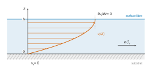
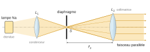
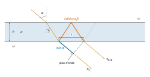
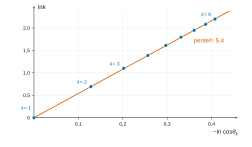

# Centrale-Supélec PC — Physique 1 2026 · Corrigé brut

*Corrigé rédigé par IA, non officiel. Signalez toute erreur.*

Épreuve de 4 heures, calculatrice autorisée. « Autour des gouttes et des bulles » : trois parties indépendantes. Questions à prise d'initiative : Q18, Q22, Q50.

## Partie A — Évaporation d'une goutte d'eau

### I — Évolution du rayon d'une goutte sphérique

**Q1.** À la température $T$, la pression de vapeur saturante $p_\text{sat}(T)$ d'un corps pur est la pression de sa vapeur lorsqu'elle est en équilibre avec la phase liquide. C'est l'ordonnée, à l'abscisse $T$, de la courbe de vaporisation du diagramme $(T,p)$. Pour $p<p_\text{sat}(T)$, seule la vapeur est stable ; pour $p>p_\text{sat}(T)$, seul le liquide l'est.

$p_\text{sat}$ est une **fonction croissante de $T$**. La courbe de vaporisation monte de 0,61 kPa à $273{,}15$ K jusqu'à 2,3 kPa à $293{,}15$ K (données).

La relation (6) de l'énoncé, avec $\Delta h_\text{vap}>0$, le traduit : $p_\text{sat}(T_g)/p_\text{sat}(T_\infty)$ est supérieur à 1 si $T_g>T_\infty$. La croissance est rapide, quasi exponentielle en $-1/T$.

**Q2.** La pesanteur est négligée, la goutte est une sphère de centre $O$ et l'atmosphère lointaine est homogène, de concentration uniforme. L'ensemble (géométrie, conditions aux limites, milieu) est invariant par toute rotation autour de $O$. La cause étant invariante, l'effet l'est aussi : en coordonnées sphériques de centre $O$, $c(\vec r,t)=c(r,t)$.

Avec le gradient sphérique du formulaire, la loi de Fick donne $\vec\jmath_m=-D\,\dfrac{\partial c}{\partial r}\,\vec e_r$ : le courant est radial et sa norme ne dépend que de $r$ et $t$. **Le flux diffusif est à symétrie sphérique.**

**Q3.** Loi de Fick :

$$\boxed{\vec\jmath_m=-D\,\overrightarrow{\text{grad}}\,c}$$

avec $c$ en kg·m⁻³, $\vec\jmath_m$ en kg·m⁻²·s⁻¹ et $D$ en m²·s⁻¹.

**Q4.** La vapeur est un gaz parfait. Une quantité $n$ de vapeur occupant le volume $V$ sous la pression partielle $p$ vérifie

$$pV=nRT,$$

et sa masse vaut $nM_\text{eau}$. D'où

$$\boxed{c(r,t)=\frac{M_\text{eau}\,p(r,t)}{RT}}$$

Conditions aux limites :

- en $r=r_g$, le liquide est en équilibre avec sa vapeur : $p=p_\text{sat}(T)$, donc $c(r_g,t)=c_\text{sat}=\dfrac{M_\text{eau}p_\text{sat}(T)}{RT}$ ;
- pour $r\to\infty$, $p=p_\infty=\mathcal R_H\,p_\text{sat}(T)$, donc $c(\infty,t)=c_\infty=\dfrac{M_\text{eau}p_\infty}{RT}=\mathcal R_H\,c_\text{sat}$.

Comme $\mathcal R_H\le1$, on a $c_\infty\le c_\text{sat}$ : le flux de vapeur est dirigé vers l'extérieur.

**Q5.** Sur la longueur caractéristique $r_g$, le profil diffusif s'établit en $\tau_\text{diff}\sim r_g^2/D$, tandis que la « source » (la goutte) évolue sur sa durée de vie $t_0$. Le critère est

$$\boxed{\tau_\text{diff}=\frac{r_{g0}^2}{D}\ll t_0}$$

**Q6.** Soit $\phi_m$ le flux de masse sortant à travers une sphère de rayon $r>r_g$ :

$$\begin{aligned}
\phi_m&=4\pi r^2 j_m(r)\\
&=-4\pi r^2D\,\frac{\mathrm dc}{\mathrm dr}.
\end{aligned}$$

Le flux est conservatif en régime quasi stationnaire, donc $\phi_m$ ne dépend pas de $r$. Alors

$$\begin{aligned}
\frac{\mathrm dc}{\mathrm dr}&=-\frac{\phi_m}{4\pi Dr^2}\\
c(r)&=c_\infty+\frac{\phi_m}{4\pi Dr},
\end{aligned}$$

la constante étant fixée par la condition à l'infini. La condition $c(r_g)=c_\text{sat}$ donne $\phi_m=4\pi Dr_g(c_\text{sat}-c_\infty)$, soit avec Q4 :

$$\boxed{\phi_m=4\pi r_g\,\frac{M_\text{eau}Dp_\text{sat}(T)}{RT}\,(1-\mathcal R_H)}$$

C'est la relation (2).

**Q7.** Entre $t$ et $t+\mathrm dt$, on a d'une part le bilan de matière $\mathrm dm=-\phi_m\,\mathrm dt$. D'autre part, la goutte reste sphérique et le liquide est incompressible : $m=\tfrac43\pi r_g^3\mu_\text{eau}$, donc $\mathrm dm=4\pi r_g^2\mu_\text{eau}\,\mathrm dr_g$. En égalant et en simplifiant par $4\pi r_g\neq0$ :

$$\boxed{r_g\frac{\mathrm dr_g}{\mathrm dt}=-\frac{M_\text{eau}Dp_\text{sat}(T)}{\mu_\text{eau}RT}(1-\mathcal R_H)}$$

C'est la relation (3).

**Q8.** Notons $\kappa=\dfrac{M_\text{eau}Dp_\text{sat}(T)}{\mu_\text{eau}RT}(1-\mathcal R_H)$. L'équation (3) s'écrit $\tfrac12\,\mathrm d(r_g^2)/\mathrm dt=-\kappa$, d'où $r_g^2=r_{g0}^2-2\kappa t$ :

$$\boxed{r_g(t)=r_{g0}\sqrt{1-\frac{t}{t_0}}}$$

avec

$$\boxed{t_0=\frac{\mu_\text{eau}RT\,r_{g0}^2}{2M_\text{eau}Dp_\text{sat}(T)(1-\mathcal R_H)}}$$

C'est le carré du rayon qui décroît linéairement (« loi en $d^2$ ») ; la goutte disparaît en un temps fini $t_0$.

**Q9.** Avec $\mathcal R_H=0$ :

$$t_0=\frac{1{,}0\times10^{3}\times8{,}314\times293{,}15\times(1{,}0\times10^{-3})^2}{2\times18\times10^{-3}\times2{,}4\times10^{-5}\times2{,}3\times10^{3}},$$

soit

$$\boxed{t_0\approx1{,}2\times10^{3}\ \text{s}\approx20\ \text{min}}$$

Par ailleurs

$$\begin{aligned}
\tau_\text{diff}&=\frac{r_{g0}^2}{D}\\
&=\frac{10^{-6}}{2{,}4\times10^{-5}}\\
&=4{,}2\times10^{-2}\ \text{s},
\end{aligned}$$

d'où $\tau_\text{diff}/t_0\approx3\times10^{-5}\ll1$ : **l'approximation des régimes quasi stationnaires est largement justifiée.**

Analytiquement, $\tau_\text{diff}/t_0=2c_\text{sat}(1-\mathcal R_H)/\mu_\text{eau}$. L'approximation tient parce que la vapeur saturante ($c_\text{sat}=1{,}7\times10^{-2}$ kg·m⁻³) est environ $6\times10^4$ fois moins dense que le liquide.

### II — Température de la goutte

#### II.1 — Mise en équation

**Q10.** Argument des résistances thermiques : dans la goutte et dans l'air, la géométrie et l'échelle ($r_g$) sont les mêmes, donc les conductances sont respectivement d'ordre $\lambda_\text{eau}r_g$ et $\lambda_\text{air}r_g$. Le rapport des écarts de température supportés (nombre de Biot) vaut

$$\frac{\lambda_\text{air}}{\lambda_\text{eau}}=\frac{2{,}6\times10^{-2}}{0{,}61}\approx4\times10^{-2}\ll1 .$$

Presque toute la chute de température se fait dans l'air. En outre, le temps d'homogénéisation thermique de la goutte, $\tau_\text{th}=\mu_\text{eau}c_\text{eau}r_{g0}^2/\lambda_\text{eau}\approx7$ s, est très court devant $t_0\approx1{,}2\times10^3$ s. **La température de la goutte peut être prise uniforme.**

**Q11.** La vaporisation consomme de l'énergie ($\Delta h_\text{vap}>0$) : l'évaporation est **endothermique**. La goutte se refroidit jusqu'à ce que le flux thermique reçu de l'air compense la puissance consommée : $\boxed{T_g<T_\infty}$.

**Q12.** Dans l'air, la conduction est quasi stationnaire, sans source, à symétrie sphérique : le flux $\Phi=-4\pi r^2\lambda_\text{air}\,\mathrm dT/\mathrm dr$ (compté sortant) ne dépend pas de $r$. On en déduit $T(r)=T_\infty+(T_g-T_\infty)\,r_g/r$, et le flux reçu par la goutte vaut

$$\begin{aligned}
\phi_\text{th,d}&=4\pi r_g^2\lambda_\text{air}\Big(\frac{\mathrm dT}{\mathrm dr}\Big)_{r_g}\\
&=4\pi\lambda_\text{air}r_g(T_\infty-T_g).
\end{aligned}$$

D'où

$$\boxed{R_\text{th,d}=\frac{1}{4\pi\lambda_\text{air}r_g}}$$

$R_\text{th,d}$ s'exprime en K·W⁻¹.

**Q13.** On fait le bilan d'énergie de la goutte en régime quasi stationnaire : $T_g$ est constante, et la variation d'enthalpie sensible de la goutte est négligeable (Q10).

Pendant $\mathrm dt$, la goutte reçoit $\phi_\text{th,d}\,\mathrm dt$ et vaporise la masse $\phi_m\,\mathrm dt$. Cette vaporisation consomme $\Delta h_\text{vap}\phi_m\,\mathrm dt$, donc

$$\phi_\text{th,d}=\Delta h_\text{vap}\phi_m .$$

Avec Q12 et (4) :

$$4\pi\lambda_\text{air}r_g(T_\infty-T_g)=\Delta h_\text{vap}\,4\pi r_g\frac{M_\text{eau}D}{R}\left[\frac{p_\text{sat}(T_g)}{T_g}-\frac{p_\infty(T_\infty)}{T_\infty}\right].$$

On simplifie par $4\pi r_g$ (l'écart ne dépend pas du rayon), on met $p_\text{sat}(T_\infty)/T_\infty$ en facteur et on reconnaît $\mathcal R_H$ :

$$\boxed{T_\infty-T_g=\frac{\Delta h_\text{vap}M_\text{eau}Dp_\text{sat}(T_\infty)}{\lambda_\text{air}RT_\infty}\left(\frac{p_\text{sat}(T_g)}{T_g}\frac{T_\infty}{p_\text{sat}(T_\infty)}-\mathcal R_H\right)}$$

C'est la relation (5).

#### II.2 — Résolution numérique

**Q14.** On reporte (6) dans (5). Avec $C_1=\dfrac{\Delta h_\text{vap}DM_\text{eau}p_\text{sat}(T_\infty)}{\lambda_\text{air}RT_\infty}$ et $C_2=\dfrac{\Delta h_\text{vap}M_\text{eau}}{R}$, il faut annuler

$$f(x)=T_\infty-x-C_1\left[\frac{T_\infty}{x}\exp\!\Big(C_2\Big(\frac1{T_\infty}-\frac1x\Big)\Big)-\mathcal R_H\right].$$

```python
def f(x):
    return Tinf - x - C1*(Tinf/x*np.exp(C2*(1/Tinf - 1/x)) - RH)

a = 273.0   # la goutte reste liquide : Tg > Tfus
b = Tinf    # Tg < Tinf (Q11)
```

Justification des bornes. Les constantes valent $C_1\approx38$ K et $C_2\approx5{,}2\times10^3$ K. La fonction $f$ est continue sur $[a,b]$, avec

$$f(b)=-C_1(1-\mathcal R_H)<0$$

et

$$f(273)\approx+8{,}8>0 .$$

La racine est encadrée et la dichotomie converge. Le programme exécuté renvoie $T_g\approx277{,}74$ K, à la tolérance $10^{-2}$ K près. Une borne inférieure plus basse, par exemple $a=250$ K, convient aussi.

#### II.3 — Résolution approchée

**Q15.** On a $c_\text{sat}(T)=M_\text{eau}p_\text{sat}(T)/(RT)$. On écrit (7) en $T=T_\text{fus}$ :

$$\frac{p_\text{sat}(T_\text{fus})}{p_\text{sat}(T_\infty)}\frac{T_\infty}{T_\text{fus}}=1-\alpha(T_\infty-T_\text{fus}),$$

d'où

$$\boxed{\alpha=\frac{1}{T_\infty-T_\text{fus}}\left[1-\frac{p_\text{sat}(T_\text{fus})\,T_\infty}{p_\text{sat}(T_\infty)\,T_\text{fus}}\right]}$$

Application numérique : le crochet vaut $1-0{,}265\times1{,}073=0{,}715$, d'où $\boxed{\alpha\approx3{,}6\times10^{-2}\ \text{K}^{-1}}$.

**Q16.** Le flux (4) s'écrit $\phi_m=4\pi r_gD\,[c_\text{sat}(T_g)-c_\infty]$ avec $c_\infty=\mathcal R_H\,c_\text{sat}(T_\infty)$. En notant $\Delta T=T_\infty-T_g$, le bilan $\phi_\text{th,d}=\Delta h_\text{vap}\phi_m$ donne

$$\lambda_\text{air}\Delta T=\Delta h_\text{vap}D\,c_\text{sat}(T_\infty)\big[1-\alpha\Delta T-\mathcal R_H\big].$$

En posant $K=\Delta h_\text{vap}Dc_\text{sat}(T_\infty)/\lambda_\text{air}$, on obtient $\Delta T(1+K\alpha)=K(1-\mathcal R_H)$ :

$$\boxed{T_\infty-T_g=\frac{K}{1+K\alpha}(1-\mathcal R_H)}$$

avec

$$\boxed{K=\frac{\Delta h_\text{vap}DM_\text{eau}p_\text{sat}(T_\infty)}{\lambda_\text{air}RT_\infty}}$$

$K$ est homogène à une température (c'est la constante $C_1$ du programme).

**Q17.** On a $c_\text{sat}(T_\infty)=1{,}70\times10^{-2}$ kg·m⁻³, d'où

$$\begin{aligned}
K&=\frac{2{,}4\times10^6\times2{,}4\times10^{-5}\times1{,}70\times10^{-2}}{2{,}6\times10^{-2}}\\
&=37{,}6\ \text{K}
\end{aligned}$$

et $K\alpha=1{,}35$. Pour $\mathcal R_H=0$ :

$$\boxed{T_\infty-T_g=\frac{37{,}6}{2{,}35}\approx16\ \text{K}}$$

Ce résultat est proche de la résolution numérique (environ 15,4 K) ; l'écart, de l'ordre de 5 %, vient de ce que la corde de la fonction convexe $c_\text{sat}(T)$ surestime $c_\text{sat}(T_g)$, donc le refroidissement.

Le refroidissement est important : la goutte est vers 4 °C. Le facteur $1+K\alpha=2{,}35$ traduit la rétroaction (une goutte plus froide s'évapore moins). Enfin $\Delta T/T_\infty\approx5\times10^{-2}\ll1$.

**Q18.** Avec le flux (4) et $\mathcal R_H=0$, le bilan de masse de Q7 donne

$$r_g\,\frac{\mathrm dr_g}{\mathrm dt}=-\frac{D}{\mu_\text{eau}}\,c_\text{sat}(T_g).$$

D'après Q13, $T_g$ ne dépend pas de $r_g$ : le second membre est encore constant, la loi en $r^2$ subsiste et

$$\begin{aligned}
\frac{t_0'}{t_0}&=\frac{c_\text{sat}(T_\infty)}{c_\text{sat}(T_g)}\\
&=\frac{1}{1-\alpha\Delta T}\\
&=\frac{1}{1-3{,}58\times10^{-2}\times16{,}0}\\
&=2{,}35 .
\end{aligned}$$

De façon équivalente, le bilan d'énergie donne directement $\phi_m=4\pi\lambda_\text{air}r_g\Delta T/\Delta h_\text{vap}$, d'où

$$t_0'=\frac{\mu_\text{eau}\Delta h_\text{vap}r_{g0}^2}{2\lambda_\text{air}\Delta T}$$

et

$$\boxed{t_0'\approx2{,}9\times10^{3}\ \text{s}\approx48\ \text{min}\approx2{,}3\,t_0}$$

Avec la valeur numérique $T_g=277{,}7$ K et la relation (6), on trouve $c_\text{sat}(T_g)/c_\text{sat}(T_\infty)=0{,}395$, d'où $t_0'\approx3{,}1\times10^3$ s. **La goutte vit 2,3 à 2,5 fois plus longtemps** que dans le modèle isotherme, qui est donc une mauvaise approximation de la durée de vie.

### III — Effets radiatifs

**Q19.** On pose $\Delta T=T_\infty-T_g$, avec $\Delta T/T_\infty\ll1$ :

$$\begin{aligned}
T_\infty^4-T_g^4&=T_\infty^4\big[1-(1-\Delta T/T_\infty)^4\big]\\
&\approx4T_\infty^3\Delta T .
\end{aligned}$$

Avec $S_\text{goutte}=4\pi r_g^2$, on obtient

$$\phi_\text{th,rad}=16\pi\sigma\varepsilon T_\infty^3r_g^2\,(T_\infty-T_g),$$

d'où

$$\boxed{R_\text{rad}=\frac{1}{16\pi\sigma\varepsilon T_\infty^3r_g^2}}$$

**Q20.** Les deux flux sont proportionnels au même écart (résistances en parallèle) :

$$\begin{aligned}
\frac{\phi_\text{th,d}}{\phi_\text{th,rad}}&=\frac{R_\text{rad}}{R_\text{th,d}}\\
&=\frac{\lambda_\text{air}}{4\sigma\varepsilon T_\infty^3r_g}.
\end{aligned}$$

La conduction domine si

$$\boxed{r_g\ll r_c=\frac{\lambda_\text{air}}{4\sigma\varepsilon T_\infty^3}\approx\frac{2{,}6\times10^{-2}}{5{,}5}\approx4{,}7\ \text{mm}}$$

Pour $r_{g0}=1$ mm, le rayonnement représente encore environ 20 % de la conduction. La condition n'est que modérément satisfaite ; elle s'améliore à mesure que la goutte rétrécit.

### IV — Application : mesure du taux d'humidité

**Q21.** De (9), $p_\infty(T_\infty)=p_\text{sat}(T_g)-\mathcal A\,p_\text{atm}\Delta T$, donc

$$\boxed{\mathcal R_H=\frac{p_\text{sat}(T_g)-\mathcal A\,p_\text{atm}\,(T_\infty-T_g)}{p_\text{sat}(T_\infty)}}$$

avec $T_g=T_\text{hum}$ et $T_\infty=T_\text{sec}$. Pour un air saturé, $\Delta T=0$ et $\mathcal R_H=1$.

**Q22.** En régime permanent, la goutte du thermomètre humide reçoit $f_h\phi_\text{th,d}$ et vaporise $f_\text{ev}\phi_m$ : $f_h\phi_\text{th,d}=\Delta h_\text{vap}f_\text{ev}\phi_m$. Comme $f_\text{ev}=f_h$, les coefficients de ventilation se simplifient, et l'on retrouve le bilan de Q13 :

$$\lambda_\text{air}(T_\infty-T_g)=\frac{\Delta h_\text{vap}M_\text{eau}D}{R}\left[\frac{p_\text{sat}(T_g)}{T_g}-\frac{p_\infty(T_\infty)}{T_\infty}\right].$$

Comme $\Delta T\ll T$, on remplace les deux températures des dénominateurs par la température moyenne $\overline T=(T_\infty+T_g)/2$. Le crochet vaut alors environ

$$\frac{p_\text{sat}(T_g)-p_\infty}{\overline T}=-\frac{\Delta p}{\overline T}.$$

D'où

$$\Delta p=-\frac{\lambda_\text{air}R\overline T}{\Delta h_\text{vap}M_\text{eau}D}\,\Delta T,$$

et par identification avec (9) :

$$\boxed{\mathcal A=\frac{\lambda_\text{air}\,R\,\overline T}{\Delta h_\text{vap}\,M_\text{eau}\,D\,p_\text{atm}}}$$

Avec $\overline T\approx285$ K, on obtient $\mathcal A\approx5{,}9\times10^{-4}$ K⁻¹. Ce coefficient ne dépend pas de la vitesse de ventilation $U$, ce qui rend l'instrument utilisable.

## Partie B — Spin coating

### I — Équation de Stokes

**Q23.** Dans $\mu\left[\dfrac{\partial\vec v}{\partial t}+(\vec v\cdot\overrightarrow{\text{grad}})\vec v\right]=\vec f_\text{vol}-\overrightarrow{\text{grad}}\,p+\eta\Delta\vec v$ :

- $\mu\,\partial\vec v/\partial t$ est le terme d'accélération locale (instationnarité) ;
- $\mu(\vec v\cdot\overrightarrow{\text{grad}})\vec v$ est le terme d'accélération convective, non linéaire ; les deux premiers termes forment $\mu\,\mathrm D\vec v/\mathrm Dt$ ;
- $-\overrightarrow{\text{grad}}\,p$ est la résultante volumique des forces de pression ;
- $\eta\Delta\vec v$ est la force volumique de viscosité (diffusion de quantité de mouvement).

Le référentiel du plateau tourne à $\vec\omega=\omega\vec e_z$ constant : il n'est pas galiléen. Les forces volumiques sont

$$\boxed{\vec f_\text{vol}=\mu\vec g+\mu\omega^2r\,\vec e_r-2\mu\,\vec\omega\wedge\vec v}$$

soit le poids, la force d'inertie d'entraînement (centrifuge, $r$ étant la distance à l'axe) et la force de Coriolis. Il n'y a pas de terme en $\dot{\vec\omega}$ en régime de rotation uniforme.

**Q24.** On a $\|\vec f_\text{cf}\|=\mu\omega^2r$ et $\|\vec f_\text{Cor}\|\le2\mu\omega v$, d'où $f_\text{Cor}/f_\text{cf}\sim2v/(\omega r)$. L'écoulement est mû par la force centrifuge et freiné par la viscosité. L'équilibre $\mu\omega^2r\sim\eta v/h^2$ donne l'échelle $v\sim\mu\omega^2rh^2/\eta$, donc

$$\frac{f_\text{Cor}}{f_\text{cf}}\sim\frac{2\mu\omega h^2}{\eta}=\frac{2\omega h^2}{\nu},$$

avec

$$\begin{aligned}
\nu&=\frac{\eta}{\mu}\\
&=3{,}4\times10^{-5}\ \text{m}^2\cdot\text{s}^{-1}.
\end{aligned}$$

Numériquement, $\omega=2000\times2\pi/60=209$ rad·s⁻¹. Avec la vitesse moyenne dans l'épaisseur, le rapport vaut environ 1 pour $h=h_0=0{,}5$ mm. Il tombe à environ $10^{-2}$ pour $h=50$ µm. Il n'est plus que de $10^{-4}$ environ pour $h\approx5$ µm. Le film atteint ces épaisseurs en quelques millisecondes (Q39).

On peut aussi utiliser une vitesse moyenne d'étalement, $v\sim(R_\text{max}-R_0)/T\approx3\times10^{-3}$ m·s⁻¹. Pour $r\sim1$ cm, elle donne $f_\text{cf}/f_\text{Cor}\sim3\times10^2$. **Le terme centrifuge est prépondérant** pendant toute la phase qui fixe l'épaisseur finale.

**Q25.** La goutte, le substrat et les forces restantes (poids selon $-\vec e_z$, force centrifuge selon $\vec e_r$) sont invariants par rotation autour de $(Oz)$. Donc la norme de la vitesse, la pression $p$ et l'épaisseur $h$ ne dépendent pas de $\theta$.

Une fois la force de Coriolis négligée, aucune force n'a de composante orthoradiale et $\partial p/\partial\theta=0$. La projection de Navier-Stokes sur $\vec e_\theta$ est alors une équation homogène en $v_\theta$. Elle est complétée par les conditions $v_\theta(z=0)=0$ (adhérence au plateau, immobile dans ce référentiel) et $\partial v_\theta/\partial z(z=h)=0$.

Le liquide est mis en rotation avec le plateau par diffusion visqueuse en $h^2/\nu\sim10^{-2}$ s, pendant l'accélération de l'étape 2. Ensuite $v_\theta=0$ est solution et le reste : $\boxed{v_\theta=0}$.

**Q26.** On a $\operatorname{div}\vec v=0$, avec $v_\theta=0$ et $\partial_\theta=0$ :

$$\frac1r\frac{\partial(rv_r)}{\partial r}+\frac{\partial v_z}{\partial z}=0 .$$

Les deux termes sont du même ordre, $v_r/R\sim v_z/h$, donc $v_z/v_r\sim h/R\ll1$ (goutte aplatie, rapport qui décroît encore au cours du temps) :

$$\boxed{\vec v\simeq v_r(r,z,t)\,\vec e_r}$$

**Q27.** Dans $(\Delta\vec v)\cdot\vec e_r$, les termes $\dfrac1{r^2}\dfrac{\partial^2v_r}{\partial\theta^2}$ et $-\dfrac2{r^2}\dfrac{\partial v_\theta}{\partial\theta}$ sont nuls (Q25). Il reste

$$\begin{aligned}
\frac1r\frac{\partial}{\partial r}\Big(r\frac{\partial v_r}{\partial r}\Big)&\sim\frac{v_r}{R^2}\\
\frac{v_r}{r^2}&\sim\frac{v_r}{R^2}\\
\frac{\partial^2v_r}{\partial z^2}&\sim\frac{v_r}{h^2}.
\end{aligned}$$

Le dernier domine dans le rapport $(R/h)^2\ge10^2$ : $\boxed{(\Delta\vec v)\cdot\vec e_r\simeq\dfrac{\partial^2v_r}{\partial z^2}}$.

**Q28.** Le nombre de Reynolds $\text{Re}=\mu VL/\eta$ compare le terme convectif au terme visqueux. Pour un film mince, le rapport pertinent est celui du terme convectif $\mu V^2/R$ (convection selon $r$) au terme visqueux $\eta V/h^2$. C'est le nombre de Reynolds réduit

$$\text{Re}^*=\frac{\mu Vh}{\eta}\,\frac hR .$$

Avec $V\sim\mu\omega^2Rh^2/\eta$, on obtient $\text{Re}^*\sim(\omega h^2/\nu)^2$ :

- environ 1 au tout début ($h_0=0{,}5$ mm) ;
- $\text{Re}^*\approx10^{-3}$ pour $h=0{,}1$ mm ;
- $\text{Re}^*\approx10^{-7}$ pour $h=10$ µm.

Avec la vitesse moyenne $3\times10^{-3}$ m·s⁻¹ et $L=h_0$, on trouve $\text{Re}=5\times10^{-2}$. **Hormis les toutes premières millisecondes, $\text{Re}^*\ll1$** : on néglige le terme convectif $\mu(\vec v\cdot\overrightarrow{\text{grad}})\vec v$ devant le terme visqueux.

**Q29.** Le profil de vitesse s'établit dans l'épaisseur par diffusion visqueuse en $\tau_\text{v}\sim h^2/\nu$. L'épaisseur évolue sur la durée (d'après (14) pour un film uniforme)

$$\begin{aligned}
\tau_h&=\frac{h}{|\dot h|}\\
&=\frac{3\eta}{2\mu\omega^2h^2},
\end{aligned}$$

d'où

$$\frac{\tau_\text v}{\tau_h}=\frac23\Big(\frac{\omega h^2}{\nu}\Big)^2 .$$

Ce rapport vaut :

- environ 1,6 à $t=0$ ;
- $3\times10^{-3}$ pour $h=0{,}1$ mm ;
- $3\times10^{-7}$ pour $h=10$ µm.

Au-delà de quelques centièmes de seconde, le champ de vitesse suit instantanément l'épaisseur : **l'écoulement est quasi stationnaire** et l'on néglige $\mu\,\partial\vec v/\partial t$. Les 30 s du procédé sont très longues devant ce transitoire.

**Q30.** Sans terme d'inertie (Q28, Q29), avec pression uniforme, pesanteur et Coriolis négligées et $(\Delta\vec v)\cdot\vec e_r\simeq\partial^2v_r/\partial z^2$ (Q27), la projection sur $\vec e_r$ donne $0=\mu\omega^2r+\eta\,\partial^2v_r/\partial z^2$ :

$$\boxed{\frac{\partial^2v_r}{\partial z^2}=-\frac{\mu\omega^2r}{\eta}}$$

C'est l'équation (12).

**Q31.** En $z=0$, le fluide visqueux adhère au plateau, immobile dans le référentiel d'étude : $\boxed{v_r(r,0,t)=0}$.

En $z=h$, la contrainte tangentielle est continue. L'air, de viscosité environ 2000 fois plus faible, n'exerce pas de contrainte appréciable ; comme la pente de l'interface est faible, la normale est $\vec e_z$ et la contrainte tangentielle vaut $\eta\,\partial v_r/\partial z$. Donc $\boxed{(\partial v_r/\partial z)_{z=h}=0}$.

**Q32.** On intègre deux fois en $z$, à $r$ et $t$ fixés. La condition en $h$ fixe la première constante, la condition en 0 la seconde :

$$\begin{aligned}
\frac{\partial v_r}{\partial z}&=-\frac{\mu\omega^2r}{\eta}(z-h)\\
v_r&=\frac{\mu\omega^2r}{\eta}\Big(hz-\frac{z^2}2\Big).
\end{aligned}$$

Donc

$$\boxed{v_r(r,z,t)=\frac{\mu\omega^2r}{2\eta}\,z\,\big(2h(r,t)-z\big)}$$

Le profil est semi-parabolique, maximal à la surface libre.



**Q33.**

$$\begin{aligned}
Q&=\int_0^{2\pi}\!\!\int_0^hv_r\,r\,\mathrm dz\,\mathrm d\theta\\
&=2\pi r\frac{\mu\omega^2r}{\eta}\Big(\frac{h^3}2-\frac{h^3}6\Big),
\end{aligned}$$

d'où

$$\boxed{Q(r,t)=\frac{2\pi\mu\omega^2r^2}{3\eta}h^3}$$

### II — Bilan de masse

**Q34.** La masse du système vaut $\mu\,2\pi r\,h(r,t)\,\mathrm dr$ au premier ordre, d'où

$$\boxed{\mathrm d^2m=2\pi\mu\,r\,\frac{\partial h}{\partial t}\,\mathrm dr\,\mathrm dt}$$

**Q35.** Par la face de rayon $r$, le liquide entre : $\boxed{\delta m_e(r,t)=\mu Q(r,t)\,\mathrm dt}$. Par la face de rayon $r+\mathrm dr$, il sort : $\boxed{\delta m_e(r+\mathrm dr,t)=-\mu Q(r+\mathrm dr,t)\,\mathrm dt}$. Rien ne traverse le substrat ni la surface libre (pas d'évaporation pendant cette étape). Au total :

$$\boxed{\delta^2m_e=-\mu\frac{\partial Q}{\partial r}\,\mathrm dr\,\mathrm dt}$$

**Q36.** Le liquide est incompressible et sans source : $\mathrm d^2m=\delta^2m_e$, donc $2\pi r\,\partial h/\partial t=-\partial Q/\partial r$. Avec (13),

$$\frac{\partial Q}{\partial r}=\frac{2\pi\mu\omega^2}{3\eta}\Big(2rh^3+3r^2h^2\frac{\partial h}{\partial r}\Big),$$

d'où

$$\boxed{\frac{\partial h}{\partial t}=-\frac{\mu\omega^2}{\eta}\left[\frac23h^3+rh^2\frac{\partial h}{\partial r}\right]}$$

C'est l'équation (14).

### III — Loi d'évolution de h(t) et r(t)

**Q37.** Le film est uniforme : $\partial h/\partial r=0$, d'où $\dfrac{\mathrm dh}{\mathrm dt}=-\dfrac{2\mu\omega^2}{3\eta}h^3$. En séparant les variables, $\dfrac1{h^2}=\dfrac1{h_0^2}+\dfrac{4\mu\omega^2}{3\eta}t$ :

$$\boxed{h(t)=\frac{h_0}{\sqrt{1+t/\tau}}}$$

avec

$$\boxed{\tau=\frac{3\eta}{4\mu\omega^2h_0^2}}$$

**Q38.** Le liquide est incompressible et ne s'évapore pas pendant cette phase : le volume se conserve, $\pi r^2h=\pi R_0^2h_0$, d'où

$$\boxed{r(t)=R_0\Big(1+\frac t\tau\Big)^{1/4}}$$

**Q39.** Avec $\omega=209{,}4$ rad·s⁻¹ :

$$\tau=\frac{3\times3{,}6\times10^{-2}}{4\times1{,}06\times10^3\times(209{,}4)^2\times(5{,}0\times10^{-4})^2},$$

soit

$$\boxed{\tau\approx2{,}3\times10^{-3}\ \text{s}}$$

Comme $T/\tau\approx1{,}3\times10^4$ :

$$\begin{aligned}
h(T)&=\frac{h_0}{\sqrt{1+T/\tau}}\\
&\approx h_0\sqrt{\frac{\tau}{T}},
\end{aligned}$$

soit

$$\boxed{h(T)\approx4{,}4\ \mu\text{m}}$$

Contrôles : $r(T)=R_0(1+T/\tau)^{1/4}\approx5{,}3$ cm $<R_\text{max}=10$ cm, donc la goutte reste sur le substrat ; $h/r\approx10^{-4}$.

Pour $T\gg\tau$, $h\approx\sqrt{3\eta/(4\mu\omega^2T)}$ ne dépend plus de $h_0$.

## Partie C — Mesure de l'épaisseur d'une bulle par interférométrie

### I — Intensité transmise par la bulle

**Q40.** Le montage se fait en trois éléments :

1. une lentille convergente $L_1$ (condenseur) forme l'image de la lampe spectrale étendue sur un diaphragme de petit diamètre, ce qui concentre la lumière ;
2. le diaphragme sélectionne une source quasi ponctuelle $S$ ;
3. $S$ est placée au foyer objet d'une seconde lentille convergente $L_2$, de grande focale $f_2'$ : les rayons qui en sont issus émergent parallèles entre eux.

La divergence résiduelle vaut environ $d/f_2'$, où $d$ est le diamètre du diaphragme. On règle la position de $L_2$ pour que la tache lumineuse garde le même diamètre quand on éloigne l'écran.



**Q41.** La loi de Snell-Descartes à l'entrée donne $\sin\alpha=n\sin\beta$, d'où $\sin\beta=\sin84{,}2^\circ/1{,}4=0{,}711$ et $\boxed{\beta\approx45{,}3^\circ}$.

La lumière pénètre toujours dans le film : on passe d'un milieu moins réfringent à un milieu plus réfringent, et $\sin\alpha/n\le1/n<1$ ; il n'y a jamais de réflexion totale à l'entrée.

Les faces sont parallèles, donc à la sortie $n\sin\beta=\sin\alpha'$, soit $\boxed{\alpha'=\alpha=84{,}2^\circ}$ : les rayons émergents sont parallèles au rayon incident. Par retour inverse, la sortie est toujours possible. Ce qui empêche la mesure en incidence rasante, c'est que la réflexion devient totale en énergie ($R\to1$ quand $\alpha\to90^\circ$, figure 13), et non une réflexion totale interne.

**Q42.** Le rayon $k+1$ fait un aller-retour de plus dans la lame : son chemin optique supplémentaire vaut $2nh/\cos\beta$. Son point d'émergence est décalé de $\ell=2h\tan\beta$ le long de la lame.

Ramenés à un même plan d'onde, perpendiculaire aux rayons émergents inclinés de $\alpha$, les deux trajets diffèrent dans l'air de $\ell\sin\alpha$, parcouru par le rayon $k$. Avec $\sin\alpha=n\sin\beta$ :

$$\begin{aligned}
\delta&=\frac{2nh}{\cos\beta}-2h\tan\beta\,n\sin\beta\\
&=2nh\cos\beta,
\end{aligned}$$

d'où

$$\boxed{\varphi=\frac{4\pi nh\cos\beta}{\lambda}}$$

Les deux réflexions supplémentaires ont lieu sur des interfaces liquide/air identiques, avec $r$ réel positif : aucun déphasage additionnel n'apparaît.



**Q43.** À chaque aller-retour, l'amplitude est multipliée par $r^2$ (deux réflexions internes) et la phase augmente de $\varphi$ : $\underline s_{k+1}=r^2e^{-i\varphi}\,\underline s_k$, donc

$$\boxed{\underline s_k=\underline s_1\big(r^2e^{-i\varphi}\big)^{k-1}}$$

La raison $q=r^2e^{-i\varphi}$ vérifie $|q|=r^2<1$ : la série géométrique converge, et tous les rayons ont le même facteur $e^{i\omega t}$, d'où

$$\begin{aligned}
\underline s&=\sum_{k\ge1}\underline s_k\\
&=\boxed{\frac{\underline s_1}{1-r^2\exp(-i\varphi)}}
\end{aligned}$$

**Q44.** Le module carré du dénominateur vaut, avec le formulaire :

$$\begin{aligned}
|1-r^2e^{-i\varphi}|^2&=1-2r^2\cos\varphi+r^4\\
&=(1-r^2)^2+4r^2\sin^2(\varphi/2).
\end{aligned}$$

Le rayon 1 a subi deux transmissions : $\underline s_1=t^2s_0$. Donc

$$\begin{aligned}
|\underline s_1|^2&=t^4\mathcal I_0\\
&=(1-r^2)^2\mathcal I_0 .
\end{aligned}$$

D'où

$$\begin{aligned}
\mathcal I&=\underline s\,\underline s^*\\
&=\frac{(1-r^2)^2\mathcal I_0}{(1-r^2)^2+4r^2\sin^2(\varphi/2)}\\
&=\frac{\mathcal I_0}{1+m\sin^2(\varphi/2)},
\end{aligned}$$

avec

$$\boxed{m=\frac{4r^2}{(1-r^2)^2}}$$

### II — Analyse des images

**Q45.** $\mathcal I$ est maximale quand $\sin(\varphi/2)=0$ :

$$\boxed{\varphi=2p\pi,\ p\in\mathbb Z}$$

Le maximum vaut alors

$$\boxed{\mathcal I_\text{max}=\mathcal I_0}$$

À la résonance, la lame transmet toute la lumière incidente, quel que soit $r$ : elle n'absorbe pas ($r^2+t^2=1$) et les ondes réfléchies interfèrent destructivement. Les maxima sont équidistants (période $2\pi$). Entre deux maxima, l'intensité descend à $\mathcal I_0/(1+m)$, soit $\mathcal I_0/12$ pour $m=11$ : les pics sont fins et contrastés, ce qui caractérise les interférences à ondes multiples.

**Q46.** La condition $4\pi nh\cos\beta/\lambda=2p\pi$ donne

$$\boxed{h_p=\frac{p\lambda}{2n\cos\beta},\ p\in\mathbb N}$$

L'écart d'épaisseur entre deux franges brillantes vaut

$$\boxed{\Delta h=\frac{\lambda}{2n\cos\beta}}$$

Numériquement :

$$\Delta h=\frac{589{,}3\times10^{-9}}{2\times1{,}4\times0{,}704}\approx0{,}30\ \mu\text{m}.$$

Chaque frange brillante est une ligne d'égale épaisseur.

**Q47.** Le contraste est $\mathcal C=\dfrac{\mathcal I_\text{max}-\mathcal I_\text{min}}{\mathcal I_\text{max}+\mathcal I_\text{min}}$, avec $\mathcal I_\text{max}=\mathcal I_0$ et $\mathcal I_\text{min}=\mathcal I_0/(1+m)$. Donc $\mathcal C=\dfrac m{m+2}$ ; comme $m+2=\dfrac{2(1+r^4)}{(1-r^2)^2}$,

$$\boxed{\mathcal C=\frac{2r^2}{1+r^4}}$$

Pour $R=r^2\approx0{,}55$ ($\alpha=84{,}2^\circ$, figure 13), $\mathcal C\approx0{,}85$. Pour $R\approx0{,}03$ (incidence quasi normale), $\mathcal C\approx0{,}06$.

**Q48.** La condition $\mathcal I=\mathcal I_0/2$ s'écrit $m\sin^2(\varphi/2)=1$, soit $\sin(\varphi/2)=\pm1/\sqrt m$. Pour $m\gg1$, $\varphi/2$ est petit près de 0 :

$$\boxed{\varphi_\pm\approx\pm\frac2{\sqrt m}}$$

d'où la largeur à mi-hauteur

$$\boxed{\Delta\varphi_{1/2}\approx\frac4{\sqrt m}}$$

Pour $m=11$, $\Delta\varphi_{1/2}\approx1{,}2$ rad, soit environ 19 % de l'intervalle $2\pi$ entre deux pics.

**Q49.** *Position des franges.* Un rayon du faisceau horizontal qui passe à la distance $d$ du centre du disque image rencontre la paroi sphérique sous l'incidence $\alpha$ telle que $\sin\alpha=d/r_0$. La figure 13 permet de calculer $m$ et $\mathcal C$ :

| α | 0° | 45° | 60° | 75° | 84,2° | → 90° |
|---|---|---|---|---|---|---|
| $d/r_0$ | 0 | 0,71 | 0,87 | 0,97 | 0,995 | 1 |
| $R=r^2$ (fig. 13) | 0,03 | 0,04 | 0,07 | 0,23 | 0,55 | 1 |
| $m$ | 0,13 | 0,17 | 0,33 | 1,5 | 11 | $\to\infty$ |
| $\mathcal C$ | 0,06 | 0,08 | 0,14 | 0,44 | 0,85 | 1 |

Le contraste n'est appréciable que pour $\alpha\gtrsim75^\circ$, c'est-à-dire sur les 3 % extérieurs du disque. Les franges forment donc une **fine couronne sur le pourtour** de la bulle, et l'intérieur paraît uniforme (figure 8). Tout au bord ($\alpha\to90^\circ$, $R\to1$), plus rien n'est transmis : le contour apparaît sombre. L'arc de mesure à $0{,}995\,r_0$ réalise le compromis entre fort contraste et transmission encore mesurable.

*Aspect.* Les franges brillantes sont fines ($\Delta\varphi_{1/2}\approx1{,}2$ rad pour $m=11$) et très contrastées ($\mathcal C\approx0{,}85$). Ce sont des **franges d'égale épaisseur**.

Le drainage a la symétrie de révolution, donc $h$ ne dépend que de $\theta$ : les franges suivent les parallèles $\theta=$ cte, qui se projettent en **traits horizontaux** sur l'image.

L'écart angulaire entre franges, $\Delta\theta\approx\Delta h/|\mathrm dh/\mathrm d\theta|$, diminue vers la base, où $h$ croît vite : les franges se resserrent en descendant (28,4° entre les franges 1 et 2, 1,1° entre les franges 8 et 9 dans le tableau 1).

*Évolution.* Une frange donnée correspond à une épaisseur fixée $h_p=p\Delta h$. Le drainage amincit le haut, donc la ligne où $h=h_p$ **descend** au cours du temps. C'est ce que montrent la ligne tiretée, partie du sommet à $t=0$, et la ligne pointillée, apparue au sommet à $t=220$ s.

Chaque fois que $h(\theta=0)$ franchit un multiple de $\Delta h$, une nouvelle frange naît au sommet. Celle de $t=220$ s est la dernière : elle correspond à $p=1$, donc $h(0)=\Delta h\approx0{,}30$ µm.

Ensuite $h(0)<\Delta h$ : il n'y a plus d'ordre $p\ge1$ au sommet, donc plus de frange brillante.

D'après (16), quand $h\to0$, on a $\varphi\to0$ et la transmission tend vers $\mathcal I_0$. Le minimum se situe vers $h\approx\Delta h/2$. Le « film noir » est le nom classique, hérité de l'observation en réflexion, d'un film de quelques dizaines de nanomètres au plus. En réflexion, il ne renvoie presque rien ; en transmission, le modèle prévoit au contraire une zone sans franges qui s'éclaircit. Sa présence au sommet signale que la bulle va éclater.

*Protocole.*

1. Filmer la bulle à cadence régulière, avec un éclairage et une géométrie fixes.
2. Sur chaque image, repérer le centre et le rayon $r_0$ du disque, puis relever le profil d'intensité le long de l'arc de rayon $0{,}995\,r_0$. L'incidence y est uniforme ($\alpha=84{,}2^\circ$), donc $\Delta h$ est le même partout, et l'angle polaire repère la colatitude $\theta$.
3. Repérer les positions $\theta_k$ des maxima d'intensité.
4. Fixer les ordres absolus : à l'instant où la dernière frange apparaît au sommet, celle-ci a l'ordre $p=1$, et les suivantes, en descendant, ont les ordres $2,3,\dots$, d'où $h(\theta_k)=k\Delta h$. On peut aussi partir de l'éclatement ($h\to0$ au sommet) et remonter le film en comptant les franges.
5. Suivre chaque frange d'image en image : elle garde son ordre en glissant, ce qui donne $h(\theta,t)$ aux points $\theta_k(t)$. On interpole entre franges, éventuellement à l'aide de l'intensité, qui donne $\varphi$ modulo $2\pi$.

La résolution est de $\Delta h\approx0{,}3$ µm entre deux franges.

**Q50.** D'après Q49, à $t=220$ s, la frange 1 au sommet est d'ordre $p=1$.

La frange $k$ est d'ordre $p=k$, donc $h_k=k\Delta h$. Au sommet, $h_0=h(0)=\Delta h$, soit $h_k/h_0=k$. La loi (17) équivaut à

$$\ln k=\ell\,\big[-\ln\cos\theta_k\big].$$

| $k$ | 2 | 3 | 4 | 5 | 6 | 7 | 8 | 9 |
|---|---|---|---|---|---|---|---|---|
| $\theta_k$ (°) | 28,4 | 35,2 | 39,3 | 42,0 | 44,1 | 45,8 | 47,2 | 48,3 |
| $x_k=-\ln\cos\theta_k$ | 0,128 | 0,202 | 0,256 | 0,297 | 0,331 | 0,361 | 0,386 | 0,408 |
| $y_k=\ln k$ | 0,693 | 1,099 | 1,386 | 1,609 | 1,792 | 1,946 | 2,079 | 2,197 |
| $y_k/x_k$ | 5,41 | 5,44 | 5,41 | 5,42 | 5,41 | 5,39 | 5,38 | 5,39 |

Les points $(x_k,y_k)$, y compris $(0,0)$ pour $k=1$, sont alignés sur une droite passant par l'origine. La régression libre donne une ordonnée à l'origine de 0,004, négligeable. Les rapports $y_k/x_k$ sont constants à 0,6 % près, ce qui valide la loi (17), avec

$$\boxed{\ell=\frac{\sum x_ky_k}{\sum x_k^2}\approx5{,}4}$$

soit

$$h(\theta)\approx0{,}30\ \mu\text{m}\times\cos^{-5{,}4}\theta .$$



Avec un décalage d'ordre, $h_k=(k+1)\Delta h$, l'ordonnée à l'origine vaudrait 0,6 et la dispersion serait bien plus grande : l'identification $p=k$ est confirmée. L'épaisseur passe de 0,30 µm au sommet à environ 2,7 µm à $\theta=48^\circ$ ; le drainage est très inhomogène.
