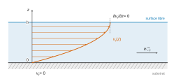
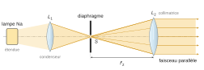
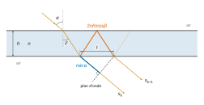
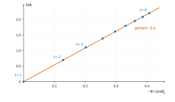

# Centrale-Supélec PC — Physique 1 2026 · Corrigé guidé

*Corrigé rédigé par IA, non officiel. Signalez toute erreur.*

## Présentation du sujet

**Thème.** « Autour des gouttes et des bulles » : trois phénomènes de physique des interfaces, traités dans trois parties **totalement indépendantes**. L'épreuve dure 4 heures, avec calculatrice. Elle compte 50 questions : 22 en partie A, 17 en partie B, 11 en partie C.

- **Partie A — Évaporation d'une goutte d'eau (Q1 à Q22).** Diffusion de la vapeur autour d'une goutte sphérique en régime quasi stationnaire, conduisant à la loi en $r^2$ (Q1 à Q9). Couplage avec la thermique : la goutte se refroidit, ce qu'on résout par dichotomie en Python puis par un modèle affine (Q10 à Q18). Correction radiative (Q19, Q20) et application au psychromètre (Q21, Q22).
- **Partie B — Spin coating (Q23 à Q39).** Mécanique des fluides visqueux dans un référentiel tournant : on simplifie Navier-Stokes par ordres de grandeur jusqu'à l'équation de lubrification, puis on écrit le profil de vitesse, le débit et un bilan de masse. On aboutit à la loi $h\propto t^{-1/2}$ de l'épaisseur du film.
- **Partie C — Interférométrie sur une bulle (Q40 à Q50).** Montage de collimation, lame à faces parallèles en transmission, ondes multiples (fonction d'Airy), contraste et finesse. On termine par la lecture de photographies réelles et l'ajustement d'une loi $h(\theta)$ à partir de positions de franges.

**Notions du programme mobilisées.** Corps pur diphasé ; diffusion de particules (loi de Fick, bilans en géométrie sphérique) ; diffusion thermique (loi de Fourier, résistance thermique) ; rayonnement linéarisé ; premier principe pour un système ouvert ; dichotomie en Python ; référentiels non galiléens ; Navier-Stokes, nombre de Reynolds, conditions aux limites ; bilans de masse locaux ; optique géométrique (Snell-Descartes, lentilles) ; interférences (différence de marche, contraste), sommes géométriques complexes ; exploitation de données par linéarisation.

**Difficulté et longueur.** Le sujet est long mais guidé : beaucoup de résultats intermédiaires sont donnés, ce qui permet de rebondir. Les questions à **initiative** (numéro souligné) sont **Q18, Q22 et Q50**. Les plus délicates sont les ordres de grandeur de la partie B (Q24, Q28, Q29), qui demandent de construire soi-même une échelle de vitesse, et Q49, une question ouverte d'interprétation des photographies.

**À ne pas laisser passer.** Q1 à Q4, Q6 à Q9, Q11, Q12, Q19, Q21 ; Q23, Q26, Q27, Q30 à Q38 ; Q41 à Q48. Ce sont des calculs de cours rapides, souvent avec le résultat donné.

**Gestion du temps.** Environ 1 h 40 pour A, 1 h 15 pour B, 1 h 05 pour C. Les parties étant indépendantes, on peut commencer par celle qu'on maîtrise le mieux. Il faut garder du temps pour Q50, courte si l'on a bien compris l'identification des ordres de franges.

## Partie A — Évaporation d'une goutte d'eau

On décrit d'abord une goutte isotherme dont la vapeur diffuse vers l'infini (Fick, régime quasi stationnaire, bilan de masse). On couple ensuite cette diffusion à la thermique : la vaporisation refroidit la goutte, ce qui ralentit l'évaporation. Le psychromètre exploite ce refroidissement pour mesurer l'humidité.

### Question 1

> [!INDICATION]
> Question de cours sur le corps pur diphasé : de quel équilibre parle-t-on, et entre quelles phases ?

> [!INDICATION]
> Pour le sens de variation, pensez à la courbe de vaporisation du diagramme $(T,p)$ ou aux deux valeurs numériques fournies en fin d'énoncé.

#### Solution

À la température $T$, la pression de vapeur saturante $p_\text{sat}(T)$ d'un corps pur est la pression de la vapeur **en équilibre avec le liquide**. C'est l'ordonnée, à l'abscisse $T$, de la courbe de vaporisation du diagramme $(T,p)$. Pour $p<p_\text{sat}(T)$, seule la vapeur est stable ; pour $p>p_\text{sat}(T)$, seul le liquide l'est.

$p_\text{sat}$ est une **fonction croissante de $T$** : elle passe de 0,61 kPa à 273,15 K à 2,3 kPa à 293,15 K (données). La relation de Clausius-Clapeyron (6), donnée plus loin avec $\Delta h_\text{vap}>0$, traduit cette croissance rapide, quasi exponentielle en $-1/T$.

> [!PIEGE]
> Dire « pression maximale de la vapeur » sans préciser « en équilibre avec le liquide » est insuffisant. Et $p_\text{sat}$ dépend de la seule température, pas de la pression totale.

### Question 2

> [!INDICATION]
> Cherchez les invariances du problème complet : géométrie, conditions aux limites, milieu extérieur.

> [!INDICATION]
> Une fois établi que $c$ ne dépend que de $r$ et $t$, la loi de Fick et l'expression du gradient en coordonnées sphériques (formulaire) donnent la direction du courant.

#### Solution

La pesanteur est négligée, la goutte est une sphère de centre $O$ et l'air lointain est homogène. L'ensemble du problème est donc invariant par toute rotation autour de $O$. La concentration, effet de ces causes, possède la même invariance : $c(\vec r,t)=c(r,t)$ en coordonnées sphériques de centre $O$.

Le gradient sphérique se réduit alors à $\dfrac{\partial c}{\partial r}\vec e_r$, et $\vec\jmath_m=-D\,\dfrac{\partial c}{\partial r}\,\vec e_r$ est radial, de norme fonction de $(r,t)$ seulement : **le flux est à symétrie sphérique.**

> [!METHODE]
> Un argument de symétrie porte sur **tout** le problème (géométrie, conditions aux limites, forces), pas seulement sur la forme de l'objet. C'est l'absence de pesanteur, que l'énoncé précise, qui supprime la direction verticale.

### Question 3

> [!INDICATION]
> Loi phénoménologique de cours ; les unités se déduisent de celles de $c$ (concentration en **masse**).

#### Solution

$$\boxed{\vec\jmath_m=-D\,\overrightarrow{\text{grad}}\,c}$$

avec $c$ en kg·m⁻³, $\vec\jmath_m$ en kg·m⁻²·s⁻¹ (masse traversant une unité de surface par unité de temps) et $D$ en m²·s⁻¹. Le signe moins traduit le transport des zones concentrées vers les zones diluées.

### Question 4

> [!INDICATION]
> La vapeur d'eau est un gaz parfait : reliez la masse de vapeur contenue dans un volume $V$ à sa pression partielle.

> [!INDICATION]
> À la surface, l'énoncé parle d'équilibre liquide-vapeur ; à l'infini, la définition de $\mathcal R_H$ fait le reste.

#### Solution

Pour $n$ moles de vapeur dans le volume $V$ sous la pression partielle $p$, la loi des gaz parfaits et la masse s'écrivent

$$\begin{aligned}
pV&=nRT\\
m&=nM_\text{eau},
\end{aligned}$$

donc

$$\boxed{c(r,t)=\frac{M_\text{eau}\,p(r,t)}{RT}}$$

- En $r=r_g$, il y a équilibre liquide-vapeur : $p=p_\text{sat}(T)$, d'où $c(r_g)=c_\text{sat}=\dfrac{M_\text{eau}p_\text{sat}(T)}{RT}$.
- Pour $r\to\infty$, $p=p_\infty=\mathcal R_H\,p_\text{sat}(T)$, d'où $c(\infty)=c_\infty=\mathcal R_H\,c_\text{sat}$.

Comme $\mathcal R_H\le1$, la concentration décroît de la goutte vers l'infini : la vapeur diffuse vers l'extérieur.

> [!PIEGE]
> La masse molaire de l'air n'intervient pas : $c$ est la concentration de la **vapeur d'eau**, qui se calcule avec $M_\text{eau}$ et la pression **partielle**.

### Question 5

> [!INDICATION]
> L'approximation compare deux durées : laquelle mesure l'établissement du profil diffusif, laquelle mesure l'évolution de la source ?

> [!INDICATION]
> L'équation de diffusion associe à une longueur $L$ un temps en $L^2/D$. Quelle est la seule longueur du problème ?

#### Solution

Le profil de concentration s'établit sur l'échelle $r_g$ en $\tau_\text{diff}\sim r_g^2/D$ ; la goutte évolue sur sa durée de vie $t_0$. Le critère est

$$\boxed{\tau_\text{diff}=\frac{r_{g0}^2}{D}\ll t_0}$$

> [!JURY]
> Un critère **quantitatif** est demandé : une inégalité entre deux grandeurs explicites, et non une phrase du type « la goutte évolue lentement ».

### Question 6

> [!INDICATION]
> Le flux étant conservatif, le flux total à travers une sphère de rayon $r$ ne dépend pas de $r$. Utilisez-le comme constante.

> [!INDICATION]
> Exprimez ce flux avec Fick, séparez les variables et intégrez de $r_g$ à l'infini avec les conditions de Q4.

#### Solution

À travers la sphère de rayon $r>r_g$, le flux

$$\begin{aligned}
\phi_m&=4\pi r^2j_m\\
&=-4\pi r^2D\,\frac{\mathrm dc}{\mathrm dr}
\end{aligned}$$

est indépendant de $r$. Alors

$$\begin{aligned}
\frac{\mathrm dc}{\mathrm dr}&=-\frac{\phi_m}{4\pi Dr^2}\\
c(r)&=c_\infty+\frac{\phi_m}{4\pi Dr}.
\end{aligned}$$

La condition $c(r_g)=c_\text{sat}$ donne $\phi_m=4\pi Dr_g(c_\text{sat}-c_\infty)$, soit

$$\boxed{\phi_m=4\pi r_g\,\frac{M_\text{eau}Dp_\text{sat}(T)}{RT}(1-\mathcal R_H)}$$

Le profil est en $1/r$ et le flux est proportionnel à $r_g$, et non à la surface $r_g^2$. Le gradient en surface, en $1/r_g$, compense.

> [!METHODE]
> En régime stationnaire à symétrie sphérique sans source, écrire « flux total = constante » est plus rapide que de résoudre $\Delta c=0$. Le même calcul servira pour la thermique en Q12.

### Question 7

> [!INDICATION]
> Première manière : ce qui sort par la surface pendant $\mathrm dt$. Seconde manière : la masse d'une sphère de rayon $r_g$.

#### Solution

D'une part, $\mathrm dm=-\phi_m\,\mathrm dt$. D'autre part, $m=\tfrac43\pi r_g^3\mu_\text{eau}$ (liquide incompressible), donc $\mathrm dm=4\pi r_g^2\mu_\text{eau}\,\mathrm dr_g$. En égalant et en simplifiant par $4\pi r_g\ne0$ :

$$\boxed{r_g\frac{\mathrm dr_g}{\mathrm dt}=-\frac{M_\text{eau}Dp_\text{sat}(T)}{\mu_\text{eau}RT}(1-\mathcal R_H)}$$

### Question 8

> [!INDICATION]
> Le membre de gauche est la dérivée d'une fonction simple de $r_g$.

#### Solution

On pose $\kappa=\dfrac{M_\text{eau}Dp_\text{sat}(T)}{\mu_\text{eau}RT}(1-\mathcal R_H)$. Alors $\tfrac12\,\mathrm d(r_g^2)/\mathrm dt=-\kappa$, donc $r_g^2=r_{g0}^2-2\kappa t$ et

$$\boxed{r_g(t)=r_{g0}\sqrt{1-t/t_0}}$$

avec

$$\boxed{t_0=\frac{\mu_\text{eau}RT\,r_{g0}^2}{2M_\text{eau}Dp_\text{sat}(T)(1-\mathcal R_H)}}$$

C'est la « loi en $d^2$ » : le carré du diamètre décroît linéairement et la goutte disparaît en un temps fini.

> [!PIEGE]
> Ce n'est pas une décroissance exponentielle : l'équation n'est pas linéaire en $r_g$.

### Question 9

> [!INDICATION]
> Application numérique directe, toutes grandeurs en unités SI ($M_\text{eau}$ en kg·mol⁻¹, $T$ en K).

> [!INDICATION]
> Pour la validité, revenez au critère de Q5 et calculez les deux durées.

#### Solution

$$t_0=\frac{10^3\times8{,}314\times293{,}15\times10^{-6}}{2\times18\times10^{-3}\times2{,}4\times10^{-5}\times2{,}3\times10^3},$$

soit

$$\boxed{t_0\approx1{,}2\times10^3\ \text{s}\approx20\ \text{min}}$$

On a $\tau_\text{diff}=r_{g0}^2/D$, soit $4{,}2\times10^{-2}$ s, d'où $\tau_\text{diff}/t_0\approx3\times10^{-5}\ll1$ : **l'approximation est largement valide.**

En effet, $\tau_\text{diff}/t_0=2c_\text{sat}(1-\mathcal R_H)/\mu_\text{eau}$ : la vapeur saturante est des dizaines de milliers de fois moins dense que le liquide.

> [!METHODE]
> Toujours confronter un résultat à l'intuition : une goutte millimétrique qui s'évapore en une vingtaine de minutes dans l'air sec est plausible.

### Question 10

> [!INDICATION]
> Une donnée de l'énoncé ne sert qu'ici : la conductivité thermique de l'eau liquide.

> [!INDICATION]
> Comparez les résistances thermiques de conduction dans la goutte et dans l'air, qui ont la même géométrie. On peut confirmer par un temps de diffusion thermique dans la goutte.

#### Solution

À géométrie et échelle égales, les conductances valent environ $\lambda_\text{eau}r_g$ dans la goutte et $\lambda_\text{air}r_g$ dans l'air. Le rapport des chutes de température (nombre de Biot) est $\lambda_\text{air}/\lambda_\text{eau}=0{,}026/0{,}61\approx4\times10^{-2}\ll1$ : presque tout l'écart de température se situe dans l'air.

De plus, $\tau_\text{th}=\mu_\text{eau}c_\text{eau}r_{g0}^2/\lambda_\text{eau}\approx7$ s $\ll t_0$. **La température de la goutte est uniforme.**

### Question 11

> [!INDICATION]
> Faut-il fournir ou récupérer de l'énergie pour vaporiser un liquide ? D'où vient cette énergie ?

#### Solution

La vaporisation absorbe $\Delta h_\text{vap}>0$ par kilogramme : elle est **endothermique**. La goutte se refroidit jusqu'à ce que la chaleur reçue de l'air compense la puissance de vaporisation : $\boxed{T_g<T_\infty}$.

### Question 12

> [!INDICATION]
> C'est le calcul de Q6, transposé à la diffusion thermique.

> [!INDICATION]
> Le flux thermique total à travers une sphère de rayon $r$ est conservatif. Intégrez $T(r)$ entre $r_g$ (où $T=T_g$) et l'infini.

#### Solution

Le flux sortant $\Phi=-4\pi r^2\lambda_\text{air}\,\mathrm dT/\mathrm dr$ ne dépend pas de $r$. Donc $T(r)=T_\infty+(T_g-T_\infty)\,r_g/r$, et le flux **reçu** par la goutte vaut

$$\phi_\text{th,d}=4\pi\lambda_\text{air}r_g(T_\infty-T_g),$$

d'où

$$\boxed{R_\text{th,d}=\frac1{4\pi\lambda_\text{air}r_g}}$$

$R_\text{th,d}$ s'exprime en K·W⁻¹.

> [!PIEGE]
> Ne pas confondre avec une résistance surfacique (K·m²·W⁻¹) : $R_\text{th,d}$ porte sur le flux total.

### Question 13

> [!INDICATION]
> En régime quasi stationnaire, la température de la goutte ne varie pas : où passe l'énergie reçue de l'air ?

> [!INDICATION]
> Écrivez l'égalité entre le flux thermique reçu et la puissance de vaporisation $\Delta h_\text{vap}\phi_m$, puis factorisez $p_\text{sat}(T_\infty)/T_\infty$.

#### Solution

La goutte est à température constante et son énergie interne sensible ne varie pas notablement. La puissance reçue alimente donc entièrement la vaporisation : $\phi_\text{th,d}=\Delta h_\text{vap}\phi_m$. Avec Q12 et (4) :

$$4\pi\lambda_\text{air}r_g(T_\infty-T_g)=\Delta h_\text{vap}\,4\pi r_g\frac{M_\text{eau}D}{R}\left[\frac{p_\text{sat}(T_g)}{T_g}-\frac{p_\infty}{T_\infty}\right].$$

On simplifie par $4\pi r_g$, on factorise $p_\text{sat}(T_\infty)/T_\infty$ et on utilise $\mathcal R_H=p_\infty/p_\text{sat}(T_\infty)$ :

$$\boxed{T_\infty-T_g=\frac{\Delta h_\text{vap}M_\text{eau}Dp_\text{sat}(T_\infty)}{\lambda_\text{air}RT_\infty}\left(\frac{p_\text{sat}(T_g)}{T_g}\frac{T_\infty}{p_\text{sat}(T_\infty)}-\mathcal R_H\right)}$$

L'écart **ne dépend pas de $r_g$** ; ce point sera décisif en Q18.

> [!PIEGE]
> $\Delta h_\text{vap}$ est **massique** : il multiplie un flux de masse. Le bilan porte sur la goutte, qui reçoit $\phi_\text{th,d}$ et perd $\phi_m$.

### Question 14

> [!INDICATION]
> La dichotomie cherche un zéro : écrivez (5) sous la forme $f(T_g)=0$ en remplaçant le rapport des pressions par (6), avec les constantes $C_1$ et $C_2$ du programme.

> [!INDICATION]
> Bornes : il faut $f(a)$ et $f(b)$ de signes opposés. Utilisez Q11 pour l'une, et l'état liquide de la goutte pour l'autre.

#### Solution

Avec $C_1=\dfrac{\Delta h_\text{vap}DM_\text{eau}p_\text{sat}(T_\infty)}{\lambda_\text{air}RT_\infty}$ et $C_2=\dfrac{\Delta h_\text{vap}M_\text{eau}}R$ :

```python
def f(x):
    return Tinf - x - C1*(Tinf/x*np.exp(C2*(1/Tinf - 1/x)) - RH)

a = 273.0   # la goutte reste liquide
b = Tinf    # Tg < Tinf (Q11)
```

Les constantes valent $C_1\approx38$ K et $C_2\approx5{,}2\times10^3$ K. On a alors

$$f(b)=-C_1(1-\mathcal R_H)<0$$

et

$$f(273)\approx+8{,}8>0 .$$

La fonction $f$ est continue et change de signe, donc `bisect` converge. Le programme renvoie $T_g\approx277{,}74$ K à $10^{-2}$ K près ; une borne $a=250$ K convient aussi.

> [!PIEGE]
> Trois erreurs typiques : oublier le facteur $T_\infty/x$ (l'équation (5) porte sur $p_\text{sat}/T$), inverser $1/T_\infty-1/x$ dans l'exponentielle, ou proposer des bornes qui n'encadrent pas la racine (`bisect` lève alors une erreur). Les commentaires du listing comportent deux coquilles sans conséquence : `Lambda` est une conductivité thermique et $\Delta h_\text{vap}$ s'exprime en J·kg⁻¹.

### Question 15

> [!INDICATION]
> Le modèle (7) porte sur la **concentration** saturante, pas sur la pression. Exprimez $c_\text{sat}$ en fonction de $p_\text{sat}$ et $T$.

> [!INDICATION]
> Écrivez (7) au point $T=T_\text{fus}$, où $p_\text{sat}$ est connue, et isolez $\alpha$.

#### Solution

Avec $c_\text{sat}=M_\text{eau}p_\text{sat}/(RT)$, l'équation (7) écrite en $T_\text{fus}$ donne

$$\boxed{\alpha=\frac1{T_\infty-T_\text{fus}}\left[1-\frac{p_\text{sat}(T_\text{fus})\,T_\infty}{p_\text{sat}(T_\infty)\,T_\text{fus}}\right]}$$

Numériquement, $\alpha=(1-0{,}265\times1{,}073)/20{,}0$, soit $\boxed{\alpha\approx3{,}6\times10^{-2}\ \text{K}^{-1}}$.

> [!PIEGE]
> Oublier le facteur $T_\infty/T_\text{fus}$ donne $3{,}7\times10^{-2}$ K⁻¹ : l'écart numérique est faible, mais la méthode est fausse.

### Question 16

> [!INDICATION]
> Réécrivez le flux (4) avec des concentrations : il est proportionnel à $c_\text{sat}(T_g)-c_\infty$.

> [!INDICATION]
> Le bilan d'énergie devient alors linéaire en $\Delta T$ une fois (7) injecté.

#### Solution

On a $\phi_m=4\pi r_gD[c_\text{sat}(T_g)-c_\infty]$ et $c_\infty=\mathcal R_Hc_\text{sat}(T_\infty)$. Le bilan d'énergie s'écrit

$$\lambda_\text{air}\Delta T=\Delta h_\text{vap}D\,c_\text{sat}(T_\infty)[1-\alpha\Delta T-\mathcal R_H].$$

Avec $K=\Delta h_\text{vap}Dc_\text{sat}(T_\infty)/\lambda_\text{air}$, il donne :

$$\boxed{T_\infty-T_g=\frac{K}{1+K\alpha}(1-\mathcal R_H)}$$

avec

$$\boxed{K=\frac{\Delta h_\text{vap}DM_\text{eau}p_\text{sat}(T_\infty)}{\lambda_\text{air}RT_\infty}}$$

$K$ est une température. Pour $\mathcal R_H=1$, on retrouve bien $\Delta T=0$.

### Question 17

> [!INDICATION]
> Calculez d'abord $c_\text{sat}(T_\infty)$, puis $K$ et $K\alpha$. Pour commenter, comparez à la résolution numérique et au signe attendu de l'erreur du modèle affine.

#### Solution

$c_\text{sat}(T_\infty)=1{,}70\times10^{-2}$ kg·m⁻³, $K=37{,}6$ K, $K\alpha=1{,}35$, d'où

$$\boxed{T_\infty-T_g\approx16\ \text{K}}$$

C'est proche de l'écart d'environ 15 K donné par la résolution numérique (écart d'environ 5 %). La fonction $c_\text{sat}(T)$ est convexe et le modèle affine la remplace par une corde, située au-dessus : il surestime $c_\text{sat}(T_g)$, donc l'évaporation et le refroidissement. Le refroidissement est spectaculaire, la goutte est vers 4 °C. On vérifie aussi $\Delta T/T_\infty\approx5\times10^{-2}\ll1$, ce qui servira en Q19.

### Question 18

> [!INDICATION]
> Reprenez le bilan de masse de Q7 avec le flux (4) : qu'est-ce qui change dans le second membre ? Reste-t-il constant au cours de l'évaporation ?

> [!INDICATION]
> Le rapport des durées de vie est le rapport des « forces motrices » de l'évaporation, exprimées en concentrations. On peut aussi passer directement par le bilan d'énergie, qui relie $\phi_m$ à $\Delta T$.

#### Solution

Pour $\mathcal R_H=0$, $r_g\,\mathrm dr_g/\mathrm dt=-Dc_\text{sat}(T_g)/\mu_\text{eau}$. D'après Q13, $T_g$ ne dépend pas de $r_g$ : le second membre est constant, la loi en $r^2$ subsiste et

$$\begin{aligned}
\frac{t_0'}{t_0}&=\frac{c_\text{sat}(T_\infty)}{c_\text{sat}(T_g)}\\
&=\frac1{1-\alpha\Delta T}\\
&=\frac1{1-0{,}0358\times16{,}0}\\
&\approx2{,}35 .
\end{aligned}$$

De façon équivalente, le bilan d'énergie donne

$$\begin{aligned}
\phi_m&=\frac{\phi_\text{th,d}}{\Delta h_\text{vap}}\\
&=\frac{4\pi\lambda_\text{air}r_g\Delta T}{\Delta h_\text{vap}},
\end{aligned}$$

d'où

$$t_0'=\frac{\mu_\text{eau}\Delta h_\text{vap}r_{g0}^2}{2\lambda_\text{air}\Delta T}$$

et

$$\boxed{t_0'\approx2{,}9\times10^3\ \text{s}\approx48\ \text{min}\approx2{,}3\,t_0}$$

Avec $T_g=277{,}7$ K et la relation (6), on trouve $c_\text{sat}(T_g)/c_\text{sat}(T_\infty)=0{,}395$ et $t_0'\approx3{,}1\times10^3$ s. **La goutte vit 2,3 à 2,5 fois plus longtemps** que prévu par le modèle isotherme, qui sous-estime donc nettement la durée de vie.

> [!PIEGE]
> Corriger $t_0$ par le seul rapport $T_g/T_\infty\approx0{,}95$ ne suffit pas. C'est $p_\text{sat}$, exponentielle en $-1/T$, qui pilote le flux.

> [!JURY]
> Dans une question à initiative, la démarche est évaluée autant que le résultat. Il faut justifier explicitement que la loi en $r^2$ reste valable avant de parler d'un nouveau temps d'évaporation.

### Question 19

> [!INDICATION]
> Développement limité au premier ordre de $T_g^4=(T_\infty-\Delta T)^4$.

#### Solution

$T_\infty^4-T_g^4\approx4T_\infty^3(T_\infty-T_g)$, et $S_\text{goutte}=4\pi r_g^2$, d'où

$$\phi_\text{th,rad}=16\pi\sigma\varepsilon T_\infty^3r_g^2(T_\infty-T_g),$$

d'où

$$\boxed{R_\text{rad}=\frac1{16\pi\sigma\varepsilon T_\infty^3r_g^2}}$$

### Question 20

> [!INDICATION]
> Les deux flux sont proportionnels au même écart de température : comparez les résistances. Lequel des deux flux est le plus grand quand sa résistance est la plus petite ?

#### Solution

$$\begin{aligned}
\frac{\phi_\text{th,d}}{\phi_\text{th,rad}}&=\frac{R_\text{rad}}{R_\text{th,d}}\\
&=\frac{\lambda_\text{air}}{4\sigma\varepsilon T_\infty^3r_g}.
\end{aligned}$$

Ce rapport est grand devant 1 si et seulement si

$$\boxed{r_g\ll r_c=\frac{\lambda_\text{air}}{4\sigma\varepsilon T_\infty^3}\approx4{,}7\ \text{mm}}$$

Pour $r_{g0}=1$ mm, le rayonnement vaut encore environ 20 % de la conduction. L'approximation est acceptable sans être excellente, et elle s'améliore quand la goutte rétrécit.

> [!METHODE]
> $R_\text{th,d}\propto1/r_g$ et $R_\text{rad}\propto1/r_g^2$ : quand deux mécanismes ont des lois d'échelle différentes, une taille critique sépare leurs domaines de prépondérance.

### Question 21

> [!INDICATION]
> Isolez $p_\infty(T_\infty)$ dans (9), puis divisez par $p_\text{sat}(T_\infty)$.

#### Solution

$$\boxed{\mathcal R_H=\frac{p_\text{sat}(T_g)-\mathcal A\,p_\text{atm}(T_\infty-T_g)}{p_\text{sat}(T_\infty)}}$$

avec $T_g=T_\text{hum}$ et $T_\infty=T_\text{sec}$, les deux grandeurs mesurées. Pour un air saturé, $\Delta T=0$ et $\mathcal R_H=1$.

### Question 22

> [!INDICATION]
> Refaites le bilan d'énergie de Q13 avec les flux ventilés (10) et (11). Que deviennent les coefficients de ventilation ?

> [!INDICATION]
> Pour faire apparaître $\Delta p$, remplacez les températures des dénominateurs $p/T$ par une même température moyenne $\overline T$. L'approximation est justifiée par $\Delta T\ll T$.

#### Solution

On a $f_h\phi_\text{th,d}=\Delta h_\text{vap}f_\text{ev}\phi_m$ avec $f_h=f_\text{ev}$ : on retrouve le bilan de Q13,

$$\begin{aligned}
\lambda_\text{air}\Delta T&=\frac{\Delta h_\text{vap}M_\text{eau}D}{R}\left[\frac{p_\text{sat}(T_g)}{T_g}-\frac{p_\infty}{T_\infty}\right]\\
&\approx-\frac{\Delta h_\text{vap}M_\text{eau}D}{R\overline T}\,\Delta p .
\end{aligned}$$

Par identification avec (9) :

$$\boxed{\mathcal A=\frac{\lambda_\text{air}R\overline T}{\Delta h_\text{vap}M_\text{eau}Dp_\text{atm}}}$$

Pour $\overline T\approx285$ K, on obtient $\mathcal A\approx5{,}9\times10^{-4}$ K⁻¹.

$\mathcal A$ ne dépend pas de la vitesse $U$ de ventilation : c'est ce qui rend l'instrument utilisable.

> [!METHODE]
> L'égalité $f_\text{ev}=f_h$ traduit l'analogie entre transfert de masse et transfert thermique. Dans un rapport de deux flux soumis au même écoulement, les effets de convection se compensent.

## Partie B — Spin coating

On simplifie l'équation de Navier-Stokes, écrite dans le référentiel du plateau, par une série d'ordres de grandeur, jusqu'à l'équilibre local entre force centrifuge et viscosité (Q23 à Q30). On en tire le profil de vitesse et le débit (Q31 à Q33), puis un bilan de masse sur une couronne (Q34 à Q36), et enfin la loi d'amincissement d'une goutte modélisée par un cylindre (Q37 à Q39).

### Question 23

> [!INDICATION]
> Nommez chaque terme : deux termes d'accélération, deux forces surfaciques ramenées au volume, et les forces volumiques.

> [!INDICATION]
> Le référentiel du plateau est en rotation uniforme : quelles forces d'inertie faut-il ajouter au poids ?

#### Solution

- $\mu\,\partial\vec v/\partial t$ : accélération locale ;
- $\mu(\vec v\cdot\overrightarrow{\text{grad}})\vec v$ : accélération convective, non linéaire ; avec le terme précédent, elle forme $\mu\,\mathrm D\vec v/\mathrm Dt$ ;
- $-\overrightarrow{\text{grad}}\,p$ : forces de pression par unité de volume ;
- $\eta\Delta\vec v$ : forces de viscosité par unité de volume (diffusion de quantité de mouvement).

Le référentiel tournant à $\vec\omega=\omega\vec e_z$ constant n'est pas galiléen :

$$\boxed{\vec f_\text{vol}=\mu\vec g+\mu\omega^2r\,\vec e_r-2\mu\vec\omega\wedge\vec v}$$

On y trouve le poids, la force d'inertie d'entraînement (centrifuge, $r$ = distance à l'axe) et la force de Coriolis. Il n'y a pas de terme en $\dot{\vec\omega}$ en rotation uniforme.

> [!PIEGE]
> Oublier la force de Coriolis, alors que la question suivante demande précisément de l'évaluer.

### Question 24

> [!INDICATION]
> Formez le rapport des normes des deux forces : il fait intervenir une vitesse caractéristique que l'énoncé ne donne pas.

> [!INDICATION]
> Construisez cette vitesse à partir de l'équilibre entre le moteur de l'écoulement (force centrifuge) et son frein (viscosité, avec des gradients sur l'épaisseur $h$). Discutez selon la valeur de $h$.

#### Solution

On a $f_\text{Cor}/f_\text{cf}\sim2v/(\omega r)$. L'équilibre $\mu\omega^2r\sim\eta v/h^2$ donne $v\sim\mu\omega^2rh^2/\eta$, d'où

$$\frac{f_\text{Cor}}{f_\text{cf}}\sim\frac{2\omega h^2}{\nu}.$$

Les valeurs numériques sont :

$$\begin{aligned}
\nu&=\frac{\eta}{\mu}\\
&=3{,}4\times10^{-5}\ \text{m}^2\cdot\text{s}^{-1}\\
\omega&=\frac{2000\times2\pi}{60}\\
&=209\ \text{rad}\cdot\text{s}^{-1}.
\end{aligned}$$

Avec la vitesse moyenne dans l'épaisseur, le rapport vaut environ 1 pour $h_0=0{,}5$ mm. Il tombe à environ $10^{-2}$ pour $h=50$ µm. Il ne vaut plus que $10^{-4}$ pour $h\approx5$ µm. Le film atteint ces épaisseurs en quelques millisecondes (Q39).

Une estimation plus grossière utilise la vitesse moyenne d'étalement, $(R_\text{max}-R_0)/T\approx3\times10^{-3}$ m·s⁻¹. Elle donne $f_\text{cf}/f_\text{Cor}\sim3\times10^2$ pour $r\sim1$ cm. **Le terme centrifuge est prépondérant** pendant toute la phase qui fixe l'épaisseur finale.

> [!METHODE]
> Quand l'énoncé ne fournit pas d'échelle de vitesse, on la tire de l'équilibre des forces dominantes, et on le dit. Le même paramètre $\omega h^2/\nu$ contrôlera aussi Q28 et Q29.

> [!JURY]
> Un ordre de grandeur doit être chiffré et ses hypothèses explicites : dire quelle vitesse on choisit, et pourquoi.

### Question 25

> [!INDICATION]
> Deux affirmations distinctes : l'indépendance vis-à-vis de $\theta$ relève de la symétrie, la nullité de $v_\theta$ relève de l'absence de force orthoradiale.

> [!INDICATION]
> Coriolis négligée, projetez Navier-Stokes sur $\vec e_\theta$ : l'équation obtenue a-t-elle un terme source ?

#### Solution

La goutte, le substrat et les forces restantes (poids, force centrifuge) sont invariants par rotation autour de $(Oz)$. La norme de la vitesse, la pression $p$ et l'épaisseur $h$ ne dépendent donc pas de $\theta$.

Sans force de Coriolis, aucune force n'est orthoradiale et $\partial p/\partial\theta=0$. La projection sur $\vec e_\theta$ est une équation homogène en $v_\theta$. Les conditions aux limites sont $v_\theta(z=0)=0$ (adhérence au plateau immobile) et $\partial_zv_\theta(h)=0$.

Le liquide est mis en rotation avec le plateau par diffusion visqueuse en $h^2/\nu\sim10^{-2}$ s, pendant l'étape d'accélération. Ensuite la solution nulle s'impose : $\boxed{v_\theta=0}$.

> [!PIEGE]
> « Par symétrie, $v_\theta=0$ » est faux : une rotation d'ensemble est parfaitement compatible avec la symétrie de révolution. C'est l'absence de force orthoradiale qui annule $v_\theta$.

### Question 26

> [!INDICATION]
> Écrivez $\operatorname{div}\vec v=0$ en cylindriques (formulaire), puis comparez les échelles de variation selon $r$ et selon $z$.

#### Solution

$$\frac1r\frac{\partial(rv_r)}{\partial r}+\frac{\partial v_z}{\partial z}=0 .$$

Les deux termes sont d'ordres $v_r/R$ et $v_z/h$. Ils doivent se compenser, donc $v_z/v_r\sim h/R\ll1$ :

$$\boxed{\vec v\simeq v_r(r,z,t)\,\vec e_r}$$

$v_z$ est petit mais non nul : c'est lui qui fait descendre la surface libre.

### Question 27

> [!INDICATION]
> Passez en revue les cinq termes du laplacien projeté : deux sont rigoureusement nuls d'après Q25.

> [!INDICATION]
> Pour les autres termes, comparez les échelles de variation de la vitesse radiale : le rayon $R$ dans la direction radiale, l'épaisseur $h$ dans la direction verticale.

#### Solution

Les termes en $\partial^2v_r/\partial\theta^2$ et $\partial v_\theta/\partial\theta$ sont nuls. Pour les autres :

$$\begin{aligned}
\frac1r\frac{\partial}{\partial r}\Big(r\frac{\partial v_r}{\partial r}\Big)&\sim\frac{v_r}{R^2}\\
\frac{v_r}{r^2}&\sim\frac{v_r}{R^2}\\
\frac{\partial^2v_r}{\partial z^2}&\sim\frac{v_r}{h^2}.
\end{aligned}$$

Le dernier domine dans le rapport $(R/h)^2\ge10^2$ :

$$\boxed{(\Delta\vec v)\cdot\vec e_r\simeq\frac{\partial^2v_r}{\partial z^2}}$$

### Question 28

> [!INDICATION]
> Définissez Re comme le rapport des ordres de grandeur du terme convectif et du terme visqueux.

> [!INDICATION]
> Dans un film mince, le terme convectif varie sur $R$ et le terme visqueux sur $h$ : le rapport pertinent fait apparaître un facteur $h/R$. Utilisez l'échelle de vitesse de Q24.

#### Solution

$\text{Re}=\mu VL/\eta$ compare l'inertie convective à la viscosité. Pour le film, le rapport pertinent est

$$\begin{aligned}
\text{Re}^*&=\frac{\mu V^2/R}{\eta V/h^2}\\
&=\frac{\mu Vh}{\eta}\,\frac hR .
\end{aligned}$$

Avec $V\sim\mu\omega^2Rh^2/\eta$, il vaut $\text{Re}^*\sim(\omega h^2/\nu)^2$ :

- environ 1 au tout début ;
- environ $10^{-3}$ pour $h=0{,}1$ mm ;
- environ $10^{-7}$ pour $h=10$ µm.

Avec la vitesse moyenne d'étalement et $L=h_0$, on obtient $\text{Re}\approx5\times10^{-2}$. Hors des premières millisecondes, $\text{Re}^*\ll1$ : on **néglige le terme convectif** devant le terme visqueux (écoulement de Stokes).

> [!PIEGE]
> « Re petit donc écoulement laminaire » ne répond pas à la question : ce qui est demandé, c'est quel terme on supprime.

### Question 29

> [!INDICATION]
> Comparez le temps d'établissement du profil de vitesse dans l'épaisseur (diffusion visqueuse) au temps sur lequel l'épaisseur varie.

> [!INDICATION]
> Pour ce second temps, utilisez $h/|\dot h|$ tiré de (14) pour un film uniforme, plutôt que la durée totale du procédé.

#### Solution

On a $\tau_\text v\sim h^2/\nu$ et, pour l'épaisseur,

$$\begin{aligned}
\tau_h&=\frac{h}{|\dot h|}\\
&=\frac{3\eta}{2\mu\omega^2h^2},
\end{aligned}$$

d'où $\tau_\text v/\tau_h=\tfrac23(\omega h^2/\nu)^2$. Ce rapport vaut :

- environ 1,6 à $t=0$ ;
- $3\times10^{-3}$ pour $h=0{,}1$ mm ;
- $3\times10^{-7}$ pour $h=10$ µm.

Au-delà de quelques centièmes de seconde, le profil de vitesse suit instantanément l'épaisseur : **l'écoulement est quasi stationnaire**, et l'on néglige $\mu\,\partial\vec v/\partial t$. Le bref transitoire initial n'affecte pas l'épaisseur finale, qui oublie $h_0$ (Q39).

> [!PIEGE]
> Comparer à la période de rotation n'a pas de sens : dans le référentiel tournant, la rotation est stationnaire. Comparer à $T=30$ s seulement masque le fait que l'épaisseur varie très vite au début.

### Question 30

> [!INDICATION]
> Récapitulez les termes éliminés aux questions précédentes et par les hypothèses de l'énoncé, puis projetez sur $\vec e_r$.

#### Solution

On a éliminé les termes d'inertie (Q28, Q29), le gradient de pression (pression uniforme), le poids (énoncé) et la force de Coriolis (Q24), et $(\Delta\vec v)\cdot\vec e_r\simeq\partial_z^2v_r$ (Q27). Il reste $0=\mu\omega^2r+\eta\,\partial^2v_r/\partial z^2$ :

$$\boxed{\frac{\partial^2v_r}{\partial z^2}=-\frac{\mu\omega^2r}\eta}$$

### Question 31

> [!INDICATION]
> En $z=0$ : paroi solide immobile dans le référentiel d'étude. En $z=h$ : que vaut la contrainte tangentielle exercée par l'air ?

#### Solution

En $z=0$, adhérence : $\boxed{v_r(r,0,t)=0}$.

En $z=h$, la contrainte tangentielle est continue ; l'air, environ 2000 fois moins visqueux, n'en exerce pas d'appréciable. Comme la pente de l'interface est faible, la normale est $\vec e_z$ et cette contrainte s'écrit $\eta\,\partial v_r/\partial z$, d'où $\boxed{(\partial v_r/\partial z)_{z=h}=0}$.

> [!PIEGE]
> « La vitesse est maximale en surface » est une conséquence, pas la justification. La justification est l'absence de cisaillement à une surface libre.

### Question 32

> [!INDICATION]
> Intégrez deux fois en $z$ à $r$ et $t$ fixés. Quelle condition fixe chaque constante ?

#### Solution

$\partial_zv_r=-\dfrac{\mu\omega^2r}\eta(z-h)$ (condition en $h$), puis, avec la condition en 0 :

$$\boxed{v_r=\frac{\mu\omega^2r}{2\eta}\,z(2h-z)}$$

Le profil est semi-parabolique, nul à la paroi et maximal à la surface, où il vaut $\mu\omega^2rh^2/(2\eta)$.



### Question 33

> [!INDICATION]
> Intégrez $v_r$ sur la surface latérale du cylindre de rayon $r$, d'élément $r\,\mathrm d\theta\,\mathrm dz$.

#### Solution

$$\begin{aligned}
Q&=2\pi r\int_0^hv_r\,\mathrm dz\\
&=2\pi r\frac{\mu\omega^2r}{\eta}\cdot\frac{h^3}3,
\end{aligned}$$

d'où

$$\boxed{Q=\frac{2\pi\mu\omega^2r^2}{3\eta}h^3}$$

Le débit varie comme $h^3$ : diviser l'épaisseur par 10 divise le débit par 1000, d'où un amincissement de plus en plus lent.

### Question 34

> [!INDICATION]
> Écrivez la masse de la couronne au premier ordre en $\mathrm dr$. Faites ensuite varier $h$ entre $t$ et $t+\mathrm dt$.

#### Solution

$$\boxed{\mathrm d^2m=2\pi\mu\,r\,\frac{\partial h}{\partial t}\,\mathrm dr\,\mathrm dt}$$

### Question 35

> [!INDICATION]
> Le débit $Q$ est compté positivement vers l'extérieur : ce qui traverse la face en $r$ entre dans le système, ce qui traverse la face en $r+\mathrm dr$ en sort.

#### Solution

$\boxed{\delta m_e(r,t)=\mu Q(r,t)\,\mathrm dt}$ et $\boxed{\delta m_e(r+\mathrm dr,t)=-\mu Q(r+\mathrm dr,t)\,\mathrm dt}$. Rien ne traverse le fond ni la surface libre (le solvant ne s'évapore qu'à l'étape 4). D'où

$$\boxed{\delta^2m_e=-\mu\frac{\partial Q}{\partial r}\,\mathrm dr\,\mathrm dt}$$

### Question 36

> [!INDICATION]
> Égalez les résultats de Q34 et Q35, puis dérivez le produit $r^2h^3$ en n'oubliant pas que $h$ dépend de $r$.

#### Solution

$2\pi r\,\partial_th=-\partial_rQ$, avec $\partial_r(r^2h^3)=2rh^3+3r^2h^2\partial_rh$. En divisant par $2\pi r$ :

$$\boxed{\frac{\partial h}{\partial t}=-\frac{\mu\omega^2}\eta\left[\frac23h^3+rh^2\frac{\partial h}{\partial r}\right]}$$

> [!METHODE]
> Bilan sur un système ouvert élémentaire : variation de masse = masse entrante. Ce schéma vaut pour toute équation de conservation 1D, en coordonnées cartésiennes, cylindriques ou sphériques.

### Question 37

> [!INDICATION]
> Dans le modèle cylindrique, que vaut $\partial h/\partial r$ ? L'équation devient une équation différentielle ordinaire à variables séparables.

> [!INDICATION]
> Intégrez $\mathrm dh/h^3$ : la quantité naturelle est $1/h^2$.

#### Solution

$\dfrac{\mathrm dh}{\mathrm dt}=-\dfrac{2\mu\omega^2}{3\eta}h^3$, donc $\dfrac1{h^2}=\dfrac1{h_0^2}+\dfrac{4\mu\omega^2}{3\eta}t$ :

$$\boxed{h(t)=\frac{h_0}{\sqrt{1+t/\tau}}}$$

avec

$$\boxed{\tau=\frac{3\eta}{4\mu\omega^2h_0^2}}$$

Aux temps longs, $h\approx\sqrt{3\eta/(4\mu\omega^2t)}$ ne dépend plus de $h_0$.

> [!PIEGE]
> L'équation est non linéaire : une solution exponentielle est fausse.

### Question 38

> [!INDICATION]
> Que conserve-t-on pendant l'étalement d'un liquide incompressible qui ne s'évapore pas encore ?

#### Solution

Le volume $\pi r^2h=\pi R_0^2h_0$ est conservé, d'où $\boxed{r(t)=R_0(1+t/\tau)^{1/4}}$ : l'étalement latéral est très lent.

### Question 39

> [!INDICATION]
> Convertissez $\omega$ en rad·s⁻¹. Comparez $T$ à $\tau$ avant de simplifier, et contrôlez que la goutte ne déborde pas du substrat.

#### Solution

$\omega=209{,}4$ rad·s⁻¹ et

$$\tau=\frac{3\times3{,}6\times10^{-2}}{4\times1{,}06\times10^3\times209{,}4^2\times(5\times10^{-4})^2},$$

soit

$$\boxed{\tau\approx2{,}3\ \text{ms}}$$

Comme $T/\tau\approx1{,}3\times10^4$, $h(T)\approx h_0\sqrt{\tau/T}$, soit $\boxed{h(T)\approx4{,}4\ \mu\text{m}}$.

Contrôles : $r(T)\approx5{,}3$ cm $<R_\text{max}=10$ cm, et l'épaisseur obtenue appartient bien à la gamme annoncée par l'énoncé (d'une dizaine de nanomètres à plusieurs micromètres).

> [!PIEGE]
> Oublier le facteur $2\pi$ de la conversion tr/min → rad/s change $\tau$ d'un facteur 40. Le rayon $R_\text{max}$ est fourni pour le contrôle final : une donnée inutilisée doit alerter.

## Partie C — Mesure de l'épaisseur d'une bulle par interférométrie

Le film de la bulle est modélisé localement par une lame à faces parallèles éclairée sous une incidence fixe. On construit la fonction de transmission à ondes multiples (Q42 à Q44), on en tire la position, le contraste et la largeur des franges (Q45 à Q48), puis on interprète les photographies et on ajuste une loi d'épaisseur (Q49, Q50). Les interférences à ondes multiples ne sont pas au programme en tant que telles, mais l'énoncé les construit pas à pas : il suffit de savoir sommer une série géométrique et calculer une différence de marche.

### Question 40

> [!INDICATION]
> Un faisceau parallèle est issu d'un point objet situé au foyer d'une lentille convergente. Quel est le rôle du diaphragme face à une source étendue ?

> [!INDICATION]
> Pensez à un condenseur pour envoyer un maximum de lumière à travers le diaphragme.

#### Solution

1. Une lentille condenseur $L_1$ forme l'image de la lampe au sodium sur un petit diaphragme.
2. Le diaphragme constitue une source quasi ponctuelle $S$.
3. $S$ est placée au foyer objet d'une lentille collimatrice $L_2$ de grande focale $f_2'$ : le faisceau émergent est parallèle. La divergence résiduelle vaut environ $d/f_2'$, où $d$ est le diamètre du trou.



Réglage : la tache lumineuse doit garder le même diamètre quand on éloigne l'écran.

> [!PIEGE]
> Sans diaphragme, chaque point de la source étendue donne un faisceau parallèle de direction différente : le faisceau global diverge et l'angle d'incidence $\alpha$, sur lequel repose toute la mesure, n'est plus défini.

### Question 41

> [!INDICATION]
> Loi de Snell-Descartes à l'entrée. Peut-il y avoir réflexion totale quand on passe de l'air à l'huile ?

> [!INDICATION]
> À la sortie, la normale est la même qu'à l'entrée (faces parallèles).

#### Solution

La loi de Snell-Descartes à l'entrée donne

$$\begin{aligned}
\sin\beta&=\frac{\sin\alpha}{n}\\
&=\frac{0{,}995}{1{,}4}\\
&=0{,}711,
\end{aligned}$$

d'où $\boxed{\beta\approx45{,}3^\circ}$. La lumière pénètre **toujours** dans le film : on va vers un milieu plus réfringent et $\sin\alpha/n<1$.

À la sortie, $n\sin\beta=\sin\alpha'$, donc $\boxed{\alpha'=\alpha=84{,}2^\circ}$ : les rayons émergents sont parallèles au rayon incident. L'impossibilité de mesurer en incidence rasante vient de ce que $R\to1$ quand $\alpha\to90^\circ$ (figure 13), non d'une réflexion totale.

> [!PIEGE]
> La réflexion totale n'existe que du milieu le plus réfringent vers le moins réfringent ; et, par retour inverse de la lumière, un rayon entré dans la lame peut toujours en ressortir.

### Question 42

> [!INDICATION]
> Le rayon $k+1$ fait un aller-retour de plus dans la lame. Mais il faut comparer les deux rayons sur un même plan d'onde, perpendiculaire aux rayons émergents.

> [!INDICATION]
> Le décalage latéral entre deux points d'émergence vaut $2h\tan\beta$ ; projetez-le sur la direction de propagation dans l'air, puis utilisez Snell-Descartes.

#### Solution

Le chemin optique supplémentaire dans la lame vaut $2nh/\cos\beta$. Le rayon $k$ parcourt en plus dans l'air $2h\tan\beta\sin\alpha$. Avec $\sin\alpha=n\sin\beta$ :

$$\begin{aligned}
\delta&=\frac{2nh}{\cos\beta}-\frac{2nh\sin^2\beta}{\cos\beta}\\
&=2nh\cos\beta,
\end{aligned}$$

d'où

$$\boxed{\varphi=\frac{4\pi nh\cos\beta}\lambda}$$

Les deux réflexions supplémentaires ont lieu sur des interfaces identiques : il n'y a pas de déphasage additionnel.



> [!PIEGE]
> Oublier le terme de décalage latéral donne $2nh/\cos\beta$, faux ici d'un facteur 2.

### Question 43

> [!INDICATION]
> Que deviennent l'amplitude et la phase d'un rayon à chaque aller-retour supplémentaire ? Vous obtenez une suite géométrique.

> [!INDICATION]
> Avant de sommer, vérifiez la condition de convergence de la série.

#### Solution

À chaque aller-retour, l'amplitude est multipliée par $r^2$ (deux réflexions) et la phase retardée de $\varphi$ :

$$\boxed{\underline s_k=\underline s_1(r^2e^{-i\varphi})^{k-1}}$$

Comme $|r^2e^{-i\varphi}|=r^2<1$, la série converge, et tous les rayons ont le même facteur $e^{i\omega t}$ :

$$\boxed{\underline s=\frac{\underline s_1}{1-r^2e^{-i\varphi}}}$$

### Question 44

> [!INDICATION]
> Calculez le module carré du dénominateur et faites apparaître $\sin^2(\varphi/2)$ grâce au formulaire.

> [!INDICATION]
> Le numérateur doit être l'intensité **incidente** : combien de transmissions le rayon 1 a-t-il subies ? Utilisez $r^2+t^2=1$.

#### Solution

Le module carré du dénominateur vaut

$$|1-r^2e^{-i\varphi}|^2=(1-r^2)^2+4r^2\sin^2(\varphi/2).$$

Par ailleurs $\underline s_1=t^2s_0$, donc $|\underline s_1|^2=(1-r^2)^2\mathcal I_0$. D'où

$$\mathcal I=\frac{\mathcal I_0}{1+m\sin^2(\varphi/2)},$$

avec

$$\boxed{m=\frac{4r^2}{(1-r^2)^2}}$$

> [!PIEGE]
> Laisser $|\underline s_1|^2$ au numérateur ne démontre pas la formule demandée : c'est $\mathcal I_0$ qui doit apparaître.

### Question 45

> [!INDICATION]
> Quand le dénominateur de (16) est-il minimal ? Que vaut alors $\mathcal I$, et que dire de la lumière réfléchie ?

#### Solution

$$\boxed{\varphi=2p\pi\ (p\in\mathbb Z)}$$

Le maximum vaut alors

$$\boxed{\mathcal I_\text{max}=\mathcal I_0}$$

À la résonance, la lame transmet toute la lumière, quel que soit $r$ : elle n'absorbe pas, et les ondes réfléchies interfèrent destructivement. Les maxima sont périodiques en $\varphi$. Entre deux maxima, l'intensité tombe à $\mathcal I_0/(1+m)=\mathcal I_0/12$ pour $m=11$ : les pics sont fins et contrastés, comme sur la figure 11.

### Question 46

> [!INDICATION]
> Combinez la condition de Q45 avec l'expression de $\varphi$ de Q42 ; l'écart entre deux ordres successifs donne $\Delta h$.

#### Solution

$$\boxed{h_p=\frac{p\lambda}{2n\cos\beta}\ (p\in\mathbb N)}$$

L'écart d'épaisseur entre deux franges brillantes vaut

$$\boxed{\Delta h=\frac{\lambda}{2n\cos\beta}}$$

Numériquement :

$$\Delta h=\frac{589{,}3\ \text{nm}}{2\times1{,}4\times0{,}704}\approx0{,}30\ \mu\text{m}.$$

Ce sont des franges d'égale épaisseur. Ici $2n\cos\beta\approx1{,}97$ : $\Delta h$ vaut presque $\lambda/2$.

### Question 47

> [!INDICATION]
> Définition usuelle du contraste à partir de $\mathcal I_\text{max}$ et $\mathcal I_\text{min}$ ; cherchez $\mathcal I_\text{min}$ dans (16).

#### Solution

$\mathcal C=\dfrac{\mathcal I_\text{max}-\mathcal I_\text{min}}{\mathcal I_\text{max}+\mathcal I_\text{min}}$, avec $\mathcal I_\text{min}=\mathcal I_0/(1+m)$, d'où $\mathcal C=\dfrac m{m+2}$ et

$$\boxed{\mathcal C=\frac{2r^2}{1+r^4}}$$

On obtient $\mathcal C\approx0{,}85$ pour $R=r^2\approx0{,}55$ (bord de la bulle). À l'inverse, $\mathcal C\approx0{,}06$ pour $R\approx0{,}03$ (incidence normale).

### Question 48

> [!INDICATION]
> Résolvez $m\sin^2(\varphi/2)=1$ ; l'hypothèse $m\gg1$ autorise un développement de $\sin$ près de 0.

#### Solution

$\sin(\varphi/2)=\pm1/\sqrt m$, d'où, pour $m\gg1$ :

$$\boxed{\varphi_\pm\approx\pm\frac2{\sqrt m}}$$

d'où la largeur à mi-hauteur

$$\boxed{\Delta\varphi_{1/2}\approx\frac4{\sqrt m}}$$

Pour $m=11$, $\Delta\varphi_{1/2}\approx1{,}2$ rad, soit environ 19 % de l'intervalle entre deux pics. Plus la réflectivité est grande, plus les franges sont fines : c'est le principe du Fabry-Pérot.

> [!PIEGE]
> La largeur à mi-hauteur est $\varphi_+-\varphi_-$, pas $\varphi_+$ seul.

### Question 49

> [!INDICATION]
> Reliez chaque point de l'image à l'angle d'incidence sur la paroi : un rayon passant à la distance $d$ du centre du disque arrive sous $\sin\alpha=d/r_0$. Lisez ensuite $R(\alpha)$ sur la figure 13 et déduisez-en $m$ et $\mathcal C$.

> [!INDICATION]
> Les franges sont d'égale épaisseur : si $h$ ne dépend que de $\theta$, quelle est leur forme ? Comment bougent-elles si le haut s'amincit ?

> [!INDICATION]
> Pour le protocole, le comptage de franges ne donne que des différences d'épaisseur : quel événement observable fixe l'ordre absolu ?

#### Solution

*Position.* Pour un rayon passant à la distance $d$ du centre, $\sin\alpha=d/r_0$. La figure 13 donne :

| α | 0° | 60° | 75° | 84,2° | → 90° |
|---|---|---|---|---|---|
| $d/r_0$ | 0 | 0,87 | 0,97 | 0,995 | 1 |
| $R$ | 0,03 | 0,07 | 0,23 | 0,55 | 1 |
| $m$ | 0,13 | 0,33 | 1,5 | 11 | $\to\infty$ |
| $\mathcal C$ | 0,06 | 0,14 | 0,44 | 0,85 | 1 |

Les franges ne sont contrastées que pour $\alpha\gtrsim75^\circ$ : elles forment une **fine couronne sur le pourtour** de la bulle, et l'intérieur paraît uniforme. Tout au bord, $R\to1$ et rien n'est transmis : le contour est sombre. L'arc à $0{,}995\,r_0$ concilie fort contraste et transmission mesurable.

*Aspect.* Les franges sont fines ($\Delta\varphi_{1/2}\approx1{,}2$ rad) et contrastées. Ce sont des franges d'égale épaisseur ; comme $h$ ne dépend que de $\theta$, elles suivent les parallèles, vus comme des **traits horizontaux**. Elles se resserrent vers la base, où $h$ croît vite : 28,4° entre les franges 1 et 2, 1,1° entre les franges 8 et 9.

*Évolution.* Chaque frange correspond à une épaisseur fixée $p\Delta h$. Le drainage amincit le haut, donc chaque frange **descend** : c'est le cas de la ligne tiretée entre $t=0$ et $t=370$ s.

Une nouvelle frange naît au sommet chaque fois que $h(0)$ franchit un multiple de $\Delta h$. La dernière, apparue à $t=220$ s (ligne pointillée), est d'ordre $p=1$ : $h(0)=\Delta h\approx0{,}30$ µm. Ensuite il n'y a plus de frange au sommet.

D'après (16), quand $h\to0$, $\varphi\to0$ et la transmission tend vers $\mathcal I_0$. Le minimum se situe vers $h\approx\Delta h/2$. Le « film noir » désigne classiquement, en réflexion, un film de quelques dizaines de nanomètres au plus, qui ne réfléchit presque rien. Son apparition au sommet annonce l'éclatement.

*Protocole.*

1. Filmer à cadence régulière.
2. Sur chaque image, relever l'intensité le long de l'arc de rayon $0{,}995\,r_0$. L'incidence y est uniforme ($\alpha=84{,}2^\circ$), donc $\Delta h$ aussi, et l'angle polaire repère $\theta$.
3. Repérer les maxima $\theta_k$.
4. Fixer les ordres : à l'apparition de la dernière frange au sommet, celle-ci est d'ordre 1, et les suivantes vers le bas sont d'ordre $2,3,\dots$, d'où $h(\theta_k)=k\Delta h$. On peut aussi remonter le temps depuis l'éclatement ($h\to0$).
5. Suivre chaque frange d'image en image (son ordre est conservé) pour obtenir $h(\theta,t)$, puis interpoler entre les franges.

> [!PIEGE]
> En transmission, un film quasi nul correspond à $\varphi\approx0$, donc à un **maximum** de transmission. Prédire un sommet sombre pour un film de quelques nanomètres contredit la formule (16) qu'on vient d'établir.

> [!JURY]
> « Expliquer précisément » appelle des arguments chiffrés tirés des figures (valeurs de $R$, de $m$, du contraste), pas seulement une description qualitative.

### Question 50

> [!INDICATION]
> D'après Q46, le numéro d'une frange donne son épaisseur à une constante près. La phrase « la dernière frange brillante apparaît au sommet » fixe cette constante.

> [!INDICATION]
> Une loi en $\cos^{-\ell}\theta$ se teste par passage au logarithme : quelles grandeurs porter en abscisse et en ordonnée pour obtenir une droite passant par l'origine ?

#### Solution

À $t=220$ s, la frange 1 du sommet est d'ordre 1 (dernière frange avant $h\to0$). La frange $k$ est d'ordre $k$, donc $h_k=k\Delta h$.

Au sommet, $h_0=\Delta h$, soit $h_k/h_0=k$. La loi (17) équivaut à

$$\ln k=\ell\,\big[-\ln\cos\theta_k\big].$$

| $k$ | 2 | 3 | 4 | 5 | 6 | 7 | 8 | 9 |
|---|---|---|---|---|---|---|---|---|
| $x_k=-\ln\cos\theta_k$ | 0,128 | 0,202 | 0,256 | 0,297 | 0,331 | 0,361 | 0,386 | 0,408 |
| $y_k=\ln k$ | 0,693 | 1,099 | 1,386 | 1,609 | 1,792 | 1,946 | 2,079 | 2,197 |
| $y_k/x_k$ | 5,41 | 5,44 | 5,41 | 5,42 | 5,41 | 5,39 | 5,38 | 5,39 |

Les points, y compris $(0,0)$ pour $k=1$, sont alignés sur une droite passant par l'origine. La régression libre donne une ordonnée à l'origine de 0,004, et les rapports $y_k/x_k$ sont constants à 0,6 % près. La loi (17) est validée, avec

$$\boxed{\ell=\frac{\sum x_ky_k}{\sum x_k^2}\approx5{,}4}$$

soit

$$h(\theta)\approx0{,}30\ \mu\text{m}\times\cos^{-5{,}4}\theta .$$



Avec un décalage d'ordre, $h_k=(k+1)\Delta h$, l'ajustement serait nettement moins bon (ordonnée à l'origine 0,6), ce qui confirme l'identification. L'épaisseur passe de 0,30 µm au sommet à environ 2,7 µm vers 48° : le drainage est très inhomogène.

> [!METHODE]
> Pour tester une loi de puissance $y=ax^b$, on porte $\ln y$ en fonction de $\ln x$, puis on juge l'alignement sur tous les points, pas sur un seul couple. La constance des pentes locales est un contrôle rapide à la calculatrice.

> [!JURY]
> Dans une question à initiative, chaque choix doit être explicité : ici, l'origine des ordres de franges et la méthode de linéarisation.

## Bilan

**Méthodes à retenir.**

- **Diffusion en géométrie sphérique, régime stationnaire** : flux total conservatif, profil en $1/r$, flux proportionnel au rayon. Le même calcul vaut pour la matière (Fick) et pour la chaleur (Fourier), d'où la résistance $1/(4\pi\lambda r)$.
- **Approximation des régimes quasi stationnaires** : comparer un temps de diffusion $L^2/D$ au temps d'évolution de la source. Ce raisonnement revient en partie A (Q5, Q9) et en partie B (Q29).
- **Bilan d'énergie avec changement d'état** : puissance reçue = $\Delta h_\text{vap}\times$ débit massique vaporisé. C'est la clé de la température de la goutte, de la durée de vie corrigée et du psychromètre.
- **Dichotomie** : mettre l'équation sous forme $f(x)=0$ et justifier physiquement des bornes de signes opposés.
- **Ordres de grandeur en mécanique des fluides** : construire l'échelle de vitesse à partir de l'équilibre des forces dominantes, et identifier le paramètre sans dimension qui contrôle toutes les approximations (ici $\omega h^2/\nu$).
- **Film mince (lubrification)** : $v_z/v_r\sim h/R$, prédominance de $\partial^2/\partial z^2$, adhérence au fond, contrainte nulle à la surface libre, débit en $h^3$, bilan de masse sur une couronne.
- **Ondes multiples** : suite géométrique de raison $r^2e^{-i\varphi}$, fonction d'Airy, contraste $2r^2/(1+r^4)$, largeur à mi-hauteur $4/\sqrt m$. La différence de marche d'une lame à faces parallèles vaut $2nh\cos\beta$.
- **Exploitation de données** : linéarisation logarithmique d'une loi de puissance, et attention à l'origine des ordres d'interférence.

**Prérequis à revoir.** Corps pur diphasé ; lois de Fick et de Fourier ; forces d'inertie en référentiel tournant ; Navier-Stokes et conditions aux limites ; Snell-Descartes ; montage de collimation ; notation complexe des ondes et calcul de $|z|^2$.

**Questions transposables.** La loi en $d^2$ de l'évaporation (et de la combustion) des gouttes ; la température humide et le psychromètre ; la résistance thermique d'une sphère et la comparaison conduction/rayonnement ; le profil semi-parabolique d'un film entraîné par une force volumique (film sur plan incliné, spin coating) ; la loi $h\propto t^{-1/2}$ ; la lame à faces parallèles, le Fabry-Pérot et les franges d'égale épaisseur (coin d'air, bulles de savon).
