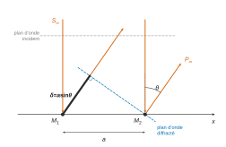
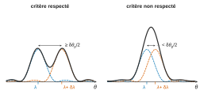
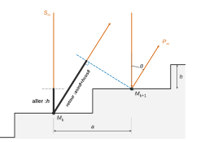
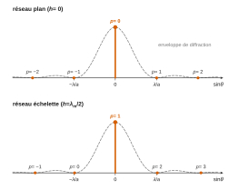
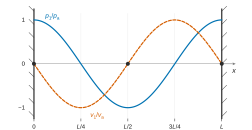
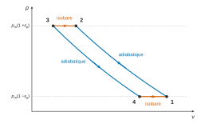

# Centrale-Supélec PC — Physique 2 2026 · Corrigé

*Corrigé rédigé par IA, non officiel. Signalez toute erreur.*

Épreuve de 4 heures, calculatrice autorisée. Thème : quelques instruments du télescope spatial James Webb. Trois parties indépendantes, 43 questions.

## Partie A – Spectrométrie par un réseau à échelette

### Q1

La loi de la réflexion ne fait intervenir aucun indice : elle est indépendante de la longueur d'onde. Un miroir concave a donc la même distance focale pour toutes les longueurs d'onde, alors que la vergence d'une lentille dépend de l'indice $n(\lambda)$ du verre. **Un miroir ne présente pas d'aberration chromatique**, défaut rédhibitoire pour un instrument qui travaille de $0{,}6$ à $28\ \mu\text{m}$. (On peut ajouter que les verres usuels absorbent fortement l'infrarouge, alors que la lumière ne traverse pas un miroir.)

### Interférences à deux ondes

### Q2

Notons $\vec u_i = -\vec u_y$ la direction de propagation incidente et $\vec u_d = \sin\theta\,\vec u_x + \cos\theta\,\vec u_y$ celle de l'onde diffractée vers $P$. Source et point d'observation étant à l'infini, les surfaces d'onde sont planes et, pour un point $M$ quelconque du réseau et une origine $O$ fixe,

$$(SMP) = \text{cte} + (\vec u_i - \vec u_d)\cdot\overrightarrow{OM}.$$

Donc

$$\begin{aligned}
\delta &= (SM_1P) - (SM_2P)\\
&= (\vec u_d - \vec u_i)\cdot\overrightarrow{M_1M_2}.
\end{aligned}$$

Avec $\overrightarrow{M_1M_2} = a\,\vec u_x$ ($h=0$) : l'incidence étant normale, les trajets aller sont égaux ; au retour, le rayon issu de $M_2$ est en avance de la projection $a\sin\theta$. Ainsi

$$\boxed{\delta = a\sin\theta}$$

Le déphasage correspondant vaut $\phi = 2\pi\delta/\lambda$, soit

$$\boxed{\phi = \frac{2\pi a\sin\theta}{\lambda}}$$



### Q3

En prenant l'onde issue de $M_1$ comme référence de phase, $\underline s = A_0\left(1+e^{i\phi}\right)$ et

$$\begin{aligned}
I_2 &= |\underline s|^2\\
&= A_0^2\left|e^{i\phi/2}\right|^2\left|e^{-i\phi/2}+e^{i\phi/2}\right|^2\\
&= 4A_0^2\cos^2\frac{\phi}{2}.
\end{aligned}$$

Le maximum $4A_0^2$ est atteint pour $\phi\in2\pi\mathbb Z$, d'où

$$\boxed{I_{n,2}(\phi) = \cos^2\frac{\phi}{2}}$$

soit aussi $I_{n,2}(\phi) = (1+\cos\phi)/2$.

Tracé : sinusoïde comprise entre 0 et 1, de période $2\pi$ en $\phi$. Maxima égaux à 1 en $\phi = 2p\pi$, zéros en $\phi = (2p+1)\pi$.

### Interférences à N ondes

### Q4

$\overrightarrow{M_1M_k} = (k-1)a\,\vec u_x$, donc, par le calcul de Q2,

$$\boxed{\delta_k = (k-1)\,\delta}$$

et

$$\boxed{\phi_k = (k-1)\,\phi}$$

Les phases des $N$ ondes sont en progression arithmétique de raison $\phi$ (avec $\phi_1 = 0$).

### Q5

Pour $\phi\notin2\pi\mathbb Z$, le formulaire (raison $q = e^{i\phi}\neq1$) donne

$$\begin{aligned}
\underline s &= A_0\sum_{m=0}^{N-1}e^{im\phi}\\
&= A_0\,\frac{1-e^{iN\phi}}{1-e^{i\phi}}.
\end{aligned}$$

Avec $1-e^{i\alpha} = -2i\,e^{i\alpha/2}\sin(\alpha/2)$ au numérateur et au dénominateur :

$$\underline s = A_0\,e^{i(N-1)\phi/2}\,\frac{\sin(N\phi/2)}{\sin(\phi/2)}.$$

Le facteur de phase est de module 1, d'où

$$\boxed{I_N(\phi) = A_0^2\,\frac{\sin^2(N\phi/2)}{\sin^2(\phi/2)}}$$

**Maximum.** Par l'inégalité triangulaire, $|\underline s| \le \sum_k A_0 = NA_0$. L'égalité a lieu si et seulement si toutes les amplitudes complexes sont colinéaires et de même sens, c'est-à-dire $e^{i\phi} = 1$, soit $\phi\in2\pi\mathbb Z$. Cette valeur est atteinte, par exemple pour $\theta = 0$. Donc $\max(I_N) = N^2A_0^2$.

La formule se prolonge d'ailleurs par continuité en $\phi = 2p\pi$ : avec $\phi = 2p\pi+u$, on a $\sin(N\phi/2)/\sin(\phi/2)\to\pm N$. Finalement

$$\boxed{I_{n,N}(\phi) = \left(\frac{\sin(N\phi/2)}{N\sin(\phi/2)}\right)^2}$$

### Q6

$I_{n,N} = 1$ si et seulement si $\phi = 2p\pi$, soit $2\pi a\sin\theta_p/\lambda = 2p\pi$ :

$$\boxed{\sin\theta_p = \frac{p\lambda}{a}}$$

Seuls existent les ordres tels que $|p|\le a/\lambda$.

### Q7

Les zéros vérifient $\sin(N\phi/2) = 0$ et $\sin(\phi/2)\neq0$.

Ce sont donc les $\phi = 2m\pi/N$, avec $m$ non multiple de $N$. Ceux qui encadrent le pic $p$ ($m = pN$) correspondent à $m = pN\pm1$ :

$$\phi_\pm = 2p\pi\pm\frac{2\pi}{N},$$

soit

$$\sin\theta_\pm = \sin\theta_p\pm\frac{\lambda}{Na}.$$

Pour $N\gg1$, $\varepsilon = \pm\lambda/(Na)$ est un infiniment petit (le pic étant supposé loin de l'incidence rasante, $|\varepsilon|\ll 1-|\sin\theta_p|$). Le formulaire donne, avec $\cos\theta_p>0$ :

$$\begin{aligned}
\theta_\pm &\simeq \theta_p\pm\frac{\lambda}{Na\sqrt{1-\sin^2\theta_p}}\\
&= \theta_p\pm\frac{\lambda}{Na\cos\theta_p},
\end{aligned}$$

d'où

$$\boxed{\delta\theta_p = \frac{2\lambda}{Na\cos\theta_p}}$$

### Q8

Les deux longueurs d'onde sont incohérentes entre elles : la caméra reçoit la **somme des intensités** des deux pics. Si l'écart angulaire des pics est inférieur à leur demi-largeur $\delta\theta_p/2$, le creux entre eux disparaît : la somme ne présente qu'un **seul maximum**, élargi. On observe une seule raie, les deux longueurs d'onde ne sont pas résolues.



### Q9

D'après Q6, $\sin\theta_p^{\lambda+\delta\lambda} = \sin\theta_p^\lambda + p\,\delta\lambda/a$, avec $p\,\delta\lambda/a$ infiniment petit. Le formulaire donne

$$\theta_p^{\lambda+\delta\lambda}-\theta_p^{\lambda}\simeq\frac{p\,\delta\lambda}{a\cos\theta_p^\lambda}.$$

Le critère s'écrit, avec Q7,

$$\frac{p\,\delta\lambda}{a\cos\theta_p^\lambda}\ge\frac{\lambda}{Na\cos\theta_p^\lambda}.$$

Comme $a\cos\theta_p^\lambda>0$ et $p>0$, il équivaut à $\delta\lambda\ge\delta\lambda_{\min}$, avec

$$\boxed{\delta\lambda_{\min} = \frac{\lambda}{pN}}$$

et le pouvoir de résolution vaut

$$\boxed{P_r = pN}$$

### Interférences à une infinité d'ondes

### Q10

À l'ordre $p>0$, $\lambda$ est envoyée en $\sin\theta = p\lambda/a$. Le spectre d'ordre $p$ occupe donc l'intervalle $[p\lambda_{\min}/a\,;\,p\lambda_{\max}/a]$ en $\sin\theta$.

Cette fonction est strictement croissante de $\theta$ sur $[-\pi/2\,;\pi/2]$. Pas de recouvrement avec l'ordre $p+1$ si le bord haut de l'ordre $p$ est sous le bord bas de l'ordre $p+1$ :

$$p\lambda_{\max} < (p+1)\lambda_{\min},$$

soit

$$\boxed{p < \frac{\lambda_{\min}}{\lambda_{\max}-\lambda_{\min}}}$$

### Q11

| Filtre | f070lp | f100lp | f170lp | f295lp |
|---|---|---|---|---|
| $\lambda_{\max}-\lambda_{\min}$ (µm) | 0,57 | 0,92 | 1,51 | 2,40 |
| $\lambda_{\min}/(\lambda_{\max}-\lambda_{\min})$ | 1,23 | 1,05 | 1,10 | 1,20 |

Pour les quatre filtres, ce rapport est compris entre 1 et 2. L'ordre 0 ne disperse pas (toutes les longueurs d'onde en $\theta = 0$) ; parmi les ordres $p\ge1$, seul $p = 1$ vérifie la condition de Q10, quel que soit le filtre. La caméra reste donc en face de l'ordre

$$\boxed{p_0 = 1}$$

### Prise en compte de la diffraction par les miroirs

### Q12

La fonction $I_{n,\text{diff}}$ vaut 1 en $\phi = 0$. Elle s'annule en $\phi = 2m\pi$, $m\in\mathbb Z^*$.

Le lobe central a une largeur totale $4\pi$, double de celle des lobes secondaires. Le premier lobe secondaire culmine à environ $4{,}7\,\%$, et les maxima secondaires décroissent en $1/\phi^2$.

Avec $\phi = 2\pi a\sin\theta/\lambda$, le premier zéro est en $\sin\theta = \lambda/a$. Quand $a\gg\lambda$, la lumière est renvoyée dans un cône d'ouverture $\sim\lambda/a\to0$ autour de $\theta = 0$, direction du rayon réfléchi sous incidence normale : **on retrouve la loi de la réflexion de l'optique géométrique**.

### Q13

$I_{n,\text{tot}}$ n'est non nulle qu'en $\phi = 2p\pi$, où elle vaut

$$I_{n,\text{diff}}(2p\pi) = \left(\frac{\sin p\pi}{p\pi}\right)^2 = \begin{cases}1 & p = 0\\ 0 & p\neq0\end{cases}$$

**Seul l'ordre 0 est lumineux** : les zéros de diffraction tombent exactement sur les ordres non nuls, parce que la largeur du miroir est égale au pas du réseau. Or l'ordre 0 ($\sin\theta_0 = 0$ pour toute $\lambda$) ne disperse pas : toute l'énergie part dans la seule direction sans information spectrale. Le spectromètre serait inutilisable.

### Réseau à échelette

### Q14

D'après la figure 2, $\overrightarrow{M_kM_{k+1}} = a\,\vec u_x + h\,\vec u_y$. Avec le résultat général de Q2,

$$\begin{aligned}
\delta_e &= (\vec u_d-\vec u_i)\cdot\overrightarrow{M_kM_{k+1}}\\
&= \left[\sin\theta\,\vec u_x + (1+\cos\theta)\,\vec u_y\right]\cdot\left[a\,\vec u_x + h\,\vec u_y\right]
\end{aligned}$$

$$\boxed{\delta_e = a\sin\theta + h\left(1+\cos\theta\right)}$$

Le rayon qui passe par $M_{k+1}$ est plus haut de $h$. Son trajet aller est plus court de $h$, et son trajet retour plus court de $a\sin\theta + h\cos\theta$.



### Q15

Les facettes restent horizontales, de largeur $a$, éclairées sous incidence normale. L'enveloppe de diffraction est donc inchangée, $\text{sinc}^2(\pi a\sin\theta/\lambda)$, de maximum en $\theta = 0$ quel que soit $h$. Les ordres, eux, vérifient $a\sin\theta + h(1+\cos\theta) = p\lambda$.

Pour que l'ordre $p_0$ de $\lambda_m$ soit dans la direction $\theta = 0$ du maximum de diffraction :

$$2h = p_0\lambda_m,$$

d'où

$$\boxed{\begin{aligned}
h &= \frac{p_0\lambda_m}{2}\\
&= \frac{\lambda_m}{2}
\end{aligned}}$$

Ce choix est toujours possible, puisque $h>0$. Par exemple, $h\approx2{,}0\ \mu\text{m}$ pour f295lp ($\lambda_m = 4{,}07\ \mu\text{m}$) et $h\approx0{,}49\ \mu\text{m}$ pour f070lp.

**Intérêt.** Pour un réseau plan en réflexion, le maximum de diffraction (réflexion spéculaire) coïncide avec l'ordre 0 non dispersif (Q13). Pour un réseau plan en transmission (TP), le maximum de diffraction de chaque fente est dans la direction de la lumière non déviée, encore l'ordre 0. Dans les deux cas les ordres utiles ne reçoivent que les lobes secondaires. La marche du réseau échelette **découple** direction de l'enveloppe et direction des ordres : elle place l'ordre dispersif $p_0$ au sommet de l'enveloppe, ce qui concentre la lumière dans l'ordre utile (et l'ordre 0, déplacé vers $\sin\theta\approx-\lambda/a$, tombe près d'un zéro de l'enveloppe). On gagne en luminosité, et l'on peut travailler à ordre élevé, où $P_r = pN$ est grand.



## Partie B – Absorption IR d'une molécule diatomique

### Approche classique

### Q16

Système : la masse $\mu$, dans le référentiel galiléen ; seule force, $\vec F = -k(\ell-\ell_0)\,\vec e_x$. Le PFD projeté sur $\vec e_x$ donne $\mu\ddot\ell = -k(\ell-\ell_0)$ :

$$\boxed{\ddot\ell + \omega_0^2\,\ell = \omega_0^2\,\ell_0}$$

avec

$$\boxed{\omega_0 = \sqrt{\frac{k}{\mu}}}$$

### Q17

Le ressort a pour longueur $\ell = x_B - x_A$. Il exerce sur $A$ la force $+k(\ell-\ell_0)\,\vec e_x$, et sur $B$ la force opposée :

$$m_A\ddot x_A = k(\ell-\ell_0)$$

et

$$m_B\ddot x_B = -k(\ell-\ell_0).$$

En divisant par les masses et en soustrayant :

$$\ddot\ell = -k\left(\frac1{m_A}+\frac1{m_B}\right)(\ell-\ell_0),$$

soit l'équation de Q16 avec

$$\boxed{\mu = \frac{m_Am_B}{m_A+m_B}}$$

### Q18

On identifie $\omega_0$ à la pulsation du rayonnement absorbé, $\omega_0 = 2\pi c/\lambda$ :

$$k = \mu\left(\frac{2\pi c}{\lambda}\right)^2.$$

Numériquement,

$$\begin{aligned}
\omega_0 &= \frac{2\pi\times3{,}00\times10^8}{4{,}67\times10^{-6}}\\
&= 4{,}04\times10^{14}\ \text{rad·s}^{-1},
\end{aligned}$$

$$\boxed{k = 1{,}14\times10^{-26}\times\left(4{,}04\times10^{14}\right)^2\approx1{,}86\times10^{3}\ \text{N·m}^{-1}}$$

C'est une raideur très élevée (cent fois celle d'un ressort de TP), qui traduit la solidité de la triple liaison $\text{C}\equiv\text{O}$, en haut de l'échelle des constantes de force des liaisons covalentes (quelques centaines à $\sim2\times10^3$ N/m).

### Q19

Avec $u = \ell-\ell_0$ et $e^{-au} = 1 - au + O(u^2)$ (formulaire) :

$$\begin{aligned}
V &= V_0\left(au + O(u^2)\right)^2\\
&= V_0a^2u^2 + O(u^3).
\end{aligned}$$

L'identification à l'énergie potentielle élastique $\frac12ku^2$ donne

$$\boxed{V_0 = \frac{k}{2a^2}}$$

On vérifie que $V''(\ell_0) = 2V_0a^2 = k$.

$$V_0 = \frac{1{,}86\times10^3}{2\times\left(2{,}27\times10^{10}\right)^2}\approx\boxed{1{,}80\times10^{-18}\ \text{J}\approx11{,}3\ \text{eV}}$$

soit $V_0\mathcal N_A\approx1{,}08\times10^3$ kJ/mol. Comme $V\to V_0$ quand $\ell\to\infty$, $V_0$ est l'**énergie de dissociation** de la liaison : une dizaine d'eV, valeur typique d'une liaison covalente très forte, cohérente avec la triple liaison de CO (l'une des plus fortes connues).

### Q20

Classiquement, l'énergie de vibration $E = \frac12k A^2$ varie continûment avec l'amplitude : la molécule pourrait absorber n'importe quelle quantité d'énergie. De plus, dans le potentiel réel (Morse, anharmonique), la période d'oscillation classique dépend de l'énergie : des molécules d'énergies différentes résonneraient à des fréquences différentes, et le gaz absorberait sur une bande continue. Le modèle classique ne peut donc pas expliquer une absorption restreinte au voisinage de $4{,}67\ \mu\text{m}$. Il faut admettre que **l'énergie de vibration est quantifiée** : un photon n'est absorbé que si $hc/\lambda$ est égal à l'écart entre deux niveaux permis. C'est l'objet de l'approche quantique.

### Approche quantique

### Q21

Avec $\underline\psi = \underline\phi(x)\underline f(t)$ et en divisant par $\underline\phi\,\underline f$ (là où il ne s'annule pas) :

$$\frac{1}{\underline\phi(x)}\left[-\frac{\hbar^2}{2\mu}\underline\phi''(x) + V_{\text{app}}(x)\underline\phi(x)\right] = i\hbar\frac{\underline f'(t)}{\underline f(t)}.$$

Le membre de gauche ne dépend que de $x$, celui de droite que de $t$ : tous deux sont égaux à une constante $A$, d'où

$$\boxed{i\hbar\,\frac{\underline f'(t)}{\underline f(t)} = A}$$

Or $[\hbar] = \text{J·s}$ et $[\underline f'/\underline f] = \text{s}^{-1}$. La constante $A$ est donc une énergie, comme $V_{\text{app}}$ dans le membre de gauche. Avec $A = E$ et la constante d'intégration égale à 1 :

$$\boxed{\underline f(t) = \exp\left(-\frac{iEt}{\hbar}\right)}$$

### Q22

$$\boxed{-\frac{\hbar^2}{2\mu}\underline\phi''(x) + V_{\text{app}}(x)\,\underline\phi(x) = E\,\underline\phi(x)}$$

- Zone 1 ($V = +\infty$) : probabilité de présence nulle, $\boxed{\underline\phi_1 = 0}$.
- Zone 2 ($V = 0$) : $\underline\phi'' + K^2\underline\phi = 0$, $\boxed{\underline\phi_2(x) = \alpha\cos Kx + \beta\sin Kx}$.
- Zone 3, où $V = V_0>E$ : $\underline\phi'' - K'^2\underline\phi = 0$ avec $K'$ réel. Les solutions sont $\underline\phi_3 = \gamma e^{-K'x} + \delta e^{K'x}$. La normalisabilité (état lié) impose $\delta = 0$ : $\boxed{\underline\phi_3(x) = \gamma\,e^{-K'x}}$.

### Q23

En $x = 0$ (potentiel infini), seule $\underline\phi$ est continue. Donc $\underline\phi_2(0) = 0$, et $\alpha = 0$.

En $x = L$ (saut de potentiel fini), $\underline\phi$ et $\underline\phi'$ sont continues :

$$\begin{aligned}
\beta\sin KL &= \gamma e^{-K'L} &&(1)\\
\beta K\cos KL &= -K'\gamma e^{-K'L} &&(2)
\end{aligned}$$

Si $\sin KL = 0$, (1) donne $\gamma = 0$. Puis (2) donne $\beta = 0$, car $\cos KL\neq0$ : fonction d'onde nulle, exclu. Donc $\sin KL\neq0$ : les deux membres de (1) sont non nuls et le quotient (2)/(1) donne $K\cot KL = -K'$, soit

$$\boxed{K'L = -\frac{KL}{\tan KL}}$$

### Q24

Par définition de $K$ et $K'$ :

$$K^2 + K'^2 = \frac{2\mu V_0}{\hbar^2},$$

indépendant de $E$. Donc

$$(KL)^2 + (K'L)^2 = R^2,$$

avec

$$\boxed{R = \frac{L\sqrt{2\mu V_0}}{\hbar}}$$

Le point $(z, y) = (KL, K'L)$ doit être à la fois sur la courbe $y = -z/\tan z$ (Q23) et sur le cercle centré sur l'origine, de rayon $R$. Il est dans le quart de plan $z>0$, $y>0$, car $0<E<V_0$.

Les valeurs de $KL$ sont les abscisses des intersections. Chacune donne une énergie $E = \hbar^2(KL)^2/(2\mu L^2)$.

Les branches utiles sont sur $]n\pi-\pi/2\,;n\pi[$. Le nombre d'états liés est le nombre d'entiers $n\ge1$ tels que $n\pi-\pi/2<R$.

### Q25

Énergie du photon :

$$\begin{aligned}
\Delta E &= \frac{2\pi\hbar c}{\lambda}\\
&= \frac{2\pi\times1{,}05\times10^{-34}\times3{,}00\times10^8}{4{,}67\times10^{-6}}\\
&= 4{,}24\times10^{-20}\ \text{J},
\end{aligned}$$

soit $0{,}265$ eV.

Si $R\gg1$ (à vérifier), les intersections sont proches des asymptotes $z = n\pi$. Alors $K_nL\simeq n\pi$ et

$$E_n\simeq\frac{n^2\pi^2\hbar^2}{2\mu L^2},$$

d'où

$$\Delta E = E_2-E_1\simeq\frac{3\pi^2\hbar^2}{2\mu L^2}.$$

On en tire

$$L\simeq\pi\hbar\sqrt{\frac{3}{2\mu\Delta E}}\approx\boxed{1{,}8\times10^{-11}\ \text{m} = 18\ \text{pm}}$$

Vérification :

$$R = \frac{L\sqrt{2\mu V_0}}{\hbar}\approx\frac{1{,}8\times10^{-11}\times2{,}03\times10^{-22}}{1{,}05\times10^{-34}}\approx35\gg\pi,$$

soit une dizaine d'états liés, ce qui valide l'approximation. La résolution numérique exacte donne $KL = 3{,}05$ et $6{,}10$ pour les deux premiers niveaux et $L\approx17{,}8$ pm.

**Qualité de l'approximation.** La largeur trouvée est du bon ordre de grandeur : dans le puits de Morse, la zone classiquement permise mesure environ 10 pm pour l'énergie du fondamental ($\approx\frac12\hbar\omega_0$) et 17 pm pour celle du premier excité, petite devant $\ell_0 = 113$ pm et devant la portée $1/a = 44$ pm.

Mais l'approximation est grossière : $V_{\text{app}}$ est un puits à fond plat de largeur fixe, dont les niveaux croissent en $n^2$ (écarts croissants), alors que les niveaux de Morse sont presque équidistants près du fond, puis de plus en plus serrés. De plus, à l'énergie $V_0$, le puits de Morse est infiniment large (dissociation), pas de largeur 18 pm. Enfin $L$ a été ajusté sur la transition à reproduire. $V_{\text{app}}$ explique la quantification et donne la bonne échelle de longueur, mais ne décrit pas le spectre de vibration de CO.

## Partie C – Refroidissement du télescope

### I – Refroidissement passif par rayonnement

### Q26

Le Soleil émet $P = 4\pi R_{\text{sol}}^2\,\sigma T_{\text{sol}}^4$, répartie sur la sphère de rayon $d$ :

$$\begin{aligned}
\varphi &= \sigma T_{\text{sol}}^4\left(\frac{R_{\text{sol}}}{d}\right)^2\\
&= 6{,}28\times10^7\times\left(4{,}61\times10^{-3}\right)^2\\
&\approx1{,}34\times10^3\ \text{W·m}^{-2}
\end{aligned}$$

(la constante solaire). Le bouclier, de surface $S_b = 240$ m², supposé normal au rayonnement, reçoit

$$\boxed{P_{\text{sol}} = \sigma T_{\text{sol}}^4\left(\frac{R_{\text{sol}}}{d}\right)^2S_b\approx3{,}2\times10^5\ \text{W}}$$

Le bouclier n'en transmet que 23 mW au côté froid : atténuation d'un facteur $\sim10^7$.

### Q27

Système : le côté froid, de température supposée uniforme $T(t)$, solide indilatable, sans travail échangé. Il reçoit $P_t$ et rayonne $\sigma ST^4$ vers l'espace (on néglige le fond cosmologique à 2,7 K, qui apporterait 0,5 mW). Premier principe entre $t$ et $t+\text{d}t$ :

$$mc\,\frac{\text{d}T}{\text{d}t} = P_t - \sigma ST^4,$$

soit

$$\boxed{\frac{\text{d}T}{\text{d}t} + aT^4 = b}$$

avec

$$\boxed{\begin{aligned}
a &= \frac{\sigma S}{mc}\\
b &= \frac{P_t}{mc}
\end{aligned}}$$

### Q28

En régime permanent, $aT_\infty^4 = b$ :

$$\boxed{\begin{aligned}
T_\infty &= \left(\frac ba\right)^{1/4}\\
&= \left(\frac{P_t}{\sigma S}\right)^{1/4}
\end{aligned}}$$

$b$ est homogène à une température divisée par un temps : le temps caractéristique est

$$\boxed{\begin{aligned}
\tau &= \frac{T_\infty}{b}\\
&= \frac{1}{aT_\infty^3}
\end{aligned}}$$

Applications numériques :

$$\begin{aligned}
\frac{P_t}{\sigma S} &= \frac{0{,}023}{8{,}51\times10^{-6}}\\
&= 2{,}70\times10^3\ \text{K}^4,
\end{aligned}$$

d'où $\boxed{T_\infty\approx7{,}2\ \text{K}}$. Ensuite $b = 2{,}40\times10^{-9}$ K/s et $\tau = 3{,}0\times10^9$ s, soit $\boxed{\tau\approx3{,}5\times10^4\ \text{jours}}$ (environ 95 ans).

Ce temps caractérise l'approche finale de $T_\infty$. La dynamique est fortement non linéaire : à haute température, le temps caractéristique local $1/(aT^3)$ est bien plus court (13 jours à 100 K). En négligeant $P_t$, le passage de 300 K à 50 K prend

$$\frac{mc}{3\sigma S}\left(\frac1{50^3}-\frac1{300^3}\right)\approx35\ \text{jours}.$$

### Q29

```python
def f(y):
    return b - a * y**4
```

### Q30

Le temps est compté en jours ; $a$ et $b$ sont alors exprimés avec le jour comme unité de temps. Ils valent $a = 7{,}65\times10^{-8}\ \text{K}^{-3}\text{·j}^{-1}$ et $b = 2{,}07\times10^{-4}\ \text{K·j}^{-1}$. Schéma d'Euler explicite, $T_{n+1} = T_n + \text{d}t\,f(T_n)$ :

```python
def euler(f, dt, T0):
    t = [0]
    T = [T0]
    n = round(150 / dt)              # nombre de pas pour atteindre 150 jours
    for i in range(n):
        T.append(T[-1] + dt * f(T[-1]))
        t.append(t[-1] + dt)
    return t, T
```

Le nombre de pas est calculé une fois pour toutes, ce qui évite qu'une condition `while t[-1] + dt <= 150` s'arrête un pas trop tôt à cause des arrondis. Exécuté avec `dt = 0.01` et `T0 = 300`, ce code donne $T(10\ \text{j})\approx75$ K, $T(60\ \text{j})\approx42$ K et $T(150\ \text{j})\approx31$ K.

### Q31

- **Accord global** : la modélisation reproduit la décroissance rapide (de 250 K à environ 50 K en une quarantaine de jours) puis le net ralentissement. Le refroidissement est bien dominé par le rayonnement du côté froid.
- **Début (avant 35 jours environ)** : les mesures sont au-dessus du modèle (environ 90 à 95 K mesurés contre 75 K calculés à 10 jours), avec un palier vers 63 K entre 15 et 30 jours. Le modèle à température uniforme ignore les inerties différentes des sous-ensembles (miroirs, structure, instruments) et le déploiement progressif du bouclier, ainsi que les événements de mise en service (chauffages, électronique).
- **Fin** : les courbes se croisent vers 40 jours. Les mesures se stabilisent vers 43 K alors que le modèle continue à décroître (31 K à 150 jours) vers $T_\infty = 7{,}2$ K. L'équilibre réel correspond à une puissance absorbée $\sigma ST^4\approx29$ W, plus de mille fois $P_t$ : le modèle néglige la dissipation de l'électronique, la conduction par la structure et le rayonnement du bouclier lui-même vers le côté froid.

Le modèle décrit bien le transitoire, gouverné par $aT^4$, mais pas l'équilibre, gouverné par les apports. L'objectif $T<50$ K est atteint ; descendre à 7 K pour MIRI exige un refroidissement actif (partie C.II).

### II – Refroidissement thermo-acoustique

### Solution en ondes stationnaires

### Q32

Équation d'Euler (fluide parfait) et conservation de la masse :

$$\boxed{\mu\left[\frac{\partial\vec v}{\partial t} + \left(\vec v\cdot\overrightarrow{\text{grad}}\right)\vec v\right] = -\overrightarrow{\text{grad}}\,p + \mu\vec g}$$

et

$$\boxed{\frac{\partial\mu}{\partial t} + \text{div}\left(\mu\vec v\right) = 0}$$

La pesanteur sera négligée dans la suite.

### Q33

Au premier ordre ($\mu_0$, $p_0$ uniformes et constants ; produits de grandeurs d'ordre 1 négligés, en particulier le terme convectif et $\mu_1\vec v_1$), en géométrie unidimensionnelle :

$$\boxed{\begin{aligned}
&\mu_0\frac{\partial v_1}{\partial t} = -\frac{\partial p_1}{\partial x} &&(1)\\
&\frac{\partial\mu_1}{\partial t} + \mu_0\frac{\partial v_1}{\partial x} = 0 &&(2)\\
&\mu_1 = \mu_0\chi_Sp_1 &&(3)
\end{aligned}}$$

la troisième venant de l'évolution isentropique : $\mu_1 = (\partial\mu/\partial p)_S\,p_1$ avec $\chi_S$ évalué au repos.

### Q34

On dérive (2) par rapport à $t$, (1) par rapport à $x$, et on soustrait : $\partial_t^2\mu_1 = \partial_x^2p_1$. Avec (3) :

$$\boxed{\frac{\partial^2p_1}{\partial x^2} - \mu_0\chi_S\frac{\partial^2p_1}{\partial t^2} = 0}$$

C'est une équation de d'Alembert, de célérité

$$\boxed{c = \frac{1}{\sqrt{\mu_0\chi_S}}}$$

### Q35

En régime sinusoïdal, $p_1''(x) + k^2p_1(x) = 0$, avec

$$\boxed{\begin{aligned}
k &= \omega\sqrt{\mu_0\chi_S}\\
&= \frac{\omega}{c}
\end{aligned}}$$

d'où $p_1(x) = \alpha\cos kx + \beta\sin kx$. L'équation (1) avec $v_1(x,t) = i\,v_1(x)e^{i\omega t}$ donne $\mu_0(i\omega)(i\,v_1(x)) = -p_1'(x)$, soit

$$p_1'(x) = \mu_0\,\omega\,v_1(x).\quad(4)$$

La paroi rigide en $x = 0$ impose $v_1(0) = 0$. Donc $p_1'(0) = \beta k = 0$, et $\beta = 0$. En notant $p_a$ l'amplitude :

$$\boxed{p_1(x) = p_a\cos kx}$$

### Q36

La paroi en $x = L$ impose $v_1(L) = 0$, soit $-p_ak\sin kL = 0$.

Or $p_a\neq0$, et $k\neq0$ : le cas $k = 0$ correspond à une surpression uniforme, sans onde. Donc $kL = n\pi$ :

$$\boxed{k_n = \frac{n\pi}{L},\quad n\in\mathbb N^*}$$

D'après (4),

$$v_1(x) = -\frac{p_a}{\mu_0c}\sin k_nx,$$

d'où $v_a = p_a/(\mu_0c)$. Ainsi $p_1/p_a = \cos k_nx$ et $v_1/v_a = -\sin k_nx$.

Pour $n = 2$ ($k_2 = 2\pi/L$, longueur d'onde $L$) :

| $x$ | 0 | $L/4$ | $L/2$ | $3L/4$ | $L$ |
|---|---|---|---|---|---|
| $p_1/p_a = \cos(2\pi x/L)$ | 1 | 0 | −1 | 0 | 1 |
| $v_1/v_a = -\sin(2\pi x/L)$ | 0 | −1 | 0 | 1 | 0 |

Les deux sinusoïdes, de période $L$, sont en quadrature spatiale. Les nœuds de vitesse (ventres de pression) sont en $0$, $L/2$ et $L$. Les nœuds de pression (ventres de vitesse) sont en $L/4$ et $3L/4$.



### Q37

Pour un **gaz parfait** de $\gamma$ **constant** subissant une transformation **adiabatique réversible** :

$$\boxed{T^\gamma P^{1-\gamma} = \text{cte}}$$

### Q38

Par différentiation logarithmique, $\gamma\,\text{d}T/T + (1-\gamma)\,\text{d}P/P = 0$ ; au premier ordre autour de $(T_0, p_0)$ :

$$T_1 = \frac{\gamma-1}{\gamma}\frac{T_0}{p_0}p_1,$$

d'où

$$\boxed{T_1(x) = T_a\cos k_nx}$$

avec

$$\boxed{T_a = \frac{\gamma-1}{\gamma}\frac{T_0}{p_0}p_a}$$

### Perturbation par une plaque : approche Lagrangienne

### Q39

La particule n'échange de la chaleur qu'au cours des deux isobares, au contact de la plaque, aux extrémités de son excursion. Comme $T'_m>0$ :

- la **source chaude** est la portion de plaque en $x_m + x_a$, à $T_m(1+\varepsilon_T)$, où la particule cède de la chaleur (étape $[2]\to[3]$) ;
- la **source froide** est la portion de plaque en $x_m - x_a$, à $T_m(1-\varepsilon_T)$, où elle en reçoit (étape $[4]\to[1]$).

Le **travail** est reçu lors des compressions et détentes adiabatiques imposées par l'onde sonore, c'est-à-dire par les forces de pression du fluide voisin : il est fourni, en dernier ressort, par le dispositif qui entretient l'onde acoustique.

### Q40

Avec $v = rT/p$ et $v_0 = rT_m/p_m$, au premier ordre :

$$\begin{aligned}
\frac{v_1}{v_0}&\simeq1-\varepsilon_T+\varepsilon_p\\
\frac{v_2}{v_0}&\simeq1-\varepsilon_T+2\varepsilon'_p-\varepsilon_p\\
\frac{v_3}{v_0}&\simeq1+\varepsilon_T-\varepsilon_p\\
\frac{v_4}{v_0}&\simeq1+\varepsilon_T-2\varepsilon'_p+\varepsilon_p
\end{aligned}$$

d'où

$$\begin{aligned}
v_1-v_2 = v_4-v_3 &= \frac{2\varepsilon_pv_0}{\gamma}>0\\
v_1-v_4 = v_2-v_3 &= 2(\varepsilon'_p-\varepsilon_T)v_0>0
\end{aligned}$$

en régime frigorifique (Q41).

Allure (échelles très dilatées) : deux isobares horizontales, $p_m(1+\varepsilon_p)$ en haut et $p_m(1-\varepsilon_p)$ en bas. Elles sont reliées par deux adiabatiques descendantes $1\to2$ et $3\to4$, plus raides que des isothermes. Le parcours $1\to2\to3\to4$ est dans le **sens trigonométrique** : cycle récepteur.



### Q41

Pour un réfrigérateur, la particule doit céder de la chaleur à la source chaude ($T_2>T_3$) et en prendre à la source froide ($T_1>T_4$). Avec le tableau :

$$\begin{aligned}
T_2-T_3 &= 2T_m(\varepsilon'_p-\varepsilon_T)(1+\varepsilon'_p)\\
T_1-T_4 &= 2T_m(\varepsilon'_p-\varepsilon_T)(1-\varepsilon'_p)
\end{aligned}$$

$\varepsilon'_p$ étant petit, les deux conditions équivalent à $\varepsilon_T<\varepsilon'_p$, soit

$$\frac{x_aT'_m}{T_m}<\frac{\gamma-1}{\gamma}\frac{x_ap'_m}{p_m}.$$

Donc

$$\boxed{T'_m<T'_{\text{lim}} = \frac{\gamma-1}{\gamma}\,\frac{T_m}{p_m}\,p'_m}$$

$T'_{\text{lim}}$ est le gradient de température créé dans le fluide par l'onde adiabatique seule (Q38). Au-delà, la machine fonctionne en moteur.

### Q42

Étapes adiabatiques : $\boxed{q_{12} = q_{34} = 0}$. Étapes isobares d'un gaz parfait ($\delta q = \text{d}h = c_p\,\text{d}T$) :

$$\boxed{\begin{aligned}
q_{23} &= c_p(T_3-T_2)\\
q_{41} &= c_p(T_1-T_4)
\end{aligned}}$$

Sur un cycle, $\Delta u = 0$, donc

$$\begin{aligned}
w_{\text{cycle}} &= -(q_{23}+q_{41})\\
&= c_p\left[(T_2-T_3)-(T_1-T_4)\right],
\end{aligned}$$

d'où

$$\boxed{w_{\text{cycle}} = 4\,c_p\,T_m\,\varepsilon'_p\left(\varepsilon'_p-\varepsilon_T\right)}$$

Il est positif en régime frigorifique ($\varepsilon'_p>\varepsilon_T$) : la particule reçoit du travail, en accord avec le sens de parcours de Q40. Il est du second ordre, alors que les chaleurs échangées sont du premier ordre : beaucoup de chaleur transportée pour peu de travail. Il s'annule au gradient critique, et devient négatif (moteur) au-delà.

### Q43

Efficacité frigorifique : chaleur prélevée à la source froide divisée par le travail reçu :

$$\begin{aligned}
e &= \frac{q_{41}}{w_{\text{cycle}}}\\
&= \frac{2c_pT_m(\varepsilon'_p-\varepsilon_T)(1-\varepsilon'_p)}{4c_pT_m\varepsilon'_p(\varepsilon'_p-\varepsilon_T)}\\
&= \boxed{\frac{1-\varepsilon'_p}{2\varepsilon'_p}\simeq\frac{1}{2\varepsilon'_p}}
\end{aligned}$$

Efficacité de Carnot entre $T_f = T_m(1-\varepsilon_T)$ et $T_c = T_m(1+\varepsilon_T)$ :

$$\begin{aligned}
e_C &= \frac{T_f}{T_c-T_f}\\
&= \boxed{\frac{1-\varepsilon_T}{2\varepsilon_T}\simeq\frac{1}{2\varepsilon_T}}
\end{aligned}$$

Comme $\varepsilon_T<\varepsilon'_p$, on a bien $e<e_C$ : la condition de fonctionnement frigorifique est compatible avec le second principe, et $e\to e_C$ quand le gradient de la plaque tend vers le gradient critique, la puissance frigorifique tendant alors vers zéro.
