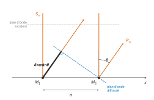
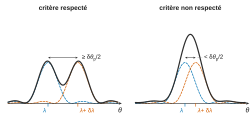
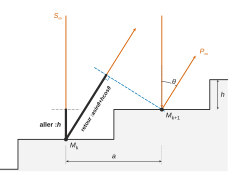
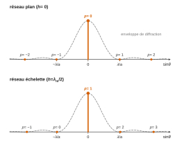
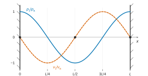
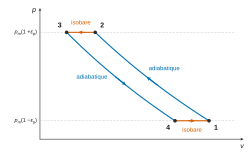

# Centrale-Supélec PC — Physique 2 2026 · Corrigé guidé

*Corrigé rédigé par IA, non officiel. Signalez toute erreur.*

## Présentation du sujet

**Thème.** « Un bref aperçu des instruments du télescope spatial James Webb ». Le sujet prend trois éléments du JWST et, pour chacun, remonte du dispositif à la physique qui le gouverne. Épreuve de **4 heures**, **calculatrice autorisée**, 43 questions en **trois parties indépendantes**. Un formulaire (somme géométrique, développements limités de $\sin$ et $\arcsin$, série de l'exponentielle) et toutes les données numériques sont regroupés en fin d'énoncé.

**Découpage.**

- **Partie A — Spectrométrie par un réseau à échelette (Q1 à Q15).** Construction progressive de la théorie du réseau : deux ondes (Q2-Q3), $N$ ondes (Q4-Q7), pouvoir de résolution (Q8-Q9), recouvrement des ordres et choix de l'ordre de travail (Q10-Q11), rôle de la diffraction par chaque miroir (Q12-Q13), puis réseau échelette, dont la marche de hauteur $h$ envoie la lumière dans un ordre utile (Q14-Q15).
- **Partie B — Absorption IR d'une molécule diatomique (Q16 à Q25).** Oscillateur harmonique et masse réduite (Q16-Q17), raideur de la liaison CO tirée de sa raie d'absorption (Q18), potentiel de Morse et énergie de dissociation (Q19), limite du modèle classique (Q20), puis équation de Schrödinger dans un puits fini à une paroi infinie : séparation des variables, raccordements, résolution graphique et estimation de la largeur du puits (Q21-Q25).
- **Partie C — Refroidissement du télescope (Q26 à Q43).** C.I : flux solaire, bilan radiatif du côté froid, régime permanent et temps caractéristique, méthode d'Euler en Python, lecture critique d'une courbe réelle (Q26-Q31). C.II : équations de l'acoustique linéarisées, ondes stationnaires dans un tuyau fermé, loi de Laplace (Q32-Q38), puis cycle thermo-acoustique d'une particule de fluide le long d'une plaque : sources, diagramme de Clapeyron, gradient critique, travail et efficacité (Q39-Q43).

**Notions du programme mobilisées.** Interférences à $N$ ondes et réseaux, diffraction à l'infini (PC) ; mécanique du point, oscillateur harmonique, système à deux corps ; énergie potentielle et développement au voisinage d'un minimum ; équation de Schrödinger, états stationnaires, puits de potentiel (PC) ; loi de Stefan, premier principe en puissance ; méthode d'Euler (programme d'informatique commune) ; équations d'Euler et de conservation de la masse, approximation acoustique, équation de d'Alembert, ondes stationnaires (PC) ; lois de Laplace, cycles thermodynamiques, efficacité et théorème de Carnot (PCSI).

**Difficulté et longueur.** Le sujet est long mais très guidé : beaucoup de résultats sont donnés (« montrer que », Q5, Q14, Q23, Q27, Q35), ce qui permet de rebondir après un échec. Les points délicats sont la justification du maximum en Q5, la discussion physique de Q13 et Q15, la conclusion qualitative de Q25, le commentaire de figure en Q31, et la fin de la partie C.II, où tout repose sur des développements limités à l'ordre 2 fournis par le tableau.

**À ne pas laisser passer.** Q1 à Q4, Q6, Q16 à Q19, Q21, Q22, Q26 à Q29, Q32 à Q38 sont des questions de cours ou d'application directe. La partie C.I et le début de C.II rapportent vite.

**Gestion du temps.** À titre indicatif : 1 h 30 pour la partie A, 1 h pour la partie B, 1 h 30 pour la partie C. Les parties étant indépendantes, on peut commencer par la partie B ou par C.I, plus courtes et très proches du cours.

---

## Partie A – Spectrométrie par un réseau à échelette

La partie construit pas à pas la formule des réseaux et le pouvoir de résolution, puis montre qu'un réseau plan « gaspille » sa lumière dans l'ordre 0, et que la marche d'un réseau échelette corrige ce défaut. Outils : chemin optique entre ondes planes, sommes géométriques complexes, développements limités du formulaire.

### Question 1

> [!INDICATION]
> Comparer les lois de la réflexion et de la réfraction : laquelle fait intervenir une grandeur qui dépend de la longueur d'onde ?

#### Solution

La loi de la réflexion ne fait intervenir aucun indice : elle est indépendante de la longueur d'onde. Un miroir concave a donc la même distance focale pour toutes les longueurs d'onde, alors que la vergence d'une lentille dépend de l'indice $n(\lambda)$ du verre. **Un miroir ne présente pas d'aberration chromatique**, défaut rédhibitoire pour un instrument qui couvre $0{,}6$ à $28\ \mu\text{m}$. (Autre raison recevable : les verres usuels absorbent fortement l'infrarouge, alors que la lumière ne traverse pas un miroir.)

> [!PIEGE]
> Écrire qu'un miroir « n'a pas d'aberrations » est faux : un miroir sphérique présente une aberration de sphéricité. C'est l'aberration *chromatique* qui disparaît.

### Interférences à deux ondes

### Question 2

> [!INDICATION]
> Source et observation sont à l'infini : les surfaces d'onde sont des plans. Faire un schéma et tracer le plan d'onde diffracté passant par $M_2$.

> [!INDICATION]
> L'incidence est normale : que peut-on dire des trajets aller jusqu'à $M_1$ et $M_2$ ? Au retour, la différence est la projection de $\overrightarrow{M_1M_2}$ sur la direction diffractée.

#### Solution

Notons $\vec u_i = -\vec u_y$ la direction de propagation incidente et $\vec u_d = \sin\theta\,\vec u_x + \cos\theta\,\vec u_y$ celle de l'onde diffractée vers $P$. Pour des ondes planes, avec une origine $O$ fixe,

$$(SMP) = \text{cte} + (\vec u_i - \vec u_d)\cdot\overrightarrow{OM}.$$

Donc

$$\begin{aligned}
\delta &= (SM_1P) - (SM_2P)\\
&= (\vec u_d - \vec u_i)\cdot\overrightarrow{M_1M_2}.
\end{aligned}$$

Avec $\overrightarrow{M_1M_2} = a\,\vec u_x$, les trajets aller sont égaux (incidence normale). Au retour, le rayon issu de $M_2$ est en avance de $a\sin\theta$. Pour $\theta>0$, en effet, $P$ est du côté de $M_2$ :

$$\boxed{\delta = a\sin\theta}$$

et

$$\boxed{\phi = \frac{2\pi a\sin\theta}{\lambda}}$$



> [!METHODE]
> La formule $\delta = (\vec u_d - \vec u_i)\cdot\overrightarrow{M_1M_2}$ traite d'un coup toutes les géométries (incidence oblique, marche verticale) : elle resservira telle quelle en Q4 et Q14.

### Question 3

> [!INDICATION]
> Sommer les deux amplitudes complexes, puis factoriser par l'exponentielle de l'angle moitié pour calculer le module au carré.

#### Solution

$\underline s = A_0(1+e^{i\phi})$, donc

$$\begin{aligned}
I_2 &= A_0^2\left|e^{-i\phi/2}+e^{i\phi/2}\right|^2\\
&= 4A_0^2\cos^2(\phi/2).
\end{aligned}$$

Le maximum $4A_0^2$ est atteint en $\phi\in2\pi\mathbb Z$ :

$$\boxed{I_{n,2}(\phi) = \cos^2\frac{\phi}{2}}$$

soit aussi $I_{n,2}(\phi) = (1+\cos\phi)/2$.

Tracé : sinusoïde entre 0 et 1, de période $2\pi$, maxima 1 en $\phi = 2p\pi$, zéros en $\phi = (2p+1)\pi$.

> [!PIEGE]
> La période de $\cos(\phi/2)$ est $4\pi$, mais celle de son **carré** est $2\pi$ : l'écriture $(1+\cos\phi)/2$ lève le doute. Vérifier deux valeurs, $I_{n,2}(0) = 1$ et $I_{n,2}(\pi) = 0$, et ne pas oublier que le minimum est nul (amplitudes égales).

### Interférences à N ondes

### Question 4

> [!INDICATION]
> Reprendre le calcul de Q2 avec $\overrightarrow{M_1M_k}$ au lieu de $\overrightarrow{M_1M_2}$.

#### Solution

$\overrightarrow{M_1M_k} = (k-1)a\,\vec u_x$, d'où

$$\boxed{\delta_k = (k-1)\,\delta}$$

et

$$\boxed{\phi_k = (k-1)\,\phi}$$

Contrôle : $\delta_1 = 0$ et $\delta_2 = \delta$.

### Question 5

> [!INDICATION]
> L'amplitude totale est une somme géométrique : le formulaire s'applique si sa raison est différente de 1. Factoriser ensuite numérateur et dénominateur par l'angle moitié.

> [!INDICATION]
> Pour le maximum de $I_N$, majorer le module d'une somme par la somme des modules, et examiner le cas d'égalité.

#### Solution

Pour $\phi\notin2\pi\mathbb Z$ ($q = e^{i\phi}\neq1$) :

$$\begin{aligned}
\underline s &= A_0\sum_{m=0}^{N-1}e^{im\phi}\\
&= A_0\frac{1-e^{iN\phi}}{1-e^{i\phi}}\\
&= A_0\,e^{i(N-1)\phi/2}\,\frac{\sin(N\phi/2)}{\sin(\phi/2)}
\end{aligned}$$

en utilisant $1-e^{i\alpha} = -2i\,e^{i\alpha/2}\sin(\alpha/2)$. Le facteur de phase est de module 1 :

$$\boxed{I_N(\phi) = A_0^2\,\frac{\sin^2(N\phi/2)}{\sin^2(\phi/2)}}$$

**Maximum.** $|\underline s|\le\sum_kA_0 = NA_0$. L'égalité a lieu si et seulement si les $N$ amplitudes complexes sont colinéaires et de même sens, soit $e^{i\phi} = 1$, c'est-à-dire $\phi\in2\pi\mathbb Z$. Cette valeur est atteinte (en $\theta = 0$). Donc $\max I_N = N^2A_0^2$.

La formule se prolonge par continuité en $\phi = 2p\pi$. En posant $\phi = 2p\pi+u$, $\sin(N\phi/2)/\sin(\phi/2)\to\pm N$ quand $u\to0$. D'où

$$\boxed{I_{n,N}(\phi) = \left(\frac{\sin(N\phi/2)}{N\sin(\phi/2)}\right)^2}$$

> [!JURY]
> « Justifier soigneusement » signifie que $\max I_N = N^2A_0^2$ doit être démontré (inégalité triangulaire avec son cas d'égalité, ou passage à la limite), et que l'hypothèse $q\neq1$ du formulaire doit être signalée puis le cas $q = 1$ traité à part.

### Question 6

> [!INDICATION]
> D'après Q5, à quelles valeurs de $\phi$ l'intensité normalisée vaut-elle 1 ? Revenir ensuite à $\theta$.

#### Solution

$I_{n,N} = 1$ si et seulement si $\phi = 2p\pi$, c'est-à-dire

$$\boxed{\sin\theta_p = \frac{p\lambda}{a}}$$

Seuls existent les ordres tels que $|p|\le a/\lambda$.

> [!PIEGE]
> Écrire $\theta_p = p\lambda/a$ suppose les petits angles, ce que rien n'autorise ici : $\theta$ parcourt $[-\pi/2\,;\pi/2]$.

### Question 7

> [!INDICATION]
> Les zéros annulent le numérateur sans annuler le dénominateur. Lesquels encadrent immédiatement le pic d'ordre $p$ ?

> [!INDICATION]
> On obtient $\sin\theta_\pm$ ; pour passer à $\theta_\pm$, utiliser le développement de $\arcsin$ du formulaire.

#### Solution

$I_{n,N} = 0\iff\phi = 2m\pi/N$ avec $m$ non multiple de $N$. Les zéros qui encadrent le pic $p$ ($m = pN$) correspondent à $m = pN\pm1$ :

$$\phi_\pm = 2p\pi\pm\frac{2\pi}{N},$$

soit

$$\sin\theta_\pm = \sin\theta_p\pm\frac{\lambda}{Na}.$$

Pour $N\gg1$, $\lambda/(Na)$ est infiniment petit (le pic étant supposé loin de l'incidence rasante). Avec $\cos\theta_p>0$ :

$$\theta_\pm\simeq\theta_p\pm\frac{\lambda}{Na\cos\theta_p},$$

d'où

$$\boxed{\delta\theta_p = \frac{2\lambda}{Na\cos\theta_p}}$$

> [!PIEGE]
> La largeur définie par l'énoncé est l'écart **total** entre les deux zéros, pas la demi-largeur. Et le facteur $1/\cos\theta_p$, qui vient de l'arc sinus, se perd si l'on raisonne comme si $\theta$ était proportionnel à $\phi$.

### Question 8

> [!INDICATION]
> Deux longueurs d'onde différentes sont incohérentes : qu'est-ce que la caméra additionne ?

> [!INDICATION]
> Dessiner les deux pics et leur somme, d'abord bien séparés, puis rapprochés à moins d'une demi-largeur.

#### Solution

La caméra reçoit la **somme des intensités** des deux pics. Si leur écart est inférieur à la demi-largeur $\delta\theta_p/2$, le creux entre eux se comble : la somme n'a plus qu'**un seul maximum**, élargi. On voit une seule raie, les deux longueurs d'onde ne sont pas résolues.



> [!PIEGE]
> On somme les intensités et non les amplitudes. Le schéma doit montrer les deux pics **et** leur somme : c'est la somme, seule observable, qui décide.

### Question 9

> [!INDICATION]
> Exprimer l'écart $\theta_p^{\lambda+\delta\lambda}-\theta_p^\lambda$ par le même développement de l'$\arcsin$ qu'en Q7.

> [!INDICATION]
> Reporter $\delta\theta_p$ de Q7 dans le critère : un facteur commun positif se simplifie.

#### Solution

$\sin\theta_p^{\lambda+\delta\lambda} = \sin\theta_p^\lambda + p\,\delta\lambda/a$, d'où

$$\theta_p^{\lambda+\delta\lambda}-\theta_p^\lambda\simeq\frac{p\,\delta\lambda}{a\cos\theta_p^\lambda}.$$

Le critère devient

$$\frac{p\,\delta\lambda}{a\cos\theta_p^\lambda}\ge\frac{\lambda}{Na\cos\theta_p^\lambda}.$$

Avec $a\cos\theta_p^\lambda>0$ et $p>0$ :

$$\boxed{\delta\lambda_{\min} = \frac{\lambda}{pN}}$$

et

$$\boxed{P_r = pN}$$

> [!METHODE]
> Résultat de cours à connaître : le pouvoir de résolution d'un réseau est le produit de l'ordre par le nombre de traits éclairés. Il ne dépend ni du pas ni de l'angle, et croît avec l'ordre.

### Interférences à une infinité d'ondes

### Question 10

> [!INDICATION]
> Écrire l'intervalle des $\sin\theta$ occupé par le spectre d'ordre $p$, puis celui de l'ordre $p+1$.

> [!INDICATION]
> Il faut comparer le bord haut de l'un au bord bas de l'autre.

#### Solution

Le spectre d'ordre $p$ occupe $[p\lambda_{\min}/a\,;\,p\lambda_{\max}/a]$ en $\sin\theta$. Cette fonction de $\theta$ est croissante. Pas de recouvrement avec l'ordre $p+1$ si $p\lambda_{\max}<(p+1)\lambda_{\min}$ :

$$\boxed{p<\frac{\lambda_{\min}}{\lambda_{\max}-\lambda_{\min}}}$$

> [!METHODE]
> Le pas $a$ disparaît : seule compte la largeur relative de la bande du filtre. Plus la bande est large, plus il faut travailler à ordre bas.

### Question 11

> [!INDICATION]
> Calculer le rapport de Q10 pour chacun des quatre filtres, puis se demander quel ordre non nul convient à tous.

#### Solution

| Filtre | f070lp | f100lp | f170lp | f295lp |
|---|---|---|---|---|
| $\lambda_{\max}-\lambda_{\min}$ (µm) | 0,57 | 0,92 | 1,51 | 2,40 |
| $\lambda_{\min}/(\lambda_{\max}-\lambda_{\min})$ | 1,23 | 1,05 | 1,10 | 1,20 |

Le rapport est compris entre 1 et 2 pour les quatre filtres : l'ordre 1 est toujours permis, l'ordre 2 toujours interdit (cas le plus contraignant : f100lp). L'ordre 0 ne disperse pas. Donc, quel que soit le filtre, $\boxed{p_0 = 1}$ : la caméra n'a pas à être déplacée quand on change de filtre.

> [!PIEGE]
> Montrer le résultat pour les **quatre** filtres, et écrire la double inégalité $1<\text{rapport}<2$ : c'est elle qui fait la démonstration.

### Prise en compte de la diffraction par les miroirs

### Question 12

> [!INDICATION]
> Sinus cardinal au carré : valeur en 0, zéros, largeur du lobe central comparée à celle des lobes secondaires.

> [!INDICATION]
> Pour la limite $a\gg\lambda$, remplacer $\phi$ par son expression en fonction de $\theta$ et regarder où se trouve le premier zéro.

#### Solution

$I_{n,\text{diff}}(0) = 1$, et la fonction s'annule en $\phi = 2m\pi$, $m\neq0$. Le lobe central a une largeur totale $4\pi$, double de celle des lobes secondaires, dont le premier culmine à environ $4{,}7\,\%$.

Le premier zéro est en $\sin\theta = \lambda/a$. Si $a\gg\lambda$, toute la lumière est renvoyée dans un cône d'ouverture $\sim\lambda/a\to0$ autour de $\theta = 0$, direction de la réflexion sous incidence normale : **on retrouve la loi de la réflexion de l'optique géométrique**.

> [!PIEGE]
> Raisonner sur $\phi$ seul ne permet pas de conclure. La largeur $a$ n'apparaît qu'une fois $\phi$ exprimé en fonction de $\theta$.

### Question 13

> [!INDICATION]
> Le produit $I_{n,\infty}\times I_{n,\text{diff}}$ n'est non nul qu'aux ordres d'interférence : évaluer le facteur de diffraction en ces points.

> [!INDICATION]
> Pour le second volet, se demander ce que l'ordre trouvé fait des différentes longueurs d'onde.

#### Solution

En $\phi = 2p\pi$ :

$$I_{n,\text{tot}} = \left(\frac{\sin p\pi}{p\pi}\right)^2,$$

qui vaut 1 pour $p = 0$ (prolongement par continuité) et 0 pour $p\neq0$. **Seul l'ordre 0 est lumineux** : les zéros de diffraction tombent exactement sur les ordres non nuls, parce que la largeur des miroirs est égale au pas du réseau.

Or l'ordre 0 ($\sin\theta_0 = 0$ pour toute $\lambda$) ne disperse pas : toute l'énergie part dans la seule direction qui ne porte aucune information spectrale, et les ordres utiles sont éteints. Le spectromètre serait inutilisable.

> [!PIEGE]
> Le défaut n'est pas « on perd de la lumière » : on la garde toute, mais dans l'ordre qui ne sépare pas les longueurs d'onde.

### Réseau à échelette

### Question 14

> [!INDICATION]
> Appliquer la formule vectorielle de Q2 avec le nouveau vecteur $\overrightarrow{M_kM_{k+1}}$, qui a maintenant une composante verticale.

#### Solution

$\overrightarrow{M_kM_{k+1}} = a\,\vec u_x + h\,\vec u_y$ (figure 2), donc

$$\delta_e = \left[\sin\theta\,\vec u_x + (1+\cos\theta)\,\vec u_y\right]\cdot\left[a\,\vec u_x + h\,\vec u_y\right],$$

d'où

$$\boxed{\delta_e = a\sin\theta + h(1+\cos\theta)}$$

Le rayon passant par $M_{k+1}$ est plus haut de $h$. Son trajet aller est plus court de $h$, et son trajet retour plus court de $a\sin\theta + h\cos\theta$.



> [!METHODE]
> Deux contrôles immédiats : $h = 0$ redonne Q2, et $\theta = 0$ donne $2h$ (aller-retour sur la marche). Ce second contrôle est exactement ce dont Q15 a besoin.

### Question 15

> [!INDICATION]
> La marche déplace-t-elle l'enveloppe de diffraction d'une facette ? Regarder l'orientation des facettes par rapport au faisceau incident.

> [!INDICATION]
> Écrire que la direction du maximum de l'enveloppe est aussi celle de l'ordre $p_0$ pour $\lambda_m$, à l'aide de Q14.

#### Solution

Les facettes restent horizontales, de largeur $a$, sous incidence normale : l'enveloppe de diffraction est inchangée, de maximum en $\theta = 0$, quel que soit $h$. Les ordres, eux, vérifient $a\sin\theta + h(1+\cos\theta) = p\lambda$.

L'ordre $p_0$ de $\lambda_m$ est en $\theta = 0$ si

$$2h = p_0\lambda_m,$$

d'où

$$\boxed{\begin{aligned}
h &= \frac{p_0\lambda_m}{2}\\
&= \frac{\lambda_m}{2}
\end{aligned}}$$

Ce choix est toujours possible : $h\approx2{,}0\ \mu\text{m}$ pour f295lp ($\lambda_m = 4{,}07\ \mu\text{m}$), $h\approx0{,}49\ \mu\text{m}$ pour f070lp.

**Intérêt.** Réseau plan en réflexion : le maximum de diffraction (réflexion spéculaire) coïncide avec l'ordre 0, non dispersif (Q13). Réseau plan en transmission (TP) : le maximum de diffraction de chaque fente est dans la direction non déviée, encore l'ordre 0. Dans les deux cas, les ordres utiles ne reçoivent que les lobes secondaires. Le réseau échelette **découple** la direction de l'enveloppe et celle des ordres : il place l'ordre dispersif $p_0$ au sommet de l'enveloppe, tandis que l'ordre 0, déplacé vers $\sin\theta\approx-\lambda/a$, tombe près d'un zéro. On gagne en luminosité dans l'ordre utile, et l'on peut travailler à ordre élevé, où $P_r = pN$ est grand.



> [!PIEGE]
> La marche ne déplace pas le maximum de diffraction, elle déplace les **ordres d'interférence**. Le facteur 2 de $2h$ vient de ce que la marche est parcourue à l'aller et au retour.

---

## Partie B – Absorption IR d'une molécule diatomique

On modélise la liaison C–O par un ressort, on mesure sa raideur sur la raie d'absorption, on constate l'insuffisance de la description classique, puis on quantifie l'énergie dans un puits de potentiel simplifié. Outils : PFD, développement d'un potentiel au voisinage d'un minimum, équation de Schrödinger stationnaire, raccordements, résolution graphique.

### Approche classique

### Question 16

> [!INDICATION]
> PFD sur la masse dans le référentiel galiléen ; exprimer la force de rappel avec son signe en fonction de $\ell-\ell_0$.

#### Solution

$\mu\ddot\ell = -k(\ell-\ell_0)$, d'où

$$\boxed{\ddot\ell + \omega_0^2\,\ell = \omega_0^2\,\ell_0}$$

avec

$$\boxed{\omega_0 = \sqrt{\frac{k}{\mu}}}$$

> [!PIEGE]
> Oublier $\ell_0$ et écrire $\ddot\ell + \omega_0^2\ell = 0$ décrit un ressort de longueur à vide nulle.

### Question 17

> [!INDICATION]
> PFD sur chaque atome, avec des forces opposées (actions réciproques), puis former $\ddot x_B - \ddot x_A$.

#### Solution

$m_A\ddot x_A = k(\ell-\ell_0)$ et $m_B\ddot x_B = -k(\ell-\ell_0)$. En divisant par les masses et en soustrayant :

$$\ddot\ell = -k\left(\frac1{m_A}+\frac1{m_B}\right)(\ell-\ell_0),$$

d'où

$$\boxed{\mu = \frac{m_Am_B}{m_A+m_B}}$$

> [!METHODE]
> Contrôle de cohérence : si $m_B\gg m_A$, $\mu\to m_A$ et l'atome lourd joue le rôle du mur de la figure 5. La masse réduite est toujours inférieure à la plus petite des deux masses.

### Question 18

> [!INDICATION]
> Identifier $\omega_0$ à la pulsation de l'onde absorbée, en prenant garde à la différence entre fréquence et pulsation.

#### Solution

$\omega_0 = 2\pi c/\lambda = 4{,}04\times10^{14}$ rad/s et

$$\boxed{k = \mu\left(\frac{2\pi c}{\lambda}\right)^2\approx1{,}86\times10^3\ \text{N·m}^{-1}}$$

Raideur considérable, cent fois celle d'un ressort de TP : elle traduit la solidité de la triple liaison $\text{C}\equiv\text{O}$, en haut de l'échelle des liaisons covalentes (quelques centaines à $\sim2\times10^3$ N/m).

> [!PIEGE]
> Oublier le $2\pi$ divise $k$ par $4\pi^2\approx40$. Et une question qui demande de « commenter » n'est traitée qu'à moitié sans comparaison chiffrée.

### Question 19

> [!INDICATION]
> Développer $V(\ell)$ à l'ordre 2 au voisinage de $\ell_0$ grâce au développement de l'exponentielle du formulaire.

> [!INDICATION]
> Identifier au potentiel élastique d'un ressort, sans oublier son facteur $\frac12$. Pour le commentaire, chercher la limite de $V$ quand $\ell\to\infty$.

#### Solution

Avec $u = \ell-\ell_0$ : $1-e^{-au} = au + O(u^2)$, donc $V = V_0a^2u^2 + O(u^3)$. L'identification à $\frac12ku^2$ donne

$$\boxed{V_0 = \frac{k}{2a^2}}$$

Numériquement,

$$V_0 = \frac{1{,}86\times10^3}{2\times(2{,}27\times10^{10})^2}\approx\boxed{1{,}80\times10^{-18}\ \text{J}\approx11{,}3\ \text{eV}}$$

soit environ $1{,}08\times10^3$ kJ/mol. Comme $V\to V_0$ quand $\ell\to\infty$, $V_0$ est l'**énergie de dissociation** : une dizaine d'eV, ordre de grandeur d'une liaison covalente très forte, cohérent avec la triple liaison de CO.

> [!METHODE]
> Approximation harmonique d'un potentiel quelconque : $k = V''(\ell_0)$. Ici $V''(\ell_0) = 2V_0a^2$, ce qui redonne le résultat par un second chemin.

### Question 20

> [!INDICATION]
> Dans le modèle classique, l'énergie de vibration peut-elle prendre n'importe quelle valeur ?

> [!INDICATION]
> Penser aussi à l'anharmonicité : dans le vrai potentiel, la fréquence d'oscillation classique dépend-elle de l'énergie ?

#### Solution

Classiquement, l'énergie de vibration $\frac12kA^2$ varie continûment avec l'amplitude : la molécule pourrait absorber n'importe quelle quantité d'énergie. De plus, dans le potentiel de Morse, anharmonique, la période classique dépend de l'énergie : des molécules d'énergies différentes résonneraient à des fréquences différentes, et le gaz absorberait sur une bande continue. Le modèle classique n'explique donc pas une absorption restreinte au voisinage de $4{,}67\ \mu\text{m}$. Il faut admettre que **l'énergie de vibration est quantifiée** : un photon n'est absorbé que si $hc/\lambda$ coïncide avec l'écart entre deux niveaux permis.

> [!PIEGE]
> Dire que « la mécanique classique ne prévoit pas de résonance » est faux : l'oscillateur forcé résonne en $\omega_0$, et c'est d'ailleurs ce qui a permis de calculer $k$ en Q18. L'argument porte sur le caractère discret du spectre.

### Approche quantique

### Question 21

> [!INDICATION]
> Injecter la forme produit dans l'équation de Schrödinger, diviser par $\underline\phi\,\underline f$, et regrouper ce qui dépend de $x$ d'un côté, de $t$ de l'autre.

> [!INDICATION]
> Une fonction de la seule variable $x$, égale à une fonction de la seule variable $t$ pour tous les couples $(x, t)$, est nécessairement une constante.

#### Solution

$$\frac{1}{\underline\phi(x)}\left[-\frac{\hbar^2}{2\mu}\underline\phi''(x) + V_{\text{app}}(x)\underline\phi(x)\right] = i\hbar\frac{\underline f'(t)}{\underline f(t)}$$

Le membre de gauche ne dépend que de $x$, celui de droite que de $t$ : ils sont égaux à une même constante $A$, d'où

$$\boxed{i\hbar\,\frac{\underline f'(t)}{\underline f(t)} = A}$$

Comme $[\hbar] = \text{J·s}$ et $[\underline f'/\underline f] = \text{s}^{-1}$, $A$ est une énergie. Avec $A = E$ et une constante d'intégration égale à 1 :

$$\boxed{\underline f(t) = \exp\left(-\frac{iEt}{\hbar}\right)}$$

La densité de probabilité $|\underline\psi|^2 = |\underline\phi|^2$ ne dépend pas du temps : l'état est stationnaire.

> [!JURY]
> L'argument de séparation (« fonction de $x$ = fonction de $t$, donc constante ») doit être écrit explicitement : c'est lui qui constitue la démonstration.

### Question 22

> [!INDICATION]
> L'équation pour $\underline\phi$ est le membre de gauche de Q21 égalé à $E$. Dans chaque zone, le potentiel est constant : équation linéaire à coefficients constants.

> [!INDICATION]
> En zone 3, $E<V_0$ : quel est le signe du coefficient ? Laquelle des deux solutions est acceptable pour un état lié ?

#### Solution

$$\boxed{-\frac{\hbar^2}{2\mu}\underline\phi'' + V_{\text{app}}(x)\,\underline\phi = E\,\underline\phi}$$

- Zone 1 ($V = +\infty$) : $\boxed{\underline\phi_1 = 0}$, la particule ne peut s'y trouver.
- Zone 2 ($V = 0$) : $\underline\phi'' + K^2\underline\phi = 0$, $\boxed{\underline\phi_2 = \alpha\cos Kx + \beta\sin Kx}$.
- Zone 3, où $V = V_0>E$ : $\underline\phi'' - K'^2\underline\phi = 0$, de solutions $\gamma e^{-K'x} + \delta e^{K'x}$. La normalisabilité impose $\delta = 0$ : $\boxed{\underline\phi_3 = \gamma\,e^{-K'x}}$. C'est une onde évanescente, de profondeur caractéristique $1/K'$.

### Question 23

> [!INDICATION]
> Écrire les conditions de raccordement en $x = 0$ et en $x = L$ : quelles grandeurs sont continues là où le potentiel est infini, là où son saut est fini ?

> [!INDICATION]
> En $x = L$, on obtient deux relations linéaires : leur quotient élimine les constantes, à condition de vérifier qu'on ne divise pas par zéro.

#### Solution

En $x = 0$ (potentiel infini), seule $\underline\phi$ est continue : $\alpha = 0$. En $x = L$ (saut fini), $\underline\phi$ et $\underline\phi'$ sont continues :

$$\begin{aligned}
\beta\sin KL &= \gamma e^{-K'L} &&(1)\\
\beta K\cos KL &= -K'\gamma e^{-K'L} &&(2)
\end{aligned}$$

Si $\sin KL = 0$, (1) donne $\gamma = 0$ puis (2) donne $\beta = 0$ : solution nulle, exclue. Le quotient (2)/(1) est donc licite : $K\cot KL = -K'$, soit

$$\boxed{K'L = -\frac{KL}{\tan KL}}$$

> [!PIEGE]
> La dérivée n'est **pas** continue en $x = 0$, où le potentiel est infini : l'imposer conduirait à $\underline\phi\equiv0$.

### Question 24

> [!INDICATION]
> La relation de Q23 lie deux inconnues $KL$ et $K'L$ : il manque une relation. Chercher une combinaison de $K$ et $K'$ indépendante de $E$.

#### Solution

$K^2 + K'^2 = 2\mu V_0/\hbar^2$, d'où

$$(KL)^2 + (K'L)^2 = R^2,$$

avec

$$\boxed{R = \frac{L\sqrt{2\mu V_0}}{\hbar}}$$

Le point $(KL, K'L)$ appartient à la fois à la courbe $z\mapsto-z/\tan z$ et au cercle centré sur l'origine, de rayon $R$. Il est dans le quart de plan $z>0$, $y>0$, car $0<E<V_0$.

Les solutions sont les abscisses des intersections : l'énergie est quantifiée. Le nombre d'états liés est le nombre d'entiers $n\ge1$ tels que $n\pi-\pi/2<R$, les branches utiles étant sur $]n\pi-\pi/2\,;n\pi[$.

> [!METHODE]
> Méthode graphique classique des puits finis : une relation de raccordement et une relation de définition qui ne dépend que de la profondeur et de la largeur du puits. Si $R<\pi/2$, il n'y a aucun état lié dans ce puits à paroi infinie.

### Question 25

> [!INDICATION]
> Calculer l'énergie du photon. Supposer $R$ grand : où se trouvent alors les intersections sur la figure 9 ? Vérifier l'hypothèse a posteriori.

> [!INDICATION]
> Dans cette limite, les niveaux sont ceux du puits infini ; la transition fondamental → premier excité fait intervenir $2^2-1^2$.

> [!INDICATION]
> Pour juger le modèle, comparer la largeur obtenue à celle du puits de Morse aux énergies concernées, et comparer la loi des niveaux d'un puits carré à celle d'un oscillateur.

#### Solution

$\Delta E = 2\pi\hbar c/\lambda = 4{,}24\times10^{-20}$ J ($0{,}265$ eV). Si $R\gg1$, les intersections sont proches des asymptotes : $K_nL\simeq n\pi$, $E_n\simeq n^2\pi^2\hbar^2/(2\mu L^2)$ et

$$\Delta E\simeq\frac{3\pi^2\hbar^2}{2\mu L^2},$$

d'où

$$L\simeq\pi\hbar\sqrt{\frac{3}{2\mu\Delta E}}\approx\boxed{18\ \text{pm}}$$

Vérification : $R = L\sqrt{2\mu V_0}/\hbar\approx35\gg\pi$ (une dizaine d'états liés) ; l'approximation est justifiée. La résolution exacte donne $KL = 3{,}05$ et $6{,}10$, et $L\approx17{,}8$ pm.

**Qualité de l'approximation.** L'ordre de grandeur est bon : dans le puits de Morse, la zone classiquement permise mesure environ 10 pm à l'énergie du fondamental et 17 pm à celle du premier excité, petite devant $\ell_0 = 113$ pm et devant $1/a = 44$ pm. Mais le modèle est grossier : les niveaux d'un puits carré croissent en $n^2$ (écarts croissants), alors que ceux du puits de Morse sont presque équidistants près du fond, puis de plus en plus serrés ; à l'énergie $V_0$, le puits de Morse est infiniment large (dissociation) ; enfin $L$ a été ajusté sur la donnée qu'il reproduit. $V_{\text{app}}$ explique la quantification et donne la bonne échelle de longueur, mais pas le spectre de vibration de CO.

> [!JURY]
> « Estimer » autorise une approximation, à condition de la justifier a posteriori par un calcul (ici celui de $R$). Une conclusion de type « bonne » ou « mauvaise approximation » doit être appuyée sur des chiffres et des arguments physiques.

---

## Partie C – Refroidissement du télescope

### I – Refroidissement passif par rayonnement

Bilan radiatif du côté froid, équation différentielle non linéaire, résolution numérique et confrontation à la mesure. Outils : loi de Stefan, premier principe en puissance, analyse dimensionnelle, méthode d'Euler.

### Question 26

> [!INDICATION]
> Puissance totale émise par le Soleil, puis répartition sur une sphère de rayon $d$. Quelle surface du télescope fait face au Soleil ?

#### Solution

$$\begin{aligned}
\varphi &= \frac{4\pi R_{\text{sol}}^2\sigma T_{\text{sol}}^4}{4\pi d^2}\\
&= \sigma T_{\text{sol}}^4\left(\frac{R_{\text{sol}}}{d}\right)^2\\
&\approx1{,}34\times10^3\ \text{W·m}^{-2}
\end{aligned}$$

(on retrouve la constante solaire). Le bouclier, supposé normal au rayonnement, reçoit

$$\boxed{P_{\text{sol}} = \varphi\,S_b\approx3{,}2\times10^5\ \text{W}}$$

Il n'en transmet que 23 mW : atténuation d'un facteur $\sim10^7$.

> [!PIEGE]
> Prendre $S = 150$ m², surface du côté froid, est un contresens : ce côté est à l'ombre. Contrôle numérique : l'éclairement doit retomber sur environ $1{,}4$ kW/m².

### Question 27

> [!INDICATION]
> Système : le côté froid, à température uniforme. Faire la liste de ce qu'il reçoit et de ce qu'il perd, puis appliquer le premier principe entre $t$ et $t+\text{d}t$.

#### Solution

Le côté froid (solide indilatable, sans travail échangé) reçoit $P_t$ et rayonne $\sigma ST^4$ (fond cosmologique négligé : 0,5 mW). D'où

$$mc\,\frac{\text{d}T}{\text{d}t} = P_t - \sigma ST^4,$$

soit

$$\boxed{\frac{\text{d}T}{\text{d}t} + aT^4 = b}$$

avec

$$\boxed{\begin{aligned}
a &= \frac{\sigma S}{mc}\\
b &= \frac{P_t}{mc}
\end{aligned}}$$

> [!JURY]
> Un bilan s'écrit en nommant le système et en identifiant chaque terme reçu ou perdu avec son signe ; l'homogénéité ($mc\,\text{d}T/\text{d}t$ est une puissance) se vérifie.

### Question 28

> [!INDICATION]
> Régime permanent : dérivée nulle. Pour le temps, chercher la dimension de $b$.

> [!INDICATION]
> Pour interpréter la valeur de $\tau$, comparer au temps caractéristique local $1/(aT^3)$ à haute température.

#### Solution

$$\boxed{\begin{aligned}
T_\infty &= \left(\frac ba\right)^{1/4}\\
&= \left(\frac{P_t}{\sigma S}\right)^{1/4}
\end{aligned}}$$

Comme $b$ est en K·s⁻¹, le temps caractéristique est

$$\boxed{\begin{aligned}
\tau &= \frac{T_\infty}{b}\\
&= \frac{1}{aT_\infty^3}
\end{aligned}}$$

Numériquement, $P_t/(\sigma S) = 2{,}70\times10^3$ K⁴, d'où $\boxed{T_\infty\approx7{,}2\ \text{K}}$. Ensuite $b = 2{,}40\times10^{-9}$ K/s et $\tau = 3{,}0\times10^9$ s, soit $\boxed{\tau\approx3{,}5\times10^4\ \text{jours}}$.

Cette durée (95 ans) caractérise l'approche finale de $T_\infty$. L'équation est fortement non linéaire : à 100 K, le temps local $1/(aT^3)$ n'est que de 13 jours, et le passage de 300 K à 50 K prend environ 35 jours en négligeant $P_t$.

> [!PIEGE]
> Conclure que « le télescope met 95 ans à refroidir » contredit la figure 11. $\tau$ n'est pas le temps d'une décroissance exponentielle : la phase rapide est gouvernée par le terme $aT^4$.

### Question 29

> [!INDICATION]
> Isoler $y'$ dans l'équation de Q27.

#### Solution

```python
def f(y):
    return b - a * y**4
```

> [!PIEGE]
> En Python, la puissance s'écrit `**` ; `^` est le « ou exclusif » bit à bit.

### Question 30

> [!INDICATION]
> Schéma d'Euler explicite : la nouvelle valeur s'obtient à partir de la précédente et de la pente évaluée en celle-ci.

> [!INDICATION]
> Fixer l'unité de temps (le jour, ou la seconde avec conversion), puis calculer le nombre de pas pour atteindre 150 jours.

#### Solution

On compte le temps en jours ($a = 7{,}65\times10^{-8}\ \text{K}^{-3}\text{·j}^{-1}$ et $b = 2{,}07\times10^{-4}\ \text{K·j}^{-1}$ dans cette unité) :

```python
def euler(f, dt, T0):
    t = [0]
    T = [T0]
    n = round(150 / dt)              # nombre de pas pour atteindre 150 jours
    for i in range(n):
        T.append(T[-1] + dt * f(T[-1]))
        t.append(t[-1] + dt)
    return t, T
```

Avec `dt = 0.01` et `T0 = 300`, on obtient $T(10\ \text{j})\approx75$ K, $T(60\ \text{j})\approx42$ K, $T(150\ \text{j})\approx31$ K.

> [!PIEGE]
> Une condition `while t[-1] + dt <= 150` peut s'arrêter un pas trop tôt à cause des arrondis sur les flottants (avec `dt = 0.01`, on s'arrête à 149,99). Calculer le nombre de pas une fois pour toutes est plus sûr. Et `range(150/dt)` lève une erreur : il faut un entier.

### Question 31

> [!INDICATION]
> Découper la figure en zones (début, croisement, palier) et relever des valeurs chiffrées sur les axes.

> [!INDICATION]
> Pour chaque écart, chercher l'hypothèse du modèle qui tombe en défaut : uniformité de la température, puissance reçue constante, absence d'autres sources.

#### Solution

- **Accord** : décroissance rapide (de 250 K à environ 50 K en une quarantaine de jours) puis ralentissement ; le mécanisme dominant est bien le rayonnement.
- **Début** : les mesures sont au-dessus du modèle (environ 90 à 95 K contre 75 K à 10 jours) et présentent un palier vers 63 K entre 15 et 30 jours. Le modèle ignore la non-uniformité de la température (inerties différentes des sous-ensembles), le déploiement progressif du bouclier et les événements de mise en service.
- **Fin** : les courbes se croisent vers 40 jours ; les mesures se stabilisent vers 43 K alors que le modèle continue à décroître (31 K à 150 jours) vers 7,2 K. L'équilibre réel correspond à $\sigma ST^4\approx29$ W absorbés, plus de mille fois $P_t$ : électronique, conduction par la structure, rayonnement du bouclier lui-même.

Le modèle décrit bien le transitoire, pas l'équilibre. L'objectif $T<50$ K est atteint ; les 7 K de MIRI exigent un refroidissement actif (C.II).

> [!JURY]
> Commenter une figure, c'est relever des valeurs, comparer, puis relier chaque écart à une hypothèse précise du modèle. Des adjectifs seuls ne suffisent pas.

### II – Refroidissement thermo-acoustique

On établit l'équation de propagation du son, on construit les modes propres d'un tuyau fermé, puis on suit le cycle d'une particule de fluide qui oscille le long d'une plaque : c'est un petit réfrigérateur, entraîné par l'onde. Outils : linéarisation, conditions aux limites, loi de Laplace, premier principe sur un cycle, théorème de Carnot.

### Solution en ondes stationnaires

### Question 32

> [!INDICATION]
> PFD pour une particule de fluide parfait en description eulérienne, avec l'accélération particulaire complète ; bilan de masse local.

#### Solution

$$\boxed{\mu\left[\frac{\partial\vec v}{\partial t} + (\vec v\cdot\overrightarrow{\text{grad}})\vec v\right] = -\overrightarrow{\text{grad}}\,p + \mu\vec g}$$

et

$$\boxed{\frac{\partial\mu}{\partial t} + \text{div}(\mu\vec v) = 0}$$

La pesanteur est négligée dans la suite.

> [!PIEGE]
> Écrire $\text{div}\,\vec v = 0$ suppose l'écoulement incompressible, ce qui interdit toute onde sonore.

### Question 33

> [!INDICATION]
> Remplacer chaque grandeur par sa valeur au repos plus une perturbation, puis ne garder que les termes du premier ordre. Nommer chaque terme négligé.

#### Solution

Au premier ordre ($\mu_0$, $p_0$ uniformes ; terme convectif et $\mu_1v_1$ négligés car d'ordre 2) :

$$\boxed{\begin{aligned}
&\mu_0\frac{\partial v_1}{\partial t} = -\frac{\partial p_1}{\partial x} &&(1)\\
&\frac{\partial\mu_1}{\partial t} + \mu_0\frac{\partial v_1}{\partial x} = 0 &&(2)\\
&\mu_1 = \mu_0\chi_Sp_1 &&(3)
\end{aligned}}$$

la relation (3) traduisant l'évolution isentropique linéarisée autour de l'état de repos.

### Question 34

> [!INDICATION]
> Éliminer $v_1$ par dérivations croisées de (1) et (2), puis $\mu_1$ avec (3).

#### Solution

$\partial_t(2) - \partial_x(1)$ donne $\partial_t^2\mu_1 = \partial_x^2p_1$ ; avec (3) :

$$\boxed{\frac{\partial^2p_1}{\partial x^2} - \mu_0\chi_S\frac{\partial^2p_1}{\partial t^2} = 0}$$

de célérité

$$\boxed{c = \frac{1}{\sqrt{\mu_0\chi_S}}}$$

> [!METHODE]
> Contrôle : les deux dérivées secondes doivent apparaître avec des signes opposés, de sorte que $F(x-ct)+G(x+ct)$ soit solution ; et $[\mu_0\chi_S] = \text{s}^2\text{·m}^{-2}$.

### Question 35

> [!INDICATION]
> Injecter la forme sinusoïdale dans l'équation d'onde : on obtient une équation d'oscillateur en $x$.

> [!INDICATION]
> La condition aux limites porte sur la vitesse à la paroi rigide ; l'équation d'Euler linéarisée la traduit en une condition sur $p_1'$.

#### Solution

$p_1'' + k^2p_1 = 0$, avec

$$\boxed{\begin{aligned}
k &= \omega\sqrt{\mu_0\chi_S}\\
&= \frac{\omega}{c}
\end{aligned}}$$

donc $p_1 = \alpha\cos kx + \beta\sin kx$. L'équation (1) avec $v_1(x,t) = i\,v_1(x)e^{i\omega t}$ donne

$$p_1'(x) = \mu_0\,\omega\,v_1(x).\quad(4)$$

La paroi en $x = 0$ impose $v_1(0) = 0$, donc $p_1'(0) = \beta k = 0$. Ainsi :

$$\boxed{p_1(x) = p_a\cos kx}$$

> [!PIEGE]
> C'est la **vitesse** normale qui s'annule sur une paroi rigide ; le ventre de pression en $x = 0$ en est une conséquence.

### Question 36

> [!INDICATION]
> Appliquer la même condition à la seconde paroi : elle n'est satisfaite que pour certaines valeurs de $k$.

#### Solution

$v_1(L) = 0\iff\sin kL = 0$ ; le cas $k = 0$ (surpression uniforme, pas d'onde) est exclu, d'où

$$\boxed{k_n = \frac{n\pi}{L},\quad n\in\mathbb N^*}$$

D'après (4),

$$v_1 = -\frac{p_a}{\mu_0c}\sin k_nx,$$

d'où $v_a = p_a/(\mu_0c)$. Ainsi $p_1/p_a = \cos k_nx$ et $v_1/v_a = -\sin k_nx$. Pour $n = 2$ :

| $x$ | 0 | $L/4$ | $L/2$ | $3L/4$ | $L$ |
|---|---|---|---|---|---|
| $p_1/p_a$ | 1 | 0 | −1 | 0 | 1 |
| $v_1/v_a$ | 0 | −1 | 0 | 1 | 0 |

Ce sont deux sinusoïdes de période $L$, en quadrature spatiale. Les nœuds de vitesse (ventres de pression) sont en $0$, $L/2$ et $L$. Les nœuds de pression sont en $L/4$ et $3L/4$.



> [!PIEGE]
> Sur le tracé, pression et vitesse ne doivent jamais s'annuler aux mêmes points. Vérification : vitesse nulle sur les deux parois.

### Question 37

> [!INDICATION]
> Loi de cours : écrire la forme qui relie $T$ et $P$, puis lister **toutes** les hypothèses.

#### Solution

Pour un **gaz parfait**, de $\gamma$ **constant**, en évolution **adiabatique réversible** :

$$\boxed{T^\gamma P^{1-\gamma} = \text{cte}}$$

> [!PIEGE]
> L'adiabaticité seule ne suffit pas : une détente de Joule-Gay-Lussac est adiabatique mais irréversible et ne suit pas la loi de Laplace.

### Question 38

> [!INDICATION]
> Différentiation logarithmique de la loi de Laplace, puis linéarisation autour de $(T_0, p_0)$.

#### Solution

$\gamma\,\text{d}T/T + (1-\gamma)\,\text{d}P/P = 0$, d'où au premier ordre

$$\boxed{T_1(x) = T_a\cos k_nx}$$

avec

$$\boxed{T_a = \frac{\gamma-1}{\gamma}\frac{T_0}{p_0}p_a}$$

La surtempérature est en phase avec la surpression ; $T_a>0$ car une compression adiabatique échauffe le gaz.

### Perturbation par une plaque : approche Lagrangienne

### Question 39

> [!INDICATION]
> À quelles étapes la particule échange-t-elle de la chaleur, et avec quoi ? Utiliser le signe de $T'_m$.

> [!INDICATION]
> Pour le travail, se demander qui comprime et détend la particule, et ce qui entretient ce mouvement.

#### Solution

La particule n'échange de la chaleur qu'au cours des isobares, au contact de la plaque. Comme $T'_m>0$ :

- **source chaude** : la plaque en $x_m+x_a$, à $T_m(1+\varepsilon_T)$, où la particule cède de la chaleur (étape $[2]\to[3]$) ;
- **source froide** : la plaque en $x_m-x_a$, à $T_m(1-\varepsilon_T)$, où elle en reçoit (étape $[4]\to[1]$).

Le **travail** est reçu lors des compressions et détentes adiabatiques imposées par l'onde, par les forces de pression du fluide voisin ; il est fourni en dernier ressort par le dispositif qui entretient l'onde acoustique. De proche en proche, les particules se relaient et transportent la chaleur de l'extrémité froide vers l'extrémité chaude de la plaque.

> [!PIEGE]
> Les sources sont extérieures au système (la particule) : ce sont deux portions de plaque, pas « le fluide comprimé ».

### Question 40

> [!INDICATION]
> Calculer les volumes massiques des quatre points par la loi des gaz parfaits, au premier ordre, pour savoir lequel est le plus à droite.

> [!INDICATION]
> Isobares horizontales, adiabatiques plus raides que des isothermes ; le sens de parcours se déduit de l'ordre $1\to2\to3\to4$.

#### Solution

Avec $v = rT/p$ et $v_0 = rT_m/p_m$, au premier ordre :

$$\begin{aligned}
\frac{v_1}{v_0}&\simeq1-\varepsilon_T+\varepsilon_p\\
\frac{v_2}{v_0}&\simeq1-\varepsilon_T+2\varepsilon'_p-\varepsilon_p\\
\frac{v_3}{v_0}&\simeq1+\varepsilon_T-\varepsilon_p\\
\frac{v_4}{v_0}&\simeq1+\varepsilon_T-2\varepsilon'_p+\varepsilon_p
\end{aligned}$$

d'où

$$\begin{aligned}
v_1-v_2 = v_4-v_3 &= \frac{2\varepsilon_pv_0}{\gamma}>0\\
v_1-v_4 = v_2-v_3 &= 2(\varepsilon'_p-\varepsilon_T)v_0>0
\end{aligned}$$

en régime frigorifique.



Le cycle (échelles très dilatées) est parcouru dans le **sens trigonométrique** : c'est un cycle récepteur, qui reçoit du travail.

> [!METHODE]
> En diagramme de Clapeyron, sens horaire = moteur, sens trigonométrique = récepteur (réfrigérateur ou pompe à chaleur). Le signe de $w_{\text{cycle}}$ trouvé en Q42 doit être cohérent avec ce sens.

### Question 41

> [!INDICATION]
> Traduire « réfrigérateur » : la particule doit céder de la chaleur à la source chaude et en recevoir de la source froide. Que cela impose-t-il aux températures des points 2 et 3, puis des points 4 et 1 ?

> [!INDICATION]
> Calculer $T_2-T_3$ et $T_1-T_4$ à partir du tableau, et chercher un facteur commun.

#### Solution

Il faut $T_2>T_3$ et $T_1>T_4$. Le tableau donne les factorisations exactes

$$\begin{aligned}
T_2-T_3 &= 2T_m(\varepsilon'_p-\varepsilon_T)(1+\varepsilon'_p)\\
T_1-T_4 &= 2T_m(\varepsilon'_p-\varepsilon_T)(1-\varepsilon'_p)
\end{aligned}$$

$\varepsilon'_p$ étant petit, les deux conditions équivalent à $\varepsilon_T<\varepsilon'_p$, soit

$$\boxed{T'_m<T'_{\text{lim}} = \frac{\gamma-1}{\gamma}\,\frac{T_m}{p_m}\,p'_m}$$

$T'_{\text{lim}}$ est le gradient de température qu'imprime l'onde adiabatique seule au fluide (Q38). Au-delà, les échanges s'inversent et la machine devient un moteur thermo-acoustique.

> [!METHODE]
> Factoriser plutôt que développer : la factorisation montre d'un coup que les deux conditions sont équivalentes, même au second ordre.

### Question 42

> [!INDICATION]
> Chaleur reçue nulle sur les adiabatiques ; sur une isobare d'un gaz parfait, la chaleur massique est la variation d'enthalpie massique.

> [!INDICATION]
> Le travail du cycle s'obtient par le premier principe sur un cycle complet. Attention : il est du second ordre, il faut garder les termes d'ordre 2 du tableau.

#### Solution

Sur les adiabatiques,

$$\boxed{q_{12} = q_{34} = 0}$$

et sur les isobares,

$$\boxed{\begin{aligned}
q_{23} &= c_p(T_3-T_2)\\
q_{41} &= c_p(T_1-T_4)
\end{aligned}}$$

Sur un cycle, $\Delta u = 0$, donc

$$\begin{aligned}
w_{\text{cycle}} &= -(q_{23}+q_{41})\\
&= c_p\left[(T_2-T_3)-(T_1-T_4)\right],
\end{aligned}$$

d'où

$$\boxed{w_{\text{cycle}} = 4\,c_p\,T_m\,\varepsilon'_p(\varepsilon'_p-\varepsilon_T)}$$

Positif en régime frigorifique (la particule reçoit du travail, conformément au sens de parcours de Q40). Il est du second ordre alors que les chaleurs sont du premier ordre : beaucoup de chaleur transportée pour peu de travail. Il s'annule au gradient critique et devient négatif (moteur) au-delà.

> [!PIEGE]
> À l'ordre 1, les chaleurs $q_{23}$ et $q_{41}$ se compensent exactement et l'on trouverait $w_{\text{cycle}} = 0$. C'est pour cela que l'énoncé fournit $T_2$ et $T_4$ à l'ordre 2.

### Question 43

> [!INDICATION]
> Efficacité d'un réfrigérateur : ce que l'on veut (chaleur prise à la source froide) sur ce que l'on paie (travail reçu).

> [!INDICATION]
> Pour Carnot, les températures à utiliser sont celles des deux sources identifiées en Q39, pas celles de la particule.

#### Solution

$$\begin{aligned}
e &= \frac{q_{41}}{w_{\text{cycle}}}\\
&= \frac{2c_pT_m(\varepsilon'_p-\varepsilon_T)(1-\varepsilon'_p)}{4c_pT_m\varepsilon'_p(\varepsilon'_p-\varepsilon_T)}\\
&= \boxed{\frac{1-\varepsilon'_p}{2\varepsilon'_p}\simeq\frac{1}{2\varepsilon'_p}}
\end{aligned}$$

(simplification licite car $\varepsilon'_p-\varepsilon_T>0$). Entre $T_f = T_m(1-\varepsilon_T)$ et $T_c = T_m(1+\varepsilon_T)$ :

$$\begin{aligned}
e_C &= \frac{T_f}{T_c-T_f}\\
&= \boxed{\frac{1-\varepsilon_T}{2\varepsilon_T}\simeq\frac{1}{2\varepsilon_T}}
\end{aligned}$$

Comme $\varepsilon_T<\varepsilon'_p$, on a $e<e_C$ : la condition de fonctionnement frigorifique est compatible avec le second principe. L'efficacité tend vers celle de Carnot quand le gradient de la plaque tend vers le gradient critique, mais la puissance frigorifique tend alors vers zéro.

> [!PIEGE]
> Mettre $|q_{23}|$ au numérateur donne l'efficacité d'une pompe à chaleur, pas d'un réfrigérateur. Une efficacité n'est pas un rendement : elle peut dépasser 1, et c'est le cas ici.

---

## Bilan

**Méthodes à retenir.**

- Différence de marche entre ondes planes : $\delta = (\vec u_d-\vec u_i)\cdot\overrightarrow{M_1M_2}$, valable pour toutes les géométries (réseau plan, incidence oblique, marche d'échelette).
- Somme de $N$ ondes en progression de phase : somme géométrique, factorisation par l'angle moitié, maximum justifié par l'inégalité triangulaire.
- Passage des $\phi$ aux $\theta$ par développement de l'$\arcsin$ : c'est l'origine du facteur $1/\cos\theta_p$.
- Approximation harmonique d'un potentiel : $k = V''(\ell_0)$ ; masse réduite pour un système à deux corps.
- Puits quantiques : séparation des variables, conditions de raccordement (dérivée non continue là où le potentiel est infini), résolution graphique intersection courbe-cercle.
- Bilan d'énergie en puissance, analyse dimensionnelle d'un temps caractéristique, méthode d'Euler avec un nombre de pas entier.
- Acoustique linéaire : linéarisation, dérivations croisées, conditions de vitesse nulle sur les parois, quantification des modes.
- Cycles infinitésimaux : garder l'ordre qui ne se compense pas (ici le second ordre pour le travail).

**Prérequis à revoir.** Réseaux et pouvoir de résolution ; diffraction à l'infini par une fente ; oscillateur harmonique ; équation de Schrödinger et puits de potentiel ; loi de Stefan ; équations de la mécanique des fluides parfaits ; lois de Laplace ; efficacités et théorème de Carnot.

**Questions classiques transposables.** La formule des réseaux et $P_r = pN$ (Q6-Q9) ; le recouvrement des ordres (Q10) ; la masse réduite (Q17) ; l'énergie de dissociation déduite du potentiel de Morse (Q19) ; le puits fini et sa résolution graphique (Q22-Q24) ; le temps caractéristique d'une équation non linéaire (Q28) ; les modes propres d'un tuyau fermé aux deux bouts (Q35-Q36) ; le gradient critique d'une machine thermo-acoustique (Q41).
