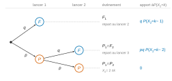
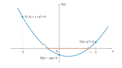
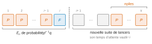
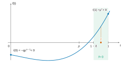

# Centrale-Supélec PSI — Mathématiques 1 2026 · Corrigé

*Corrigé rédigé par IA, non officiel. Signalez toute erreur.*

Notations : $P_i$ (resp. $F_i$) désigne l'événement « le $i$-ième lancer donne pile (resp. face) ». Les lancers sont mutuellement indépendants, de même loi, et $p+q=1$.

## A — Les cas où $n=1$ et $n=2$

### I — Le cas où $n=1$

### Question 1

Soit $k\in\mathbb{N}^*$. On a
$$(X_1=k)=F_1\cap\dots\cap F_{k-1}\cap P_k,$$
donc par indépendance $P(X_1=k)=q^{k-1}p$. Comme
$$\sum_{k\geqslant1}q^{k-1}p=\frac{p}{1-q}=1,$$
on obtient
$$\begin{aligned}
P(X_1=+\infty)&=1-\sum_{k\geqslant1}P(X_1=k)\\
&=0.
\end{aligned}$$

$$\boxed{\begin{aligned}
&\forall k\in\mathbb{N}^*,\ P(X_1=k)=q^{k-1}p,\\
&P(X_1=+\infty)=0 :\ X_1\sim\mathcal{G}(p).
\end{aligned}}$$

### Question 2

Pour une loi géométrique de paramètre $p$ :

$$\boxed{\begin{aligned}
G_{X_1}(z)&=\frac{pz}{1-qz}\quad(|z|<1/q),\\
E(X_1)&=\frac1p,\\
V(X_1)&=\frac{q}{p^2}.
\end{aligned}}$$

### Question 3

*Fonction génératrice.* Soit $|z|<1/q$. La série $\sum_{k\geqslant1}q^{k-1}pz^k$ est géométrique de raison $qz$, avec $|qz|<1$ ; elle converge donc absolument et
$$G_{X_1}(z)=pz\sum_{k\geqslant1}(qz)^{k-1}=\frac{pz}{1-qz}.$$
Le rayon de convergence vaut $1/q>1$.

*Moments.* Le rayon $1/q$ est strictement supérieur à $1$. Les séries dérivées $\sum kP(X_1=k)z^{k-1}$ et $\sum k(k-1)P(X_1=k)z^{k-2}$ ont le même rayon, donc convergent absolument en $z=1$.

Ainsi $X_1$ admet un moment d'ordre 2, avec
$$\begin{aligned}
E(X_1)&=G'_{X_1}(1),\\
E(X_1(X_1-1))&=G''_{X_1}(1).
\end{aligned}$$
Or
$$\begin{aligned}
G'_{X_1}(z)&=\frac{p}{(1-qz)^2},\\
G''_{X_1}(z)&=\frac{2pq}{(1-qz)^3},
\end{aligned}$$
d'où $E(X_1)=\frac{p}{p^2}=\frac1p$ et $E(X_1(X_1-1))=\frac{2q}{p^2}$. Par la formule de König-Huygens,
$$\begin{aligned}
V(X_1)&=G''(1)+G'(1)-G'(1)^2\\
&=\frac{2q}{p^2}+\frac1p-\frac1{p^2}\\
&=\frac{2q+p-1}{p^2}\\
&=\frac{q}{p^2}.
\end{aligned}$$

### II — Le cas où $n=2$

### Question 4

$(X_2=1)$ est impossible (un seul lancer ne peut contenir deux piles), et $(X_2=2)=P_1\cap P_2$. Donc
$$\boxed{\begin{aligned}
P(X_2=1)&=0,\\
P(X_2=2)&=p^2.
\end{aligned}}$$

### Question 5

Soit $k>2$ et supposons $X_2=k$. Les deux premiers lancers ne donnent pas $PP$, sinon on aurait $X_2=2$. Donc **les deux premiers résultats appartiennent à $\{FF,FP,PF\}$** : soit le premier lancer donne face, soit les deux premiers donnent $PF$.

Plus précisément, fixons $k$. L'événement $(X_2=k)$ impose $P_{k-1}\cap P_k$. Si $k\geqslant3$, il impose aussi $F_{k-2}$ :
- $k=3$ : $F_1P_2P_3$, l'ensemble est $\{FP\}$ ;
- $k=4$ : $F_2P_3P_4$, donc le lancer 2 est face. L'ensemble est $\{FF,PF\}$ (suites $FFPP$ et $PFPP$) ;
- $k\geqslant5$ : les trois issues sont possibles. On place $k-4\geqslant1$ faces au milieu. Par exemple : $FF\,F\cdots F\,PP$, $FP\,F\cdots F\,PP$, $PF\,F\cdots F\,PP$.

### Question 6

Considérons les événements $F_1$, $P_1\cap F_2$ et $P_1\cap P_2$. Ils sont deux à deux incompatibles, de réunion $\Omega$.

Leurs probabilités $q$, $pq$, $p^2$ sont non nulles : c'est un système complet. Soit $k>2$.

- Sur $P_1\cap P_2$, $X_2=2\neq k$ : $P(X_2=k\cap P_1\cap P_2)=0$.
- Sur $F_1$, aucune série de deux piles ne contient le lancer 1. Ainsi $X_2=k$ équivaut à : la première série $PP$ des lancers à partir du deuxième se termine au rang $k-1$ de cette suite. Ces lancers sont indépendants, de même loi, et indépendants du premier, donc $P(F_1\cap(X_2=k))=q\,P(X_2=k-1)$.
- Sur $P_1\cap F_2$, aucune série $PP$ ne contient les lancers 1 ou 2. De même, $P(P_1\cap F_2\cap(X_2=k))=pq\,P(X_2=k-2)$, avec $k-2\geqslant1$.



La formule des probabilités totales donne
$$\boxed{\begin{aligned}
\forall k>2,\quad P(X_2=k)&=q\,P(X_2=k-1)\\
&\quad+pq\,P(X_2=k-2).
\end{aligned}}$$

### Question 7

Soit $T=X^2-qX-pq$. Son discriminant $\Delta=q^2+4pq$ est strictement positif : $T$ a deux racines réelles
$$\begin{aligned}
r_1&=\frac{q+\sqrt{q^2+4pq}}{2},\\
r_2&=\frac{q-\sqrt{q^2+4pq}}{2},
\end{aligned}$$
avec $r_2<r_1$.

Leur produit vaut $-pq<0$, donc $r_2<0<r_1$. Leur somme vaut $q>0$, d'où
$$|r_1|-|r_2|=r_1+r_2=q>0,$$
soit $|r_2|<|r_1|$.

Enfin, on évalue le trinôme en $1$, $-1$ et $0$ :
$$\begin{aligned}
T(1)&=1-q-pq\\
&=p-pq\\
&=p^2>0,\\
T(-1)&=1+q-pq\\
&=1+q^2>0,\\
T(0)&=-pq<0.
\end{aligned}$$
Par le théorème des valeurs intermédiaires, $T$ s'annule dans $]-1,0[$ et dans $]0,1[$. Ces deux zéros sont $r_2$ et $r_1$, donc
$$\boxed{\begin{aligned}
&-1<r_2<0<r_1<1,\\
&|r_2|<|r_1|.
\end{aligned}}$$



### Question 8

La série $\sum r_1^{k-1}z^k$ est géométrique, de rayon $1/r_1$. De même, $\sum r_2^{k-1}z^k$ a pour rayon $1/|r_2|$. Ces rayons sont distincts puisque $|r_2|<r_1$, donc le rayon de la différence est le plus petit des deux :
$$\boxed{R=\frac1{r_1}>1.}$$

### Question 9

D'après Q6, $u_k=P(X_2=k)$ vérifie, pour $k\geqslant3$,
$$u_k=qu_{k-1}+pqu_{k-2}.$$
L'équation caractéristique $x^2-qx-pq=0$ a deux racines réelles distinctes $r_1,r_2$. Il existe donc $(\alpha,\beta)\in\mathbb{R}^2$ tels que, pour tout $k\geqslant1$,
$$u_k=\alpha r_1^{k}+\beta r_2^{k}.$$
Les conditions $u_1=0$ et $u_2=p^2$ donnent
$$\begin{aligned}
\alpha r_1+\beta r_2&=0,\\
\alpha r_1^2+\beta r_2^2&=p^2,
\end{aligned}$$
d'où $\alpha r_1(r_1-r_2)=p^2$, puis
$$\begin{aligned}
\alpha&=\frac{p^2}{r_1(r_1-r_2)},\\
\beta&=-\frac{p^2}{r_2(r_1-r_2)}.
\end{aligned}$$
Ainsi, avec $r_1-r_2=\sqrt{q^2+4pq}$, pour tout $k\geqslant2$ (et même $k\geqslant1$) :
$$\boxed{P(X_2=k)=\frac{p^2}{\sqrt{q^2+4pq}}\left(r_1^{k-1}-r_2^{k-1}\right).}$$

### Question 10

$X_2$ prend la valeur $+\infty$ si et seulement si elle est supérieure ou égale à tout entier :
$$\boxed{(X_2=+\infty)=\bigcap_{k\in\mathbb{N}^*}(X_2\geqslant k).}$$
La suite $\big((X_2\geqslant k)\big)_k$ est décroissante pour l'inclusion ; par continuité décroissante,
$$\begin{aligned}
P(X_2=+\infty)&=\lim_{k\to+\infty}P(X_2\geqslant k)\\
&=\lim_{k\to+\infty}\Big(1-\sum_{j=1}^{k-1}P(X_2=j)\Big)\\
&=1-\sum_{j=1}^{+\infty}P(X_2=j).
\end{aligned}$$
Comme $|r_1|,|r_2|<1$, d'après Q9,
$$\begin{aligned}
\sum_{j\geqslant1}P(X_2=j)&=\frac{p^2}{r_1-r_2}\left(\frac1{1-r_1}-\frac1{1-r_2}\right)\\
&=\frac{p^2}{(1-r_1)(1-r_2)}\\
&=\frac{p^2}{T(1)}\\
&=1,
\end{aligned}$$
car $(1-r_1)(1-r_2)=T(1)=p^2$. Donc
$$\boxed{P(X_2=+\infty)=0.}$$

### Question 11

Soit $|z|<R=1/r_1$ ; alors $|r_2z|<|r_1z|<1$. D'après Q9 et Q10, $G_{X_2}(z)=\sum_{k\geqslant1}P(X_2=k)z^k$ et
$$\begin{aligned}
G_{X_2}(z)&=\frac{p^2}{r_1-r_2}\sum_{k\geqslant2}\left(r_1^{k-1}-r_2^{k-1}\right)z^k\\
&=\frac{p^2z^2}{r_1-r_2}\left(\frac{r_1}{1-r_1z}-\frac{r_2}{1-r_2z}\right)\\
&=\frac{p^2z^2}{(1-r_1z)(1-r_2z)}.
\end{aligned}$$
Or
$$\begin{aligned}
(1-r_1z)(1-r_2z)&=1-(r_1+r_2)z+r_1r_2z^2\\
&=1-qz-pqz^2,
\end{aligned}$$
donc
$$\boxed{\forall z\in\mathbb{C},\ |z|<R,\quad G_{X_2}(z)=\frac{p^2z^2}{1-qz-pqz^2}.}$$

### Question 12

La série entière $\sum P(X_2=k)z^k$ a pour rayon $R=1/r_1>1$. Ses séries dérivées première et seconde ont le même rayon, donc convergent absolument en $z=1$.

Ainsi $\sum kP(X_2=k)$ et $\sum k(k-1)P(X_2=k)$ convergent, donc aussi $\sum k^2P(X_2=k)$.

Comme $X_2$ est presque sûrement finie (Q10), **$X_2$ admet une espérance et une variance**, avec
$$\begin{aligned}
E(X_2)&=G'(1),\\
E(X_2(X_2-1))&=G''(1).
\end{aligned}$$

### Question 13

Notons $G=G_{X_2}$ et $D(z)=1-qz-pqz^2$. On a $D(z)G(z)=p^2z^2$ sur $]-R,R[$, intervalle contenant $1$. De plus :
$$\begin{aligned}
G(1)&=1,\\
D(1)&=p^2,\\
D'(1)&=-q-2pq\\
&=-q(1+2p),\\
D''&=-2pq.
\end{aligned}$$

En dérivant une fois en $1$ :
$$D'(1)+p^2G'(1)=2p^2,$$
d'où
$$\begin{aligned}
p^2G'(1)&=2p^2+(1-p)(1+2p)\\
&=1+p,
\end{aligned}$$
et
$$\boxed{E(X_2)=\frac{1+p}{p^2}=\frac1{p^2}+\frac1p.}$$
En dérivant deux fois en $1$ :
$$D''(1)+2D'(1)G'(1)+p^2G''(1)=2p^2,$$
donc
$$\begin{aligned}
p^2G''(1)&=2p^2+2pq+2q(1+2p)\frac{1+p}{p^2}\\
&=2p+\frac{2(1+2p-p^2-2p^3)}{p^2},
\end{aligned}$$
puisque $(1-p)(1+2p)(1+p)=1+2p-p^2-2p^3$.

Posons $u=1/p$. Alors $G''(1)=2u^4+4u^3-2u^2-2u$ et $E(X_2)=u^2+u$, donc
$$\begin{aligned}
V(X_2)&=G''(1)+G'(1)-G'(1)^2\\
&=(2u^4+4u^3-2u^2-2u)+(u^2+u)-(u^4+2u^3+u^2)\\
&=u^4+2u^3-2u^2-u,
\end{aligned}$$
$$\boxed{V(X_2)=\frac1{p^4}+\frac2{p^3}-\frac2{p^2}-\frac1p.}$$
(Contrôle : pour $p=\frac12$, $E(X_2)=6$ et $V(X_2)=22$.)

## B — Le cas où $n=3$

### I — Étude générale à l'aide de l'algèbre linéaire

### Question 14

Trois piles consécutifs demandent au moins trois lancers, et $(X_3=3)=P_1\cap P_2\cap P_3$ :
$$\boxed{\begin{aligned}
P(X_3=1)&=0,\\
P(X_3=2)&=0,\\
P(X_3=3)&=p^3.
\end{aligned}}$$

### Question 15

Considérons les événements
$$\begin{aligned}
E_1&=F_1,\\
E_2&=P_1\cap F_2,\\
E_3&=P_1\cap P_2\cap F_3,\\
E_0&=P_1\cap P_2\cap P_3.
\end{aligned}$$
Ils forment un système complet (classement selon le rang du premier face parmi les trois premiers lancers). Leurs probabilités respectives sont
$$q,\qquad pq,\qquad p^2q,\qquad p^3.$$

Soit $k>3$. Sur $E_0$, $X_3=3\neq k$.

Soit $i\in\{1,2,3\}$. Sur $E_i$, le face du rang $i$ empêche toute série de trois piles de contenir un lancer de rang $\leqslant i$.

Le processus recommence au lancer $i+1$, avec des lancers indépendants de même loi et indépendants des $i$ premiers. D'où $P(E_i\cap(X_3=k))=P(E_i)P(X_3=k-i)$, avec $k-i\geqslant1$.

Par la formule des probabilités totales :
$$\boxed{\begin{aligned}
\forall k>3,\quad P(X_3=k)&=qP(X_3=k-1)+pqP(X_3=k-2)\\
&\quad+qp^2P(X_3=k-3).
\end{aligned}}$$

### Question 16

Soit $k\geqslant1$. Comme $k+3>3$, Q15 donne la première composante de $U_{k+1}$. Les deux autres sont les deux premières de $U_k$ :
$$\boxed{M=\begin{pmatrix}q&pq&qp^2\\1&0&0\\0&1&0\end{pmatrix}.}$$

### Question 17

En développant $\det(XI_3-M)$ selon la première colonne :
$$\begin{aligned}
\chi_M(X)&=\begin{vmatrix}X-q&-pq&-qp^2\\-1&X&0\\0&-1&X\end{vmatrix}\\
&=(X-q)X^2+\begin{vmatrix}-pq&-qp^2\\-1&X\end{vmatrix},
\end{aligned}$$
$$\boxed{\chi_M(X)=X^3-qX^2-pqX-qp^2.}$$

### Question 18

On a $\chi_M(0)=-qp^2<0$ et
$$\begin{aligned}
\chi_M(1)&=1-q(1+p+p^2)\\
&=1-(1-p^3)\\
&=p^3>0.
\end{aligned}$$
Par le théorème des valeurs intermédiaires, $\chi_M$ s'annule sur $]0,1[$.

*Unicité.* Pour $x>0$, on a
$$\frac{\chi_M(x)}{x^3}=1-\frac qx-\frac{pq}{x^2}-\frac{qp^2}{x^3}.$$
Cette fonction est strictement croissante sur $]0,+\infty[$, donc $\chi_M$ s'annule au plus une fois sur $]0,+\infty[$.

Ainsi **$\chi_M$ a une unique racine $\lambda_1$ dans $]0,1[$**, c'est sa seule racine positive, et
$$\begin{aligned}
\chi_M&<0\ \text{sur}\ ]0,\lambda_1[,\\
\chi_M&>0\ \text{sur}\ ]\lambda_1,+\infty[.
\end{aligned}$$

### Question 19

$$\begin{aligned}
(X-p)\chi_M(X)&=X^4-qX^3-pqX^2-qp^2X\\
&\quad-pX^3+pqX^2+qp^2X+qp^3\\
&=X^4-(p+q)X^3+qp^3\\
&=X^4-X^3+qp^3.
\end{aligned}$$

Soit $\psi=X^4-X^3+qp^3$. Alors $\psi'=X^2(4X-3)$.

Ainsi $\psi$ est strictement décroissante sur $]-\infty,\frac34]$ et strictement croissante sur $[\frac34,+\infty[$ : elle a au plus deux racines réelles distinctes. De plus $\psi(p)=p^3(p-1+q)=0$.

On calcule aussi
$$\chi_M(p)=p^2(p-3q).$$

*Cas $\psi(\frac34)<0$.* Alors $\psi$ a exactement deux racines réelles, simples. L'une est $p$. L'autre est $\lambda_1$ : toute racine de $\chi_M$ est racine de $\psi$.

Supposons $\lambda_1=p$. Alors $\chi_M(p)=0$, ce qui donne $p^2(p-3q)=0$, soit $p=\frac34$. On aurait alors $\psi(\frac34)=\psi(p)=0$ : contradiction.

Les racines réelles de $\chi_M$ sont parmi $\{p,\lambda_1\}$, et $\chi_M(p)\neq0$. Donc **$\lambda_1$ est la seule racine réelle de $\chi_M$**.

*Cas $\psi(\frac34)=0$.* Comme $\psi\geqslant\psi(\frac34)$ et $\psi(p)=0$, cela impose $p=\frac34$.

Alors $\frac34$ est l'unique racine réelle de $\psi$, donc de $\chi_M$. Ainsi $\lambda_1=\frac34$.

*Cas $\psi(\frac34)>0$.* Il est exclu puisque $\psi(p)=0$.

Dans tous les cas, $\chi_M$ admet une seule racine réelle, $\lambda_1$.

### Question 20

$\chi_M$, réel de degré 3, est scindé sur $\mathbb{C}$. Sa seule racine réelle est $\lambda_1$. Ses deux autres racines sont donc non réelles et conjuguées, $\lambda_2$ et $\overline{\lambda_2}$, avec $\lambda_2\neq\overline{\lambda_2}$.

Les trois racines $\lambda_1,\lambda_2,\overline{\lambda_2}$ sont deux à deux distinctes. Ainsi $M\in\mathcal{M}_3(\mathbb{C})$ a trois valeurs propres distinctes, donc **$M$ est diagonalisable dans $\mathbb{C}$**.

### Question 21

Par récurrence, $U_k=M^{k-1}U_1$ pour $k\geqslant1$. De plus $M^{k-1}=QD^{k-1}Q^{-1}$, avec $D=\mathrm{diag}(\lambda_1,\lambda_2,\overline{\lambda_2})$.

Posons $V=Q^{-1}U_1=(v_1,v_2,v_3)^\top$, et notons $(w_1,w_2,w_3)$ la troisième ligne de $Q$. La troisième composante de $U_k$ vaut alors
$$P(X_3=k)=w_1v_1\lambda_1^{k-1}+w_2v_2\lambda_2^{k-1}+w_3v_3\overline{\lambda_2}^{\,k-1}.$$
Posons
$$\begin{aligned}
A&=w_1v_1,\\
B&=w_2v_2,\\
C&=w_3v_3,
\end{aligned}$$
indépendants de $k$. Pour tout $k\geqslant1$ :
$$\boxed{P(X_3=k)=A\lambda_1^{k-1}+B\lambda_2^{k-1}+C\overline{\lambda_2}^{\,k-1},}$$
avec $\lambda_1\in]0,1[$ (Q18) et $\lambda_2\in\mathbb{C}$.

### Question 22

Pour $k=1,2,3$ (Q14) :
$$\begin{aligned}
A+B+C&=0,\\
A\lambda_1+B\lambda_2+C\overline{\lambda_2}&=0,\\
A\lambda_1^2+B\lambda_2^2+C\overline{\lambda_2}^2&=p^3.
\end{aligned}$$
Soit $L(X)=(X-\lambda_2)(X-\overline{\lambda_2})=X^2-sX+m$, avec $s=2\mathrm{Re}\lambda_2$ et $m=|\lambda_2|^2$.

La combinaison (troisième) $-s\,$(deuxième) $+m\,$(première) donne
$$A\,L(\lambda_1)+B\,L(\lambda_2)+C\,L(\overline{\lambda_2})=p^3,$$
soit
$$A\,L(\lambda_1)=p^3.$$
Comme $L(\lambda_1)=(\lambda_1-\lambda_2)(\lambda_1-\overline{\lambda_2})=|\lambda_1-\lambda_2|^2\neq0$ :
$$\boxed{A=\frac{p^3}{(\lambda_1-\lambda_2)(\lambda_1-\overline{\lambda_2})}=\frac{p^3}{|\lambda_1-\lambda_2|^2}>0.}$$
En n'utilisant que les racines : $\psi(\lambda_1)=0$ donne $qp^3=\lambda_1^3(1-\lambda_1)$. La somme des racines donne $q=\lambda_1+2\mathrm{Re}\lambda_2$. D'où
$$A=\frac{\lambda_1^3(1-\lambda_1)}{(\lambda_1+2\mathrm{Re}\lambda_2)\,|\lambda_1-\lambda_2|^2}.$$

### Question 23

Écrivons $\lambda_2=re^{i\theta}$, de sorte que
$$\begin{aligned}
\lambda_2^{k-1}&=r^{k-1}e^{i(k-1)\theta},\\
\overline{\lambda_2}^{\,k-1}&=r^{k-1}e^{-i(k-1)\theta}.
\end{aligned}$$
Comme $P(X_3=k)$ est réel, il est égal à sa partie réelle. Avec $\lambda_1$ réel :
$$P(X_3=k)=\mathrm{Re}(A)\lambda_1^{k-1}+r^{k-1}\mathrm{Re}\big(Be^{i(k-1)\theta}\big)+r^{k-1}\mathrm{Re}\big(Ce^{-i(k-1)\theta}\big).$$
Or
$$\begin{aligned}
\mathrm{Re}(Be^{i\varphi})&=\mathrm{Re}B\cos\varphi-\mathrm{Im}B\sin\varphi,\\
\mathrm{Re}(Ce^{-i\varphi})&=\mathrm{Re}C\cos\varphi+\mathrm{Im}C\sin\varphi.
\end{aligned}$$
Posons
$$\begin{aligned}
a&=\mathrm{Re}A,\\
b&=\mathrm{Re}B+\mathrm{Re}C,\\
c&=\mathrm{Im}C-\mathrm{Im}B,
\end{aligned}$$
réels indépendants de $k$. Pour tout $k\in\mathbb{N}^*$ :
$$\boxed{P(X_3=k)=a\lambda_1^{k-1}+br^{k-1}\cos((k-1)\theta)+cr^{k-1}\sin((k-1)\theta).}$$
D'après Q22, $a=A=\frac{p^3}{|\lambda_1-\lambda_2|^2}$.

### Question 24

*$q<\lambda_1$.* On a
$$\begin{aligned}
\chi_M(q)&=q^3-q^3-pq^2-qp^2\\
&=-pq<0.
\end{aligned}$$
Or $\chi_M>0$ sur $]\lambda_1,+\infty[$ (Q18). Comme $q>0$, on a $q<\lambda_1$.

*$\mathrm{Re}(\lambda_2)<0$.* La somme des racines de $\chi_M$ vaut $q$, soit $\lambda_1+2\mathrm{Re}\lambda_2=q$. Donc $2\mathrm{Re}\lambda_2=q-\lambda_1<0$.

*$|\lambda_2-1|>1$.* Comme $1-\mathrm{Re}\lambda_2>1$,
$$|\lambda_2-1|^2=(\mathrm{Re}\lambda_2-1)^2+(\mathrm{Im}\lambda_2)^2\geqslant(1-\mathrm{Re}\lambda_2)^2>1.$$

*$|\lambda_2|<\lambda_1$.* Les nombres $\lambda_1$ et $\lambda_2$ sont racines de $\psi$ (Q19). Pour $\lambda\in\{\lambda_1,\lambda_2\}$, on a donc $\lambda^3(1-\lambda)=qp^3$.

En module :
$$|\lambda_2|^3|\lambda_2-1|=qp^3=\lambda_1^3(1-\lambda_1).$$
Comme $|\lambda_2-1|>1$ et $0<1-\lambda_1<1$,
$$|\lambda_2|^3<|\lambda_2|^3|\lambda_2-1|=\lambda_1^3(1-\lambda_1)<\lambda_1^3,$$
donc $|\lambda_2|<\lambda_1$. En résumé :
$$\boxed{\begin{aligned}
&q<\lambda_1,\\
&\mathrm{Re}(\lambda_2)<0,\\
&|\lambda_2-1|>1,\\
&|\lambda_2|<\lambda_1.
\end{aligned}}$$

### Question 25

D'après Q23, $\big|P(X_3=k)-a\lambda_1^{k-1}\big|\leqslant(|b|+|c|)r^{k-1}$, donc, puisque $a>0$ (Q22),
$$\left|\frac{P(X_3=k)}{a\lambda_1^{k-1}}-1\right|\leqslant\frac{|b|+|c|}{a}\left(\frac{r}{\lambda_1}\right)^{k-1}\xrightarrow[k\to+\infty]{}0$$
car $0<r<\lambda_1$ (Q24). Donc $P(X_3=k)\sim a\lambda_1^{k-1}=\frac{a}{\lambda_1}\lambda_1^k$ :
$$\boxed{\begin{aligned}
P(X_3=k)&\underset{k\to+\infty}{\sim}m\lambda_1^k,\\
m&=\frac{p^3}{\lambda_1|\lambda_1-\lambda_2|^2}\\
&=\frac{p^3}{\lambda_1(\lambda_1-\lambda_2)(\lambda_1-\overline{\lambda_2})}>0.
\end{aligned}}$$

### II — Un cas particulier

### Question 26

Pour $p=\frac34$, on a $q=\frac14$ et $\chi_M(X)=X^3-\frac14X^2-\frac3{16}X-\frac9{64}$, donc
$$\chi_M\!\left(\frac X4\right)=\frac1{64}\left(X^3-X^2-3X-9\right).$$
Une racine entière de $X^3-X^2-3X-9$ divise $9$. Les entiers $1$ et $9$ ne conviennent pas.

En revanche $27-9-9-9=0$, donc **$3$ est racine de $\chi_M(X/4)$**.

### Question 27

On factorise :
$$X^3-X^2-3X-9=(X-3)(X^2+2X+3).$$
Le trinôme $X^2+2X+3$, de discriminant $-8$, a pour racines $-1\pm i\sqrt2$. Les racines de $\chi_M$ sont celles-ci divisées par $4$ :
$$\boxed{\begin{aligned}
\lambda_1&=\frac34,\\
\lambda_2&=\frac{-1+i\sqrt2}{4},\\
\overline{\lambda_2}&=\frac{-1-i\sqrt2}{4}.
\end{aligned}}$$
(Contrôle : somme $\frac14=q$, produit $\frac34\cdot\frac3{16}=\frac9{64}=qp^2$.)

### Question 28

On a $\lambda_1-\lambda_2=\frac{4-i\sqrt2}{4}$, donc
$$\begin{aligned}
|\lambda_1-\lambda_2|^2&=\frac{18}{16}\\
&=\frac98,\\
m&=\frac{27/64}{\frac34\cdot\frac98}\\
&=\frac12.
\end{aligned}$$
Ainsi :
$$\boxed{P(X_3=k)\underset{k\to+\infty}{\sim}\frac12\left(\frac34\right)^k.}$$

## C — L'étude générale par le calcul de la fonction génératrice

### Question 29

$n$ piles consécutifs demandent au moins $n$ lancers, et $(X_n=n)=P_1\cap\dots\cap P_n$ :
$$\boxed{\begin{aligned}
&\forall k\in\{1,\dots,n-1\},\ P(X_n=k)=0,\\
&P(X_n=n)=p^n.
\end{aligned}}$$

### Question 30

Pour $i\in\{1,\dots,n\}$, soit
$$E_i=P_1\cap\dots\cap P_{i-1}\cap F_i,$$
de probabilité $p^{i-1}q$. Soit aussi
$$E_0=P_1\cap\dots\cap P_n,$$
de probabilité $p^n$. Ces $n+1$ événements forment un système complet (rang du premier face parmi les $n$ premiers lancers, ou absence de face). Soit $k>n$.

Sur $E_0$, $X_n=n\neq k$.

Soit $i\in\{1,\dots,n\}$. Sur $E_i$, le lancer de rang $i$ donne face. Aucune série de $n$ piles ne peut donc contenir un lancer de rang $\leqslant i$.

Ainsi $X_n=k$ équivaut à : la première série de $n$ piles des lancers suivants se termine au rang $k-i$ de cette suite.

Ces lancers sont indépendants, de même loi, et indépendants des $i$ premiers. D'où $P(E_i\cap(X_n=k))=p^{i-1}q\,P(X_n=k-i)$, avec $k-i\geqslant1$.



La formule des probabilités totales donne
$$\boxed{\begin{aligned}
\forall k>n,\quad P(X_n=k)&=qP(X_n=k-1)+qpP(X_n=k-2)\\
&\quad+\dots+qp^{n-1}P(X_n=k-n).
\end{aligned}}$$

### Question 31

Comme $p\neq1$, $\sum_{i=1}^np^{i-1}=\frac{1-p^n}{q}$, donc
$$\boxed{\begin{aligned}
f(1)&=1-(1-p^n)\\
&=p^n>0.
\end{aligned}}$$
La fonction $f$ est polynomiale, donc continue en $1$. Il existe ainsi $\delta\in]0,1-p[$ tel que $f>0$ sur $[1-\delta,1]$.

Le réel $t=1-\frac\delta2$ vérifie $p<1-\delta<t<1$ et $f(t)>0$. **Il existe donc $t\in]p,1[$ tel que $f(t)\geqslant0$**, c'est-à-dire
$$q\sum_{i=1}^np^{i-1}t^{n-i}\leqslant t^n.\qquad(\ast)$$



### Question 32

Récurrence forte sur $k\in\mathbb{N}^*$.

*Initialisation, $1\leqslant k\leqslant n$.* Pour $k<n$, on a $P(X_n=k)=0\leqslant t^k$. Pour $k=n$, on a $P(X_n=n)=p^n\leqslant t^n$, car $0<p<t$.

*Hérédité.* Soit $k>n$ tel que $P(X_n=j)\leqslant t^j$ pour tout $j\leqslant k-1$. Pour $i\in\{1,\dots,n\}$, on a $1\leqslant k-i\leqslant k-1$, donc par Q30 et $(\ast)$ :
$$\begin{aligned}
P(X_n=k)&=\sum_{i=1}^nqp^{i-1}P(X_n=k-i)\\
&\leqslant\sum_{i=1}^nqp^{i-1}t^{k-i}\\
&=t^{k-n}\,q\sum_{i=1}^np^{i-1}t^{n-i}\\
&\leqslant t^{k-n}t^n\\
&=t^k.
\end{aligned}$$
$$\boxed{\forall k\in\mathbb{N}^*,\quad P(X_n=k)\leqslant t^k.}$$

### Question 33

*Définition.* Soit $|z|<1/t$. On a $|P(X_n=k)z^k|\leqslant(t|z|)^k$, avec $t|z|<1$.

La série $\sum P(X_n=k)z^k$ converge donc absolument. $G_{X_n}$ est ainsi définie sur le disque $|z|<1/t$, de rayon $\geqslant1/t>1$.

*Calcul.* Notons $u_k=P(X_n=k)$, $G=G_{X_n}$, et soit $|z|<1/t$.

On utilise Q29–Q30 et la convergence absolue : la famille $(qp^{i-1}u_{k-i}z^k)_{1\leqslant i\leqslant n,\ k>n}$ est sommable, majorée par $q(t|z|)^{k-i}|z|^i$. Ainsi :
$$\begin{aligned}
G(z)-p^nz^n&=\sum_{k>n}\sum_{i=1}^nqp^{i-1}u_{k-i}z^k\\
&=\sum_{i=1}^nqp^{i-1}z^i\sum_{j>n-i}u_jz^j\\
&=G(z)\,q\sum_{i=1}^np^{i-1}z^i,
\end{aligned}$$
car $u_j=0$ pour $j<n$ et $n-i<n$.

Comme $|pz|<p/t<1$, on a $q\sum_{i=1}^np^{i-1}z^i=qz\frac{1-p^nz^n}{1-pz}$. En multipliant par $1-pz$ :
$$G(z)\big[(1-pz)-qz+qp^nz^{n+1}\big]=p^nz^n(1-pz),$$
soit
$$G(z)\big(qp^nz^{n+1}-z+1\big)=p^nz^n(1-pz).$$
Supposons que $qp^nz^{n+1}-z+1$ s'annule en un $z_0$ du disque. On aurait $p^nz_0^n(1-pz_0)=0$, donc $z_0=0$ (car $pz_0\neq1$).

Or ce facteur vaut $1$ en $0$. Donc
$$\boxed{\forall z\in\mathbb{C},\ |z|<\frac1t,\quad G_{X_n}(z)=\frac{p^nz^n(1-pz)}{qp^nz^{n+1}-z+1}.}$$
En particulier $G_{X_n}(1)=\frac{p^nq}{qp^n}=1$, donc $P(X_n=+\infty)=0$.

### Question 34

Le rayon de convergence de $\sum P(X_n=k)z^k$ est $\geqslant1/t>1$. La série dérivée converge donc absolument en $1$.

Ainsi **$X_n$ (presque sûrement finie) admet une espérance**, et $E(X_n)=G'_{X_n}(1)$.

Posons $N(z)=p^n(z^n-pz^{n+1})$ et $D(z)=1-z+qp^nz^{n+1}$. Alors :
$$\begin{aligned}
N(1)&=qp^n,\\
D(1)&=qp^n,\\
N'(1)&=p^n\big(n-(n+1)p\big),\\
D'(1)&=(n+1)qp^n-1.
\end{aligned}$$
Donc
$$\begin{aligned}
E(X_n)&=\frac{N'(1)D(1)-N(1)D'(1)}{D(1)^2}\\
&=\frac{p^n\big(n-(n+1)p\big)-(n+1)qp^n+1}{qp^n}\\
&=\frac{p^n\big(n-(n+1)(p+q)\big)+1}{qp^n},
\end{aligned}$$
$$\boxed{\begin{aligned}
E(X_n)&=\frac{1-p^n}{qp^n}\\
&=\sum_{i=1}^n\frac1{p^i}.
\end{aligned}}$$
Contrôles : pour $n=1$, on retrouve $\frac1p$. Pour $n=2$, on retrouve $\frac{1+p}{p^2}$.

### Question 35

Soit $i\in\{1,\dots,n\}$. Pour $|z|<|\lambda_i|$, on a
$$\begin{aligned}
\frac{a_i}{z-\lambda_i}&=-\frac{a_i}{\lambda_i}\cdot\frac{1}{1-z/\lambda_i}\\
&=-\sum_{k\geqslant0}\frac{a_i}{\lambda_i^{k+1}}z^k.
\end{aligned}$$
Sur le disque $|z|<\rho$, avec $\rho=\min\left(\frac1t,|\lambda_1|,\dots,|\lambda_n|\right)$, on a donc
$$\begin{aligned}
\sum_{k\geqslant1}P(X_n=k)z^k&=G_{X_n}(z)\\
&=\Big(a-\sum_{i=1}^n\frac{a_i}{\lambda_i}\Big)-\sum_{k\geqslant1}\Big(\sum_{i=1}^n\frac{a_i}{\lambda_i^{k+1}}\Big)z^k.
\end{aligned}$$
Par unicité du développement en série entière sur un disque de rayon $\rho>0$, pour tout $k\in\mathbb{N}^*$ :
$$\boxed{P(X_n=k)=-\sum_{1\leqslant i\leqslant n}\frac{a_i}{\lambda_i^{k+1}},}$$
et de plus $a=\sum_{i=1}^n\frac{a_i}{\lambda_i}$.

## D — Obtenir une succession de pile à la suite de lancers d'une pièce

### Question 36

Si $k<n$, $A_{n,k}=\varnothing$ ; et $A_{n,n}=P_1\cap\dots\cap P_n$ :
$$\boxed{\begin{aligned}
&\forall k\in\{1,\dots,n-1\},\ P(A_{n,k})=0,\\
&P(A_{n,n})=p^n.
\end{aligned}}$$

### Question 37

On reprend le système complet $(E_0,E_1,\dots,E_n)$ de Q30. Soit $k>n$.

On a $E_0\subset A_{n,k}$, donc $P(E_0\cap A_{n,k})=p^n$.

Soit $i\in\{1,\dots,n\}$. Sur $E_i$, aucune série de $n$ piles ne contient un lancer de rang $\leqslant i$.

Ainsi $A_{n,k}$ est réalisé si et seulement si les lancers de rangs $i+1,\dots,k$ contiennent au moins $n$ piles consécutifs. Ces $k-i$ lancers sont indépendants, de même loi, et indépendants des $i$ premiers.

Donc $P(E_i\cap A_{n,k})=qp^{i-1}P(A_{n,k-i})$, avec $k-i\geqslant1$.

Par la formule des probabilités totales :
$$\boxed{\begin{aligned}
\forall k>n,\quad P(A_{n,k})&=p^n+qP(A_{n,k-1})+qpP(A_{n,k-2})\\
&\quad+\dots+qp^{n-1}P(A_{n,k-n}).
\end{aligned}}$$

### Question 38

```python
def probas_series(p, k, n):
    """Renvoie [P(A_{n,1}), ..., P(A_{n,k})] ; proba[j] contient P(A_{n,j+1})."""
    q = 1 - p
    proba = []
    for l in range(1, k + 1):
        if l < n:
            proba.append(0)
        elif l == n:
            proba.append(p ** n)
        else:
            s = p ** n
            for i in range(1, n + 1):
                s = s + q * p ** (i - 1) * proba[l - i - 1]   # P(A_{n,l-i})
            proba.append(s)
    return proba
```

Soit $l>n$. Pour $1\leqslant i\leqslant n$, on a
$$0\leqslant l-n-1\leqslant l-i-1\leqslant l-2,$$
donc les valeurs utilisées sont déjà calculées.

Coût : $O(nk)$ opérations. Par exemple `probas_series(0.5, 100, 5)[-1]` vaut environ $0{,}8101$.

### Question 39

Une suite constante $v$ convient si et seulement si
$$\begin{aligned}
v&=p^n+v\,q\sum_{i=1}^np^{i-1}\\
&=p^n+v(1-p^n),
\end{aligned}$$
c'est-à-dire $vp^n=p^n$, soit $v=1$ :
$$\boxed{\forall k\in\mathbb{N}^*,\ v_k=1.}$$

### Question 40

Posons $w_k=1-P(A_{n,k})$. Pour $k>n$, par Q37 et $q\sum_{i=1}^np^{i-1}=1-p^n$ :
$$\begin{aligned}
\sum_{i=1}^nqp^{i-1}w_{k-i}&=(1-p^n)-\sum_{i=1}^nqp^{i-1}P(A_{n,k-i})\\
&=(1-p^n)-\big(P(A_{n,k})-p^n\big)\\
&=w_k.
\end{aligned}$$
La suite $(w_k)$ vérifie donc la relation de $(\star)$. Ses premiers termes sont $w_i=1-P(A_{n,i})$ pour $i\leqslant n$ (Q36).

Par l'unicité admise, la suite $(u_k)$ associée à ces conditions initiales est $(w_k)$. D'où $P(A_{n,k})=1-u_k$ pour tout $k$, avec
$$\boxed{(b_1,\dots,b_{n-1},b_n)=(1,\dots,1,\ 1-p^n).}$$

### Question 41

D'après Q40, $u_k=1-P(A_{n,k})=P\big(\overline{A_{n,k}}\big)$.
- Une série présente dans les $k$ premiers lancers l'est dans les $k+1$ premiers, donc $A_{n,k}\subset A_{n,k+1}$. Ainsi $P(A_{n,k})\leqslant P(A_{n,k+1})$ : **$(u_k)$ est décroissante**.
- L'événement $\overline{A_{n,k}}$ contient $F_1\cap\dots\cap F_k$, de probabilité $q^k>0$. Donc $u_k>0$.
- Soit $k\geqslant n$. On a $A_{n,n}\subset A_{n,k}$, donc $P(A_{n,k})\geqslant p^n>0$. Ainsi $u_k\leqslant1-p^n<1$.

$$\boxed{\begin{aligned}
&\forall k\geqslant n,\ 0<u_k<1,\\
&(u_k)_{k\in\mathbb{N}^*}\text{ décroissante}.
\end{aligned}}$$

### Question 42

*$M<1$.* Soit $i\in\{n,\dots,2n-1\}$. Notons $B_i$ l'événement « les lancers $1,\dots,i+1-n$ donnent face et les lancers $i+2-n,\dots,i+1$ donnent pile ».

Il est bien défini car $i+1-n\geqslant1$. Les $n$ derniers des $i+1$ premiers lancers sont piles, donc $B_i\subset A_{n,i+1}$.

Les $i$ premiers lancers ne contiennent que $n-1$ piles, consécutifs à la fin, donc $B_i\subset\overline{A_{n,i}}$. Ainsi
$$\begin{aligned}
u_i-u_{i+1}&=P(A_{n,i+1})-P(A_{n,i})\\
&\geqslant P(B_i)\\
&=q^{i+1-n}p^n>0.
\end{aligned}$$
Comme $u_i>0$, on en déduit $\frac{u_{i+1}}{u_i}<1$. Un maximum d'un nombre fini de réels $<1$ est $<1$ : $0<M<1$.

*Choix de $\alpha$.* On a $f(1)=p^n>0$ et $f$ est continue.

Il existe donc $\delta\in]0,1[$ tel que $f\geqslant0$ sur $[1-\delta,1]$. Posons $\alpha=\max(M,1-\delta)\in[M,1[$.

Alors $f(\alpha)\geqslant0$, soit
$$q\sum_{i=1}^np^{i-1}\alpha^{n-i}\leqslant\alpha^n.\qquad(\ast\ast)$$

*Récurrence d'ordre $n$ à partir du rang $n+1$.* Montrons $u_k\leqslant\alpha^{k-n}$ pour $k\geqslant n+1$.

*Rangs $n+1$ à $2n$.* Pour $i\in\{n,\dots,2n-1\}$, on a $u_{i+1}\leqslant Mu_i\leqslant\alpha u_i$.

Comme $u_n=1-p^n<1$, on en déduit, pour $1\leqslant j\leqslant n$, $u_{n+j}\leqslant\alpha^ju_n\leqslant\alpha^j$.

*Hérédité.* Soit $k\geqslant2n+1$ tel que la propriété soit vraie aux rangs $k-n,\dots,k-1$, tous $\geqslant n+1$. Par $(\star)$ et $(\ast\ast)$ :
$$\begin{aligned}
u_k&=\sum_{i=1}^nqp^{i-1}u_{k-i}\\
&\leqslant\sum_{i=1}^nqp^{i-1}\alpha^{k-i-n}\\
&=\alpha^{k-2n}\,q\sum_{i=1}^np^{i-1}\alpha^{n-i}\\
&\leqslant\alpha^{k-2n}\alpha^n\\
&=\alpha^{k-n}.
\end{aligned}$$

$$\boxed{\exists\alpha\in[M,1[,\ \forall k\geqslant n+1,\quad u_k\leqslant\alpha^{k-n}.}$$

### Question 43

La suite $(A_{n,k})_k$ est croissante pour l'inclusion. Par Q42, $0<u_k\leqslant\alpha^{k-n}\to0$ puisque $0\leqslant\alpha<1$. Par continuité croissante :
$$\boxed{\begin{aligned}
P\Big(\bigcup_{k=1}^{+\infty}A_{n,k}\Big)&=\lim_{k\to+\infty}P(A_{n,k})\\
&=1-\lim_{k\to+\infty}u_k\\
&=1.
\end{aligned}}$$
Prenons $n=10\,000$. L'événement « on obtient à un moment une série d'au moins $10\,000$ piles consécutifs » est exactement $\bigcup_kA_{10\,000,k}$, car une telle série se termine à un rang fini $k$.

Il est de probabilité $1$ : il est presque sûr, quel que soit $p\in]0,1[$.

### Question 44

Ici $n=5$, $p=\frac12$, $k=100\geqslant n+1$. Avec la valeur admise $\alpha=0{,}9827$, Q42 donne $u_{100}\leqslant\alpha^{95}\leqslant0{,}193$, d'où par Q40
$$\boxed{\begin{aligned}
P(A_{5,100})&=1-u_{100}\\
&\geqslant1-0{,}193\\
&=0{,}807\geqslant0{,}8.
\end{aligned}}$$
La probabilité d'obtenir au moins cinq piles consécutifs en $100$ lancers d'une pièce équilibrée est donc au moins $0{,}8$.

*Remarque sur la donnée.* La valeur admise n'est pas compatible avec Q42. En effet, $u_5=\frac{31}{32}$ et $u_6=\frac{61}{64}$, donc
$$M\geqslant\frac{u_6}{u_5}=\frac{61}{62}\approx0{,}9839>0{,}9827.$$
De plus $f(0{,}9827)<0$. Avec ce $\alpha$, la majoration $u_k\leqslant\alpha^{k-5}$ est d'ailleurs fausse à partir de $k=113$.

Elle est cependant vraie pour $k=100$ : la récurrence de Q37 donne $u_{100}\approx0{,}1899$. La conclusion est donc exacte : $P(A_{5,100})\approx0{,}8101$.

### Question 45

Démarche, calquée sur la partie B.

**1. Linéariser.** Travailler sur $u_k=1-P(A_{n,k})$, qui vérifie la récurrence linéaire d'ordre $n$ $(\star)$ (Q40), sans terme constant.

**2. Vectoriser.** Poser $V_k=(u_{k+n-1},\dots,u_{k+1},u_k)^\top$. Alors $V_{k+1}=NV_k$, donc $V_k=N^{k-1}V_1$. Ici $N$ est la matrice compagnon de première ligne $(q,\ qp,\ \dots,\ qp^{n-1})$, de sous-diagonale formée de $1$ et nulle ailleurs.

**3. Polynôme caractéristique.** Comme en Q17, $\chi_N(X)=X^n-q\sum_{i=1}^np^{i-1}X^{n-i}$ : c'est le polynôme qui définit $f$.

**4. Racines de module $<1$.** Soit $\mu$ une racine telle que $|\mu|\geqslant1$. Alors
$$\begin{aligned}
|\mu|^n&\leqslant q\sum_{i=1}^np^{i-1}|\mu|^{n-i}\\
&\leqslant|\mu|^{n-1}(1-p^n)\\
&<|\mu|^{n-1},
\end{aligned}$$
d'où $|\mu|<1$ : absurde. Les racines vérifient aussi $\mu\neq0$, car $\chi_N(0)=-qp^{n-1}\neq0$.

**5. Racines simples, diagonalisation.** Comme en Q19, on pose
$$\Psi=(X-p)\chi_N=X^{n+1}-X^n+qp^n,$$
de dérivée $\Psi'=X^{n-1}\big((n+1)X-n\big)$.

Une racine multiple de $\chi_N$ serait racine multiple de $\Psi$, donc égale à $\frac{n}{n+1}$.

On montre alors que cela force $p=\frac n{n+1}$, et que $p$ serait racine au moins triple de $\Psi$. C'est exclu, car $\Psi''(\frac n{n+1})\neq0$.

Donc $\chi_N$ a $n$ racines distinctes $\mu_1,\dots,\mu_n$. On a alors $N=QDQ^{-1}$, avec $D=\mathrm{diag}(\mu_1,\dots,\mu_n)$.

**6. Conclure.** Comme en Q21, la dernière composante de $V_k=QD^{k-1}Q^{-1}V_1$ s'écrit $u_k=\sum_i\gamma_i\mu_i^{k-1}$. On pose $c_i=\gamma_i/\mu_i$ :
$$\boxed{\begin{aligned}
&\forall k\in\mathbb{N}^*,\ P(A_{n,k})=1-\sum_{i=1}^nc_i\mu_i^k,\\
&|\mu_i|<1.
\end{aligned}}$$
Les $c_i$ se déterminent, si on le souhaite, par les $n$ conditions initiales (système de Vandermonde inversible puisque les $\mu_i$ sont distincts et non nuls).
