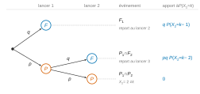
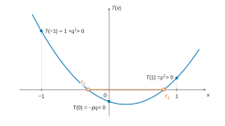
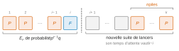
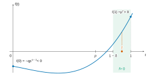

# Centrale-Supélec PSI — Mathématiques 1 2026 · Corrigé guidé

*Corrigé rédigé par IA, non officiel. Signalez toute erreur.*

## Présentation du sujet

**Thème.** Le sujet, intitulé *Obtention de piles successifs lors de lancers d'une pièce*, étudie le temps d'attente $X_n$ de la première série de $n$ piles consécutifs. La pièce a pour paramètre $p\in]0,1[$, et $q=1-p$.

Le sujet étudie ensuite la probabilité $P(A_{n,k})$ de voir au moins $n$ piles consécutifs en $k$ lancers. Épreuve de 4 heures, calculatrice autorisée, 45 questions.

**Fil conducteur.** Une seule idée probabiliste, conditionner par **le rang du premier face** parmi les premiers lancers, fournit à chaque fois une **récurrence linéaire d'ordre $n$** :
$$\begin{aligned}
P(X_n=k)&=\sum_{i=1}^nqp^{i-1}P(X_n=k-i)\\
&=qP(X_n=k-1)+\dots+qp^{n-1}P(X_n=k-n).
\end{aligned}$$
Le sujet exploite ensuite cette récurrence par trois outils : la résolution explicite (ordre 2), la réduction de la matrice compagnon (ordre 3) et la fonction génératrice (ordre $n$). Le polynôme $f(t)=t^n-q\sum_{i=1}^np^{i-1}t^{n-i}$ de l'introduction est le polynôme caractéristique de cette récurrence : il revient en B, en C et en D.

**Découpage.**
- **Partie A (Q1–Q13), $n=1$ puis $n=2$.** Loi géométrique, puis récurrence d'ordre 2 pour $X_2$, résolution explicite, $P(X_2=+\infty)=0$, fonction génératrice, espérance et variance.
- **Partie B (Q14–Q28), $n=3$.** Récurrence d'ordre 3 et matrice compagnon $M$. Localisation des racines de $\chi_M$ : une racine réelle $\lambda_1\in]0,1[$, deux racines complexes conjuguées de module plus petit. Diagonalisation, équivalent $P(X_3=k)\sim m\lambda_1^k$, puis cas explicite $p=\frac34$.
- **Partie C (Q29–Q35), $n$ quelconque.** Majoration $P(X_n=k)\leqslant t^k$, fonction génératrice rationnelle, $E(X_n)=\frac{1-p^n}{qp^n}$, décomposition en éléments simples admise.
- **Partie D (Q36–Q45), au moins $n$ piles en $k$ lancers.** Récurrence affine, passage à $u_k=1-P(A_{n,k})$, décroissance géométrique de $u_k$, conséquence « presque sûre », application numérique, démarche de synthèse.

**Notions du programme mobilisées.** Systèmes complets d'événements et formule des probabilités totales ; continuité croissante et décroissante ; loi géométrique ; fonctions génératrices, critère d'existence des moments par le rayon de convergence ; séries entières (rayon, unicité du développement) ; suites récurrentes linéaires d'ordre 2 ; polynôme caractéristique, diagonalisation, relations coefficients-racines ; théorème des valeurs intermédiaires ; récurrence forte ; Python.

**Difficulté et longueur.** Le sujet est long mais progressif et très guidé. La plupart des questions sont des variantes d'un même raisonnement : celui qui a bien compris Q6 traite Q15, Q30 et Q37 presque mécaniquement. Les questions discriminantes sont Q19 (une seule racine réelle), Q24 (comparaison des modules), Q33 (calcul de la fonction génératrice), Q42 (récurrence d'ordre $n$ avec un $\alpha$ à construire) et Q45 (synthèse).

**À ne pas laisser passer.** Q1–Q2, Q4, Q14, Q16–Q17, Q26–Q29, Q31, Q36, Q38–Q39, Q43–Q44 : ce sont des points presque assurés.

**Gestion du temps.** Environ 55 minutes pour A, 1 h 15 pour B, 50 minutes pour C, 50 minutes pour D, 10 minutes de relecture. Les parties dépendent peu les unes des autres : la partie D peut être abordée directement (elle ne réutilise de C que la fonction $f$ et l'idée de Q32), ce qui permet de récolter Q36–Q41 et Q43–Q44 si l'on bloque en B.

Notations : $P_i$ (resp. $F_i$) est l'événement « le $i$-ième lancer donne pile (resp. face) ». Les lancers sont mutuellement indépendants et de même loi.

## A — Les cas où $n=1$ et $n=2$

La partie A met en place tous les gestes du sujet sur les cas les plus simples : décrire un événement par des mots en $P$ et $F$, conditionner par le premier face, montrer qu'une variable à valeurs dans $\mathbb{N}^*\cup\{+\infty\}$ est presque sûrement finie, et tirer espérance et variance d'une fonction génératrice de rayon strictement supérieur à 1.

### I — Le cas où $n=1$

### Question 1

> [!INDICATION]
> Écrivez l'événement $(X_1=k)$ comme une intersection d'événements portant chacun sur un lancer.

> [!INDICATION]
> N'oubliez pas la valeur $+\infty$ : une loi n'est complète que si l'on connaît aussi $P(X_1=+\infty)$.

#### Solution

Soit $k\in\mathbb{N}^*$. On a
$$(X_1=k)=F_1\cap\dots\cap F_{k-1}\cap P_k,$$
donc, par indépendance des lancers, $P(X_1=k)=q^{k-1}p$. Comme
$$\sum_{k\geqslant1}q^{k-1}p=\frac{p}{1-q}=1,$$
on obtient
$$\begin{aligned}
P(X_1=+\infty)&=1-\sum_{k\geqslant1}P(X_1=k)\\
&=0.
\end{aligned}$$
$$\boxed{\begin{aligned}
&\forall k\in\mathbb{N}^*,\ P(X_1=k)=q^{k-1}p,\\
&P(X_1=+\infty)=0 :\ X_1\sim\mathcal{G}(p).
\end{aligned}}$$

> [!PIEGE]
> Écrire seulement « $X_1$ suit une loi géométrique » ne suffit pas : il faut décrire l'événement et invoquer l'indépendance. L'énoncé autorise $X_n=+\infty$, il faut donc régler le cas de cette valeur.

### Question 2

> [!INDICATION]
> « Donner directement » : on attend les formules de cours, sans démonstration (elle fait l'objet de Q3).

#### Solution

$$\boxed{\begin{aligned}
G_{X_1}(z)&=\frac{pz}{1-qz}\quad(|z|<1/q),\\
E(X_1)&=\frac1p,\\
V(X_1)&=\frac{q}{p^2}.
\end{aligned}}$$

> [!PIEGE]
> Ne pas confondre avec le nombre d'échecs $X_1-1$, à valeurs dans $\mathbb{N}$. Sa fonction génératrice est $\frac{p}{1-qz}$ et son espérance $\frac qp$.

### Question 3

> [!INDICATION]
> La fonction génératrice est la somme d'une série géométrique. Quel est son rayon de convergence ?

> [!INDICATION]
> Un rayon strictement supérieur à $1$ autorise à dériver en $1$. Rappelez ce que donnent $G'(1)$ et $G''(1)$.

#### Solution

*Fonction génératrice.* Soit $|z|<1/q$. La série $\sum_{k\geqslant1}q^{k-1}pz^k$ est géométrique de raison $qz$, avec $|qz|<1$ ; elle converge absolument et
$$G_{X_1}(z)=pz\sum_{k\geqslant1}(qz)^{k-1}=\frac{pz}{1-qz}.$$
Son rayon de convergence est $1/q>1$.

*Moments.* Les séries dérivées $\sum kP(X_1=k)z^{k-1}$ et $\sum k(k-1)P(X_1=k)z^{k-2}$ ont le même rayon $1/q>1$. Elles convergent donc absolument en $z=1$.

Ainsi $X_1$ admet un moment d'ordre 2, avec
$$\begin{aligned}
E(X_1)&=G'_{X_1}(1),\\
E(X_1(X_1-1))&=G''_{X_1}(1).
\end{aligned}$$
Or
$$\begin{aligned}
G'_{X_1}(z)&=\frac{p}{(1-qz)^2},\\
G''_{X_1}(z)&=\frac{2pq}{(1-qz)^3},
\end{aligned}$$
d'où $E(X_1)=\frac{p}{p^2}=\frac1p$ et $E(X_1(X_1-1))=\frac{2q}{p^2}$. Par la formule de König-Huygens,
$$\begin{aligned}
V(X_1)&=G''(1)+G'(1)-G'(1)^2\\
&=\frac{2q}{p^2}+\frac1p-\frac1{p^2}\\
&=\frac{2q+p-1}{p^2}\\
&=\frac{q}{p^2}.
\end{aligned}$$

> [!METHODE]
> Retenez la formule $V(X)=G''(1)+G'(1)-G'(1)^2$, valable dès que $X$ admet un moment d'ordre 2. Elle resservira en Q13.

> [!PIEGE]
> $G''(1)$ vaut $E(X(X-1))$ et non $E(X^2)$. Oublier le terme $+G'(1)$ est l'erreur la plus fréquente.

### II — Le cas où $n=2$

### Question 4

> [!INDICATION]
> Combien de lancers faut-il au minimum pour voir deux piles consécutifs ?

#### Solution

$(X_2=1)$ est impossible, et $(X_2=2)=P_1\cap P_2$. Donc
$$\boxed{\begin{aligned}
P(X_2=1)&=0,\\
P(X_2=2)&=p^2.
\end{aligned}}$$

### Question 5

> [!INDICATION]
> Parmi les quatre résultats possibles des deux premiers lancers, lequel est incompatible avec $X_2=k>2$ ?

> [!INDICATION]
> Pour être complet, regardez ce qu'impose $X_2=k$ sur les lancers $k-2$ à $k$. Testez ensuite les petites valeurs de $k$.

#### Solution

Soit $k>2$ et supposons $X_2=k$. Les deux premiers lancers ne donnent pas $PP$, sinon on aurait $X_2=2$. Donc **les deux premiers résultats appartiennent à $\{FF,FP,PF\}$** : soit le premier lancer donne face, soit les deux premiers donnent $PF$.

Plus précisément, fixons $k$. L'événement $(X_2=k)$ impose $P_{k-1}\cap P_k$. Comme $k\geqslant3$, il impose aussi $F_{k-2}$ :
- $k=3$ : $F_1P_2P_3$, l'ensemble est $\{FP\}$ ;
- $k=4$ : $F_2P_3P_4$. L'ensemble est $\{FF,PF\}$ (suites $FFPP$ et $PFPP$) ;
- $k\geqslant5$ : les trois issues sont possibles. On place $k-4\geqslant1$ faces au milieu. Par exemple : $FF\,F\cdots F\,PP$, $FP\,F\cdots F\,PP$, $PF\,F\cdots F\,PP$.

> [!METHODE]
> Le regroupement utile pour la suite n'est pas $\{FF\}\cup\{FP\}\cup\{PF\}$ mais $\{F\ \text{au premier lancer}\}\cup\{PF\}$ : c'est la position du **premier face** qui dit à partir de quel lancer le processus recommence.

### Question 6

> [!INDICATION]
> Utilisez le système complet $F_1$, $P_1\cap F_2$, $P_1\cap P_2$, suggéré par Q5.

> [!INDICATION]
> Sachant $F_1$, que devient la recherche de deux piles consécutifs ? Expliquez pourquoi les lancers suivants « recommencent l'expérience ».

#### Solution

Considérons les événements $F_1$, $P_1\cap F_2$ et $P_1\cap P_2$. Ils sont deux à deux incompatibles, de réunion $\Omega$.

Leurs probabilités $q$, $pq$, $p^2$ sont non nulles : c'est un système complet. Soit $k>2$.

- Sur $P_1\cap P_2$, $X_2=2\neq k$ : $P\big((X_2=k)\cap P_1\cap P_2\big)=0$.
- Sur $F_1$, aucune série de deux piles ne contient le lancer 1. Ainsi $X_2=k$ équivaut à : la première série $PP$ des lancers à partir du deuxième se termine au rang $k-1$ de cette suite. Ces lancers sont indépendants, de même loi, et indépendants du premier, donc $P\big(F_1\cap(X_2=k)\big)=q\,P(X_2=k-1)$.
- Sur $P_1\cap F_2$, aucune série $PP$ ne contient les lancers 1 ou 2. De même, $P\big(P_1\cap F_2\cap(X_2=k)\big)=pq\,P(X_2=k-2)$, avec $k-2\geqslant1$.



La formule des probabilités totales donne
$$\boxed{\begin{aligned}
\forall k>2,\quad P(X_2=k)&=q\,P(X_2=k-1)\\
&\quad+pq\,P(X_2=k-2).
\end{aligned}}$$

> [!JURY]
> L'argument du « redémarrage » doit être écrit : le face interdit à toute série de chevaucher les premiers lancers, et les lancers suivants forment une suite de même loi, indépendante des premiers. Écrire seulement « on repart de zéro » ne justifie pas le décalage d'indice.

> [!METHODE]
> Cette décomposition est le cœur du sujet : elle sera réécrite en Q15 ($n=3$), Q30 ($n$ quelconque) et Q37 (événement $A_{n,k}$). Soignez-la une fois pour toutes.

### Question 7

> [!INDICATION]
> Discriminant, puis relations coefficients-racines (somme et produit) pour les signes et les modules.

> [!INDICATION]
> Pour la localisation dans $]-1,1[$, évaluez le trinôme. Les points utiles sont $-1$, $0$ et $1$.

#### Solution

Soit $T=X^2-qX-pq$. Son discriminant $\Delta=q^2+4pq$ est strictement positif, donc $T$ a deux racines réelles
$$\begin{aligned}
r_1&=\frac{q+\sqrt{q^2+4pq}}{2},\\
r_2&=\frac{q-\sqrt{q^2+4pq}}{2},
\end{aligned}$$
avec $r_2<r_1$.

Leur produit vaut $-pq<0$, donc $r_2<0<r_1$. Leur somme vaut $q>0$, d'où
$$|r_1|-|r_2|=r_1+r_2=q>0,$$
soit $|r_2|<|r_1|$.

Enfin, on évalue le trinôme en $1$, $-1$ et $0$ :
$$\begin{aligned}
T(1)&=1-q-pq\\
&=p-pq\\
&=p^2>0,\\
T(-1)&=1+q-pq\\
&=1+q^2>0,\\
T(0)&=-pq<0.
\end{aligned}$$
Par le théorème des valeurs intermédiaires, $T$ s'annule dans $]-1,0[$ et dans $]0,1[$. Comme $T$ n'a que deux racines, ce sont $r_2$ et $r_1$ :
$$\boxed{\begin{aligned}
&-1<r_2<0<r_1<1,\\
&|r_2|<|r_1|.
\end{aligned}}$$



> [!PIEGE]
> « $T(1)>0$ donc $r_1<1$ » est faux en soi. En effet, $T(1)>0$ dit seulement que $1$ est hors de $[r_2,r_1]$.
>
> Le signe de $T(0)$ (ou la position de $0$) précise de quel côté.

### Question 8

> [!INDICATION]
> La série est la différence de deux séries géométriques. Quels sont leurs rayons ?

> [!INDICATION]
> Que sait-on du rayon d'une somme de deux séries entières de rayons **différents** ?

#### Solution

La série $\sum r_1^{k-1}z^k$ a pour rayon $1/r_1$. La série $\sum r_2^{k-1}z^k$ a pour rayon $1/|r_2|$. Ces rayons sont distincts puisque $|r_2|<r_1$ (Q7), donc le rayon de la différence est le plus petit des deux :
$$\boxed{R=\frac1{r_1}>1.}$$

> [!PIEGE]
> Si les deux rayons étaient égaux, on saurait seulement que le rayon de la somme est au moins égal à leur valeur commune. C'est l'inégalité stricte $|r_2|<|r_1|$ de Q7 qui permet de conclure.

### Question 9

> [!INDICATION]
> La suite $(P(X_2=k))_k$ vérifie une récurrence linéaire d'ordre 2 dont l'équation caractéristique est le trinôme de Q7.

> [!INDICATION]
> Les conditions initiales sont celles de Q4. Vérifiez votre formule pour $k=1$ et $k=2$.

#### Solution

D'après Q6, $u_k=P(X_2=k)$ vérifie, pour $k\geqslant3$,
$$u_k=qu_{k-1}+pqu_{k-2}.$$
L'équation caractéristique $x^2-qx-pq=0$ a deux racines réelles distinctes $r_1,r_2$. Il existe donc $(\alpha,\beta)\in\mathbb{R}^2$ tels que, pour tout $k\geqslant1$,
$$u_k=\alpha r_1^k+\beta r_2^k.$$
Les conditions $u_1=0$ et $u_2=p^2$ donnent
$$\begin{aligned}
\alpha r_1+\beta r_2&=0,\\
\alpha r_1^2+\beta r_2^2&=p^2.
\end{aligned}$$
En reportant $\beta r_2=-\alpha r_1$ dans la seconde, $\alpha r_1(r_1-r_2)=p^2$, d'où
$$\begin{aligned}
\alpha&=\frac{p^2}{r_1(r_1-r_2)},\\
\beta&=-\frac{p^2}{r_2(r_1-r_2)}.
\end{aligned}$$
Avec $r_1-r_2=\sqrt{q^2+4pq}$, pour tout $k\geqslant2$ (et même $k\geqslant1$) :
$$\boxed{P(X_2=k)=\frac{p^2}{\sqrt{q^2+4pq}}\left(r_1^{k-1}-r_2^{k-1}\right).}$$

> [!PIEGE]
> La récurrence ne vaut que pour $k\geqslant3$ : les deux conditions initiales sont $u_1$ et $u_2$, et il faut les deux.

### Question 10

> [!INDICATION]
> $X_2=+\infty$ signifie que $X_2$ dépasse tout entier. Quelle propriété de continuité d'une probabilité s'applique à une intersection décroissante ?

> [!INDICATION]
> Il reste à calculer $\sum_{j\geqslant1}P(X_2=j)$ à partir de Q9 ; le produit $(1-r_1)(1-r_2)$ se lit sur le trinôme.

#### Solution

$X_2$ vaut $+\infty$ si et seulement si elle est supérieure ou égale à tout entier :
$$\boxed{(X_2=+\infty)=\bigcap_{k\in\mathbb{N}^*}(X_2\geqslant k).}$$
La suite $\big((X_2\geqslant k)\big)_k$ est décroissante pour l'inclusion ; par continuité décroissante,
$$\begin{aligned}
P(X_2=+\infty)&=\lim_{k\to+\infty}P(X_2\geqslant k)\\
&=\lim_{k\to+\infty}\Big(1-\sum_{j=1}^{k-1}P(X_2=j)\Big)\\
&=1-\sum_{j=1}^{+\infty}P(X_2=j).
\end{aligned}$$
Comme $|r_1|,|r_2|<1$, Q9 donne
$$\begin{aligned}
\sum_{j\geqslant1}P(X_2=j)&=\frac{p^2}{r_1-r_2}\left(\frac1{1-r_1}-\frac1{1-r_2}\right)\\
&=\frac{p^2}{(1-r_1)(1-r_2)}\\
&=1,
\end{aligned}$$
car $(1-r_1)(1-r_2)=T(1)=p^2$. Donc
$$\boxed{P(X_2=+\infty)=0.}$$

> [!PIEGE]
> Écrire « $\sum_jP(X_2=j)=1$ car c'est une loi de probabilité » est un raisonnement circulaire : c'est justement ce qu'il faut démontrer, puisque la masse manquante est $P(X_2=+\infty)$.

### Question 11

> [!INDICATION]
> Remplacez $P(X_2=k)$ par l'expression de Q9 et sommez deux séries géométriques.

> [!INDICATION]
> Reconnaissez $(1-r_1z)(1-r_2z)$ grâce aux relations coefficients-racines.

#### Solution

Soit $|z|<R=1/r_1$ ; alors $|r_2z|<|r_1z|<1$. D'après Q9 et Q10, $G_{X_2}(z)=\sum_{k\geqslant1}P(X_2=k)z^k$ et
$$\begin{aligned}
G_{X_2}(z)&=\frac{p^2}{r_1-r_2}\sum_{k\geqslant2}\left(r_1^{k-1}-r_2^{k-1}\right)z^k\\
&=\frac{p^2z^2}{r_1-r_2}\left(\frac{r_1}{1-r_1z}-\frac{r_2}{1-r_2z}\right)\\
&=\frac{p^2z^2}{(1-r_1z)(1-r_2z)},
\end{aligned}$$
puisque $r_1(1-r_2z)-r_2(1-r_1z)=r_1-r_2$. Or
$$\begin{aligned}
(1-r_1z)(1-r_2z)&=1-(r_1+r_2)z+r_1r_2z^2\\
&=1-qz-pqz^2,
\end{aligned}$$
donc
$$\boxed{\forall z\in\mathbb{C},\ |z|<R,\quad G_{X_2}(z)=\frac{p^2z^2}{1-qz-pqz^2}.}$$

> [!METHODE]
> Autre voie, plus rapide et généralisable : multiplier la récurrence de Q6 par $z^k$ et sommer pour $k\geqslant3$, ce qui donne $G(z)(1-qz-pqz^2)=p^2z^2$. C'est la méthode de Q33.

### Question 12

> [!INDICATION]
> Le rayon de convergence de la fonction génératrice est-il strictement supérieur à $1$ ?

#### Solution

La série entière $\sum P(X_2=k)z^k$ a pour rayon $R=1/r_1>1$ (Q8). Ses séries dérivées première et seconde ont le même rayon, donc convergent absolument en $z=1$.

Ainsi $\sum kP(X_2=k)$ et $\sum k(k-1)P(X_2=k)$ convergent, donc aussi $\sum k^2P(X_2=k)$.

Comme $X_2$ est presque sûrement finie (Q10), **$X_2$ admet une espérance et une variance**, avec
$$\begin{aligned}
E(X_2)&=G'(1),\\
E(X_2(X_2-1))&=G''(1).
\end{aligned}$$

> [!JURY]
> Pour une variance, il faut établir l'existence du moment d'ordre 2, et pas seulement celle de l'espérance. L'argument du rayon strictement supérieur à 1 donne les deux d'un coup.

### Question 13

> [!INDICATION]
> Plutôt que de dériver un quotient, dérivez l'identité $D(z)G(z)=p^2z^2$ avec $D(z)=1-qz-pqz^2$.

> [!INDICATION]
> Pour simplifier la variance, posez $u=1/p$ et éliminez $q=1-p$.

#### Solution

Notons $G=G_{X_2}$ et $D(z)=1-qz-pqz^2$. On a $D(z)G(z)=p^2z^2$ sur $]-R,R[$, intervalle qui contient $1$. De plus :
$$\begin{aligned}
G(1)&=1,\\
D(1)&=p^2,\\
D'(1)&=-q-2pq\\
&=-q(1+2p),\\
D''&=-2pq.
\end{aligned}$$

*Espérance.* En dérivant une fois et en évaluant en $1$ :
$$D'(1)+p^2G'(1)=2p^2,$$
d'où
$$\begin{aligned}
p^2G'(1)&=2p^2+(1-p)(1+2p)\\
&=1+p,
\end{aligned}$$
et
$$\boxed{E(X_2)=\frac{1+p}{p^2}=\frac1{p^2}+\frac1p.}$$

*Variance.* En dérivant deux fois :
$$D''(1)+2D'(1)G'(1)+p^2G''(1)=2p^2,$$
donc
$$\begin{aligned}
p^2G''(1)&=2p^2+2pq+2q(1+2p)\frac{1+p}{p^2}\\
&=2p+\frac{2(1+2p-p^2-2p^3)}{p^2},
\end{aligned}$$
puisque $2p^2+2pq=2p$ et $(1-p)(1+2p)(1+p)=1+2p-p^2-2p^3$.

Posons $u=1/p$. Alors $G''(1)=2u^4+4u^3-2u^2-2u$ et $E(X_2)=u^2+u$, d'où
$$\begin{aligned}
V(X_2)&=G''(1)+G'(1)-G'(1)^2\\
&=(2u^4+4u^3-2u^2-2u)+(u^2+u)-(u^4+2u^3+u^2)\\
&=u^4+2u^3-2u^2-u,
\end{aligned}$$
$$\boxed{V(X_2)=\frac1{p^4}+\frac2{p^3}-\frac2{p^2}-\frac1p.}$$
Contrôle : pour $p=\frac12$, on trouve $E(X_2)=6$ et
$$V(X_2)=16+16-8-2=22.$$

> [!METHODE]
> Dériver une identité $D\,G=N$ plutôt que le quotient $N/D$ réduit beaucoup les risques d'erreur. Un contrôle sur une valeur simple ($p=\frac12$) coûte une ligne et sécurise le calcul.

## B — Le cas où $n=3$

La partie B traite la récurrence d'ordre 3 par l'algèbre linéaire. On l'écrit $U_{k+1}=MU_k$, puis on localise les racines de $\chi_M$ : une racine réelle $\lambda_1\in]0,1[$ et deux racines complexes conjuguées de module plus petit. On diagonalise et l'on en déduit le comportement asymptotique de $P(X_3=k)$. Le polynôme auxiliaire $\psi=(X-p)\chi_M$ sert d'outil central en Q19 et Q24.

### I — Étude générale à l'aide de l'algèbre linéaire

### Question 14

> [!INDICATION]
> Même raisonnement qu'en Q4, avec trois piles.

#### Solution

Trois piles consécutifs demandent au moins trois lancers, et $(X_3=3)=P_1\cap P_2\cap P_3$ :
$$\boxed{\begin{aligned}
P(X_3=1)&=0,\\
P(X_3=2)&=0,\\
P(X_3=3)&=p^3.
\end{aligned}}$$

### Question 15

> [!INDICATION]
> Classez les issues selon le rang du premier face parmi les trois premiers lancers, ou son absence.

> [!INDICATION]
> Le dernier événement du système correspond à $PPF$, pas à $PPP$ : vérifiez le coefficient du terme en $P(X_3=k-3)$.

#### Solution

Considérons les événements
$$\begin{aligned}
E_1&=F_1,\\
E_2&=P_1\cap F_2,\\
E_3&=P_1\cap P_2\cap F_3,\\
E_0&=P_1\cap P_2\cap P_3.
\end{aligned}$$
Ils forment un système complet. Leurs probabilités respectives sont
$$q,\qquad pq,\qquad p^2q,\qquad p^3.$$
Soit $k>3$. Sur $E_0$, $X_3=3\neq k$.

Soit $i\in\{1,2,3\}$. Sur $E_i$, le face du rang $i$ empêche toute série de trois piles de contenir un lancer de rang $\leqslant i$.

L'expérience recommence au lancer $i+1$, avec des lancers indépendants de même loi et indépendants des $i$ premiers. Donc $P\big(E_i\cap(X_3=k)\big)=P(E_i)\,P(X_3=k-i)$, avec $k-i\geqslant1$.

Par la formule des probabilités totales :
$$\boxed{\begin{aligned}
\forall k>3,\quad P(X_3=k)&=qP(X_3=k-1)+pqP(X_3=k-2)\\
&\quad+qp^2P(X_3=k-3).
\end{aligned}}$$

### Question 16

> [!INDICATION]
> La première ligne de $M$ code la récurrence ; les deux autres décalent les composantes.

#### Solution

Soit $k\geqslant1$. On a $k+3>3$, donc Q15 donne la première composante de $U_{k+1}$. Les deux autres composantes de $U_{k+1}$ sont les deux premières de $U_k$ :
$$\boxed{M=\begin{pmatrix}q&pq&qp^2\\1&0&0\\0&1&0\end{pmatrix}.}$$

> [!PIEGE]
> L'ordre des composantes de $U_k$ est décroissant de haut en bas. Inverser cet ordre change la place de la ligne de récurrence, et donc la forme de la matrice.

### Question 17

> [!INDICATION]
> Développez $\det(XI_3-M)$ selon la première colonne, qui ne contient que deux termes non nuls.

#### Solution

$$\begin{aligned}
\chi_M(X)&=\begin{vmatrix}X-q&-pq&-qp^2\\-1&X&0\\0&-1&X\end{vmatrix}\\
&=(X-q)X^2+\begin{vmatrix}-pq&-qp^2\\-1&X\end{vmatrix}\\
&=(X-q)X^2-pqX-qp^2,
\end{aligned}$$
$$\boxed{\chi_M(X)=X^3-qX^2-pqX-qp^2.}$$

> [!METHODE]
> On retrouve l'équation caractéristique de la récurrence : c'est la propriété générale des matrices compagnons. Pour $n=3$, $\chi_M$ est exactement le polynôme qui définit $f$.

### Question 18

> [!INDICATION]
> L'existence vient du théorème des valeurs intermédiaires entre $0$ et $1$ ; le calcul de $\chi_M(1)$ fait apparaître une somme géométrique.

> [!INDICATION]
> Pour l'unicité, divisez par $x^3$ : la fonction $x\mapsto\chi_M(x)/x^3$ a une monotonie évidente sur $]0,+\infty[$.

#### Solution

On a $\chi_M(0)=-qp^2<0$ et
$$\begin{aligned}
\chi_M(1)&=1-q(1+p+p^2)\\
&=1-(1-p^3)\\
&=p^3>0.
\end{aligned}$$
Par le théorème des valeurs intermédiaires, $\chi_M$ s'annule sur $]0,1[$.

Pour $x>0$, on a
$$\frac{\chi_M(x)}{x^3}=1-\frac qx-\frac{pq}{x^2}-\frac{qp^2}{x^3}.$$
Cette fonction est strictement croissante sur $]0,+\infty[$ (somme de fonctions croissantes, dont l'une strictement). Donc $\chi_M$ s'annule au plus une fois sur $]0,+\infty[$.

Ainsi **$\chi_M$ a une unique racine $\lambda_1$ dans $]0,1[$** ; c'est sa seule racine positive, et
$$\begin{aligned}
\chi_M&<0\ \text{sur}\ ]0,\lambda_1[,\\
\chi_M&>0\ \text{sur}\ ]\lambda_1,+\infty[.
\end{aligned}$$

> [!METHODE]
> Le signe de $\chi_M$ de part et d'autre de $\lambda_1$ ne coûte rien ici. Il sert en Q24 pour comparer $q$ à $\lambda_1$. On peut aussi étudier $\chi_M'$, mais l'astuce de la division par $x^3$ est plus courte.

### Question 19

> [!INDICATION]
> La vérification est un développement. Pour le nombre de racines réelles, étudiez les variations de $\psi=X^4-X^3+qp^3$.

> [!INDICATION]
> $p$ est toujours une racine de $\psi$. Distinguez selon le signe de $\psi(\frac34)$, et regardez quand $p$ est racine de $\chi_M$.

#### Solution

*Vérification.*
$$\begin{aligned}
(X-p)\chi_M(X)&=X^4-qX^3-pqX^2-qp^2X\\
&\quad-pX^3+pqX^2+qp^2X+qp^3\\
&=X^4-(p+q)X^3+qp^3\\
&=X^4-X^3+qp^3.
\end{aligned}$$

*Une seule racine réelle.* Soit $\psi=X^4-X^3+qp^3$. Alors $\psi'=X^2(4X-3)$.

Ainsi $\psi$ est strictement décroissante sur $]-\infty,\frac34]$ et strictement croissante sur $[\frac34,+\infty[$ : elle a au plus deux racines réelles distinctes. De plus $\psi(p)=p^3(p-1+q)=0$, et
$$\begin{aligned}
\chi_M(p)&=p^3-3qp^2\\
&=p^2(p-3q).
\end{aligned}$$

*Cas $\psi(\frac34)<0$.* Alors $\psi$ a exactement deux racines réelles. L'une est $p$. L'autre est $\lambda_1$, racine de $\chi_M$ donc de $\psi$.

En effet $\lambda_1\neq p$. Sinon $\chi_M(p)=0$, d'où $p=3q$, soit $p=\frac34$. On aurait alors $\psi(\frac34)=\psi(p)=0$ : contradiction.

Les racines réelles de $\chi_M$ sont parmi $\{p,\lambda_1\}$, et $\chi_M(p)\neq0$. Donc **$\lambda_1$ est la seule racine réelle de $\chi_M$**.

*Cas $\psi(\frac34)=0$.* Alors $\frac34$ est l'unique racine réelle de $\psi$ (minimum strict). Comme $\psi(p)=0$, on a $p=\frac34$.

Ainsi $\frac34$ est la seule racine réelle de $\chi_M$ : $\lambda_1=\frac34$.

*Cas $\psi(\frac34)>0$.* Il est exclu puisque $\psi(p)=0$.

Dans tous les cas, $\chi_M$ admet une seule racine réelle, $\lambda_1$.

> [!PIEGE]
> « $\psi$ a au plus deux racines réelles » ne suffit pas à lui seul : il faut écarter que $\chi_M$ ait une racine réelle double ou une deuxième racine réelle égale à $p$. C'est le rôle de la discussion sur $\chi_M(p)$. Une autre rédaction consiste à compter les racines réelles avec multiplicité : $\psi$ en a exactement deux, donc $\chi_M$ en a une seule.

### Question 20

> [!INDICATION]
> Combien $\chi_M$ a-t-il de racines complexes distinctes ?

#### Solution

$\chi_M$, réel de degré 3, est scindé sur $\mathbb{C}$. Sa seule racine réelle est $\lambda_1$.

Ses deux autres racines sont donc non réelles et, $\chi_M$ étant à coefficients réels, conjuguées. Ce sont $\lambda_2$ et $\overline{\lambda_2}$, avec $\lambda_2\neq\overline{\lambda_2}$.

Les trois nombres $\lambda_1,\lambda_2,\overline{\lambda_2}$ sont deux à deux distincts ($\lambda_1$ est réel, les deux autres non). La matrice $M\in\mathcal{M}_3(\mathbb{C})$ a trois valeurs propres distinctes : **elle est diagonalisable dans $\mathbb{C}$**.

> [!METHODE]
> En dimension $n$, $n$ valeurs propres distinctes suffisent pour diagonaliser : inutile de calculer les sous-espaces propres.

### Question 21

> [!INDICATION]
> Exprimez $U_k$ à l'aide de $M^{k-1}$ et de $U_1$. Remplacez ensuite $M^{k-1}$ par $QD^{k-1}Q^{-1}$.

> [!INDICATION]
> Lisez seulement la troisième composante : chaque terme est un produit d'un coefficient de $Q$, d'une puissance de valeur propre et d'une composante de $Q^{-1}U_1$.

#### Solution

Par récurrence immédiate, $U_k=M^{k-1}U_1$ pour $k\geqslant1$. De plus $M^{k-1}=QD^{k-1}Q^{-1}$, avec $D=\mathrm{diag}(\lambda_1,\lambda_2,\overline{\lambda_2})$ (on ordonne ainsi les valeurs propres).

Posons $V=Q^{-1}U_1=(v_1,v_2,v_3)^\top$, et notons $(w_1,w_2,w_3)$ la troisième ligne de $Q$. La troisième composante de $U_k$ vaut alors
$$P(X_3=k)=w_1v_1\lambda_1^{k-1}+w_2v_2\lambda_2^{k-1}+w_3v_3\overline{\lambda_2}^{\,k-1}.$$
Posons
$$\begin{aligned}
A&=w_1v_1,\\
B&=w_2v_2,\\
C&=w_3v_3,
\end{aligned}$$
indépendants de $k$. Pour tout $k\geqslant1$ :
$$\boxed{P(X_3=k)=A\lambda_1^{k-1}+B\lambda_2^{k-1}+C\overline{\lambda_2}^{\,k-1},}$$
avec $\lambda_1\in]0,1[$ (Q18) et $\lambda_2\in\mathbb{C}$.

> [!PIEGE]
> L'exposant est $k-1$ et non $k$, parce que $U_k=M^{k-1}U_1$. Et c'est bien la troisième composante de $U_k$ qui vaut $P(X_3=k)$.

### Question 22

> [!INDICATION]
> Écrivez la relation de Q21 pour $k=1,2,3$ à l'aide de Q14 : c'est un système de Vandermonde.

> [!INDICATION]
> Pour éliminer $B$ et $C$ d'un coup, combinez les trois équations avec les coefficients du polynôme $(X-\lambda_2)(X-\overline{\lambda_2})$.

#### Solution

Pour $k=1,2,3$ :
$$\begin{aligned}
A+B+C&=0,\\
A\lambda_1+B\lambda_2+C\overline{\lambda_2}&=0,\\
A\lambda_1^2+B\lambda_2^2+C\overline{\lambda_2}^2&=p^3.
\end{aligned}$$
Soit $L(X)=(X-\lambda_2)(X-\overline{\lambda_2})=X^2-sX+m$, avec $s=2\mathrm{Re}\lambda_2$ et $m=|\lambda_2|^2$.

La combinaison (troisième) $-\,s\,$(deuxième) $+\,m\,$(première) donne
$$A\,L(\lambda_1)+B\,L(\lambda_2)+C\,L(\overline{\lambda_2})=p^3,$$
soit
$$A\,L(\lambda_1)=p^3.$$
Or $L(\lambda_1)=(\lambda_1-\lambda_2)(\lambda_1-\overline{\lambda_2})=|\lambda_1-\lambda_2|^2$. Ce nombre est non nul, car $\lambda_1$ est réel et distinct de $\lambda_2$. Donc
$$\boxed{A=\frac{p^3}{(\lambda_1-\lambda_2)(\lambda_1-\overline{\lambda_2})}=\frac{p^3}{|\lambda_1-\lambda_2|^2}>0.}$$
Si l'on veut une expression ne faisant intervenir que les racines : $\psi(\lambda_1)=0$ donne $qp^3=\lambda_1^3(1-\lambda_1)$. La somme des racines de $\chi_M$ donne $q=\lambda_1+2\mathrm{Re}\lambda_2$. D'où
$$A=\frac{\lambda_1^3(1-\lambda_1)}{(\lambda_1+2\mathrm{Re}\lambda_2)\,|\lambda_1-\lambda_2|^2}.$$

> [!METHODE]
> Pour extraire une seule inconnue d'un système de Vandermonde, on applique à la suite le polynôme qui annule les autres racines : c'est l'idée de l'interpolation de Lagrange. On évite ainsi la résolution complète.

> [!PIEGE]
> Retenez que $A$ est réel et strictement positif : c'est ce qui rend possible l'équivalent de Q25.

### Question 23

> [!INDICATION]
> $P(X_3=k)$ est réel : il est égal à sa partie réelle. C'est la raison pour laquelle l'énoncé a introduit la notation $\mathrm{Re}$.

> [!INDICATION]
> Écrivez $\lambda_2^{k-1}=r^{k-1}e^{i(k-1)\theta}$ et développez $\mathrm{Re}(Be^{i\varphi})$ et $\mathrm{Re}(Ce^{-i\varphi})$.

#### Solution

Écrivons $\lambda_2=re^{i\theta}$, de sorte que
$$\begin{aligned}
\lambda_2^{k-1}&=r^{k-1}e^{i(k-1)\theta},\\
\overline{\lambda_2}^{\,k-1}&=r^{k-1}e^{-i(k-1)\theta}.
\end{aligned}$$
Les nombres $P(X_3=k)$ et $\lambda_1$ sont réels. En prenant la partie réelle de l'égalité de Q21 :
$$P(X_3=k)=\mathrm{Re}(A)\lambda_1^{k-1}+r^{k-1}\mathrm{Re}\big(Be^{i(k-1)\theta}\big)+r^{k-1}\mathrm{Re}\big(Ce^{-i(k-1)\theta}\big).$$
Or
$$\begin{aligned}
\mathrm{Re}(Be^{i\varphi})&=\mathrm{Re}B\cos\varphi-\mathrm{Im}B\sin\varphi,\\
\mathrm{Re}(Ce^{-i\varphi})&=\mathrm{Re}C\cos\varphi+\mathrm{Im}C\sin\varphi.
\end{aligned}$$
Posons
$$\begin{aligned}
a&=\mathrm{Re}A,\\
b&=\mathrm{Re}B+\mathrm{Re}C,\\
c&=\mathrm{Im}C-\mathrm{Im}B,
\end{aligned}$$
qui sont des réels indépendants de $k$. Pour tout $k\in\mathbb{N}^*$ :
$$\boxed{P(X_3=k)=a\lambda_1^{k-1}+br^{k-1}\cos((k-1)\theta)+cr^{k-1}\sin((k-1)\theta).}$$
D'après Q22, $a=A=\frac{p^3}{|\lambda_1-\lambda_2|^2}>0$.

> [!METHODE]
> Variante : montrer que le triplet $(A,B,C)$ est unique (système de Vandermonde inversible), puis conjuguer pour obtenir $C=\overline B$ et $A\in\mathbb{R}$. On trouve alors $b=2\mathrm{Re}B$ et $c=-2\mathrm{Im}B$. Le passage direct à la partie réelle évite cet argument d'unicité.

### Question 24

> [!INDICATION]
> Pour $q<\lambda_1$, calculez $\chi_M(q)$ et utilisez le signe de $\chi_M$ établi en Q18. Pour $\mathrm{Re}(\lambda_2)$, pensez à la somme des racines.

> [!INDICATION]
> Pour $|\lambda_2|<\lambda_1$, utilisez que les deux nombres sont racines de $\psi$. Ils vérifient donc $\lambda^3(1-\lambda)=qp^3$ : passez au module.

#### Solution

*$q<\lambda_1$.* On a
$$\begin{aligned}
\chi_M(q)&=q^3-q^3-pq^2-qp^2\\
&=-pq(q+p)\\
&=-pq<0.
\end{aligned}$$
Or $\chi_M>0$ sur $]\lambda_1,+\infty[$ (Q18). Comme $q>0$, on a $q<\lambda_1$.

*$\mathrm{Re}(\lambda_2)<0$.* La somme des racines de $\chi_M$ vaut $q$, soit $\lambda_1+2\mathrm{Re}\lambda_2=q$. D'où $2\mathrm{Re}\lambda_2=q-\lambda_1<0$.

*$|\lambda_2-1|>1$.* Comme $1-\mathrm{Re}\lambda_2>1$,
$$|\lambda_2-1|^2=(1-\mathrm{Re}\lambda_2)^2+(\mathrm{Im}\lambda_2)^2\geqslant(1-\mathrm{Re}\lambda_2)^2>1.$$

*$|\lambda_2|<\lambda_1$.* Les nombres $\lambda_1$ et $\lambda_2$ sont racines de $\psi$ (Q19). Ils vérifient donc $\lambda^3(1-\lambda)=qp^3$.

En passant au module pour $\lambda_2$ :
$$|\lambda_2|^3|\lambda_2-1|=qp^3=\lambda_1^3(1-\lambda_1).$$
Comme $|\lambda_2-1|>1$ et $0<1-\lambda_1<1$,
$$|\lambda_2|^3<|\lambda_2|^3|\lambda_2-1|=\lambda_1^3(1-\lambda_1)<\lambda_1^3,$$
et la stricte croissance de $x\mapsto x^3$ sur $\mathbb{R}_+$ conclut :
$$\boxed{\begin{aligned}
&q<\lambda_1,\\
&\mathrm{Re}(\lambda_2)<0,\\
&|\lambda_2-1|>1,\\
&|\lambda_2|<\lambda_1.
\end{aligned}}$$

> [!METHODE]
> Les quatre résultats s'enchaînent : chacun sert au suivant. Quand une question est découpée ainsi, l'ordre de l'énoncé est presque toujours l'ordre de la preuve.

### Question 25

> [!INDICATION]
> Dans l'écriture de Q23, majorez le terme oscillant en valeur absolue par une constante fois $r^{k-1}$.

> [!INDICATION]
> Un équivalent se prouve en montrant que le quotient tend vers $1$ ; il faut pour cela que $a$ soit non nul. Attention au décalage entre $\lambda_1^{k-1}$ et $\lambda_1^k$.

#### Solution

D'après Q23, $\big|P(X_3=k)-a\lambda_1^{k-1}\big|\leqslant(|b|+|c|)r^{k-1}$. Puisque $a>0$ (Q22),
$$\left|\frac{P(X_3=k)}{a\lambda_1^{k-1}}-1\right|\leqslant\frac{|b|+|c|}{a}\left(\frac{r}{\lambda_1}\right)^{k-1}\xrightarrow[k\to+\infty]{}0,$$
car $0<r<\lambda_1$ (Q24). Donc $P(X_3=k)\sim a\lambda_1^{k-1}=\frac{a}{\lambda_1}\lambda_1^k$ :
$$\boxed{\begin{aligned}
P(X_3=k)&\underset{k\to+\infty}{\sim}m\lambda_1^k,\\
m&=\frac{p^3}{\lambda_1|\lambda_1-\lambda_2|^2}\\
&=\frac{p^3}{\lambda_1(\lambda_1-\lambda_2)(\lambda_1-\overline{\lambda_2})}>0.
\end{aligned}}$$

> [!PIEGE]
> Oublier la division par $\lambda_1$ (on obtiendrait $m=A$) est l'erreur classique de cette question.

### II — Un cas particulier

### Question 26

> [!INDICATION]
> Écrivez $\chi_M$ pour $p=\frac34$, puis substituez $\frac X4$. En multipliant par $64$, on obtient un polynôme unitaire à coefficients entiers.

> [!INDICATION]
> Une racine entière d'un polynôme unitaire à coefficients entiers divise le terme constant.

#### Solution

Pour $p=\frac34$, on a $q=\frac14$ et $\chi_M(X)=X^3-\frac14X^2-\frac3{16}X-\frac9{64}$, donc
$$\chi_M\!\left(\frac X4\right)=\frac1{64}\left(X^3-X^2-3X-9\right).$$
Une racine entière de $X^3-X^2-3X-9$ divise $9$. On teste les diviseurs positifs :
$$\begin{aligned}
1-1-3-9&\neq0,\\
729-81-27-9&\neq0,\\
27-9-9-9&=0.
\end{aligned}$$
Donc **$3$ est racine de $\chi_M(X/4)$**. Ainsi $\frac34$ est racine de $\chi_M$.

### Question 27

> [!INDICATION]
> Factorisez par $X-3$, résolvez le trinôme restant, puis revenez aux racines de $\chi_M$ en divisant par $4$.

#### Solution

On factorise :
$$X^3-X^2-3X-9=(X-3)(X^2+2X+3).$$
Le trinôme $X^2+2X+3$, de discriminant $-8$, a pour racines $-1\pm i\sqrt2$.

Or un nombre $z$ est racine de $\chi_M$ si et seulement si $4z$ est racine du polynôme précédent. Donc :
$$\boxed{\begin{aligned}
\lambda_1&=\frac34,\\
\lambda_2&=\frac{-1+i\sqrt2}{4},\\
\overline{\lambda_2}&=\frac{-1-i\sqrt2}{4}.
\end{aligned}}$$
Contrôles : la somme vaut $\frac14=q$, et le produit $\frac34\cdot\frac3{16}=\frac9{64}=qp^2$. De plus $|\lambda_2|=\frac{\sqrt3}4<\frac34$ et $\mathrm{Re}\lambda_2=-\frac14<0$, conformément à Q24.

> [!METHODE]
> Les relations coefficients-racines fournissent un contrôle immédiat d'un calcul de racines. Remarquez aussi que, pour $p=\frac34$, on a $\lambda_1=p$ : c'est exactement le cas limite $\psi(\frac34)=0$ de Q19.

### Question 28

> [!INDICATION]
> Appliquez la formule de $m$ obtenue en Q25 avec les valeurs de Q27.

#### Solution

On a $\lambda_1-\lambda_2=\frac{4-i\sqrt2}{4}$, donc
$$\begin{aligned}
|\lambda_1-\lambda_2|^2&=\frac{16+2}{16}\\
&=\frac98,
\end{aligned}$$
puis
$$\begin{aligned}
m&=\frac{27/64}{\frac34\cdot\frac98}\\
&=\frac{27/64}{27/32}\\
&=\frac12.
\end{aligned}$$
Ainsi :
$$\boxed{P(X_3=k)\underset{k\to+\infty}{\sim}\frac12\left(\frac34\right)^k.}$$
Contrôle numérique (calculatrice autorisée) : la récurrence de Q15 donne $P(X_3=20)\approx1{,}5857\cdot10^{-3}$. De son côté, $\frac12(\frac34)^{20}\approx1{,}5856\cdot10^{-3}$.

## C — L'étude générale par le calcul de la fonction génératrice

Pour $n$ quelconque, on ne cherche plus les racines. On majore $P(X_n=k)$ par une suite géométrique $t^k$, de raison $t<1$. Ce réel $t$ est fourni par $f$.

Cela garantit un rayon de convergence strictement supérieur à $1$. La récurrence donne alors directement une expression rationnelle de $G_{X_n}$, dont on tire l'espérance.

### Question 29

> [!INDICATION]
> Même raisonnement qu'en Q4 et Q14.

#### Solution

$n$ piles consécutifs demandent au moins $n$ lancers, et $(X_n=n)=P_1\cap\dots\cap P_n$ :
$$\boxed{\begin{aligned}
&\forall k\in\{1,\dots,n-1\},\ P(X_n=k)=0,\\
&P(X_n=n)=p^n.
\end{aligned}}$$

### Question 30

> [!INDICATION]
> Généralisez le système complet de Q15 : rang du premier face parmi les $n$ premiers lancers, ou absence de face.

#### Solution

Pour $i\in\{1,\dots,n\}$, soit
$$E_i=P_1\cap\dots\cap P_{i-1}\cap F_i,$$
de probabilité $p^{i-1}q$. Soit aussi
$$E_0=P_1\cap\dots\cap P_n,$$
de probabilité $p^n$. Ces $n+1$ événements sont deux à deux incompatibles et de réunion $\Omega$ : c'est un système complet. Soit $k>n$.

Sur $E_0$, $X_n=n\neq k$.

Soit $i\in\{1,\dots,n\}$. Sur $E_i$, le lancer de rang $i$ donne face. Aucune série de $n$ piles ne peut donc contenir un lancer de rang $\leqslant i$.

Ainsi $X_n=k$ équivaut à : la première série de $n$ piles des lancers suivants se termine au rang $k-i$ de cette suite.

Ces lancers sont indépendants, de même loi et indépendants des $i$ premiers. D'où $P\big(E_i\cap(X_n=k)\big)=p^{i-1}q\,P(X_n=k-i)$, avec $k-i\geqslant k-n\geqslant1$.



La formule des probabilités totales donne
$$\boxed{\begin{aligned}
\forall k>n,\quad P(X_n=k)&=qP(X_n=k-1)+qpP(X_n=k-2)\\
&\quad+\dots+qp^{n-1}P(X_n=k-n).
\end{aligned}}$$

### Question 31

> [!INDICATION]
> $f(1)$ contient une somme géométrique de raison $p$.

> [!INDICATION]
> $f(1)>0$ et $f$ est continue. Ainsi $f$ reste positive sur tout un voisinage de $1$. Choisissez $t$ dans ce voisinage en respectant aussi $t>p$.

#### Solution

Comme $p\neq1$,
$$\begin{aligned}
\sum_{i=1}^np^{i-1}&=\frac{1-p^n}{1-p}\\
&=\frac{1-p^n}{q},
\end{aligned}$$
donc
$$\boxed{\begin{aligned}
f(1)&=1-(1-p^n)\\
&=p^n>0.
\end{aligned}}$$
La fonction $f$ est polynomiale, donc continue en $1$. Il existe ainsi $\delta\in]0,1-p[$ tel que $f>0$ sur $[1-\delta,1]$.

Le réel $t=1-\frac\delta2$ vérifie $p<1-\delta<t<1$ et $f(t)>0$. **Il existe donc $t\in]p,1[$ tel que $f(t)\geqslant0$**, ce qui s'écrit
$$q\sum_{i=1}^np^{i-1}t^{n-i}\leqslant t^n.\qquad(\ast)$$



> [!METHODE]
> Réécrire $f(t)\geqslant0$ sous la forme $(\ast)$ dès maintenant : c'est exactement l'inégalité qui fait marcher l'hérédité de Q32, puis celle de Q42.

### Question 32

> [!INDICATION]
> Récurrence forte, avec une initialisation sur les $n$ premiers rangs (Q29). Où sert l'hypothèse $t>p$ ?

> [!INDICATION]
> Dans l'hérédité, appliquez Q30, majorez chaque terme, puis mettez $t^{k-n}$ en facteur pour faire apparaître $(\ast)$.

#### Solution

Récurrence forte sur $k\in\mathbb{N}^*$.

*Initialisation, $1\leqslant k\leqslant n$.* Pour $k<n$, on a $P(X_n=k)=0\leqslant t^k$. Pour $k=n$, on a $P(X_n=n)=p^n\leqslant t^n$, car $0<p<t$.

*Hérédité.* Soit $k>n$ tel que $P(X_n=j)\leqslant t^j$ pour tout $j\in\{1,\dots,k-1\}$. Pour $i\in\{1,\dots,n\}$, on a $1\leqslant k-i\leqslant k-1$, donc par Q30 et $(\ast)$ :
$$\begin{aligned}
P(X_n=k)&=\sum_{i=1}^nqp^{i-1}P(X_n=k-i)\\
&\leqslant\sum_{i=1}^nqp^{i-1}t^{k-i}\\
&=t^{k-n}\,q\sum_{i=1}^np^{i-1}t^{n-i}\\
&\leqslant t^{k-n}t^n\\
&=t^k.
\end{aligned}$$
$$\boxed{\forall k\in\mathbb{N}^*,\quad P(X_n=k)\leqslant t^k.}$$

> [!PIEGE]
> Une récurrence d'ordre $n$ s'initialise sur $n$ rangs consécutifs. Initialiser seulement en $k=1$ ne permet pas d'appliquer la relation de Q30 au rang $n+1$.

### Question 33

> [!INDICATION]
> La convergence découle de Q32 par comparaison à une série géométrique. Pour le calcul, multipliez la relation de Q30 par $z^k$ et sommez pour $k>n$.

> [!INDICATION]
> Après interversion des sommes, la somme intérieure redonne $G(z)$ tout entière, car $P(X_n=j)=0$ pour $j<n$. On obtient une équation du premier degré en $G(z)$.

> [!INDICATION]
> Avant de diviser, vérifiez que le dénominateur ne s'annule pas sur le disque, et que $1-pz\neq0$.

#### Solution

*Définition.* Soit $|z|<1/t$. On a $|P(X_n=k)z^k|\leqslant(t|z|)^k$, avec $t|z|<1$.

La série $\sum P(X_n=k)z^k$ converge donc absolument. Ainsi $G_{X_n}$ est définie sur le disque $|z|<1/t$, et son rayon de convergence est au moins $1/t>1$.

*Calcul.* Notons $u_k=P(X_n=k)$, $G=G_{X_n}$, et fixons $|z|<1/t$.

La famille $(qp^{i-1}u_{k-i}z^k)_{1\leqslant i\leqslant n,\ k>n}$ est sommable : elle est majorée par $q(t|z|)^{k-i}|z|^i$, et l'indice $i$ ne prend qu'un nombre fini de valeurs. Cela autorise l'interversion. Par Q29–Q30 :
$$\begin{aligned}
G(z)-p^nz^n&=\sum_{k>n}\sum_{i=1}^nqp^{i-1}u_{k-i}z^k\\
&=\sum_{i=1}^nqp^{i-1}z^i\sum_{j>n-i}u_jz^j\\
&=G(z)\,q\sum_{i=1}^np^{i-1}z^i,
\end{aligned}$$
car $u_j=0$ pour $j<n$ et $n-i<n$.

Comme $|pz|<p/t<1$, on a $pz\neq1$ et
$$q\sum_{i=1}^np^{i-1}z^i=qz\frac{1-p^nz^n}{1-pz}.$$
En multipliant par $1-pz$ et en utilisant $pz+qz=z$ :
$$G(z)\big[(1-pz)-qz+qp^nz^{n+1}\big]=p^nz^n(1-pz),$$
soit
$$G(z)\big(qp^nz^{n+1}-z+1\big)=p^nz^n(1-pz).$$
Supposons que $qp^nz^{n+1}-z+1$ s'annule en un point $z_0$ du disque. On aurait $p^nz_0^n(1-pz_0)=0$, donc $z_0=0$.

Or ce facteur vaut $1$ en $0$. On peut donc diviser :
$$\boxed{\forall z\in\mathbb{C},\ |z|<\frac1t,\quad G_{X_n}(z)=\frac{p^nz^n(1-pz)}{qp^nz^{n+1}-z+1}.}$$
En particulier, comme $1<1/t$, on a $G_{X_n}(1)=\frac{p^nq}{qp^n}=1$. Donc $P(X_n=+\infty)=0$.

> [!METHODE]
> Multiplier une récurrence linéaire par $z^k$ et sommer : c'est la méthode standard pour obtenir la série génératrice d'une suite récurrente. Elle redonne Q11 pour $n=2$.

> [!JURY]
> L'interversion des sommations et la non-annulation du dénominateur sont deux points de rigueur attendus. Une copie qui divise sans vérifier perd une partie des points.

### Question 34

> [!INDICATION]
> L'existence vient du rayon de convergence. Pour le calcul, dérivez le quotient $N/D$ en $1$, sachant que $N(1)=D(1)$.

#### Solution

Le rayon de convergence de $\sum P(X_n=k)z^k$ est au moins $1/t>1$. La série dérivée converge donc absolument en $1$.

Ainsi **$X_n$ (presque sûrement finie, Q33) admet une espérance**, et $E(X_n)=G'_{X_n}(1)$.

Posons $N(z)=p^n(z^n-pz^{n+1})$ et $D(z)=1-z+qp^nz^{n+1}$. Alors :
$$\begin{aligned}
N(1)&=qp^n,\\
D(1)&=qp^n,\\
N'(1)&=p^n\big(n-(n+1)p\big),\\
D'(1)&=(n+1)qp^n-1.
\end{aligned}$$
Donc
$$\begin{aligned}
E(X_n)&=\frac{N'(1)D(1)-N(1)D'(1)}{D(1)^2}\\
&=\frac{p^n\big(n-(n+1)p\big)-(n+1)qp^n+1}{qp^n}\\
&=\frac{p^n\big(n-(n+1)(p+q)\big)+1}{qp^n},
\end{aligned}$$
$$\boxed{\begin{aligned}
E(X_n)&=\frac{1-p^n}{qp^n}\\
&=\sum_{i=1}^n\frac1{p^i}.
\end{aligned}}$$
Contrôles : pour $n=1$, on retrouve $\frac1p$ (Q2). Pour $n=2$, on retrouve $\frac{1+p}{p^2}$ (Q13).

> [!METHODE]
> Toujours confronter une formule générale aux cas particuliers déjà traités : ici A.I et A.II.

### Question 35

> [!INDICATION]
> Développez chaque $\frac{a_i}{z-\lambda_i}$ en série géométrique, en mettant $-\lambda_i$ en facteur.

> [!INDICATION]
> Deux séries entières égales sur un disque de rayon strictement positif ont les mêmes coefficients.

#### Solution

Soit $i\in\{1,\dots,n\}$. Pour $|z|<|\lambda_i|$, on a
$$\begin{aligned}
\frac{a_i}{z-\lambda_i}&=-\frac{a_i}{\lambda_i}\cdot\frac{1}{1-z/\lambda_i}\\
&=-\sum_{k\geqslant0}\frac{a_i}{\lambda_i^{k+1}}z^k.
\end{aligned}$$
Soit $\rho=\min\left(\frac1t,|\lambda_1|,\dots,|\lambda_n|\right)$. Sur le disque $|z|<\rho$, en sommant ces $n$ développements :
$$\begin{aligned}
\sum_{k\geqslant1}P(X_n=k)z^k&=G_{X_n}(z)\\
&=\Big(a-\sum_{i=1}^n\frac{a_i}{\lambda_i}\Big)-\sum_{k\geqslant1}\Big(\sum_{i=1}^n\frac{a_i}{\lambda_i^{k+1}}\Big)z^k.
\end{aligned}$$
Par unicité du développement en série entière sur ce disque de rayon $\rho>0$, pour tout $k\in\mathbb{N}^*$ :
$$\boxed{P(X_n=k)=-\sum_{1\leqslant i\leqslant n}\frac{a_i}{\lambda_i^{k+1}},}$$
et de plus le terme constant donne $a=\sum_{i=1}^n\frac{a_i}{\lambda_i}$.

> [!PIEGE]
> L'exposant est $k+1$, à cause du facteur $-\frac1{\lambda_i}$ sorti de la série géométrique. Et il faut nommer le théorème d'unicité plutôt que d'« identifier » sans justification.

## D — Obtenir une succession de pile à la suite de lancers d'une pièce

On passe du temps d'attente à l'événement $A_{n,k}=(X_n\leqslant k)$. La récurrence devient affine ; on la rend linéaire en posant $u_k=1-P(A_{n,k})$, probabilité de ne pas avoir vu la série. On montre que $u_k$ décroît géométriquement, d'où un résultat « presque sûr » et une minoration numérique, puis on esquisse la forme exacte de $P(A_{n,k})$.

### Question 36

> [!INDICATION]
> Avec exactement $n$ lancers, que signifie « au moins $n$ piles consécutifs » ?

#### Solution

Si $k<n$, $A_{n,k}=\varnothing$ ; et $A_{n,n}=P_1\cap\dots\cap P_n$ :
$$\boxed{\begin{aligned}
&\forall k\in\{1,\dots,n-1\},\ P(A_{n,k})=0,\\
&P(A_{n,n})=p^n.
\end{aligned}}$$

> [!PIEGE]
> Ces valeurs coïncident avec celles de Q29, mais $A_{n,k}=(X_n\leqslant k)$ et non $(X_n=k)$ : les deux suites diffèrent dès le rang $n+1$.

### Question 37

> [!INDICATION]
> Reprenez le système complet de Q30. Qu'est-ce qui change pour l'événement $E_0$ ?

#### Solution

On reprend le système complet $(E_0,E_1,\dots,E_n)$ de Q30. Soit $k>n$.

On a $E_0\subset A_{n,k}$, donc $P(E_0\cap A_{n,k})=p^n$.

Soit $i\in\{1,\dots,n\}$. Sur $E_i$, aucune série de $n$ piles ne contient un lancer de rang $\leqslant i$.

Ainsi $A_{n,k}$ est réalisé si et seulement si les lancers de rangs $i+1,\dots,k$ contiennent au moins $n$ piles consécutifs. Ces $k-i$ lancers sont indépendants, de même loi et indépendants des $i$ premiers.

Donc $P(E_i\cap A_{n,k})=qp^{i-1}P(A_{n,k-i})$, avec $k-i\geqslant1$.

Par la formule des probabilités totales :
$$\boxed{\begin{aligned}
\forall k>n,\quad P(A_{n,k})&=p^n+qP(A_{n,k-1})+qpP(A_{n,k-2})\\
&\quad+\dots+qp^{n-1}P(A_{n,k-n}).
\end{aligned}}$$

> [!METHODE]
> Le terme constant $p^n$ vient de $E_0$, qui réalise désormais l'événement au lieu de l'exclure. La récurrence est affine : d'où la suite de la partie, qui retranche une solution constante.

### Question 38

> [!INDICATION]
> Remplissez une liste de gauche à droite en distinguant $l<n$, $l=n$ et $l>n$.

> [!INDICATION]
> Attention au décalage : l'élément d'indice $j$ de la liste contient $P(A_{n,j+1})$.

#### Solution

```python
def probas_series(p, k, n):
    """Renvoie [P(A_{n,1}), ..., P(A_{n,k})] ; proba[j] contient P(A_{n,j+1})."""
    q = 1 - p
    proba = []
    for l in range(1, k + 1):
        if l < n:
            proba.append(0)
        elif l == n:
            proba.append(p ** n)
        else:
            s = p ** n
            for i in range(1, n + 1):
                s = s + q * p ** (i - 1) * proba[l - i - 1]   # P(A_{n,l-i})
            proba.append(s)
    return proba
```

Soit $l>n$. Pour $1\leqslant i\leqslant n$, l'indice $l-i-1$ vérifie
$$0\leqslant l-n-1\leqslant l-i-1\leqslant l-2,$$
donc les valeurs utilisées sont déjà calculées.

Le coût est en $O(nk)$ opérations. Par exemple, `probas_series(0.5, 100, 5)[-1]` vaut environ $0{,}8101$.

> [!PIEGE]
> Les deux erreurs classiques : oublier le terme constant $p^n$ pour $l>n$, et se tromper d'une unité dans les indices. La fonction doit **renvoyer** la liste, pas l'afficher.

### Question 39

> [!INDICATION]
> Injectez une constante $v$ dans la relation ; la somme $q\sum_{i=1}^np^{i-1}$ a déjà été calculée en Q31.

#### Solution

La suite constante égale à $v$ convient si et seulement si
$$\begin{aligned}
v&=p^n+v\,q\sum_{i=1}^np^{i-1}\\
&=p^n+v(1-p^n),
\end{aligned}$$
c'est-à-dire $vp^n=p^n$, soit $v=1$ (car $p^n\neq0$) :
$$\boxed{\forall k\in\mathbb{N}^*,\ v_k=1.}$$

### Question 40

> [!INDICATION]
> Comme pour une équation différentielle linéaire avec second membre, retranchez la solution particulière de Q39 : posez $w_k=1-P(A_{n,k})$.

> [!INDICATION]
> Vérifiez que $(w_k)$ satisfait la relation de $(\star)$, puis utilisez l'unicité admise ; les conditions initiales viennent de Q36.

#### Solution

Posons $w_k=1-P(A_{n,k})$. Pour $k>n$, par Q37 et $q\sum_{i=1}^np^{i-1}=1-p^n$ :
$$\begin{aligned}
\sum_{i=1}^nqp^{i-1}w_{k-i}&=(1-p^n)-\sum_{i=1}^nqp^{i-1}P(A_{n,k-i})\\
&=(1-p^n)-\big(P(A_{n,k})-p^n\big)\\
&=w_k.
\end{aligned}$$
La suite $(w_k)$ vérifie donc la relation de $(\star)$. Ses premiers termes sont $w_i=1-P(A_{n,i})$ pour $i\leqslant n$ (Q36).

Par l'unicité admise, la suite $(u_k)$ associée à ces conditions initiales est $(w_k)$. Donc $P(A_{n,k})=1-u_k$ pour tout $k$, avec
$$\boxed{(b_1,\dots,b_{n-1},b_n)=(1,\dots,1,\ 1-p^n).}$$

> [!PIEGE]
> La dernière condition initiale $b_n=1-p^n$ diffère des autres : ne pas l'oublier.

### Question 41

> [!INDICATION]
> Interprétez $u_k$ comme la probabilité d'un événement, puis utilisez la monotonie de $k\mapsto A_{n,k}$.

> [!INDICATION]
> Pour les inégalités strictes, exhibez un événement de probabilité non nulle inclus dans $\overline{A_{n,k}}$, puis un autre inclus dans $A_{n,k}$.

#### Solution

D'après Q40, $u_k=1-P(A_{n,k})=P\big(\overline{A_{n,k}}\big)$.
- Une série présente dans les $k$ premiers lancers l'est dans les $k+1$ premiers : $A_{n,k}\subset A_{n,k+1}$. Donc $P(A_{n,k})\leqslant P(A_{n,k+1})$, et **$(u_k)$ est décroissante**.
- L'événement $\overline{A_{n,k}}$ contient $F_1\cap\dots\cap F_k$, de probabilité $q^k>0$. Donc $u_k>0$.
- Soit $k\geqslant n$. On a $A_{n,n}\subset A_{n,k}$, donc $P(A_{n,k})\geqslant p^n>0$. Ainsi $u_k\leqslant1-p^n<1$.

$$\boxed{\begin{aligned}
&\forall k\geqslant n,\ 0<u_k<1,\\
&(u_k)_{k\in\mathbb{N}^*}\text{ décroissante}.
\end{aligned}}$$

> [!METHODE]
> L'interprétation probabiliste évite toute récurrence sur $(\star)$. « Une probabilité est positive » ne donne pas une inégalité stricte : il faut exhiber un événement réalisable.

### Question 42

> [!INDICATION]
> Trois étapes. D'abord, montrer $M<1$ (sinon $[M,1[$ est vide). Ensuite, choisir $\alpha\in[M,1[$ tel que $f(\alpha)\geqslant0$. Enfin, faire une récurrence d'ordre $n$.

> [!INDICATION]
> Pour $M<1$, cherchez un événement inclus dans $A_{n,i+1}$ mais pas dans $A_{n,i}$, de probabilité non nulle. Pour $\alpha$, raisonnez comme en Q31.

> [!INDICATION]
> L'initialisation porte sur les rangs $n+1$ à $2n$. Elle utilise la définition de $M$ et l'inégalité $u_n<1$. L'hérédité est la même mise en facteur qu'en Q32.

#### Solution

*$M<1$.* Soit $i\in\{n,\dots,2n-1\}$. Notons $B_i$ l'événement « les lancers $1,\dots,i+1-n$ donnent face et les lancers $i+2-n,\dots,i+1$ donnent pile ».

Il est bien défini car $i+1-n\geqslant1$. Sur $B_i$, les $n$ derniers des $i+1$ premiers lancers sont piles. Donc $B_i\subset A_{n,i+1}$.

De plus, les $i$ premiers lancers ne contiennent que $n-1$ piles, consécutifs à la fin. Donc $B_i\subset\overline{A_{n,i}}$. Ainsi
$$\begin{aligned}
u_i-u_{i+1}&=P(A_{n,i+1})-P(A_{n,i})\\
&\geqslant P(B_i)\\
&=q^{i+1-n}p^n>0.
\end{aligned}$$
Comme $u_i>0$, on en déduit $\frac{u_{i+1}}{u_i}<1$. Le maximum d'un nombre fini de réels strictement inférieurs à $1$ est strictement inférieur à $1$ : $0<M<1$.

*Choix de $\alpha$.* On a $f(1)=p^n>0$ (Q31), et $f$ est continue.

Il existe donc $\delta\in]0,1[$ tel que $f\geqslant0$ sur $[1-\delta,1]$. Posons $\alpha=\max(M,1-\delta)$.

Alors $\alpha\in[M,1[$ et $f(\alpha)\geqslant0$, soit
$$q\sum_{i=1}^np^{i-1}\alpha^{n-i}\leqslant\alpha^n.\qquad(\ast\ast)$$

*Récurrence d'ordre $n$ à partir du rang $n+1$.* Montrons $u_k\leqslant\alpha^{k-n}$ pour tout $k\geqslant n+1$.

*Rangs $n+1$ à $2n$.* Pour $i\in\{n,\dots,2n-1\}$, on a $u_{i+1}\leqslant Mu_i\leqslant\alpha u_i$.

Donc, pour $j\in\{1,\dots,n\}$, $u_{n+j}\leqslant\alpha^ju_n\leqslant\alpha^j$, puisque $u_n=1-p^n<1$.

*Hérédité.* Soit $k\geqslant2n+1$ tel que la propriété soit vraie aux rangs $k-n,\dots,k-1$, qui sont tous $\geqslant n+1$. Par $(\star)$ et $(\ast\ast)$ :
$$\begin{aligned}
u_k&=\sum_{i=1}^nqp^{i-1}u_{k-i}\\
&\leqslant\sum_{i=1}^nqp^{i-1}\alpha^{k-i-n}\\
&=\alpha^{k-2n}\,q\sum_{i=1}^np^{i-1}\alpha^{n-i}\\
&\leqslant\alpha^{k-2n}\alpha^n\\
&=\alpha^{k-n}.
\end{aligned}$$

$$\boxed{\exists\alpha\in[M,1[,\ \forall k\geqslant n+1,\quad u_k\leqslant\alpha^{k-n}.}$$

> [!METHODE]
> Le rôle de $M$ est de fournir l'initialisation sur $n$ rangs consécutifs ; celui de $f$ est de faire passer l'hérédité. C'est le même schéma qu'en Q32, avec une suite qui décroît au lieu d'une suite majorée.

> [!PIEGE]
> L'énoncé ne dit pas que $M<1$ : il faut le démontrer, sinon l'intervalle $[M,1[$ pourrait être vide. La simple décroissance large de Q41 ne suffit pas.

### Question 43

> [!INDICATION]
> La suite $(A_{n,k})_k$ est croissante : quel théorème de continuité s'applique ? La question 42 donne la limite de $u_k$.

> [!INDICATION]
> Pour l'interprétation, identifiez l'événement « obtenir à un moment une série d'au moins $10\,000$ piles » à une réunion.

#### Solution

La suite $(A_{n,k})_k$ est croissante pour l'inclusion (Q41). De plus $0<u_k\leqslant\alpha^{k-n}\to0$, car $0\leqslant\alpha<1$. Par continuité croissante :
$$\boxed{\begin{aligned}
P\Big(\bigcup_{k=1}^{+\infty}A_{n,k}\Big)&=\lim_{k\to+\infty}P(A_{n,k})\\
&=1-\lim_{k\to+\infty}u_k\\
&=1.
\end{aligned}}$$
Prenons $n=10\,000$. L'événement « on obtient à un moment une série d'au moins $10\,000$ piles consécutifs » est exactement $\bigcup_kA_{10\,000,k}$. En effet, une telle série, si elle apparaît, se termine à un rang fini $k$.

Il est de probabilité $1$ : il est **presque sûr**, quel que soit $p\in]0,1[$.

> [!PIEGE]
> Presque sûr ne veut pas dire certain : la suite « face à tous les lancers » réalise le contraire, mais avec probabilité nulle.

### Question 44

> [!INDICATION]
> Appliquez Q42 avec $k=100$ et $n=5$, puis Q40 pour revenir à $P(A_{5,100})$. Vérifiez que $k\geqslant n+1$ et que l'exposant est $k-n$.

#### Solution

Ici $n=5$, $p=\frac12$, $k=100\geqslant n+1$. Avec la valeur admise $\alpha=0{,}9827$, Q42 donne $u_{100}\leqslant\alpha^{95}\leqslant0{,}193$, d'où, par Q40,
$$\boxed{\begin{aligned}
P(A_{5,100})&=1-u_{100}\\
&\geqslant1-0{,}193\\
&=0{,}807\geqslant0{,}8.
\end{aligned}}$$
La probabilité d'obtenir au moins cinq piles consécutifs en $100$ lancers d'une pièce équilibrée est donc au moins $0{,}8$.

*Remarque sur la donnée.* La valeur admise n'est pas compatible avec la construction de Q42. En effet :
$$\begin{aligned}
u_5&=1-\frac1{32}=\frac{31}{32},\\
u_6&=1-\Big(\frac1{32}+\frac1{64}\Big)=\frac{61}{64},
\end{aligned}$$
donc
$$M\geqslant\frac{u_6}{u_5}=\frac{61}{62}\approx0{,}9839>0{,}9827.$$
De plus $f(0{,}9827)<0$. Avec ce $\alpha$, la majoration $u_k\leqslant\alpha^{k-5}$ est d'ailleurs fausse à partir de $k=113$.

Elle est vraie pour $k=100$ : la fonction de Q38 donne $u_{100}\approx0{,}1899$. La conclusion reste donc exacte : $P(A_{5,100})\approx0{,}8101$.

Le plus petit $\alpha$ légitime, $\alpha=\frac{61}{62}$, ne donnerait que $P(A_{5,100})\geqslant0{,}787$.

> [!METHODE]
> Le candidat applique la donnée admise, comme le demande l'énoncé. Mais un contrôle numérique rapide (ici avec la fonction de Q38) permet de vérifier que la conclusion est vraie et de repérer une donnée douteuse.

### Question 45

> [!INDICATION]
> Suivez le plan de la partie B : récurrence linéaire, matrice compagnon, polynôme caractéristique, racines, diagonalisation, lecture d'une composante.

> [!INDICATION]
> La récurrence de Q37 n'est pas linéaire : sur quelle suite faut-il travailler ? Quel polynôme de l'énoncé est le polynôme caractéristique ?

> [!INDICATION]
> Pour $|\mu|<1$, supposez $|\mu|\geqslant1$ et utilisez l'inégalité triangulaire dans $\mu^n=q\sum p^{i-1}\mu^{n-i}$. Pour la simplicité des racines, imitez Q19 avec $(X-p)\chi_N$.

#### Solution

Démarche, calquée sur la partie B.

**1. Linéariser.** Travailler sur $u_k=1-P(A_{n,k})$, qui vérifie la récurrence linéaire d'ordre $n$ $(\star)$ (Q40), sans terme constant.

**2. Vectoriser.** Poser $V_k=(u_{k+n-1},\dots,u_{k+1},u_k)^\top$. Alors $V_{k+1}=NV_k$, donc $V_k=N^{k-1}V_1$.

Ici $N$ est la matrice compagnon de première ligne $(q,\ qp,\ \dots,\ qp^{n-1})$. Elle a des $1$ sur la sous-diagonale et des $0$ ailleurs.

**3. Polynôme caractéristique.** Comme en Q17, $\chi_N(X)=X^n-q\sum_{i=1}^np^{i-1}X^{n-i}$ : c'est le polynôme qui définit $f$.

**4. Racines de module $<1$.** Soit $\mu$ une racine telle que $|\mu|\geqslant1$. Alors
$$\begin{aligned}
|\mu|^n&\leqslant q\sum_{i=1}^np^{i-1}|\mu|^{n-i}\\
&\leqslant|\mu|^{n-1}(1-p^n)\\
&<|\mu|^{n-1},
\end{aligned}$$
d'où $|\mu|<1$ : absurde. De plus $\mu\neq0$, car $\chi_N(0)=-qp^{n-1}\neq0$.

**5. Racines simples, diagonalisation.** Comme en Q19, on pose
$$\Psi=(X-p)\chi_N=X^{n+1}-X^n+qp^n,$$
de dérivée $\Psi'=X^{n-1}\big((n+1)X-n\big)$.

Une racine multiple de $\chi_N$ serait racine multiple de $\Psi$. Elle serait donc égale à $\frac n{n+1}$, car $\Psi(0)\neq0$.

L'égalité $\Psi(\frac n{n+1})=0$ force alors $p=\frac n{n+1}$. Ce réel serait racine au moins triple de $\Psi$. C'est exclu, car $\Psi''(\frac n{n+1})\neq0$.

Donc $\chi_N$ a $n$ racines distinctes $\mu_1,\dots,\mu_n$. On a alors $N=QDQ^{-1}$, avec $D=\mathrm{diag}(\mu_1,\dots,\mu_n)$.

**6. Conclure.** Comme en Q21, la dernière composante de $V_k=QD^{k-1}Q^{-1}V_1$ s'écrit $u_k=\sum_i\gamma_i\mu_i^{k-1}$. On pose $c_i=\gamma_i/\mu_i$ :
$$\boxed{\begin{aligned}
&\forall k\in\mathbb{N}^*,\ P(A_{n,k})=1-\sum_{i=1}^nc_i\mu_i^k,\\
&|\mu_i|<1.
\end{aligned}}$$
Les $c_i$ se déterminent par les $n$ conditions initiales (système de Vandermonde inversible, les $\mu_i$ étant distincts et non nuls).

> [!JURY]
> Pour une question de démarche, on attend des étapes nettement identifiées, chacune avec le résultat qui la justifie. Les trois points qui font que la conclusion est vraie sont la linéarisation préalable, la simplicité des racines (sans elle, des termes en $k^j\mu_i^k$ apparaîtraient) et la majoration $|\mu_i|<1$.

> [!METHODE]
> L'étape 4 est le pendant, en dimension $n$, de l'étude des racines faite en Q18–Q24. Elle n'utilise que $q\sum_{i=1}^np^{i-1}=1-p^n<1$, l'inégalité qui a déjà servi en Q31 et Q39.

## Bilan

**Méthodes à retenir.**
- **Conditionner par le premier face** : système complet $E_1,\dots,E_n,E_0$, formule des probabilités totales, et argument de « redémarrage » (indépendance et identité de loi des lancers suivants). Le même schéma donne Q6, Q15, Q30 et Q37.
- **Montrer qu'une variable est presque sûrement finie** : continuité décroissante, puis calcul effectif de $\sum_kP(X=k)$ (Q10), ou $G_X(1)=1$ (Q33). Jamais par l'argument circulaire « c'est une loi ».
- **Moments par la fonction génératrice** : un rayon strictement supérieur à $1$ donne d'un coup l'existence de tous les moments ; $V=G''(1)+G'(1)-G'(1)^2$.
- **Récurrence linéaire et matrice compagnon** : $\chi_M$ est le polynôme caractéristique de la récurrence ; valeurs propres distinctes, donc diagonalisation, donc combinaison de suites géométriques ; la racine de plus grand module donne l'équivalent.
- **Localiser des racines** : valeurs intermédiaires, monotonie de $\chi(x)/x^n$, relations coefficients-racines, polynôme auxiliaire $(X-p)\chi$ dont la dérivée se factorise.
- **Majoration géométrique par récurrence forte** : initialiser sur $n$ rangs, puis mettre $t^{k-n}$ en facteur pour utiliser $f(t)\geqslant0$ (Q32, Q42).
- **Série génératrice d'une suite récurrente** : multiplier par $z^k$, sommer, intervertir, résoudre une équation du premier degré.

**Prérequis à revoir.** Loi géométrique et sa fonction génératrice ; continuité monotone d'une probabilité ; théorème sur les suites récurrentes linéaires d'ordre 2 ; rayon de convergence d'une somme ; unicité du développement en série entière ; critère de diagonalisabilité par valeurs propres distinctes ; racines conjuguées d'un polynôme réel.

**Questions classiques transposables.** Le temps d'attente d'un motif dans une suite de Bernoulli ($E(X_n)=\sum_{i=1}^np^{-i}$, soit $62$ lancers en moyenne pour cinq piles avec une pièce équilibrée) ; la fonction génératrice d'une suite définie par récurrence ; le comportement asymptotique d'une suite récurrente linéaire via la racine dominante ; la technique « solution particulière constante + solution homogène » pour une récurrence affine (Q39–Q40), analogue exact des équations différentielles linéaires avec second membre.
